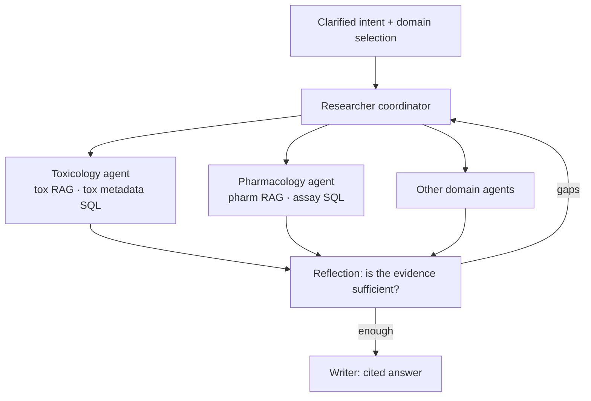

# 8b — Routing, sub-agents and evaluation in the PRINCE stack

> Two pipelines need a coordinator. The coordinator is a retriever over route descriptions, and it fails the way retrievers do.

A Tallybook customer writes, "my client says the bill never arrived." It is a delivery problem, and the help article on email delivery answers it. The router sends it to SQL instead, because the description of the SQL route mentions customers and invoices. Nothing downstream can recover: the SQL tool writes a query, finds some invoices and reports them. The pipelines in [08](08-agentic-rag-prince.md) each worked, and the question still went to the wrong one.

[08](08-agentic-rag-prince.md) built PRINCE's two retrieval pipelines: clarification, ingestion, the query-time funnel and Text-to-SQL. This part covers what sits around them. It starts with the router that picks a pipeline, then the domain sub-agents PRINCE added as its tool list grew, the context each agent receives, the NER pass that repairs the metadata both pipelines filter on, and how the stack is evaluated. It ends with when the whole agentic design is worth it.

---

## Routing

The general shape: a retrieval layer that spans structured and unstructured data needs a **router**, not a single index. Choosing *which* retrieval mechanism to use is a decision made before any retrieval happens.

Raieli and Iuculano list five kinds of router (*Building AI Agents*, ch. 6):

| Router | Decides by | Trade-off |
|---|---|---|
| Logical | Hand-written rules on the query or user | Predictable; brittle as queries vary |
| Keyword | Matching terms to sources | Cheap; misses paraphrase |
| Zero-shot classifier | A classifier over source labels | No training data; fixed label set |
| Function calling | The LLM picks a tool or source | Flexible; one LLM call per query |
| Semantic | [Cosine similarity](../../01-llm-fundamentals/notes/01-tokens-and-embeddings.md#vectors-dot-products-and-cosine-similarity) between the query and a description of each route | Fast after setup; needs good route descriptions |

Their banking and insurance example shows routing doing a second job. Sending a customer's question only to the indexes that customer may see is an access-control decision as well as a relevance one.

LangChain implements the last two (*Learning LangChain*, ch. 3). The *logical* version uses structured output: the model must return one of a `Literal["python_docs", "js_docs"]` set, and code maps that label to a retriever. The *semantic* version embeds one prompt template per route and picks the template closest to the query:

```python
import numpy as np
from ragkit import embed

ROUTES = {"sql": "how many count total sum average invoices overdue paid amount per month customer",
          "docs": "how do I change settings reset password export error problem cancel refund policy",
          "ask": "it does not work help hello thanks"}
names = list(ROUTES)
route_vecs = embed([ROUTES[n] for n in names])       # once, at startup


def route(query: str) -> tuple[str, float]:
    scores = route_vecs @ embed([query])[0]           # argmax similarity
    return names[int(scores.argmax())], float(scores.max())


for q in ["how many invoices are overdue", "total billed per customer",
          "reset my password", "can I get my money back", "my client says the bill never arrived"]:
    print(f"{q:42s} %s %.2f" % route(q))
```

```text
how many invoices are overdue              sql 0.69
total billed per customer                  sql 0.60
reset my password                          docs 0.32
can I get my money back                    docs 0.37
my client says the bill never arrived      sql 0.46
```

The book's logical router matches the returned label by lowercase substring (`"python_docs" in result.datasource.lower()`). That's fine for two labels; validate against the exact set once routes multiply. The book's code imports `langchain_core.pydantic_v1`, a shim deprecated since LangChain 0.3; use plain Pydantic v2 models.

Look at the last line. "My client says the bill never arrived" is a support question, and it went to SQL because the description of the SQL route contains "customer" and "invoices". A route description is a document in a very small index, and it fails the way documents do. Before you trust it, score it on labelled queries the way [note 03](03-keyword-semantic-and-hybrid-search.md) scores retrieval: a wrong route is a recall of zero, and nothing downstream can repair it. PRINCE's domain sub-agents below are what routing becomes once the routes outnumber what one prompt can hold.

Baidu's TURA measured what fixes a description-based router once the routes are tools. It treats 61 MCP servers, web search among them, as documents. **Embedding about 20 synthetic queries per server beside its description, and splitting multi-intent queries before retrieval, raised Recall@5 from 0.42 to 0.83** over plain dense retrieval (ERNIE, Qwen3-1.7B decomposer, 10,683 logged queries). Without the split, recall was 0.45, so most of the gain comes from decomposition. Independent sub-tasks then run as a DAG, the parallel planning LLMCompiler introduced (Kim et al., ICML 2024). That cut latency from 1,650 to 920 ms on the multi-hop subset, but only 5% of queries had more than one intent. A distilled Qwen3-4B executor called tools correctly 88.3% of the time at 750 ms P80 per step, against 82.4% at 8,700 ms for its DeepSeek-V3 teacher. The baselines are the authors' own, judging mixes humans and LLMs, the online test used 103 queries with no significance test despite claiming one, and no end-to-end latency or cost is given ([arXiv:2508.04604](https://arxiv.org/abs/2508.04604), Zhao et al., 2025-08, v2 2026-03, preprint).

---

## From one researcher to domain sub-agents

PRINCE began with two tools: one RAG retriever, one Text-to-SQL. As domains were onboarded, the tool list
grew and tools began to overlap: many operate on "studies", "findings" or "assays" but point at different
datasets, schemas and regulatory meanings. "The study" can mean a repeat-dose toxicology study, a
cardiovascular safety-pharmacology package or one assay in an aggregated table.

Two fixes, in order:

1. **A Think & Plan step** before tool calls. Reasoning explicitly about which tool matches the intent gave
   a large jump in tool-selection accuracy. (The harness view of this step is process reflection; see
   [03-harness-engineering note 05](../../../ai-engineering/03-harness-engineering/notes/05-verification-loops.md).)
2. **A hierarchy of domain sub-agents** (in progress). The top-level Researcher becomes a coordinator. It
   routes on the clarified intent and the UI's domain selection. Each domain agent owns its toolset (for
   example tox RAG + tox metadata SQL, or pharmacology RAG + assay-level SQL). It also has prompts that say
   which tables or indices are authoritative and how to read key terms. The aim is coherent
   responsibilities, no cross-domain leakage and per-domain retrieval tests.


*Image Source: diagram based on Kulkarni (2026)*

---

## Context discipline across the agents

Each agent gets the context for its job and nothing else:

| Agent | Receives | Not |
|---|---|---|
| Think & Plan | Planning context: the goal, progress, available tools | (not specified) |
| Researcher / Text-to-SQL | Only the schema slice relevant to this query | The full schema |
| Reflection | Original question + collected evidence | The full workflow history |
| Writer | Curated chunks with citation constraints | Raw retrieval output |

Splitting the monolithic agent this way also made each part testable and debuggable on its own.

Search-o1 measures the writer's row: QwQ-32B-Preview searches Bing mid-reasoning, and a separate pass by the same model condenses the ten results before they enter the chain. On-demand search beat one-shot RAG by 23.2% relative exact match on four multi-hop QA sets; single-hop did not move. Condensing took HotpotQA from 43.0 to 45.2, and on LiveCodeBench raw retrieval cut 33.0 to 24.1 while the condensed version held 33.0. No training, temperature 0.7, no variance or cost reported ([arXiv:2501.05366](https://arxiv.org/abs/2501.05366), Li et al., 2025-01, preprint).

---

## NER to repair the metadata

Text-to-SQL is only as good as the Athena metadata. Decades of migrations and differing lab practices left
fields incomplete, missing or wrong. PRINCE adds an NER utility:

1. Read study PDFs and extract entities: study IDs, compounds, species, routes of administration, dosage,
   clinical findings.
2. Turn the entities and their relations into structured annotations.
3. Score each extracted field for confidence. **High-confidence fields update Athena automatically. Low
   confidence goes to a quarantine queue for human review.**

It has been evaluated against curated datasets with promising results and is being wired into the data
pipelines. Better metadata improves both Text-to-SQL and the chunk-level filters in RAG.

The confidence gate is the part worth copying, and it needs no model to demonstrate. Here a regular expression stands in for the extractor, and agreement between pages stands in for its confidence score.

```python
import re
from collections import Counter

REPORT_PAGES = ["Study T123456-2. Species: rat. Route: oral gavage.",
                "Dosing in the rat cohort, study T123456-2, route: oral gavage.",
                "Appendix: rat and mouse reference ranges. Route: intravenous."]
PATTERNS = {"study_id": r"\bT\d{6}-\d\b", "species": r"\b(rat|mouse|dog)\b",
            "route": r"[Rr]oute: ([a-z ]+)\."}
AUTO_UPDATE = 0.9
athena, quarantine = {}, []

for field, pattern in PATTERNS.items():
    found = Counter(v for page in REPORT_PAGES for v in re.findall(pattern, page))
    value, count = found.most_common(1)[0]
    confidence = count / sum(found.values())
    target = athena if confidence >= AUTO_UPDATE else quarantine
    if target is athena:
        athena[field] = value
    else:
        quarantine.append((field, dict(found)))
    print(f"{field:9s} {value:12s} confidence {confidence:.2f}")

print("auto-updated:", athena)
print("for review:  ", quarantine)
```

```text
study_id  T123456-2    confidence 1.00
species   rat          confidence 0.75
route     oral gavage  confidence 0.67
auto-updated: {'study_id': 'T123456-2'}
for review:   [('species', {'rat': 3, 'mouse': 1}), ('route', {'oral gavage': 2, 'intravenous': 1})]
```

The study ID is unanimous and goes straight in. The species and the route disagree across pages, and a person sees them with the competing values. The cost of that lane is reviewer time, and the benefit is that a wrong value never reaches the filter, where it would silently hide every chunk of the study.

---

## Evaluating the retrieval stack

- **Dataset evals** run on every significant change to the workflow, prompts or models. They use reference
  answers written by subject-matter experts and stored in Langfuse. Metrics: faithfulness, answer
  relevancy, context relevancy, answer accuracy, and semantic similarity to the reference.
- **Live-traffic evals** run daily as a batch on real queries without references, covering faithfulness
  and answer relevancy. They catch hallucinations in production.
- **Per-stage metrics**, like a testing pyramid: retrieval quality is measured separately from the final
  answer.

The per-stage idea is easy to state and easy to skip, so here it is on the running example. One labelled set scores each stage's output, and the stage where the number drops is where the work goes. The code scores the hybrid retriever alone, then the same retriever behind a filter extractor that is wrong on every second query.

```python
from ragkit import DOC_BY_ID, QUERIES, Retriever, evaluate

r = Retriever()


def filter_wrong_half_the_time(query: str, k: int = 3) -> list[str]:
    # Keeps the labelled document's area on even positions, every other area on odd ones.
    labelled = next(ids for q, ids, _ in QUERIES if q == query)
    position = [q for q, _, _ in QUERIES].index(query)
    area = DOC_BY_ID[next(iter(labelled))].area
    return [d for d in r.hybrid(query, k=18, pool=18)
            if (DOC_BY_ID[d].area == area) == (position % 2 == 0)][:k]


print("retriever alone:", evaluate(r.hybrid))
print("with bad filter:", evaluate(filter_wrong_half_the_time))
```

```text
retriever alone: {'recall@3': 0.95, 'mrr': 0.7416666666666666, 'ndcg@3': 0.7892789260714373}
with bad filter: {'recall@3': 0.5, 'mrr': 0.45, 'ndcg@3': 0.4630929753571458}
```

Recall falls from 0.95 to 0.50 because half the queries now cannot succeed. An answer-level score would say only that the bot got worse. Measured stage by stage, the drop sits at the filter. PRINCE's split between retrieval metrics and answer metrics exists to shorten that hunt.

---

## When agentic RAG pays

| Use agentic RAG when | Avoid it when |
|---|---|
| Questions need multi-step reasoning | One-shot retrieval works fine |
| Several sources must be compared | Latency is critical |
| Accuracy matters more than speed | You can't afford complex operations |
| Provenance is non-negotiable | Your data quality is poor |
| Human-level analysis is expected | |

The field survey agrees: not the default, no cure for poor retrieval, and corrective and hierarchical designs pay in latency ([arXiv:2501.09136](https://arxiv.org/abs/2501.09136), Singh et al., 2025-01, preprint).

**Before shipping**, check: multiple retrieval strategies are implemented; the planner is separate from the generator; a validation step exists; every claim has traceable evidence; tool use is rate-limited; human override paths exist; metrics go beyond answer quality. Skip one and pause.

**What to measure** beyond answer quality: retrieval precision, evidence coverage per answer, self-correction rate, human override frequency, and *time-to-trust* (how quickly reviewers approve). These predict real-world reliability.

The direction of travel is multi-agent collaboration, better self-verification, and personalisation with guardrails. The catch: agentic RAG doesn't make a system smarter; it makes good systems better and bad ones dangerous. *Retrieval without judgment is noise; judgment without evidence is hallucination.*

---

## Takeaways

- A router is a retriever over route descriptions. Score it on labelled queries before trusting it.
- As tools multiply, add an explicit planning step, then split by domain.
- Give each agent only the context its job needs: the schema slice, the evidence, the curated chunks.
- Fix upstream data quality with confidence-gated automation and a human quarantine lane.
- Measure each stage on its own labelled set, so a drop points at the stage that caused it.

---

## Pitfalls

- **Tool lists that overlap.** Symptom: tool-selection accuracy falls as domains are added. Add a planning step, then split by domain.
- **Splitting k evenly across collections.** Symptom: a developer question gets one developer chunk and two irrelevant ones. Route first.
- **Route descriptions written once and never tested.** Symptom: support questions land in SQL because a description shares words like "customer" or "invoices". Treat the descriptions as a tiny index and score them on labelled queries, as TURA did with synthetic queries per route.
- **Lowering the confidence gate to clear the review queue.** Symptom: the quarantine lane empties and filters start hiding whole studies. A wrong metadata value is silent; the gate exists to keep it out.
- **Scoring only the final answer.** Symptom: quality drops and nobody can say which stage moved. Score retrieval, filtering and the answer separately on the same labelled set.

---

## Try it

1. Add the query `"how many refunds did we pay last year"` to the router block. Which route does it take, given that "refund" appears only in the description of the docs route?
2. In the NER block, set `AUTO_UPDATE = 0.7`. Which fields now update Athena automatically, and was that a safe change?
3. Put the gate back at 0.9 and delete the appendix page from `REPORT_PAGES`. What happens to the confidence scores, and what does that say about agreement between pages as a confidence measure?

<details>
<summary>Answers</summary>

1. `sql`, at 0.54 against 0.12 for `docs`. "How many" and "pay" are in the SQL description, and that outweighs "refund". That is the right call for this question, but the numbers come from the toy embedder. Test your own router on labelled queries.
2. `study_id` and `species` (0.75) go in; `route` (0.67) stays in review. Species happens to be right, because the mouse mention is an appendix reference range. The gate did not know that, though. It only saw three pages agreeing out of four, and at 0.7 the next 3-to-1 split goes in unreviewed whichever side is wrong.
3. Every field scores 1.00 and all three update Athena. Two agreeing pages look as certain as twenty. Agreement as a ratio ignores how much evidence there is, so a real gate also needs a minimum count, or the extractor's own score.

</details>

---

## Interview checklist

| Question | Answer |
|---|---|
| Name five kinds of router. | Logical, keyword, zero-shot classifier, function calling, semantic. |
| What happens as tools multiply? | They overlap and selection accuracy falls. PRINCE added Think & Plan, then domain sub-agents with their own tools and prompts. |
| How does PRINCE repair metadata safely? | NER with a per-field confidence score: high confidence updates Athena, low confidence goes to a human quarantine queue. |
| What runs daily without references? | Live-traffic evals for faithfulness and answer relevancy. Reference-based dataset evals run on every significant change. |
| When should you avoid agentic RAG? | When one-shot retrieval works, latency is critical, operations are thin, or data quality is poor. |
| Why is a semantic router a retrieval problem? | It embeds route descriptions and picks the nearest, so it misroutes the way a retriever misranks. Score it on labelled queries; TURA lifted Recall@5 from 0.42 to 0.83 by embedding synthetic queries per route and splitting multi-intent queries. |
| What context does each PRINCE agent get? | Think & Plan gets the goal, progress and tools; the Text-to-SQL researcher gets only the relevant schema slice; reflection gets the question and evidence; the writer gets curated chunks with citation constraints. |

---

## Next

[09 — Vector database comparison](09-vector-database-comparison.md): the vector stores behind both pipelines, and how to choose one.
