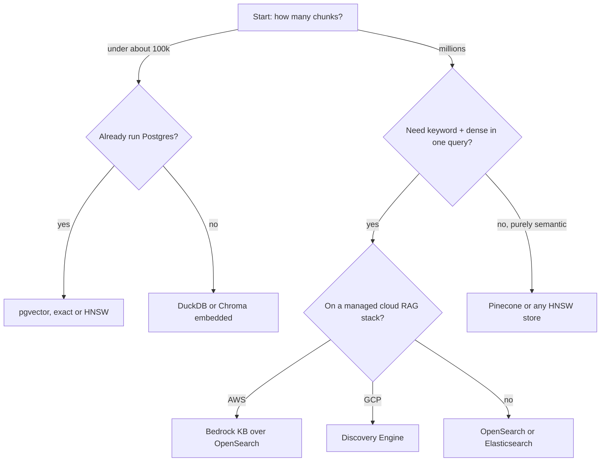

# 9 — Vector databases: reference and trade-offs

> Which vector store to use (OpenSearch, DuckDB, Chroma, pgvector, Pinecone, Discovery Engine), what each costs in features, and HNSW vs ANNOY for the index.

Tallybook has 18 help articles and a Postgres database. A vendor comparison tells the team to buy a dedicated vector database with a distributed HNSW cluster, and they spend a month running it for a corpus that a `for` loop could scan in under a millisecond. A year later another team makes the opposite mistake: their corpus has grown to 30 million chunks, their embedder has moved to 3,072 dimensions, and the Postgres index they relied on will not build at all. Both teams chose a store by reputation, before they had asked three questions: how many vectors, how many dimensions, and does the query need keywords.

This note is the reference for answering them. It compares the stores that appear in our support-agent codebase or are realistic migration targets, then tests the claims that matter on the running example. The comparison is a snapshot and vendors move fast. While writing this note, two entries in our old project table turned out to be out of date, and they are corrected below. Check a vendor's current documentation before you commit.


*Image Source: Author. The 100k line is a rule of thumb from the scan timings below, not a limit in any product.*

---

## What we currently use

| Store | Where | Mode |
|---|---|---|
| OpenSearch | Bedrock KB (the eval platform SupportAgent) | Managed — Bedrock owns the index |
| DuckDB | kb_rag default vector backend | Embedded, self-managed, no server |
| ChromaDB | kb_rag optional backend (`chroma` extra) | Embedded, persistent HNSW |
| pgvector | chat-agent local/dev | Self-managed PostgreSQL extension |
| GCP Discovery Engine | chat-agent production | Fully managed — GCP owns everything |

---

## Side-by-side comparison

| | DuckDB + VSS | ChromaDB | pgvector | OpenSearch | Elasticsearch | Pinecone | Bedrock KB |
|---|---|---|---|---|---|---|---|
| **Type** | Embedded / in-process | Embedded / client-server | PostgreSQL extension | Dedicated search engine | Dedicated search engine | Managed vector DB | Managed RAG service |
| **Hosting** | Embedded / file | Embedded or cloud | Self-hosted or RDS/Supabase | Self-hosted or AWS AOSS | Self-hosted or Elastic Cloud | SaaS only | AWS managed |
| **Hybrid search** | Dense via `vss`; BM25 via `fts`, fused by you | Dense only | Manual (dense + BM25 plugin) | Native HNSW + BM25 | Native HNSW + BM25 | Dense + sparse vectors you supply, or client-side fusion | Native hybrid (Bedrock default) |
| **Max index dim** | No limit (exact) | No limit | 2,000 `vector`, 4,000 `halfvec` (HNSW and IVFFlat); 16,000 unindexed | 16k (HNSW) | 4096 (ANN) | 20k | Managed |
| **ANN algorithm** | Flat (exact) or HNSW | HNSW (cosine) | HNSW / IVFFlat | HNSW | HNSW | HNSW + proprietary | Managed |
| **Reranking** | Manual | Manual | Manual (cross-encoder) | Manual | Manual | Via Cohere plugin | `amazon.rerank-v1:0` built-in |
| **Metadata filtering** | SQL WHERE | `where={}` dict | SQL WHERE | Query DSL | Query DSL | Filter expressions | Inline filter |
| **Operational overhead** | Zero | Zero | Low (rides your DB) | High | High | Zero | Zero |
| **Cost model** | Free | Free / Chroma Cloud | Storage + compute (shared) | Cluster cost | Cluster cost | Per-vector + per-query | Per-query + storage |
| **Streaming ingest** | COPY or INSERT | `upsert()` | psycopg batch insert | Bulk API | Bulk API | upsert API | Data source sync |

The "Hybrid search" row means what you get from one query with no extra work. Reading it as "cannot do hybrid" is a mistake: you can always run two searches and fuse them with RRF, as in the DuckDB example below. Pinecone's row is a correction to our earlier note: its [hybrid search guide](https://docs.pinecone.io/guides/search/hybrid-search) describes dense and sparse vectors in one index, separate indexes, and client-side fusion.

---

## How far exact search goes

Before picking an index, find out whether you need one. An exact scan has perfect recall, no build step and no parameters. It costs time proportional to the number of vectors times the number of dimensions, and the memory is easy to compute: 4 bytes per float.

```python
import time

import numpy as np

rng = np.random.default_rng(0)
print(f"{'vectors':>9} {'dim':>5} {'GB':>6} {'ms/query':>9}")
for n, dim in [(10_000, 384), (50_000, 384), (200_000, 384), (50_000, 1024), (50_000, 3072)]:
    docs = rng.normal(size=(n, dim)).astype("float32")
    docs /= np.linalg.norm(docs, axis=1, keepdims=True)
    query = docs[0]
    start = time.perf_counter()
    for _ in range(5):
        np.argpartition(-(docs @ query), 5)[:5]
    ms = (time.perf_counter() - start) / 5 * 1000
    print(f"{n:>9,} {dim:>5} {n * dim * 4 / 1e9:>6.2f} {ms:>9.1f}")
```

```text
  vectors   dim     GB  ms/query
   10,000   384   0.02       0.1
   50,000   384   0.08       0.9
  200,000   384   0.31       3.9
   50,000  1024   0.20       2.0
   50,000  3072   0.61       3.7
```

These are laptop timings on random vectors with NumPy's default threading, so read the shape and not the digits. Time grows with both axes. A corpus under about 100k chunks at a few hundred dimensions answers in single-digit or low double-digit milliseconds, which is small next to a model call that takes seconds. That is why our project's DuckDB backend stays on exact search below 50k chunks. Concurrency is what this table hides: a scan holds a core for its whole duration, so ten simultaneous queries are ten scans.

---

## When to use which

### pgvector
Best for: dev environments, prototypes, teams already running Postgres.

Constraints in chat-agent:
- Gemini `gemini-embedding-2-preview` outputs 3072 dims → exceeds the 2,000-dim index limit of pgvector's `vector` type → **exact search only** with the column type we use. This is fine at our dataset size but won't scale to millions of docs. The [pgvector README](https://github.com/pgvector/pgvector) lists `halfvec` at up to 4,000 indexed dimensions, so a half-precision column is the way out if we ever need an index at 3072.
- Cosine similarity via `<=>` operator.
- No sparse/BM25 hybrid without a separate plugin (pg_bm25 / ParadeDB).

```sql
-- chat-agent pattern: cosine similarity query
SELECT text, metadata, 1 - (embedding <=> %s::vector) AS score
FROM documents
ORDER BY embedding <=> %s::vector
LIMIT %s
```

### OpenSearch (Bedrock KB)
Best for: AWS-native production, multilingual corpora, hybrid search without extra infrastructure.

How Bedrock uses it:
- Two-level hierarchical chunking: leaf chunk (`AMAZON_BEDROCK_TEXT_CHUNK`) + parent context window (`AMAZON_BEDROCK_TEXT`).
- `HYBRID` search mode hardcoded — dense (HNSW) + sparse (BM25) combined automatically.
- `amazon.rerank-v1:0` ARN reranker available as a second pass.
- Vector field: `bedrock-knowledge-base-default-vector`.
- Raw `_score` is NOT exposed by the Bedrock KB API (always returns 0.0 via API; only visible in OpenSearch dashboard).

See [12 — Managed RAG](12-managed-rag.md#bedrock-knowledge-bases) for full field mapping, retrieval modes, and env vars.

### Elasticsearch
Comparable to OpenSearch (shared lineage). Prefer when:
- Already running Elastic Cloud / on-prem ES cluster.
- Need Elastic's ML node ecosystem (ELSER sparse encoder for better hybrid).
- Cross-language relevance tuning matters.

Diverges from OpenSearch post-v7.10 (license split). API-compatible for basic queries; Elastic-specific features (ELSER, Elastic Learned Sparse EncodeR) don't port directly.

### Pinecone
Best for: vector similarity with no operational burden. Our project ruled it out when we read it as dense only, because keyword precision matters in a multilingual support KB (product names, billing codes). That reading is out of date: the [hybrid search guide](https://docs.pinecone.io/guides/search/hybrid-search) covers dense and sparse vectors in one index, or separate indexes merged on the client. The sparse vectors and the balance between the two signals are yours to produce and tune, which BM25 in OpenSearch does not ask of you. The remaining reasons not to choose it are SaaS-only hosting and per-vector pricing.

### DuckDB
Two roles in our codebase:

**kb_rag production backend (default):** `VECTOR_STORE_BACKEND=duckdb` — the `DuckDBVectorIndex` in `rag/datastore/local.py` stores embeddings in a `.duckdb` file and does exact cosine search. No server, no infra. Ships as a core dep in the kb_rag `pyproject.toml` (`duckdb>=1.0`).

```bash
VECTOR_STORE_BACKEND=duckdb VECTORDB_PATH=data/corpus/v1/knowledge.duckdb uv run uvicorn main:app
```

**Eval / analysis backend:** DuckDB's `vss` extension adds HNSW for offline retrieval sweeps without spinning up a server.

```sql
INSTALL vss; LOAD vss;
CREATE TABLE docs AS SELECT * FROM read_parquet('chunks.parquet');
ALTER TABLE docs ADD COLUMN embedding FLOAT[3072];
CREATE INDEX ON docs USING HNSW (embedding);
SELECT * FROM docs ORDER BY array_distance(embedding, ?::FLOAT[3072]) LIMIT 5;
```

Limitation: the `vss` extension is dense only. For keyword-heavy queries (Danish product names, billing codes) our retrieval quality was lower than OpenSearch hybrid, which is what you get if you stop there. DuckDB's separate `fts` extension adds BM25, and the two lists fuse in a few lines, so the gap is one of effort and not capability.

Here is the whole thing on Tallybook: exact cosine with a SQL `WHERE`, BM25 from `fts`, and RRF. It needs network access once, for `INSTALL fts`.

```python
import duckdb
from ragkit import DOCS, embed, rrf

con = duckdb.connect()
con.execute("CREATE TABLE docs (id TEXT, area TEXT, audience TEXT, text TEXT, embedding FLOAT[128])")
vectors = embed([d.full for d in DOCS]).tolist()
con.executemany("INSERT INTO docs VALUES (?, ?, ?, ?, ?)",
                [(d.id, d.area, d.audience, d.full, v) for d, v in zip(DOCS, vectors)])
con.execute("INSTALL fts; LOAD fts;")
con.execute("PRAGMA create_fts_index('docs', 'id', 'text')")


def dense(query: str, k: int = 5) -> list[str]:
    vec = embed([query])[0].tolist()
    return [row[0] for row in con.execute(
        """SELECT id FROM docs WHERE audience = 'public'
           ORDER BY array_cosine_similarity(embedding, ?::FLOAT[128]) DESC LIMIT ?""",
        [vec, k]).fetchall()]


def keyword(query: str, k: int = 5) -> list[str]:
    return [row[0] for row in con.execute(
        """SELECT id FROM (SELECT id, audience, fts_main_docs.match_bm25(id, ?) AS score FROM docs)
           WHERE score IS NOT NULL AND audience = 'public' ORDER BY score DESC LIMIT ?""",
        [query, k]).fetchall()]


for q in ["what does BANK-112 mean", "can I get my money back"]:
    print(q)
    print("  dense  ", dense(q, 3))
    print("  keyword", keyword(q, 3))
    print("  hybrid ", rrf([dense(q), keyword(q)])[:3])
```

```text
what does BANK-112 mean
  dense   ['kb-13', 'kb-11', 'kb-06']
  keyword ['kb-13']
  hybrid  ['kb-13', 'kb-11', 'kb-06']
can I get my money back
  dense   ['kb-04', 'kb-05', 'kb-06']
  keyword ['kb-03']
  hybrid  ['kb-03', 'kb-04', 'kb-05']
```

Two things to read in the output. On the error code, BM25 returns the one document that holds it and nothing else, which is why you keep a keyword path. On the refund question, BM25 has only the word "back" to go on, so it returns kb-03 for "Back off for that long". RRF then scores kb-03 and kb-04 equally, because each is first in one list and absent or lower in the other, and the tie falls the wrong way. Fusion is not magic: a weak keyword match with one hit counts as much as a strong semantic one. A reranker or a stricter keyword query fixes this.

Keep the permissions predicate in both queries, as [note 07](07-rag-in-production.md#permissions-belong-in-retrieval) argues. The internal runbook kb-18 never appears here, and it would have appeared for the refund question without that `WHERE`.

### ChromaDB
Optional backend in kb_rag (`pip install chromadb` or `uv sync --extra chroma`). `ChromaVectorIndex` in `rag/datastore/local.py` uses `PersistentClient` with HNSW cosine distance.

```bash
VECTOR_STORE_BACKEND=chroma VECTOR_STORE_DIR=data/corpus/chroma uv run uvicorn main:app
```

When to prefer over DuckDB: when you want persistent HNSW (approximate search at larger corpus sizes) or plan to use the Chroma Cloud managed tier later. For our current corpus size (< 50k chunks), DuckDB exact search is fast enough and simpler.

**Not installed in the main the eval platform venv.** Tests that exercise ChromaDB use `pytest.importorskip("chromadb")` and run only under `make test-agents` with the kb_rag extras venv.

### GCP Discovery Engine (Vertex AI Search)
Best for: fully managed RAG on GCP — no index to manage, no reranker to wire up.

Two modes we use in chat-agent:

| Mode | Client class | Who generates the answer |
|---|---|---|
| Agentic RAG | `GcpAgentSearchClient` | Gemini ADK agentic loop (grade + rewrite) |
| Built-in answer | `GcpAnswerSearchClient` | GCP Discovery Engine (black box) |

See [12 — Managed RAG](12-managed-rag.md#vertex-vs-bedrock) for a detailed head-to-head comparison.

---

## Embedding model ↔ dimension ↔ store compatibility

| Embedding model | Dim | pgvector HNSW? | Notes |
|---|---|---|---|
| `gemini-embedding-2-preview` | 3072 | No with `vector` (over 2,000); yes with `halfvec` | Exact search only in our `vector` setup |
| `amazon.titan-embed-text-v2:0` | 1024 | Yes | Used by Bedrock KB |
| `text-embedding-3-large` (OpenAI) | 3072 / 256 (MRL) | Yes at 256 | Matryoshka allows dimension reduction |
| `text-embedding-004` (Google) | 768 | Yes | Cheaper, fits HNSW |

**The dimension limit applies to the index and not to the column.** The [pgvector README](https://github.com/pgvector/pgvector) gives HNSW and IVFFlat the same ceilings: 2,000 for `vector` and 4,000 for `halfvec`. A column can hold 16,000. Our old note said IVFFlat had no hard limit, which was wrong. Exact search (no index) works at any dimension, and the only trade-off is the O(n) scan cost measured above.

The choice has a storage side as well. `halfvec` stores 2 bytes per dimension instead of 4, at a cost in precision, which is the same trade as the int8 quantization in [note 07](07-rag-in-production.md). Changing the embedder means re-embedding the corpus, so this table is worth reading before the first ingest and not after.

---

## ANN index types: HNSW vs. ANNOY

The approximate-nearest-neighbour index decides how the store behaves when the corpus changes (Li, *AI Agents in Depth*, ch. 3):

| Index | Structure | Inserts | Memory | Recall | Suits |
|---|---|---|---|---|---|
| **HNSW** | Layered proximity graph | Incremental | Higher | Very high | Live corpora that change often |
| **ANNOY** | Forest of random-projection trees | **Full rebuild** on change | Low | Good | Static corpora; fast build |

The insert behaviour is also a governance point: expiring a superseded document in an ANNOY index means rebuilding it, so stale content lingers until the next rebuild ([02-context 04 — context validation](../../../ai-engineering/02-context-engineering/notes/04-retrieval.md#context-validation)). Lab: upstream [3-4 dense-embedding](https://github.com/bojieli/ai-agent-book/tree/main/chapter3/dense-embedding) benchmarks both.

The insert row is what bites in production, so here is what it costs. A graph takes new points where they are; a forest of trees built over a fixed set has to be built again. The code times both routes on 50,000 synthetic vectors, using the full HNSW rebuild as the price of any index that cannot take inserts.

```python
import time

import faiss
import numpy as np

faiss.omp_set_num_threads(1)
rng = np.random.default_rng(0)
centres = rng.normal(size=(100, 128))
vectors = centres[rng.integers(100, size=51_000)] + 0.7 * rng.normal(size=(51_000, 128))
vectors = (vectors / np.linalg.norm(vectors, axis=1, keepdims=True)).astype("float32")
docs, fresh = vectors[:50_000], vectors[50_000:]

index = faiss.IndexHNSWFlat(128, 16, faiss.METRIC_INNER_PRODUCT)
start = time.perf_counter()
index.add(docs)
print(f"build 50,000:           {time.perf_counter() - start:6.2f}s")

start = time.perf_counter()
index.add(fresh)
print(f"insert 1,000 more:      {time.perf_counter() - start:6.2f}s")

start = time.perf_counter()
rebuilt = faiss.IndexHNSWFlat(128, 16, faiss.METRIC_INNER_PRODUCT)
rebuilt.add(vectors)
print(f"rebuild 51,000 instead: {time.perf_counter() - start:6.2f}s")

ids = index.search(fresh[:100], 1)[1][:, 0]
print("new items found as their own nearest neighbour:", int((ids == np.arange(50_000, 50_100)).sum()), "of 100")
```

```text
build 50,000:             1.01s
insert 1,000 more:        0.03s
rebuild 51,000 instead:   1.03s
new items found as their own nearest neighbour: 98 of 100
```

The gap grows with the corpus, and the rebuild is the mild case: it also means holding two indexes during the swap. I tried to measure Annoy directly and could not. The wheels installed by `uv` on this Apple Silicon machine, under Python 3.11 and 3.13, returned a single wrong neighbour for every query, so the comparison above leaves it out and the table rests on Li's account. If you plan to use Annoy, sanity-check nearest neighbours on your own platform first; the upstream lab above is the place to start.

---

## Retrieval quality levers (apply to any store)

1. **Hybrid search** — combine dense (semantic) + sparse (BM25/ELSER) scores. Bedrock does this automatically; pgvector requires ParadeDB or a separate BM25 index.
2. **Reranking** — cross-encoder as a second pass over top-k candidates. Bedrock: `amazon.rerank-v1:0`. Elsewhere: Cohere Rerank, Jina Reranker, BGE-Reranker.
3. **Multi-query** — fire 2–3 reformulated queries in parallel, deduplicate by URL fingerprint. Used in the eval platform kb_lg and chat-agent. See [12](12-managed-rag.md).
4. **Parent-child chunking** — retrieve at leaf granularity, send parent context to LLM. Bedrock's native hierarchy maps to our `level=0` / `level=1` in `ChunkRecord`.
5. **CRAG (Corrective RAG)** — grade retrieved docs, rewrite query if below threshold, retry. Used in kb_lg and chat-agent agentic pipeline.

---

## Migration notes

**pgvector → OpenSearch**: straightforward if you're already on AWS. Main work is ingestion pipeline + adding BM25 hybrid config. Reranker is a one-line config change in Bedrock.

**OpenSearch (Bedrock) → pgvector**: lose hybrid search and managed reranking. Not recommended for production unless you add ParadeDB + a cross-encoder.

**pgvector → Pinecone**: gain SaaS zero-ops. Keyword search moves from a Postgres plugin to sparse vectors you generate, or to client-side fusion with a separate keyword index. The old rule here said "only if queries are purely semantic and the corpus is English", which was written when we read Pinecone as dense only. Evaluate the sparse path on your multilingual queries before moving.

**Any → GCP Discovery Engine**: only viable if your stack is already GCP-native. Retrieval is a black box — you lose visibility into score calibration, chunk boundaries, and reranker behaviour. Suitable when you want GCP to own the full RAG loop (as in chat-agent's `:answer` backend).

---

## Pitfalls

- **Choosing by reputation.** Symptom: a cluster to operate for a corpus that fits in memory. Time an exact scan first.
- **Discovering the dimension limit at index build.** Symptom: `CREATE INDEX` fails on Postgres after you have embedded everything. Check the embedder's dimension against the store before the first ingest.
- **Reading "dense only" as a dead end.** Symptom: a migration to get hybrid search that two queries and RRF would have given you. Fuse in the application first.
- **Mixing embedders in one index.** Symptom: quality drops after a model upgrade, with no errors. Vectors from two models are not comparable, so keep a model version on each record and re-embed.
- **Annoy on a changing corpus.** Symptom: new documents never appear and superseded ones stay. Plan a rebuild or use HNSW.
- **Comparing raw scores across stores.** Symptom: a threshold that worked on one store passes everything on another. Bedrock KB does not expose its raw `_score` at all, so plan around ranks.
- **Trusting a comparison table.** Symptom: a decision based on a vendor limit that has moved, as two rows here had. Read the current documentation for the two or three stores you shortlist.

---

## Try it

1. Add `(1_000_000, 384)` to the exact-scan loop and compute the memory by hand first. Is this still a good plan on an 8 GB laptop?
2. In the DuckDB block, remove the `audience` predicate from `dense` and rerun. Which results change?
3. Your embedder outputs 1,536 dimensions, you run Postgres, and you want ANN. What column type do you use, and what changes if you upgrade to a 3,072-dimension model?

<details>
<summary>Answers</summary>

1. 1,000,000 × 384 × 4 bytes is 1.54 GB, so it fits, and the scan should take about five times the 200,000 row, around 17 ms. It is a fine plan for one user and a poor one under load, because each query holds a core for that long.
2. The refund question now returns kb-18 in second place, the internal runbook, ahead of kb-05. That is the leak from [note 07](07-rag-in-production.md), and it takes one missing clause.
3. `vector` with HNSW, since 1,536 is under the 2,000 limit. At 3,072 you must move to `halfvec`, shorten the embedding if the model supports it, or search exactly, and you re-embed the corpus in any case.

</details>

---

## Interview checklist

| Question | Answer |
|---|---|
| What three questions pick a store? | How many vectors, how many dimensions, and does a query need keyword and dense together. |
| When is exact search enough? | When the scan is small next to the model call and concurrency is modest: on this machine, around 100k vectors at a few hundred dimensions. It also has perfect recall and no parameters. |
| What is pgvector's dimension limit? | HNSW and IVFFlat index up to 2,000 dimensions for `vector` and 4,000 for `halfvec`. A column can hold 16,000, searched exactly. |
| How do you get hybrid search on a dense-only store? | Run a separate keyword search and fuse the ranked lists with RRF in the application. |
| HNSW or Annoy for a live corpus? | HNSW, because it takes incremental inserts. Annoy needs a full rebuild, so stale content lingers until the next one. |
| When is OpenSearch or Elasticsearch worth the operations? | At scale, when one query must combine BM25, dense and metadata, or if you already run a cluster. |
| What does a managed service cost you? | Visibility: Discovery Engine is a black box, and Bedrock KB hides the raw score. You trade calibration and chunk control for zero operations. |
| What breaks when you change embedders? | Every vector. Old and new are not comparable, so the corpus must be re-embedded and the index rebuilt. |
| Name retrieval levers that apply to any store. | Hybrid search, reranking, multi-query, parent-child chunking, CRAG. |

---

## Next

[10 — Semantic cache](10-semantic-cache.md): skipping retrieval altogether when a query has been answered before.
