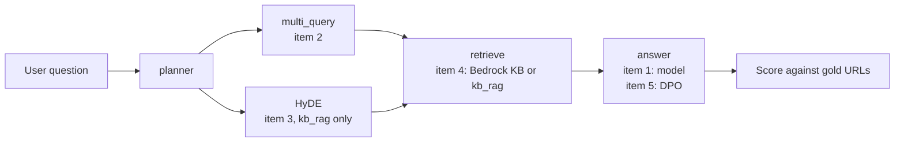

# 11 — Retrieval improvements: reading an ablation

Tallybook's support bot still gets refund questions wrong, and everyone on the team has a favourite fix: a newer model, multi-query, HyDE, a corrective loop, fine-tuning. An ablation is how you stop arguing. You change one thing at a time, score each configuration on the same labelled queries, and let the table choose. The catch is that a small eval set can only tell you about big differences, and most of the table is noise until you prove otherwise.

This chapter works through a real ablation from our support-agent project: five retrieval configurations scored on MRR, precision at 1 and latency, the conclusions we drew, and the shortlist of improvements that came out of it. The project's names are kept because they are what the numbers refer to: `kb_rag` is the deterministic pipeline, `kb_lg` the LangGraph agent with CRAG, `kb_adk` the Google ADK ReAct agent, and `va_staging` the existing staging system used as the benchmark. Each research item then gets a small experiment on Tallybook, so that you can see the mechanism run. Metric definitions are in [03](03-keyword-semantic-and-hybrid-search.md) and the wider evaluation discipline is in the [Eval pillar](../../08-eval/README.md).

Status when this was written: research, evaluating options after the first ablation run (2026-05-09). Items marked PLANNED or not measured below have not been run on the project, and their expected gains are estimates, not results.

## The baseline table

The eval had 44 tasks, of which 32 carried annotated gold URLs. MRR and P@1 are measured against those.

| Config | MRR | P@1 | Latency |
|--------|-----|-----|---------|
| va_staging benchmark | 0.625 | 0.625 | ~9.3s (smoke/10) |
| kb_adk + thinking1024 | 0.583 | 0.531 | 7.3s |
| kb_lg + CRAG | 0.547 | 0.531 | 7.7s |
| kb_lg no CRAG | 0.542 | 0.531 | 4.4s ← best latency/quality tradeoff |
| kb_adk baseline | 0.418 | 0.219 | 2.6s |

Gap to va_staging: **-0.042 MRR** (best local against the benchmark, on the smoke subset). The benchmark's latency comes from a ten-task smoke run, so treat that row as a rough target, not a like-for-like score.

### What we learned from the ablations

- **Thinking budget (+1024)**: a large gain for kb_adk (+0.165 MRR), but it hurts kb_lg when combined with CRAG. That is an interaction effect: thinking changes the citation style, which breaks CRAG's grading alignment.
- **CRAG**: +0.005 MRR against no CRAG, at a cost of +3.4s. The confidence gate (threshold 0.7) short-circuits most runs because Bedrock returns decent scores. Marginal value.
- **LLM planner**: -0.031 MRR against the regex router, and +4s latency. The regex is better for our edge-case vocabulary.
- **The va_staging advantage** has three plausible sources: (1) `gemini-3-flash-preview`, a newer model, (2) `ThinkingLevel.LOW` internally, and (3) multi-query retrieval before the KB call.

### How much of that is signal

Before believing any line above, ask how much a mean over 32 queries can move by chance. Reciprocal rank is a score between 0 and 1, and a bounded score has a standard deviation of at most 0.5, so the standard error of a mean over 32 queries is at most 0.088. The table also has a second reading. P@1 times 32 is a count of queries.

```python
import math

runs = {  # config: (MRR, P@1), scored on the 32 annotated queries
    "kb_adk + thinking1024": (0.583, 0.531),
    "kb_lg + CRAG": (0.547, 0.531),
    "kb_lg no CRAG": (0.542, 0.531),
    "kb_adk baseline": (0.418, 0.219),
}
n = 32
worst_se = 0.5 / math.sqrt(n)
print(f"worst-case standard error of one MRR: {worst_se:.3f}\n")
for name, (mrr, p1) in runs.items():
    print(f"{name:22s} MRR {mrr:.3f}  rank-1 hits {p1 * n:4.1f} of {n}")

print()
for label, delta in [("CRAG", 0.547 - 0.542), ("thinking on kb_adk", 0.583 - 0.418)]:
    print(f"{label:20s} delta {delta:+.3f} = {delta / worst_se:4.2f} worst-case SEs")
```

```text
worst-case standard error of one MRR: 0.088

kb_adk + thinking1024  MRR 0.583  rank-1 hits 17.0 of 32
kb_lg + CRAG           MRR 0.547  rank-1 hits 17.0 of 32
kb_lg no CRAG          MRR 0.542  rank-1 hits 17.0 of 32
kb_adk baseline        MRR 0.418  rank-1 hits  7.0 of 32

CRAG                 delta +0.005 = 0.06 worst-case SEs
thinking on kb_adk   delta +0.165 = 1.87 worst-case SEs
```

So CRAG's +0.005 is about 6% of one worst-case standard error, and the two kb_lg configurations put the same 17 queries' worth of answers at rank 1. "CRAG adds nothing measurable here" is the honest statement. It does not prove CRAG is useless on other corpora or with a stricter gate, and the 3.4 s it costs is measured, so the decision to drop it is easy. The thinking gain is a different size: ten extra queries at rank 1 and getting on for two worst-case errors.

This bound is pessimistic for comparisons, because the same queries go through both configurations and most of the per-query noise cancels. The tool that uses this is the paired bootstrap: compute the difference per query, resample queries, and look at the interval. Tallybook's practice kit has 20 labelled queries, so here are its real results for three real retrievers.

```python
import numpy as np
from ragkit import QUERIES, Retriever, reciprocal_rank

retriever = Retriever()


def per_query_rr(search):
    return np.array([reciprocal_rank(search(q, k=3), relevant) for q, relevant, _ in QUERIES])


def paired_bootstrap(a, b, rounds=10_000, seed=0):
    diff = a - b
    rng = np.random.default_rng(seed)
    means = diff[rng.integers(0, len(diff), (rounds, len(diff)))].mean(axis=1)
    return diff.mean(), *np.percentile(means, [2.5, 97.5])


bm25, dense, hybrid = (per_query_rr(s) for s in (retriever.sparse, retriever.dense, retriever.hybrid))
print(f"MRR: bm25 {bm25.mean():.3f}, dense {dense.mean():.3f}, hybrid {hybrid.mean():.3f}\n")
for name, a, b in [("dense - bm25", dense, bm25), ("hybrid - bm25", hybrid, bm25), ("dense - hybrid", dense, hybrid)]:
    delta, low, high = paired_bootstrap(a, b)
    print(f"{name:15s} {delta:+.3f}  95% interval [{low:+.3f}, {high:+.3f}]  "
          f"wins {(a > b).sum()}, losses {(a < b).sum()}, ties {(a == b).sum()}")
```

```text
MRR: bm25 0.550, dense 0.867, hybrid 0.733

dense - bm25    +0.317  95% interval [+0.042, +0.592]  wins 9, losses 3, ties 8
hybrid - bm25   +0.183  95% interval [+0.008, +0.367]  wins 8, losses 3, ties 9
dense - hybrid  +0.133  95% interval [-0.017, +0.292]  wins 6, losses 3, ties 11
```

These scores cut each ranking at 3, so they sit slightly below the kit's scoreboard. Read the last line. Dense beats hybrid by 0.133 MRR on these 20 queries, more than twenty times the CRAG delta, and the interval still crosses zero. Eleven of the twenty queries tie, and the difference is carried by the other nine. Keep this in mind as you read the expected gains below: an improvement of 0.05 on 32 queries needs a large change in a handful of queries, or a much larger eval set, before you can call it real.

## The research items

Each item below is one independent variable. The figure shows where each one enters the pipeline, which is also what you would toggle in an ablation.



### 1. Upgrade the model: gemini-3-flash-preview

**Expected gain**: about +0.04 to +0.08 MRR. We rated it the biggest single lever because it needs no engineering, though that range overlaps the multi-query estimate below.
**Cost**: same latency profile, slightly higher per-token cost.
**How**: `GEMINI_MODEL=gemini-3-flash-preview uv run uvicorn kb_adk.main:app --port 8011`
**Run path**: use `evals.pipelines.run live` or `evals.pipelines.run langfuse` with `GEMINI_MODEL=gemini-3-flash-preview` set in the agent environment.
**Status**: Not measured. The run needs the project's agent code, Gemini API access and the gold URL set, and none of those is in this public repository, so the gain above stays an estimate. Item 4 reports a local ablation that is measured, on a different question.

Why does a model change move a *retrieval* metric? Because MRR here is scored on the URLs the agent cites, and the agent chooses what to search for and what to cite. It is a reminder that this table measures the whole agent, not the index.

### 2. Multi-query retrieval

**What**: generate 2 or 3 reformulated queries per user question, retrieve for each, merge and deduplicate results by URL, and pass the top N to the answer node. This matches va_staging's internal strategy, which generates Danish keyword phrases before retrieval.

**Expected gain**: +0.05 to +0.10 MRR, especially on:

- Short or vague queries, where a single query has high lexical variance
- Abstract accounting terms, with their Danish spelling variants
- Cross-lingual queries, such as a Danish question against an English article

**Cost**: +1 LLM call for query generation and +N Bedrock calls, one per variant. No grading loop.
**Implementation in kb_lg**: a new node `multi_query` between `planner` and `retrieve`.

```python
# illustrative: needs a Gemini API key and the project's kb_lg State, prompt and parser.
# Sketch: generate_queries node
async def generate_queries_node(state: State) -> State:
    llm = ChatGoogleGenerativeAI(model=_MODEL, temperature=0.3)
    result = await llm.ainvoke([
        ("system", MULTI_QUERY_PROMPT),
        ("human", state["query"])
    ])
    queries = parse_queries(result.content)  # extract list of reformulations
    return {**state, "queries": [state["query"]] + queries[:2]}

# retrieve node runs bedrock_kb.retrieve for each query, merges
```

**Implementation in kb_adk**: modify the `fetch_support_knowledge` tool to accept and execute multiple queries.

**Status**: PLANNED, implement after the model upgrade ablation.

[05](05-chunking-query-parsing-and-reranking.md) shows the idea on one Tallybook query. Here it runs across all ten paraphrase queries, where keyword search suffers most, so you can see the size of the effect and where it stops. The rewrites are hand-written stand-ins for what an LLM would produce, and they were written with the corpus in view, so read these as a best case.

```python
from ragkit import QUERIES, Retriever, evaluate, rrf

REWRITES = {  # stand-ins for the LLM call
    "can I get my money back": ["refund policy", "how do I get a refund for a payment"],
    "access denied even though my token is valid": ["API authentication error 403", "invalid API key forbidden"],
    "too many requests from my integration": ["API rate limit", "HTTP-429 retry"],
    "the bank link stopped updating": ["bank connection error", "bank feed sync failed"],
    "my client says the bill never arrived": ["invoice email not delivered", "invoice email bounced"],
    "how do I close my account": ["cancel subscription", "cancelling your subscription"],
    "tax for a company in Germany": ["VAT on EU sales", "reverse charge VAT"],
    "chase customers who have not paid": ["payment reminders", "overdue invoice reminder"],
    "swap credentials safely without downtime": ["rotate API keys", "rotating API keys"],
    "move to a cheaper subscription": ["change plan", "downgrade plan"],
}


def multi_query(search):
    def run(question, k=3):
        versions = [question] + REWRITES.get(question, [])
        return rrf([search(v, k=5) for v in versions])[:k]
    return run


retriever = Retriever()
paraphrases = [row for row in QUERIES if row[2] == "paraphrase"]
for name, search in [("bm25", retriever.sparse), ("dense", retriever.dense), ("hybrid", retriever.hybrid)]:
    one, many = evaluate(search, paraphrases), evaluate(multi_query(search), paraphrases)
    print(f"{name:7s} MRR {one['mrr']:.3f} -> {many['mrr']:.3f}   recall@3 {one['recall@3']:.2f} -> {many['recall@3']:.2f}")
```

```text
bm25    MRR 0.175 -> 0.850   recall@3 0.20 -> 0.90
dense   MRR 1.000 -> 0.950   recall@3 1.00 -> 1.00
hybrid  MRR 0.650 -> 0.950   recall@3 0.90 -> 1.00
```

Multi-query takes BM25 from nearly useless to good on these queries, and it fixes hybrid, whose MRR was being dragged down by BM25's confident wrong answers. It does nothing for dense retrieval, and in fact costs a little, because the kit's stand-in embedder already handles paraphrase and the extra versions only add rank noise. That is the general pattern to test for: the lever helps the component that has the vocabulary gap. Since the project's Bedrock KB runs `HYBRID` search, it has a keyword half to help, which fits the estimate that it could be worth more than the CRAG loop.

### 3. HyDE (Hypothetical Document Embeddings)

**What**: instead of embedding the user query, generate a hypothetical ideal article that answers it, embed that, and retrieve by similarity ([arXiv:2212.10496](https://arxiv.org/abs/2212.10496) (Gao et al., 2022)). It bridges the domain gap between customer support language (informal Danish) and help centre language (formal structured articles).

**Why it works**: accounting queries use informal vocabulary ("gebyr", "moms indberette") while articles use formal Danish ("momsafregning", "indberetning til SKAT"). HyDE closes this gap.

**Cost**: +1 LLM call to generate the hypothetical article, no retrieval loop.
**Limitation**: it works best with pure vector retrieval (kb_rag). Bedrock HYBRID search (BM25 plus vector) may dilute the benefit, since BM25 is keyword-based.

**Best implementation path**: kb_rag's retrieval endpoint, not kb_adk or kb_lg with Bedrock.

```python
# illustrative: needs an LLM, the multilingual-e5-large model and the project's DuckDB index.
# Sketch for kb_rag
async def hyde_retrieve(query: str) -> list[dict]:
    hyp = await generate_hypothetical_doc(query)   # LLM call
    hyp_embedding = embed(hyp)                      # multilingual-e5-large
    return vector_search(hyp_embedding)             # DuckDB ANN
```

**Status**: PLANNED, implement as a `RETRIEVAL_MODE=hyde` flag on kb_rag after multi-query.

The gamble in HyDE is that the model guesses the corpus's vocabulary. Here is the same question with two hand-written hypothetical documents, one in the help centre's words and one in the customer's.

```python
from ragkit import Retriever

retriever = Retriever()
question = "can I get my money back"
good_guess = "Refunds are available for a set number of days after payment and go back to the original card."
bad_guess = "You can get your money back by asking your bank to return the charge on your card statement."

for label, text in [("question", question), ("good guess", good_guess), ("bad guess", bad_guess)]:
    print(f"{label:11s} bm25 {retriever.sparse(text, k=3)}  dense {retriever.dense(text, k=3)}")
```

```text
question    bm25 ['kb-03']  dense ['kb-04', 'kb-18', 'kb-05']
good guess  bm25 ['kb-04', 'kb-05', 'kb-11']  dense ['kb-04', 'kb-05', 'kb-18']
bad guess   bm25 ['kb-13', 'kb-17', 'kb-10']  dense ['kb-04', 'kb-18', 'kb-05']
```

Gold here is `kb-04`. The good guess repairs BM25, and the bad guess sends it to bank errors and webhooks. The stand-in embedder survives both, because its synonym axes were built by hand for this corpus, so don't read that as evidence about real embedders. A hypothetical document changes what the search sees, for better or worse, and nothing downstream knows which happened. That is why HyDE needs its own row in the ablation, and why it covers a different failure mode from multi-query: multi-query spreads the bet over several short phrasings, while HyDE places one long bet. The project's concern about hybrid dilution is untested. The toy above shows keyword search can benefit from a good guess, so measure it on the real corpus.

### 4. kb_rag as the retrieval backend for kb_adk and kb_lg

**What**: route all Bedrock KB calls through kb_rag's local DuckDB plus multilingual-e5-large endpoint.
**Why**: zero Bedrock cost, full control over the embedding model, and it enables HyDE.
**Flags**: `SUPPORT_AGENT_RETRIEVAL_MODE=rag` (kb_adk), `SUPPORT_AGENT_RETRIEVAL_BACKEND=rag` (kb_lg).
**Baseline**: kb_rag alone scores MRR=0.42 on retrieval-only. LLM agents with local RAG are still to be measured.

**Status**: Not measured, for the same reason as item 1: the agents, Bedrock KB and gold set are not in this repository. The Makefile targets don't exist here either, and LLM agents on local RAG remain an open question.

What can run here is the local half of the decision: which embedding model, and whether fusing it with BM25 helps. This does not answer the project's question. It swaps embedders and not LLMs, has no agent in it, and scores Tallybook's 18 pages and 20 queries, not the project's corpus. Every number below is from this run, with no API key. The first run downloads about 2.5 GB of weights.

```bash
cd generative-ai/02-rag-retrieval/practice && uv run ablation.py
```

```text
config                MRR    P@1    R@3  ms/query
bm25                0.562  0.500  0.600       0.0
toy dense           0.877  0.850  0.900       0.0
minilm-l6           0.854  0.750  0.950       0.8
bge-small           0.912  0.850  0.950       1.5
bge-base            0.875  0.750  1.000       3.7
e5-large            0.925  0.900  0.950      17.9
toy dense + bm25    0.742  0.550  0.950       0.1
minilm-l6 + bm25    0.835  0.750  0.900       0.7
bge-small + bm25    0.840  0.750  0.950       1.4
bge-base + bm25     0.840  0.750  0.950       3.6
e5-large + bm25     0.842  0.750  0.950      18.0

e5-large - bm25                +0.362  95% interval [+0.188, +0.550]  wins 9, losses 0, ties 11
bge-small - bm25               +0.350  95% interval [+0.175, +0.537]  wins 9, losses 0, ties 11
bge-base - bge-small           -0.037  95% interval [-0.138, +0.062]  wins 2, losses 3, ties 15
e5-large - bge-small           +0.013  95% interval [-0.075, +0.100]  wins 2, losses 2, ties 16
minilm-l6 - bge-small          -0.058  95% interval [-0.158, +0.042]  wins 1, losses 4, ties 15
bge-small + bm25 - bge-small   -0.073  95% interval [-0.181, +0.029]  wins 1, losses 5, ties 14
e5-large + bm25 - e5-large     -0.083  95% interval [-0.183, +0.000]  wins 0, losses 3, ties 17
toy dense - bge-small          -0.036  95% interval [-0.180, +0.104]  wins 2, losses 3, ties 15
```

Dense retrieval beats BM25 on this set by a margin the interval can resolve. Among the real embedders it can't: e5-large and bge-small tie on 16 of 20 queries, and the interval on their difference spans zero, while e5-large took about twelve times as long per query on this machine. Fusing BM25 lowered MRR for all four real models, presumably because BM25's much weaker list drags the fusion down. The two intervals printed for that comparison reach zero, so this is no evidence that hybrid helps on these queries, and not proof that it hurts. The toy row is a hand-built stand-in, so don't rank it against real models. None of this moves the project's MRR of 0.42, or says what it would become.

The managed side of this comparison is [12](12-managed-rag.md).

### 5. DPO and preference fine-tuning

**What**: curate (query, good_response, bad_response) preference pairs from the eval set and fine-tune with Direct Preference Optimization ([arXiv:2305.18290](https://arxiv.org/abs/2305.18290) (Rafailov et al., 2023); the method is covered in the [RL pillar](../../05-RL/notes/03-preference-optimization.md)). Fine-tune one of:

- Query generation (retrieval query construction): prefer queries that lead to the gold URL
- Answer synthesis: prefer responses that cite the golden article

**Blocked on**: sufficient annotated golden responses (we need 200+ preference pairs).
**Current state**: 32 annotated queries in the eval set, 0 golden responses stored.

**Path to unblock**:

1. Run comparable agent configs through `uv run python -m evals.pipelines.run live ...` or LangFuse experiments, to identify tasks where some configs hit and others miss.
2. For hit tasks, take va_staging or kb_lg+thinking responses as preferred, and adk_baseline as rejected.
3. Collect 200+ pairs before starting DPO.

**Status**: BLOCKED, collect golden responses via `ablation_analysis.ipynb` first.

The arithmetic says how blocked it is. A query yields a pair only when one config hits and another misses, so with five configs a query gives at most 2 × 3 = 6 pairs, and those six come from the same question.

```python
def pairs_from(hits_by_query, configs):
    pairs = []
    for query, hits in hits_by_query.items():
        for good in sorted(hits):
            for bad in sorted(set(configs) - hits):
                pairs.append((query, good, bad))
    return pairs


configs = ["va_staging", "adk_think", "lg_crag", "lg_plain", "adk_base"]
# Made-up hit pattern, to show the counting. Real patterns come from the ablation runs.
hits = {
    "query-1": {"va_staging", "adk_think"},
    "query-2": set(configs),               # everyone hits: no preference to learn
    "query-3": {"va_staging", "adk_think", "lg_crag"},
    "query-4": set(),                      # everyone misses: no preferred answer
}
pairs = pairs_from(hits, configs)
print(len(pairs), "pairs from", len(hits), "queries")
print(pairs[0])
print("ceiling for 32 queries and 5 configs:", 32 * 2 * 3)
```

```text
12 pairs from 4 queries
('query-1', 'adk_think', 'adk_base')
ceiling for 32 queries and 5 configs: 192
```

Even a perfect split of every query stops short of 200, at 192, and real queries where everyone hits or everyone misses contribute nothing. So the blocker is more annotated queries, and more configs would not help much: pairs from one question are not independent examples.

## Priority order

1. **gemini-3-flash-preview ablation** (zero engineering, big expected gain)
2. **kb_rag as backend** (free latency and cost benchmark)
3. **Multi-query retrieval** (best quality lever after the model upgrade)
4. **HyDE on kb_rag** (complements multi-query, different failure mode coverage)
5. **DPO** (long-term, blocked on data collection)

The rule behind that order is cheap information first. Items 1 and 2 are configuration flags. Item 3 is a node. Item 4 needs item 2's backend. Item 5 needs data that does not exist yet.

## The kb_rag baseline and what it can't see

The smoke run of 2026-05-09 used 10 tasks from `golden_traces`, drawn from the 32 annotated:

| Metric | Score |
|---|---|
| MRR | 0.26 |
| P@1 | 0.22 |
| R@3 | 0.33 |
| NDCG@3 | 0.28 |

3 of 9 annotated tasks hit in the top 5. **2 misses are ProductWiki URLs that were never ingested, so this is a coverage gap, not a ranking error.** With those filtered, the effective score on ingested content is higher. Note also that this MRR of 0.26 on ten smoke tasks and the 0.42 quoted under item 4 come from different runs, which is why you record the query set with every score.

This eval loop uses a different retrieval path from the citation proxy: `query → POST /api/v1/retrieval → ranked chunks → compare URLs to golden set → P@k / MRR / NDCG`. The existing retrieval proxy measures citation sentiment on support corpus A conversation data, and it can't measure ranked chunk quality.

### URL normalization

Every number in this chapter depends on deciding when two URLs are the same article.

**Design decision:** `kb_url_map.json` is a stateless lookup table committed to the repo. Agents never contain version-aware URL logic, so KB migrations (Product to Partner) are a data operation, not a code redeploy. This keeps agents KB-agnostic and prevents grounding false positives when the underlying domain changes.

Match on path only (`/fr/articles/1001-...`) to avoid protocol and domain drift between `help.brand-a.example` and `help.brand-b.example`.

**Aliasing rules:**

1. SupportPlatform articles: extract the numeric ID from `/articles?/(\d+)`, which is locale-agnostic.
2. `help.brand-a.example ↔ help.brand-b.example`: same article ID, rewrite domain and locale prefix. `help.brand-a.example/en/articles/<id>-<slug>` → `help.brand-b.example/fr/articles/<id>-<slug>`.
3. ProductWiki (`www.brand-a.example/wiki/<slug>/`): **no canonical Partner URL**. These are excluded from grounding and citation coverage (implemented in `url_coverage.py` as `topic_proxy`). Do NOT alias them. Tag `content_type: "glossary_term"` if they are ever ingested.

The rules fit in a few lines, and running them shows the effect on the smoke score's hit rate.

```python
import re

ARTICLE = re.compile(r"/articles?/(\d+)")


def canonical(url):
    """Stable key for an article, or None if the URL has no canonical article."""
    if "/wiki/" in url:
        return None
    match = ARTICLE.search(url)
    return f"article:{match.group(1)}" if match else url


def partner_url(url):
    match = re.search(r"help\.brand-a\.example/\w+/articles/(\d+[^/]*)", url)
    return f"https://help.brand-b.example/fr/articles/{match.group(1)}" if match else url


a = "https://help.brand-a.example/en/articles/1001-create-an-invoice"
b = "https://help.brand-b.example/fr/articles/1001-creer-une-facture"
wiki = "https://www.brand-a.example/wiki/vat/"

print(canonical(a), canonical(b), canonical(a) == canonical(b))
print(partner_url(a))
print("wiki:", canonical(wiki))

hits, annotated, wiki_misses = 3, 9, 2
print(f"hit rate as scored {hits}/{annotated} = {hits / annotated:.2f}; "
      f"on ingested content {hits}/{annotated - wiki_misses} = {hits / (annotated - wiki_misses):.2f}")
```

```text
article:1001 article:1001 True
https://help.brand-b.example/fr/articles/1001-create-an-invoice
wiki: None
hit rate as scored 3/9 = 0.33; on ingested content 3/7 = 0.43
```

### ProductWiki: never the primary retrieval target

ProductWiki is a flat concept glossary with no numeric article IDs and no Partner equivalent. For `definition` queries it provides a context frame only, and the actual answer still comes from help centre articles. This is why ProductWiki misses in eval results are **expected and correct**, not ranking failures. The source router in [10 — semantic cache](10-semantic-cache.md#source-routing--tier-2) encodes this: `definition` intent → ProductWiki as context enrichment, plus the help centre for the answer.

## Pitfalls

- **Reading a table without a noise estimate.** A delta of 0.005 on 32 queries is nothing, and even 0.133 on 20 queries left an interval that crossed zero above. Compute the paired interval before writing the conclusion.
- **Changing two things at once.** Thinking helped kb_adk and hurt kb_lg with CRAG. Had we turned on thinking and CRAG together, we could not have seen that interaction.
- **Scoring a coverage gap as a ranking failure.** Two of the six kb_rag misses were documents that were never indexed. No retriever improvement could ever fix those. Separate "not ingested" from "not found".
- **Comparing runs on different query sets.** The smoke subset and the full set gave very different kb_rag MRRs. Store the query-set version next to each score.
- **Trusting URL equality.** A domain migration can make every hit look like a miss, or a false alias can make a miss look like a hit. Normalize through one committed table.
- **Believing the expected gains.** They are estimates that justify an order of work. Replace them with measured rows as soon as a run finishes.
- **Fine-tuning before you have data.** Thirty-two questions' worth of preference pairs is not a training set, however many pairs you can derive from them.

## Try it

1. In the bootstrap block, change `seed=0` to `seed=1` and `rounds` to `1000`. How much does the `dense - hybrid` interval move, and does the conclusion change?
2. Using the worst-case bound, how many queries would you need for one standard error to equal CRAG's +0.005?
3. In the multi-query block, delete the second rewrite from every entry so that each question has one rewrite. What happens to BM25's MRR? Predict first.
4. What does `canonical` return for `https://help.brand-b.example/fr/article/1001` (singular path) and for `https://www.brand-a.example/pricing`? Is the second one what you want?

<details>
<summary>Answers</summary>

1. The interval becomes about [-0.008, +0.292] against [-0.017, +0.292]. It still crosses zero, so the conclusion stands. The lower end moved by 0.009, which is the size of error you accept with fewer rounds. The width comes from the 20 queries, and more rounds will not narrow it.
2. 0.5 / sqrt(n) = 0.005 gives n = 10,000. That is the unpaired worst case, and a paired design needs fewer, but it shows why a +0.005 can't be judged on 32 queries.
3. BM25's MRR falls from 0.850 to 0.667, and recall@3 stays at 0.90. One rewrite finds the document, but the original question's noisy ranking now carries a larger share of the fused score, so the right document lands lower. The second rewrite was buying rank, not recall.
4. The singular path still gives `article:1001`, which is why the pattern has `s?`. `https://www.brand-a.example/pricing` has no article ID, so it comes back unchanged and only matches itself. That is safe for a comparison, but it is also a sign that this URL needs a decision in `kb_url_map.json`. A URL on the other domain would not match, so domain drift is unhandled for non-article pages.

</details>

## Interview checklist

| Question | Answer |
|---|---|
| What is an ablation? | Change one component at a time, score each configuration on the same queries, and compare. It separates each change's effect and shows interactions. |
| Why was CRAG judged marginal? | +0.005 MRR and identical P@1 against no CRAG, for +3.4 s. The confidence gate at 0.7 short-circuited most runs. |
| What interaction did the ablation find? | A thinking budget gained +0.165 MRR on kb_adk but hurt kb_lg with CRAG, because thinking changed citation style and broke the grader's alignment. |
| How would you judge a +0.03 MRR on 32 queries? | Not yet real. Worst-case SE of one mean is 0.088. Compute a paired bootstrap interval on per-query differences. |
| Why a paired test? | The same queries go through both systems, so per-query difficulty cancels and the comparison is tighter. |
| How does multi-query help, and what does it cost? | It covers lexical variance by retrieving for 2 or 3 reformulations and merging. Cost: one LLM call and one retrieval per variant. It helps keyword search most. |
| How does HyDE differ? | It embeds a generated hypothetical answer in place of the query. One LLM call, one long bet on the corpus's vocabulary, best with pure vector search. |
| Why did the LLM planner lose to a regex? | -0.031 MRR and +4 s. For a narrow edge-case vocabulary the rule was simply better, so test before assuming an LLM wins. |
| What is a coverage gap? | A gold document that was never indexed. It lowers scores and no ranker can fix it, so filter or report it separately. |
| Why keep URL mapping in a data file? | KB migrations become a data change, not a redeploy, and agents stay KB-agnostic. |
| Why not alias ProductWiki? | It has no canonical article equivalent, so it is excluded from coverage. Definition queries use it for context only. |
| Why is DPO last? | It needs 200+ pairs and golden responses. 32 queries with 5 configs cap out at 192 correlated pairs, and none were stored. |

## Next

[12 — Managed RAG](12-managed-rag.md): the managed backend these experiments ran against, compared with Vertex AI Search and with our own pipeline.
