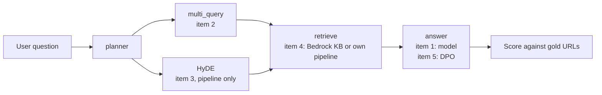
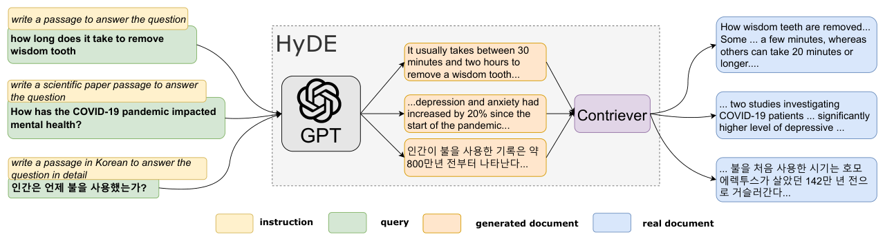
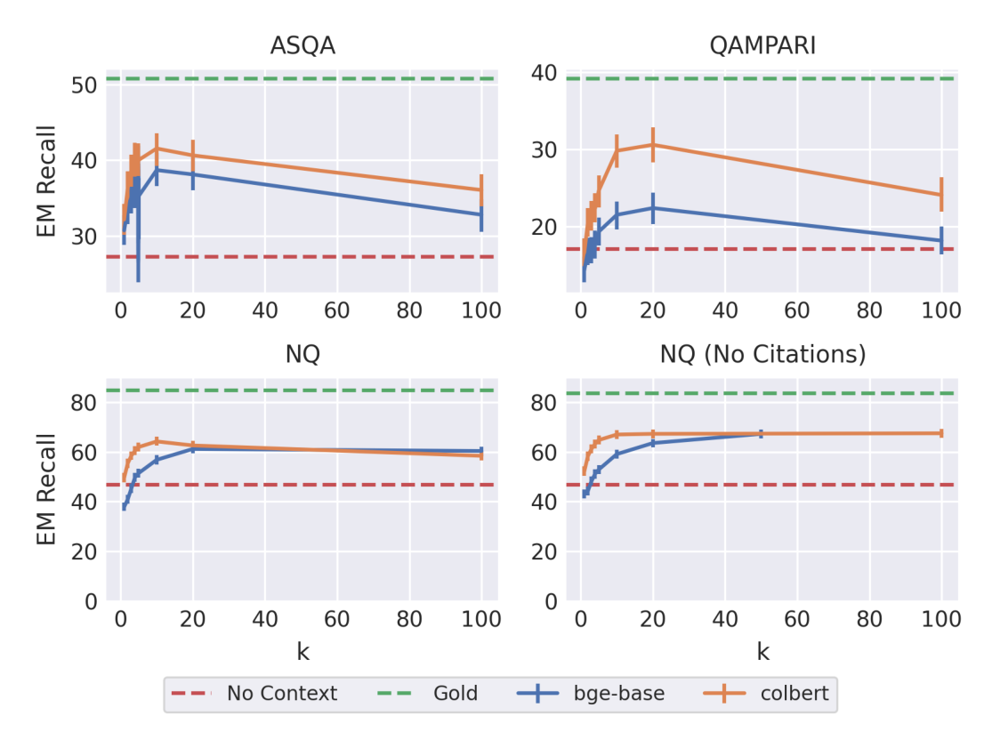
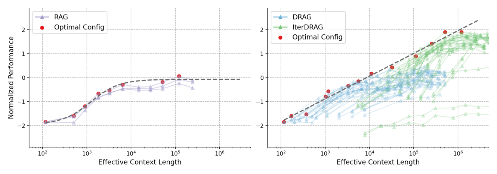

# 11 — Retrieval improvements: reading an ablation

Tallybook's support bot still gets refund questions wrong, and everyone on the team has a favourite fix: a newer model, multi-query, HyDE, a corrective loop, fine-tuning. An ablation is how you stop arguing. You change one thing at a time, score each configuration on the same labelled queries, and let the table choose. The catch is that a small eval set can only tell you about big differences, and most of the table is noise until you prove otherwise.

This chapter works through a real ablation from a production support-agent evaluation, with its identity removed: five retrieval configurations scored on MRR, precision at 1 and latency, the conclusions drawn, and the shortlist of improvements that came out of it. Those numbers are measurements, but the raw data is not in this repository, so you can't re-run them here, and they did not come from Tallybook. Four systems appear. The **deterministic pipeline** retrieves once, reranks and generates. The **graph agent** is a LangGraph agent with CRAG. The **tool-loop agent** is a Google ADK ReAct agent that decides for itself what to search. The **incumbent** is the existing assistant, used as the benchmark. Each research item then gets a small experiment on Tallybook, so that you can see the mechanism run. Metric definitions are in [03](03-keyword-semantic-and-hybrid-search.md) and the wider evaluation discipline is in the [Eval pillar](../../08-eval/README.md).

These notes were written after the first ablation run, while the options were still being evaluated. Items marked planned or not measured below were never run on that system, and their expected gains are estimates, not results.

## The baseline table

The eval had 44 tasks, of which 32 carried annotated gold URLs. MRR and P@1 are measured against those.

| Config | MRR | P@1 | Latency |
|--------|-----|-----|---------|
| Incumbent benchmark | 0.625 | 0.625 | ~9.3s (smoke/10) |
| Tool-loop + thinking1024 | 0.583 | 0.531 | 7.3s |
| Graph + CRAG | 0.547 | 0.531 | 7.7s |
| Graph no CRAG | 0.542 | 0.531 | 4.4s ← best latency/quality tradeoff |
| Tool-loop baseline | 0.418 | 0.219 | 2.6s |

Gap to the incumbent: **-0.042 MRR** (best local against the benchmark, on the smoke subset). The benchmark's latency comes from a ten-task smoke run, so treat that row as a rough target, not a like-for-like score.

### What the ablations showed

- **Thinking budget (+1024)**: a large gain for the tool-loop agent (+0.165 MRR), but it hurts the graph agent when combined with CRAG. That is an interaction effect: thinking changes the citation style, which breaks CRAG's grading alignment.
- **CRAG**: +0.005 MRR against no CRAG, at a cost of +3.4s. The confidence gate (threshold 0.7) short-circuits most runs because Bedrock returns decent scores. Marginal value.
- **What the paper's CRAG is.** The ablation's CRAG is a re-implementation: a confidence gate on knowledge-base scores. Corrective RAG proper trains a small T5-large (0.77B) evaluator that labels each retrieved document correct, incorrect or ambiguous, then refines, replaces with web search, or does both. Its evaluator classified retrieval quality at 84.3 accuracy on PopQA, against 58.0 to 64.7 for prompted ChatGPT, and the correction raised PopQA accuracy from 52.8 to 59.8 on Self-RAG's LLaMA2-7B with the same retrievals. Every generator is a LLaMA2-7B variant, thresholds were tuned per dataset, and the reported overhead (0.363 s to 0.512 s per instance) leaves out retrieval and web search. So the paper does not contradict a marginal result here: the tested gains came from a weak retriever and a trained evaluator, which this system lacked ([arXiv:2401.15884](https://arxiv.org/abs/2401.15884), Yan et al., 2024-01, preprint).

- **LLM planner**: -0.031 MRR against the regex router, and +4s latency. The regex is better for that corpus's edge-case vocabulary.
- **The incumbent's advantage** has three plausible sources: (1) `gemini-3-flash-preview`, a newer model, (2) `ThinkingLevel.LOW` internally, and (3) multi-query retrieval before the KB call.

### How much of that is signal

Before believing any line above, ask how much a mean over 32 queries can move by chance. Reciprocal rank is a score between 0 and 1, and a bounded score has a standard deviation of at most 0.5, so the standard error of a mean over 32 queries is at most 0.088. The table also has a second reading. P@1 times 32 is a count of queries.

```python
import math

runs = {  # config: (MRR, P@1), scored on the 32 annotated queries
    "tool-loop + thinking1024": (0.583, 0.531),
    "graph + CRAG": (0.547, 0.531),
    "graph no CRAG": (0.542, 0.531),
    "tool-loop baseline": (0.418, 0.219),
}
n = 32
worst_se = 0.5 / math.sqrt(n)
print(f"worst-case standard error of one MRR: {worst_se:.3f}\n")
for name, (mrr, p1) in runs.items():
    print(f"{name:24s} MRR {mrr:.3f}  rank-1 hits {p1 * n:4.1f} of {n}")

print()
for label, delta in [("CRAG", 0.547 - 0.542), ("thinking on tool-loop", 0.583 - 0.418)]:
    print(f"{label:21s} delta {delta:+.3f} = {delta / worst_se:4.2f} worst-case SEs")
```

```text
worst-case standard error of one MRR: 0.088

tool-loop + thinking1024 MRR 0.583  rank-1 hits 17.0 of 32
graph + CRAG             MRR 0.547  rank-1 hits 17.0 of 32
graph no CRAG            MRR 0.542  rank-1 hits 17.0 of 32
tool-loop baseline       MRR 0.418  rank-1 hits  7.0 of 32

CRAG                  delta +0.005 = 0.06 worst-case SEs
thinking on tool-loop delta +0.165 = 1.87 worst-case SEs
```

So CRAG's +0.005 is about 6% of one worst-case standard error, and the two graph configurations put the same 17 queries' worth of answers at rank 1. "CRAG adds nothing measurable here" is the honest statement. It does not prove CRAG is useless on other corpora or with a stricter gate, and the 3.4 s it costs is measured, so the decision to drop it is easy. The thinking gain is a different size: ten extra queries at rank 1 and getting on for two worst-case errors.

This bound is pessimistic for comparisons, because the same queries go through both configurations and most of the per-query noise cancels. The tool that uses this is the paired bootstrap: compute the difference per query, resample queries, and look at the interval. Tallybook's practice kit has 20 labelled queries, so here are its real results for three real retrievers.

```python
import numpy as np
from ragkit import QUERIES, Retriever, reciprocal_rank

retriever = Retriever()


def per_query_rr(search):
    return np.array([reciprocal_rank(search(q, k=3), relevant) for q, relevant, _ in QUERIES])


def paired_bootstrap(a, b, rounds=10_000, seed=0):
    diff = a - b
    rng = np.random.default_rng(seed)
    means = diff[rng.integers(0, len(diff), (rounds, len(diff)))].mean(axis=1)
    return diff.mean(), *np.percentile(means, [2.5, 97.5])


bm25, dense, hybrid = (per_query_rr(s) for s in (retriever.sparse, retriever.dense, retriever.hybrid))
print(f"MRR: bm25 {bm25.mean():.3f}, dense {dense.mean():.3f}, hybrid {hybrid.mean():.3f}\n")
for name, a, b in [("dense - bm25", dense, bm25), ("hybrid - bm25", hybrid, bm25), ("dense - hybrid", dense, hybrid)]:
    delta, low, high = paired_bootstrap(a, b)
    print(f"{name:15s} {delta:+.3f}  95% interval [{low:+.3f}, {high:+.3f}]  "
          f"wins {(a > b).sum()}, losses {(a < b).sum()}, ties {(a == b).sum()}")
```

```text
MRR: bm25 0.550, dense 0.867, hybrid 0.733

dense - bm25    +0.317  95% interval [+0.042, +0.592]  wins 9, losses 3, ties 8
hybrid - bm25   +0.183  95% interval [+0.008, +0.367]  wins 8, losses 3, ties 9
dense - hybrid  +0.133  95% interval [-0.017, +0.292]  wins 6, losses 3, ties 11
```

These scores cut each ranking at 3, so they sit slightly below the kit's scoreboard. Read the last line. Dense beats hybrid by 0.133 MRR on these 20 queries, more than twenty times the CRAG delta, and the interval still crosses zero. Eleven of the twenty queries tie, and the difference is carried by the other nine. Keep this in mind as you read the expected gains below: an improvement of 0.05 on 32 queries needs a large change in a handful of queries, or a much larger eval set, before you can call it real.

## The research items

Each item below is one independent variable. The figure shows where each one enters the pipeline, which is also what you would toggle in an ablation.



### 1. Upgrade the model: gemini-3-flash-preview

**Expected gain**: about +0.04 to +0.08 MRR. It was rated the biggest single lever because it needs no engineering, though that range overlaps the multi-query estimate below.
**Cost**: same latency profile, slightly higher per-token cost.
**How**: change the model setting in the agent's environment and rerun the same eval set.
**Status**: Not measured. The run needs the original agent code, Gemini API access and the gold URL set, and none of those is in this public repository, so the gain above stays an estimate. Item 4 reports a local ablation that is measured, on a different question.

Why does a model change move a *retrieval* metric? Because MRR here is scored on the URLs the agent cites, and the agent chooses what to search for and what to cite. It is a reminder that this table measures the whole agent, not the index.

A published case of the same lever: A-RAG's agent (keyword search, semantic search and a chunk-read tool) scored LLM-Acc 74.1 vs 52.8 for naive RAG on MuSiQue with GPT-5-mini (top-k 5, same model as judge), yet with GPT-4o-mini it led on only 3 of 5 public QA sets, so a gain measured on one model need not carry to another ([arXiv:2602.03442](https://arxiv.org/abs/2602.03442), Du et al., 2026-02, preprint).

### 2. Multi-query retrieval

**What**: generate 2 or 3 reformulated queries per user question, retrieve for each, merge and deduplicate results by URL, and pass the top N to the answer node. This matches the incumbent's internal strategy, which generates keyword phrases in the corpus's language before retrieval.

**Expected gain**: +0.05 to +0.10 MRR, especially on:

- Short or vague queries, where a single query has high lexical variance
- Abstract accounting terms, with the compound and spelling variants a non-English language adds
- Cross-lingual queries, such as a question in one language against an article in another

**Cost**: +1 LLM call for query generation and +N Bedrock calls, one per variant. No grading loop.
**In a graph agent**: a new node `multi_query` between `planner` and `retrieve`.

```python
# illustrative: needs a Gemini API key and your own graph State, prompt and parser.
# Sketch: generate_queries node
async def generate_queries_node(state: State) -> State:
    llm = ChatGoogleGenerativeAI(model=_MODEL, temperature=0.3)
    result = await llm.ainvoke([
        ("system", MULTI_QUERY_PROMPT),
        ("human", state["query"])
    ])
    queries = parse_queries(result.content)  # extract list of reformulations
    return {**state, "queries": [state["query"]] + queries[:2]}

# retrieve node runs bedrock_kb.retrieve for each query, merges
```

**In a tool-loop agent**: change the search tool to accept and execute multiple queries.

**Status**: Planned, not run. It would follow the model upgrade ablation.

[5b](05b-query-parsing-conversational-retrieval-and-reranking.md) shows the idea on one Tallybook query. Here it runs across all ten paraphrase queries, where keyword search suffers most, so you can see the size of the effect and where it stops. The rewrites are hand-written stand-ins for what an LLM would produce, and they were written with the corpus in view, so read these as a best case.

```python
from ragkit import QUERIES, Retriever, evaluate, rrf

REWRITES = {  # stand-ins for the LLM call
    "can I get my money back": ["refund policy", "how do I get a refund for a payment"],
    "access denied even though my token is valid": ["API authentication error 403", "invalid API key forbidden"],
    "too many requests from my integration": ["API rate limit", "HTTP-429 retry"],
    "the bank link stopped updating": ["bank connection error", "bank feed sync failed"],
    "my client says the bill never arrived": ["invoice email not delivered", "invoice email bounced"],
    "how do I close my account": ["cancel subscription", "cancelling your subscription"],
    "tax for a company in Germany": ["VAT on EU sales", "reverse charge VAT"],
    "chase customers who have not paid": ["payment reminders", "overdue invoice reminder"],
    "swap credentials safely without downtime": ["rotate API keys", "rotating API keys"],
    "move to a cheaper subscription": ["change plan", "downgrade plan"],
}


def multi_query(search):
    def run(question, k=3):
        versions = [question] + REWRITES.get(question, [])
        return rrf([search(v, k=5) for v in versions])[:k]
    return run


retriever = Retriever()
paraphrases = [row for row in QUERIES if row[2] == "paraphrase"]
for name, search in [("bm25", retriever.sparse), ("dense", retriever.dense), ("hybrid", retriever.hybrid)]:
    one, many = evaluate(search, paraphrases), evaluate(multi_query(search), paraphrases)
    print(f"{name:7s} MRR {one['mrr']:.3f} -> {many['mrr']:.3f}   recall@3 {one['recall@3']:.2f} -> {many['recall@3']:.2f}")
```

```text
bm25    MRR 0.175 -> 0.850   recall@3 0.20 -> 0.90
dense   MRR 1.000 -> 0.950   recall@3 1.00 -> 1.00
hybrid  MRR 0.650 -> 0.950   recall@3 0.90 -> 1.00
```

Multi-query takes BM25 from nearly useless to good on these queries, and it fixes hybrid, whose MRR was being dragged down by BM25's confident wrong answers. It does nothing for dense retrieval, and in fact costs a little, because the kit's stand-in embedder already handles paraphrase and the extra versions only add rank noise. That is the general pattern to test for: the lever helps the component that has the vocabulary gap. Since the production system's Bedrock KB runs `HYBRID` search, it has a keyword half to help, which fits the estimate that it could be worth more than the CRAG loop.

Li et al.'s 74-run sweep of RAG settings gives an outside number for query expansion. On TruthfulQA and MMLU with Mistral-7B-Instruct and a 1K-article Wikipedia index, a Flan-T5-small keyword expansion with a wider first-stage filter moved TruthfulQA ROUGE-L from 23.86 to 24.09 at best, and left MMLU factuality flat (63.73 to 63.75 for the largest filter). Shrinking the retrieval stride to 1 token hurt (TruthfulQA MAUVE 41.80 against 72.92). Its best variant retrieved gold question and answer pairs from the evaluation set itself, so it is a few-shot result, not retrieval from an independent corpus ([arXiv:2501.07391](https://arxiv.org/abs/2501.07391), Li et al., 2025-01, preprint).

Returning parent paragraphs has a measured cost ([05](05-chunking-query-parsing-and-reranking.md#index-small-return-large)). The LongRAG of Zhao et al. (a different paper from the long-retrieval-unit LongRAG in [02](02-why-rag-and-the-augmented-prompt.md)) retrieves 200-word chunks, maps them back to their source paragraphs, then runs an LLM extractor and a chain-of-thought relevance filter. With ChatGLM3-6B tuned on 2,600 samples, the mapped paragraphs fed the generator 10,669 tokens against 2,181 for plain chunks on HotpotQA, and did not reliably beat them (2WikiMQA F1 44.83 against 46.61). On 2WikiMQA the extractor recovered the gain (52.53) and extractor plus filter reached 54.85, at 1,233 tokens on HotpotQA. The filter alone helped little. Average F1 over three multi-hop sets (200 questions each) was 52.56 for GLM-4 against 45.96 for its vanilla RAG. The corpus held each question's own paragraphs, so every needed passage was in it, and two or three extra LLM calls per query are not costed ([arXiv:2410.18050](https://arxiv.org/abs/2410.18050), Zhao et al., 2024-10, v2 2024-11, preprint).

FRAMES gives an outside number for the sequential version. Krishna et al. built 824 multi-hop Wikipedia questions that need 2 to 15 articles. With Gemini-1.5-Pro-0514 and BM25 over Wikipedia, accuracy was 0.408 with no retrieval, 0.474 with four BM25 articles in one step and 0.729 with the gold articles. Five rounds of five generated queries, ten documents each, with planning instructions (example query sequences, no repeated queries, think step by step) reached 0.66. Without the planning instructions it climbed only from about 0.45 to about 0.52 at two documents per query, because the model's queries lacked diversity and it never corrected course. The multi-step runs cost six sequential model calls, used one model and one retriever, and did not ablate the parts of the planning prompt ([arXiv:2409.12941](https://arxiv.org/abs/2409.12941), Krishna et al., NAACL 2025).

### 3. HyDE (Hypothetical Document Embeddings)

**What**: instead of embedding the user query, generate a hypothetical ideal article that answers it, embed that, and retrieve by similarity ([arXiv:2212.10496](https://arxiv.org/abs/2212.10496) (Gao et al., ACL 2023)). The paper built it for retrieval with no relevance labels: an unsupervised encoder (Contriever) matches the generated document against real ones, and the encoder's dense bottleneck is expected to drop the invented details. On TREC DL19 web search it took Contriever from 44.5 to 61.3 nDCG@10, level with the MS MARCO fine-tuned Contriever (62.1), with InstructGPT as the generator. With Flan-T5-XXL as the generator it reached only 48.9. It stayed behind the fine-tuned model on DL20, FiQA, DBPedia and Climate-FEVER and on all four Mr.TyDi languages tested, and on DL19 ANCE and DPR beat it on nDCG@10 though not on recall. Each dataset got its own written instruction, and the authors blame the FiQA and DBPedia gaps partly on under-specified instructions. Put on top of the fine-tuned Contriever it still added 5.3 points on DL19 (62.1 to 67.4) but 0.3 on DL20, and every result is a single run. The authors frame it as a cold-start tool: once labels exist, a supervised retriever takes the in-domain queries and HyDE keeps the novel ones. Here the hope is that it bridges the domain gap between customer support language (informal phrasing) and help centre language (formal structured articles).


*Image Source: Gao et al., [Precise Zero-Shot Dense Retrieval without Relevance Labels](https://arxiv.org/abs/2212.10496) (2023), Fig. 1*

**Why it works**: accounting queries use informal vocabulary ("fee", "do my VAT") while articles use formal terms ("VAT return", "filing with the tax authority"). A generated article written in the formal register should land closer to the real one. The paper does not test vocabulary mismatch directly, so this is the case to measure on our queries.

**Cost**: +1 LLM call to generate the hypothetical article, no retrieval loop. The paper's method averages the embeddings of N sampled documents, optionally with the query's (N is not reported), so its call count is unstated, and it never measures latency.
**Limitation**: the paper tests it only with dense retrieval, as in the deterministic pipeline. Whether Bedrock HYBRID search (BM25 plus vector) dilutes the benefit is untested, since BM25 is keyword-based.

**When the guess is the problem**: HyDE finds fine details "only when those details are in a domain (such as well-known history) in which the foundational model can generate a plausible answer"; a hallucinated, stale or off-topic guess loses the grounding. In one LlamaIndex demo a question retrieved at chunk size 100, failed at the 1,024 default, and HyDE recovered it (*Generative AI Design Patterns*, ch. 4, Pattern 9). One query, so run the ablation at the real chunk size.

**Best implementation path**: the deterministic pipeline's retrieval step, not the agents on Bedrock.

**When the caller is an agent, its reasoning is the free expansion.** AgentIR embeds the agent's current reasoning trace together with its search query, using a Qwen3-Embedding-4B retriever tuned on 5,238 instances from 250 correct trajectories. On BrowseComp-Plus (top 5 snippets, LLM-judge accuracy) with Tongyi-DR it scored 66.27% against 48.67% for the untuned backbone, 50.72% for Qwen3-Embedding-8B and 33.98% for BM25, and beat the backbone plus a Qwen3-8B listwise reranker (55.66%) with no reranking call. Embedding the reasoning without any tuning gave 55.54%, and tuning without reasoning 59.40%. A HyDE-style rewriter that did not see the agent's state (31.08%) fell below BM25 because it guessed wrong readings of ambiguous queries. Adding retrieved documents to the query hurt (60.00%), and so did extra history turns. One benchmark, a fixed corpus, no seeds; the transfer to gpt-oss-120B and GLM-4.7 was tested without retraining, but the tuning used one agent ([arXiv:2603.04384](https://arxiv.org/abs/2603.04384), Chen et al., 2026-03, preprint).

```python
# illustrative: needs an LLM, the multilingual-e5-large model and a DuckDB index.
# Sketch for a deterministic pipeline
async def hyde_retrieve(query: str) -> list[dict]:
    hyp = await generate_hypothetical_doc(query)   # LLM call
    hyp_embedding = embed(hyp)                      # multilingual-e5-large
    return vector_search(hyp_embedding)             # DuckDB ANN
```

**Status**: Planned, not run. The natural form is a `RETRIEVAL_MODE=hyde` flag on the pipeline, added after multi-query.

The gamble in HyDE is that the model guesses the corpus's vocabulary. Here is the same question with two hand-written hypothetical documents, one in the help centre's words and one in the customer's.

```python
from ragkit import Retriever

retriever = Retriever()
question = "can I get my money back"
good_guess = "Refunds are available for a set number of days after payment and go back to the original card."
bad_guess = "You can get your money back by asking your bank to return the charge on your card statement."

for label, text in [("question", question), ("good guess", good_guess), ("bad guess", bad_guess)]:
    print(f"{label:11s} bm25 {retriever.sparse(text, k=3)}  dense {retriever.dense(text, k=3)}")
```

```text
question    bm25 ['kb-03']  dense ['kb-04', 'kb-18', 'kb-05']
good guess  bm25 ['kb-04', 'kb-05', 'kb-11']  dense ['kb-04', 'kb-05', 'kb-18']
bad guess   bm25 ['kb-13', 'kb-17', 'kb-10']  dense ['kb-04', 'kb-18', 'kb-05']
```

Gold here is `kb-04`. The good guess repairs BM25, and the bad guess sends it to bank errors and webhooks. The stand-in embedder survives both, because its synonym axes were built by hand for this corpus, so don't read that as evidence about real embedders. A hypothetical document changes what the search sees, for better or worse, and nothing downstream knows which happened. That is why HyDE needs its own row in the ablation, and why it covers a different failure mode from multi-query: multi-query spreads the bet over several short phrasings, while HyDE places one long bet. The concern about hybrid dilution is untested. The toy above shows keyword search can benefit from a good guess, so measure it on the real corpus.

### 4. The deterministic pipeline as the retrieval backend for both agents

**What**: route all Bedrock KB calls through the pipeline's local DuckDB plus multilingual-e5-large endpoint.
**Why**: zero Bedrock cost, full control over the embedding model, and it enables HyDE.
**Flags**: one retrieval-backend setting per agent, so the swap needs no code change.
**Baseline**: the pipeline alone scored MRR=0.42 on retrieval-only. LLM agents with local RAG were not measured.

**Status**: Not measured, for the same reason as item 1: the agents, Bedrock KB and gold set are not in this repository, and LLM agents on local RAG remain an open question.

What can run here is the local half of the decision: which embedding model, and whether fusing it with BM25 helps. This does not answer the production question. It swaps embedders and not LLMs, has no agent in it, and scores Tallybook's 18 pages and 20 queries, not the production corpus. Every number below is from this run, with no API key. The first run downloads about 2.5 GB of weights.

```bash
cd generative-ai/02-rag-retrieval/practice && uv run ablation.py
```

```text
config                MRR    P@1    R@3  ms/query
bm25                0.562  0.500  0.600       0.0
toy dense           0.877  0.850  0.900       0.0
minilm-l6           0.854  0.750  0.950       0.8
bge-small           0.912  0.850  0.950       1.5
bge-base            0.875  0.750  1.000       3.7
e5-large            0.925  0.900  0.950      17.9
toy dense + bm25    0.742  0.550  0.950       0.1
minilm-l6 + bm25    0.835  0.750  0.900       0.7
bge-small + bm25    0.840  0.750  0.950       1.4
bge-base + bm25     0.840  0.750  0.950       3.6
e5-large + bm25     0.842  0.750  0.950      18.0

e5-large - bm25                +0.362  95% interval [+0.188, +0.550]  wins 9, losses 0, ties 11
bge-small - bm25               +0.350  95% interval [+0.175, +0.537]  wins 9, losses 0, ties 11
bge-base - bge-small           -0.037  95% interval [-0.138, +0.062]  wins 2, losses 3, ties 15
e5-large - bge-small           +0.013  95% interval [-0.075, +0.100]  wins 2, losses 2, ties 16
minilm-l6 - bge-small          -0.058  95% interval [-0.158, +0.042]  wins 1, losses 4, ties 15
bge-small + bm25 - bge-small   -0.073  95% interval [-0.181, +0.029]  wins 1, losses 5, ties 14
e5-large + bm25 - e5-large     -0.083  95% interval [-0.183, +0.000]  wins 0, losses 3, ties 17
toy dense - bge-small          -0.036  95% interval [-0.180, +0.104]  wins 2, losses 3, ties 15
```

Dense retrieval beats BM25 on this set by a margin the interval can resolve. Among the real embedders it can't: e5-large and bge-small tie on 16 of 20 queries, and the interval on their difference spans zero, while e5-large took about twelve times as long per query on this machine. Fusing BM25 lowered MRR for all four real models, presumably because BM25's much weaker list drags the fusion down. The two intervals printed for that comparison reach zero, so this is no evidence that hybrid helps on these queries, and not proof that it hurts. The toy row is a hand-built stand-in, so don't rank it against real models. None of this moves the production pipeline's MRR of 0.42, or says what it would become.

**How many passages to pass.** A controlled study held the reader fixed and varied only what retrieval handed it. With Mistral-7B-Instruct-v0.3, BGE-base and two-shot ALCE-style prompts on ASQA, exact-match recall climbed to 38.7 at k=10 (27.3 closed-book, 50.7 with only gold passages in the prompt) and then declined (32.8 at k=100), while citation precision fell from 63.7 at k=1 to 24.0 at k=100. Gold passages typically sat 7th to 13th among the nearest neighbours. Gold-document recall mattered far more than how exactly the ANN search matched exact search: setting the search recall@10 to 0.7 cost only 2-3% of gold-document recall (BGE-base, graph ANN). No latency or memory numbers are reported. Noise never helped here: gold plus 5th-10th neighbours scored 49.9 and gold plus 95th-100th neighbours 49.2 against 50.7 for gold only, so it does not replicate the "power of noise" claim (Wu et al. found small gains from synthetic noise, setups differ: see [06](06-generation-for-rag.md#why-rag-works-attention)). One run per condition, temperature 1, two 7B readers ([arXiv:2411.07396](https://arxiv.org/abs/2411.07396), Leto et al., 2024-11, preprint).


*Image Source: Leto et al., [Toward Optimal Search and Retrieval for RAG](https://arxiv.org/abs/2411.07396) (2024), Fig. 2*

**More context only pays if the loop uses it.** Yue et al. scaled test-time compute for RAG with Gemini 1.5 Flash on four multi-hop sets (1.2k sampled questions each), counting input tokens only, from 16k to 5M effective tokens. Standard RAG plateaued by about 128k. DRAG (more documents and demonstrations in one call) won at 16k-32k, and IterDRAG (iterative sub-query retrieval and generation) won from 128k up. IterDRAG at 5M against standard RAG at 128k scored 76.9 against 48.4 accuracy on 2WikiMultiHopQA and 30.5 against 16.8 on MuSiQue, with gains shrinking beyond 1M. Adding documents beyond roughly 100 raised recall but not NDCG or MRR. Their fitted allocation model reached 96.6% of the oracle on held-out datasets at 1M tokens. One generator, single runs, and the abstract's "up to 58.9%" gain does not match any table cell we found ([arXiv:2410.04343](https://arxiv.org/abs/2410.04343), Yue et al., 2024-10, preprint).


*Image Source: Yue et al., [Inference Scaling for Long-Context Retrieval Augmented Generation](https://arxiv.org/abs/2410.04343) (2024), Fig. 1*

The managed side of this comparison is [12](12-managed-rag.md).

### 5. DPO and preference fine-tuning, and the other trained pieces

Moved to [11b — Training the pieces, and the pipeline eval](11b-training-the-pieces-and-the-pipeline-eval.md#5-dpo-and-preference-fine-tuning): the preference-pair arithmetic, and the papers on training retrievers, filters, when-to-retrieve and the loop itself, with TableRAG, MASS-RAG and the structured-output case. The pipeline smoke baseline, URL normalization and the product glossary moved with it.

## Priority order

1. **gemini-3-flash-preview ablation** (zero engineering, big expected gain)
2. **Deterministic pipeline as backend** (free latency and cost benchmark)
3. **Multi-query retrieval** (best quality lever after the model upgrade)
4. **HyDE on the pipeline** (complements multi-query, different failure mode coverage)
5. **DPO** (long-term, blocked on data collection)

The rule behind that order is cheap information first. Items 1 and 2 are configuration flags. Item 3 is a node. Item 4 needs item 2's backend. Item 5 needs data that does not exist yet.

## Pitfalls

- **Reading a table without a noise estimate.** A delta of 0.005 on 32 queries is nothing, and even 0.133 on 20 queries left an interval that crossed zero above. Compute the paired interval before writing the conclusion.
- **Changing two things at once.** Thinking helped the tool-loop agent and hurt the graph agent with CRAG. With thinking and CRAG turned on together, nobody could have seen that interaction.
- **Comparing runs on different query sets.** The smoke subset and the full set gave very different MRRs for the same pipeline. Store the query-set version next to each score.
- **Believing the expected gains.** They are estimates that justify an order of work. Replace them with measured rows as soon as a run finishes.

## Try it

1. In the bootstrap block, change `seed=0` to `seed=1` and `rounds` to `1000`. How much does the `dense - hybrid` interval move, and does the conclusion change?
2. Using the worst-case bound, how many queries would you need for one standard error to equal CRAG's +0.005?
3. In the multi-query block, delete the second rewrite from every entry so that each question has one rewrite. What happens to BM25's MRR? Predict first.

<details>
<summary>Answers</summary>

1. The interval becomes about [-0.008, +0.292] against [-0.017, +0.292]. It still crosses zero, so the conclusion stands. The lower end moved by 0.009, which is the size of error you accept with fewer rounds. The width comes from the 20 queries, and more rounds will not narrow it.
2. 0.5 / sqrt(n) = 0.005 gives n = 10,000. That is the unpaired worst case, and a paired design needs fewer, but it shows why a +0.005 can't be judged on 32 queries.
3. BM25's MRR falls from 0.850 to 0.667, and recall@3 stays at 0.90. One rewrite finds the document, but the original question's noisy ranking now carries a larger share of the fused score, so the right document lands lower. The second rewrite was buying rank, not recall.

</details>

## Interview checklist

| Question | Answer |
|---|---|
| What is an ablation? | Change one component at a time, score each configuration on the same queries, and compare. It separates each change's effect and shows interactions. |
| Why was CRAG judged marginal? | +0.005 MRR and identical P@1 against no CRAG, for +3.4 s. The confidence gate at 0.7 short-circuited most runs. |
| What interaction did the ablation find? | A thinking budget gained +0.165 MRR on the tool-loop agent but hurt the graph agent with CRAG, because thinking changed citation style and broke the grader's alignment. |
| How would you judge a +0.03 MRR on 32 queries? | Not yet real. Worst-case SE of one mean is 0.088. Compute a paired bootstrap interval on per-query differences. |
| Why a paired test? | The same queries go through both systems, so per-query difficulty cancels and the comparison is tighter. |
| How does multi-query help, and what does it cost? | It covers lexical variance by retrieving for 2 or 3 reformulations and merging. Cost: one LLM call and one retrieval per variant. It helps keyword search most. |
| How does HyDE differ? | It embeds a generated hypothetical answer in place of the query. At least one LLM call, one long bet on the corpus's vocabulary. The paper tested it only with pure vector search. |
| Why did the LLM planner lose to a regex? | -0.031 MRR and +4 s. For a narrow edge-case vocabulary the rule was simply better, so test before assuming an LLM wins. |

## Next

[11b — Training the pieces, and the pipeline eval](11b-training-the-pieces-and-the-pipeline-eval.md): DPO and the arithmetic of preference pairs, the trained-retriever and trained-filter papers, the deterministic pipeline's smoke baseline and URL normalization. Then [12 — Managed RAG](12-managed-rag.md): the managed backend these experiments ran against, compared with Vertex AI Search and with a pipeline you run yourself.
