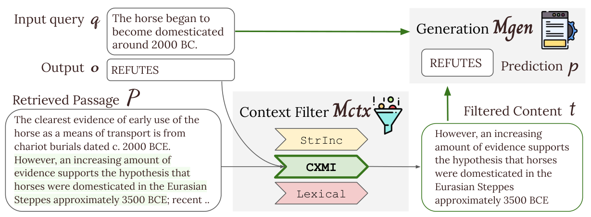
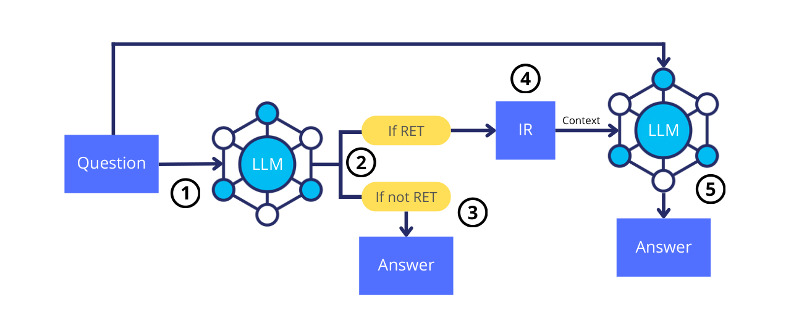
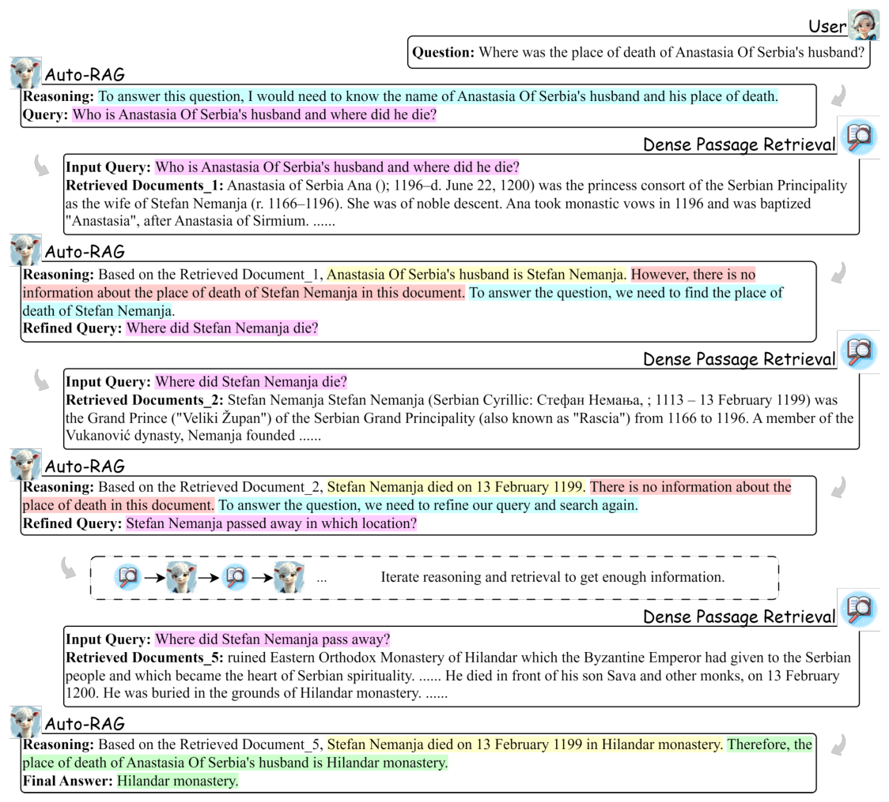

# 11b — Training the pieces, and the pipeline eval

Tallybook's ablation left two items it could not run: DPO, because there are 32 queries and no stored golden responses, and the deterministic pipeline, whose first smoke score was dragged down by documents that were never indexed. This half takes the arithmetic of why DPO is blocked, then the papers that train a retriever, a filter, a retrieval trigger or the whole loop instead of prompting them, and finally the pipeline's baseline and the URL normalization every number in the pair depends on.

> The second half of [11](11-retrieval-improvements.md). That note has the five-configuration ablation, the noise estimate, and research items 1 to 4 with the priority order. Here: item 5 (DPO and preference fine-tuning) with the trained-component papers filed beside it, then the pipeline baseline, URL normalization and the product glossary.

---

## 5. DPO and preference fine-tuning

**What**: curate (query, good_response, bad_response) preference pairs from the eval set and fine-tune with Direct Preference Optimization ([arXiv:2305.18290](https://arxiv.org/abs/2305.18290) (Rafailov et al., 2023); the method is covered in the [RL pillar](../../05-RL/notes/03-preference-optimization.md)). Fine-tune one of:

- Query generation (retrieval query construction): prefer queries that lead to the gold URL
- Answer synthesis: prefer responses that cite the golden article

**Blocked on**: sufficient annotated golden responses (200+ preference pairs).
**Current state**: 32 annotated queries in the eval set, 0 golden responses stored.

**Path to unblock**:

1. Run comparable agent configs through your eval runner or Langfuse experiments, to identify tasks where some configs hit and others miss.
2. For hit tasks, take the incumbent's or the graph agent with thinking as preferred, and the tool-loop baseline as rejected.
3. Collect 200+ pairs before starting DPO.

**Status**: Blocked until golden responses have been collected.

The arithmetic says how blocked it is. A query yields a pair only when one config hits and another misses, so with five configs a query gives at most 2 × 3 = 6 pairs, and those six come from the same question.

```python
def pairs_from(hits_by_query, configs):
    pairs = []
    for query, hits in hits_by_query.items():
        for good in sorted(hits):
            for bad in sorted(set(configs) - hits):
                pairs.append((query, good, bad))
    return pairs


configs = ["incumbent", "loop_think", "graph_crag", "graph_plain", "loop_base"]
# Made-up hit pattern, to show the counting. Real patterns come from the ablation runs.
hits = {
    "query-1": {"incumbent", "loop_think"},
    "query-2": set(configs),               # everyone hits: no preference to learn
    "query-3": {"incumbent", "loop_think", "graph_crag"},
    "query-4": set(),                      # everyone misses: no preferred answer
}
pairs = pairs_from(hits, configs)
print(len(pairs), "pairs from", len(hits), "queries")
print(pairs[0])
print("ceiling for 32 queries and 5 configs:", 32 * 2 * 3)
```

```text
12 pairs from 4 queries
('query-1', 'incumbent', 'graph_crag')
ceiling for 32 queries and 5 configs: 192
```

Even a perfect split of every query stops short of 200, at 192, and real queries where everyone hits or everyone misses contribute nothing. So the blocker is more annotated queries, and more configs would not help much: pairs from one question are not independent examples.

A retriever can also be trained with no human preference pairs at all, by letting the generator score the documents. REPLUG keeps the language model frozen, prepends each of the top-k retrieved documents to the prompt in a separate pass, and ensembles the next-token probabilities weighted by retrieval score. REPLUG LSR then trains the retriever to match a distribution over the top 20 documents given by how much each one raised the model's likelihood of the gold continuation, so the labels are the model's own probabilities on 800K Pile sequences, with no annotator. With Codex (175B) and ten Wikipedia passages, that took 5-shot MMLU from 68.3 to 71.8 and 16-shot Natural Questions from 40.6 to 45.5. The untrained Contriever retriever already gave 71.4 and 44.7, so retrieval itself is most of the gain and the training adds about a point. The supervising model was the 6.7B Curie, and the same retriever was then used with the 175B models. Every prediction costs k forward passes, the ensemble needs per-token output probabilities, which chat APIs do not return, and retrieval is always on whether or not the question needs it, which the authors list as a limit ([arXiv:2301.12652](https://arxiv.org/abs/2301.12652), Shi et al., NAACL 2024). For Tallybook the practical reading is that once the eval set stores golden answers, the answer model's likelihood of each one under each retrieved page is a retriever label that costs no annotation, provided the model exposes log probabilities.

RA-DIT trains both halves. Lin et al. fine-tune the LLaMA 65B reader on instruction data with retrieved chunks, wrong ones included, so it learns to ignore a bad chunk, and then fine-tune only the query encoder of DRAGON+ on the reader's preferences, which leaves the document index untouched (on the six KILT dev tasks at 5-shot, updating the query encoder alone scored 57.8 against 55.8 for updating both). With ten chunks, the average over MMLU, NQ, TriviaQA and ELI5 rose from 43.1 to 50.5 at 0-shot and from 52.7 to 55.2 at 5-shot against REPLUG. The retriever's share is small: on the 5-shot dev tasks the average went from 53.8 (REPLUG) to 53.9 with only the reader tuned, 54.4 with only the retriever tuned and 54.6 with both. The larger effect is the reader's, at 0-shot: retrieval-augmented instruction tuning beat plain instruction tuning 51.0 to 47.7. A single multi-task RA-DIT 65B beat Atlas 11B fine-tuned per task by 4.1 points on eight tasks (60.9 against 56.8), though the sizes are not matched. It needs per-token probabilities, hand-written retrieval templates and LLaMA-1-era models ([arXiv:2310.01352](https://arxiv.org/abs/2310.01352), Lin et al., ICLR 2024).

MMOA-RAG goes further and trains the query rewriter, the document selector and the generator together with multi-agent PPO on one shared reward, the F1 of the final answer, with the retriever frozen. On HotpotQA, 2WikiMultihopQA and AmbigQA with Llama-3-8B-Instruct, Contriever and ten candidate passages, it beat the authors' re-implemented baselines by 1.8, 1.9 and 2.7 F1 (HotpotQA F1 48.29 against 46.49), and joint training added about 3.5 F1 on the multi-hop sets over the same modules after supervised warm-up alone (HotpotQA 44.69 to 48.29). The untrained model gained nothing from retrieval (HotpotQA F1 30.67 with documents against 31.18 without), so the supervised step comes first. The margin shrank to between -0.1 and +1.4 points (the negatives are on exact-match or accuracy columns) when the Contriever-trained system was tested with BGE or E5 retrievers, and the paper reports no seeds or variance. Training cost grows with the number of agents, and inference cost does not ([arXiv:2501.15228](https://arxiv.org/abs/2501.15228), Chen et al., NeurIPS 2025). For Tallybook this is a reason to keep each stage's output inspectable, not a recipe: it needs a training set of questions with gold answers, and the paper tests only Wikipedia QA.

**Tables are a retrieval target of their own.** TableRAG stores each table twice, as a database table with a schema and as Markdown in the text index, then loops: decompose the question, retrieve text chunks, run SQL only when a retrieved chunk came from a table, and reconcile the two answers. With LLM-judged accuracy (Qwen-2.5-72B judge, one run), on HybridQA tables over 100 cells it scored 47.87 to 48.52 across three backbones against 20.28 to 26.56 for plain RAG over linearised tables, while on the single-table WikiTQ plain RAG was close (82.60 against 84.62 with Claude-3.5). The paper's text says it has lower latency than a ReAct baseline, but its own latency table shows higher latency on every column (HeteQA 45.65 s against 24.57 s). The authors built both the HeteQA benchmark (304 questions over Wikipedia tables) and the method, and every backbone is a frontier model ([arXiv:2506.10380](https://arxiv.org/abs/2506.10380), Yu et al., 2025, preprint).

**Several filters can beat one judge.** MASS-RAG, training-free, runs three agents over the retrieved passages (a summariser, an extractor and a reasoner), then a synthesis agent merges their outputs. With Llama3-8B, Contriever and ten passages, it beat the single-judge-filter MAIN-RAG by 16.8 points on ARC-Challenge (78.7 against 61.9), 7.8 on ASQA exact match and 2.6 on TriviaQA, and tied on PopQA (64.2 against 64.0). MAIN-RAG's ASQA MAUVE was higher (70.6 against 55.2). Plain RAG with Qwen3-8B already scored 86.4 on ARC-C, so the gain is partly the backbone. By the authors' token-based estimate it costs about 4 agent-call units on ARC-Challenge and 7 on TriviaQA, PopQA and ASQA, which add an optional answer agent, and MAIN-RAG's rows are copied from its paper ([arXiv:2604.18509](https://arxiv.org/abs/2604.18509), Xiao et al., 2026, preprint).

**Filtering can be trained instead of prompted.** FILCO trains a context filter that keeps only the sentences supporting the answer, then fine-tunes the generator on the filtered text. With the top-1 DPR passage on six Wikipedia-based tasks, FLAN-T5 XL (3B) and LLaMA2 7B (LoRA), inputs shrank by 44-64%, NQ exact match rose 4.3 (FLAN-T5) and 8.6 (LLaMA2) over the full passage, FEVER accuracy 6.2 and 4.3, but HotpotQA only 1.0 and 1.3 F1; the average gain was 2.8 and 3.0 points. The best way to label "useful" differed by task (string inclusion for NQ and TriviaQA, lexical overlap for Wow, conditional mutual information for FEVER, HotpotQA and ELI5). Single runs, Wikipedia only, and a filter and generator both need training; the main results are published only as a chart ([arXiv:2311.08377](https://arxiv.org/abs/2311.08377), Wang et al., 2023-11, preprint).


*Image Source: Wang et al., [Learning to Filter Context for Retrieval-Augmented Generation](https://arxiv.org/abs/2311.08377v1) (2023), Fig. 2*

**Learning when to retrieve.** ADAPT-LLM fine-tunes Llama-2 7B (LoRA) on NQ or SQuAD to emit a `<RET>` token where its own zero-shot answer was wrong, and only then fetches Contriever's top-1 passage. On PopQA exact match it scored 38.15% (SQuAD-trained) and 36.77% (NQ-trained) against 36.59% and 35.86% for always retrieving and 21-21.4% for never retrieving. The margin is under 1.6 points on one run, it asked for context on 82-84% of questions, and a popularity-threshold baseline that retrieves for 99.9% scored 36.81%, (a separate base-model re-run, 37.29 and 35.30 for ADAPT-LLM against it), so the evidence is "comparable accuracy", not a measured cost saving. Context hurt on the questions the model chose not to retrieve for (62.4% without against 55.7% with, NQ-trained), and the gold passage lifted accuracy far above top-1 retrieval (89.4% against 22.5% on SQuAD dev), so the retriever stayed the bottleneck ([arXiv:2404.19705](https://arxiv.org/abs/2404.19705), Labruna et al., 2024-04, preprint).


*Image Source: Labruna et al., [When to Retrieve: Teaching LLMs to Utilize Information Retrieval Effectively](https://arxiv.org/abs/2404.19705) (2024), Fig. 1*

**Training the loop itself.** Auto-RAG fine-tunes Llama-3-8B-Instruct on 10k synthesized reasoning traces (from NQ and 2WikiMultiHopQA) so the model plans, extracts, rewrites the query and decides when to stop. With E5-base-v2 over Wikipedia it averaged 44.3 on six QA sets (a mix of exact match and F1) against 38.4 for IRCoT, 35.5 for Iter-RetGen, 33.8 for standard RAG, 30.7 for Self-RAG and 30.2 for FLARE (baselines are FlashRAG's published runs, not rerun). Dropping training gave 38.5, dropping the reasoning 35.3 and dropping zero-shot query refinement 41.9, and about 0.5k instructions were enough to learn the behaviour. Short-form Wikipedia QA, one 8B family, no learning rate, batch size or training seeds; the efficiency claim is only a bar chart ([arXiv:2411.19443](https://arxiv.org/abs/2411.19443), Yu et al., 2024-11, preprint). This is the trained counterpart of the corrective loop above.


*Image Source: Yu et al., [Auto-RAG: Autonomous Retrieval-Augmented Generation for Large Language Models](https://arxiv.org/abs/2411.19443) (2024), Fig. 1*

**Retrieval can supply the valid names for structured output.** A generator can also be paired with a retriever of valid names. Béchard and Marquez Ayala generated JSON workflows at ServiceNow, and fine-tuned StarCoderBase generators invented step and table names as often as 21% of the time without a retriever. A 110M retriever (all-mpnet-base-v2, fine-tuned on about 15,000 step pairs) put valid names in the prompt, and hallucination fell below 7.5% for steps and 4.5% for tables at 1B to 15.5B. With it, a 3B model matched the 15.5B model without it on trigger exact match (0.615 against 0.632) and hallucinated 0.017 of steps against 0.160. Fine-tuning the retriever mattered more than size: step recall@15 went from 0.425 untuned to 0.743, while a 4.8B off-the-shelf encoder reached 0.561. On out-of-domain deployments, removing the suggestions from the same model raised hallucinated tables from 0.066 to 0.428. All of this is one proprietary task on 157 evaluation examples, with no variance reported and no comparison against grammar-constrained decoding ([arXiv:2404.08189](https://arxiv.org/abs/2404.08189), Béchard & Marquez Ayala, NAACL 2024 Industry Track).

## The deterministic pipeline's baseline and what it can't see

A smoke run of the pipeline used 10 tasks from the golden set, drawn from the 32 annotated:

| Metric | Score |
|---|---|
| MRR | 0.26 |
| P@1 | 0.22 |
| R@3 | 0.33 |
| NDCG@3 | 0.28 |

3 of 9 annotated tasks hit in the top 5. **2 misses are product glossary URLs that were never ingested, so this is a coverage gap, not a ranking error.** With those filtered, the effective score on ingested content is higher. Note also that this MRR of 0.26 on ten smoke tasks and the 0.42 quoted under item 4 come from different runs, which is why you record the query set with every score.

This eval loop uses a different retrieval path from the citation proxy: `query → retrieval endpoint → ranked chunks → compare URLs to golden set → P@k / MRR / NDCG`. The existing retrieval proxy measures citation sentiment on historical support conversations, and it can't measure ranked chunk quality.

### URL normalization

Every number in this chapter depends on deciding when two URLs are the same article.

**Design decision:** a URL map is a stateless lookup table committed to the repo. Agents never contain version-aware URL logic, so KB migrations (a help centre moving to a new domain, say) are a data operation, not a code redeploy. This keeps agents KB-agnostic and prevents grounding false positives when the underlying domain changes.

Match on path only (`/nl/articles/1001-...`) to avoid protocol and domain drift between `help.old-domain.example` and `help.new-domain.example`.

**Aliasing rules:**

1. Help-centre platform articles: extract the numeric ID from `/articles?/(\d+)`, which is locale-agnostic.
2. `help.old-domain.example ↔ help.new-domain.example`: same article ID, rewrite domain and locale prefix. `help.old-domain.example/en/articles/<id>-<slug>` → `help.new-domain.example/nl/articles/<id>-<slug>`.
3. Product glossary (`www.old-domain.example/wiki/<slug>/`): **no canonical URL on the new domain**. These are excluded from grounding and citation coverage, tagged as a topic proxy in the coverage check. Do NOT alias them. Tag `content_type: "glossary_term"` if they are ever ingested.

The rules fit in a few lines, and running them shows the effect on the smoke score's hit rate.

```python
import re

ARTICLE = re.compile(r"/articles?/(\d+)")


def canonical(url):
    """Stable key for an article, or None if the URL has no canonical article."""
    if "/wiki/" in url:
        return None
    match = ARTICLE.search(url)
    return f"article:{match.group(1)}" if match else url


def new_domain_url(url):
    match = re.search(r"help\.old-domain\.example/\w+/articles/(\d+[^/]*)", url)
    return f"https://help.new-domain.example/nl/articles/{match.group(1)}" if match else url


a = "https://help.old-domain.example/en/articles/1001-create-an-invoice"
b = "https://help.new-domain.example/nl/articles/1001-factuur-maken"
wiki = "https://www.old-domain.example/wiki/vat/"

print(canonical(a), canonical(b), canonical(a) == canonical(b))
print(new_domain_url(a))
print("wiki:", canonical(wiki))

hits, annotated, wiki_misses = 3, 9, 2
print(f"hit rate as scored {hits}/{annotated} = {hits / annotated:.2f}; "
      f"on ingested content {hits}/{annotated - wiki_misses} = {hits / (annotated - wiki_misses):.2f}")
```

```text
article:1001 article:1001 True
https://help.new-domain.example/nl/articles/1001-create-an-invoice
wiki: None
hit rate as scored 3/9 = 0.33; on ingested content 3/7 = 0.43
```

### The product glossary: never the primary retrieval target

The product glossary is a flat list of concepts with no numeric article IDs and no equivalent on the new domain. For `definition` queries it provides a context frame only, and the actual answer still comes from help centre articles. This is why glossary misses in eval results are **expected and correct**, not ranking failures. The source router in [10 — semantic cache](10-semantic-cache.md#source-routing--tier-2) encodes this: `definition` intent → glossary as context enrichment, plus the help centre for the answer.

## Pitfalls

- **Scoring a coverage gap as a ranking failure.** Two of the six pipeline misses were documents that were never indexed. No retriever improvement could ever fix those. Separate "not ingested" from "not found".
- **Trusting URL equality.** A domain migration can make every hit look like a miss, or a false alias can make a miss look like a hit. Normalize through one committed table.
- **Fine-tuning before you have data.** Thirty-two questions' worth of preference pairs is not a training set, however many pairs you can derive from them.

## Try it

1. What does `canonical` return for `https://help.new-domain.example/nl/article/1001` (singular path) and for `https://www.old-domain.example/pricing`? Is the second one what you want?

<details>
<summary>Answers</summary>

1. The singular path still gives `article:1001`, which is why the pattern has `s?`. `https://www.old-domain.example/pricing` has no article ID, so it comes back unchanged and only matches itself. That is safe for a comparison, but it is also a sign that this URL needs a decision in the URL map. A URL on the other domain would not match, so domain drift is unhandled for non-article pages.

</details>

## Interview checklist

| Question | Answer |
|---|---|
| What is a coverage gap? | A gold document that was never indexed. It lowers scores and no ranker can fix it, so filter or report it separately. |
| Why keep URL mapping in a data file? | KB migrations become a data change, not a redeploy, and agents stay KB-agnostic. |
| Why not alias the product glossary? | It has no canonical article equivalent, so it is excluded from coverage. Definition queries use it for context only. |
| Why is DPO last? | It needs 200+ pairs and golden responses. 32 queries with 5 configs cap out at 192 correlated pairs, and none were stored. |

## Next

[12 — Managed RAG](12-managed-rag.md): the managed backend these experiments ran against, compared with Vertex AI Search and with a pipeline you run yourself.
