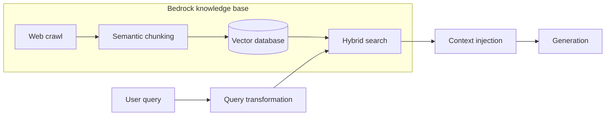

# 12 — Managed RAG: Bedrock, Vertex, and building your own

Tallybook's team has spent eleven chapters learning how to chunk, embed, fuse, rerank and evaluate. Now a manager asks the fair question: AWS and Google both sell all of that as a service, so why are we building it? The answer depends on which decisions you are willing to give up. A managed backend takes ingestion, chunking, the index and often the reranker off your hands. It also takes the chunk boundaries and sometimes the scores, and when retrieval goes wrong you have fewer places to look.

This chapter is a case study from our support-agent project, which ran all three options. First the AWS Bedrock knowledge base as an agent's retrieval backend, in enough detail to operate one. Then Vertex AI Search, the GCP service behind a second codebase, compared feature by feature. Then `kb_rag`, our own deterministic pipeline, and the decisions recorded when it was refactored. What you should take away is what stays your job under every option: the eval set, the text you feed the LLM, and knowing what each score means.

The project details are recorded as they stood in 2026, and they are one team's choices, so check the current service docs before copying them. Where the AWS and Google docs add or qualify something, the text says so.

## What a managed backend does and doesn't do

The diagram shows the Bedrock setup end to end. The crawl, chunking, vector database and hybrid search are the service. The query transformation, context injection and generation are still ours.



| Job | Bedrock KB | Vertex AI Search | Build your own (`kb_rag`) |
|---|---|---|---|
| Crawl and parse | Service | Service | You |
| Chunk | Service, you choose a strategy and sizes | Service, boundaries opaque | You |
| Index and hybrid search | Service | Service, not configurable | You |
| Rerank | Service, you opt in per query | Internal to `:answer` | You |
| Generate | You | Optional, the service can do it | You |
| Evaluate | **You** | **You** | **You** |

The last row is the one to remember. Neither service knows whether your refund answer is right, so the eval from [07](07-rag-in-production.md) and the [Eval pillar](../../08-eval/README.md) carries over unchanged. It is also what lets you compare options at all, which is how the table in [11](11-retrieval-improvements.md) was produced.

## Bedrock knowledge bases

This section is the reference spec for retrieval from an AWS Bedrock KB as used in SupportAgent: identities, modes, reranking, metadata and env vars.

### Known KB identities

| Product | KB ID | Region | Language |
|---|---|---|---|
| SupportAgent staging / Product (Danish) | `KB_STAGING` | `eu-north-1` | Danish, e.g. `opret faktura` |
| SupportAgent production / Product (Danish) | `KB_PROD` | `eu-north-1` | Danish |
| Legacy Product (Danish) | `KB_LEGACY` | `eu-north-1` | Danish |
| Product MCP | `KB_MCP` | `eu-central-1` | Danish |
| Clara (German) | *env var required* | `eu-central-1` | German, Clara tickets |

**Do not run Clara/German tickets against the Danish KB.** Confirm `BEDROCK_KNOWLEDGE_BASE_ID` before running any retrieval eval. A wrong KB returns results rather than errors, with plausible scores, and only the eval notices.

### Staging KB scope and composition

The staging KB (`KB_STAGING`) ingested four data sources via web crawl: Danish SupportPlatform help centre articles, English SupportPlatform help centre articles, ProductWiki glossary terms, and pricing pages.

**Aligned decisions (Jun 2026):**

| Decision | Rationale |
|----------|-----------|
| Restrict KB to **Danish-only SupportPlatform pages** | Current market focus is Danish; English articles duplicate content and degrade retrieval precision |
| Remove **ProductWiki** from Bedrock staging | Data quality and parsing issues; content is available in the local DuckDB corpus for `kb_rag` testing |
| Suspend **pricing page** ingestion pending a fix | Table-based page structure produces chunks too small to contain sufficient context; requires a parsing fix or supplemented content before re-ingestion |

These changes (removing English articles, ProductWiki and pricing from Bedrock) were tracked as a backlog ticket assigned to a teammate.

The local DuckDB corpus (`data/corpus/`) is a separate artifact and is not subject to these Bedrock scope restrictions, so it can include ProductWiki and pricing for local `kb_rag` testing.

Notice what fixed these problems: removing content. Tallybook's stale refund page is the same kind of problem as the English duplicates, and no setting on the service will decide for you what belongs in the index ([07](07-rag-in-production.md)).

### Two retrieval modes

| Mode | Function | `numResults` | `scoreThreshold` | Reranker | Use case |
|---|---|---|---|---|---|
| Fast | `retrieve()` | 5 | 0.4 (cosine) | No | Agent tool, low latency |
| Reranking | `retrieve_reranking()` | 15 | 0.05 (reranker) | `amazon.rerank-v1:0` | Eval, complex or multi-concept queries |

**The score scale differs by mode.** Raw cosine similarity (0–1) is calibrated differently from reranker relevance scores (borderline matches 0.05–0.35). Never compare scores across modes.

`scoreThreshold` is our own client-side setting. The [Retrieve request](https://docs.aws.amazon.com/bedrock/latest/APIReference/API_agent-runtime_Retrieve.html) has no such field, so the threshold is applied after the response comes back. The two modes differ in one configuration object. This block builds both requests and runs them through the real boto3 client with botocore's `Stubber`, so the parameter names and types are validated against the AWS service model with no network call and no real credentials. Enum values such as `overrideSearchType` are not checked locally, so a wrong value there only fails against the real service.

```python
import boto3
from botocore.stub import Stubber

REGION = "eu-central-1"
RERANK_ARN = f"arn:aws:bedrock:{REGION}::foundation-model/amazon.rerank-v1:0"
KB_ID = "KBEXAMPLE1"  # any 10 characters passes validation


def retrieve_request(query, rerank=False):
    vector = {"numberOfResults": 15 if rerank else 5, "overrideSearchType": "HYBRID"}
    if rerank:
        vector["rerankingConfiguration"] = {
            "type": "BEDROCK_RERANKING_MODEL",
            "bedrockRerankingConfiguration": {
                "modelConfiguration": {"modelArn": RERANK_ARN},
                "numberOfRerankedResults": 5,
                "metadataConfiguration": {"selectionMode": "ALL"},
            },
        }
    return {"knowledgeBaseId": KB_ID, "retrievalQuery": {"text": query},
            "retrievalConfiguration": {"vectorSearchConfiguration": vector}}


client = boto3.client("bedrock-agent-runtime", region_name=REGION,
                      aws_access_key_id="x", aws_secret_access_key="x")
fake_reply = {"retrievalResults": [{
    "content": {"text": "Refunds are available within 30 days."},
    "location": {"type": "WEB", "webLocation": {"url": "https://help.tallybook.example/kb-04"}},
    "score": 0.62,
}]}
for rerank in (False, True):
    request = retrieve_request("can I get my money back", rerank)
    with Stubber(client) as stub:
        stub.add_response("retrieve", fake_reply, request)
        hit = client.retrieve(**request)["retrievalResults"][0]
    config = request["retrievalConfiguration"]["vectorSearchConfiguration"]
    print(f"rerank={rerank!s:5}  candidates={config['numberOfResults']:2d}  "
          f"keys={sorted(config)}")
print("parsed:", hit["score"], hit["location"]["webLocation"]["url"])
```

```text
rerank=False  candidates= 5  keys=['numberOfResults', 'overrideSearchType']
rerank=True   candidates=15  keys=['numberOfResults', 'overrideSearchType', 'rerankingConfiguration']
parsed: 0.62 https://help.tallybook.example/kb-04
```

Three behaviours from the AWS docs are worth carrying with you. The search type is `HYBRID` or `SEMANTIC`. Hybrid is supported only on Amazon RDS, OpenSearch Serverless and MongoDB stores with a filterable text field, and on any other store the query [uses semantic search](https://docs.aws.amazon.com/bedrock/latest/userguide/kb-test-config.html), so "hardcoded HYBRID" is only as true as your vector store. `numberOfResults` is a maximum, and the default is five. And with [hierarchical chunking](https://docs.aws.amazon.com/bedrock/latest/userguide/kb-chunking.html) the service finds child chunks and replaces them with parents, so children sharing a parent collapse and you can get fewer results than you asked for.

### The pipeline around the call

The service returns a list. What reaches the LLM is shaped by our code.

```text
queries[] ─→ parallel boto3.retrieve() ─→ flat results
                                             ↓
                                    deduplicate (URL + content fingerprint)
                                             ↓
                                    score filter (threshold)
                                             ↓
                                    text clean + title extract
                                             ↓
                                    Passage[id, score, title, url, text]
```

**Parallel multi-query:** all queries are fired concurrently via `asyncio.to_thread`, because boto3 is synchronous. Use 2–3 queries for focused questions and 4–6 for multi-concept ones. This is the same lever as item 2 in [11](11-retrieval-improvements.md#2-multi-query-retrieval).

**Deduplication:** sort by score descending, with fingerprint = `url|content_snippet[:200]`. First occurrence wins.

**Search type:** always `HYBRID` (dense plus sparse), hardcoded in the retrieval config.

**Text cleaning.** FM-parsed chunks (from the Claude 4.5 Bedrock KB parser) contain XML artifacts. Strip the `<markdown>` and `</markdown>` wrappers, and strip `<figure>` blocks where `<figure_type>` is `Logo` or `Icon`. Web-crawled chunks are plain text, so cleaning is safe to run on both.

**Title extraction** follows one of three patterns:

| Chunk type | Pattern | Example |
|---|---|---|
| Web-crawled | `"Page Title \| Site Name"` prefix in first 120 chars | `"Create Invoice \| Product Support"` |
| FM-parsed | First `# Heading` or `## Heading` in text | `## Opret en faktura` |
| Metadata | `result.metadata["title"]` if not a URL | Prefer this when present |

Strip the site name suffix (`split(" | ")[0]`) from the final title.

Here is that whole path as a runnable function, with the service call replaced by a small sleep. The chunks are written by hand to hit each rule, using Tallybook's refund pages.

```python
import asyncio
import re
import time
from dataclasses import dataclass

RAW = {
    "refund policy": [
        {"url": "https://help.tallybook.example/kb-04", "score": 0.71, "metadata": {"title": "Refund policy"},
         "text": "<markdown>## Refund policy\nRefunds are available within 30 days.</markdown>"},
        {"url": "https://help.tallybook.example/kb-05", "score": 0.66, "metadata": {},
         "text": "Refund policy (2024 archive) | Tallybook Support Refunds are available within 14 days."},
    ],
    "can I get my money back": [
        {"url": "https://help.tallybook.example/kb-04", "score": 0.58, "metadata": {"title": "Refund policy"},
         "text": "<markdown>## Refund policy\nRefunds are available within 30 days.</markdown>"},
        {"url": "https://help.tallybook.example/kb-18", "score": 0.31, "metadata": {},
         "text": "<figure><figure_type>Logo</figure_type>Tallybook</figure>## Runbook\nManual override."},
    ],
}


@dataclass
class Passage:
    id: int
    score: float
    title: str
    url: str
    text: str


def blocking_retrieve(query):  # boto3 is sync; this stands in for one call
    time.sleep(0.2)
    return RAW[query]


FIGURE = re.compile(r"<figure>\s*<figure_type>(?:Logo|Icon)</figure_type>.*?</figure>", re.S)


def clean(text):
    return FIGURE.sub("", text.replace("<markdown>", "").replace("</markdown>", "")).strip()


def title_of(result, text):
    meta = result["metadata"].get("title", "")
    if meta and not meta.startswith("http"):
        return meta
    if " | " in text[:120]:
        return text.split(" | ")[0]
    heading = re.search(r"^#{1,2} (.+)$", text, re.M)
    return heading.group(1) if heading else ""


async def retrieve(queries, threshold=0.4):
    batches = await asyncio.gather(*(asyncio.to_thread(blocking_retrieve, q) for q in queries))
    flat = sorted((r for batch in batches for r in batch), key=lambda r: -r["score"])
    seen, passages = set(), []
    for r in flat:
        fingerprint = f"{r['url']}|{r['text'][:200]}"
        if fingerprint in seen or r["score"] < threshold:
            continue
        seen.add(fingerprint)
        text = clean(r["text"])
        passages.append(Passage(len(passages), r["score"], title_of(r, text), r["url"], text))
    return passages


start = time.perf_counter()
passages = asyncio.run(retrieve(list(RAW)))
print(f"two calls took under 0.35 s: {time.perf_counter() - start < 0.35}")
for p in passages:
    print(f"{p.score:.2f}  {p.title:28s} {p.url.rsplit('/', 1)[1]}  {p.text[-34:]!r}")
```

```text
two calls took under 0.35 s: True
0.71  Refund policy                kb-04  'unds are available within 30 days.'
0.66  Refund policy (2024 archive) kb-05  'unds are available within 14 days.'
```

Four results went in and two came out: the duplicate of `kb-04` lost on its fingerprint and the runbook fell below the threshold. The stale `kb-05` is still there, with a score that gives no hint it is out of date, saying 14 days next to the current page's 30. A managed index won't catch that. It takes the metadata filter from [03](03-keyword-semantic-and-hybrid-search.md), or removing the page.

### Implementation location

The code lives inline in each agent, as separate uv projects with no shared package:

```text
agents/support_adk/bedrock_kb.py
agents/support_lg/bedrock_kb.py
```

Both files are identical. If logic diverges, keep them separate, and do not add a `sys.path` hack.

### Retrieval mode switch

Both support agents read `SUPPORT_AGENT_RETRIEVAL_MODE` at startup:

```bash
SUPPORT_AGENT_RETRIEVAL_MODE=bedrock   # call Bedrock KB directly
SUPPORT_AGENT_RETRIEVAL_MODE=rag       # call HC_RAG_AGENT_URL (default)
```

`rag` is the default, so existing behaviour is unchanged without the env var.

### Env vars

```bash
BEDROCK_KNOWLEDGE_BASE_ID=<kb_id>       # required, no default
AWS_REGION=eu-central-1                 # default
AWS_PROFILE=<profile>                   # or explicit keys below
AWS_ACCESS_KEY_ID=<key>
AWS_SECRET_ACCESS_KEY=<secret>
```

### Reranker ARN

```text
arn:aws:bedrock:{AWS_REGION}::foundation-model/amazon.rerank-v1:0
```

Constructed at runtime from `AWS_REGION`. Reranker config: 5 reranked results, metadata `selectionMode=ALL`.

### Storage field mapping

These are the raw fields observed in the OpenSearch/Bedrock KB index and how they map to our eval schemas (`evals/pipelines/utils/schemas.py`):

| Production field | Schema | Notes |
|---|---|---|
| `id` | `ChunkRecord.chunk_id` | Bedrock internal chunk ID |
| `_id` | `ChunkRecord.opensearch_id` | OpenSearch document ID, differs from `id` |
| `_index` | `ChunkRecord.opensearch_index` | OpenSearch index name |
| `AMAZON_BEDROCK_TEXT_CHUNK` | `ChunkRecord.text` | Leaf chunk that triggered the retrieval hit |
| `AMAZON_BEDROCK_TEXT` | `ChunkRecord.parent_text` | Parent context window sent to the LLM, Bedrock's native hierarchical chunking |
| `x-amz-bedrock-kb-source-uri` | `ChunkRecord.url` | Original source URL |
| `x-amz-bedrock-kb-source-file-modality` | `ChunkRecord.source_modality` | `"TEXT"` \| `"IMAGE"` |
| `x-amz-bedrock-kb-data-source-id` | `ChunkRecord.data_source_id` / `BedrockConfig.data_source_id` | Specific ingestion source within the KB |
| `AMAZON_BEDROCK_METADATA` | n/a | Serialised metadata object, deserialise to access title, category, etc. |
| `bedrock-knowledge-base-default-vector` | `BedrockConfig.kb_vector_field` | Embedding vector field name in OpenSearch |
| `_score` | `ChunkRecord.opensearch_score` | **Not exposed by the Bedrock KB API**, visible in the OpenSearch dashboard only; always `0.0` via API |
| `_type` | n/a | OpenSearch/ES internal type field, not tracked |

**`AMAZON_BEDROCK_TEXT` vs `AMAZON_BEDROCK_TEXT_CHUNK`** is Bedrock's native two-level hierarchy: the chunk field is what matched, and the text field is the larger context window the LLM actually reads. It maps directly to our `level=0` (leaf) and `level=1` (parent) in `ChunkRecord`. It is the same small-to-big idea as parent-child chunking in [05](05-chunking-query-parsing-and-reranking.md), done for you.

### Eval comparison

The retrieval eval (M3–M4 in the migration plan) compares:

| Axis | Mode A | Mode B |
|---|---|---|
| Reranking gap | `retrieve()` (fast, no rerank) | `retrieve_reranking()` |
| RAG vs Bedrock | `SUPPORT_AGENT_RETRIEVAL_MODE=bedrock` | `SUPPORT_AGENT_RETRIEVAL_MODE=rag` |

Score against `data/support_agent/qa_golden.jsonl` using `evals/graders/retrieval/url_coverage.py`. Metrics: hit_rate, MRR, precision@5, recall@5.

### Quick smoke test

This needs AWS credentials and a real KB, so it was not run for this chapter.

```bash
cd agents/support_adk
BEDROCK_KNOWLEDGE_BASE_ID=<id> AWS_REGION=eu-central-1 \
  uv run python -c "
import asyncio, bedrock_kb
passages = asyncio.run(bedrock_kb.retrieve(['how to create an invoice']))
for p in passages:
    print(p.id, p.score, p.url)
"
```

## Vertex vs Bedrock

These are the two managed RAG backends used across our codebases, side by side. Rows in this table record what the project observed. Check them against current docs before relying on them, particularly the prices.

| | **AWS Bedrock KB** | **GCP Vertex AI Search (Discovery Engine)** |
|---|---|---|
| **Used in** | the eval platform, SupportAgent | chat-agent, production backend |
| **Service name** | Amazon Bedrock Knowledge Bases | Vertex AI Search / Agent Builder / Discovery Engine |
| **Underlying store** | OpenSearch Serverless (in our setup) | Google's proprietary search stack |
| **Indexing** | Data source sync (S3, web crawl, Confluence…) | Data store ingestion (web crawl, SupportPlatform, GCS, BigQuery…) |
| **Chunking** | Bedrock-managed hierarchical (leaf + parent) | Managed chunk mode, chunk boundaries opaque |
| **Hybrid search** | Dense (HNSW) + BM25, `HYBRID` hardcoded | Internal, not configurable |
| **Reranking** | `amazon.rerank-v1:0`, explicit config | Internal to `:answer` endpoint; not exposed in Search API |
| **Raw scores via API** | Yes: cosine similarity (0–1) for fast mode; reranker score (0.05–0.35) | Yes: `relevance_score` per chunk result (0–1 float) |
| **Grounding score** | Not returned | Yes: `answer.grounding_score` (`:answer` endpoint) |
| **Session management** | Stateless, caller owns session | Native session concept (`Session` resource), persisted in Firestore for multi-replica |
| **Language support** | Corpus language agnostic | Defaults to corpus language (French for Partner); needs preamble override per query |
| **Answer generation** | Caller sends passages to LLM | Optional: `:answer` endpoint generates answer internally |
| **Cost unit** | Per `retrieve()` call + reranker calls | $0.003/query retrieval + $0.006/query if AI model enabled |
| **Auth** | `boto3` + AWS credentials / IAM | Application Default Credentials (ADC) / service account |
| **EU data residency** | `eu-north-1`, `eu-central-1` | `eu` location endpoint (`eu-discoveryengine.googleapis.com`) |

The prices come from our project notes and were not re-checked against [Google's pricing page](https://cloud.google.com/generative-ai-app-builder/pricing). Taken at face value, they mean 100,000 queries a month would cost $300 for retrieval, or $900 with the AI model enabled. Compare that with the engineering time for the alternative, not only with a vector database bill.

### Architecture in each codebase

**The eval platform, on Bedrock KB:**

```text
User query
  │
  ├─ retrieve() — fast, cosine, top-5, no rerank      (AgentTool)
  └─ retrieve_reranking() — top-15, reranker pass      (Eval / complex)
        │
        └── Bedrock KB (OpenSearch HYBRID)
               │
               ├── AMAZON_BEDROCK_TEXT_CHUNK  ← leaf match
               └── AMAZON_BEDROCK_TEXT         ← parent context → sent to LLM
```

Key env vars:

```bash
BEDROCK_KNOWLEDGE_BASE_ID=<id>   # required
AWS_REGION=eu-central-1
SUPPORT_AGENT_RETRIEVAL_MODE=bedrock        # or 'rag' to call kb_rag agent instead
```

The full spec is in [Bedrock knowledge bases](#bedrock-knowledge-bases) above.

**chat-agent, on GCP Discovery Engine.** chat-agent supports three retrieval backends selectable at runtime:

```text
┌─────────────────────────────────────────────────────────────────┐
│  Mode A — Local pgvector                                         │
│  agent.py + tools.py                                             │
│  PostgreSQL + pgvector, Gemini embeddings, exact cosine search   │
└─────────────────────────────────────────────────────────────────┘

┌─────────────────────────────────────────────────────────────────┐
│  Mode B — GCP Agentic RAG                                        │
│  gcp_agent.py + gcp_tools.py                                     │
│  ADK agentic loop: classify → search → grade → rewrite → search  │
│  GCP Discovery Engine Search (chunk mode) does retrieval         │
│  Gemini grades relevance + synthesizes answer                    │
└─────────────────────────────────────────────────────────────────┘

┌─────────────────────────────────────────────────────────────────┐
│  Mode C — GCP Built-in Answer (:answer endpoint)                 │
│  gcp_agent_search.py                                             │
│  GCP owns retrieval + ranking + answer generation                │
│  Thin wrapper: send query, stream tokens back                    │
│  Benchmark target: compare vs Modes A and B                      │
└─────────────────────────────────────────────────────────────────┘
```

Key env vars (chat-agent):

```bash
GCP_PROJECT_ID=<id>
GCP_DISCOVERY_LOCATION=eu
GCP_ENGINE_ID=<engine_id>
GCP_DISCOVERY_SERVING_CONFIG=<serving_config>
```

### Language handling

Bedrock KB is language-agnostic: retrieval returns whatever language the docs are in, and the LLM generates in the query language.

GCP Discovery Engine **defaults to the corpus language** (French for Partner) when the user writes plain ASCII or English. chat-agent worked around this with a per-query preamble injection in `_effective_preamble()` in `gcp_agent_search.py`. The original fragment used a `lang` variable from its surroundings, so here it is made runnable, with a crude language guess in place of the project's detection:

```python
def guess_language(message):  # stand-in; a real system uses a language detector
    return "French" if any(w in message.lower().split() for w in ("le", "la", "je", "comment")) else "English"


def effective_preamble(message):
    lang = guess_language(message)
    return (
        f"CRITICAL: The user's message is in {lang}. "
        f"You MUST respond in {lang} only. Do not use French or any other language."
    )


print(effective_preamble("how do I create an invoice"))
```

```text
CRITICAL: The user's message is in English. You MUST respond in English only. Do not use French or any other language.
```

The [answer method](https://docs.cloud.google.com/generative-ai-app-builder/docs/answer) now documents an optional `answer_language_code` field alongside the custom preamble, so try that structured control before a prompt workaround. Also notice a flaw in the fragment as written: if the user's language is French, "Do not use French" contradicts the instruction before it. Workarounds like this need a test per language.

### Score semantics

| Backend | Score field | Range | Meaning |
|---|---|---|---|
| Bedrock fast | `score` | 0–1 | Cosine similarity |
| Bedrock reranker | `score` | 0.05–0.35 typical | Reranker relevance |
| GCP Search | `relevance_score` | 0–1 float | Internal relevance (not documented) |
| GCP `:answer` | `grounding_score` | 0–1 | Citation support confidence |

**Never compare scores across backends or modes.** They are calibrated on different scales. The fourth row is also a different kind of quantity: Google describes a grounding support score per claim, with an aggregated score for the answer, which measures whether the answer is supported by its sources. It says nothing about whether the sources were the right ones to find, so a confidently grounded answer can still quote the stale refund page.

### Session state

- Bedrock is stateless per call, with no session concept.
- GCP `:answer` maintains a `Session` resource on the GCP side. chat-agent persists the GCP session name in Firestore, keyed by the caller's `session_id`, so all replicas share session state without sticky routing.

### Answer generation ownership

- Bedrock: Bedrock retrieves passages, and your LLM (Claude, Gemini, etc.) generates the answer. Full control.
- GCP `:answer` endpoint: GCP retrieves and generates internally. You get `answer_text` and grounding references back. Less control but simpler integration.
- GCP Search (agentic mode): GCP retrieves chunks, and Gemini (via ADK) grades and synthesizes. Hybrid ownership.

### Eval comparison axis

When running retrieval evals, keep backends strictly separated:

| Axis | System | Metric |
|---|---|---|
| Retrieval quality | Bedrock fast vs reranker | MRR, hit_rate, precision@5 |
| Retrieval quality | GCP Search vs pgvector | MRR, hit_rate |
| End-to-end quality | GCP `:answer` vs GCP agentic vs local agentic | GroundingGrader, AnswerQualityGrader |
| Cost | All three | `gcp_search_cost_usd` tracked in Langfuse |

Retrieval evals for the eval platform: `evals/graders/retrieval/url_coverage.py` against `data/support_agent/qa_golden.jsonl`. Retrieval evals for chat-agent: `eval/evaluate.py` and the Langfuse dataset experiment flow.

### When to consider switching

**Bedrock → GCP Discovery Engine**: only if your entire infra moves to GCP. Bedrock's hybrid and reranker are genuinely strong. GCP's retrieval quality is comparable but the stack is opaque.

**GCP `:answer` → GCP agentic**: when you need CRAG-style correction loops or want to control answer synthesis. `:answer` is faster, but you can't intercept or grade the retrieval step.

**Either → pgvector**: only for local dev, or if Postgres is already your stack. It loses hybrid search and managed reranking, and it is not production-ready at scale without significant infrastructure work. See [09](09-vector-database-comparison.md).

These are one team's judgements, not measurements, so a comparison on your own eval set outranks them.

## Building your own: the kb_rag decision record

> **Note:** This section is an ADR (architecture decision record) distilled from the 2026-06-04 module refactor. It captures decisions and deferred items from that point in time, and the source of truth for module boundaries, config and follow-up decisions was this record. For the current module layout see `src/support_agents/kb_rag/README.md` in the project.

An ADR is worth reading for the things it removes. Choosing to own the pipeline means owning every line of this section.

### Architecture

`kb_rag` is a **deterministic LangChain pipeline**, not agentic, with no graph and no retry loops:

```text
guardrail → retrieve_graded_chunks → rerank_graded_chunks → confidence gate → llm.ainvoke() → output guard
```

| Agent | Framework | Control flow |
|---|---|---|
| `kb_rag` | LangChain | Deterministic: retrieve once, rerank, generate, done |
| `kb_lg` | LangGraph | Explicit graph: intent router + CRAG grade/rewrite retry |
| `kb_adk` | Google ADK | ReAct loop: model decides what to search |

### Module map

```text
rag/
  chunkers/      ← one file per strategy; get_chunker() factory in __init__.py
  reranker/      ← one file per strategy; get_reranker() factory in __init__.py
  retrieval/     ← ensemble search, RRF, scoring, snippet cache; pipeline.py is request-time entry
  ingestion/     ← offline CLI: JSONL → DuckDB; corpus_v2.py is the main ingest path
  parsing/       ← text cleaning, dedup, enrichment; wired into corpus_v2.py preprocess step
  datastore/     ← vector index implementations + DuckDB sidecar stores; factory.py is entry point
  schemas/       ← GradedChunk → RankedChunk type progression
```

Each folder has a `README.md` with per-file descriptions and tuning knobs.

### Chunkers (`rag/chunkers/`)

Six strategies, all implementing `chunk_document(doc: dict) -> list[Chunk]`:

| Strategy | Default | Notes |
|---|---|---|
| `fixed` | production default | Hard word-count splits; baseline benchmark |
| `overlapping` | | Overlap between adjacent chunks; used in `corpus_v2.py` ingest |
| `html_aware` | | Heading-boundary first; best fit for Product/SupportPlatform HTML corpus |
| `hierarchical` | | Two-level parent+child; not wired in ingestion pipeline yet |
| `adjacency` | | Positional IDs for neighbour expansion; `neighbors()` not called anywhere |
| `structured` | | Recursive paragraph split; for prose without headings |

Select via the factory:

```python
# illustrative: needs the project's support_agents package, which isn't in this repo.
from support_agents.kb_rag.rag.chunkers import get_chunker
chunker = get_chunker("html_aware")
```

**Open follow-ups:**

- Wire the `CHUNKER_STRATEGY` env var into `config.py` and the `/config` endpoint (a one-liner)
- Evaluate `html_aware` as the new ingest default, since it's a better fit for the Product HTML corpus than `fixed`

### Rerankers (`rag/reranker/`)

Five strategies via the `RERANKER_BACKEND` env var, with the factory in `rag/reranker/__init__.py`.

| Strategy | Default | Cost |
|---|---|---|
| `passthrough` | default | Free, vector score order only |
| `cross_encoder` | | Local CPU, ~50–150ms, best general-purpose option |
| `colbert` | | ~440MB download, ragatouille dep, GPU recommended |
| `pairwise` | | O(n²) cross-encoder calls, offline eval only |
| `llm_listwise` | | 1 LLM call for all passages, highest quality, API cost |

**Open follow-up:** wire `SCORE_DELTA_ENABLED` and `SCORE_DELTA_MIN` into the `agent.py` confidence gate. Both are defined in `config.py` but not yet read at request time. The intent: if the absolute score is borderline, require `score[0] - score[1] >= SCORE_DELTA_MIN` before accepting the top result.

The idea behind that gate is worth seeing, since a score's absolute value is hard to trust while the gap to the runner-up tells you whether the ranker had a clear favourite. The scores here are made up to show the logic, and the 0.7 threshold and 0.1 delta are arbitrary.

```python
ACCEPT, BORDERLINE, DELTA_MIN = 0.7, 0.4, 0.1


def gate(scores, delta_enabled=True):
    top = scores[0] if scores else 0.0
    if top >= ACCEPT:
        return "answer"
    if top < BORDERLINE:
        return "refuse"
    if not delta_enabled:
        return "answer"
    runner_up = scores[1] if len(scores) > 1 else 0.0
    return "answer" if top - runner_up >= DELTA_MIN else "refuse"


cases = {"clear winner": [0.82, 0.40], "borderline, clear gap": [0.55, 0.30],
         "borderline, tie (refund vs stale refund)": [0.55, 0.53], "nothing relevant": [0.21, 0.19]}
for name, scores in cases.items():
    print(f"{name:42s} no delta: {gate(scores, False):7s} with delta: {gate(scores)}")
```

```text
clear winner                               no delta: answer  with delta: answer
borderline, clear gap                      no delta: answer  with delta: answer
borderline, tie (refund vs stale refund)   no delta: answer  with delta: refuse
nothing relevant                           no delta: refuse  with delta: refuse
```

The third case is Tallybook's refund problem. Two near-identical pages score the same, and the gate would refuse rather than pick one. The delta signal only separates cases, though. Two chunks from the same document also tie, so you would want to measure how often this refuses good answers before turning it on.

### Ingestion preprocessing (`rag/parsing/`)

`preprocess_corpus()` now runs in `corpus_v2.ingest_v2_to_duckdb()` between load and embed:

```python
# illustrative: needs the project's rag.parsing module and its loaded docs.
preprocess_corpus(
    docs,
    clean=True,            # strip email/app noise, normalize horizontal whitespace
    deduplicate=True,      # normalized text hash dedup before embedding
    filter_language=False, # Danish corpus — no language filtering
    enrich=False,          # JSONL already has metadata; skip to protect Bedrock source map
)
```

`enrich=False` is intentional: `_BEDROCK_SOURCE_MAP` in `IngestionPipeline` is keyed on `(source, content_type)`. If `enrich=True`, heuristic `content_type` values ("procedural", "faq") could be set on docs that don't have one, potentially interfering with the map lookup.

`clean_text` was fixed to use `[^\S\n]+` (not `\s+`) so newlines are preserved, which is required for `HtmlAwareChunker` to detect `## Section` markers. One character class decides whether a chunker can see the document's structure:

```python
import re

doc = "## Refund policy\nRefunds within   30 days.\n\n## Cancelling\nCancel any   time."


def sections(text):
    return re.findall(r"^## (.+)$", text, re.M)


broken = re.sub(r"\s+", " ", doc)
fixed = re.sub(r"[^\S\n]+", " ", doc)
print("\\s+      :", repr(broken))
print("  sections:", sections(broken))
print("[^\\S\\n]+ :", repr(fixed))
print("  sections:", sections(fixed))
```

```text
\s+      : '## Refund policy Refunds within 30 days. ## Cancelling Cancel any time.'
  sections: ['Refund policy Refunds within 30 days. ## Cancelling Cancel any time.']
[^\S\n]+ : '## Refund policy\nRefunds within 30 days.\n\n## Cancelling\nCancel any time.'
  sections: ['Refund policy', 'Cancelling']
```

A silent bug of this kind doesn't raise an error. It only makes retrieval a bit worse, which is why a fixture test on the chunker's output belongs in the ingest pipeline.

### Removed config vars

Removed from `config.py` in the 2026-06-04 refactor. All were kb_lg orchestrator concepts that had leaked into kb_rag:

```text
RAG_LLM_PLANNER, RAG_PLANNER_LIGHT_MODEL     ← planner node (kb_lg concept)
CHECKPOINTER_BACKEND, SQLITE_PATH, DATABASE_URL  ← session checkpointing (LangGraph)
RAG_SUMMARIZATION_ENABLED/THRESHOLD/KEEP    ← conversation summarization (LangGraph state)
RAG_POST_ANSWER_EVALUATOR                   ← post-answer node (kb_lg concept)
RAG_POLICY_HYBRID_BORDER_LOW                ← unused (RAG_POLICY_MODE still exists)
METADB_PATH                                 ← read via os.getenv() directly in run_ingest, no var needed
```

Kept: `SCORE_DELTA_ENABLED` and `SCORE_DELTA_MIN`, which are valid reranker confidence signals, just not yet wired.

### Deferred items

| Item | Why deferred | Where to pick up |
|---|---|---|
| `CHUNKER_STRATEGY` env var + `/config` endpoint | One-liner; no design needed | `config.py` + `main.py:/config` |
| `HtmlAwareChunker` as ingest default | Needs ablation to validate vs FixedChunker | [11](11-retrieval-improvements.md) |
| `SCORE_DELTA` wiring in `agent.py` | Valid signal, just not read at request time | `agent.py` confidence gate check |
| Split `datastore/local.py` (587 lines) | Different risk profile; `ChromaVectorIndex` has test coverage | Separate PR |

## Pitfalls

- **Running the wrong KB.** The call succeeds, the scores look fine, and the eval is meaningless. Log the KB ID with every run.
- **Comparing scores across modes or backends.** A 0.3 from the reranker and a 0.3 of cosine are different quantities. Keep thresholds per mode, and compare systems on MRR, not on scores.
- **Assuming hybrid is on.** On an unsupported store or one without a filterable text field, the query uses semantic search instead, so verify the setup, because the request will look the same.
- **Trusting `_score`.** It is always `0.0` through the Bedrock API. Don't build a grader on it.
- **Expecting exactly `numberOfResults` results.** It is a maximum, and hierarchical chunking can collapse several children into one parent.
- **Grading against the wrong text.** The chunk field is what matched, and the parent field is what the LLM read. Log both, or you can't tell a retrieval failure from an overlong context.
- **Ingesting everything because you can.** English duplicates, tiny pricing-table chunks and glossary noise all lowered precision. Scope is a retrieval setting.
- **Reading a grounding score as correctness.** It says the answer is supported by what was retrieved, including a stale page.
- **Picking `:answer` before you know you won't need to intercept.** You can't grade the retrieval step inside it, so add it as a benchmark first, as chat-agent's Mode C did.
- **Destroying structure in cleaning.** `\s+` looks harmless and removes every line break a heading-aware chunker needs.

## Try it

1. In the pipeline block, lower `threshold` to `0.2`. What comes through, and what does the title show? What does this tell you about setting a threshold on cosine scores?
2. In the `retrieve_request` block, misspell `"numberOfResults"` as `"numberOfResult"` and run it. Where does the failure come from, and why is that useful without an AWS account?
3. In the gate block, what happens to `[0.55, 0.53]` if you set `DELTA_MIN = 0.01`? When would you want that?
4. Your team runs Bedrock with a self-built reranker that scored 0.05 better than the service's on 32 queries. Using [11](11-retrieval-improvements.md), what would you do next?

<details>
<summary>Answers</summary>

1. A third passage appears: the internal runbook at 0.31, titled `Runbook` once its logo figure is stripped. A customer-facing bot should never read that page, and no threshold is the right control for it, since the score only says the text looks related. Use an audience filter, or keep the page out of this KB.
2. `ParamValidationError`, raised by botocore before any request is sent, listing the names `vectorSearchConfiguration` accepts. So typos in a nested config can be caught in a unit test. Remember that enum values aren't checked the same way: a wrong `overrideSearchType` passes this local check.
3. The gap of 0.02 now clears the bar, so the gate answers, and with the two refund pages tied it may quote the stale one. A small delta only makes sense when near-ties are usually harmless, for example chunks from the same document, and you would confirm that on your eval set.
4. Nothing yet. A 0.05 gain on 32 queries is well within what chance can produce, as the bound and the paired bootstrap in [11](11-retrieval-improvements.md) show. Run the paired bootstrap on per-query differences, grow the eval set if the interval crosses zero, and only then weigh the gain against the cost of running your own reranker.

</details>

## Interview checklist

| Question | Answer |
|---|---|
| What does a managed RAG service give you? | Crawling, parsing, chunking, indexing and search as a service, and optionally reranking and generation. |
| What can't you hand over? | The eval set, the decisions about what goes in the index, and interpreting scores. |
| Bedrock's fast and reranking modes? | Fast: 5 results, cosine threshold 0.4, no reranker, for the agent tool. Reranking: 15 candidates to 5 with `amazon.rerank-v1:0`, threshold 0.05, for eval and complex queries. |
| Can you compare a 0.4 cosine with a 0.2 reranker score? | No. Different scales, per mode and per backend. Compare systems on eval metrics. |
| When is Bedrock's hybrid search not hybrid? | When the vector store isn't one of the supported types with a filterable text field. It uses semantic search instead. |
| What do `AMAZON_BEDROCK_TEXT_CHUNK` and `AMAZON_BEDROCK_TEXT` hold? | The leaf chunk that matched, and the larger parent context the LLM reads. |
| Why fire multi-query with `asyncio.to_thread`? | boto3 is synchronous, so threads give parallel calls without blocking the event loop. |
| How do you deduplicate across query variants? | Sort by score, fingerprint `url` plus the first 200 characters, and keep the first occurrence. |
| Main differences between Bedrock and Vertex? | Bedrock is stateless, explicit and leaves generation to you. Vertex is more opaque, has sessions, and `:answer` can own retrieval and generation. |
| What is a grounding score, and what doesn't it tell you? | How well the source passages support the answer. It doesn't tell you the sources were correct or current. |
| When would you leave `:answer`? | When you need correction loops or control over synthesis, since you can't intercept its retrieval step. |
| When is pgvector right? | Local dev, or a stack already on Postgres. You give up managed hybrid and reranking and take on the infrastructure work. |
| Why does kb_rag stay deterministic? | Retrieve once, rerank, generate: predictable latency and easier to debug. Loops live in `kb_lg`, and leaked config was removed. |
| Why does the delta gate exist? | A borderline top score with a clear gap to the runner-up is more trustworthy than a tie. |
| Why `[^\S\n]+` and not `\s+`? | It normalises horizontal whitespace and keeps the newlines that heading-aware chunking needs. |

## Next

This is the last note in the pillar. Next layer: [03-agentic-foundations](../../03-agentic-foundations/README.md), where retrieval becomes a tool an agent chooses to call, then the agentic applications in [07](../../07-agentic-applications/README.md).
