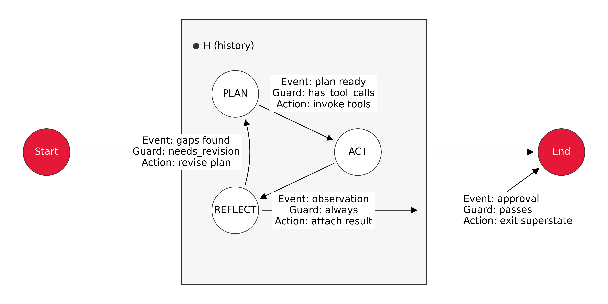
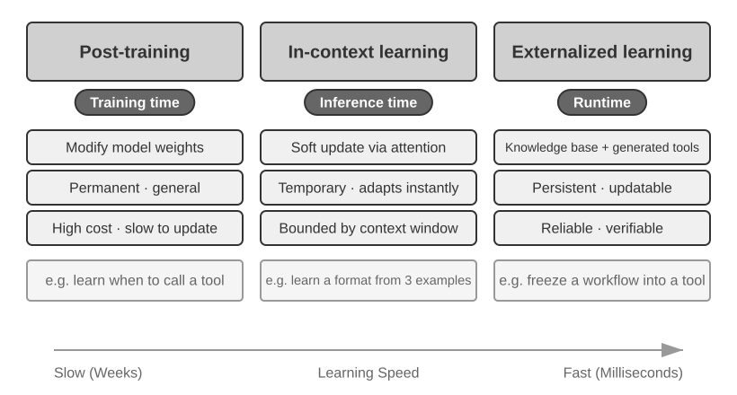

# 1 — Agent fundamentals

> Agent = LLM + Context + Tools. What each term covers, how the ReAct loop ties them together, and when to choose a workflow or an autonomous agent.

An inventory manager checks three products every Monday and decides what to reorder. A language model can read the sales figures and recommend an order in one call. That is not yet an agent. It becomes one when it looks the figures up itself, places the order, notices the supplier rejected it and tries again, and each of those steps adds a way to fail that a single call never had. This chapter takes that small job apart: what an agent is made of, how the loop runs, how much freedom to give it, and which parts must stay out of the model's hands.

---

## The running example: a restock agent

Lakshmanan and Hapke open their book with the smallest useful agent: a single model call with the system prompt "you are an inventory manager who orders just in time", given stock levels and four weeks of sales for three items. Its answer was to order 300 of itemB, justified by recent weekly sales of 70 to 90 units, a two-week delivery time and some safety stock (*Generative AI Design Patterns*, ch. 1). They define agents modestly, as small software components that deliver a capability using a model. Such a component becomes more autonomous as it plans, picks its own tools, recovers from errors and judges when it has finished, and they name four traits to look for: goal orientation, planning and reasoning, perception and action, and adaptability. They also warn that truly agentic behavior remains aspirational, because the same input can produce a different plan on another run.

That warning sets the design rule of this pillar. Anything that can be computed should be computed, and the model should be checked against it. The book's data, in plain Python:

```python
# Check the model's reorder against arithmetic the model cannot talk its way past.
from dataclasses import dataclass

@dataclass
class InventoryItem:
    name: str
    quantity_on_hand: int
    weekly_sold: list[int]     # past four weeks, oldest first
    weeks_to_deliver: int

ITEMS = [
    InventoryItem("itemA", 300, [50, 70, 80, 100], 2),
    InventoryItem("itemB", 100, [70, 80, 90, 70], 2),
    InventoryItem("itemC", 200, [80, 70, 90, 80], 1),
]

def weeks_of_cover(item: InventoryItem) -> float:
    peak = max(item.weekly_sold)                       # plan for the worst recent week
    return item.quantity_on_hand / peak

for item in ITEMS:
    cover = weeks_of_cover(item)
    verdict = "ORDER NOW" if cover < item.weeks_to_deliver else "ok"
    print(f"{item.name}: {cover:.1f} weeks of cover, {item.weeks_to_deliver} to deliver -> {verdict}")

# The stub stands in for the model's structured answer in Lakshmanan & Hapke's example.
proposed = {"item": "itemB", "quantity": 300}
item = next(i for i in ITEMS if i.name == proposed["item"])
peak = max(item.weekly_sold)
on_arrival = item.quantity_on_hand - item.weeks_to_deliver * peak
print(f"\nproposed {proposed['quantity']} of {item.name}: on arrival, stock is {on_arrival} at peak sales")
print(f"after delivery: {max(on_arrival, 0) + proposed['quantity']} units, "
      f"{(max(on_arrival, 0) + proposed['quantity']) / peak:.1f} weeks of cover")

# Why a long autonomous chain needs checkpoints: per-step reliability compounds.
for per_step in (0.99, 0.95):
    for steps in (10, 100):
        print(f"{per_step:.0%} per step over {steps:>3} steps -> {per_step ** steps:6.1%} end to end")
```

```text
itemA: 3.0 weeks of cover, 2 to deliver -> ok
itemB: 1.1 weeks of cover, 2 to deliver -> ORDER NOW
itemC: 2.2 weeks of cover, 1 to deliver -> ok

proposed 300 of itemB: on arrival, stock is -80 at peak sales
after delivery: 300 units, 3.3 weeks of cover
99% per step over  10 steps ->  90.4% end to end
99% per step over 100 steps ->  36.6% end to end
95% per step over  10 steps ->  59.9% end to end
95% per step over 100 steps ->   0.6% end to end
```

The check agrees with the model about which item to order. It also finds something the model's explanation did not state: at peak sales itemB runs out about 80 units before any order can arrive, so 300 units is a recovery rather than a just-in-time order. A person would want to know that, and the arithmetic surfaced it for free.

The last four lines show why agents get harder as they run longer. If each step works 95% of the time and failures are independent, a 10-step run succeeds about 60% of the time and a 100-step run almost never. Independence is a simplification, but the direction holds: a longer chain needs checks between steps, not just a better model.

The later chapters keep this example. [02](02-tool-use-and-react.md) gives it tools, [03](03-memory-as-an-operating-system.md) gives it memory across Mondays, [04](04-multi-agent-design-patterns.md) adds a reviewer, [05](05-framework-survey.md) adds a human approval gate, and [06](06-google-adk-intensive.md) packages its policy as a skill, and [07](07-guardrails-and-autonomy.md) puts limits around it.

---

## The formula


*Figure 1-1, The Agent–Environment interaction loop and the Model–Harness structure inside the Agent. From Li, [*AI Agents in Depth*](https://github.com/bojieli/ai-agent-book/blob/main/book-en/chapter1.md) (Apache-2.0).*

**Agent = LLM + Context + Tools.** Read each term broadly:

| Term | Role | Covers | RL analogue |
|---|---|---|---|
| **LLM** | Reasoning engine | Understanding intent, planning, choosing the next action. Knowledge comes from pre-training; decision policy from post-training. | Policy |
| **Context** | Working set of information | Everything available at a decision point: environment, user memory, domain knowledge, own state, task progress | Observation space |
| **Tools** | Action interfaces | Predefined tool calls, Skills loaded on demand, generated code, sub-agents, messages to the user, external events | Action space |

The observation and action spaces are the **interface between the model and the world**, much as an ISA is the interface between software and hardware. Information outside the observation space does not exist for the model. An action outside the action space is something the model can only recommend in words.

That makes the **primary lever, with the model held fixed, to expand context and tools**. Many "we need a smarter model" problems are interface problems: put the relevant data into context, or expose the needed operation as a tool. Manus became a general agent by taking the union of three agent types (Deep Research = web; Coding = files and code; Computer Use = screen and clicks), not by swapping models. OpenClaw extended the same spaces into messaging channels and local files.

Expansion has to be **on-demand, relevant and controlled**. Irrelevant context is noise. Every extra tool adds selection cost and attack surface. Retrieval, tool discovery and permissions are what make expansion safe ([tool discovery at scale](../../../ai-engineering/03-harness-engineering/notes/03-tool-design.md)).

Production agents of every kind share three traits. The action space is **open-ended**: they generate language and code, not button presses. They **reason internally** before acting. They **interact continuously**, adjusting to feedback from the environment.

---

## Tools

Tools can be sorted by the direction of interaction:

| Type | Direction | Examples |
|---|---|---|
| Perception | World → agent, on request | Search, file read, DB/API queries |
| Execution | Agent → world | Code execution, file writes, system commands, API calls |
| Collaboration | Agent ↔ agent/human | Sub-agent delegation, human confirmation |
| Event trigger | World → agent, unprompted | Incoming email, cron, webhook. The agent doesn't call these; they wake it up. |
| User communication | Agent → user | Progress updates, check-ins by text, voice or email |

**Tool calling has four steps.**

1. The context declares the available tools: name, purpose and parameter schema.
2. The model decides whether to call one, which one and with what arguments.
3. The framework runs the call and appends the result to the context.
4. The model decides what to do next.

The developer defines and runs tools. The model makes every decision about using them.

**General vs. specialized.** Start with the narrowest capability that works and widen it when the task demands. A sandboxed code interpreter composes better than a growing pile of single-purpose tools. Sandbox it with network off by default, a confined working directory, and CPU, memory, time and output limits. High-risk or tightly governed operations stay as **dedicated tools** with explicit parameters, narrow permissions and an audit trail: payments, deletes, outbound email, deploys. Rule of thumb: *general capabilities for composition and exploration; specialized tools to constrain risk and enforce business rules.* Depth: [harness 03 — tool design](../../../ai-engineering/03-harness-engineering/notes/03-tool-design.md).

---

## Context

Each LLM call's context has five parts:

| Part | Lifetime | Contents |
|---|---|---|
| System prompt | Static prefix | Role, permissions, rules; also cross-session user memory and injected environment state |
| Tool definitions | Static prefix | Names, descriptions, parameter schemas (since 2026, frameworks can also load schemas on demand at the end of the context without breaking the cached prefix) |
| User messages | Trajectory | Input, plus any RAG-retrieved knowledge |
| Assistant messages | Trajectory | Up to three parts: `reasoning`, `content` and `tool_calls` (typically reasoning + tool_calls, or reasoning + content) |
| Tool results | Trajectory | What the framework returns after running a tool |

**Agent context = static prefix + trajectory.** The first two parts make up the prefix, which is constant for the whole conversation and is what makes KV-caching possible. The last three make up the trajectory, which grows every turn.

### Ablation: what each part is for

Experiment 1-1 removes one part at a time (the system prompt is kept, since without it there is no agent):

| Removed | Observed failure |
|---|---|
| Tool definitions | Can't act at all. It doesn't know any tools exist. |
| Tool results | No feedback, so it calls the same tool repeatedly and loops forever |
| Reasoning in assistant messages | Consecutive decisions contradict each other |
| Message history | Loses continuity, restarts the task and repeats finished steps |

The lesson: *an agent can only decide on what is in its context.* Every component is load-bearing. Lab: [chapter1/context](https://github.com/bojieli/ai-agent-book/tree/main/chapter1/context) (needs an API key; configurable ablation modes).

The tool-results row was measured on robots before ReAct. SayCan (Ahn et al., 2022) had PaLM-540B pick a kitchen robot's next skill without ever being told whether the last one had worked. Inner Monologue ([arXiv:2207.05608](https://arxiv.org/abs/2207.05608) (Huang et al., CoRL 2023)) wrote that feedback back into the prompt as text after each step: whether the step succeeded, which objects were visible, and answers from a human when the model asked. Over 120 kitchen runs, success rose from 30.8% for SayCan to 60.4% with success and object feedback. When a person forced a skill to fail mid-task, SayCan had no reason to retry, and its mobile-manipulation success fell to 0% while Inner Monologue's held at 75%. In those runs a human supplied the object list, and a learned classifier judged success. The model still sometimes ignored the feedback, and a false "success" report misled it.

---

## The ReAct loop


*Figure 1-4, Agent trajectory—ReAct loop for a multi-currency aggregation task. From Li, [*AI Agents in Depth*](https://github.com/bojieli/ai-agent-book/blob/main/book-en/chapter1.md) (Apache-2.0).*

**Reason → act → observe**, repeated until done. On every call the model gets the static prefix plus the full trajectory, then its response is appended to the trajectory:

```
user:      "Q1 2.5M USD, Q2 2.1M EUR, Q3 1.8M GBP, Q4 380M JPY — total and average?"
assistant: reasoning="convert to USD"   tool_calls=[convert×3]      # parallel
tool ×3:   EUR→USD 2282608.7 · GBP→USD 2278481.01 · JPY→USD 2541806.02
assistant: reasoning="aggregate"         tool_calls=[code_interpreter]
tool:      "Total: $9,602,895.73, Average: $2,400,723.93"
assistant: reasoning="done"              content="FINAL ANSWER: ..."
```

That run took three iterations and four tool calls. Because the context accumulates, the model always knows what stage the task is at and what has already been tried. Because the trajectory is structured, it can be read and debugged. It is also the raw material for learning: distill trajectories into a knowledge base, or train on them with RL ([gen-AI 05](../../05-RL/README.md)). The cost is that the full trajectory is re-sent every turn, so total tokens grow quadratically with length. [Compaction](../../../ai-engineering/02-context-engineering/README.md) is the usual mitigation.

**Exit conditions** for an autonomous loop: a final-output tool is called, the model replies with no tool calls, an unrecoverable error occurs, or the round cap is hit.

The round cap needs a wrap-up step. A capped loop can stop right after a tool result, with no closing assistant message. So when the cap is hit, add one last instruction ("answer now from what you have, in the requested format") and make one more call with tools off. Koenigstein's minimal loop caps at `max_steps=8` and ends this way (*AI Agents: The Definitive Guide*, ch. 1). LangChain's legacy `AgentExecutor` defaulted to `max_iterations=15`, with `max_execution_time` as a second, wall-clock bound (*Prompt Engineering for Generative AI*, ch. 6).

### The loop in one screen

Here is that loop with the restock agent. The model is scripted so that the code runs without an API key: `decide` returns what a real model would return, and swapping in an API call changes one method. Everything else in the block is the part you own, and it stays the same when the model is real.

```python
# The whole agent in one screen: a stubbed model, two tools, a step cap, a forced wrap-up.
import json

STOCK = {"itemB": {"on_hand": 100, "weekly_sold": [70, 80, 90, 70], "weeks_to_deliver": 2}}
ORDERS = []

def get_stock(item):
    return STOCK[item]

def place_order(item, quantity):
    ORDERS.append((item, quantity))
    return {"status": "placed", "item": item, "quantity": quantity}

TOOLS = {"get_stock": get_stock, "place_order": place_order}

class ScriptedModel:
    """Replays decisions in order, as a real LLM would decide them. Swap for an API call."""
    def __init__(self, decisions):
        self.decisions, self.calls = list(decisions), 0

    def decide(self, messages):
        self.calls += 1
        if messages[-1]["role"] == "system":            # the wrap-up instruction
            return {"text": "Stopped at the step limit. Order status unconfirmed."}
        return self.decisions.pop(0)

def run_agent(model, goal, max_steps):
    messages = [{"role": "user", "content": goal}]
    for step in range(1, max_steps + 1):
        decision = model.decide(messages)
        if "text" in decision:                          # no tool call: the model is done
            print(f"step {step}: answer  {decision['text']}")
            return decision["text"]
        name, args = decision["tool"], decision["args"]
        result = TOOLS[name](**args)                    # the harness acts, not the model
        print(f"step {step}: {name}({args}) -> {json.dumps(result)}")
        messages.append({"role": "assistant", "content": decision})
        messages.append({"role": "tool", "content": json.dumps(result)})
    messages.append({"role": "system", "content": "Step limit reached. Report status now."})
    return model.decide(messages)["text"]

plan = [
    {"tool": "get_stock", "args": {"item": "itemB"}},
    {"tool": "place_order", "args": {"item": "itemB", "quantity": 300}},
    {"text": "Ordered 300 of itemB: on-hand stock runs out before a 2-week delivery."},
]

run_agent(ScriptedModel(plan), "Check itemB and reorder if needed.", max_steps=5)
print("orders:", ORDERS)

print("\n-- same agent, cap of 1 --")
ORDERS.clear()
print(run_agent(ScriptedModel(plan), "Check itemB and reorder if needed.", max_steps=1))
print("orders:", ORDERS)
```

```text
step 1: get_stock({'item': 'itemB'}) -> {"on_hand": 100, "weekly_sold": [70, 80, 90, 70], "weeks_to_deliver": 2}
step 2: place_order({'item': 'itemB', 'quantity': 300}) -> {"status": "placed", "item": "itemB", "quantity": 300}
step 3: answer  Ordered 300 of itemB: on-hand stock runs out before a 2-week delivery.
orders: [('itemB', 300)]

-- same agent, cap of 1 --
step 1: get_stock({'item': 'itemB'}) -> {"on_hand": 100, "weekly_sold": [70, 80, 90, 70], "weeks_to_deliver": 2}
Stopped at the step limit. Order status unconfirmed.
orders: []
```

Three things are worth reading closely. The model never touches `ORDERS`; it only names a tool, and the harness acts. The result goes back into `messages`, so the next decision can see it. And the capped run ends with an honest status rather than silence or a claim that the order went through, which is exactly what the wrap-up step is for.

---

## Agents as state machines

A loop with tools is a **finite state machine** (FSM). Each node is a mode, such as plan, call a tool or answer. Each edge is a decision with three parts: the *event* that fires it, the *guard* that allows it, and the *action* it runs. FSMs suit agents that switch between a few stable modes. You can checkpoint at every node and, after a crash, resume from the last completed state. They stop scaling once you add planning, reflection, approval gates and retries. Every new mode then needs edges to and from the others, and the routing turns to spaghetti (*AI Agents: The Definitive Guide*, ch. 1).


*Image Source: Nicole Koenigstein, *AI Agents: The Definitive Guide* (O'Reilly, 2026), Fig. 1-2*

A **hierarchical state machine** (HSM) lets states contain states:

| Element | Meaning | Agent equivalent |
|---|---|---|
| Superstate | Groups child states and their common policy. Entry and exit logic run once. | A subgraph. Rate limits, safety filters and circuit breakers attached to `WORKING` apply to PLAN, ACT and REFLECT alike. |
| Substate | A concrete mode with its own edges. It inherits the superstate's guards. | A node inside the subgraph |
| History (H) | Remembers the last active child. Shallow history resumes at that child; deep history resumes at a nested grandchild. | A checkpoint for part of the graph |
| Parallel region | Child regions that advance independently, then join | Fan-out of tool calls or agent roles |

LangGraph maps onto this directly. The parent graph's state schema is the shared bus. The keys a subgraph shares with its parent are the superstate's interface. Parent-level conditional edges enforce global policy, such as budget or a user's "stop". Child-level edges route among the substates. Guards are plain Python, so they stay deterministic and auditable. A checkpointer resumes a thread at the last completed node. To return to a specific substate on re-entry, persist a small marker (`state["working_last"] = "reflect"`) and branch on it.

The same frame gives an **autonomy spectrum**:

- A router is a one-edge FSM: a single choice from fixed options.
- A tool-calling agent is an HSM with a `WORKING` loop: multi-step, with reflection and memory.
- A multi-agent system is a set of subgraphs under a supervisor superstate.

Nearly every production system sits in the middle. Koenigstein calls this **orchestrated autonomy**: the model chooses freely inside regions you designed, but it cannot redesign its control graph, invent new topologies or reliably create its own tools. AI Scientist v2 shows how far that goes today. It submitted three papers to an ICLR 2025 workshop and one was accepted, at workshop level, not the main track. Reviewers found methodological gaps and shallow analysis, and the system still made citation errors and misleading figure descriptions (*AI Agents: The Definitive Guide*, ch. 1). Sakana's own paper shows how much of the run was orchestrated. An experiment-manager agent runs best-first tree search over experiment code in four fixed stages, and a VLM reviews the figures. Humans then picked 3 of about 20 generated ideas and, for each, the best manuscript across several seeds ([Sakana AI, 2025-04](https://pub.sakana.ai/ai-scientist-v2/paper/paper.pdf)). The accepted paper averaged 6.33 (scores 6, 7, 6), roughly the top 45% of 43 submissions, at a workshop whose acceptance rates the authors put at 60–80%. Their own code review found about 57% overlap between its training and test sets, and the paper was withdrawn after review as agreed with the organizers.

---

## Model as agent

Frontier models now internalize **the tool-calling decision policy** through RL: when to call, which tool, what arguments, whether to continue, how to chain hundreds of calls. Examples are Kimi K3, with stable 200–300-call chains, and GPT-5.6 with Responses-API built-in web search and code interpreter, plus an intent-clarification step before research begins. Two points are often confused:

- **RL teaches the decision; it doesn't contain the tool.** `web_search` and the sandbox still run outside the weights, server-side as API built-ins. The orchestration loop has moved from client to server, and the decision has moved into the model.
- **A stronger model makes the harness matter more, not less.** The more decisions the model owns, the more a wrong one costs, so constraint, verification and correction get finer-grained. See [harness 01](../../../ai-engineering/03-harness-engineering/notes/01-what-a-harness-is.md).

Freeform tool calling (`type: "custom"`) lets the model send raw text, such as Python or SQL, rather than JSON-escaped arguments. It changes the API format, not the architecture. The loop is still: detect call → execute → return.

Upstream labs: [1-2 web-search-agent](https://github.com/bojieli/ai-agent-book/tree/main/chapter1/web-search-agent) · [1-3 search-codegen](https://github.com/bojieli/ai-agent-book/tree/main/chapter1/search-codegen) (both need API keys).

### How agents learn


*Figure 1-2, Three Levels of Agent Capability Updates. From Li, [*AI Agents in Depth*](https://github.com/bojieli/ai-agent-book/blob/main/book-en/chapter1.md) (Apache-2.0).*

Agents learn in three ways, which differ in where the update lives and how long it lasts:

| Path | Where | Persists | Best for |
|---|---|---|---|
| Contextual adaptation | Current context (examples, state, retrieval) | This task only | Fast, cheap adjustment |
| External artifacts | Knowledge docs, prompts/Skills, code and harness | Across tasks; auditable | Facts, language-expressible strategy, deterministic rules |
| Parameters | Weights, via post-training | Permanently | High-dimensional skills rules can't express |

They work together at different timescales. Depth: [loop 08 — self-improving loops](../../../ai-engineering/04-loop-engineering/notes/08-self-improving-loops.md).

CoALA gives the three paths a memory vocabulary, borrowed from Soar-era cognitive architectures ([arXiv:2309.02427](https://arxiv.org/abs/2309.02427) (Sumers et al., TMLR 2024)). The context is *working memory*. Long-term memory is *episodic* (past trajectories), *semantic* (facts and lessons, as when Reflexion stores "there is no dishwasher in kitchen" after a failed episode), and *procedural*. Procedural memory covers both the weights and the agent's own code: prompt templates, skills, retrieval and decision logic. Learning becomes one more *internal* action, alongside reasoning and retrieval, while *external* actions touch the world. The framing ranks the risk: **writing procedural memory is far riskier than writing episodic or semantic memory**, because a bad prompt or skill update can break the agent or let it subvert its designers' intent. CoALA's advice on the action space matches the formula above: take the smallest action space the task needs, since every added action makes the decision problem harder.

The parameters row splits by *what* gets trained. Jiang et al. sort weight updates into four kinds. You can train the agent on tool-execution signals (A1, such as passing tests) or on judgments of its final output (A2). Or you can freeze the agent and train its tools instead, either independently of any agent (T1, such as a pretrained retriever) or against the frozen agent's own feedback (T2) ([arXiv:2512.16301](https://arxiv.org/abs/2512.16301) (Jiang et al., 2025-12)). T2 can be far cheaper. The s3 searcher, rewarded by how much its retrieved documents lift a frozen generator above naive top-k retrieval, reached 58.9% average QA accuracy from 2.4k training examples. Search-R1, which trains the whole agent (A2), needed about 170k examples for comparable accuracy, so s3 used about 70× less data and trained about 33× faster. A trained specialist can also *graduate* into a tool. SWE-Grep is an RL-trained code-search subagent that coding agents call, so the main agent's weights never change. The survey's open-problems section lists what goes wrong when the agent learns:

- RL for reasoning can erode the safety guardrails set during SFT (their DeepSeek-R1 case study).
- Trial and error with real tools can take actions that resetting the episode cannot undo.
- A compromised tool can return injected data that turns the calling agent into a confused deputy.

**Imitate first, then explore.** The usual recipe for the parameters row is behavioral cloning on expert trajectories, then training on the agent's own rollouts. AgentGym tests it across 11 environments with Llama-2-Chat-7B ([arXiv:2406.04151](https://arxiv.org/abs/2406.04151) (Xi et al., 2024-06, preprint)). Cloning 6,130 ReAct-format trajectories gives the base agent. AgentEvol then runs four rounds: sample once per instruction from a wider instruction set, keep only the successful trajectories, fine-tune on them plus the original set. That is the reward-filtered self-training of ReST-EM ([arXiv:2312.06585](https://arxiv.org/abs/2312.06585) (Singh et al., TMLR 2024)) applied to agents. It lifted WebShop from 66.5 to 76.5, ALFWorld from 77.5 to 88.0 and BabyAI from 69.3 to 82.7, **beating cloning on 2.4× as many expert trajectories** on all three. The same tables bound the claim. On SciWorld the extra expert data won by far (74.5 against 38.0). Exploring only the instructions already seen in cloning added little (ALFWorld 80.5), so the gain comes from task breadth, not just more rollouts. Adding failed trajectories through DPO on success/failure pairs did worse than training on successes alone on all four tasks tested. The argument for interaction is older. On ScienceWorld's 30 elementary-science tasks, a 1.5M-parameter DRRN trained online for 100k steps averaged 0.17, against 0.08 for an 11B T5 cloned from about 211k expert steps ([arXiv:2203.07540](https://arxiv.org/abs/2203.07540) (Wang et al., EMNLP 2022)). That comparison is not clean: the RL agent picks from the simulator's list of valid actions, while the T5 generates candidates that are mostly invalid and must be filtered against the same list.

**Clone the reasoning, not just the actions.** Thought Cloning trains a BabyAI agent from scratch on 1M synthetic trajectories whose thoughts are the oracle solver's plan rendered as text, with a loss on both thought and action ([arXiv:2306.00323](https://arxiv.org/abs/2306.00323) (Hu and Clune, NeurIPS 2023)). It learns faster than plain behavioral cloning, and the gap widens the further test mazes are out of distribution, zero-shot and after fine-tuning. A same-size variant without the thought loss does not close the gap, so it is not just extra parameters. Because the plan is visible, a monitor that halts the agent when a thought declares a forbidden action **cut unsafe episodes from 37–57% to under 0.6%** across three test behaviors. This is the trained counterpart of the ablation above, where removing reasoning made consecutive decisions contradict each other. The setting is narrow: rule-generated thoughts in a grid world, a small model trained from scratch, no LLM.

---

## Choosing a model

Release cycles move too fast for version picks, so here are the directions:

- **Evaluate on your own tasks**, not leaderboards ([06-eval](../../../ai-engineering/06-eval/README.md)). Tool-calling ability varies more than general benchmarks suggest.
- **Use a reasoning model** for anything multi-step or dynamic. Non-reasoning models suffice only for single simple steps or fixed-position GUI clicks.
- **Output speed is latency.** Rounds are sequential: 2 s slower per round across 20 rounds adds 40 s.
- **Multimodality** is a hard requirement if inputs include images, audio or video. Coverage differs widely.
- **Open vs. closed.** Closed models lead on capability. Open weights win on cost, private deployment and fine-tuning. A common hybrid path is to start on managed APIs (closed, or open models from a hosted provider) while roles are still forming, then self-host once the team and the need for control grow (*AI Agents: The Definitive Guide*, ch. 4).
- **Price doesn't track quality.** In Albada's mid-2025 snapshot, DeepSeek-v3 scored 87.2 on MMLU at 2.75× / 3.65× the cheapest model's input/output price. Claude 4 Opus with extended thinking scored 86.5 at 75× / 125× (*Building Applications with AI Agents*, ch. 2). Koenigstein quotes closed models at up to $150 / $600 per M input/output tokens (o1-pro), against about $0.3 / $3 for open models over 200B parameters on low-cost hosts (*AI Agents: The Definitive Guide*, ch. 4). Both snapshots are dated, but the point holds: benchmark the cheaper model before assuming you need the flagship.
- **Staff by role, not one model for everything.** Koenigstein's research team uses Qwen3-32B with thinking off for the researchers, note taker and writer. The analyst gets Qwen3-235B-A22B with a 1,536-token thinking budget plus a ModernBERT encoder that scores documents. GPT-4.1 is the supervisor that routes and decides when to finish. Turn thinking on for planning, decomposition, tool selection and verification. Turn it off for short, low-risk turns. Budgets of about 1,000+ thinking tokens work for non-trivial reasoning; raise them for math, code and multi-tool plans. Too small a budget truncates the reasoning (*AI Agents: The Definitive Guide*, ch. 4). Albada makes the same point from the other side: route simple queries to small models and design for a *multimodel* system from the start (*Building Applications with AI Agents*, ch. 1). NVIDIA's position paper pushes the default further: most agent calls are narrow, repetitive, format-bound subtasks, so a model under 10B should be the default and the LLM the exception. They cite serving a 7B model at 10–30× lower latency, energy and FLOPs than a 70–175B one. Their migration path is to log every non-chat agent call, collect 10k–100k examples, cluster them into tasks and fine-tune a specialist per cluster ([arXiv:2506.02153](https://arxiv.org/abs/2506.02153) (Belcak et al., 2025-06)). The paper runs no experiments. Its estimates that 40–70% of LLM calls in MetaGPT, Open Operator and Cradle could move to small models come from reading the code, not from measurement, and the authors' employer sells the inference stack they recommend.
- **Know the four tiers.** Lakshmanan and Hapke sort models into frontier, distilled, open-weight and locally hostable. On the LMArena leaderboard of April 6, 2025, they read Gemini Flash as about 20 times cheaper than Gemini Pro for a modest drop in rating, and they note that a 400-point Elo gap means roughly 10:1 odds of being preferred (*Generative AI Design Patterns*, ch. 1). The prices have moved since, but the method lasts: plot rating against price and start at the knee of the curve.
- **Keep the prefix byte-stable.** Reordering messages, trimming old turns or injecting documents into the middle of the context invalidates the cached KV entries after the change. Put the static system prompt first and append new material at the end (*AI Agents: The Definitive Guide*, ch. 4).

---

## Workflow vs. autonomous agent

Climb the ladder only as far as you need: **a single LLM call → workflow → autonomous agent.** Agents trade latency and cost for task performance; check the trade is worth it.

Albada adds a rung below the LLM, plain code, and rates every rung on four factors: input variability, reasoning complexity, performance or compliance constraints, and maintenance burden (*Building Applications with AI Agents*, ch. 1).

| Tier | Choose it when | Example |
|---|---|---|
| Plain code | Inputs are fully predictable; latency must be milliseconds; certification demands deterministic, auditable logic (medical devices, aeronautics) | A regex parser for logs that always read `YYYY-MM-DD HH:MM:SS—message` |
| Deterministic workflow | You can list every branch in advance and need retries, backoff or approval gates | Invoices arrive as CSV, JSON or PDF. Route each format to its parser and halt for human review on a failed reconciliation. |
| Chatbot / RAG | The job is question-answering over documents, with no follow-up actions | An IT help desk answering "How do I reset my VPN credentials?" |
| Agent | Inputs are free-form and varied, and the task needs multistep planning that adapts to intermediate results | A support inbox where one email reports a swelling battery and the next a billing error |

| | Workflow | Autonomous agent |
|---|---|---|
| Path | Fixed in code; the LLM works only inside nodes | Chosen at runtime from environment feedback |
| Strengths | Steps can't be skipped or reordered ("no booking before payment"); injection is confined to a single node | Handles the unforeseen: layovers, cancellations, mid-flow changes |
| Weakness | Can only follow preset exception branches or hand off | Costlier; errors compound; needs explicit stop conditions |
| Fits | Compliance-critical, decomposable processes | Open-ended tasks with unpredictable step counts (SWE-bench, computer use, research) |

Real systems **mix them**: compliance-critical spine as workflow, flexible parts as agent nodes (n8n canvases do this visually). Anthropic's three principles for either: **keep it simple** (direct API calls over frameworks), **keep it transparent** (show plans, logs, trajectories), and **design the ACI** (agent–computer interface) so misuse is impossible. That is *poka-yoke*: like the SIM card's notched corner, the tool should only fit one way. Depth: [harness 07 — orchestration](../../../ai-engineering/03-harness-engineering/notes/07-orchestration.md).

**Scope the first agent to one bounded workflow.** Albada's support agent starts with order cancellation only. Each way of getting the scope wrong fails differently. Too narrow, and you miss other high-volume requests such as refunds and address changes. Too broad ("automate every support inquiry"), and you drown in edge cases. Too vague ("improve customer satisfaction"), and you never know when you've succeeded. A bounded workflow has concrete inputs (the message and the order record), structured outputs (a tool call and a confirmation) and a checkable result. That gives a minimal eval from day one: did it call `cancel_order`, with the right order ID, and send a correct confirmation? The metrics are tool recall, parameter accuracy and confirmation quality, measured over hundreds of real tickets. In Albada's words, "an untested agent is an untrusted agent" (*Building Applications with AI Agents*, ch. 2). Scale needs planning too: a system built for 10 tickets a minute can hang at 1,000 without autoscaling (ch. 1). Depth: [06-eval](../../../ai-engineering/06-eval/README.md).

**Errors compound with steps, so count failures by type.** At 95% accuracy per step, a 10-step task succeeds about 60% of the time, and a 100-step task 0.6% of the time (*AI Engineering*, ch. 6). Per-step reliability matters more for an agent than for a single call. Huyen's failure taxonomy is a good set of eval buckets. Measure how often each one happens:

| Failure | Example (*AI Engineering*, ch. 6) | Metric |
|---|---|---|
| Invalid tool | The plan calls `bing_search`, which isn't in the inventory | Share of calls to tools that don't exist |
| Valid tool, invalid parameters | `lbs_to_kg` called with two arguments when it takes one | Share of calls that fail schema validation |
| Valid tool, wrong values | `lbs=100` when the user said 120 | Share of calls with incorrect arguments, against labeled tasks |
| Goal failure | A $5,000 San Francisco–Hanoi trip planned to Ho Chi Minh City, or over budget | Task success under the stated constraints |
| Reflection error | Asked to put 50 people in 30 hotel rooms, it places 40 and reports success | Agreement between the agent's "done" and a checker's |
| Tool failure | The tool itself returns a wrong answer | Per-tool error rate, tested in isolation |
| Efficiency | Correct, but takes too many steps, dollars or seconds | Steps, cost and latency per task, against a baseline |

For planning failures, generate K plans per (task, tool inventory) pair and report the share of valid plans and how many attempts a valid one takes on average. The reflection row is why "the agent said it finished" can never be the success signal.

---

## Guardrails

The loop above has no opinion about what a tool is allowed to do, so that has to be enforced elsewhere: around inputs, around execution, around outputs, and by people at the points where an action cannot be undone. The governing rule is that **a prompt restriction is not a permission**, so the boundary belongs below the model, in credentials and tools. [07 — guardrails and autonomy](07-guardrails-and-autonomy.md) covers the positions, the patterns that lower risk before you filter it, what the user must be able to see, and how much autonomy exists today.

---

## Pitfalls

- **Calling a single LLM call an agent, or a workflow an agent.** Ask who decides the next step at run time. If your code does, it is a workflow, and that is often the better system.
- **Trusting the model's own explanation.** A fluent justification is not a check. In the example above, the arithmetic found a stockout the explanation left out. Compute what can be computed.
- **Treating "the agent said it finished" as success.** Verify the goal against the environment: read the order back from the system of record.
- **Stopping at the step cap with no wrap-up.** The trajectory ends on a tool result and the user gets nothing, or the last message implies work that never happened.
- **Putting permissions in the prompt.** A prompt can be edited or overridden. Use read-only credentials and tools that cannot perform the forbidden action.
- **Picking the flagship model first.** Price does not track quality on your task. Measure on your own cases, and staff by role.

---

## Try it

1. Run the coverage check with itemC's delivery time changed to 3 weeks. What changes, and what does that tell you about which input the decision depends on?
2. The restock loop's cap is 5 and the plan takes 3 steps. Set `max_steps=2`. What happens to `ORDERS`, and is the final message honest?
3. In the coverage check, a model recommends ordering 300 of itemA. Write the one-line test that would reject it, and say what number it needs that the model does not have to be trusted for.

<details>
<summary>Answers</summary>

1. itemC now has 2.2 weeks of cover against 3 weeks of delivery, so it flips to `ORDER NOW`. The decision depends on delivery time as much as on sales, so a stale delivery figure produces a wrong order however good the model is.
2. Step 1 reads the stock and step 2 places the order, so `ORDERS` holds `('itemB', 300)`. The loop then stops before the model's closing message, and the wrap-up reports "Order status unconfirmed" although the order did go through. The status is cautious but incomplete. A better harness builds the wrap-up from the trajectory, so it can state the actions that were taken.
3. `assert weeks_of_cover(item) < item.weeks_to_deliver`. itemA has 3.0 weeks of cover against 2 weeks of delivery, so the test fails and the order goes to review. The numbers come from the system of record, so nothing here relies on the model's arithmetic.

</details>

---

## Interview checklist

| Question | Short answer |
|---|---|
| What is an agent, in one line? | A model in a loop that chooses actions through tools, with context carrying state between steps, inside a harness that executes those actions and enforces limits |
| Who decides the next step in a workflow and in an agent? | Your code in a workflow; the model in an agent. Most production systems mix the two ([orchestrated autonomy](#agents-as-state-machines)) |
| When is an agent the wrong choice? | When inputs vary little and the path is known. Plain code, a workflow or RAG is cheaper, faster and easier to test |
| Why do long agent runs fail more often? | Per-step errors compound: at 95% per step, 10 steps is about 60% and 100 steps is under 1%, assuming independent failures |
| What are the exit conditions of the loop? | A final-output tool, a reply with no tool calls, an unrecoverable error, or the round cap. The cap needs a wrap-up call |
| Why do token costs grow quadratically with run length? | The whole trajectory is re-sent on each turn, so the input grows with every step and is paid for every time |
| Where does a permission belong? | Below the model, in credentials and tools. A prompt can be edited or overridden ([07](07-guardrails-and-autonomy.md)) |
| How should you pick a model? | Evaluate on your own tasks, weigh price against quality per role, and treat speed as latency, since rounds run in sequence |

---

## Next

→ [02 — tool use and the ReAct loop](02-tool-use-and-react.md): the mechanics of a tool call, from raw function calling to MCP. Production view: [harness 01 — what a harness is](../../../ai-engineering/03-harness-engineering/notes/01-what-a-harness-is.md) (Model + Harness).
