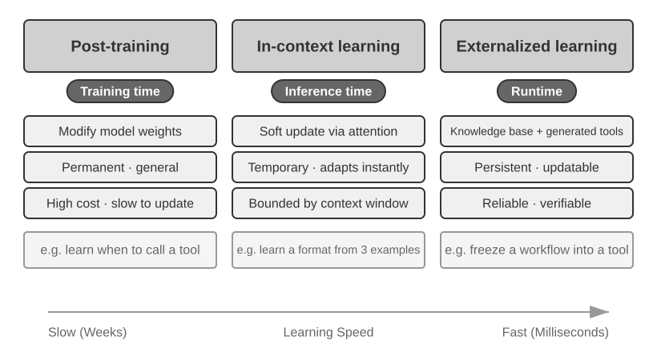

# 1c — Model as agent and how agents learn

> Frontier models now own the tool-calling decision, and an agent can change itself at three timescales: in context, in external artifacts and in weights.

[Note 01](01-agent-fundamentals.md) defined the agent as a model, a context and tools in a loop, and chose a model for it. This note covers the two questions that follow once the model is strong: what RL training moved from your code into the model, and how an agent improves after it ships. It is the second half of the pair, so it assumes the loop from note 01. For the stores that carry what an agent learns, see [03b](03b-learning-from-experience.md).

---

## Model as agent

Frontier models now internalize **the tool-calling decision policy** through RL: when to call, which tool, what arguments, whether to continue, how to chain hundreds of calls. Examples are Kimi K3, with stable 200–300-call chains, and GPT-5.6 with Responses-API built-in web search and code interpreter, plus an intent-clarification step before research begins. Two points are often confused:

- **RL teaches the decision; it doesn't contain the tool.** `web_search` and the sandbox still run outside the weights, server-side as API built-ins. The orchestration loop has moved from client to server, and the decision has moved into the model.
- **A stronger model makes the harness matter more, not less.** The more decisions the model owns, the more a wrong one costs, so constraint, verification and correction get finer-grained. See [harness 01](../../../ai-engineering/03-harness-engineering/notes/01-what-a-harness-is.md).

Freeform tool calling (`type: "custom"`) lets the model send raw text, such as Python or SQL, rather than JSON-escaped arguments. It changes the API format, not the architecture. The loop is still: detect call → execute → return.

Upstream labs: [1-2 web-search-agent](https://github.com/bojieli/ai-agent-book/tree/main/chapter1/web-search-agent) · [1-3 search-codegen](https://github.com/bojieli/ai-agent-book/tree/main/chapter1/search-codegen) (both need API keys).

### How agents learn


*Figure 1-2, Three Levels of Agent Capability Updates. From Li, [*AI Agents in Depth*](https://github.com/bojieli/ai-agent-book/blob/main/book-en/chapter1.md) (Apache-2.0).*

Agents learn in three ways, which differ in where the update lives and how long it lasts:

| Path | Where | Persists | Best for |
|---|---|---|---|
| Contextual adaptation | Current context (examples, state, retrieval) | This task only | Fast, cheap adjustment |
| External artifacts | Knowledge docs, prompts/Skills, code and harness | Across tasks; auditable | Facts, language-expressible strategy, deterministic rules |
| Parameters | Weights, via post-training | Permanently | High-dimensional skills rules can't express |

They work together at different timescales. Depth: [loop 08 — self-improving loops](../../../ai-engineering/04-loop-engineering/notes/08-self-improving-loops.md).

CoALA gives the three paths a memory vocabulary, borrowed from Soar-era cognitive architectures ([arXiv:2309.02427](https://arxiv.org/abs/2309.02427) (Sumers et al., TMLR 2024)). The context is *working memory*. Long-term memory is *episodic* (past trajectories), *semantic* (facts and lessons, as when Reflexion stores "there is no dishwasher in kitchen" after a failed episode), and *procedural*. Procedural memory covers both the weights and the agent's own code: prompt templates, skills, retrieval and decision logic. Learning becomes one more *internal* action, alongside reasoning and retrieval, while *external* actions touch the world. The framing ranks the risk: **writing procedural memory is far riskier than writing episodic or semantic memory**, because a bad prompt or skill update can break the agent or let it subvert its designers' intent. CoALA's advice on the action space matches the formula in [note 01](01-agent-fundamentals.md#the-formula): take the smallest action space the task needs, since every added action makes the decision problem harder.

The parameters row splits by *what* gets trained. Jiang et al. sort weight updates into four kinds. You can train the agent on tool-execution signals (A1, such as passing tests) or on judgments of its final output (A2). Or you can freeze the agent and train its tools instead, either independently of any agent (T1, such as a pretrained retriever) or against the frozen agent's own feedback (T2) ([arXiv:2512.16301](https://arxiv.org/abs/2512.16301) (Jiang et al., 2025-12)). T2 can be far cheaper. The s3 searcher, rewarded by how much its retrieved documents lift a frozen generator above naive top-k retrieval, reached 58.9% average QA accuracy from 2.4k training examples. Search-R1, which trains the whole agent (A2), needed about 170k examples for comparable accuracy, so s3 used about 70× less data and trained about 33× faster. A trained specialist can also *graduate* into a tool. SWE-Grep is an RL-trained code-search subagent that coding agents call, so the main agent's weights never change. The survey's open-problems section lists what goes wrong when the agent learns:

- RL for reasoning can erode the safety guardrails set during SFT (their DeepSeek-R1 case study).
- Trial and error with real tools can take actions that resetting the episode cannot undo.
- A compromised tool can return injected data that turns the calling agent into a confused deputy.

**Imitate first, then explore.** The usual recipe for the parameters row is behavioral cloning on expert trajectories, then training on the agent's own rollouts. AgentGym tests it across 11 environments with Llama-2-Chat-7B ([arXiv:2406.04151](https://arxiv.org/abs/2406.04151) (Xi et al., 2024-06, preprint)). Cloning 6,130 ReAct-format trajectories gives the base agent. AgentEvol then runs four rounds: sample once per instruction from a wider instruction set, keep only the successful trajectories, fine-tune on them plus the original set. That is the reward-filtered self-training of ReST-EM ([arXiv:2312.06585](https://arxiv.org/abs/2312.06585) (Singh et al., TMLR 2024)) applied to agents. It lifted WebShop from 66.5 to 76.5, ALFWorld from 77.5 to 88.0 and BabyAI from 69.3 to 82.7, **beating cloning on 2.4× as many expert trajectories** on all three. The same tables bound the claim. On SciWorld the extra expert data won by far (74.5 against 38.0). Exploring only the instructions already seen in cloning added little (ALFWorld 80.5), so the gain comes from task breadth, not just more rollouts. Adding failed trajectories through DPO on success/failure pairs did worse than training on successes alone on all four tasks tested. The argument for interaction is older. On ScienceWorld's 30 elementary-science tasks, a 1.5M-parameter DRRN trained online for 100k steps averaged 0.17, against 0.08 for an 11B T5 cloned from about 211k expert steps ([arXiv:2203.07540](https://arxiv.org/abs/2203.07540) (Wang et al., EMNLP 2022)). That comparison is not clean: the RL agent picks from the simulator's list of valid actions, while the T5 generates candidates that are mostly invalid and must be filtered against the same list.

**Clone the reasoning, not just the actions.** Thought Cloning trains a BabyAI agent from scratch on 1M synthetic trajectories whose thoughts are the oracle solver's plan rendered as text, with a loss on both thought and action ([arXiv:2306.00323](https://arxiv.org/abs/2306.00323) (Hu and Clune, NeurIPS 2023)). It learns faster than plain behavioral cloning, and the gap widens the further test mazes are out of distribution, zero-shot and after fine-tuning. A same-size variant without the thought loss does not close the gap, so it is not just extra parameters. Because the plan is visible, a monitor that halts the agent when a thought declares a forbidden action **cut unsafe episodes from 37–57% to under 0.6%** across three test behaviors. This is the trained counterpart of [the context ablation](01-agent-fundamentals.md#ablation-what-each-part-is-for), where removing reasoning made consecutive decisions contradict each other. The setting is narrow: rule-generated thoughts in a grid world, a small model trained from scratch, no LLM.

**Mix the agent data with general data.** AgentTuning fine-tunes Llama-2-chat on 20% GPT-4 agent trajectories (6 environments, kept only above a reward threshold) and 80% ShareGPT chat ([arXiv:2310.12823](https://arxiv.org/abs/2310.12823) (Zeng et al., Findings of ACL 2024)). **AgentLM-70B scored 1.40 on six held-out agent tasks against 0.51 for Llama-2-70b-chat (+176%), with GPT-3.5 at 1.49**, and general benchmarks held (0.96 against 0.95 on MMLU, HumanEval, GSM8K and MT-Bench). Training on agent data alone at 7B cut the held-out score to 0.09 against 0.67 for the mix. The held-out tasks resemble the held-in ones (web, household), the agent trajectories come from GPT-4, which caps the result, and the authors say it still struggles with Minecraft, as GPT-3.5 does.


---

## Reward-filtered self-training in a few lines

AgentEvol's loop is: sample rollouts, keep the ones that succeeded, train on them, repeat. The toy below strips it to the mechanism. The "policy" is a table of action weights, the "environment" rewards one action per state, and "training" adds the successful trajectories' actions to the table. The numbers are our own run on a made-up task, not AgentGym's.

```python
import random

random.seed(0)
STATES, ACTIONS = range(5), ["a", "b", "c"]
GOOD = {s: ACTIONS[s % 3] for s in STATES}          # the one rewarded action per state
weights = {s: {a: 1.0 for a in ACTIONS} for s in STATES}   # the "model"


def rollout():
    traj = [(s, random.choices(ACTIONS, [weights[s][a] for a in ACTIONS])[0]) for s in STATES]
    return traj, all(a == GOOD[s] for s, a in traj)


def success_rate(n=2000):
    return sum(rollout()[1] for _ in range(n)) / n


print(f"round 0 success: {success_rate():.3f}")
for rnd in range(1, 5):
    kept = [t for t, ok in (rollout() for _ in range(2000)) if ok]   # reward filter: successes only
    for traj in kept:
        for s, a in traj:
            weights[s][a] += 1.0                                      # "fine-tune" on what worked
    print(f"round {rnd}: kept {len(kept):4d} trajectories, success {success_rate():.3f}")
```

On our run, success went from 0.003 to 0.408 after one round and 0.993 after two, but only because the first round's lucky successes covered every state. The AgentGym tables show the real limit: exploring only the instructions already seen in cloning added little, so the gain came from task breadth.

---

## Pitfalls

- **Assuming RL put the tool inside the model.** It taught the decision (when to call, which tool, what arguments). The search or sandbox still runs outside the weights, so the harness still has to execute, validate and bound it.
- **Writing procedural memory like episodic memory.** A bad prompt or skill update can break the agent or let it subvert its designers' intent, which is far riskier than appending a fact (CoALA).
- **Treating expert data as the only lever.** Reward-filtered self-play beat cloning on 2.4× as many expert trajectories on three AgentGym tasks, yet lost badly on SciWorld, where the extra expert data won (74.5 against 38.0).
- **Training on failures by default.** DPO on success/failure pairs did worse than training on successes alone on all four AgentGym tasks tested.
- **Letting RL touch safety behavior unchecked.** RL for reasoning can erode guardrails set during SFT, and real-tool trial and error can take actions that resetting the episode cannot undo.
- **Reading a grid-world result as an LLM result.** Thought Cloning's monitor cut unsafe episodes from 37-57% to under 0.6%, but with rule-generated thoughts and a small model trained from scratch.

---

## Try it

1. In the toy above, change `random.choices` to use `weights[s]` only for states 0 to 3 and a uniform choice for state 4, then rerun. What happens to the success rate, and what does it say about task breadth?
2. An agent's only update path is editing its own system prompt. By CoALA's ranking, which memory is it writing, and what gate would you put in front of the write?
3. A search subagent is trained against a frozen generator's feedback. Which of Jiang et al.'s four kinds is that, and what data cost would you expect against training the whole agent?

<details>
<summary>Answers</summary>

1. State 4 never learns, so a full-trajectory success stays near 1/3 at best. The filter only teaches what the rollouts already reach, which is why AgentGym's gain came from broader instructions and not from more samples of the same ones.
2. Procedural memory, the riskiest kind. Gate it behind an eval run on held-out tasks, a diff the user can read and a one-step rollback.
3. T2: the tool is trained against the frozen agent's feedback. The s3 searcher used about 2.4k examples against about 170k for Search-R1, roughly 70× less data.

</details>

---

## Interview checklist

| Question | Short answer |
|---|---|
| What did RL change about tool calling? | It moved the decision (when, which tool, which arguments, whether to continue) into the model. The tool and its execution stay outside the weights. |
| Why does a stronger model need more harness, not less? | It owns more decisions, so a wrong one costs more. Constraint, verification and correction get finer-grained. |
| What are the three ways an agent learns? | Context (this task only), external artifacts such as prompts, skills and code (across tasks, auditable), and parameters (permanent, via post-training). |
| Which memory write is riskiest? | Procedural: it changes the agent's own prompts, skills or weights. Episodic and semantic writes are safer. |
| What is the usual recipe for training on trajectories? | Behavioral cloning on expert trajectories, then reward-filtered training on the agent's own successful rollouts. |
| Why clone the thoughts too? | The plan is visible, so a monitor can halt a forbidden action, and the agent learned faster, at least in the BabyAI grid world. |
| When is it cheaper to train the tool than the agent? | When the agent is frozen and the tool learns from its feedback (T2): s3 matched Search-R1's accuracy with about 70× less data. |

---

## Next

→ [02 — tool use and the ReAct loop](02-tool-use-and-react.md), or back to [01 — agent fundamentals](01-agent-fundamentals.md#choosing-a-model) for choosing a model. The stores that hold what an agent learns: [03b — learning from experience](03b-learning-from-experience.md).
