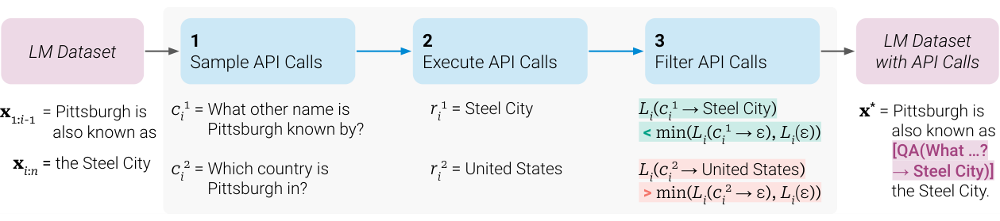
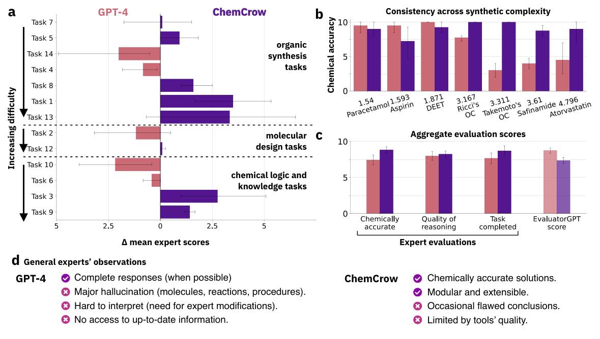
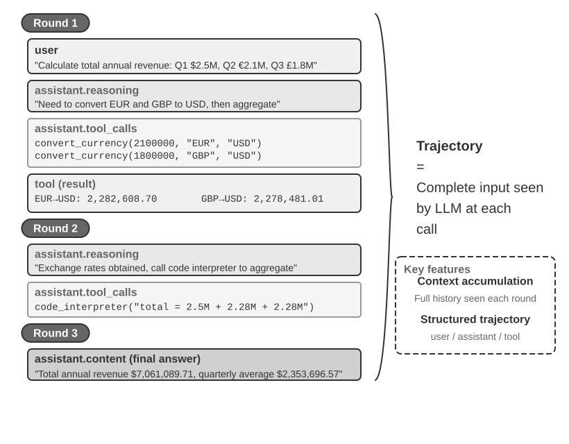
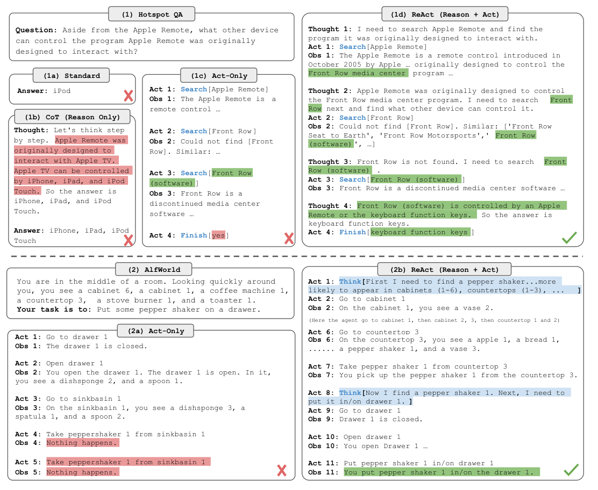
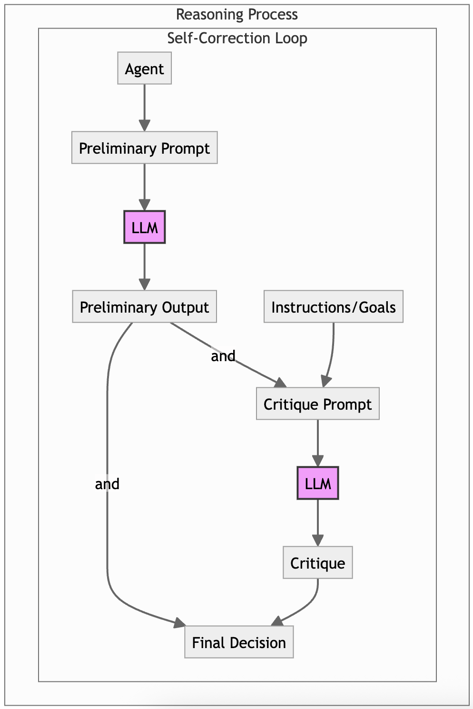
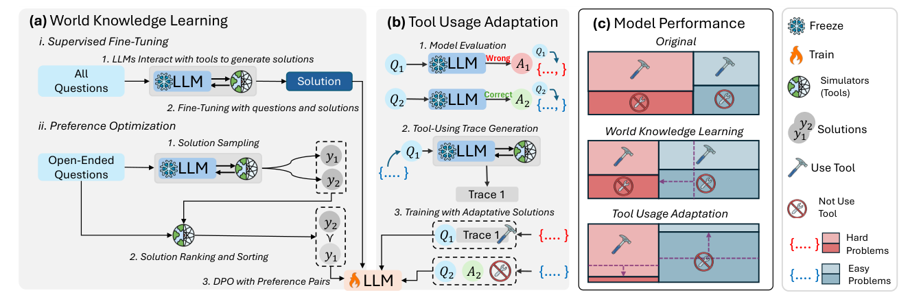
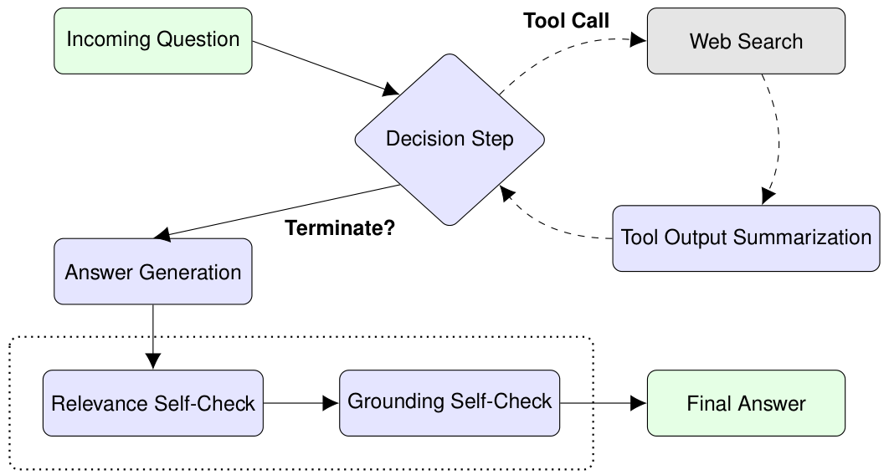

# 2 — Tool use and the ReAct loop

> The model never runs a tool: it emits a name and arguments, your code runs it and feeds the result back, and a loop of those turns is an agent.

The restock agent from [01](01-agent-fundamentals.md) can only recommend an order until it can see stock and place one. Giving it that reach looks like the model gaining new powers, but the model gains nothing: it still only produces text, some of which your code agrees to treat as a request. Almost everything that matters about tools follows from that split, including who can approve a call, what happens when the arguments are wrong, and why text from a web page can end up steering what runs on your machine.

---

## The one mechanism under every framework

Every agent framework in [05](05-framework-survey.md) wraps the same four steps:

| Step | Who | What crosses the wire |
|---|---|---|
| 1. Advertise | client | tool name, description, JSON schema of the arguments |
| 2. Decide | model | either text for the user, or a tool call `{name, arguments}` |
| 3. Execute | client | your code parses the arguments and runs the function |
| 4. Observe | client → model | the result goes back as a tool message; return to step 2 |

The loop stops when the model answers without a tool call, or when a step or token budget runs out. The names differ by vendor: Toolformer called it tool use, Andrew Ng and Anthropic say **tool use**, OpenAI and Gemini say **function calling**. Lakshmanan and Hapke file it as pattern **P21 Tool Calling** and call ReAct "just" CoT plus Tool Calling; with Reflection, tool calling is "usually considered the threshold" of an agentic application (*Generative AI Design Patterns*, ch. 7). Xiao and Zhu put the same loop in one line: plain reasoning is a straight line from prompt to answer, while agentic reasoning runs in a continuous loop of thinking, acting and observing (Yao et al., 2023), and the failure to expect is a model that gets lost or stuck in it, repeating mistakes or not recovering when an action fails (Shinn et al., 2023). They also note that reasoning models motivate agents: an agent needs reasoning to plan toward a goal and to notice and repair its own mistakes (*Foundations of LLMs*, ch. 6).

The training recipe came nine months earlier in TALM ([arXiv:2205.12255](https://arxiv.org/abs/2205.12255) (Parisi et al., 2022 ⚑)). It fine-tuned T5 models (220M–3B) to write a text tool call, read the result and then answer. Starting from about 150 hand-written tool demonstrations, it sampled many tool calls per training example and kept only those that led to the right answer, for several rounds. With a BM25 retriever on Natural Questions, the 220M TALM beat a 3B T5 without tools. The paper reports these gains only as figures, and every call was single-hop.

Toolformer ([arXiv:2302.04761](https://arxiv.org/abs/2302.04761), Schick et al., 2023-02) is also the clearest evidence that tool calls help where the model is weakest. GPT-J (6.7B) was shown a few demonstrations per API and wrote candidate calls into its own training text. A call was kept only when inserting its result made the following tokens easier to predict. The model was then fine-tuned on what survived. With a calculator it scored 40.4 on ASDiv, against 14.0 for GPT-3 175B and 14.8 for the same model with tools disabled. With a QA tool it scored 53.5 on LAMA T-REx against GPT-3's 39.8. Each call was a single inline lookup with no chaining. Multi-step tool use needed ReAct-style loops and, later, models trained for function calling.



*Image Source: Schick et al., [Toolformer: Language Models Can Teach Themselves to Use Tools](https://arxiv.org/abs/2302.04761) (2023), Fig. 2*

ChemCrow ([arXiv:2304.05376](https://arxiv.org/abs/2304.05376) (Bran et al., 2023-04)) shows the same effect in a ReAct loop. GPT-4 at temperature 0.1 was given 18 chemistry tools, including name-to-SMILES conversion, reaction planning and a cloud robot lab. It planned and ran real syntheses of DEET and three thiourea organocatalysts. On 14 tasks graded by four expert chemists, tool-less GPT-4 won only the easy tasks it could answer from memory, and ChemCrow won on the harder and novel ones. Two caveats apply. A GPT-4 grader preferred tool-less GPT-4's fluent but wrong answers. And in the authors' own reproducibility check, the tools returned the right product in all 5 runs of one task, but in 2 of them the model misread that product's SMILES string and drew the wrong conclusion about the mechanism.



*Image Source: Bran et al., [ChemCrow: Augmenting large-language models with chemistry tools](https://arxiv.org/abs/2304.05376) (2023), Fig. 4*



*Figure: a ReAct trajectory (Li, AI Agents in Depth, ch 1).*

---

## The raw loop, no framework

Lab 1 of the Letta course builds a memory-editing agent in about thirty lines of OpenAI calls. Strip the memory part and what is left is the loop every SDK hides:

```python
# illustrative: needs an OpenAI API key plus `client`, `system_prompt`, `agent_memory` and `core_memory_save` from the Letta lab
# One tool, described by a JSON schema; the enum constrains the section argument.
core_memory_save_metadata = {
    "type": "function",
    "function": {
        "name": "core_memory_save",
        "description": "Save important information about you, the agent or the human you are chatting with.",
        "parameters": {
            "type": "object",
            "properties": {
                "section": {"type": "string", "enum": ["human", "agent"]},
                "memory": {"type": "string"},
            },
            "required": ["section", "memory"],
        },
    },
}

def agent_step(user_message, chat_history):
    chat_history.append({"role": "user", "content": user_message})
    while True:                                   # the agent loop
        response = client.chat.completions.create(
            model="gpt-4o-mini",
            messages=[{"role": "system", "content": system_prompt},
                      {"role": "system", "content": "[MEMORY]\n" + json.dumps(agent_memory)}]
                     + chat_history,
            tools=[core_memory_save_metadata],
        )
        msg = response.choices[0].message
        if not msg.tool_calls:                    # plain text: done
            chat_history.append({"role": "assistant", "content": msg.content})
            return msg.content
        chat_history.append(msg)                  # keep the call in history
        call = msg.tool_calls[0]
        result = core_memory_save(**json.loads(call.function.arguments))
        chat_history.append({"role": "tool", "tool_call_id": call.id, "content": str(result)})
```

Two details carry over to every real system:

- **The tool call goes back into history before the result.** Most APIs reject a tool result whose call ID they have not seen.
- **The system prompt states the policy.** The lab appends "You must either call a tool (core_memory_save) or write a response to the user. Do not take the same actions multiple times!" Without the second sentence the model can loop on the same call.

The Anthropic Messages API has the same shape with different field names: the model returns content blocks, a `tool_use` block carries `id`, `name` and `input`, and results go back in a user message (`MCP/chatbot.py` in AgenticAIFrameworks does this with an older model). Here it is for the restock agent's first tool, with a stub client that replays what the API would return:

```python
# The Messages API loop, with a stub client so it runs offline.
# Replace StubClient() with anthropic.Anthropic() and this loop stays the same.
from types import SimpleNamespace as NS

STOCK = {"itemB": {"on_hand": 100, "peak_weekly": 90, "weeks_to_deliver": 2}}

TOOLS = [{
    "name": "get_stock",
    "description": "Stock on hand, peak weekly sales and delivery time for one item. "
                   "Use before any reorder decision. Unknown items return an error.",
    "strict": True,
    "input_schema": {
        "type": "object",
        "properties": {"item": {"type": "string", "description": "Item ID, such as itemB"}},
        "required": ["item"],
        "additionalProperties": False,
    },
}]

def execute_tool(name, args):
    if name != "get_stock":
        return f"Error: unknown tool {name}"
    if args["item"] not in STOCK:                     # an error the model can act on
        return f"Error: no item {args['item']!r}. Known items: {sorted(STOCK)}"
    return str(STOCK[args["item"]])

def tool_use(id_, item):
    return NS(type="tool_use", id=id_, name="get_stock", input={"item": item})

SCRIPT = [
    NS(stop_reason="tool_use", content=[tool_use("t1", "item-B")]),   # a wrong ID, as models do
    NS(stop_reason="tool_use", content=[tool_use("t2", "itemB")]),    # corrected from the error
    NS(stop_reason="end_turn", content=[NS(type="text", text="itemB runs out before delivery. Reorder.")]),
]

class StubClient:
    def __init__(self):
        self.messages = self
        self.sizes = []

    def create(self, **kwargs):
        self.sizes.append(len(kwargs["messages"]))    # what each call re-sends
        return SCRIPT[len(self.sizes) - 1]

client = StubClient()
messages = [{"role": "user", "content": "Should we reorder itemB?"}]

while True:
    response = client.messages.create(
        model="claude-opus-5-5", max_tokens=16000, tools=TOOLS, messages=messages)
    if response.stop_reason != "tool_use":
        break
    messages.append({"role": "assistant", "content": response.content})
    results = []
    for block in response.content:                    # one turn can hold several calls
        if block.type == "tool_use":
            output = execute_tool(block.name, block.input)
            print(f"{block.name}({block.input}) -> {output}")
            results.append({"type": "tool_result", "tool_use_id": block.id, "content": output})
    messages.append({"role": "user", "content": results})

print("stop_reason:", response.stop_reason)
print("answer:", next(b.text for b in response.content if b.type == "text"))
print("messages sent per call:", client.sizes)
```

```text
get_stock({'item': 'item-B'}) -> Error: no item 'item-B'. Known items: ['itemB']
get_stock({'item': 'itemB'}) -> {'on_hand': 100, 'peak_weekly': 90, 'weeks_to_deliver': 2}
stop_reason: end_turn
answer: itemB runs out before delivery. Reorder.
messages sent per call: [1, 3, 5]
```

Three lines in this output are the lesson. The first call fails on a wrong ID, and because the error names the valid items, the model can fix it without help. The message count grows by two per round, which is the quadratic cost from [01](01-agent-fundamentals.md#the-react-loop) in miniature. And the loop tests `stop_reason`, not the presence of text, because a response can stop for other reasons, such as hitting `max_tokens`, that a real system must handle separately. All the tool results from one turn go back in a single user message; sending one message per result, as many older examples do, breaks when the model makes parallel calls.

---

## ReAct as a prompt

Before native function calling, ReAct (Yao et al. 2022) was a prompt format that the client parsed. AutoGen's `react_prompting.py` still shows it:

```python
ReAct_prompt = """
Answer the following questions as best you can. You have access to tools provided.
Use the following format:
Question: the input question you must answer
Thought: you should always think about what to do
Action: the action to take
Action Input: the input to the action
Observation: the result of the action
... (this process can repeat multiple times)
Thought: I now know the final answer
Final Answer: the final answer to the original input question
Begin!
Question: {input}
"""
```

| ReAct as text | ReAct with native tool calls |
|---|---|
| Client regex-parses `Action:` lines | Provider returns a structured call |
| Model can hallucinate an `Observation:` | Observation only comes from your code |
| Works on any completion model | Needs a model trained for tool calls |
| Thought is visible text | Thought is optional (reasoning field or omitted) |

Use native calls. Keep the ReAct prompt as a reading of what the loop is doing. A few lines of parsing show what the left column costs:

```python
# Why text-parsed ReAct is fragile: the client has to find the action in free text.
import re

ACTION = re.compile(r"(?i)action\s*:\s*([^\n]+)")
INPUT = re.compile(r"(?i)action input\s*:\s*([^\n]+)")

def parse(text):
    actions, inputs = ACTION.findall(text), INPUT.findall(text)
    if not actions or not inputs:
        return "parse failure: retry or repair"
    return actions[-1].strip(), inputs[-1].strip()    # the last match, as Phoenix & Taylor advise

good = "Thought: I need the stock.\nAction: get_stock\nAction Input: itemB"
reworded = "Thought: I need the stock, so I'll call get_stock on itemB."
invented = good + "\nObservation: on_hand=100\nThought: done\nAction: place_order\nAction Input: itemB, 300"

for label, text in [("good", good), ("reworded", reworded), ("invented", invented)]:
    print(f"{label:9}", parse(text))
```

```text
good      ('get_stock', 'itemB')
reworded  parse failure: retry or repair
invented  ('place_order', 'itemB, 300')
```

The reworded reply says the right thing and still fails to parse. The third reply is worse: the model invented its own observation and went on to an order, and a last-match parser would run it. The stop sequence described below exists to prevent exactly this.

The switch is measurable. In OpenHands on SWE-bench Verified, o1 at high reasoning effort resolved 29.1% of issues with a text-parsed action format and **47.7% with native function calling**, and its overthinking score fell from 2.43 to 1.05 ([arXiv:2502.08235](https://arxiv.org/abs/2502.08235) (Cuadron et al., 2025-02, preprint)). Overthinking here is a Claude 3.5 Sonnet judge's 0–10 rating of how much the agent reasoned about actions instead of taking them and reading the result. Across about 4,000 trajectories, a higher score went with fewer resolved issues, and reasoning models scored higher than non-reasoning ones (3.5 against 2.2 on average). The format is not the whole story: on BFCL's multi-turn set the same switch moved o1 only from 36% to 41%. The judge was checked against four experts on just 20 traces.

**Acting does not beat thinking on every task.** In the ReAct paper's own HotpotQA result with PaLM-540B, ReAct scored 27.4 EM against 29.4 for CoT. The best score, 35.1, came from falling back to self-consistent CoT when ReAct ran out of steps (Yao et al., ICLR 2023). ALAMA ([arXiv:2412.00722](https://arxiv.org/abs/2412.00722) (Huang et al., COLING 2025)) found the same with one-shot prompts. With Llama-3-8B-Instruct, a ReAct-style retrieval mechanism was the weakest of five on GSM8K (71.8% against 80.1% for Reflection) and no better than plain CoT on HotpotQA (15.8 against 17.6 EM; GPT-3.5 tied them at 22.2). All five mechanisms solved only 42.6% of the GSM8K questions, but an oracle that picked the right mechanism per question solved 96.9%. Training the model to choose for itself reached 82.2%, well short of that ceiling. KnowSelf ([arXiv:2504.03553](https://arxiv.org/abs/2504.03553) (Qiao et al., ACL 2025)) makes the same choice at every step. A fine-tuned Llama-3.1-8B emitted a `[Knowledge]` token to fetch a rule from a knowledge base on 15% of its ALFWorld steps. It scored 84.3, against 77.6 for WKM, which injects knowledge at every step. On Gemma-2B, injecting knowledge at every step scored below reflection alone. So the design question is not ReAct or CoT. It is when the model should reach outside itself.



*Image Source: Yao et al., [ReAct: Synergizing Reasoning and Acting in Language Models](https://arxiv.org/abs/2210.03629) (2022), Fig. 1*

If you do run ReAct as text, Phoenix and Taylor's hand-built loop shows the three parts you need (*Prompt Engineering for Generative AI*, ch. 6):

- **Parse the last action, not the first.** Use a case-insensitive regex such as `(?i)action\s*:\s*([^\n]+)`, which captures up to the end of the line, and a second one for `action_input`. Take the last match in the response.
- **Stop before the observation.** Pass a stop sequence such as `"tool_result:"` so generation halts where the observation would start. Without it the model writes its own, fabricated, tool result.
- **Expect parse failures.** Either send the bad response to a model to repair it, or retry the request from the previous state.

Their comparison table (Table 6-2) is dated. It credits OpenAI function calling with single tool execution but not with sequential tool execution or an iterative thought process, and it calls ReAct less stable. That described 2023 agent wrappers, not the mechanism. Today a native tool-calling loop does both multi-step sequential calls and parallel calls in one turn, so the right column above is the one to build on.

A fixed list of legal moves can cut the invalid ones. KnowAgent ([arXiv:2403.03101](https://arxiv.org/abs/2403.03101) (Zhu et al., 2024-03, preprint)) targets planning hallucination, such as a Lookup before any Search, by writing an action knowledge base into the prompt: the allowed actions and which may follow which (Search may be followed by Search, Retrieve, Lookup or Finish). On HotpotQA with Llama-2-13b, invalid actions fell to 0.35% of steps from 2.08% for ReAct and misordered ones to 1.23% from 3.54%. On ALFWorld the rules in the prompt alone lifted unseen-task success from 9.70 to 38.06; after LoRA fine-tuning on self-generated trajectories that obey the rules (two rounds), it reached 58.71 against 38.81 for GPT-4 with ReAct. The graph is hand-written over four actions, and GPT-4-distilled rules matched it on ALFWorld but lost on HotpotQA (25.72 against 39.26 F1 at 13b). Test sets are small (100 questions per level), single runs, Llama-2 era.

---

## What reasoning steps fix, and what they do not

ReAct is CoT plus Tool Calling, so it inherits the strengths and limits of chain of thought. Lakshmanan and Hapke's pattern P13 is the clearest statement of both (*Generative AI Design Patterns*, ch. 5).

CoT helps when a model knows the rule but does not apply it, and it comes in three strengths. **Zero-shot** just asks for step-by-step reasoning. **Few-shot** shows worked examples, and it fixes what zero-shot misses: on a baggage question for a Singapore–Dallas–Toronto trip under a 50 kg/40 kg rule, zero-shot Gemini answered 50 kg, while few-shot examples got the correct 40 kg. **Auto-CoT** retrieves the closest examples from a store. Their image for the difference from RAG is that RAG gives the model a few fish, while few-shot CoT shows it how to fish.

Three failure modes matter more for agents than the technique itself:

| CoT fails on | Their example | The fix |
|---|---|---|
| **Gaps in knowledge** | "300 km west of Hyderabad" produces confident steps ending in the wrong city; the answer is Solapur | Supply the fact. Given a map, the model gets it right. For an agent this means a tool, not more reasoning |
| **Exact computation** | 84 m² × 10.7639 written out as 903.20; the true product is 904.1676 | A calculator or code tool |
| **Non-sequential expertise** | Bridge play, where experts weigh the whole hand instead of stepping through it | Examples from an expert, or a specialist model |

The reasoning a model shows can also be a story told after the fact, so asking "why" does not audit it. The book's own success case makes this point by accident. Asked for the flow of crude oil through a 25 cm pipe, zero-shot Claude applied the laminar-flow formula and reported 84 m³/s, while itself remarking that the figure seemed very high and the flow would be turbulent. Dividing by the pipe's area gives a speed of about 1,700 m/s, so the formula does not apply and the number is meaningless. The book still counts this as the prompt triggering the right behavior. Well-formed steps are not evidence of a correct answer, so check the result independently, as with the restock arithmetic.

Arsanjani and Bustos place a plain single agent (one model, tools through function calling, ReAct) at the base of their agent-level patterns and add structure only when it fails: memory, then RAG, then a self-correction pass. Their self-correction step is a second prompt that casts the model as an auditor: check the preliminary decision against the policy context and say whether anything was missed. It "requires at least two separate LLM calls instead of one", a cost they state without measuring. Their loan examples script the model's replies, and the chapter's claims that RAG "drastically reduces hallucinations" and that a multimodal agent cuts processing time carry no numbers or citations (*Agentic Architectural Patterns*, ch. 9).



*Image Source: Arsanjani & Bustos, *Agentic Architectural Patterns for Building Multi-Agent Systems* (Packt, 2026), Fig. 9-6*

Providers now apply much of this inside their models, so zero-shot CoT helps small models more than reasoning models, and thinking modes replace the hand-written instruction. The authors' practical advice is to use a thinking model as a teacher that writes examples for a smaller one, and to set a reminder to retest any CoT prompt every six months, since a hotfix or new model may make it unnecessary.

A 2023 survey of the road from chain of thought to agents ([arXiv:2311.11797](https://arxiv.org/abs/2311.11797) (Zhang et al., 2023-11, preprint)) gathers two conditions from other papers under which CoT works: a model of preferably at least 20 billion parameters, and parametric knowledge that is relevant to the task and interconnected. It also reports that CoT-verification gains often came from oracles or external tools such as search engines and calculators, which is the table's advice to supply the fact. It runs no experiments, covers ReAct in one descriptive paragraph without numbers, and stops at October 2023.

Three papers show where the limit sits. Self-Discover ([arXiv:2402.03620](https://arxiv.org/abs/2402.03620) (Zhou et al., 2024-02, preprint)) has the model compose a JSON reasoning plan once per task. Zero-shot with GPT-4 it scored 81% on 23 BigBench-Hard tasks against 75% for zero-shot CoT, and 73% against 71% on a 200-problem MATH subsample. A hand-check of 99 wrong MATH answers found **74.7% were calculation errors and 25.3% bad plans**: a better plan does not fix arithmetic, which is the table's second row. Buffer of Thoughts ([arXiv:2406.04271](https://arxiv.org/abs/2406.04271) (Yang et al., NeurIPS 2024)) retrieves a stored thought-template, often code, and instantiates it. With GPT-4 it solved 82.4% of Game of 24 against 74.0% for Tree of Thoughts, at about 12% of the cost of multi-query methods. Valmeekam et al. ([arXiv:2409.13373](https://arxiv.org/abs/2409.13373) (2024-09, preprint)) ran 600 Blocksworld planning instances: o1-preview solved 97.8% zero-shot, but **only 52.8% once the predicates were renamed**, where no non-reasoning LLM reached 5%, and 23.63% on 110 larger problems. The classical planner Fast Downward solved 600 of 600 in 0.265 s. It was one run of a preview model; the authors' remedy is an LLM plus a sound verifier.

Two papers train the tool habit instead of prompting it. ReST meets ReAct ([arXiv:2312.10003](https://arxiv.org/abs/2312.10003) (Aksitov et al., 2023-12, preprint)) fine-tunes a search-using ReAct agent on its own trajectories: the prompted PaLM 2-L agent answers 2,000 questions (no labels), its reranked trajectories train the next model, and a second generation repeats this. On Bamboogle (125 two-hop questions, auto-evaluated) **the fine-tuned PaLM 2-XS reached 65.9 against 70.3 for the prompted L teacher**, and the fine-tuned L reached 76.1. Quality beat quantity: dropping about 30% of trajectories by hand-filtering lowered XS by 2.5 points, and four trajectories per question added 0.3 over two. The models and search API are not public, the tool is one search API, and only two generations were run. Adapting While Learning ([arXiv:2411.00412](https://arxiv.org/abs/2411.00412) (Lyu et al., ICML 2025)) trains the other half, when to call a tool at all. It labels each training question easy or hard from the model's own direct-answer accuracy: easy ones keep the direct answer, hard ones get the tool trace. On Llama-3.1-8B over six scientific datasets, answer accuracy rose 29.11 points on the no-tool prompt (30.20 to 59.31), but base Llama forced to use tools already reached 57.60, so the gain is mostly internalised knowledge and fewer calls: the base model called tools on 90.96% of questions against 51.72% after training, and open-ended Climate questions fell from 7.21 to 2.70 calls on average. GPT-4o, Claude-3.5 and Llama-70B stayed near 50% tool-decision accuracy, and GPT-4o still led on MATH (82.94 against 62.35). Single runs on test sets of 80-280 questions, with simulator-generated data from the same templates as the tools.

API-Bank measures the tool habit directly ([arXiv:2304.08244](https://arxiv.org/abs/2304.08244) (Li et al., EMNLP 2023)): 73 runnable APIs, 314 dialogues and 753 calls, with API search as a tool. Zero-shot, **call correctness was 60.24% for GPT-4, 47.16% for GPT-3.5-turbo and 15.19% for Alpaca-7B**; Lynx-7B, Alpaca fine-tuned on 1,888 generated dialogues, reached 39.58%. GPT-3.5 lost 21 points when it also had to find the API and 17 more when it had to plan the calls. Alpaca's commonest error was making no call at all (36.77%). The harder tiers have only 50 dialogues each, and each score is one run.



*Image Source: Lyu et al., [Adapting While Learning: Grounding LLMs for Scientific Problems with Tool Usage Adaptation](https://arxiv.org/abs/2411.00412) (2025), Fig. 1*



*Image Source: Aksitov et al., [ReST meets ReAct: Self-Improvement for Multi-Step Reasoning LLM Agent](https://arxiv.org/abs/2312.10003) (2023), Fig. 2*

---

## Caller and executor are different agents

AutoGen makes the split explicit: one agent proposes the call, another runs it. That separation is where a human approval step or a sandbox goes.

```python
# illustrative: needs `autogen-agentchat` 0.2 and an LLM API key; `calculator` and the two agents come from the lab
from typing import Annotated, Literal
from autogen import register_function

Operator = Literal["+", "-", "*", "/"]          # becomes an enum in the schema

def calculator(a: int, b: int, operator: Annotated[Operator, "operator"]) -> int:
    if operator == "+": return a + b
    if operator == "-": return a - b
    if operator == "*": return a * b
    if operator == "/": return int(a / b)
    raise ValueError("Invalid operator")

register_function(
    calculator,
    caller=assistant,       # the LLM agent that sees the schema
    executor=user_proxy,    # the agent that runs the code (no LLM)
    description="A simple calculator",
)
```

The chess lesson (AutoGen L4) uses the same pattern with `make_move(move: Annotated[str, "A move in UCI format."])`: each player is a caller, a board proxy with `llm_config=False` is the executor, and the board proxy ends the chat as soon as a legal move is made. See [04](04-multi-agent-design-patterns.md) for the conversation structure.

---

→ MCP servers, code execution instead of a tool list, the rules for reliable tool calls, and the six prompt-injection defenses are in [02c — MCP, code execution and safe tool calls](02c-mcp-code-and-safe-tool-calls.md). Planning and choosing among many tools stay in [02b](02b-planning-and-tool-use.md).

---

## Pitfalls

- **Vague tool descriptions.** The description is the model's only documentation. Say when to use the tool and what it returns, and include an example ID.
- **Raising on bad arguments.** A stack trace ends the run or teaches the model nothing. Return an error it can act on, naming the valid values.
- **One result message per tool call.** It works until the model makes parallel calls. Collect the results of a turn into one message.
- **Letting the model write its own observation.** In text-parsed ReAct, without a stop sequence, it will. Use native tool calls.
- **Using more reasoning when a fact is missing.** A longer chain gives a more convincing wrong answer. Add a tool or data.
- **Reading CoT steps as an audit trail.** They can be written after the fact. Verify the result independently.

---

## Try it

1. In the stub loop, add a `place_order` tool and script a turn that calls `get_stock` for two items in parallel. How many entries go in the user message that follows, and what links each to its call?
2. Change the error message in `execute_tool` to just `"Error"`. In a real run, what would the model likely do next, and what would it cost?
3. Extend `parse` so that the `invented` reply is rejected. What is the simplest rule that does it, and which API feature makes the rule unnecessary?
4. The agent keeps saying itemB's delivery time is 2 weeks after the supplier changed it to 4. Would "think step by step" help? What would?
5. Run [`practice/tool_agent.py`](../practice/tool_agent.py), an agent whose loop, dispatch and error handling are real and whose model is scripted. Compare the two wrong-ID scenarios, then forget one `tool_result` in a parallel turn. Now lower `MAX_STEPS` to 3: which scenarios still finish?

<details>
<summary>Answers</summary>

1. Two `tool_result` entries in one user message, each with the `tool_use_id` of its call.
2. It has nothing to act on, so it would probably retry the same ID or guess. Each retry re-sends the whole conversation, so a vague error costs tokens and may use up the step cap.
3. Reject any reply that contains `Observation:`, since only your code may write one. A stop sequence prevents the text from being generated, and native tool calls remove the need to parse at all.
4. No. This is a knowledge gap, and reasoning over a stale figure gives a tidy wrong answer. Read the delivery time from a tool on each run instead of holding it in the prompt or in memory.
5. With the helpful error the run ends after 2 calls and 458 characters on its last call. With a bare `Error` the script repeats itself until the step cap: 6 calls, 6 errors, 1,089 characters on the last call, and no answer. The missing result is rejected, because every `tool_use` needs a `tool_result` with its ID in the next message. At `MAX_STEPS = 3` the six scenarios that stop on their own still finish, and the two that don't hit the cap after 3 calls.

</details>

---

## Interview checklist

| Question | Short answer |
|---|---|
| Who executes a tool call? | The client. The model only emits name and arguments |
| Does ReAct always beat CoT? | No. Observations help when the task needs facts the model lacks. On HotpotQA the original ReAct scored below CoT (27.4 against 29.4 EM with PaLM-540B), and the best result combined the two. Decide per task, or per step, when to call out |
| Why put a caller and an executor in different agents? | Approval, sandboxing and auditing sit between them |
| Why does CoT not fix a knowledge gap? | Reasoning cannot supply a missing fact: the steps stay plausible and the answer stays wrong. Give the agent a tool or the data |
| Why group tool results in one message? | A single turn can carry several parallel calls, and each result must answer its `tool_use_id`. Results for one turn belong together |
| Why return errors as tool results? | So the model can correct itself, which it can do only if the error says what was wrong and what is valid |

---

## Next

→ [02b — planning and tool use](02b-planning-and-tool-use.md): plans that name their tools, restated state, independent calls run together, and choosing among many tools.
