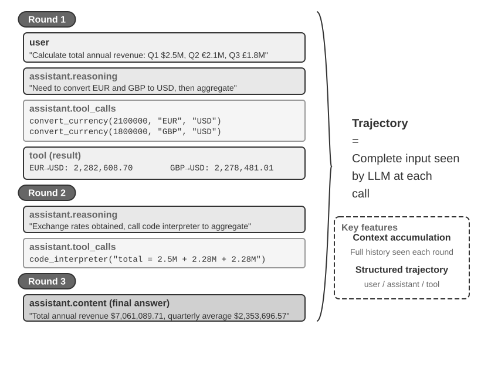
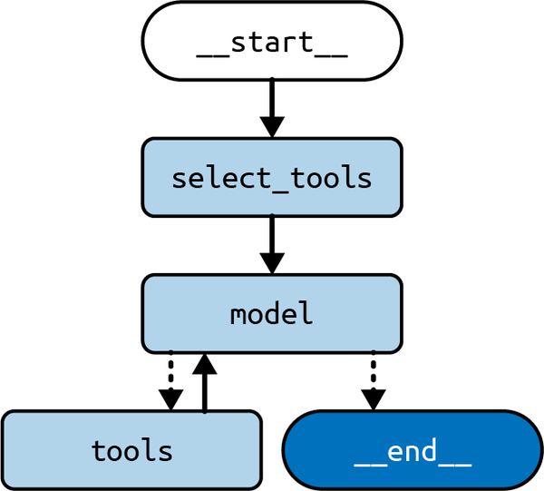

# 2 — Tool use and the ReAct loop

> The model never runs a tool: it emits a name and arguments, your code runs it and feeds the result back, and a loop of those turns is an agent.

---

## The one mechanism under every framework

Every agent framework in [05](05-framework-survey.md) wraps the same four steps:

| Step | Who | What crosses the wire |
|---|---|---|
| 1. Advertise | client | tool name, description, JSON schema of the arguments |
| 2. Decide | model | either text for the user, or a tool call `{name, arguments}` |
| 3. Execute | client | your code parses the arguments and runs the function |
| 4. Observe | client → model | the result goes back as a tool message; return to step 2 |

The loop stops when the model answers without a tool call, or when a step or token budget runs out. The names differ by vendor: Toolformer called it tool use, Andrew Ng and Anthropic say **tool use**, OpenAI and Gemini say **function calling**. Lakshmanan and Hapke file it as pattern **P21 Tool Calling** and note that ReAct is "just CoT + Tool Calling".

Toolformer ([arXiv:2302.04761](https://arxiv.org/abs/2302.04761), Schick et al., 2023-02) is also the clearest evidence that tool calls help where the model is weakest. GPT-J (6.7B) was shown a few demonstrations per API and wrote candidate calls into its own training text. A call was kept only when inserting its result made the following tokens easier to predict. The model was then fine-tuned on what survived. With a calculator it scored 40.4 on ASDiv, against 14.0 for GPT-3 175B and 14.8 for the same model with tools disabled. With a QA tool it scored 53.5 on LAMA T-REx against GPT-3's 39.8. Each call was a single inline lookup with no chaining. Multi-step tool use needed ReAct-style loops and, later, models trained for function calling.



*Figure: a ReAct trajectory (Li, AI Agents in Depth, ch 1).*

---

## The raw loop, no framework

Lab 1 of the Letta course builds a memory-editing agent in about thirty lines of OpenAI calls. Strip the memory part and what is left is the loop every SDK hides:

```python
# One tool, described by a JSON schema; the enum constrains the section argument.
core_memory_save_metadata = {
    "type": "function",
    "function": {
        "name": "core_memory_save",
        "description": "Save important information about you, the agent or the human you are chatting with.",
        "parameters": {
            "type": "object",
            "properties": {
                "section": {"type": "string", "enum": ["human", "agent"]},
                "memory": {"type": "string"},
            },
            "required": ["section", "memory"],
        },
    },
}

def agent_step(user_message, chat_history):
    chat_history.append({"role": "user", "content": user_message})
    while True:                                   # the agent loop
        response = client.chat.completions.create(
            model="gpt-4o-mini",
            messages=[{"role": "system", "content": system_prompt},
                      {"role": "system", "content": "[MEMORY]\n" + json.dumps(agent_memory)}]
                     + chat_history,
            tools=[core_memory_save_metadata],
        )
        msg = response.choices[0].message
        if not msg.tool_calls:                    # plain text: done
            chat_history.append({"role": "assistant", "content": msg.content})
            return msg.content
        chat_history.append(msg)                  # keep the call in history
        call = msg.tool_calls[0]
        result = core_memory_save(**json.loads(call.function.arguments))
        chat_history.append({"role": "tool", "tool_call_id": call.id, "content": str(result)})
```

Two details carry over to every real system:

- **The tool call goes back into history before the result.** Most APIs reject a tool result whose call ID they have not seen.
- **The system prompt states the policy.** The lab appends "You must either call a tool (core_memory_save) or write a response to the user. Do not take the same actions multiple times!" Without the second sentence the model can loop on the same call.

The Anthropic Messages API has the same shape with different field names (`MCP/chatbot.py` in AgenticAIFrameworks):

```python
# Anthropic: the model returns content blocks; a tool_use block carries id, name, input.
for block in response.content:
    if block.type == "tool_use":
        result = execute_tool(block.name, block.input)
        messages.append({"role": "assistant", "content": response.content})
        messages.append({"role": "user", "content": [
            {"type": "tool_result", "tool_use_id": block.id, "content": result}
        ]})
```

---

## ReAct as a prompt

Before native function calling, ReAct (Yao et al. 2022) was a prompt format that the client parsed. AutoGen's `react_prompting.py` still shows it:

```python
ReAct_prompt = """
Answer the following questions as best you can. You have access to tools provided.
Use the following format:
Question: the input question you must answer
Thought: you should always think about what to do
Action: the action to take
Action Input: the input to the action
Observation: the result of the action
... (this process can repeat multiple times)
Thought: I now know the final answer
Final Answer: the final answer to the original input question
Begin!
Question: {input}
"""
```

| ReAct as text | ReAct with native tool calls |
|---|---|
| Client regex-parses `Action:` lines | Provider returns a structured call |
| Model can hallucinate an `Observation:` | Observation only comes from your code |
| Works on any completion model | Needs a model trained for tool calls |
| Thought is visible text | Thought is optional (reasoning field or omitted) |

Use native calls. Keep the ReAct prompt as a reading of what the loop is doing.

If you do run ReAct as text, Phoenix and Taylor's hand-built loop shows the three parts you need (*Prompt Engineering for Generative AI*, ch. 6):

- **Parse the last action, not the first.** Use a case-insensitive regex such as `(?i)action\s*:\s*([^\n]+)`, which captures up to the end of the line, and a second one for `action_input`. Take the last match in the response.
- **Stop before the observation.** Pass a stop sequence such as `"tool_result:"` so generation halts where the observation would start. Without it the model writes its own, fabricated, tool result.
- **Expect parse failures.** Either send the bad response to a model to repair it, or retry the request from the previous state.

Their comparison table (Table 6-2) is dated. It credits OpenAI function calling with single tool execution but not with sequential tool execution or an iterative thought process, and it calls ReAct less stable. That described 2023 agent wrappers, not the mechanism. Today a native tool-calling loop does both multi-step sequential calls and parallel calls in one turn, so the right column above is the one to build on.

---

## Caller and executor are different agents

AutoGen makes the split explicit: one agent proposes the call, another runs it. That separation is where a human approval step or a sandbox goes.

```python
from typing import Annotated, Literal
from autogen import register_function

Operator = Literal["+", "-", "*", "/"]          # becomes an enum in the schema

def calculator(a: int, b: int, operator: Annotated[Operator, "operator"]) -> int:
    if operator == "+": return a + b
    if operator == "-": return a - b
    if operator == "*": return a * b
    if operator == "/": return int(a / b)
    raise ValueError("Invalid operator")

register_function(
    calculator,
    caller=assistant,       # the LLM agent that sees the schema
    executor=user_proxy,    # the agent that runs the code (no LLM)
    description="A simple calculator",
)
```

The chess lesson (AutoGen L4) uses the same pattern with `make_move(move: Annotated[str, "A move in UCI format."])`: each player is a caller, a board proxy with `llm_config=False` is the executor, and the board proxy ends the chat as soon as a legal move is made. See [04](04-multi-agent-design-patterns.md) for the conversation structure.

---

## MCP: tools served over a protocol

The Model Context Protocol moves the tool list out of the client process. A server declares tools, resources and prompts; any MCP client can list and call them.

```python
from mcp.server.fastmcp import FastMCP

mcp = FastMCP("research", port=8001)

@mcp.tool()                                  # callable by the model
def search_papers(topic: str, max_results: int = 5) -> list[str]:
    """Search arXiv for a topic and store the results."""
    ...

@mcp.resource("papers://{topic}")            # readable data, addressed by URI
def get_topic_papers(topic: str) -> str: ...

@mcp.prompt()                                # a reusable prompt template
def generate_search_prompt(topic: str, num_papers: int = 5) -> str: ...

if __name__ == "__main__":
    mcp.run(transport="stdio")               # or "sse" for a remote server
```

The book lists three limits of MCP as of May 2025:

| Limit | Workaround |
|---|---|
| No auth enforcement in the spec | OAuth in front of the server (Cloudflare Workers) |
| Mostly one-way: client calls server | A2A or ACP for agent-to-agent collaboration |
| Calls time out at 30–60 s | Streamable HTTP transport, or return a job ID and poll |

**MCP does not bypass the tool call.** Albada describes MCP as a way to "inject rich, dynamic context ... directly into the model's reasoning process without invoking separate tools", unlike API calls that "require full round-trip execution" (*Building Applications with AI Agents*, ch. 2). That is wrong. An MCP tool is invoked through a `tools/call` request and its result returns as an ordinary tool result: a full round trip. Resources and prompts are separate primitives that the client or user chooses to put into context. MCP standardizes how tools and context are discovered and transported. It doesn't give the model a cheaper channel into its reasoning.

For when MCP beats an in-process function, and the tool-contract rules, see [harness 03 — tool design](../../../ai-engineering/03-harness-engineering/notes/03-tool-design.md).

---

## Code execution instead of a tool list

Pattern **P22 Code Execution**: when the task is easier to express as a program than as a sequence of calls, let the model write code and run it in a sandbox. AutoGen L5 gives the model a code executor and a set of pre-written functions it may import:

```python
from autogen.coding import LocalCommandLineCodeExecutor

executor = LocalCommandLineCodeExecutor(
    timeout=60,
    work_dir="coding",
    functions=[get_stock_prices, plot_stock_prices],   # importable by generated code
)
code_executor_agent = ConversableAgent(
    name="code_executor_agent",
    llm_config=False,
    code_execution_config={"executor": executor},
    human_input_mode="ALWAYS",                        # approve every run
)
code_writer_agent.update_system_message(
    code_writer_agent.system_message + executor.format_functions_for_prompt()
)
```

| Use tool calling when | Use code execution when |
|---|---|
| A handful of fixed actions | Open-ended data work, loops, plotting |
| Each action has side effects you must gate | The output is a program or a DSL (SQL, Graphviz) |
| The arguments are short | Many calls would be chained anyway |

The book's rules for P22: run in a sandbox with CPU, memory, network and time limits (Docker or a VM); validate before running (parse, static analysis); send errors back so the model can repair them (P18 Reflection). It works best with a narrow DSL plus a parser. `LocalCommandLineCodeExecutor` runs on the host: the lab is fine, production is not. Execution boundaries are covered in [harness 04](../../../ai-engineering/03-harness-engineering/notes/04-execution-boundaries.md).

There is evidence that the interpreter does work that chain-of-thought (CoT) can't. Sprague et al. (2024) found that up to 95% of CoT's gain on MMLU comes from questions whose question or output contains "=", meaning symbolic or math problems. For other questions, nothing predicted when CoT would help. They also found that CoT is good at producing a plan but weaker at executing it, so the gain is larger when the plan goes to a Python interpreter. Mirzadeh et al.'s GSM-Symbolic (2024) rewrites GSM8K problems as templates. Accuracy drops when only the numbers change, falls sharply as problems get more complex, and is thrown off by irrelevant clauses, which the model turns into operations (*Building AI Agents with LLMs, RAG, and Knowledge Graphs*, ch. 11). For arithmetic and symbolic steps, have the model write the expression and let code evaluate it.

---

## Making tool calls reliable

From the P21 section of the book, plus what the labs show:

| Rule | Why |
|---|---|
| Clear names and descriptions; one job per tool | The description is the only documentation the model reads |
| State a usage policy in the system prompt | "Call X before Y", "never call Z twice" |
| Constrain arguments with enums and examples (P2 Grammar) | Removes a whole class of invalid calls |
| Keep the tool list short: 3–10 tools as of June 2025 | Selection accuracy drops as the list grows |
| Don't make the model fill in deterministic values | Inject IDs, dates and user context in code |
| Return descriptive errors, not stack traces | The model can retry (P18 Reflection) |
| Prefer code execution when the input is a DSL | SQL as a string beats twenty filter parameters |
| Write the docstring as the tool's contract | LangChain's `@tool` builds the schema from the signature and docstring, and raises an error if the docstring is missing. A vague docstring makes invalid calls more likely (*AI Agents: The Definitive Guide*, ch. 1). |
| Validate arguments before the tool runs | A Pydantic `args_schema` with `file_type: Literal["pdf", "txt"]` rejects bad calls at the boundary (*Prompt Engineering for Generative AI*, ch. 6) |
| Use the return string to steer the next turn | A tool can return instructions as well as data: "Interview saved! ... You must tell the user that the interview is saved" (*Prompt Engineering for Generative AI*, ch. 6). The same channel carries prompt injection, so only your own tools should do this. |
| Return tool exceptions as messages | LangGraph's `ToolNode` turns an exception into a `ToolMessage` carrying the error, so the model decides whether to retry (*Learning LangChain*, ch. 6) |

Oshin and Campos add two structural fixes for when the model's choice of tool is the problem (*Learning LangChain*, ch. 6).

**Always call a tool first.** If every query should start with a search, don't spend an LLM call deciding that. Make the entry node build the tool call itself:

```python
def first_model(state: State) -> State:
    query = state["messages"][-1].content
    call = ToolCall(name="duckduckgo_search", args={"query": query}, id=uuid4().hex)
    return {"messages": AIMessage(content="", tool_calls=[call])}

builder.add_edge(START, "first_model")
builder.add_edge("first_model", "tools")   # then the usual model <-> tools loop
```

This saves one model call of latency and stops the model from deciding it doesn't need to search. It makes the agent worse if the rule isn't truly universal.

**Preselect tools by retrieval.** Above roughly 10 tools, the model gets worse at picking the right one. Embed each tool's description in a vector store. Add a `select_tools` node that retrieves the relevant names for the query, and bind only those (`model.bind_tools(selected)`) before the loop starts. This also shortens the prompt. The retrieval step adds latency, so add it only once accuracy measurably drops as tools are added.


*Image Source: Mayo Oshin & Nuno Campos, *Learning LangChain* (O'Reilly, 2025), Fig. 6-3*

A caution from the same chapter: its calculator tool calls `ast.literal_eval`, which rejects any arithmetic expression, so `"1933-1872"` raises an error. And when the model does the subtraction itself, it says Coolidge died at 61; the search result it had already retrieved says 60 (born July 1872, died January 1933). A correct tool beats model arithmetic, but only if the tool is actually correct. Test each tool on its own before blaming the loop.

When the catalogue is too large to list, the field tried two fixes in 2023: fine-tune on API documentation, and retrieve the few relevant tools per request. Gorilla ([arXiv:2305.15334](https://arxiv.org/abs/2305.15334), Patil et al., 2023-05) fine-tuned LLaMA-7B on 1,645 TorchHub, TensorHub and HuggingFace calls. With no retriever it reached **71.7% AST accuracy on HuggingFace calls, against 19.8% for zero-shot GPT-4**. GPT-4's errors were mostly invented models and repos: 37% of its HuggingFace calls named an API that doesn't exist. Retrieval cut both ways. With the oracle document in the prompt, GPT-3.5 reached 89.7%. With BM25, every model fell below 20% on HuggingFace, and Gorilla dropped from 71.7% to 17.0%. A weak retriever is worse than none. ToolLLM ([arXiv:2307.16789](https://arxiv.org/abs/2307.16789), Qin et al., 2023-07) scaled to 16,464 RapidAPI endpoints with ChatGPT-generated instructions and solution paths. Swapping the ReAct loop for a depth-first search over call trees, which lets the model back up after a failed call, raised **ChatGPT's pass rate from 40.2% to 64.8%**. That beat GPT-4 with ReAct (57.2%). The fine-tuned 7B ToolLLaMA reached 66.7% with the same search, while Vicuna and Alpaca passed nothing. The pass rates are judged by ChatGPT, which agreed with human annotators 87.1% of the time, so read them as relative.

---

## Prompt injection: six defenses

A tool result is untrusted input that lands in the context. Beurer-Kellner et al. (2025), as summarized in ch 7:

| Pattern | Idea |
|---|---|
| Action-Selector | The model picks from fixed actions; tool output never returns to it |
| Plan-Then-Execute | Fix the plan before reading untrusted data; data cannot add steps |
| Map-Reduce | Process each untrusted item in an isolated call; aggregate safe outputs |
| Dual-LLM | A privileged model plans; a quarantined model reads untrusted text and returns symbols |
| Code-Then-Execute | The model writes a program up front; the program, not the model, handles data |
| Context-Minimization | Drop the user prompt or untrusted spans from context before later steps |

Each trades capability for safety. Pick the weakest one that blocks the attack paths your tools open up.

---

## Interview questions

| Question | Short answer |
|---|---|
| Who executes a tool call? | The client. The model only emits name and arguments |
| Why does ReAct work better than CoT alone? | Observations ground the next thought in real data |
| Why put a caller and an executor in different agents? | Approval, sandboxing and auditing sit between them |
| When would you choose code execution over tools? | Open-ended computation or a DSL; when many calls would chain |
| What does MCP add over function calling? | A protocol: tools live in a separate server any client can use |
| Does MCP let the model use context without a tool round trip? | No. MCP tools are still `tools/call` round trips; resources and prompts are separate primitives the client chooses to load |
| You have 40 tools and selection accuracy drops. What do you do? | Retrieve the few relevant tools per query and bind only those; measure that the extra latency pays off |

→ Next: [03 — memory as an operating system](03-memory-as-an-operating-system.md) — what the loop remembers between turns, and how the agent edits it with the same tool calls.
