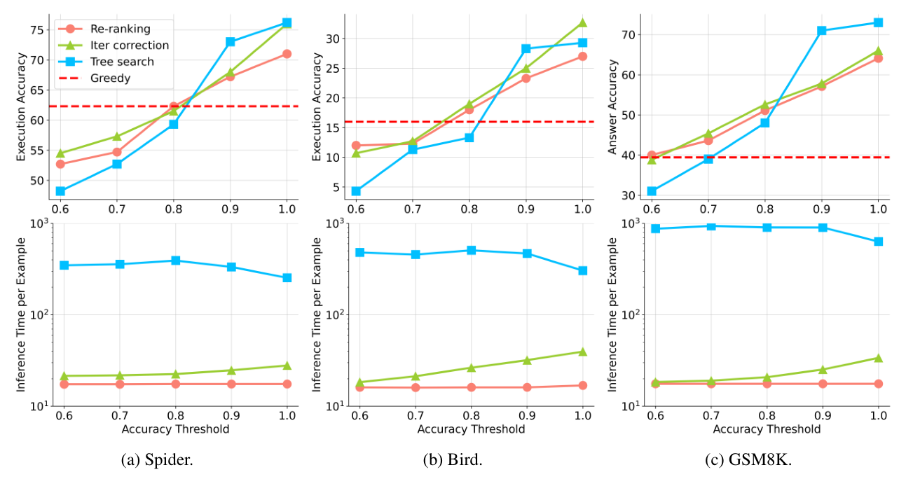

# 2b — Planning and tool use

> A ReAct agent decides its next tool one step at a time. Most of the measured gains in this chapter come from writing more of that decision down first: which tool each step uses, what is known after each step, and which steps don't depend on each other.

[Note 02](02-tool-use-and-react.md) built the loop: the model emits a tool call, the harness runs it, the result goes back into the context, repeat. [04's planning strategies](04c-planning-architectures-and-failure.md#planning-strategies) sorted the ways to plan by where each fails, from decomposition-first to interleaved. This chapter sits between them. It takes the restock agent from 02 and asks four practical questions. Should the plan name the tool for each step? Should the agent restate what it knows as it goes? Which calls can run at the same time? And how does the agent pick a tool when there are hundreds?

The papers here are recent and mostly preprints, each tested on one or two benchmarks. Read the numbers as the size of an effect under one setup, not as rules.

---

## Write the plan down, with the tool named

The cheapest plan is one a person writes once. Routine ([arXiv:2507.14447](https://arxiv.org/abs/2507.14447) (Zeng et al., 2025-07, preprint)) calls it a *routine*: a numbered list of steps for one business process, each naming the tool to call, with optional branches. In an HR agent with 25 MCP tools and 7 routines of 4–7 steps, scored on 1,148 step-level tool calls with the earlier steps given (teacher-forced), **overall tool-call accuracy went from 41.1% to 96.3% for GPT-4o and from 32.6% to 83.3% for Qwen3-14B** when the routine was in the prompt. Without it, no model passed 50%, and over 85% of errors were the wrong tool. Structure and parameters were already 94–100% right. The tool names carried much of the gain: removing them from the routine cost most models 5–15 points (GPT-4o was unaffected). A rough user-written draft still beat no plan (GPT-4o 71.2%), and adding distractor routines alongside the right one pulled GPT-4o down to 76.6%. A Qwen3-14B fine-tuned on 537 routine-guided traces from GPT-4o reached 90.2% *with no routine at inference*: the plan was learned into the weights. The limits matter. It is one internal scenario with GPT-4o-generated test data, a single run, a baseline that is a single prompt rather than a ReAct loop, and no cost or latency figures.

The lesson for the restock agent is narrow and useful. Where the process is known (check stock, check lead time, compute the order, raise it), write the steps and the tools into the prompt. Don't make the model rediscover the order on every run. Keep one routine per process in context, because the wrong ones are distractors.

The zero-shot version of the same idea is Plan-and-Solve ([doi:10.18653/v1/2023.acl-long.147](https://doi.org/10.18653/v1/2023.acl-long.147) (Wang et al., ACL 2023)): the prompt asks the model to devise a plan and then carry it out, and PS+ adds "extract the variables and calculate intermediate results". On text-davinci-003 at temperature 0 across six math sets, **PS+ averaged 76.7% against 70.4% for zero-shot chain of thought**, close to 8-shot hand-written chains (77.6%) with no examples. The gain was smallest on GSM8K (59.3 against 56.4), and the trigger sentences were tuned per dataset. Two surveys explain the limits. Qiao et al. relay that chain-of-thought prompts give no gain, and may hurt, below roughly 100B parameters ([doi:10.18653/v1/2023.acl-long.294](https://doi.org/10.18653/v1/2023.acl-long.294) (Qiao et al., ACL 2023, survey)). Dong et al.'s own run (8 demonstrations, four models, five tasks; AG News and SNLI cut to 1,000 test items) found no demonstration selector best everywhere, with MDL best on GPT-2 and top-k similarity best on the other three ([doi:10.18653/v1/2024.emnlp-main.64](https://doi.org/10.18653/v1/2024.emnlp-main.64) (Dong et al., EMNLP 2024, survey)). So test any planning prompt on the model you will deploy.


---

## Restate the state as you go

Planning fails in long tasks when the model loses track of where it is. AoT+ ([arXiv:2501.13545](https://arxiv.org/abs/2501.13545) (Sel et al., ICLR 2025)) prompts the model with search traces that include backtracking, and makes it **restate the current state after every step**. On Blocksworld, scored by a PDDL plan validator, GPT-4 went from 35% with chain of thought to 82% with AoT+, equal to LLM-Modulo's 82%, a loop with an external verifier. AoT+ used about a third of the tokens (2,068 against 6,453). The gap was wider for other models: Claude 82% against LLM-Modulo's 19%, GPT-4o 73% against 48%. In the ablation, AoT+M (AoT's search examples plus the per-step restatement) scored 84% against plain AoT's 45%, so most of the gain comes from restating state, not from showing the model search. The comparison is not compute-matched, LLM-Modulo may be tuned for GPT-4, and the paper gives no instance counts.

In an agent the harness can do this for the model: after each tool result, write a short "known so far" block into the context instead of leaving the facts scattered across earlier tool outputs. The executor below prints it after every level.

Training can make the habit stick. PDDL-INSTRUCT ([arXiv:2509.13351](https://arxiv.org/abs/2509.13351) (Verma et al., 2025-09, preprint)) fine-tunes the model to write, for every action, the preconditions it checked, the effects it applied and the full resulting state, and uses a plan validator's feedback on which precondition or effect was wrong during training. On 100 PlanBench tasks per domain, Llama-3-8B's valid plans went from 28% to 94% on Blocksworld, 1% to 64% on Mystery Blocksworld and 11% to 79% on Logistics, with one generation and no feedback at test time. Detailed feedback beat valid/invalid feedback by 5–15 points. The baseline is the untuned model, not a prompted or sampled one, and training and test tasks come from the same domains.

CoAT ([arXiv:2502.02390](https://arxiv.org/abs/2502.02390) (Pan et al., Findings of EMNLP 2025)) adds a related step to tree search over reasoning: at each node the model writes or retrieves "associated" facts before expanding. With the search held fixed, that step raised the score on the authors' own 205-question set from 0.67 to 0.77 (Qwen2.5-32B), judged by rubric with the judge model unnamed. Its comparison with single-pass models is not compute-matched, and the paper reports no cost beyond saying reasoning takes longer.

Whether search over plans pays depends on what picks among the branches. Chen et al. ([arXiv:2402.10890](https://arxiv.org/abs/2402.10890) (Chen et al., 2024-02, preprint)) replaced the discriminator with an oracle whose accuracy they could cap. With CodeLlama-13B-Instruct as generator (5 samples at temperature 0.6) on text-to-SQL (Spider, Bird) and GSM8K, **tree search needed a discriminator of about 90% accuracy to beat plain re-ranking significantly, and below 80% it did worse than re-ranking**, while costing 10-20 times more time (296 s against 17 s per Bird example with a naive discriminator). With real discriminators no method beat re-ranking significantly on Spider, and in 29 of 37 cases where iterative correction lost to re-ranking, the error was in the discriminator, not the search. ThoughtSculpt ([arXiv:2404.05966](https://arxiv.org/abs/2404.05966) (Chi et al., 2024-04, preprint)) is the case where the evaluator is strong enough: MCTS that revises a node from the evaluator's feedback reached 89.9% interestingness on story-outline improvement against 72.1% for Tree of Thoughts (GPT-3.5, 50 outlines, scored by a Flan-T5 evaluator trained on GPT-3.5 outlines). On a 20-puzzle mini-crossword with GPT-4 it scored 54.0% of words against 39.5%, at roughly twice ToT's cost per case. Swapping the evaluator for Llama3.1-8B cost more (99.0% to 96.3% coverage on constrained generation) than swapping the generator (98.5%). Put the budget into the verifier first; both studies are single runs on small sets. HiAR-ICL ([arXiv:2411.18478](https://arxiv.org/abs/2411.18478) (Wu et al., 2024-11, preprint)) moves the search offline: MCTS over five reasoning actions on 200 seed questions yields reusable "thought cards", and at inference the five nearest cards guide a single pass checked by a process reward model plus a self-consistency vote. Qwen2.5-7B-Instruct reached 80.6% on MATH500 against GPT-4o's 77.2% (CoT with self-consistency over 4), and end-to-end time per sample was 7.0 times lower than rStar on MATH (Llama3-8B), with the offline cost counted. Random action chains in place of cards cost 10.4 points on a four-task average. Baselines for the tree methods are mostly copied from their papers, and cards are built from the same benchmark's training questions.



*Image Source: Chen et al., [When is Tree Search Useful for LLM Planning? It Depends on the Discriminator](https://arxiv.org/abs/2402.10890) (2024), Fig. 3*

Self-evaluation can also steer the search itself. Xie et al. have the same LLM score each reasoning step's correctness and sample beams by those scores ([arXiv:2305.00633](https://arxiv.org/abs/2305.00633) (Xie et al., NeurIPS 2023)). With Codex on GSM8K (5 beams, 16 candidates per step), **PAL with guided beams scored 85.5% against 80.4% for PAL with self-consistency**, and gains grew with chain length (72.9 to 82.6 on the 358 problems of 9 or more steps). It is not free: single-chain guided PAL used about 27.7k tokens against 0.3k for single-chain PAL (the 85.5% beam setting used about 550k against 7.4k for PAL with self-consistency), it needs token logits so it cannot run on API-only models, and Llama-2 13B was the only compute-matched check (46.1 against 41.8 at 12.6k against 13.9k tokens).

Long horizons are still where planning breaks. WebArena gives agents 812 tasks on self-hosted shopping, forum, code and CMS sites, scored by answer matching or checks on final state ([arXiv:2307.13854](https://arxiv.org/abs/2307.13854) (Zhou et al., ICLR 2024)). With a 2-shot prompt over the accessibility tree and at most 30 actions, **the best GPT-4 agent (chain of thought, no unachievable-task hint) completed 14.41% of tasks, against 78.24% for humans on a 170-task sample**; with the hint GPT-4 scored 11.70. The other rows used the hint: GPT-3.5 reached 8.75% and text-bison-001 5.05%, and chain of thought added 2.34 points for GPT-3.5 (6.41 to 8.75), so the model comparison mixes settings. The authors' explanations, missing exploration and weak recovery from failure, are hypotheses and not tested.


---

## Plan as a graph: run independent calls together

ReAct makes one call per turn, even when two calls don't depend on each other. Stock and lead time for three items are six independent lookups; only the order quantity needs both. If the plan says which steps depend on which, it is a directed acyclic graph (DAG). The harness can sort it into levels and run each level at once.

GAP ([arXiv:2510.25320](https://arxiv.org/abs/2510.25320) (Wu et al., 2025-10, preprint)) trains a 3B model (Qwen2.5-3B-Instruct, SFT on about 7,000 GPT-4o trajectories, then RL rewarded for answer correctness only) to emit such a graph of Wikipedia searches. Against Search-R1, a sequential search model of the same size, **mean turns fell from 2.69 to 1.78 on HotpotQA** and inference time from 221 s to 168 s on a batch. Accuracy rose too, but how much depends on the comparator: against Search-R1, HotpotQA accuracy went from 25.3 to 36.7 in one table and from 37.6 to 42.5 in the other; against the strongest baseline, AFM-RL, the gain was only +0.9 exact-match points on average across four multi-hop sets, with no variance reported. The paper's headline reductions (21.6% fewer turns, 32.3% less time) are measured against a different baseline, AFM-RL, not Search-R1 as the text says, and its two tables give different HotpotQA accuracies (42.5 and 36.7). Treat it as good evidence that a model can learn to batch, which saves latency, and weak evidence that graphs beat a strong sequential searcher on answers.

The graph also scopes context. Task-Decoupled Planning ([arXiv:2601.07577](https://arxiv.org/abs/2601.07577) (Li et al., 2026-01, preprint)) has a supervisor build a DAG of subtasks. Each subtask's planner and executor see only the node's description, its predecessors' outputs and its own trace, never the full history, and a failure is replanned at that node only. Against Plan-and-Act, which revises one global plan, it **used 82% fewer output tokens on HotpotQA and 70–75% fewer on ScienceWorld** (100 instances each, DeepSeek-V3.2 and GPT-4o), while scoring as well or better. Against plain ReAct the picture is mixed. ReAct stayed level or ahead on HotpotQA accuracy (73% against 69% with GPT-4o) and on ScienceWorld with DeepSeek, where feedback arrives every step. On TravelPlanner (120 tasks) TDP led the average by 2–4 points. Input tokens, call counts and the supervisor's own per-step call aren't reported, and there are no ablations or seeds.

Both point the same way: a dependency graph buys **latency** (fewer waits) and **smaller contexts** (each node sees less). Neither showed a reliable accuracy gain over the strongest sequential baseline.

---

## Choosing among many tools

02 advised keeping the tool list to 3–10 because selection accuracy falls as the list grows. Two lines of work try to relax that limit.

**Retrieve the tool instead of listing it.** Chain-of-Tools ([arXiv:2503.16779](https://arxiv.org/abs/2503.16779) (Wu et al., 2025-03, preprint)) keeps the model frozen and trains small modules on its hidden states. One decides when to call a tool, and a pair of encoders matches the query to tool descriptions by [dot product](../../01-llm-fundamentals/notes/01-tokens-and-embeddings.md#vectors-dot-products-and-cosine-similarity), so the prompt doesn't grow with the pool. On a pool of 999 seen tools (LLaMA2-7B-Chat, single run) it picked the right tool 35.1% of the time against 23.8% for ToolkenGPT. On 837 tools unseen in training it got 10.4% top-1 (33.7% top-5) where ToolkenGPT got 0.0%. Even its best result, 43.6% after training on a synthetic set, the authors call "still a long way from being usable". There is no baseline that lists the tools in context, and cost is not measured. The practical version is the one 02 already shows: retrieve a handful of tool descriptions by embedding, then let the model choose among those.

**Choosing whether to use a tool at all.** The smallest choice is between a tool and no tool. Agentic-R1 ([arXiv:2507.05707](https://arxiv.org/abs/2507.05707) (Du et al., 2025-07, preprint)) fine-tunes a 7B reasoning model on 2,678 traces that switch between Python execution and text reasoning, built from two teachers. It learned to call the executor on 79.2% of a hard combinatorics set and 52.0% of the easier AMC set. At a 32K-token budget, averaged over 5 seeds, it beat its own base (DeepSeek-R1-Distill-7B) on the two sets that favour code (59.3% against 56.3% on large-answer DeepMath problems, 49.4% against 44.5% on Combinatorics300), and lost on MATH500 (82.4% against 89.2%). A self-distilled variant, Agentic-R1-SD, reached 65.3%, 52.0% and 93.3%, so the MATH500 loss is recoverable. It is math only with one tool, and only output tokens are matched, not executor calls or time.

**Fix the descriptions, by testing the tool.** The model only knows a tool through its description, and descriptions are often wrong. Play2Prompt ([arXiv:2503.14432](https://arxiv.org/abs/2503.14432) (Fang et al., 2025-03, preprint)) has an 8B model call each tool with proposed arguments, keep calls that succeed, and write a query and answer for each one in reverse. It then rewrites the description to score well on those examples. On BFCL Executable (310 queries, three runs, no variance), average accuracy rose 85.9% → 92.9% for LLaMA-3.1-8B and 92.4% → 94.9% for GPT-4o. Demonstrations usually helped more than the rewritten description, and both together did best. The gain grew as the original docs got worse: with all parameter descriptions deleted, GPT-4o went from 79.2% to 85.0%. Gains weren't uniform (GPT-4o fell from 98.6% to 95.7% on one category). The method needs tools that are safe to call repeatedly. The rewritten docs are longer, and their inference cost isn't measured.

For the restock agent: test each tool's description against real calls before blaming the planner. A description that names a parameter `start_date` when the API wants `from` is a planning failure that no plan will fix.

---

## Building a planned executor

The executor below takes a plan as a model would emit it: nodes, each naming a tool, its arguments and the nodes it depends on. Arguments of the form `${id}` are filled from earlier results. It sorts the nodes into levels, runs each level, and restates what is known after each one.

```text
                  plan (JSON: id, tool, args, deps)
                                │
                        topological levels
                                │
   level 1   get_stock(A) get_stock(B) get_stock(C) get_lead_time(A) (B) (C)   ← independent: one wait
                                │
   level 2        reorder_qty(A)   reorder_qty(B)   reorder_qty(C)            ← needs level 1
                                │
                state: 9 values known  →  orders
```

```python
from concurrent.futures import ThreadPoolExecutor

# Stub tools. In production each is a network call, so the number of
# round trips the agent waits through is what sets latency.
STOCK = {"itemA": 40, "itemB": 12, "itemC": 95}
LEAD_DAYS = {"itemA": 3, "itemB": 9, "itemC": 5}
DAILY_SALES = {"itemA": 10, "itemB": 6, "itemC": 8}

def get_stock(sku):
    return STOCK[sku]

def get_lead_time(sku):
    return LEAD_DAYS[sku]

def reorder_qty(stock, lead, sku):
    need = DAILY_SALES[sku] * (lead + 7)   # cover lead time plus a week
    return max(0, need - stock)

TOOLS = {"get_stock": get_stock, "get_lead_time": get_lead_time,
         "reorder_qty": reorder_qty}

# A plan as the model would emit it: nodes with explicit dependencies.
PLAN = []
for sku in STOCK:
    PLAN += [
        {"id": f"s_{sku}", "tool": "get_stock", "args": [sku], "deps": []},
        {"id": f"l_{sku}", "tool": "get_lead_time", "args": [sku], "deps": []},
        {"id": f"q_{sku}", "tool": "reorder_qty",
         "args": [f"${{s_{sku}}}", f"${{l_{sku}}}", sku],
         "deps": [f"s_{sku}", f"l_{sku}"]},
    ]

def levels(plan):
    """Topological sort into levels; nodes in one level are independent."""
    done, out = set(), []
    remaining = {n["id"]: n for n in plan}
    while remaining:
        ready = [n for n in remaining.values() if set(n["deps"]) <= done]
        if not ready:
            raise ValueError("cycle or missing dependency in plan")
        out.append(ready)
        for n in ready:
            done.add(n["id"])
            del remaining[n["id"]]
    return out

def resolve(arg, state):
    if isinstance(arg, str) and arg.startswith("${"):
        return state[arg[2:-1]]
    return arg

def run(plan, parallel=True):
    state, waits = {}, 0
    for i, level in enumerate(levels(plan), 1):
        calls = [(n, [resolve(a, state) for a in n["args"]]) for n in level]
        if parallel:
            waits += 1                      # one wait for the whole level
            with ThreadPoolExecutor() as pool:
                results = list(pool.map(lambda c: TOOLS[c[0]["tool"]](*c[1]), calls))
        else:
            waits += len(calls)             # one wait per call
            results = [TOOLS[n["tool"]](*args) for n, args in calls]
        for (n, _), r in zip(calls, results):
            state[n["id"]] = r
        # Restate what is known after every level, as AoT+ does after every step.
        print(f"  level {i}: {len(level)} calls, {len(state)} values known")
    return state, waits

print("levels:", [len(l) for l in levels(PLAN)])
for parallel in (False, True):
    state, waits = run(PLAN, parallel)
    orders = {k[2:]: v for k, v in state.items() if k.startswith("q_")}
    print("parallel" if parallel else "sequential", orders, "waits:", waits)
```

Output:

```text
levels: [6, 3]
  level 1: 6 calls, 6 values known
  level 2: 3 calls, 9 values known
sequential {'itemA': 60, 'itemB': 84, 'itemC': 1} waits: 9
  level 1: 6 calls, 6 values known
  level 2: 3 calls, 9 values known
parallel {'itemA': 60, 'itemB': 84, 'itemC': 1} waits: 2
```

Same answers, two waits instead of nine. ReAct would also spend nine *model* turns here, one per call. The planned executor spends one turn writing the plan and none choosing tools, because the plan names them. What it gives up is adaptation: if `get_stock` fails, nothing downstream runs, and the plan needs a repair step (04's [decomposition-first plans](04c-planning-architectures-and-failure.md#planning-strategies) section covers local repair).

---

## Pitfalls

- **Comparing a plan against a weak baseline.** Routine's baseline is one prompt with a tool list; GAP's headline numbers are against a different model than the one named. Ask what the plan was compared with, and whether calls or tokens were matched.
- **Counting accuracy and forgetting latency.** Graph planning mostly saved waits, not errors. If latency doesn't matter for your agent, the extra planning step may not pay.
- **Too many routines in context.** Distractor routines cost GPT-4o about 20 points in Routine. Retrieve the one routine for the task.
- **Trusting tool descriptions.** A wrong parameter name looks like a planning failure. Call the tool and check the description against what it accepts (Play2Prompt).
- **Planning everything up front where feedback is immediate.** In ScienceWorld, where every step returns useful feedback, interleaved ReAct matched or beat the decoupled planner. Plan ahead when steps are predictable; interleave when they aren't.
- **Search without a compute budget.** Tree search over reasoning (CoAT) is compared with single-pass models. Give the baseline the same number of calls before crediting the search.

---

## Try it

1. Add a fourth item to `STOCK` and run the executor. How many waits does each mode take now, and why does the parallel count not change?
2. Make `reorder_qty` for `itemB` depend on `q_itemA` as well (a shared budget). How do the levels and waits change?
3. Your restock agent has 40 tools and picks the wrong one about a third of the time. Name the first two changes you would try, in order.

<details>
<summary>Answers</summary>

1. Sequential takes 12 waits (four items × three calls). Parallel still takes 2, because the new item's two lookups join level 1 and its order joins level 2. The depth of the graph, not its width, sets the number of waits.
2. `q_itemB` moves to a third level, because it now needs a level-2 result. Levels become `[6, 2, 1]` and parallel waits rise to 3. Sequential stays at 9.
3. First, write routines for the known processes, naming the tool at each step, and retrieve the right one per task: in Routine, tool selection caused over 85% of errors and naming the tool fixed most of them. Second, retrieve a short list of candidate tools by embedding instead of listing all 40, and check the descriptions of the tools it confuses against real calls.

</details>

---

## Interview checklist

| Question | Answer |
|---|---|
| Why put tool names in a plan? | Wrong tool choice is the main tool-use failure. In Routine (HR agent, 25 tools), a plan naming the tool per step took GPT-4o from 41.1% to 96.3% step-level accuracy, and removing the names cost most models 5–15 points. |
| What does restating state buy? | On Blocksworld, GPT-4 went from 35% (CoT) to 82% with AoT+, and the ablation showed the restatement, not the search examples, carried the gain. |
| When does a plan DAG pay? | When there are independent calls and latency matters. GAP cut turns from 2.69 to 1.78 on HotpotQA and beat the strongest baseline (AFM-RL) on accuracy by under a point. |
| Why scope each subtask's context? | Smaller contexts and local replanning. TDP used 70–82% fewer output tokens than Plan-and-Act, but didn't beat ReAct where feedback is immediate. |
| How do you handle hundreds of tools? | Retrieve a few candidates by embedding, then let the model choose. Learned retrieval on 837 unseen tools still reached only 10.4% top-1 at 7B. |
| How do you improve a tool description? | Call the tool, keep calls that work, and use them as examples and as a test set for rewriting the description. Play2Prompt gained 2.5–7 points on BFCL. |

---

## Next

→ [02c — MCP, code execution and safe tool calls](02c-mcp-code-and-safe-tool-calls.md): serving tools over a protocol, running generated code, reliable calls and prompt-injection defenses. Then [03 — memory as an operating system](03-memory-as-an-operating-system.md): what the loop remembers between turns, and how the agent edits it with the same tool calls.
