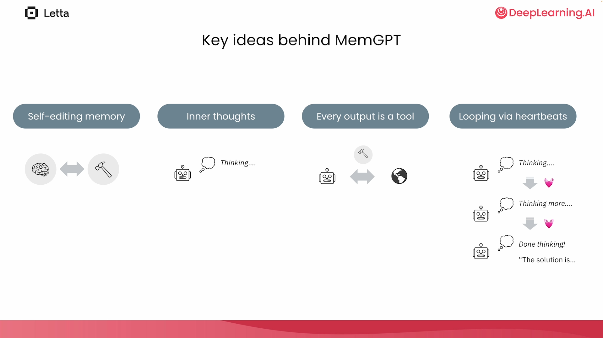
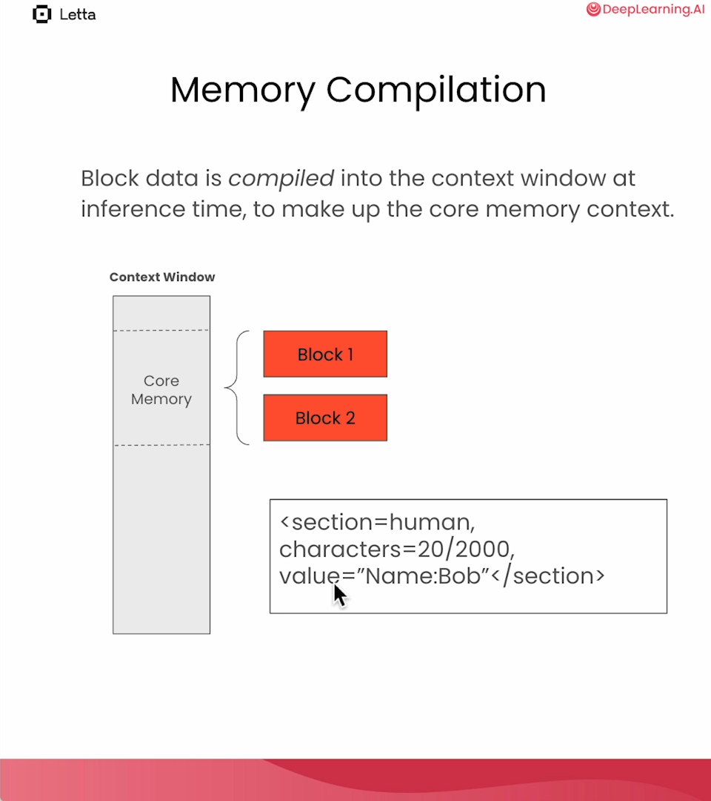
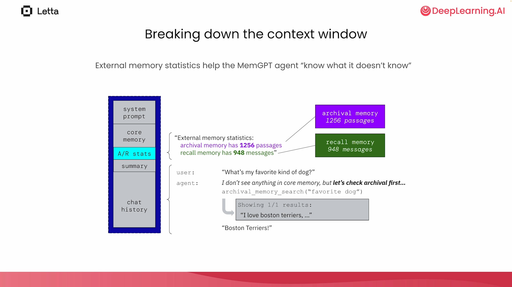
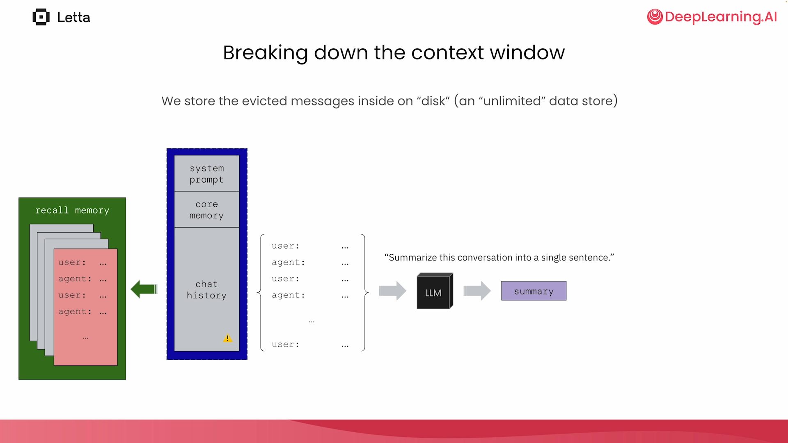
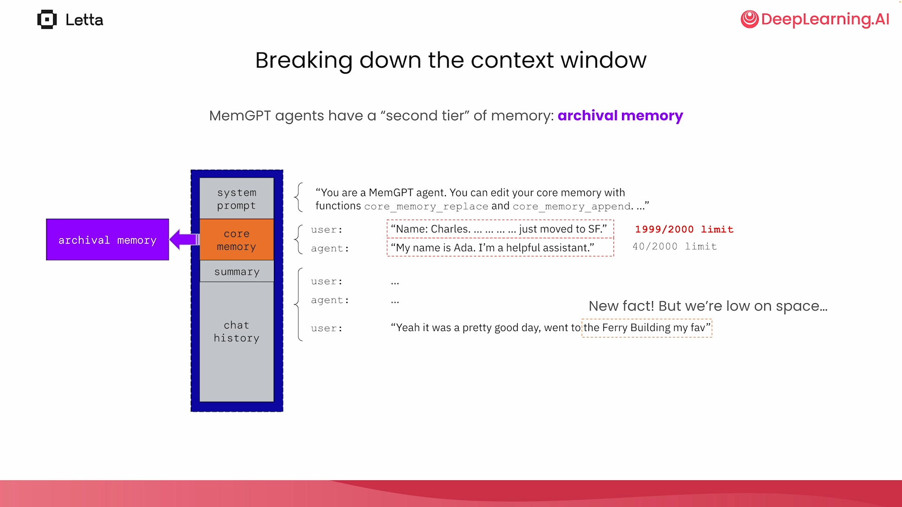
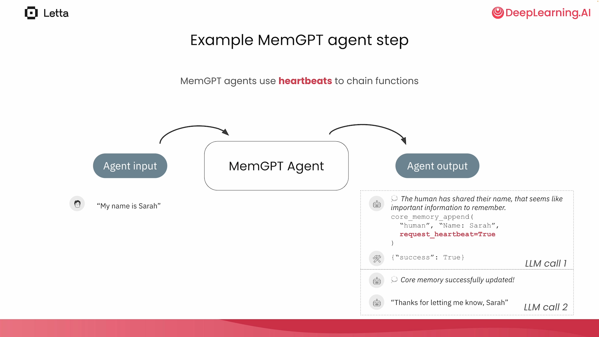
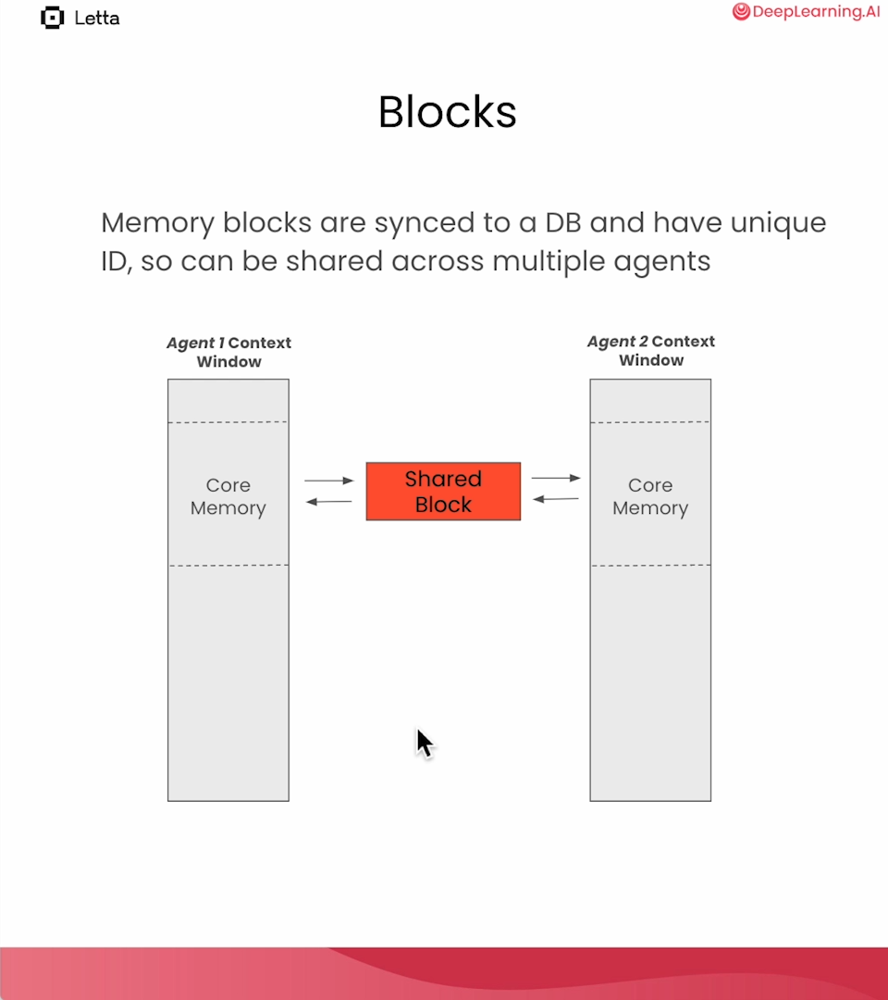

# 3 — Memory as an operating system

> MemGPT treats the context window as RAM and external stores as disk, and makes the agent its own memory manager: every memory edit, search and eviction is a tool call.

On Monday the restock agent learns that a supplier's delivery time has doubled, and next Monday, in a new session, it knows nothing about that. A model has no state between calls: everything it appears to remember was put into the prompt by someone. So the real question is who decides what goes in, what comes out and what happens when there is no more room. MemGPT's answer is that the agent can do that work itself with tools, which turns a storage problem into a behavior you have to design and test.

---

## What this note adds

Memory theory (types, hygiene, the memory loop, production designs) lives in [context engineering 06 — memory](../../../ai-engineering/02-context-engineering/notes/06-memory.md). Read that first. This note covers only what MemGPT and its successor Letta add on top:

- the **operating-system framing**: tiers, paging, and an agent that pages for itself;
- **self-editing memory** through tools;
- **heartbeats**, which let one user message drive many LLM calls;
- the **Letta API** as a concrete implementation, from the DeepLearning.AI course.

---

## The OS analogy

An LLM has a fixed context window, the way a CPU has fixed RAM. MemGPT (Packer et al. 2023) borrows the answer operating systems use: a memory hierarchy with paging. The difference is that the LLM decides what to page in and out.

The paper's evidence is about recall across sessions. In **deep memory retrieval**, the agent is asked about a detail from one of five earlier chat sessions. GPT-4 alone scored **32.1%** and GPT-4 with MemGPT **92.5%**. The setup favours MemGPT, though: the baseline saw only a lossy summary of the earlier sessions, while MemGPT could page through the full history with search. On document QA (NaturalQuestions-Open, with the same retriever for both), the fixed-context models were capped by however many retrieved documents fit in the window. MemGPT could keep querying archival storage, so its accuracy didn't fall as the document set grew. The limits matter as much as the wins. MemGPT often **stopped paging before it reached the gold document**, and with GPT-3.5 it degraded badly because that model's function calling was weak. The design only works as well as the model's tool use ([arXiv:2310.08560](https://arxiv.org/abs/2310.08560) (Packer et al., 2023-10)).

| OS concept | MemGPT equivalent |
|---|---|
| RAM | the context window |
| Disk | archival memory and recall memory (databases) |
| Page in | a search tool call returns results into context |
| Page out | summarize old messages and evict them to recall memory |
| Kernel | the agent loop that compiles state into a prompt each step |
| Interrupt | a heartbeat request that schedules another step |



*Figure: the four ideas behind MemGPT (Letta course, L2).*

The four ideas:

1. **Self-editing memory.** The agent writes to its own memory with tools.
2. **Inner thoughts.** The agent reasons privately; the user sees only what it sends.
3. **Every output is a tool call.** Even replying to the user is a tool (`send_message`).
4. **Looping via heartbeats.** A tool call can set `request_heartbeat=True` to get another turn without waiting for the user.

---

## Context compilation

Agent state lives in a database, not in the prompt. Each step, the server **compiles** that state into a prompt:

| Context section | Content | Who writes it |
|---|---|---|
| System prompt | instructions, tool rules | developer |
| Core memory | labelled blocks (persona, human, ...) | the agent, through tools |
| External memory stats | counts of archival and recall entries | the server |
| Recursive summary | summary of evicted messages | the server, on overflow |
| Chat history | recent messages | the loop |

The memory stats line matters: it tells the agent that there is more it does not currently see, so it knows when to search.

Each core-memory block has a label, a character limit and a value. Blocks are rows in a database with unique IDs. The compiled prompt renders each one with its label and fill level; schematically:

```text
<persona characters="52/2000">
You are a helpful assistant and you always use emojis
</persona>
<human characters="18/10000">
My name is Charles
</human>
```



*Figure: compiling blocks into the context window (Letta course, L4).*

---

## Two tiers, three stores

| Tier | Store | In context? | Size | Tools |
|---|---|---|---|---|
| 1 | Core memory | always | small (e.g. 2,000 chars per block) | `core_memory_append`, `core_memory_replace` |
| 2 | Recall memory | no | all past messages | `conversation_search` |
| 2 | Archival memory | no | unbounded, vector-indexed | `archival_memory_insert`, `archival_memory_search` |



*Figure: memory tiers in MemGPT (Letta course, L2).*

When the context fills up, the server summarizes the oldest messages and moves them to recall memory. The messages are still searchable; they just cost nothing until the agent asks for them.



*Figure: overflow handling (Letta course, L2).*

Archival memory is general purpose: facts the agent chose to keep, plus documents a developer loaded. Because core memory has a hard limit, the agent has to decide what earns a place there and what goes to archival.



*Figure: why a second tier is needed (Letta course, L2).*

---

## Heartbeats: one message, many steps

Every tool in MemGPT takes a `request_heartbeat` argument. If the agent sets it, the server calls the model again with the tool result, without waiting for the user. That is how an agent chains a memory search, a memory edit and a reply from one user message.



*Figure: heartbeats (Letta course, L2).*

The task-queue system prompt from Lab 4 makes the rules explicit: heartbeats keep the loop alive, inner monologue stays at 50 words or fewer, and `send_message` is the only action the user sees.

---

## Building it from scratch

Lab 1 builds self-editing memory with raw OpenAI calls: a dict for memory, one tool to write to it, and the memory serialized into a system message on every call. The full loop is in [02 — the raw loop](02-tool-use-and-react.md#the-raw-loop-no-framework). The memory-specific part is small:

```python
import json

agent_memory = {"human": "", "agent": ""}

def core_memory_save(section: str, memory: str):
    agent_memory[section] += "\n" + memory     # the agent edits its own context

# rebuilt on every call: this is context compilation in one line
memory_message = {"role": "system", "content": "[MEMORY]\n" + json.dumps(agent_memory)}
```

The system prompt ends with "When you learn new information, make sure to always call the core_memory_save tool." Without that instruction the model rarely saves anything.

### Two tiers for the restock agent

Add a size limit and a second store and the whole design appears. The block below has no LLM in it; the calls at the bottom are the ones a model would choose to make, so you can see what each one changes:

```python
# Self-editing memory for the restock agent: a small core that is always in context,
# and an archive that is only reached by a tool call. No LLM needed to see the mechanics.
CORE_LIMIT = 100
core = {"policy": "Order just in time. Keep two weeks of peak sales."}
archive = []

def core_append(label, text):
    new = core.get(label, "") + " " + text
    if sum(map(len, core.values())) - len(core.get(label, "")) + len(new) > CORE_LIMIT:
        return f"Error: core is full (limit {CORE_LIMIT}). Move detail to the archive."
    core[label] = new.strip()
    return "ok"

def archive_insert(text):
    archive.append(text)
    return f"ok, {len(archive)} passages in archive"

def archive_search(query):
    return [p for p in archive if query.lower() in p.lower()] or "no match"

def compile_context(trajectory):
    """Rebuilt for every model call. This is all the model will ever know."""
    blocks = "\n".join(f"<{k}>{v}</{k}>" for k, v in core.items())
    stats = f"[{len(archive)} passages in archive, not shown]"
    return f"{blocks}\n{stats}\n" + "\n".join(trajectory)

# What a model would choose to do across two Mondays, scripted.
print(core_append("supplier", "Acme delivers itemB."))
print(core_append("supplier", "On 3 March Acme said lead time rose to 4 weeks after a port strike."))
print(archive_insert("3 March: Acme lead time for itemB rose to 4 weeks, port strike."))
print(core_append("supplier", "See archive: lead time."))

print("\n--- next Monday, new session ---")
print(compile_context(["user: Should we reorder itemB?"]))
print("\nsearch 'lead time' ->", archive_search("lead time"))
print("search 'delay'     ->", archive_search("delay"))
```

```text
ok
Error: core is full (limit 100). Move detail to the archive.
ok, 1 passages in archive
ok

--- next Monday, new session ---
<policy>Order just in time. Keep two weeks of peak sales.</policy>
<supplier>Acme delivers itemB. See archive: lead time.</supplier>
[1 passages in archive, not shown]
user: Should we reorder itemB?

search 'lead time' -> ['3 March: Acme lead time for itemB rose to 4 weeks, port strike.']
search 'delay'     -> no match
```

Read the output from the model's side. The second `core_append` is refused, and the error tells the model what to do next, so the size limit becomes a behavior rather than a crash. The archive's contents never appear in the compiled context, only a count, which is how the model knows there is something worth searching for. And the last line shows the weak point: the fact is stored, but the query "delay" misses it, because this search is literal. A real archive uses embeddings for that reason. Even so, the agent has to decide to search at all, and that is the failure the [stale-memory pitfall](#pitfalls) describes.

---

## The Letta API

Letta is the MemGPT authors' server. The course pins `letta==0.6.50` and runs the server at `http://localhost:8283`. Agents are persistent server objects, not Python objects in your process.

**Create an agent with memory blocks (Lab 3):**

```python
# illustrative: needs `letta==0.6.50`, a Letta server on localhost:8283 and an OpenAI key
from letta_client import Letta
client = Letta(base_url="http://localhost:8283")

agent_state = client.agents.create(
    name="simple_agent",
    memory_blocks=[
        {"label": "human",   "value": "My name is Charles", "limit": 10000},
        {"label": "persona", "value": "You are a helpful assistant and you always use emojis"},
    ],
    model="openai/gpt-4o-mini-2024-07-18",
    embedding="openai/text-embedding-3-small",
)

response = client.agents.messages.create(
    agent_id=agent_state.id,
    messages=[{"role": "user", "content": "my name actually Sarah"}],
)
# the agent calls core_memory_replace; the block now says Sarah
client.agents.blocks.retrieve(agent_id=agent_state.id, block_label="human").value
```

**Archival memory directly (Lab 3):** `client.agents.passages.list(agent_id=...)` reads it and `client.agents.passages.create(agent_id=..., text="Bob loves boston terriers")` writes to it from outside the agent.

**Custom memory tools (Lab 4).** A tool that takes `agent_state: "AgentState"` gets the calling agent injected, so it can edit that agent's blocks. The lab builds a task queue in a core-memory block:

```python
# illustrative: needs a Letta server, an OpenAI key, `client`, `pop_tool` and the lab's system prompt file
def task_queue_push(agent_state: "AgentState", task_description: str):
    """Push to a task queue stored in core memory.

    Args:
        task_description (str): A description of the next task you must accomplish.
    """
    from letta_client import Letta          # tools run server-side: import inside
    import json
    client = Letta(base_url="http://localhost:8283")
    block = client.agents.blocks.retrieve(agent_id=agent_state.id, block_label="tasks")
    tasks = json.loads(block.value) + [task_description]
    client.agents.blocks.modify(agent_id=agent_state.id, block_label="tasks",
                                value=json.dumps(tasks))

push_tool = client.tools.upsert_from_function(func=task_queue_push)

task_agent = client.agents.create(
    system=open("task_queue_system_prompt.txt").read(),
    memory_blocks=[{"label": "tasks", "value": "[]"}],
    model="openai/gpt-4o-mini-2024-07-18",
    embedding="openai/text-embedding-3-small",
    tool_ids=[pop_tool.id, push_tool.id],
    include_base_tools=False,               # drop the default memory tools
    tools=["send_message"],
)
```

The docstring is the tool description: Letta builds the JSON schema from the signature and the `Args:` section.

**Agentic RAG over a document (Lab 5).** A *source* is a document collection; attaching it copies its passages into the agent's archival memory, where `archival_memory_search` finds them. The course uses an employee handbook, kept here as [packer-wooders-agent-memory-handbook.pdf](../sources/packer-wooders-agent-memory-handbook.pdf).

```python
# illustrative: needs a Letta server, an OpenAI key, `agent_state`, and a `handbook.pdf`
source = client.sources.create(name="employee_handbook",
                               embedding="openai/text-embedding-3-small")
job = client.sources.files.upload(source_id=source.id, file=open("handbook.pdf", "rb"))
while job.status != "completed":            # chunking and embedding run as a job
    job = client.jobs.retrieve(job.id); time.sleep(1)

client.agents.sources.attach(agent_id=agent_state.id, source_id=source.id)
# "Search archival for our company's vacation policies" -> archival_memory_search
```

This is agentic RAG: the agent decides whether to retrieve, what query to send and whether to search again. Compare the fixed retrieve-then-generate pipeline in [02-rag-retrieval](../../02-rag-retrieval/README.md). The lab also shows a plain tool (`query_birthday_db`) as the other route to external data.

---

## Memory types in other frameworks

Lakshmanan and Hapke (P28 Long-Term Memory) and LangMem use a cognitive-science vocabulary. It maps onto MemGPT's stores like this:

| P28 type | Meaning | MemGPT/Letta | LangMem / Mem0 |
|---|---|---|---|
| Working | current session messages, trimmed to fit | chat history + summary | message list in graph state |
| Episodic | past interactions, searchable with metadata | recall memory | `Episode` schema; Mem0 `run_id` |
| Procedural | instructions, user profile, how to behave | persona block, system prompt | `create_prompt_optimizer` rewrites the prompt |
| Semantic | facts extracted from conversations | human block, archival memory | `create_memory_manager` with schemas; Mem0 graph + vectors |

The book's working-memory rule: trim to the token limit but keep the system prompt, and keep the trimmed list valid (never drop a tool call while keeping its result). Mem0's `memory.add(messages, user_id=...)` uses an LLM to extract facts, resolve contradictions with what is stored, and drop small talk and general knowledge; `memory.search(query, user_id=...)` returns ranked memories across types.

"Trimmed to fit" covers four strategies. LangChain's legacy memory classes, as Phoenix and Taylor present them, give each one a name (*Prompt Engineering for Generative AI*, ch. 6):

| Strategy | Legacy class | Keeps | Trade-off |
|---|---|---|---|
| Full buffer | `ConversationBufferMemory` | Every message | No limit, so it eventually overflows the window |
| Last-k window | `ConversationBufferWindowMemory` | The last k exchanges | Silently forgets anything older than k |
| Token buffer | `ConversationTokenBufferMemory` | Recent messages up to a token limit | Predictable size; same blind spot as the window |
| Running summary | `ConversationSummaryMemory` | An LLM-written summary | Costs a model call per update; summaries lose detail |
| Summary + buffer | `ConversationSummaryBufferMemory` | Recent messages verbatim; older ones folded into a summary once a token limit is passed | The usual default: recency kept exactly, history kept roughly |

By default these live in process memory and disappear with the session; persistence needs a database-backed history. The classes are deprecated: current LangChain keeps the message list in LangGraph state with a checkpointer and trims or summarizes it in a node. The strategies are unchanged. In MemGPT terms, the summary-plus-buffer row is the recursive summary plus recent chat history from the context-compilation table above. MemGPT adds what these classes lack: the evicted messages stay searchable in recall memory.

The Mem0 paper ([arXiv:2504.19413](https://arxiv.org/abs/2504.19413), Chhikara et al., 2025-04) shows what extraction costs. On LOCOMO's long multi-session conversations, graded by an LLM judge, Mem0 scored 66.9% and the graph variant 68.4%. Passing the whole 26k-token conversation scored **72.9%**. Memory wins on cost: about 1.8k tokens per query instead of 26k, and p95 latency of 1.4 s instead of 17 s. Mem0 also beat its other memory baselines: OpenAI's memory at 52.9%, LangMem at 58.1%, and Zep at 66.0% (Zep also took hours to make new memories searchable). When the history still fits in the window and latency doesn't matter, full context is the more accurate baseline.

The retrieval score most of these systems descend from is from *Generative Agents* ([arXiv:2304.03442](https://arxiv.org/abs/2304.03442), Park et al., 2023-04). It ran 25 simulated characters, each with a **memory stream** of timestamped observations. Each memory gets three scores, each min-max scaled to [0, 1]:

- recency: exponential decay, factor 0.995 per game hour since the memory was last *retrieved*
- importance: the LLM rates the memory 1–10 when it is stored, e.g. 2 for "cleaning up the room" and 8 for "asking your crush out"
- relevance: cosine similarity to the current query

The three are summed with equal weight. **Reflection** runs when the importance of recent events adds up past 150, which works out to two or three times a game day. It writes higher-level conclusions back into the stream as memories. In a believability ranking (TrueSkill), the full architecture scored μ = 29.9, without reflection 26.9, and without memory, reflection or planning 21.2. Human crowdworkers role-playing the agents scored 23.0. Memory errors persisted: agents missed facts they had observed, retrieved fragments, and embellished details.

MemOS ([arXiv:2505.22101](https://arxiv.org/abs/2505.22101), Li et al., 2025-05) takes the OS analogy further than MemGPT. Its taxonomy is by where memory lives rather than what it is about: **parametric** (the weights), **activation** (the KV cache and hidden states), and **plaintext** (retrievable documents, which is everything in the table above). It also defines paths for moving memory between them, such as caching hot plaintext as KV or distilling stable knowledge into weights. Every unit is a **MemCube**: a payload plus a metadata header that records provenance, a time-to-live or decay policy, access control, version lineage and access frequency. That header is the governance layer most frameworks leave out, but MemOS is an architecture paper with no experiments, so treat it as a checklist of fields to store, not as evidence that the design works.

The LangGraph + LangMem course version, with semantic, episodic and procedural memory in an email assistant, is [04-agentic-frameworks 03](../../04-agentic-frameworks/notes/03-long-term-memory-with-langgraph.md).

LangMem's procedural memory is the one idea MemGPT does not have: a prompt optimizer that rewrites the agent's own instructions from feedback.

```python
# illustrative: needs `langmem` and an API key for the named model; the model ID is from the course
from langmem import create_prompt_optimizer

optimizer = create_prompt_optimizer(
    "anthropic:claude-3-5-sonnet-latest",
    kind="metaprompt",
    config={"max_reflection_steps": 3},
)
conversation = [
    {"role": "user", "content": "Explain inheritance in Python."},
    {"role": "assistant", "content": "Inheritance allows classes to inherit features from other classes."},
    {"role": "user", "content": "Can you give me a concrete code example?"},
]
feedback = {"user_score": 0.3, "feedback": "Too vague, no practical detail."}

better_prompt = optimizer.invoke({
    "trajectories": [(conversation, feedback)],   # (messages, feedback) pairs
    "prompt": "You are a helpful assistant.",
})
```

---

## Shared memory across agents

Blocks are database rows, so two agents can attach the same block. Lab 6 gives an evaluator agent and an outreach agent a shared `company` block; when one agent learns "the company has rebranded to Letta" and edits the block, the other sees the change on its next step.



*Figure: shared blocks (Letta course, L4).*

The multi-agent side of Lab 6 is in [04 — multi-agent design patterns](04-multi-agent-design-patterns.md#letta-agents-as-services-with-shared-memory).

---

## Designing a memory agent

From the course conclusion, the four things you control:

| Lever | Question |
|---|---|
| Prompts | What does the system prompt say about when to save and search? |
| Tools | Which memory tools exist, and do any have side effects outside memory? |
| Memory management | Block sizes, eviction policy, what gets summarized |
| Memory content | Initial persona and human blocks, preloaded archival documents |

How much should the memory agent curate? A controlled comparison of filesystem memory stores ([arXiv:2607.26637](https://arxiv.org/abs/2607.26637), Zhou et al., 2026-07) says less than you'd think. With gpt-5.4-mini building and searching the store, a verbatim dump of the conversations or one file per session matched or beat an agent-curated store on all four conversational benchmarks; on PersonaMem at 32k tokens, curation scored 37.5% against 78.1% for the dump, because the curator left superseded preferences standing as current (the right fact was still in the store for all 13 misses). Asking the agent to reorganize a store silently condensed it unless told to keep every fact: on REALTALK, a condensing reorganization dropped correctness from 77.6% to 41.2%, while a fact-preserving one held at 77.6%. Two budget rules follow. Spend model strength on the reader, not the writer: a stronger searcher raised mean correctness from about 62% (gpt-5.4-nano) to 79% (gpt-5.4), while a stronger builder "buys a more elaborate store, not a more useful one." And match stored experience to the executor: on ALFWorld, raw episode logs helped a gpt-4.1 executor most (87.1% vs. 73.6% with no store), but a gpt-4.1-mini executor did better with distilled task guidance (76.4% vs. 66.4% with logs). The study uses single build runs and 32–158 questions per benchmark tier, so read differences of a few points as ties.

The safe kind of curation edits the index, not the facts. A-MEM ([arXiv:2502.12110](https://arxiv.org/abs/2502.12110) (Xu et al., NeurIPS 2025)) stores each interaction as a Zettelkasten-style note: the raw content plus LLM-written keywords, tags and a one-line context, linked to related notes. When a new note arrives, the agent may rewrite its neighbours' keywords, tags and context, but never their content. On LoCoMo with GPT-4o-mini, scored by token F1, removing the linking and rewriting steps cut multi-hop F1 from 27.0 to 9.7. Against the whole conversation in context, the result looks like Mem0's. With GPT-4o, A-MEM won on temporal questions (39.4 vs. 9.1 F1) using about 1.2k tokens per question instead of 16.9k. It lost on single-hop questions (48.4 vs. 61.6) and on adversarial ones (36.4 vs. 52.6).

The verbatim result assumes there is a verbatim record to keep. For a video or audio stream there isn't one, so the writer has to extract something. M3-Agent ([arXiv:2508.09736](https://arxiv.org/abs/2508.09736) (Long et al., 2025-08, preprint)) turns each 30-second clip into episodic memory (what happened) and semantic memory (what it implies, such as "Alice likes coffee in the morning"), keyed to face and voice identities. With the reader held fixed, **dropping the semantic memories cut VideoMME-long accuracy from 61.8% to 48.7%**, and dropping the face–voice identity links cut it to 52.1%. On the authors' robot-view benchmark, dropping semantic memory cut accuracy from 30.7% to 13.6%. Here the writer mattered too. A Qwen2.5-Omni-7B fine-tuned to write memories beat prompted Gemini-1.5-Pro in the same role (61.8% vs. 52.7% on VideoMME-long), so the "spend on the reader" rule applies to text conversations, where the raw record can be stored as it is.

Memory of *how to do a task* raises the same choice between keeping the trajectory and keeping a distilled routine. Agent Workflow Memory ([arXiv:2409.07429](https://arxiv.org/abs/2409.07429) (Wang et al., ICML 2025)) turns successful trajectories into reusable workflows and adds them to the prompt. Example-specific values become placeholders such as `{product-name}`. In the online setting it learns from its own test-time runs, keeping those an LLM evaluator judges successful. With GPT-4 on WebArena, success rose from 15.0% (BrowserGym with the same accessibility-tree input) to 35.5%. The paper's own ablation agrees with Zhou et al., though. **Deduplicated raw trajectories did as well as LM-abstracted workflows on WebArena (35.6% vs. 35.5%)**, and on Mind2Web abstraction added 1.7 points of step success (43.4% to 45.1%). Wrapping workflows as callable tools changed little, because the agent called them in only 18.5% of tasks.

Retrieval is the other half. When stored experiences look alike, similarity is a poor proxy for usefulness. MemRL ([arXiv:2601.03192](https://arxiv.org/abs/2601.03192) (Zhang et al., 2026-01, preprint)) gives each stored experience a utility score. Each time the experience is used, task reward updates the score with a Monte Carlo rule, Q ← Q + α(r − Q). Candidates are first recalled by similarity, then re-ranked by an equal mix of similarity and utility. This is Generative Agents' importance score learned from outcomes instead of rated once at write time, and the idea goes back to episodic control in RL (Pritzel et al., ICML 2017). The model stays frozen. With GPT-4o-mini on Lifelong Agent Bench OS tasks, MemRL reached 78.8% success after 10 epochs, against 69.0% for similarity-only RAG and 73.6% for MemP. With GPT-5-mini on ALFWorld it reached 94.9%, against 88.7% for RAG. It needs a reward for every task, and the gain needs tasks that resemble each other. On HLE, where questions share little, cross-task retrieval tied reflecting on the same task alone (60.6% vs. 61.0%).

The memory manager can also be a small model trained for the job. mem-agent from Dria ([mem-agent](https://github.com/firstbatchxyz/mem-agent/blob/main/main.pdf) (Tekparmak & Kaya, 2025-10)) trained Qwen3-4B-Thinking with GSPO to retrieve, update and ask for clarification over an Obsidian-style folder of markdown files, using Python file tools. On the authors' 56-sample md-memory-bench, scored by an LLM judge, the overall score rose from 0.39 to 0.75. That put it second of 11 models, behind Qwen3-235B-Thinking at 0.79 and ahead of GPT-5 at 0.63 and Claude Opus 4.1 at 0.55. The engineering lessons travel better than the leaderboard:
- **Format rewards get farmed.** Paying per well-formed turn taught the model to use all 8 turns. The fix was rewards that shrink each turn until halfway, then turn negative, plus double the reward for success.
- **Diffs are hard for small models.** A diff-based update tool failed, and they switched to `update_file(path, old_content, new_content)`.
- **Quantization costs judgment first.** The 4- and 8-bit builds sometimes invent facts instead of asking the user for clarification.

The benchmark is small and handmade, and the training data is synthetic from the same team, so treat 0.75 as an existence proof, not a ranking.

Two larger studies make the same point: tools let the agent manage memory, but they don't teach it when to. AgeMem ([arXiv:2601.01885](https://arxiv.org/abs/2601.01885) (Yu et al., 2026-01, preprint)) gives the agent MemGPT-style tools for both tiers: add, update and delete for the long-term store, and retrieve, summarize and filter for the context. It trains them with GRPO on HotpotQA only. When Qwen2.5-7B-Instruct was only prompted to use these tools, it never updated or deleted a memory (0.00 calls per episode). It averaged 33.4% across ALFWorld, SciWorld, PDDL, BabyAI and HotpotQA, against 28.1% with no memory and 37.1% with Mem0. **After RL it averaged 42.0%**, and Qwen3-4B went from 45.6% to 54.3%. The context tools saved only 3–5% of prompt tokens over plain RAG. M3-Agent's controller makes the same point for search. After RL, its 32B controller, which searches memory for up to five rounds, scored 61.8% on VideoMME-long, against 52.5% for the same model prompted. This is MemGPT's weak-function-calling limit again: a memory design works only as well as the model's tool use.

---

## Pitfalls

From the course's conclusion, with the fixes that go with them:

| Pitfall | Fix |
|---|---|
| Agent never saves | Say so in the system prompt; check the tool description |
| Core memory fills with trivia | Smaller block limits; a rule for what belongs in core vs archival |
| Agent answers from stale core memory | Memory stats in context; instruct it to search before answering |
| Shared block edited by two agents at once | One writer per block, or a tool that serializes writes |

Four more follow from the rest of this chapter:

- **Treating memory as trusted.** Anything saved from a tool result or user message comes back later as if it were context, so an injected instruction can persist across sessions. Mark where each memory came from.
- **Overwriting facts with summaries.** A summary loses detail for good. Keep the verbatim record and curate the index on top of it.
- **Storing what you should look up.** A delivery time held in memory goes stale. Keep the source of truth in a tool, and store what the system of record does not hold, such as why a decision was made.
- **Testing storage and not behavior.** A passing insert test says nothing about whether the agent saves the right things. Replay real conversations and check what it wrote and what it later retrieved.

---

## Try it

1. Run the two-tier block with `CORE_LIMIT = 40`. What does the first `core_append` return, and what does the context look like next Monday?
2. Change `archive_search` to match any word in the query. Does `"lead time delay"` now find the passage? What would it wrongly match in a larger archive?
3. Add a `core_replace(label, old, new)` tool. Why might it suit a small model better than a diff-based edit?
4. Which tier should hold each of these: the agent's ordering policy, a 40-page supplier contract, last Monday's conversation, today's stock level?

<details>
<summary>Answers</summary>

1. The policy alone is 49 characters, so every `core_append` is refused and even the short pointer to the archive is lost. Next Monday, the context shows the policy and a count of one archived passage, with no hint of what it holds. A limit set too low silently costs you the index.
2. Yes, it finds the passage through "lead" and "time". It would also match any passage containing "time", which is why keyword matching needs ranking, and why archives usually use embeddings or hybrid search.
3. It only has to quote the old text and supply the new text. The mem-agent team reports that a diff-based tool failed for their small model and that they moved to a tool of this form.
4. Policy: core. Contract: archival, with retrieval. Last Monday's conversation: recall. Stock level: none of them, since it should come from a tool on each run.

</details>

---

## Interview checklist

| Question | Short answer |
|---|---|
| What is the MemGPT analogy? | Context = RAM, databases = disk, the LLM pages for itself with tools |
| Core vs archival vs recall? | Always in context and small; vector store of facts and documents; full message history |
| What is a heartbeat? | A flag on a tool call asking for another LLM step without user input |
| Why is "every output a tool call" useful? | One uniform loop; replying is just another action the agent chooses |
| What does agentic RAG change? | The agent decides when and what to retrieve, and can retrieve again |
| Why give core memory a hard size limit? | It is always in context, so it costs tokens on every call. An error at the limit makes the agent decide what to keep |
| Should a memory agent summarize what it stores? | Often not: curate the index and keep the facts. Zhou et al. found that verbatim stores hold up well against curated ones |
| Why does the agent not search when it should? | Tools let it manage memory but do not teach it when. Put memory stats in context, instruct it, and test that behavior |

---

## Next

→ [04 — multi-agent design patterns](04-multi-agent-design-patterns.md): reflection, tool use, planning and collaboration built from conversations between agents.
