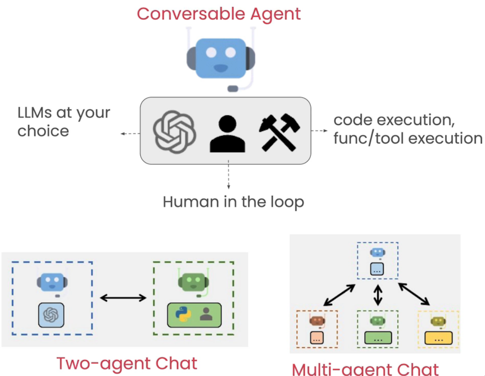
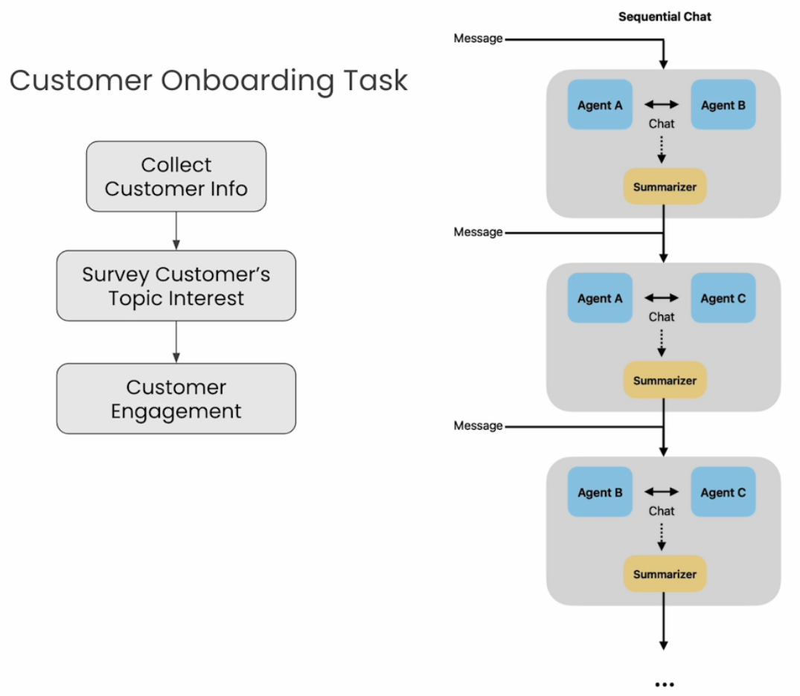
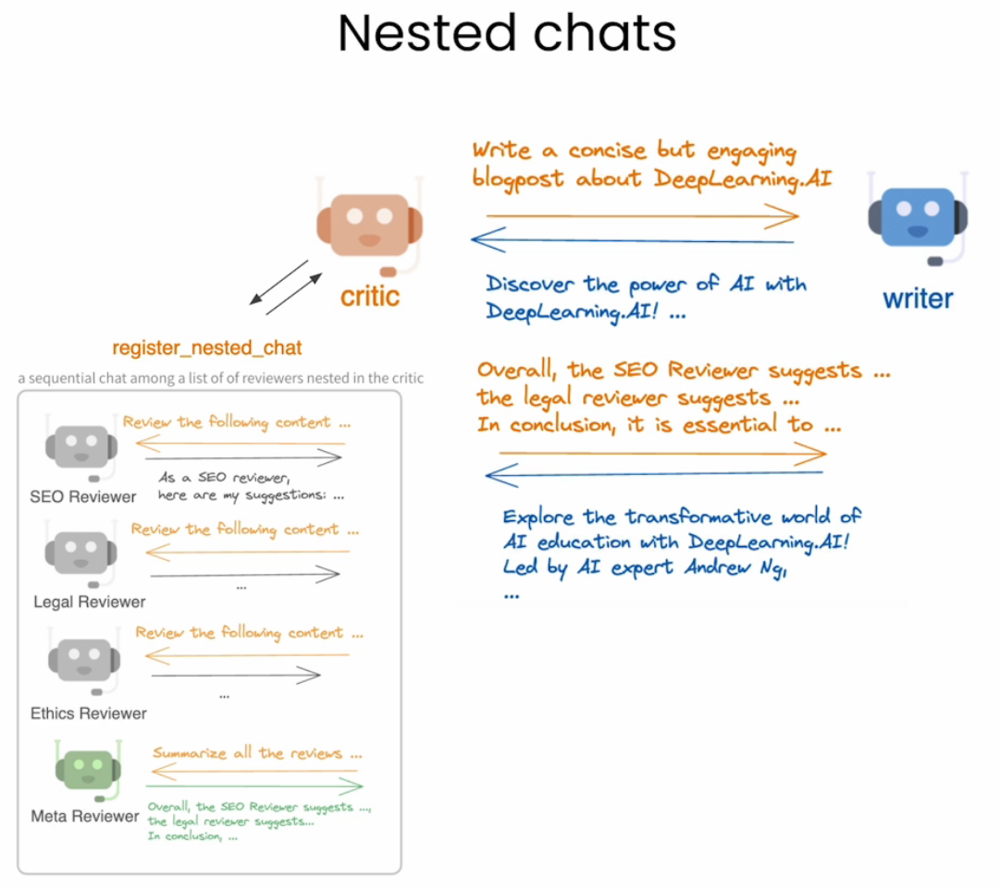
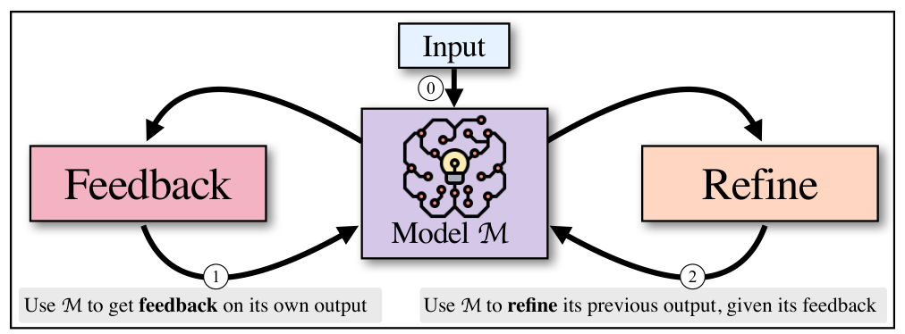
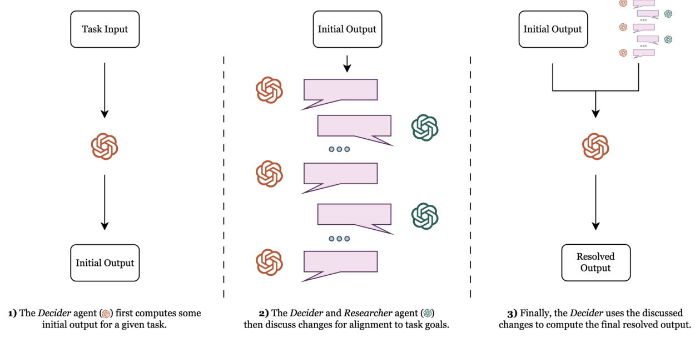
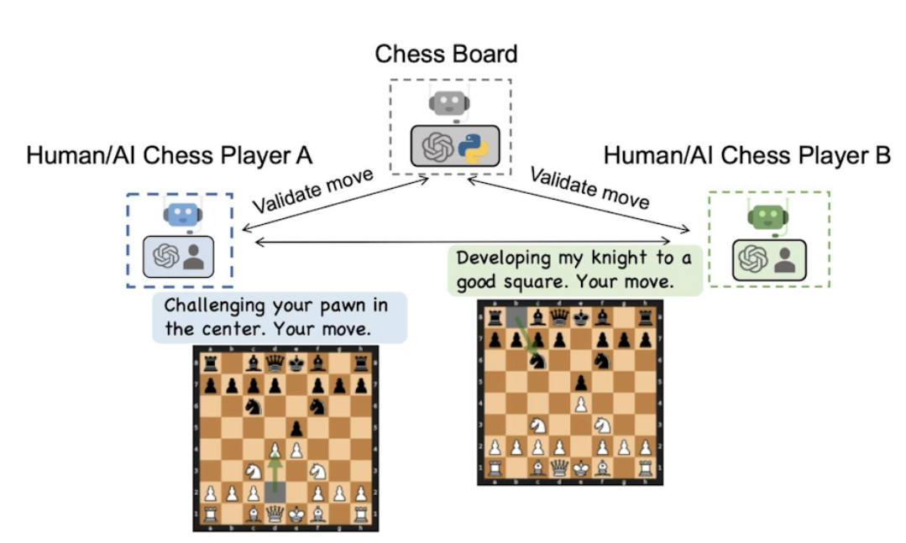
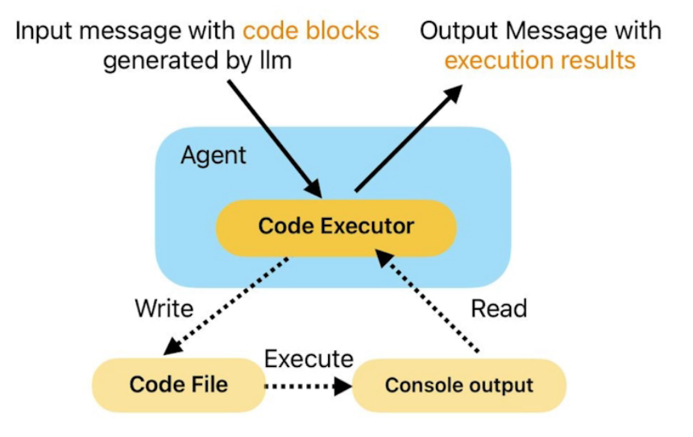
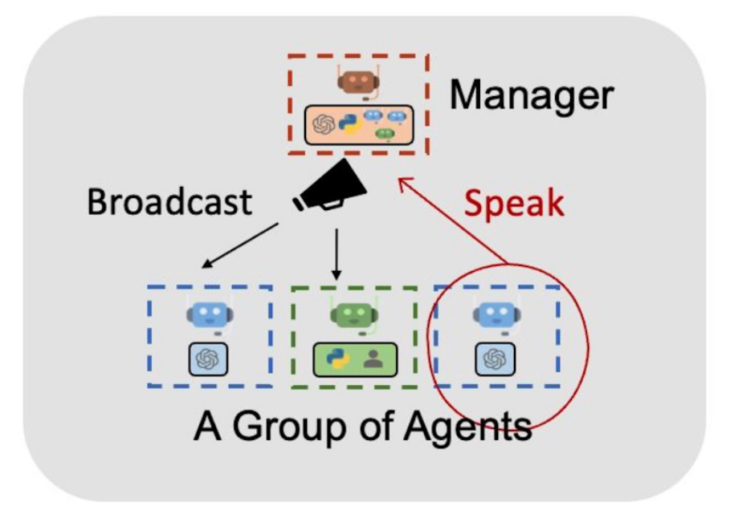

# 4 — Multi-agent design patterns

> Andrew Ng's four agentic patterns (reflection, tool use, planning, multi-agent collaboration) can all be built from one primitive: agents that send each other messages until a stop condition fires.

A single restock agent both proposes an order and judges it, and a judge reviewing its own work tends to approve it. Adding a reviewer seems like the obvious fix, and sometimes it is. But two agents now have to agree on what they are doing, know when to stop and avoid repeating each other, and each message they exchange costs tokens. This chapter builds up from one conversation to group chats and shared memory, and it asks at each step whether the extra agent has earned its cost, because when Cemri et al. studied the traces of real multi-agent runs, the failures they catalogued were bad specifications, misaligned agents and weak verification.

---

## The pattern catalogues

| Source | Patterns |
|---|---|
| Andrew Ng, May 2024 | Reflection, Tool Use, Planning, Multi-agent Collaboration |
| OpenAI adds | LLM-as-Judge, Parallelization, Router, Guardrails |
| Anthropic | *Workflows* (prompt chaining, routing, parallelization, orchestrator-workers, evaluator-optimizer) vs *agents* (the model directs its own loop) |
| Lakshmanan & Hapke | P17 LLM-as-Judge, P18 Reflection, P21 Tool Calling, P22 Code Execution, P23 Multiagent Collaboration |

The AutoGen course walks through Ng's four patterns with one lesson each, plus two lessons on the conversation primitives underneath. The table below is the whole course; the sections after it pull out the code that matters.

| Lesson | Pattern | Example | Key AutoGen feature |
|---|---|---|---|
| L1 | Two-agent conversation | Two comedians | `ConversableAgent`, `initiate_chat`, termination |
| L2 | Sequential chats | Customer onboarding | `initiate_chats` with summaries carried forward |
| L3 | Reflection | Blog post with reviewers | nested chats |
| L4 | Tool use | Conversational chess | `register_function`, caller/executor split |
| L5 | Coding | Stock price plots | code executor, user-defined functions |
| L6 | Planning | Stock report | `GroupChat` with speaker transitions |

The course is pyautogen 0.2. AutoGen has since been rewritten (0.4 is event-driven) and Microsoft now points new work at the Microsoft Agent Framework; the patterns carry over, the class names do not. See [05 — framework survey](05-framework-survey.md).

Agents can also talk without addressing each other. *Agentic Architectural Patterns* (ch. 4) separates direct communication, where one agent sends another a structured message (`{"task": "reorder_part", "quantity": 500}`), from indirect communication through a shared environment, called stigmergy: one agent writes `{"status": "complete"}` to a shared database and another, which watches that record, starts the next step. Direct messages give a clear, auditable chain of delegation; the shared record couples agents only through its schema. The chapter shows both with worked examples and no measurements.

---

## L1 — the primitive: a conversation

```python
# illustrative: needs `autogen-agentchat` 0.2 and an LLM API key
from autogen import ConversableAgent

cathy = ConversableAgent(
    name="cathy",
    system_message="Your name is Cathy and you are a stand-up comedian.",
    llm_config=llm_config,
    human_input_mode="NEVER",
)
joe = ConversableAgent(
    name="joe",
    system_message="Your name is Joe and you are a stand-up comedian. "
                   "Start the next joke from the punchline of the previous joke.",
    llm_config=llm_config,
    human_input_mode="NEVER",
    is_termination_msg=lambda msg: "I gotta go" in msg["content"],  # stop condition
)

chat_result = joe.initiate_chat(
    recipient=cathy,
    message="I'm Joe. Cathy, let's keep the jokes rolling.",
    max_turns=2,                                   # hard stop
    summary_method="reflection_with_llm",          # LLM writes the summary
    summary_prompt="Summarize the conversation",
)
chat_result.chat_history, chat_result.cost, chat_result.summary
```



*Figure: two-agent conversation (AutoGen course, L1).*

Every multi-agent system needs two stop conditions: a turn cap (`max_turns`) and a semantic one (`is_termination_msg`). Without the cap, two polite agents thank each other forever.

---

## L2 — sequential chats: a pipeline of conversations

Onboarding runs three conversations in order. Each one ends with a summary, and the summaries become the context for the next conversation. That is prompt chaining where each link is a dialogue.

```python
# illustrative: needs `autogen-agentchat` 0.2 and an LLM API key, with the agents from the lab
chats = [
    {
        "sender": onboarding_personal_information_agent,
        "recipient": customer_proxy_agent,      # human_input_mode="ALWAYS", llm_config=False
        "message": "Hello, I'm here to help you get started. Could you tell me your name and location?",
        "summary_method": "reflection_with_llm",
        "summary_args": {"summary_prompt": "Return the customer information as JSON: {'name': '', 'location': ''}"},
        "max_turns": 2,
        "clear_history": True,
    },
    {"sender": onboarding_topic_preference_agent, "recipient": customer_proxy_agent, ...},
    {"sender": customer_proxy_agent, "recipient": customer_engagement_agent, ...},
]
chat_results = initiate_chats(chats)
```



*Figure: sequential chats (AutoGen course, L2).*

Asking the summary step for JSON turns a free conversation into structured state for the next stage.

---

## L3 — reflection with nested chats

A writer drafts; a critic reviews. The critic does not review alone: each time the writer speaks, the critic runs a set of **nested chats** with specialist reviewers, then returns their combined feedback as its reply.

```python
# illustrative: needs `autogen-agentchat` 0.2 and an LLM API key, with the agents from the lab
def reflection_message(recipient, messages, sender, config):
    # pass the writer's latest draft to each reviewer
    return f"Review the following content.\n\n{recipient.chat_messages_for_summary(sender)[-1]['content']}"

review_chats = [
    {"recipient": SEO_reviewer,    "message": reflection_message, "summary_method": "reflection_with_llm",
     "summary_args": {"summary_prompt": "Return review as JSON: {'Reviewer': '', 'Review': ''}"}, "max_turns": 1},
    {"recipient": legal_reviewer,  "message": reflection_message, ...},
    {"recipient": ethics_reviewer, "message": reflection_message, ...},
    {"recipient": meta_reviewer,   "message": "Aggregate feedback from all reviewers and give final suggestions.",
     "max_turns": 1},
]
critic.register_nested_chats(review_chats, trigger=writer)   # fires when writer speaks

writer.initiate_chat(recipient=critic, message=task, max_turns=2, summary_method="last_msg")
```



*Figure: reflection with nested chats (AutoGen course, L3).*

This is P18 Reflection with the critic split into roles. The book's guidance for reflection applies: a reviewer with a specific rubric beats "please improve this", and one or two rounds capture most of the gain.

**The same loop as a two-node graph.** Oshin and Campos build reflection from a `generate` node and a `reflect` node (*Learning LangChain*, ch. 7). One detail is easy to miss: `reflect` swaps the roles of every message after the first, so AI messages become human messages and the reverse. The critic model then thinks it is grading a user's essay, and its critique goes back to `generate` as a `HumanMessage`, as if the user had sent it. The swap is needed because dialogue-tuned models are trained on alternating human/AI turns. The loop then runs a fixed number of rounds:

```python
# illustrative: needs LangGraph, LangChain and a model API key, with `State` and the prompts from *Learning LangChain*
def reflect(state: State) -> State:
    swap = {AIMessage: HumanMessage, HumanMessage: AIMessage}
    flipped = [reflection_prompt, state["messages"][0]] + [
        swap[type(m)](content=m.content) for m in state["messages"][1:]
    ]
    critique = model.invoke(flipped)
    return {"messages": [HumanMessage(content=critique.content)]}

def should_continue(state: State):
    return END if len(state["messages"]) > 6 else "reflect"   # 3 rounds, ending on a draft

builder.add_edge(START, "generate")
builder.add_conditional_edges("generate", should_continue)
builder.add_edge("reflect", "generate")
```

There are two variants: let `reflect` decide when the draft is good enough, or add reflection as the last node of a tool-calling agent, at the price of more latency. The authors "strongly recommend" grounding the critique wherever possible. For code, run a linter or compiler before `reflect` and pass it the errors. That matches the P22 rule of sending execution errors back to the model ([02](02c-mcp-code-and-safe-tool-calls.md#code-execution-instead-of-a-tool-list)).

### When self-critique helps, and when it doesn't

Self-Refine ([arXiv:2303.17651](https://arxiv.org/abs/2303.17651) (Madaan et al., NeurIPS 2023)) is the origin of the single-model loop: the same LLM drafts, critiques and rewrites, with no training and no outside signal. Across seven tasks with GPT-3.5, ChatGPT and GPT-4 it improved outputs by about 20 points absolute on average, and it backs both rules above. Rubric: swapping its specific, actionable critique for generic "improve this" feedback dropped ChatGPT's Sentiment Reversal score from 43.2 to 31.2, and in a manual review of failed refinements, 94% traced to bad feedback (wrong location or wrong fix) and only 6% to the rewrite. Rounds: on Code Optimization the score went 22.0 → 27.0 → 27.9 → 28.8 over three rounds, so most of the gain came in the first.



*Image Source: Madaan et al., [Self-Refine: Iterative Refinement with Self-Feedback](https://arxiv.org/abs/2303.17651) (2023), Fig. 1*

**On math, the same loop did nothing.** GSM8K solve rates moved 64.1 → 64.1 (GPT-3.5), 74.8 → 75.0 (ChatGPT) and 92.9 → 93.1 (GPT-4), because the critic can't tell a wrong chain from a right one: ChatGPT's feedback was "everything looks good" on 94% of problems. Telling the loop only *whether* the answer was wrong lifted GPT-3.5 to 68.9. RCI ([arXiv:2303.17491](https://arxiv.org/abs/2303.17491) (Kim et al., NeurIPS 2023)) shows the same dependence: its GSM8K gain with gpt-3.5-turbo (78.0% → 85.4%) used the correct label to decide when to stop, and the authors report that without it, false-negative critiques pull accuracy down. Huang et al. made this the general finding ([arXiv:2310.01798](https://arxiv.org/abs/2310.01798) (Huang et al., ICLR 2024)): without an oracle, intrinsic self-correction on reasoning tasks tends to turn right answers wrong. In planning it can be worse. In PlanGEN's baseline ([arXiv:2502.16111](https://arxiv.org/abs/2502.16111) (Parmar et al., EMNLP 2025)), a self-reflection loop on Gemini-1.5-Pro scored 14.9% exact match on NATURAL PLAN trip planning, against 34.8% for a single pass.

The rule: when the task has a right answer, reflect against something checkable (tests, a compiler, the problem's constraints, a second model's answer). Self-critique alone earns its keep on open-ended quality: tone, readability, coverage of a long list of requirements. A reasoning survey ([arXiv:2504.09037](https://arxiv.org/abs/2504.09037) (Ke et al., 2025, preprint)) relays the same pattern: self-refinement is unreliable without a robust verifier, and critic loops can over-refine. It has no experiments of its own.

DERA ([arXiv:2303.17071](https://arxiv.org/abs/2303.17071) (Nair et al., 2023-03, preprint)) is a role-asymmetric version of the loop. A Researcher agent critiques a draft, a Decider agent accepts or rejects each point and writes the accepted ones to a shared scratchpad, and a final prompt rewrites the draft from the scratchpad; both roles are GPT-4. On 50 telehealth encounters, four physicians preferred the DERA summary 90% to 10%, and rated 92% of DERA care plans complete against 64% of the initial ones. On multiple-choice MedQA it was level with plain GPT-4 (0.840 against 0.834), and on open-ended MedQA and NEJM it matched a one-shot 5-vote baseline, so the gain is on long-form output with many details, not short answers. There is no single-agent ablation, so the Researcher's share beyond one extra critique pass is untested, and GPT-4 scores GPT-4 in the corruption study.



*Image Source: Nair et al., [DERA: Enhancing Large Language Model Completions with Dialog-Enabled Resolving Agents](https://arxiv.org/abs/2303.17071) (2023), Fig. 1*

---

## L4 — tool use inside a conversation

Two player agents play chess through a board proxy that owns the `python-chess` board. Each player has the tools `get_legal_moves()` and `make_move(move)`, registered with the player as caller and the board proxy as executor (see [02 — caller and executor](02-tool-use-and-react.md#caller-and-executor-are-different-agents)).

```python
# illustrative: needs `autogen-agentchat` 0.2 and an LLM API key and `chess`; see the lab
board_proxy = ConversableAgent(
    name="Board Proxy",
    llm_config=False,                      # no LLM: it only executes tools
    is_termination_msg=check_made_move,    # nested chat ends once a legal move is made
    default_auto_reply="Please make a move.",
    human_input_mode="NEVER",
)

player_white.register_nested_chats(
    trigger=player_black,
    chat_queue=[{"sender": board_proxy, "recipient": player_white, "summary_method": "last_msg"}],
)
```



*Figure: conversational chess (AutoGen course, L4).*

The structure is worth copying: the outer chat is the social layer (players talk), the nested chat is the work layer (a player and the board negotiate a legal move). A variant adds chit-chat to the outer layer and marks the nested chats `"silent": True` so the tool traffic stays out of the outer transcript.

---

## L5 — coding agents

Covered in [02 — code execution](02c-mcp-code-and-safe-tool-calls.md#code-execution-instead-of-a-tool-list). The multi-agent point: the code writer and the code executor are separate agents, and the executor runs with `human_input_mode="ALWAYS"` so a person approves each run.



*Figure: code writer and executor (AutoGen course, L5).*

---

## L6 — planning with a group chat

Five agents share one conversation, and a manager picks who speaks next.

| Agent | Role | LLM? |
|---|---|---|
| Admin | the human; approves the plan and the report | no (`human_input_mode="ALWAYS"`) |
| Planner | breaks the task into steps that need information Python can get | yes |
| Engineer | writes code for the steps | yes |
| Executor | runs the code (`last_n_messages=3`, `use_docker=False`) | no |
| Writer | writes the blog post in Markdown | yes |

```python
# illustrative: needs `autogen-agentchat` 0.2 and an LLM API key, with the agents from the lab
groupchat = autogen.GroupChat(
    agents=[user_proxy, engineer, writer, executor, planner],
    messages=[],
    max_round=10,
    allowed_or_disallowed_speaker_transitions={
        user_proxy: [engineer, writer, executor, planner],
        engineer:   [user_proxy, executor],
        writer:     [user_proxy, planner],
        executor:   [user_proxy, engineer, planner],
        planner:    [user_proxy, engineer, writer],
    },
    speaker_transitions_type="allowed",
)
manager = autogen.GroupChatManager(groupchat=groupchat, llm_config=llm_config)
```



*Figure: the financial-report group chat (AutoGen course, L6).*

Without the transition table, the manager LLM picks the next speaker from each agent's `description` alone, and it often picks badly (the writer starts before any data exists). The table turns free-for-all into a state machine with LLM choice only among legal moves. LangGraph makes that state machine the primary abstraction; see [04-agentic-frameworks](../../04-agentic-frameworks/README.md).

---

### A conversation needs three kinds of stop

The patterns in this chapter differ in topology but share one need: something has to end the conversation. Here is the restock agent with a reviewer, with stubs in place of the two models:

```python
# A buyer and a reviewer with the three stop conditions a conversation needs.
# Both agents are stubs. The verifier at the end is plain code on purpose.
PEAK = 90

def buyer(feedback):
    """Stub for an LLM: proposes an order, and raises it when the reviewer objects."""
    return 150 if feedback is None else 300

def reviewer(quantity):
    """Stub for an LLM critic. Approves anything above a rule of thumb."""
    return "APPROVE" if quantity >= 3 * PEAK else f"Too low: {quantity} is under three weeks of peak."

def verify(quantity):
    """Independent of both agents: does the order cover two weeks of peak sales?"""
    return quantity >= 2 * PEAK

def converse(max_turns):
    feedback = None
    for turn in range(1, max_turns + 1):
        quantity = buyer(feedback)
        feedback = reviewer(quantity)
        print(f"turn {turn}: buyer says {quantity}; reviewer says {feedback!r}")
        if feedback == "APPROVE":                      # semantic stop
            return quantity
    return None                                        # the turn cap: no agreement

for cap in (3, 1):
    quantity = converse(cap)
    if quantity is None:
        print(f"cap {cap}: no agreement, escalate to a human\n")
    else:
        print(f"cap {cap}: agreed on {quantity}; verifier says {verify(quantity)}\n")

# Speaker transitions are a small state machine: the graph forbids what the prompt only discourages.
ALLOWED = {"planner": {"buyer"}, "buyer": {"reviewer"}, "reviewer": {"buyer", "executor"}, "executor": set()}
def legal(path):
    return all(b in ALLOWED[a] for a, b in zip(path, path[1:]))

print(legal(["planner", "buyer", "reviewer", "executor"]))
print(legal(["planner", "buyer", "executor"]))         # the buyer cannot skip review
```

```text
turn 1: buyer says 150; reviewer says 'Too low: 150 is under three weeks of peak.'
turn 2: buyer says 300; reviewer says 'APPROVE'
cap 3: agreed on 300; verifier says True

turn 1: buyer says 150; reviewer says 'Too low: 150 is under three weeks of peak.'
cap 1: no agreement, escalate to a human

True
False
```

The run shows the three stops: a semantic one (`APPROVE`), a turn cap that ends in escalation rather than in a guess, and a verifier that is not one of the two agents. The reviewer here has only a rule of thumb, and a real one can be just as easily satisfied, so "the agents agreed" is not the success signal. The transition table does in a few lines what the group-chat transitions below do: it makes skipping review impossible instead of merely discouraged.

---

→ Planning strategies (plan-and-execute, Tree of Thoughts, search over agents), Letta agents with shared memory, the architecture catalogue (P23) and why multi-agent systems fail are in [04c — planning, architectures and why teams fail](04c-planning-architectures-and-failure.md). The evidence on when extra agents pay is in [04b](04b-when-more-agents-pay.md).

---

## Pitfalls

- **Adding agents before fixing the prompt.** A second agent multiplies cost and failure modes. Try one agent with better tools or a workflow first, and add another only when you can state what it does that the first cannot.
- **Treating agreement as success.** Two models can approve a wrong answer together. Keep an independent check, in code where possible.
- **Termination by polite phrase alone.** Agents that say "thanks" can loop indefinitely. Use a turn cap and an explicit stop signal, and escalate at the cap.
- **Self-critique with the same context.** A critic that shares the writer's assumptions can repeat its errors. See [when self-critique helps](#when-self-critique-helps-and-when-it-doesnt).
- **Passing the full history on every handoff.** Tokens grow with every agent. Filter what crosses a handoff, and summarize between stages.
- **Leaving roles vague.** Overlapping roles repeat work and ignore each other's output. Write the spec first; specification problems are one of Cemri's three failure categories.


---

## Try it

1. Change `reviewer` so that it always objects. What does `converse(3)` do, and what do you want the system to do next?
2. Add `"executor"` to the buyer's allowed transitions in `ALLOWED`. Which check now passes that should not, and how would you catch this in a test?

<details>
<summary>Answers</summary>

1. It runs three turns and returns `None`, and the caller escalates to a human. Without that branch, the likely bug is treating the last proposal as the answer.
2. `legal(["planner", "buyer", "executor"])` returns `True`, so an order can skip review. Keep a test asserting that this path is illegal, so the policy cannot change unnoticed.

</details>

---

## Interview checklist

| Question | Short answer |
|---|---|
| Name Ng's four agentic patterns | Reflection, tool use, planning, multi-agent collaboration |
| What is a nested chat for? | Running a sub-conversation (reviewers, a tool executor) behind one agent's reply |
| How do you stop a group chat from derailing? | Speaker-transition rules, turn caps, a human approver |
| Why does a reflection node swap human and AI roles? | Dialogue-tuned models expect alternating turns; the critic must see the draft as user input, and the generator must see the critique as user feedback |
| What stops a two-agent conversation? | A semantic signal, a turn cap that escalates, and ideally a verifier that is neither agent |

---

## Next

→ [04b — when more agents pay](04b-when-more-agents-pay.md): the evidence on when a team beats one agent given the same budget.
