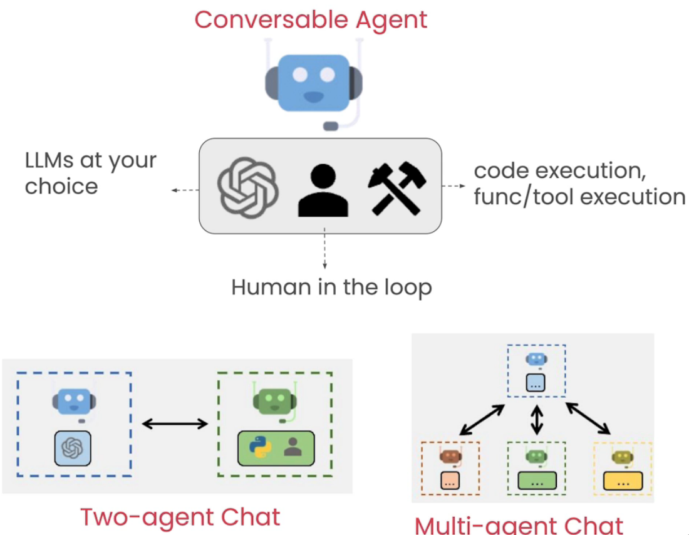
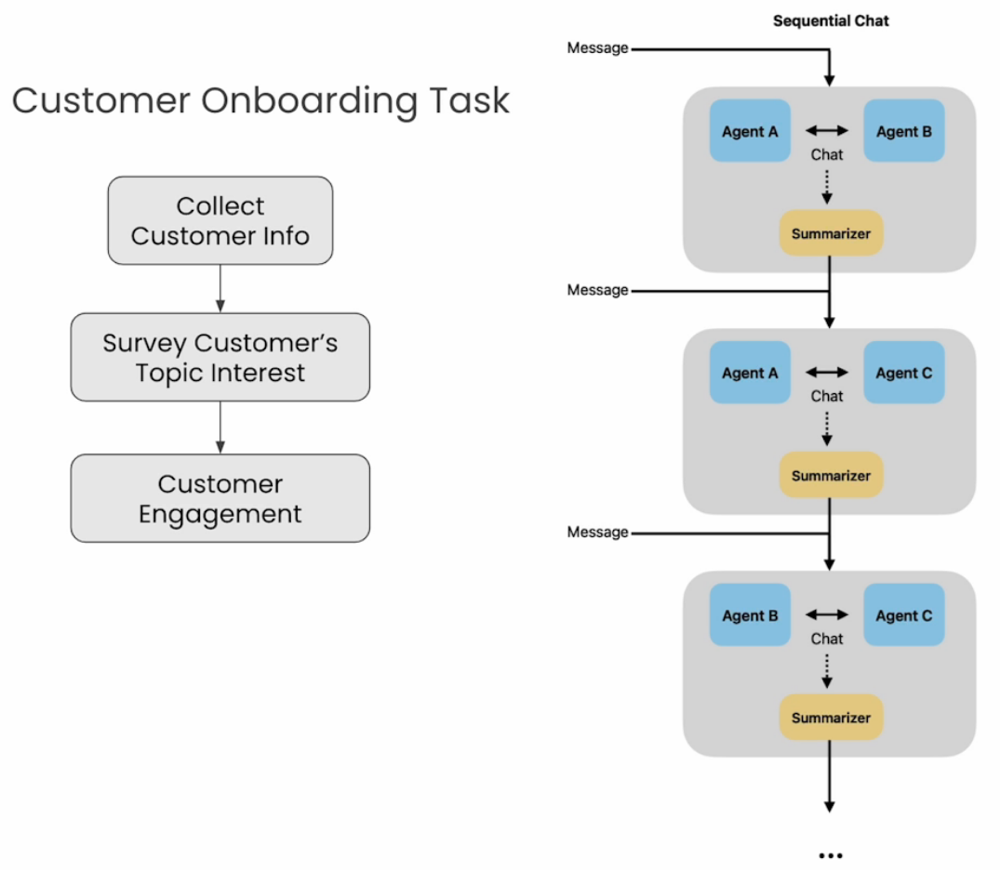
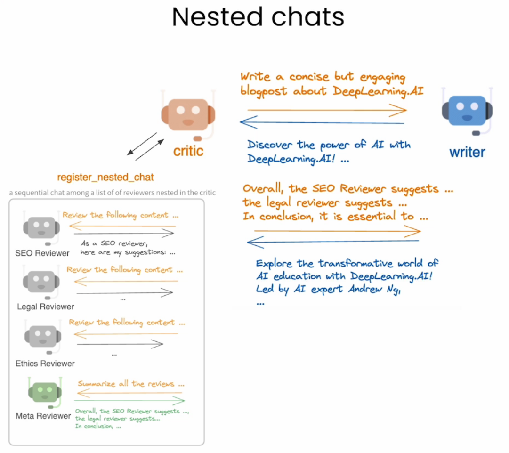
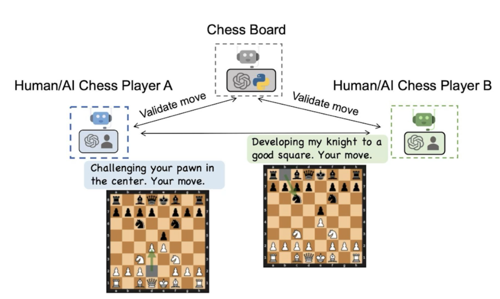
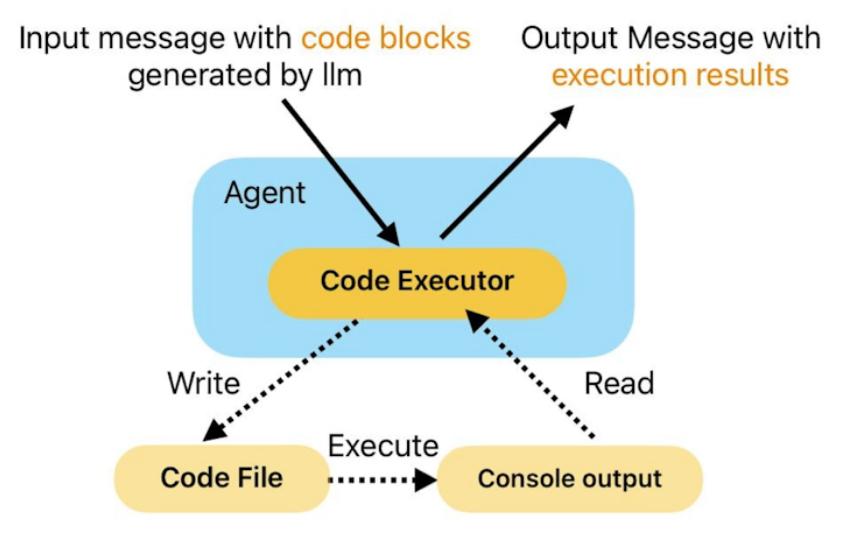
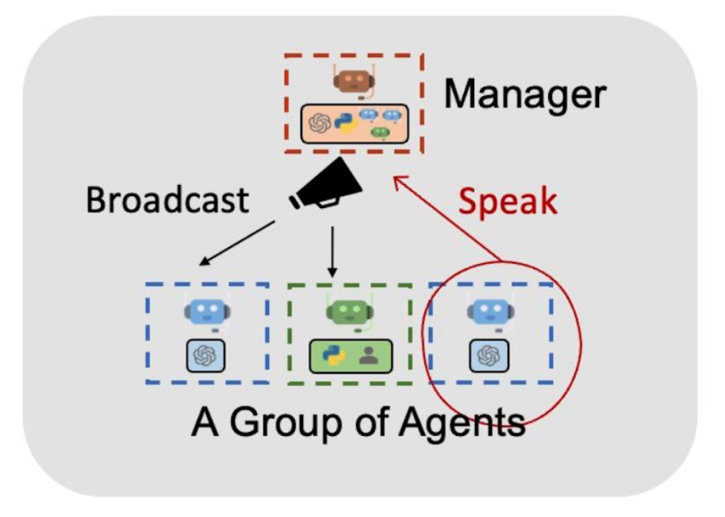
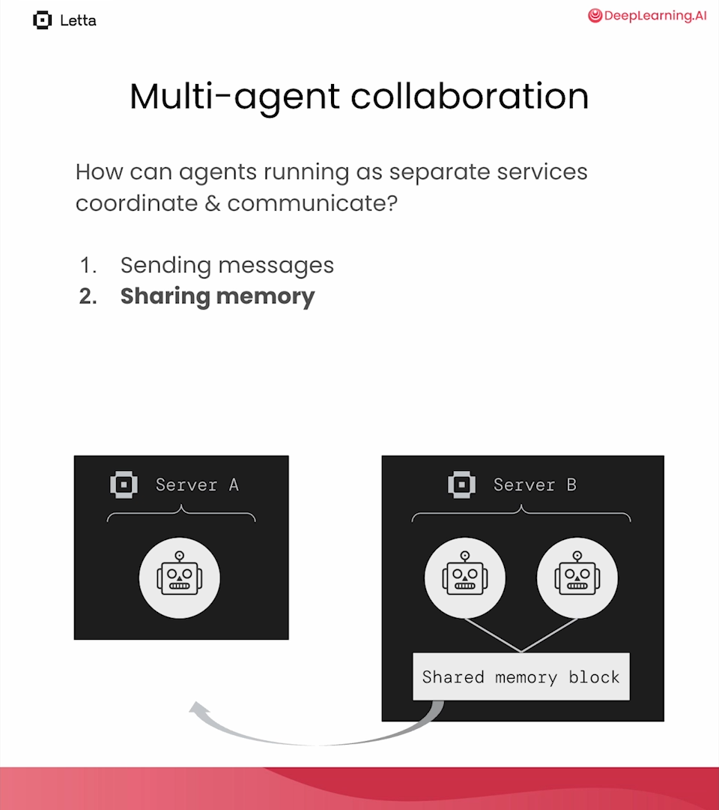
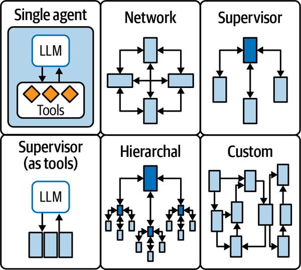

# 4 — Multi-agent design patterns

> Andrew Ng's four agentic patterns (reflection, tool use, planning, multi-agent collaboration) can all be built from one primitive: agents that send each other messages until a stop condition fires.

A single restock agent both proposes an order and judges it, and a judge reviewing its own work tends to approve it. Adding a reviewer seems like the obvious fix, and sometimes it is. But two agents now have to agree on what they are doing, know when to stop and avoid repeating each other, and each message they exchange costs tokens. This chapter builds up from one conversation to group chats and shared memory, and it asks at each step whether the extra agent has earned its cost, because when Cemri et al. studied the traces of real multi-agent runs, the failures they catalogued were bad specifications, misaligned agents and weak verification.

---

## The pattern catalogues

| Source | Patterns |
|---|---|
| Andrew Ng, May 2024 | Reflection, Tool Use, Planning, Multi-agent Collaboration |
| OpenAI adds | LLM-as-Judge, Parallelization, Router, Guardrails |
| Anthropic | *Workflows* (prompt chaining, routing, parallelization, orchestrator-workers, evaluator-optimizer) vs *agents* (the model directs its own loop) |
| Lakshmanan & Hapke | P17 LLM-as-Judge, P18 Reflection, P21 Tool Calling, P22 Code Execution, P23 Multiagent Collaboration |

The AutoGen course walks through Ng's four patterns with one lesson each, plus two lessons on the conversation primitives underneath. The table below is the whole course; the sections after it pull out the code that matters.

| Lesson | Pattern | Example | Key AutoGen feature |
|---|---|---|---|
| L1 | Two-agent conversation | Two comedians | `ConversableAgent`, `initiate_chat`, termination |
| L2 | Sequential chats | Customer onboarding | `initiate_chats` with summaries carried forward |
| L3 | Reflection | Blog post with reviewers | nested chats |
| L4 | Tool use | Conversational chess | `register_function`, caller/executor split |
| L5 | Coding | Stock price plots | code executor, user-defined functions |
| L6 | Planning | Stock report | `GroupChat` with speaker transitions |

The course is pyautogen 0.2. AutoGen has since been rewritten (0.4 is event-driven) and Microsoft now points new work at the Microsoft Agent Framework; the patterns carry over, the class names do not. See [05 — framework survey](05-framework-survey.md).

---

## L1 — the primitive: a conversation

```python
# illustrative: needs `autogen-agentchat` 0.2 and an LLM API key
from autogen import ConversableAgent

cathy = ConversableAgent(
    name="cathy",
    system_message="Your name is Cathy and you are a stand-up comedian.",
    llm_config=llm_config,
    human_input_mode="NEVER",
)
joe = ConversableAgent(
    name="joe",
    system_message="Your name is Joe and you are a stand-up comedian. "
                   "Start the next joke from the punchline of the previous joke.",
    llm_config=llm_config,
    human_input_mode="NEVER",
    is_termination_msg=lambda msg: "I gotta go" in msg["content"],  # stop condition
)

chat_result = joe.initiate_chat(
    recipient=cathy,
    message="I'm Joe. Cathy, let's keep the jokes rolling.",
    max_turns=2,                                   # hard stop
    summary_method="reflection_with_llm",          # LLM writes the summary
    summary_prompt="Summarize the conversation",
)
chat_result.chat_history, chat_result.cost, chat_result.summary
```



*Figure: two-agent conversation (AutoGen course, L1).*

Every multi-agent system needs two stop conditions: a turn cap (`max_turns`) and a semantic one (`is_termination_msg`). Without the cap, two polite agents thank each other forever.

---

## L2 — sequential chats: a pipeline of conversations

Onboarding runs three conversations in order. Each one ends with a summary, and the summaries become the context for the next conversation. That is prompt chaining where each link is a dialogue.

```python
# illustrative: needs `autogen-agentchat` 0.2 and an LLM API key, with the agents from the lab
chats = [
    {
        "sender": onboarding_personal_information_agent,
        "recipient": customer_proxy_agent,      # human_input_mode="ALWAYS", llm_config=False
        "message": "Hello, I'm here to help you get started. Could you tell me your name and location?",
        "summary_method": "reflection_with_llm",
        "summary_args": {"summary_prompt": "Return the customer information as JSON: {'name': '', 'location': ''}"},
        "max_turns": 2,
        "clear_history": True,
    },
    {"sender": onboarding_topic_preference_agent, "recipient": customer_proxy_agent, ...},
    {"sender": customer_proxy_agent, "recipient": customer_engagement_agent, ...},
]
chat_results = initiate_chats(chats)
```



*Figure: sequential chats (AutoGen course, L2).*

Asking the summary step for JSON turns a free conversation into structured state for the next stage.

---

## L3 — reflection with nested chats

A writer drafts; a critic reviews. The critic does not review alone: each time the writer speaks, the critic runs a set of **nested chats** with specialist reviewers, then returns their combined feedback as its reply.

```python
# illustrative: needs `autogen-agentchat` 0.2 and an LLM API key, with the agents from the lab
def reflection_message(recipient, messages, sender, config):
    # pass the writer's latest draft to each reviewer
    return f"Review the following content.\n\n{recipient.chat_messages_for_summary(sender)[-1]['content']}"

review_chats = [
    {"recipient": SEO_reviewer,    "message": reflection_message, "summary_method": "reflection_with_llm",
     "summary_args": {"summary_prompt": "Return review as JSON: {'Reviewer': '', 'Review': ''}"}, "max_turns": 1},
    {"recipient": legal_reviewer,  "message": reflection_message, ...},
    {"recipient": ethics_reviewer, "message": reflection_message, ...},
    {"recipient": meta_reviewer,   "message": "Aggregate feedback from all reviewers and give final suggestions.",
     "max_turns": 1},
]
critic.register_nested_chats(review_chats, trigger=writer)   # fires when writer speaks

writer.initiate_chat(recipient=critic, message=task, max_turns=2, summary_method="last_msg")
```



*Figure: reflection with nested chats (AutoGen course, L3).*

This is P18 Reflection with the critic split into roles. The book's guidance for reflection applies: a reviewer with a specific rubric beats "please improve this", and one or two rounds capture most of the gain.

**The same loop as a two-node graph.** Oshin and Campos build reflection from a `generate` node and a `reflect` node (*Learning LangChain*, ch. 7). One detail is easy to miss: `reflect` swaps the roles of every message after the first, so AI messages become human messages and the reverse. The critic model then thinks it is grading a user's essay, and its critique goes back to `generate` as a `HumanMessage`, as if the user had sent it. The swap is needed because dialogue-tuned models are trained on alternating human/AI turns. The loop then runs a fixed number of rounds:

```python
# illustrative: needs LangGraph, LangChain and a model API key, with `State` and the prompts from *Learning LangChain*
def reflect(state: State) -> State:
    swap = {AIMessage: HumanMessage, HumanMessage: AIMessage}
    flipped = [reflection_prompt, state["messages"][0]] + [
        swap[type(m)](content=m.content) for m in state["messages"][1:]
    ]
    critique = model.invoke(flipped)
    return {"messages": [HumanMessage(content=critique.content)]}

def should_continue(state: State):
    return END if len(state["messages"]) > 6 else "reflect"   # 3 rounds, ending on a draft

builder.add_edge(START, "generate")
builder.add_conditional_edges("generate", should_continue)
builder.add_edge("reflect", "generate")
```

There are two variants: let `reflect` decide when the draft is good enough, or add reflection as the last node of a tool-calling agent, at the price of more latency. The authors "strongly recommend" grounding the critique wherever possible. For code, run a linter or compiler before `reflect` and pass it the errors. That matches the P22 rule of sending execution errors back to the model ([02](02-tool-use-and-react.md#code-execution-instead-of-a-tool-list)).

### When self-critique helps, and when it doesn't

Self-Refine ([arXiv:2303.17651](https://arxiv.org/abs/2303.17651) (Madaan et al., NeurIPS 2023)) is the origin of the single-model loop: the same LLM drafts, critiques and rewrites, with no training and no outside signal. Across seven tasks with GPT-3.5, ChatGPT and GPT-4 it improved outputs by about 20 points absolute on average, and it backs both rules above. Rubric: swapping its specific, actionable critique for generic "improve this" feedback dropped ChatGPT's Sentiment Reversal score from 43.2 to 31.2, and in a manual review of failed refinements, 94% traced to bad feedback (wrong location or wrong fix) and only 6% to the rewrite. Rounds: on Code Optimization the score went 22.0 → 27.0 → 27.9 → 28.8 over three rounds, so most of the gain came in the first.

**On math, the same loop did nothing.** GSM8K solve rates moved 64.1 → 64.1 (GPT-3.5), 74.8 → 75.0 (ChatGPT) and 92.9 → 93.1 (GPT-4), because the critic can't tell a wrong chain from a right one: ChatGPT's feedback was "everything looks good" on 94% of problems. Telling the loop only *whether* the answer was wrong lifted GPT-3.5 to 68.9. RCI ([arXiv:2303.17491](https://arxiv.org/abs/2303.17491) (Kim et al., NeurIPS 2023)) shows the same dependence: its GSM8K gain with gpt-3.5-turbo (78.0% → 85.4%) used the correct label to decide when to stop, and the authors report that without it, false-negative critiques pull accuracy down. Huang et al. made this the general finding ([arXiv:2310.01798](https://arxiv.org/abs/2310.01798) (Huang et al., ICLR 2024)): without an oracle, intrinsic self-correction on reasoning tasks tends to turn right answers wrong. In planning it can be worse. In PlanGEN's baseline ([arXiv:2502.16111](https://arxiv.org/abs/2502.16111) (Parmar et al., EMNLP 2025)), a self-reflection loop on Gemini-1.5-Pro scored 14.9% exact match on NATURAL PLAN trip planning, against 34.8% for a single pass.

The rule: when the task has a right answer, reflect against something checkable (tests, a compiler, the problem's constraints, a second model's answer). Self-critique alone earns its keep on open-ended quality: tone, readability, coverage of a long list of requirements.

---

## L4 — tool use inside a conversation

Two player agents play chess through a board proxy that owns the `python-chess` board. Each player has the tools `get_legal_moves()` and `make_move(move)`, registered with the player as caller and the board proxy as executor (see [02 — caller and executor](02-tool-use-and-react.md#caller-and-executor-are-different-agents)).

```python
# illustrative: needs `autogen-agentchat` 0.2 and an LLM API key and `chess`; see the lab
board_proxy = ConversableAgent(
    name="Board Proxy",
    llm_config=False,                      # no LLM: it only executes tools
    is_termination_msg=check_made_move,    # nested chat ends once a legal move is made
    default_auto_reply="Please make a move.",
    human_input_mode="NEVER",
)

player_white.register_nested_chats(
    trigger=player_black,
    chat_queue=[{"sender": board_proxy, "recipient": player_white, "summary_method": "last_msg"}],
)
```



*Figure: conversational chess (AutoGen course, L4).*

The structure is worth copying: the outer chat is the social layer (players talk), the nested chat is the work layer (a player and the board negotiate a legal move). A variant adds chit-chat to the outer layer and marks the nested chats `"silent": True` so the tool traffic stays out of the outer transcript.

---

## L5 — coding agents

Covered in [02 — code execution](02-tool-use-and-react.md#code-execution-instead-of-a-tool-list). The multi-agent point: the code writer and the code executor are separate agents, and the executor runs with `human_input_mode="ALWAYS"` so a person approves each run.



*Figure: code writer and executor (AutoGen course, L5).*

---

## L6 — planning with a group chat

Five agents share one conversation, and a manager picks who speaks next.

| Agent | Role | LLM? |
|---|---|---|
| Admin | the human; approves the plan and the report | no (`human_input_mode="ALWAYS"`) |
| Planner | breaks the task into steps that need information Python can get | yes |
| Engineer | writes code for the steps | yes |
| Executor | runs the code (`last_n_messages=3`, `use_docker=False`) | no |
| Writer | writes the blog post in Markdown | yes |

```python
# illustrative: needs `autogen-agentchat` 0.2 and an LLM API key, with the agents from the lab
groupchat = autogen.GroupChat(
    agents=[user_proxy, engineer, writer, executor, planner],
    messages=[],
    max_round=10,
    allowed_or_disallowed_speaker_transitions={
        user_proxy: [engineer, writer, executor, planner],
        engineer:   [user_proxy, executor],
        writer:     [user_proxy, planner],
        executor:   [user_proxy, engineer, planner],
        planner:    [user_proxy, engineer, writer],
    },
    speaker_transitions_type="allowed",
)
manager = autogen.GroupChatManager(groupchat=groupchat, llm_config=llm_config)
```



*Figure: the financial-report group chat (AutoGen course, L6).*

Without the transition table, the manager LLM picks the next speaker from each agent's `description` alone, and it often picks badly (the writer starts before any data exists). The table turns free-for-all into a state machine with LLM choice only among legal moves. LangGraph makes that state machine the primary abstraction; see [04-agentic-frameworks](../../04-agentic-frameworks/README.md).

---

### A conversation needs three kinds of stop

The patterns in this chapter differ in topology but share one need: something has to end the conversation. Here is the restock agent with a reviewer, with stubs in place of the two models:

```python
# A buyer and a reviewer with the three stop conditions a conversation needs.
# Both agents are stubs. The verifier at the end is plain code on purpose.
PEAK = 90

def buyer(feedback):
    """Stub for an LLM: proposes an order, and raises it when the reviewer objects."""
    return 150 if feedback is None else 300

def reviewer(quantity):
    """Stub for an LLM critic. Approves anything above a rule of thumb."""
    return "APPROVE" if quantity >= 3 * PEAK else f"Too low: {quantity} is under three weeks of peak."

def verify(quantity):
    """Independent of both agents: does the order cover two weeks of peak sales?"""
    return quantity >= 2 * PEAK

def converse(max_turns):
    feedback = None
    for turn in range(1, max_turns + 1):
        quantity = buyer(feedback)
        feedback = reviewer(quantity)
        print(f"turn {turn}: buyer says {quantity}; reviewer says {feedback!r}")
        if feedback == "APPROVE":                      # semantic stop
            return quantity
    return None                                        # the turn cap: no agreement

for cap in (3, 1):
    quantity = converse(cap)
    if quantity is None:
        print(f"cap {cap}: no agreement, escalate to a human\n")
    else:
        print(f"cap {cap}: agreed on {quantity}; verifier says {verify(quantity)}\n")

# Speaker transitions are a small state machine: the graph forbids what the prompt only discourages.
ALLOWED = {"planner": {"buyer"}, "buyer": {"reviewer"}, "reviewer": {"buyer", "executor"}, "executor": set()}
def legal(path):
    return all(b in ALLOWED[a] for a, b in zip(path, path[1:]))

print(legal(["planner", "buyer", "reviewer", "executor"]))
print(legal(["planner", "buyer", "executor"]))         # the buyer cannot skip review
```

```text
turn 1: buyer says 150; reviewer says 'Too low: 150 is under three weeks of peak.'
turn 2: buyer says 300; reviewer says 'APPROVE'
cap 3: agreed on 300; verifier says True

turn 1: buyer says 150; reviewer says 'Too low: 150 is under three weeks of peak.'
cap 1: no agreement, escalate to a human

True
False
```

The run shows the three stops: a semantic one (`APPROVE`), a turn cap that ends in escalation rather than in a guess, and a verifier that is not one of the two agents. The reviewer here has only a rule of thumb, and a real one can be just as easily satisfied, so "the agents agreed" is not the success signal. The transition table does in a few lines what the group-chat transitions below do: it makes skipping review impossible instead of merely discouraged.

---

## Planning strategies

The Planner in L6 is one way to plan. Huang et al.'s survey of LLM-agent planning ([arXiv:2402.02716](https://arxiv.org/abs/2402.02716)), as summarized by Raieli and Iuculano, sorts the options by where each one fails (*Building AI Agents with LLMs, RAG, and Knowledge Graphs*, ch. 4):

| Strategy | How it works | Fails when |
|---|---|---|
| Decomposition first | Plan every subgoal up front, then execute ("Let's first devise a plan" / "Let's carry out the plan") | A step goes wrong mid-run: the plan can't be corrected |
| Interleaved | Decompose one subtask, solve it, decompose the next (ReAct is this) | The problem is hard: chains grow long and costly without reaching an answer |
| Multi-plan selection | Sample several plans and pick one by majority vote, tree search or RL | The budget is tight: generating many paths costs compute and time, and the stochastic choice is inconsistent |
| External planner | A symbolic or small neural planner finds the path; the LLM fixes the mistakes | You can't afford the engineering: complex to build |
| Reflection and refinement | Generate a plan, critique it (self or a separate evaluator), refine | No guarantee of convergence; it can loop |
| Memory-augmented | Store and recall past observations and outcomes in external memory to get past the context limit | The book names no failure mode; it inherits the weaknesses of retrieval |

**Plan-and-execute** separates planning from execution, with each handled by its own LLM call that sees the objective, the current task and the completed tasks. BabyAGI is the classic example. In a loop, an execution agent does the next task and stores the result in a vector database. A task-creation agent derives new tasks from the objective and that result. A prioritization agent reorders the task list against the objective (*Prompt Engineering for Generative AI*, ch. 6). The structure is also an injection defense: Plan-Then-Execute in [02](02-tool-use-and-react.md#prompt-injection-six-defenses) fixes the plan before untrusted data is read. BabyAGI regenerates tasks every cycle, so it gets the flexibility and loses that protection.

**Tree of Thoughts** (ToT, [arXiv:2305.10601](https://arxiv.org/abs/2305.10601)) is multi-plan selection with backtracking. On the Game of 24, GPT-4 with chain-of-thought solved 4% of problems; ToT solved 74% (*Prompt Engineering for Generative AI*, ch. 6). Koenigstein's cheap version uses two models: a small model proposes three options as structured output, and a stronger judge picks one. Clamp the judge's index in code, because structured output guarantees the type, not the range (*AI Agents: The Definitive Guide*, ch. 2):

```python
# illustrative: needs a chat model API key, plus `judge_llm`, `ChoicePayload` and `eval_prompt` from the book
choice = judge_llm.with_structured_output(ChoicePayload).invoke(eval_prompt)
idx = max(0, min(choice.choice_index, len(opts) - 1))
```

She notes that this propose-and-judge pair can sometimes replace a full multi-agent design, with fewer calls to the large model.

**Count the calls before you adopt it.** Lakshmanan and Hapke's pattern P14 generates thoughts, scores each from 0 to 1, keeps the top few and stops early above a threshold such as 0.95. Their supply-chain example, with depth 4, 3 thoughts per node and width 3, took 41 model calls and 93 seconds (*Generative AI Design Patterns*, ch. 5). Parallelism helps only so far, because every candidate at one level must exist before the next level can start. The arithmetic is easy to reproduce:

```python
# Tree of Thoughts as beam search, with a counter: the cost is the point.
import random
random.seed(7)

class StubLLM:
    calls = 0
    def propose(self, plan, n):
        StubLLM.calls += 1                             # one call yields n thoughts
        return [plan + [random.choice("ABCDE")] for _ in range(n)]
    def score(self, plan):
        StubLLM.calls += 1                             # one call per candidate
        return random.random()

def tree_of_thoughts(depth, thoughts, width):
    llm, beam = StubLLM(), [[]]
    StubLLM.calls = 0
    for _ in range(depth):
        candidates = [c for plan in beam for c in llm.propose(plan, thoughts)]
        ranked = sorted(candidates, key=llm.score, reverse=True)
        beam = ranked[:width]
    return beam[0], StubLLM.calls

for depth, thoughts, width in [(1, 3, 1), (2, 3, 2), (4, 3, 3), (4, 3, 5)]:
    _, calls = tree_of_thoughts(depth, thoughts, width)
    print(f"depth {depth}, {thoughts} thoughts, width {width}: {calls:3d} LLM calls")
```

```text
depth 1, 3 thoughts, width 1:   4 LLM calls
depth 2, 3 thoughts, width 2:  12 LLM calls
depth 4, 3 thoughts, width 3:  40 LLM calls
depth 4, 3 thoughts, width 5:  56 LLM calls
```

With those settings the counter reads 40, so the book's 41 is consistent with one more call for a final summary, although the book does not itemize them. The book's advice is to try the cheaper alternatives first: a reasoning model, least-to-most prompting, [reflection](#when-self-critique-helps-and-when-it-doesnt) or wait-injection, which appends "Wait" to make the model keep reasoning (budget forcing, Muennighoff et al. 2025). ToT has also become easier to skip since it was introduced, because reasoning models now do much of this search internally.

Graph of Thoughts ([arXiv:2308.09687](https://arxiv.org/abs/2308.09687) (Besta et al., AAAI 2024)) adds the move a tree lacks: merging. Thoughts become graph vertices, so partial solutions can be combined, as in merge sort. Sorting 128 numbers with GPT-3.5, it cut median error by about 62% against ToT at over 31% lower cost. But the user writes the graph of operations for each task before the run, so GoT is a workflow in Anthropic's sense, not a planner: the model fills in the nodes, the engineer chose the shape.

Koh et al. carry multi-plan selection from puzzles into a live environment ([arXiv:2407.01476](https://arxiv.org/abs/2407.01476) (Koh et al., 2024-07)). They run best-first search over web-page states: the agent proposes b candidate actions, executes each one, and GPT-4o scores the resulting screenshots as a value function. The search stops at a score threshold or after c state expansions. On VisualWebArena it lifted a GPT-4o agent from 18.9% to 26.4% success (+39.7% relative) and Llama-3-70B from 7.6% to 16.7%. On WebArena it lifted GPT-4o from 15.0% to 19.2%. On a 200-task subset, success rose with budget: 24.5% with no search, 32.0% at c=5, 37.0% at c=20. The paper names three costs. A budget of c=20 can use up to 20× more LM calls. Backtracking means resetting the environment and replaying the action sequence. And search is only safe over actions that can be undone, such as browsing, not placing an order. (The text quotes an 18.6% baseline once; the tables say 18.9%.)

**A search is only as good as its scorer.** RAP ([arXiv:2305.14992](https://arxiv.org/abs/2305.14992) (Hao et al., EMNLP 2023)) runs Monte Carlo tree search over reasoning steps with one LLM in two roles: as agent it proposes the next action, and as world model it predicts the state that action leads to, so a plan is checked against an imagined state before anything runs. On Blocksworld with LLaMA-33B, chain-of-thought solved 17% of 2-step and 0% of 6-step problems; RAP with 20 iterations solved 100% and 42%, ahead of GPT-4 with chain-of-thought (50% and 40%). On GSM8K the margin was thin: 48.6% against 46.8% for 10-sample self-consistency. rStar ([arXiv:2408.06195](https://arxiv.org/abs/2408.06195) (Qi et al., ICLR 2025)) found why at small scale: a 7–8B model's rewards for its own steps are close to random, so with LLaMA2-7B on GSM8K, RAP (24.3%) barely beat 128-sample majority voting (23.1%). rStar replaces the self-grade with a second small model: Phi-3-mini is given the first part of a trajectory, completes it, and the trajectory counts only if both reach the same answer. Majority voting over rStar's own search tree scored 27.2%; that check lifted it to 63.9%. The bill is about 166 model calls and 367k generated tokens per question. PlanGEN ([arXiv:2502.16111](https://arxiv.org/abs/2502.16111) (Parmar et al., EMNLP 2025)) makes the scorer explicit for natural-language plans: one agent extracts the instance's constraints (each person's busy hours, the meeting length), a verifier scores candidates against them, and a selector picks Best-of-N, ToT or REBASE per instance. With Gemini-1.5-Pro on NATURAL PLAN calendar scheduling, exact match rose from 48.9% for a single pass to 60.7% with constraint-verified Best-of-N, and plain Best-of-N beat ToT on all three NATURAL PLAN tasks. Spend on the verifier before the search.

**Decomposition-first plans break at execution, so repair them instead of starting over.** An early zero-shot planning study found the gap ([arXiv:2201.07207](https://arxiv.org/abs/2201.07207) (Huang et al., ICML 2022)). In VirtualHome, human judges rated 78% of GPT-3 175B's plans correct (human-written plans: 70%), but only 8% could be executed, because the steps didn't map to actions the environment supports. Mapping each step to the nearest admissible action by embedding similarity took Codex 12B from 18% to 79% executable, and correctness fell from 65% to 55%. DEPS ([arXiv:2302.01560](https://arxiv.org/abs/2302.01560) (Wang et al., NeurIPS 2023)) closes the loop in Minecraft. When a subgoal fails, a descriptor reports what happened, the LLM explains why the plan failed and rewrites it, and a trained selector orders parallel subgoals by predicted steps to completion. Across 71 tasks, average success went from 25.8% for the best prior LLM planner (Code-as-Policies) to 39.4% with describe-explain-plan and 48.6% with the selector. StructuredAgent ([arXiv:2603.05294](https://arxiv.org/abs/2603.05294) (Lobo et al., 2026-03, preprint)) makes repair local. The plan is an AND/OR tree; a failed node is repaired in place, and OR nodes hold alternatives. With Claude 3.5 Sonnet on WebArena's 630 tasks it reached 53% success, against 46% for AgentOccam on the same backbone. In ablation, repair restored 37–44% of failed nodes while leaving 88–99% of the tree intact, and OR alternatives without repair added nothing. The gain vanished with a weaker backbone (Kimi-k2): the tree is only as good as the decompositions the model writes.

---

## Letta: agents as services with shared memory

The Letta course (L6) takes a different approach. Each agent is a persistent service behind a REST API, with its own memory. Agents coordinate in two ways:

| Mechanism | How |
|---|---|
| Messaging | a tool `send_message_to_agent_and_wait_for_reply` |
| Shared state | the same memory block attached to both agents (`block_ids=[company_block.id]`) |
| Groups | `client.groups.create(agent_ids=[...])`: round-robin turn-taking |

```python
# illustrative: needs a Letta server on localhost:8283 and an OpenAI key
company_block = client.blocks.create(label="company", value="The company is called AgentOS ...", limit=10000)

eval_agent = client.agents.create(
    name="eval_agent",
    memory_blocks=[{"label": "persona", "value": eval_persona}],
    model="openai/gpt-4o-mini-2024-07-18",
    embedding="openai/text-embedding-ada-002",
    tool_ids=[reject_tool.id],
    tools=["send_message_to_agent_and_wait_for_reply"],
    include_base_tools=False,
    block_ids=[company_block.id],                         # shared with the outreach agent
    tool_rules=[{"type": "exit_loop",                     # stop after handing off
                 "tool_name": "send_message_to_agent_and_wait_for_reply"}],
)
```



*Figure: evaluator and outreach agents sharing a company block (Letta course, L6).*

When the outreach agent is told "the company has rebranded to Letta", it edits the shared block, and the evaluator sees the new name on its next step. Shared memory replaces a whole round of messages. The memory mechanics are in [03](03-memory-as-an-operating-system.md#shared-memory-across-agents).

The idea is older than Letta: it is the blackboard of classic multi-agent systems (Hearsay-II: Erman et al., *ACM Computing Surveys* 1980). MetaGPT rebuilt it for LLM teams as a **shared message pool** ([arXiv:2308.00352](https://arxiv.org/abs/2308.00352) (Hong et al., ICLR 2024)). Each role publishes a structured document (requirements, system design, interface spec) instead of chatting, subscribes to the documents its role needs, and acts only once its inputs exist. Guo et al.'s survey lists the pool as a fourth communication structure next to layered, centralized and decentralized ([arXiv:2402.01680](https://arxiv.org/abs/2402.01680) (Guo et al., IJCAI 2024)). CoELA measured how much the messages themselves are worth ([arXiv:2307.02485](https://arxiv.org/abs/2307.02485) (Zhang et al., ICLR 2024)). Two GPT-4 agents shared a household task in the C-WAH simulator. **Turning off messages between them caused no significant slowdown, while removing the memory module nearly doubled the steps to finish.** Messages mattered with a human partner: 8 subjects rated the talking agent's trustworthiness 6.3 against 4.7 for the silent one, on a 7-point scale. (The CoELA runs are single-seed, for cost.)

---

## Architectures (P23)

| Architecture | Shape | Use when |
|---|---|---|
| Hierarchical | an executive delegates to workers; prompt chaining is the simplest form | the task decomposes cleanly |
| Peer-to-peer | agents debate to consensus | you want diverse views on a judgement call |
| Market-based | agents bid for tasks (sealed-bid or English auction) | heterogeneous agents with different costs |
| Human-in-the-loop | a proxy agent routes conflicts to a person | high stakes, ambiguous decisions |

The LangGraph view of the same space names topologies by who decides what runs next (*Learning LangChain*, ch. 7):


*Image Source: Mayo Oshin & Nuno Campos, *Learning LangChain* (O'Reilly, 2025), Fig. 7-3*

| Topology | Who picks the next agent |
|---|---|
| Network | Any agent can call any other |
| Supervisor | One supervisor agent. A special case makes the subagents its tools. |
| Hierarchical | Supervisors of supervisors |
| Custom | Parts of the flow are fixed edges; only some agents choose |

The supervisor is a structured-output call: `next: Literal["researcher", "coder", "FINISH"]`, read by a conditional edge. The router sees only the agents' names unless you add descriptions, so `agent_1` and `agent_2` give it nothing to decide with. Two design choices follow. The first is whether subagents share one `messages` list, so each sees the others' work, or are subgraphs that keep their own state and return only a summary. The second is whether each subagent returns to the supervisor or decides for itself to answer the user. The authors' own caveat: reflection and multi-agent "shouldn't be the first thing you reach for". Start with the single agent of [02](02-tool-use-and-react.md). (Their Python listing has bugs. `AgentState` declares only `next`, yet the nodes return `messages`, and `"FINISH"` is never mapped to `END`. The JavaScript version maps it.)

The subagents-as-tools case is older than LangGraph. In HuggingGPT, ChatGPT plans the task, picks Hugging Face models by their descriptions, runs them and writes up the results ([arXiv:2303.17580](https://arxiv.org/abs/2303.17580) (Shen et al., NeurIPS 2023)). Its numbers show where the weight sits: **the supervisor's plan bounds everything the workers can do.** On the authors' human-annotated requests, GPT-3.5 planned 18.2% of multi-step sequences and 20.8% of task graphs correctly, and GPT-4 41.4% and 58.3%. In a human evaluation of 130 requests, 63.1% were resolved end to end with GPT-3.5 as controller and 15.6% with Vicuna-13B.

Koenigstein builds three of these in LangGraph and compares them (*AI Agents: The Definitive Guide*, ch. 2):

| Architecture | Use when | Benefits | Trade-offs |
|---|---|---|---|
| Supervisor | Small teams with clear task boundaries | Simple; strong control; avoids deadlocks | Central bottleneck; single point of failure |
| Hierarchical | Multi-team workflows that must scale | Modular; mirrors an org chart | Harder to debug; needs careful design |
| Swarm | Peers handing work back and forth (researcher ↔ writer) | Flexible, natural back-and-forth | Less predictable; needs robust handoff design |

Her runs show the cost profile, but on different tasks. The hierarchical team wrote a whitepaper in about two minutes with `recursion_limit=150`. The swarm produced three cited bullet points in about 30 seconds. Don't read that as swarm being faster. Swarm handoffs use `create_handoff_tool`, which by default passes the **full message history** to the next agent. Filter it, or every handoff grows the context.

Raieli and Iuculano's single- vs multi-agent comparison (*Building AI Agents with LLMs, RAG, and Knowledge Graphs*, ch. 11; the book's caption for this table is wrong):

| | Single agent | Multi-agent |
|---|---|---|
| Cost | Lower: fewer inference steps | Higher: more agents, LLM calls and tool use |
| Latency | Lower | Higher: inter-agent communication |
| Fault tolerance | One failure breaks the system | Failures can be contained in one agent |
| Modularity | Monolithic | Agents added or replaced independently |
| Scalability | One agent handles all logic | Parallel agents |
| Communication overhead | None | Significant: explicit messaging |
| Interpretability | One decision chain | Distributed reasoning is harder to follow |

Albada adds the cost driver: agents spend tokens sharing context and coordinating, so a multi-agent system often uses more tokens for the same task (*Building Applications with AI Agents*, ch. 2).

Part of that overhead is learned verbosity, and it can be trained out. Optima trains one Llama 3 8B model to play both agents, with a reward that weighs task score, token count and readable messages ([arXiv:2410.08115](https://arxiv.org/abs/2410.08115) (Chen et al., Findings of ACL 2025)). On 2WikiMultiHopQA, with the evidence split so that neither agent can answer alone, F1 rose from 25.9 with plain multi-agent debate to 74.2, on 55 tokens per task instead of 544. Its untrained baseline is the more useful number for design. **Plain debate between two Llama 3 8B agents lost to one agent with self-consistency (n=8) on all four reasoning benchmarks** (MATH 29.8% vs. 35.7%, GSM8K 72.5% vs. 80.3%). Even after training, Optima stayed below self-consistency on MATH. Talking pays when the context is split across agents, not as a way to reason better.

Use cases from the book, roughly from least to most complex: parallel breadth-first work (the most common), multistep pipelines, collaborative content, complex reasoning, adversarial verification (red team / blue team), domain integration, self-improving systems.

---

## Why multi-agent systems fail

Cemri et al. (2025) found 40–80% of tasks fail in the multi-agent systems they studied, and sorted 14 failure modes into three groups:

| Category | Examples |
|---|---|
| Specification issues | ignoring the role or task spec, repeating steps, losing context, not recognising completion |
| Inter-agent misalignment | conversation resets, not asking for clarification, derailment, withholding information, ignoring other agents, reasoning that does not match action |
| Task verification | missing or weak checks, premature termination |

The taxonomy comes from expert annotation of about 150 conversation traces, each averaging over 15,000 lines. No single cause dominates: failures spread across all three categories, and they are correlated. A bad architecture, for example, causes inefficient communication downstream, so fixing one mode rarely fixes the system (*Building AI Agents with LLMs, RAG, and Knowledge Graphs*, ch. 11).

The book adds that coordination overhead grows faster than the number of agents, consistency across agents is hard, and errors compound along a chain. Its advice: if UX design, a human in the loop or adjusted expectations let a single agent do the job, use a single agent. The production view (subagents as context firewalls, when not to go multi-agent) is in [harness 07 — orchestration](../../../ai-engineering/03-harness-engineering/notes/07-orchestration.md) and [context 10 — tools and multi-agent](../../../ai-engineering/02-context-engineering/notes/10-tools-and-multi-agent.md).

| Rule | Why |
|---|---|
| Always set a turn cap and a semantic stop | Agents rarely stop on their own |
| Restrict who can speak after whom | Free speaker selection derails |
| Summarize between stages, as JSON when possible | Keeps the next stage's context small and parseable |
| Give reviewers a rubric | Generic critique adds little |
| Prefer shared state to chatter for facts | One block edit beats N messages |
| Start with one agent | Most failures are coordination failures |

"Start with one agent" holds even for a workflow you have already designed as multi-agent, provided every role runs on the same model. Xu et al. ([arXiv:2601.12307](https://arxiv.org/abs/2601.12307), 2026-01) executed such homogeneous workflows as one agent role-playing each step over successive turns, so the shared prefix stays in the KV cache. With GPT-4o-mini as executor, accuracy held (HumanEval 92.1% vs. 91.6% multi-agent; MBPP 81.4% vs. 81.1%) and cost fell (an AFlow workflow on HotpotQA: $0.53 vs. $1.44), though HotpotQA accuracy did drop, 68.4% vs. 72.1%. The closed-model savings are a simulated KV-cache cost, not a billed one, and the trick can't reproduce a workflow that mixes models; in their tests a GPT-4o-mini + Haiku mix was largely bounded by the best single-model workflow anyway.

**Read the software-company papers against that baseline.** MetaGPT runs a software team's standard operating procedure as a pipeline: product manager, architect, project manager, engineer, QA. The handoffs are documents, not chat ([arXiv:2308.00352](https://arxiv.org/abs/2308.00352) (Hong et al., ICLR 2024)). It reports 85.9% pass@1 on HumanEval with GPT-4, against 67% for GPT-4 alone. But that 67% is the GPT-4 technical report's figure. The paper's own appendix re-runs gpt-4-0613 alone and gets 81.2% just by pulling the code out of the reply with a regex. MetaGPT without its run-the-tests-and-debug loop scores 81.7%. **So the roles add about half a point; the other 4.2 come from executing the code**, the single-agent move of [02](02-tool-use-and-react.md#code-execution-instead-of-a-tool-list). ChatDev chains CEO, CTO, programmer, reviewer and tester agents through dialogue ([arXiv:2307.07924](https://arxiv.org/abs/2307.07924) (Qian et al., ACL 2024)). Each paper beats the other on a benchmark and metric it built itself. With GPT-3.5 on ChatDev's 1,200-task SRDD, 88% of ChatDev's programs ran against 41% of MetaGPT's. On MetaGPT's SoftwareDev (7 tasks, a 1–4 executability scale), MetaGPT scored 3.75 and ChatDev 2.25. A third-party benchmark sides with neither. On Paper2Code's 90 recent ML papers, both scored below a single LLM call given the full paper: 2.70 (ChatDev) and 2.48 (MetaGPT) against 3.08, judged 1–5 against the authors' code on the ICLR papers ([arXiv:2504.17192](https://arxiv.org/abs/2504.17192) (Seo et al., ICLR 2026)). What won there (3.68) was a pipeline built for the task: plan, analyze each file, then write the code. Its ablation holds a lesson about handoff documents. On the ICML papers, adding an architecture design after the overall plan dropped the score from 3.40 to 3.13, below the bare paper's 3.28. The design did not say which file to write first. It took a logic design that fixed the file order to lift the score to 3.60.

---

## Pitfalls

- **Adding agents before fixing the prompt.** A second agent multiplies cost and failure modes. Try one agent with better tools or a workflow first, and add another only when you can state what it does that the first cannot.
- **Treating agreement as success.** Two models can approve a wrong answer together. Keep an independent check, in code where possible.
- **Termination by polite phrase alone.** Agents that say "thanks" can loop indefinitely. Use a turn cap and an explicit stop signal, and escalate at the cap.
- **Self-critique with the same context.** A critic that shares the writer's assumptions can repeat its errors. See [when self-critique helps](#when-self-critique-helps-and-when-it-doesnt).
- **Passing the full history on every handoff.** Tokens grow with every agent. Filter what crosses a handoff, and summarize between stages.
- **Leaving roles vague.** Overlapping roles repeat work and ignore each other's output. Write the spec first; specification problems are one of Cemri's three failure categories.
- **Unbounded search over plans.** Tree width and depth multiply. Count the calls, and clamp model-chosen indices in code.
- **Concurrent writes to shared memory.** Give each block one writer or serialize writes.

---

## Try it

1. Change `reviewer` so that it always objects. What does `converse(3)` do, and what do you want the system to do next?
2. Add `"executor"` to the buyer's allowed transitions in `ALLOWED`. Which check now passes that should not, and how would you catch this in a test?
3. Using the counter, find a width and thought count at depth 3 that stays under 20 calls. What are you giving up?
4. Your team proposes five agents for a pipeline whose steps always run in the same order. What do you propose instead?

<details>
<summary>Answers</summary>

1. It runs three turns and returns `None`, and the caller escalates to a human. Without that branch, the likely bug is treating the last proposal as the answer.
2. `legal(["planner", "buyer", "executor"])` returns `True`, so an order can skip review. Keep a test asserting that this path is illegal, so the policy cannot change unnoticed.
3. Two thoughts and width 2 cost 1+2, then 2+4, then 2+4, which is 15 calls. You give up alternatives the narrower beam discards, and a poor early score can then remove the best path.
4. A workflow: sequential steps in code, with a model call inside each. Use agents only where a step must choose what to do next.

</details>

---

## Interview checklist

| Question | Short answer |
|---|---|
| Name Ng's four agentic patterns | Reflection, tool use, planning, multi-agent collaboration |
| What is a nested chat for? | Running a sub-conversation (reviewers, a tool executor) behind one agent's reply |
| How do you stop a group chat from derailing? | Speaker-transition rules, turn caps, a human approver |
| Why do multi-agent systems fail? | Bad specs, misaligned agents, weak verification (Cemri 2025) |
| Messages vs shared memory? | Messages for requests; shared blocks for facts every agent needs |
| Why does a reflection node swap human and AI roles? | Dialogue-tuned models expect alternating turns; the critic must see the draft as user input, and the generator must see the critique as user feedback |
| Supervisor, hierarchical or swarm? | Supervisor for small teams (bottleneck, but no deadlocks); hierarchical for many teams (harder to debug); swarm for peer back-and-forth (needs careful handoffs) |
| Does a role-play software team beat one model? | Not cleanly. MetaGPT's HumanEval gain over a well-parsed single GPT-4 call is under a point before its test-and-debug loop, and on Paper2Code both MetaGPT and ChatDev lost to one call given the full paper |
| Decomposition-first vs interleaved planning? | Up-front plans can't correct mid-run errors; interleaved plans adapt but can run long and costly on hard problems |
| What stops a two-agent conversation? | A semantic signal, a turn cap that escalates, and ideally a verifier that is neither agent |
| What does Tree of Thoughts cost? | Calls per level grow with width × thoughts: 41 calls and 93 seconds in Lakshmanan and Hapke's depth-4 example. Try a reasoning model first |

---

## Next

→ [05 — framework survey](05-framework-survey.md): the same patterns in AutoGen, CrewAI, LangGraph, ADK, the OpenAI Agents SDK, smolagents and Letta, plus MCP and A2A.
