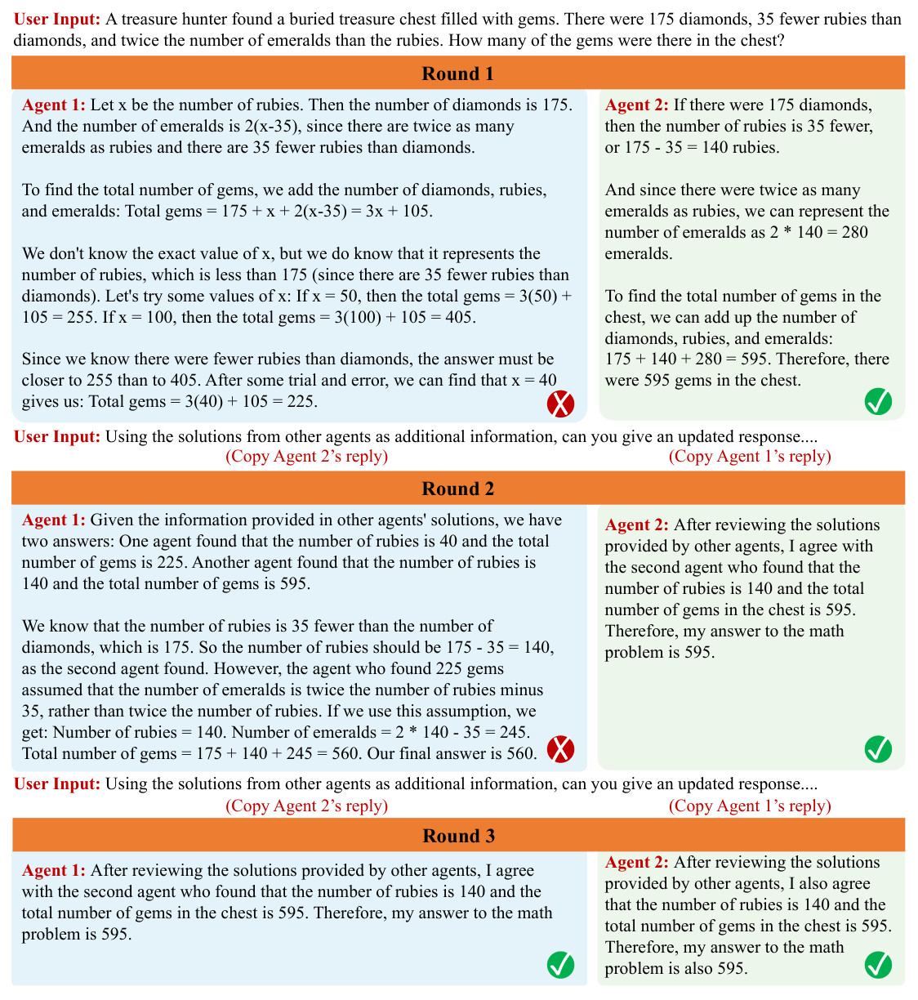
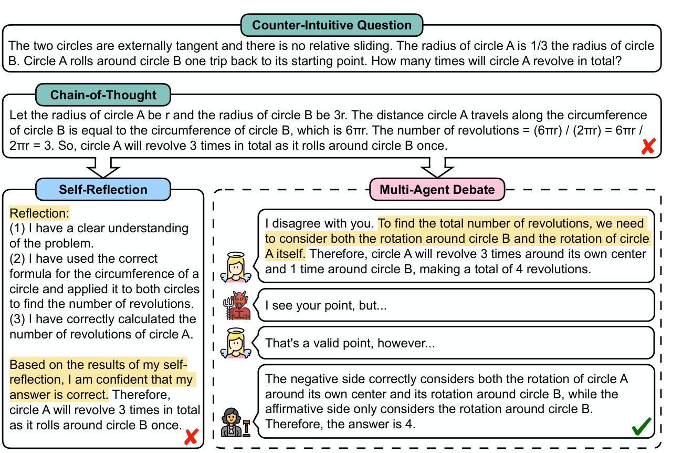

# 4b — When more agents pay

> Every extra agent, critic or round is spent compute. The question is never "does the team beat one call?" but "does it beat the same tokens spent on independent samples and a vote?"

[Note 04](04-multi-agent-design-patterns.md) built reviewers, debates and group chats for the restock agent, and kept asking whether each extra agent earned its cost. This chapter answers with the evidence. Most papers compare a multi-agent design against a single call, which is a comparison the team wins by spending more. The fair baseline spends the same tokens on N independent answers and takes a majority vote (self-consistency). Against that baseline, a lot of structure stops paying: critics that judge their own work, debates whose last step is a vote anyway, and hierarchies that make every agent agree with the leader.

---

## The equal-compute baseline

Self-consistency samples several reasoning chains at nonzero temperature and returns the most common answer ([arXiv:2203.11171](https://arxiv.org/abs/2203.11171) (Wang et al., ICLR 2023)). It needs no critic, no protocol and no second role, so it is the cheapest way to turn more tokens into accuracy on any task with a checkable final answer. Any design that adds roles should be compared with it at the same token cost.

Mirzaei ran that comparison for the self-critique family ([arXiv:2607.28576](https://arxiv.org/abs/2607.28576) (Mirzaei, 2026-07, preprint)). On Qwen2.5 Instruct at 1.5B, 3B and 7B, with 150 questions each from GSM8K and MATH-500, every method was compared against self-consistency interpolated to that method's measured token cost. **Of 36 comparisons, none beat the baseline**, 10 were significantly worse after a Holm correction within each setting and 26 were indistinguishable. Self-Refine (3 rounds) and a forced Reflexion stayed below the baseline even at 7B, by 3.6 and 5.5 points on GSM8K and 6.3 and 10.1 on MATH-500. Reflexion as published did nothing at 1.5B: the model called its first answer correct on every question, so what was measured as Reflexion was one chain of thought, cheap and therefore well placed on the cost curve.

The cleanest test holds the samples fixed. Given the same 8 candidates, asking the model to pick the best lost to counting votes by 8.0 and 11.3 points at 1.5B (GSM8K, MATH-500) and 5.3 and 17.3 at 3B. At 7B the gap was 2.0 and 1.3, with confidence intervals that include zero. Where the verifier and the vote disagreed and only one was right, the verifier was right 12.5–33.3% of the time. This is the self-critique result of [04](04-multi-agent-design-patterns.md#when-self-critique-helps-and-when-it-doesnt) stated in tokens: the critic cannot tell a right chain from a wrong one, so its calls are better spent on more samples. The limits are wide. It covers math with exact-match answers only, small quantized models on CPU, one prompt per method and 150 questions per cell (enough to detect gaps of about 5–6 points). Sampling, Best-of-N and debate ran once, and the author notes that Self-Refine was designed for open-ended text, where a vote cannot be taken. A first draft scored Best-of-N as if it were the vote; the published tables carry the corrected scoring.

---

## Debate against the vote

Debate is the oldest version of a team, and the early papers compared it with a single call more often than with a vote. Du et al. had N copies of gpt-3.5-turbo answer, then each read the others' answers and updated, for R rounds ([arXiv:2305.14325](https://arxiv.org/abs/2305.14325) (Du et al., ICML 2024)). With 3 agents and 2 rounds on 100 problems per task (524 people for biographies), **debate lifted GSM8K from 77.0 to 85.0, arithmetic from 67.0 to 81.8, and biography facts (524 computer scientists, ChatGPT judging against Wikipedia) from 66.0 to 73.8**. The paper's own vote baseline, with the same three agents, scored 81.0 on GSM8K and 69.0 on arithmetic. So on GSM8K half of debate's gain over one agent is what counting votes already gives, and only on arithmetic does debate clearly pay. One agent reflecting on itself lowered GSM8K (77.0 to 75.0). The cost is not reported (several generations per agent per round), debate is not matched to the vote on tokens, and the authors note that models can affirm a wrong consensus and lose early turns in long histories.



*Image Source: Du et al., [Improving Factuality and Reasoning in Language Models through Multiagent Debate](https://arxiv.org/abs/2305.14325) (2023), Fig. 2*

Liang et al. assign the roles instead of copying one prompt: an affirmative and a negative debater argue in turn from the shared history, and a judge ends the debate or extracts the answer ([arXiv:2305.19118](https://arxiv.org/abs/2305.19118) (Liang et al., EMNLP 2024)). On Counter-Intuitive AR (200 questions, GPT-3.5-Turbo, temperature 0, zero-shot), **debate scored 37.0% against 28.0 for chain of thought, 29.5 for self-consistency and 27.5 for self-reflection**, still below GPT-4 at 51.0. The self-consistency sample count is not stated, so this is not an equal-compute result. Their ablations match the sections above: on translation, more than two debaters made results worse, and an LLM judge may favour its own outputs.



*Image Source: Liang et al., [Encouraging Divergent Thinking in Large Language Models through Multi-Agent Debate](https://arxiv.org/abs/2305.19118) (2024), Fig. 2*

ChatEval uses debate to *judge* rather than to answer ([arXiv:2308.07201](https://arxiv.org/abs/2308.07201) (Chan et al., ICLR 2024)). On FairEval (80 questions, ChatGPT, one run at temperature 0), two debating referees with different role prompts agreed with human labels 60.0% of the time against 53.8% for a single referee; GPT-4 went from 61.3% to 63.8%. **Giving both referees the same role prompt gave 53.8%, no better than one**, and extra turns brought no significant gain. One question is 1.25 points, and the paper does not compare against sampling one referee several times and voting. That role-diversity result fits the diversity-collapse result from Chen et al. below: the ingredient is different views, not more speakers.

MedAgents puts the pattern in one domain ([arXiv:2311.10537](https://arxiv.org/abs/2311.10537) (Tang et al., Findings of ACL 2024)). Role-played experts for the question and the options write analyses, vote on a summary until all agree, and a decision maker answers. Across nine medical QA sets (300 random items each, zero-shot), **GPT-4 averaged 86.7 against 83.0 for zero-shot chain of thought with 5-sample self-consistency**, and GPT-3.5 72.1 against 70.9. The cost is about $1.41 per 100 questions and 40 s each, and the vote is not matched to that spend. On MedQA with GPT-3.5, six experts from different domains scored 64.1 and six of the same domain 59.2.


---

## Teams converge

The peer-to-peer row of [04's architecture table](04c-planning-architectures-and-failure.md#architectures-p23) says to use debate "when you want diverse views". Chen et al. measured whether a group keeps its views apart ([arXiv:2604.18005](https://arxiv.org/abs/2604.18005) (Chen et al., 2026-04, preprint)). Three DeepSeek-V3 agents at temperature 0.7 wrote research proposals on 20 ICLR topics, 50 sessions per topic, under five persona structures. **Hierarchy collapsed diversity.** A flat group of junior personas reached a Vendi score of 8.08 across all proposals, and an interdisciplinary group of senior experts 4.65, the lowest. The expert group's judged quality was only 0.6 points higher on a 10-point scale (8.50 vs 7.88), with the same model as generator and judge. The cause is the structure, not seniority. In a flat topology, senior personas were slightly *more* diverse than junior ones (per-topic Vendi 3.02 vs 2.89). In leader-led groups, collaborators' turns sat close to the leader's (cosine 0.63 vs 0.44 in flat groups), and they wrote less than a third as many words. The ranking held at temperatures 0.3, 0.7 and 1.0.

Two fixes helped, each in one place. Writing alone before discussing, which the authors take from group psychology's Nominal Group Technique (Delbecq et al., 1986, as they cite it), raised diversity over the standard discussion protocol under the naive persona. But a protocol where each agent sees the full history and speaks in turn scored higher still in the appendix, so cite blind writing only as better than the standard protocol. Mixing models (DeepSeek-V3, GPT-4o, Claude Sonnet 4) raised per-topic diversity 34% for the expert structure and did nothing for the flat one (−4%, not significant). Adding agents had diminishing returns: per-topic diversity rose only 3.09 to 3.32 from 3 to 7 agents. The study covers one open-ended task, so it says nothing about correctness tasks, tools or cost, and all quality scores come from an LLM judge.

For the restock agent, this argues against a "senior buyer plus two assistants" debate. If you want several options before a judgement call, have each agent draft alone, use different models if you can, and merge afterwards.

---

## Mixing models: more is rarely better

If one model's agents converge, mixing models looks like the cure. Marjanovic et al. tested it at scale ([arXiv:2609.17306](https://arxiv.org/abs/2609.17306) (Marjanovic et al., 2026-09, preprint)). They took 23 models from six families (2B to 1.6T parameters), five samples each per question, and combined pools of 3 to 20 models by routing, majority vote or an LLM judge (gpt-oss-120b) on HLE, GPQA-Diamond and FrontierScience-Olympiad, with no tools. The pool's ceiling rose with size, since some model in a bigger pool is more likely to be right. **What the system achieved fell instead: "more models nearly always decreases performance"**, and most deliberately chosen pools ended below the best single model in the pool, often below a random pool. The reason is in the error structure. Strong models get the same questions right (correlation 0.93 across pairs), while their errors are only weakly correlated (0.38), so adding weaker models mostly adds wrong answers for the vote to count. Only single-family pools ever beat the best single model, and then narrowly (Gemma 4: about +2 points on FrontierScience, under +1 on GPQA). Repeating the best model did help: on HLE it went from 29.4% for one sample to 32.2% with a 5-sample vote and 36.5% with the judge picking among 5. That comparison is not compute-matched, the judge agreed with human grading 93% of the time (κ 0.63), and only three simple combination methods were tried, so debate and tool-using teams are untested. Read it with Chen et al. above: mixing models helped hierarchical groups generate *different ideas*, and it hurt pools that have to agree on *the right answer*.

---

## The lazy agent

A team can also collapse into one agent without anyone noticing. Zhang et al. trained ReMA, a two-agent setup in which one copy of Qwen2.5 plans ("meta-thinking") and another reasons, with multi-turn GRPO on math ([arXiv:2511.02303](https://arxiv.org/abs/2511.02303) (Zhang et al., 2025-11, preprint)). **The pair scored below one agent trained with plain GRPO**: 51.97 against 55.08 averaged over seven math benchmarks at 7B, and 57.24 against 58.05 at 14B. Measured by how much each agent's step changes the next one, the reasoning agent's influence decayed toward zero during training while the planner took over. The cause is in the loss. Multi-turn GRPO divides each trajectory's loss by its number of turns, so of two trajectories with the same reward the shorter one is reinforced more, and an agent that returns an empty or copied turn makes the trajectory shorter. Prompting the reasoning agent to contribute recovered only 0.6 points on MATH500 (74.4 to 75.6). Their fix, Dr. MAMR, drops the per-turn normalization, rewards each agent's causal influence and lets the reasoner restart; it reached 58.43 at 7B and 62.49 at 14B, and removing either of the first two parts cost 5–7 points on AIME24 and AMC23. The agents share weights and differ only in prompt, the tasks are math with verifiable answers, and no seeds are reported. The general point survives those limits. "Two agents" in a diagram is a claim about the work being split, so check that it is, for example by ablating one agent's turns and seeing whether the answer changes.

---

## When a team does beat the vote

The strongest positive result so far comes with mixed models and a learned protocol. Pappu et al. gave three mid-tier models from different labs (o3-mini, Claude Sonnet 4, DeepSeek-V3) a bank of up to 10 interaction strategies, which they evolved on 15 AIME 2024 problems and then froze ([arXiv:2609.22682](https://arxiv.org/abs/2609.22682) (Pappu et al., 2026-09, preprint)). On held-out AIME 2024–2026, HMMT 2026 and TheoremQA physics, **the team averaged 66.7%**. The best single member scored 48.8%, self-consistency with 10 samples from the best model 55.4%, and the best model playing every role in sequence ("linearization", at about the team's budget) 58.7%. Running the same strategies with three copies of o3-mini gave 56.0%, so the mix of models is doing much of the work. The gain is uneven. On HMMT 2026 the team and linearization tied at 39.4%. On a knowledge and logic suite (GPQA, MMLU-Pro, BBEH, with a different three-model roster) the team led linearization by only 0.7 points (72.8 vs 72.1). There, one of its candidates was right on 87.9% of questions, but it picked a right one only 72.8% of the time. Generation was not the bottleneck; selection was. The limits matter for the equal-compute question. Matching was by candidate count and "approximately" the budget, with no token or dollar counts. The offline strategy search is not counted. Results are means of 3 seeds on sets of 30–100 problems with no confidence intervals. Read it with Marjanovic et al. above: mixing a few comparably strong models and teaching them how to interact paid off, while voting across many unequal ones did not.

TUMIX gets its diversity from tools rather than from models ([arXiv:2510.01279](https://arxiv.org/abs/2510.01279) (Chen et al., 2025-09, preprint)). It runs 15 agents built on one model, each with a different mix of text reasoning, code interpreter and search. Over several rounds, each agent sees the others' answers, and a final majority vote decides. Every baseline got the same tools and was matched on number of model calls. Averaged over HLE, GPQA-Diamond and AIME 2024–25, **TUMIX scored 72.3% with Gemini-2.5-Pro against 69.2% for a majority vote and 70.3% for the best baseline**; with 2.5-Flash the scores were 60.6% against 53.7% for majority vote and 55.5% for the best baseline. Fifteen different agents also beat one strong agent sampled 15 times (HLE with Pro: 32.3% vs 29.0%). The rounds show the convergence problem from above. On HLE, the share of questions where at least one agent was right fell from 51.9% in round 1 to 33.9% by round 6, while mean accuracy flattened near 32%, so refining past round 2 or 3 mostly throws away right answers. Letting an LLM judge stop the rounds early (after at least two) kept accuracy at 49% of the calls. The limits: matching is by inference count (the paper reports tokens as roughly equal but does not match them), and later rounds carry every earlier answer in the prompt. The runs use two Gemini models on three QA benchmarks, as means of 3 runs with no intervals, and AIME has only 60 problems. Some baselines' agents were selected on HLE. Like Pappu et al., the gain comes from candidates that differ, so here it is tools rather than models, plus a stop before they converge.

Parallel workers can also buy *latency* rather than accuracy. AsyncThink trains one model to act as organizer, splitting off sub-questions to workers that are copies of itself and then waiting on their results ([arXiv:2510.26658](https://arxiv.org/abs/2510.26658) (Chi et al., 2025-10, preprint)). With Qwen3-4B trained by RL and four concurrent slots, it tied a four-sample majority vote on AIME-24 (38.7%), edged it on AMC-23 (73.3% vs 72.8%), and **cut critical-path latency by 28%** (about 1,460 vs 2,040 decoding steps). On a countdown puzzle with several solutions it got all of them right 89.0% of the time, against about 69–71% for the baselines. Latency here is a theoretical count of decoding steps along the longest fork–join path, not wall-clock time. The setup matches the number of concurrent slots, not total tokens, and never reports total tokens. It used one 4B model on small reasoning tasks, with no tools. So it says how to shorten the wait, not whether a team beats one agent at the same cost.

---

## Routing by size: pick one agent per task

Not every multi-agent design runs several agents on the same task. Some pick one agent per task, and here the baseline is the best single model run on every task. Alazraki et al. put four Qwen3 agents (4B, 8B, 14B, 32B) in a "strategy auction" ([arXiv:2602.02751](https://arxiv.org/abs/2602.02751) (Alazraki et al., 2026-02, preprint)). Each agent writes a short plan as its bid. All four score every plan, a cost term charges for plan length times the agent's price, and the winner executes. Losing cheaper agents can rebid using past winning and losing plans retrieved from memory. On their HST-Bench of 753 deep-search and coding tasks, binned by how long a human expert takes, the small agents held up on easy tasks and collapsed on hard ones: the 4B reached 87% of the 32B's pass@1 on the easiest deep-search bin and 25% on the hardest. **The auction beat always using the 32B by 3.5 points on deep search (67.3 vs 63.8) and 2.7 on coding (61.1 vs 58.4), at 42% and 25% lower cost per million tokens.** The auction itself added under 1% of tokens. Routers that read only the task description saved more on coding but lost accuracy on hard tasks (6.3% against 22.8% at the hardest coding bin for one of them). The auction errs toward caution: in deep search, 61–65% of the tasks it sent to the 14B or 32B could have been solved by the 4B. Without peer scoring, coding pass@1 fell to 48.7. The limits: one model family spanning about 8× in price, prices calibrated rather than measured, tool calls not priced, scoring weights fitted on 68–88 easy dev items, and auction results averaged over 5 orderings against single-run baselines. For the restock agent, this is the pattern to copy: let a cheap model draft the plan, have peers score it, and escalate only when the plan looks weak.

---

## Extra machinery: check the model first

Papers that add cognitive machinery to agents often find that the choice of model matters more than the mechanism. Kostka and Chudziak gave three role agents in a four-district resource simulation an explicit theory-of-mind step (predict what the other agents will do) and a belief section checked by an answer-set-programming solver ([arXiv:2603.00142](https://arxiv.org/abs/2603.00142) (Kostka and Chudziak, 2026-02, preprint)). **No configuration helped every model.** On median final district health, GPT-4o stayed within about a point of its base of 69.44 in every configuration. Claude 3.5 Sonnet lost 5 points with theory of mind alone (68.89 to 63.89) and gained about 2 with both mechanisms (71.11). Llama 3.1 8B fell from 35.00 to 26.34 with the belief section alone. Meanwhile the spread between models, from 27.50 (GPT-3.5-Turbo) to 71.11, dwarfed any mechanism effect. The trial count is not stated, no significance tests were run, the models are dated, and the authors call the task simple.

MetaCogAgent has each of three prompted GPT-4 agents score its own confidence and hand a task off when that score falls below a threshold ([arXiv:2605.17292](https://arxiv.org/abs/2605.17292) (Wang and Shu, 2026-05, preprint)). It reports 82.4% on a 700-task benchmark the authors built, against 77.1% for a three-agent majority vote and 65.3% for a single agent. It used 1,382 API calls against 2,100 for the vote and 700 for the single agent. That is the shape of a useful design: spend extra calls only on the tasks the first agent doubts. But the evidence is thin. There was a single run, no matched self-consistency baseline at about 1,400 calls, the authors scored routing against their own labels, and the code is unreleased. Removing the delegation step brought it to 77.3%, level with the vote. For the restock agent, the lesson from both papers is the same: before you add a belief model or a confidence router, try the stronger model and the vote, and keep the mechanism only if it beats both at the same cost.

The field's own map says the same. A 2026 survey of multi-agent systems ([arXiv:2605.14892](https://arxiv.org/abs/2605.14892) (Qi et al., 2026-05, preprint survey)) sorts designs by role, communication, orchestration and interaction, and concludes that **"no orchestration topology is universally superior"**. It notes that current systems "do not yet learn when specialization is necessary, when redundancy is beneficial, or when additional agents simply add noise". The survey runs no experiments. For the claim that adding agents doesn't guarantee gains, it points to a 2025 study by Kim et al. that this chapter has not read. For failure taxonomies, it points to the Cemri et al. study already covered in [04](04c-planning-architectures-and-failure.md#why-multi-agent-systems-fail). So use it as a map of the design space, not as evidence.
---

## Running the comparison yourself

Before you ship a team, run the check every paper above either did or skipped. Hold the call budget fixed, then compare the design with independent samples and a vote.

```text
                 design with k agents / rounds
                              |
          can answers be checked or voted on? --no--> compare with best single model
                              |                         at equal tokens; LLM judge,
                             yes                        report variance
                              |
       measure tokens per task for the design (T)
                              |
       run self-consistency with the best model at ~T tokens
                              |
         design beats the vote? --no--> ship the vote
                              |
                             yes
                              |
     ablate each agent's turns: does the answer change? --no--> remove that agent
                              |
                             yes --> keep the design, re-check when the model changes
```

The simulation below shows why the vote is hard to beat. It is a toy, not data. Each call is right with probability 0.55, and wrong answers scatter over four options. A critique fixes a wrong answer only 30% of the time, and as often as not breaks a right one. Those are assumptions chosen to resemble the weak self-verification Mirzaei measured, not figures from any paper.

```python
import random
from collections import Counter

def sample(p_right, rng):
    """One call: the right answer 'A' with probability p_right, else one of four wrong answers."""
    return "A" if rng.random() < p_right else rng.choice("BCDE")

def vote(n, p_right, rng):
    """Self-consistency: n independent calls, majority answer."""
    return Counter(sample(p_right, rng) for _ in range(n)).most_common(1)[0][0]

def draft_and_critique(n, p_right, critic_skill, rng):
    """One draft, then n-1 critique-and-revise calls. A critique keeps a right answer and
    fixes a wrong one only with probability critic_skill; otherwise it may break a right one."""
    ans = sample(p_right, rng)
    for _ in range(n - 1):
        if ans == "A":
            ans = ans if rng.random() > (1 - critic_skill) / 2 else rng.choice("BCDE")
        elif rng.random() < critic_skill:
            ans = "A"
    return ans

def accuracy(method, trials=20_000, seed=0, **kw):
    rng = random.Random(seed)
    return sum(method(rng=rng, **kw) == "A" for _ in range(trials)) / trials

for calls in (1, 3, 5, 9):
    sc = accuracy(vote, n=calls, p_right=0.55)
    dc = accuracy(draft_and_critique, n=calls, p_right=0.55, critic_skill=0.3)
    print(f"{calls} calls  vote {sc:.3f}  draft+critique {dc:.3f}")
```

```text
1 calls  vote 0.549  draft+critique 0.549
3 calls  vote 0.655  draft+critique 0.475
5 calls  vote 0.772  draft+critique 0.455
9 calls  vote 0.896  draft+critique 0.461
```

With the same nine calls, the vote reaches about 90% and the critique loop falls below a single call. Raise `critic_skill` until the curves cross to see how good a critic has to be before refinement pays. On real tasks, wrong answers often agree with each other, and then the vote gains less than this.

---

## Pitfalls

- **Comparing against one call.** A team that spends 5× the tokens and beats a single call has shown nothing. Compare it with the same tokens spent on samples and a vote, and report the token counts.
- **Counting candidates instead of tokens.** "Ten candidates each" is not equal compute when one side runs multi-phase strategies. Pappu et al. matched candidate count; the token bill was not reported.
- **A leader in the prompt.** A senior persona leading the discussion pulls the others toward it (Chen et al.). Have agents draft alone first.
- **Adding weaker models to the pool.** Strong models share their right answers, so extra weak models mostly add wrong votes (Marjanovic et al.).
- **A second agent that does nothing.** Under multi-turn RL, one agent can learn to coast (Dr. MAMR). Ablate its turns and check that the answer changes.
- **A mechanism that only helps one model.** Theory-of-mind and belief modules helped some models and hurt others (Kostka and Chudziak). Re-test whenever the model changes.
- **Routers that read only the task.** Description-only routers lost accuracy on hard tasks; plans written by the agents carried more signal (Alazraki et al.).
- **Forgetting that every agent re-reads its own context.** In Agentopia's 100-agent, ten-year society, an average ten-year run (mean of three worlds) used 13.7B tokens over 567K calls, and about 95% of the input tokens came from the role-playing agents, each carrying its full persona context at every step ([arXiv:2606.07513](https://arxiv.org/abs/2606.07513) (Wang et al., 2026-06, preprint)). Price a team per agent-step, not per answer.

---

## Try it

1. Run the simulation with `critic_skill` at 0.3, 0.6 and 0.9. At what skill does `draft_and_critique` with 5 calls beat a 5-sample vote?
2. Change `sample` so that wrong answers all come back as `"B"` (correlated errors). What happens to the vote at 9 calls when `p_right` is 0.45?
3. A vendor reports that their 4-agent debate beats GPT-x by 6 points. List the three numbers you would ask for before believing it.

<details>
<summary>Answers</summary>

1. With 5 calls the vote scores about 0.77. The critique loop scores about 0.46 at 0.3 and 0.75 at 0.6, and passes the vote between 0.6 and 0.7 (0.82 at 0.7). In this toy, the critic must fix most wrong answers before refinement beats sampling. Mirzaei's verifier was right in only 12.5–33.3% of the cases where it disagreed with the vote.
2. Accuracy falls as you add samples: about 0.45 with one call, 0.43 with 3 and 0.39 with 9, heading toward 0. When errors agree and the right answer is less likely than the shared wrong one, the vote amplifies the wrong answer. This is why Marjanovic et al.'s pooled results depend on how errors are correlated.
3. The debate's token (or dollar) cost per task; a self-consistency baseline with GPT-x at that cost; and the variance across seeds or a confidence interval for the 6-point gap.

</details>

---

## Interview checklist

| Question | Answer |
|---|---|
| What is the fair baseline for a multi-agent system on a task with checkable answers? | Self-consistency: the best single model sampled several times at the same token budget, with a majority vote. |
| Does self-critique beat sampling at equal compute? | Not in Mirzaei's study: 0 of 36 comparisons beat the vote with small Qwen models on GSM8K and MATH-500. A critic given the same 8 candidates picked worse than counting votes. |
| Why can adding models to a vote hurt? | Strong models get the same questions right, and their errors are only weakly correlated. Weaker models mostly add wrong votes (Marjanovic et al., 23 models). |
| When has a team beaten the vote? | Three mixed mid-tier models with a learned interaction protocol beat 10-sample self-consistency on competition math (66.7 vs 55.4). The gap was near zero on a knowledge suite, and tokens were not reported. |
| What does a hierarchy do to a brainstorming team? | It collapses diversity: collaborators echo the leader. Flat groups and drafting alone first keep ideas apart (Chen et al.). |
| How do you check that a second agent is pulling its weight? | Ablate its turns and see whether the final answer changes. Under multi-turn GRPO, one agent can learn to contribute nothing. |
| When does routing among model sizes pay? | When cheap models handle most tasks and a strong model takes the hard ones. SALE beat always-32B by 2.7–3.5 points at 25–42% lower cost, but still over-escalated. |

---

## Next

→ [04c — planning, architectures and why teams fail](04c-planning-architectures-and-failure.md): planning strategies, Letta's shared-memory agents, the architecture catalogue and the failure modes of real multi-agent runs. Then [05 — framework survey](05-framework-survey.md).
