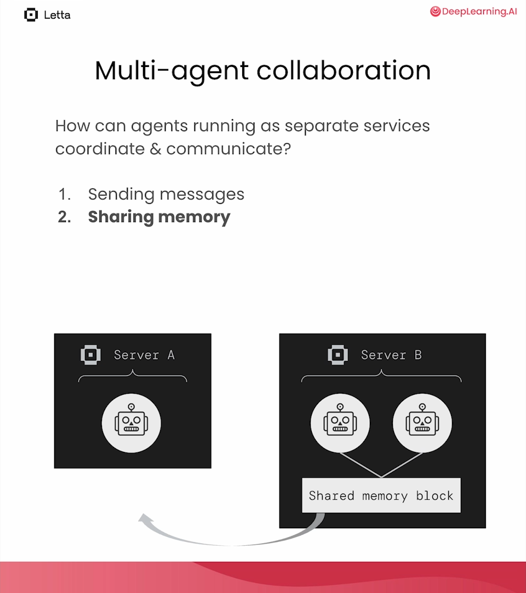
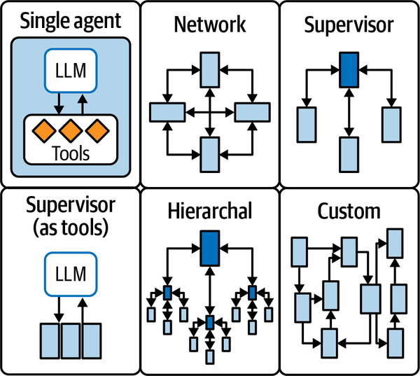
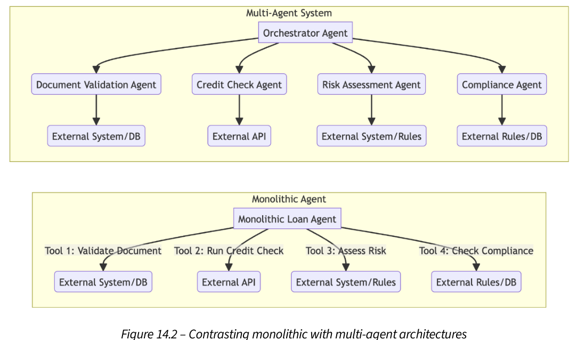

# 4c — Planning, architectures and why teams fail

> Once agents can talk, three questions remain: how a plan is made and searched, how agents are wired together, and why the wiring fails. Each answer starts from a cost that is easy to miss.

[Note 04](04-multi-agent-design-patterns.md) built the primitive, a conversation with stop conditions, and used it for reflection, tool use, coding and a planned group chat. [04b](04b-when-more-agents-pay.md) tested whether extra agents beat the same compute spent on samples. This chapter covers planning strategies, Letta's shared-memory agents, the architecture catalogue (P23) and the failure modes Cemri et al. recorded. The restock agent from 01 is the running example.

---

## Planning strategies

The Planner in L6 is one way to plan. Huang et al.'s survey of LLM-agent planning ([arXiv:2402.02716](https://arxiv.org/abs/2402.02716)), as summarized by Raieli and Iuculano, sorts the options by where each one fails (*Building AI Agents with LLMs, RAG, and Knowledge Graphs*, ch. 4):

| Strategy | How it works | Fails when |
|---|---|---|
| Decomposition first | Plan every subgoal up front, then execute ("Let's first devise a plan" / "Let's carry out the plan") | A step goes wrong mid-run: the plan can't be corrected |
| Interleaved | Decompose one subtask, solve it, decompose the next (ReAct is this) | The problem is hard: chains grow long and costly without reaching an answer |
| Multi-plan selection | Sample several plans and pick one by majority vote, tree search or RL | The budget is tight: generating many paths costs compute and time, and the stochastic choice is inconsistent |
| External planner | A symbolic or small neural planner finds the path; the LLM fixes the mistakes | You can't afford the engineering: complex to build |
| Reflection and refinement | Generate a plan, critique it (self or a separate evaluator), refine | No guarantee of convergence; it can loop |
| Memory-augmented | Store and recall past observations and outcomes in external memory to get past the context limit | The book names no failure mode; it inherits the weaknesses of retrieval |

**Plan-and-execute** separates planning from execution, with each handled by its own LLM call that sees the objective, the current task and the completed tasks. BabyAGI is the classic example. In a loop, an execution agent does the next task and stores the result in a vector database. A task-creation agent derives new tasks from the objective and that result. A prioritization agent reorders the task list against the objective (*Prompt Engineering for Generative AI*, ch. 6). The structure is also an injection defense: Plan-Then-Execute in [02](02c-mcp-code-and-safe-tool-calls.md#prompt-injection-six-defenses) fixes the plan before untrusted data is read. BabyAGI regenerates tasks every cycle, so it gets the flexibility and loses that protection.

**Tree of Thoughts** (ToT, [arXiv:2305.10601](https://arxiv.org/abs/2305.10601)) is multi-plan selection with backtracking. On the Game of 24, GPT-4 with chain-of-thought solved 4% of problems; ToT solved 74% (*Prompt Engineering for Generative AI*, ch. 6). Koenigstein's cheap version uses two models: a small model proposes three options as structured output, and a stronger judge picks one. Clamp the judge's index in code, because structured output guarantees the type, not the range (*AI Agents: The Definitive Guide*, ch. 2):

```python
# illustrative: needs a chat model API key, plus `judge_llm`, `ChoicePayload` and `eval_prompt` from the book
choice = judge_llm.with_structured_output(ChoicePayload).invoke(eval_prompt)
idx = max(0, min(choice.choice_index, len(opts) - 1))
```

She notes that this propose-and-judge pair can sometimes replace a full multi-agent design, with fewer calls to the large model.

**Count the calls before you adopt it.** Lakshmanan and Hapke's pattern P14 generates thoughts, scores each from 0 to 1, keeps the top few and stops early above a threshold such as 0.95. Their supply-chain example, with depth 4, 3 thoughts per node and width 3, took 41 model calls and 93 seconds (*Generative AI Design Patterns*, ch. 5). Parallelism helps only so far, because every candidate at one level must exist before the next level can start. The arithmetic is easy to reproduce:

```python
# Tree of Thoughts as beam search, with a counter: the cost is the point.
import random
random.seed(7)

class StubLLM:
    calls = 0
    def propose(self, plan, n):
        StubLLM.calls += 1                             # one call yields n thoughts
        return [plan + [random.choice("ABCDE")] for _ in range(n)]
    def score(self, plan):
        StubLLM.calls += 1                             # one call per candidate
        return random.random()

def tree_of_thoughts(depth, thoughts, width):
    llm, beam = StubLLM(), [[]]
    StubLLM.calls = 0
    for _ in range(depth):
        candidates = [c for plan in beam for c in llm.propose(plan, thoughts)]
        ranked = sorted(candidates, key=llm.score, reverse=True)
        beam = ranked[:width]
    return beam[0], StubLLM.calls

for depth, thoughts, width in [(1, 3, 1), (2, 3, 2), (4, 3, 3), (4, 3, 5)]:
    _, calls = tree_of_thoughts(depth, thoughts, width)
    print(f"depth {depth}, {thoughts} thoughts, width {width}: {calls:3d} LLM calls")
```

```text
depth 1, 3 thoughts, width 1:   4 LLM calls
depth 2, 3 thoughts, width 2:  12 LLM calls
depth 4, 3 thoughts, width 3:  40 LLM calls
depth 4, 3 thoughts, width 5:  56 LLM calls
```

With those settings the counter reads 40, so the book's 41 is consistent with one more call for a final summary, although the book does not itemize them. The book's advice is to try the cheaper alternatives first: a reasoning model, least-to-most prompting, [reflection](04-multi-agent-design-patterns.md#when-self-critique-helps-and-when-it-doesnt) or wait-injection, which appends "Wait" to make the model keep reasoning (budget forcing, Muennighoff et al. 2025). ToT has also become easier to skip since it was introduced, because reasoning models now do much of this search internally. A 2025 survey ([arXiv:2502.03671](https://arxiv.org/abs/2502.03671) (Patil and Jadon, 2025-02, preprint)) compares the four by how each handles error: chain-of-thought "can propagate errors", self-consistency votes them out, ToT prunes weak branches, and program-aided reasoning hands the computation to code. It has no experiments or numbers.

Graph of Thoughts ([arXiv:2308.09687](https://arxiv.org/abs/2308.09687) (Besta et al., AAAI 2024)) adds the move a tree lacks: merging. Thoughts become graph vertices, so partial solutions can be combined, as in merge sort. Sorting 128 numbers with GPT-3.5, it cut median error by about 62% against ToT at over 31% lower cost. But the user writes the graph of operations for each task before the run, so GoT is a workflow in Anthropic's sense, not a planner: the model fills in the nodes, the engineer chose the shape.

Koh et al. carry multi-plan selection from puzzles into a live environment ([arXiv:2407.01476](https://arxiv.org/abs/2407.01476) (Koh et al., 2024-07)). They run best-first search over web-page states: the agent proposes b candidate actions, executes each one, and GPT-4o scores the resulting screenshots as a value function. The search stops at a score threshold or after c state expansions. On VisualWebArena it lifted a GPT-4o agent from 18.9% to 26.4% success (+39.7% relative) and Llama-3-70B from 7.6% to 16.7%. On WebArena it lifted GPT-4o from 15.0% to 19.2%. On a 200-task subset, success rose with budget: 24.5% with no search, 32.0% at c=5, 37.0% at c=20. The paper names three costs. A budget of c=20 can use up to 20× more LM calls. Backtracking means resetting the environment and replaying the action sequence. And search is only safe over actions that can be undone, such as browsing, not placing an order. (The text quotes an 18.6% baseline once; the tables say 18.9%.)

**A search is only as good as its scorer.** RAP ([arXiv:2305.14992](https://arxiv.org/abs/2305.14992) (Hao et al., EMNLP 2023)) runs Monte Carlo tree search over reasoning steps with one LLM in two roles: as agent it proposes the next action, and as world model it predicts the state that action leads to, so a plan is checked against an imagined state before anything runs. On Blocksworld with LLaMA-33B, chain-of-thought solved 17% of 2-step and 0% of 6-step problems; RAP with 20 iterations solved 100% and 42%, ahead of GPT-4 with chain-of-thought (50% and 40%). On GSM8K the margin was thin: 48.6% against 46.8% for 10-sample self-consistency. rStar ([arXiv:2408.06195](https://arxiv.org/abs/2408.06195) (Qi et al., ICLR 2025)) found why at small scale: a 7–8B model's rewards for its own steps are close to random, so with LLaMA2-7B on GSM8K, RAP (24.3%) barely beat 128-sample majority voting (23.1%). rStar replaces the self-grade with a second small model: Phi-3-mini is given the first part of a trajectory, completes it, and the trajectory counts only if both reach the same answer. Majority voting over rStar's own search tree scored 27.2%; that check lifted it to 63.9%. The bill is about 166 model calls and 367k generated tokens per question. PlanGEN ([arXiv:2502.16111](https://arxiv.org/abs/2502.16111) (Parmar et al., EMNLP 2025)) makes the scorer explicit for natural-language plans: one agent extracts the instance's constraints (each person's busy hours, the meeting length), a verifier scores candidates against them, and a selector picks Best-of-N, ToT or REBASE per instance. With Gemini-1.5-Pro on NATURAL PLAN calendar scheduling, exact match rose from 48.9% for a single pass to 60.7% with constraint-verified Best-of-N, and plain Best-of-N beat ToT on all three NATURAL PLAN tasks. Spend on the verifier before the search.

A fixed branching factor is a poor fit for sampling, because a model can always draw one more fresh answer. AB-MCTS ([arXiv:2503.04412](https://arxiv.org/abs/2503.04412) (Inoue et al., NeurIPS 2025)) gives every node a "generate a new answer" child and uses Thompson sampling to choose, at each step, between going wider (a fresh sample) and going deeper (refining an existing answer with the evaluator's feedback); the update rules are in [RL 09](../../05-RL/notes/09-test-time-search-and-training.md). With a budget of 128 LLM calls on LiveCodeBench, CodeContest and ARC-AGI, using GPT-4o and DeepSeek-V3, its two variants had the best average rank (2.3 and 2.7) against 3.5 for repeated sampling, 4.2 for standard MCTS and 5.5 for sequential refinement. The margins were often inside the error bars (mean ± s.d. over repeated runs), and repeated sampling won ARC-AGI with GPT-4o (15.0 against 12.3 to 14.0 Pass@2 for the three AB-MCTS variants). With DeepSeek-V3 on ARC-AGI up to 512 calls, AB-MCTS kept improving while repeated sampling flattened (read from a plot). It assumes a reliable score from an evaluator such as unit tests, and was tested on single-program tasks, not agent trajectories.

Planning can also be steered by a small separate model that holds task knowledge. WKM ([arXiv:2405.14205](https://arxiv.org/abs/2405.14205) (Qiao et al., NeurIPS 2024)) trains a LoRA "world knowledge model" beside the agent. It writes task knowledge (workflows and commonsense, distilled by contrasting expert trajectories with the agent's own failed ones) once per task, and state knowledge for each step. State knowledge is not put in the prompt. Matching training triplets are retrieved, and their next-action counts are mixed into the agent's action probabilities, with weight γ on the agent. On ALFWorld (seen/unseen), WebShop and ScienceWorld with 7 to 8B models, it beat the fine-tuned baselines NAT, ETO and KnowAgent by 1 to 5 points of average reward (Mistral-7B ALFWorld 73.57/76.87, +3.13/+5.44), and 7B WKM beat one-shot GPT-4 ReAct on ALFWorld (44.29/38.05) and WebShop but not ScienceWorld. Invalid-action trajectories on ALFWorld fell to 32.86%/29.85% from 45.71%/50.00% for NAT (the table does not name the backbone). Task knowledge helped more than state knowledge, a Mistral-7B knowledge model also lifted GPT-4 on ALFWorld to 50.71/47.01, and inference costs about 2.5 times the agent alone. Simulated text environments, no seeds, and the knowledge base cannot update as the world changes.

**Decomposition-first plans break at execution, so repair them instead of starting over.** An early zero-shot planning study found the gap ([arXiv:2201.07207](https://arxiv.org/abs/2201.07207) (Huang et al., ICML 2022)). In VirtualHome, human judges rated 78% of GPT-3 175B's plans correct (human-written plans: 70%), but only 8% could be executed, because the steps didn't map to actions the environment supports. Mapping each step to the nearest admissible action by embedding similarity took Codex 12B from 18% to 79% executable, and correctness fell from 65% to 55%. DEPS ([arXiv:2302.01560](https://arxiv.org/abs/2302.01560) (Wang et al., NeurIPS 2023)) closes the loop in Minecraft. When a subgoal fails, a descriptor reports what happened, the LLM explains why the plan failed and rewrites it, and a trained selector orders parallel subgoals by predicted steps to completion. Across 71 tasks, average success went from 25.8% for the best prior LLM planner (Code-as-Policies) to 39.4% with describe-explain-plan and 48.6% with the selector. StructuredAgent ([arXiv:2603.05294](https://arxiv.org/abs/2603.05294) (Lobo et al., 2026-03, preprint)) makes repair local. The plan is an AND/OR tree; a failed node is repaired in place, and OR nodes hold alternatives. With Claude 3.5 Sonnet on WebArena's 630 tasks it reached 53% success, against 46% for AgentOccam on the same backbone. In ablation, repair restored 37–44% of failed nodes while leaving 88–99% of the tree intact, and OR alternatives without repair added nothing. The gain vanished with a weaker backbone (Kimi-k2): the tree is only as good as the decompositions the model writes.

---

## Letta: agents as services with shared memory

The Letta course (L6) takes a different approach. Each agent is a persistent service behind a REST API, with its own memory. Agents coordinate in two ways:

| Mechanism | How |
|---|---|
| Messaging | a tool `send_message_to_agent_and_wait_for_reply` |
| Shared state | the same memory block attached to both agents (`block_ids=[company_block.id]`) |
| Groups | `client.groups.create(agent_ids=[...])`: round-robin turn-taking |

```python
# illustrative: needs a Letta server on localhost:8283 and an OpenAI key
company_block = client.blocks.create(label="company", value="The company is called AgentOS ...", limit=10000)

eval_agent = client.agents.create(
    name="eval_agent",
    memory_blocks=[{"label": "persona", "value": eval_persona}],
    model="openai/gpt-4o-mini-2024-07-18",
    embedding="openai/text-embedding-ada-002",
    tool_ids=[reject_tool.id],
    tools=["send_message_to_agent_and_wait_for_reply"],
    include_base_tools=False,
    block_ids=[company_block.id],                         # shared with the outreach agent
    tool_rules=[{"type": "exit_loop",                     # stop after handing off
                 "tool_name": "send_message_to_agent_and_wait_for_reply"}],
)
```



*Figure: evaluator and outreach agents sharing a company block (Letta course, L6).*

When the outreach agent is told "the company has rebranded to Letta", it edits the shared block, and the evaluator sees the new name on its next step. Shared memory replaces a whole round of messages. The memory mechanics are in [03](03-memory-as-an-operating-system.md#shared-memory-across-agents).

The idea is older than Letta: it is the blackboard of classic multi-agent systems (Hearsay-II: Erman et al., *ACM Computing Surveys* 1980). MetaGPT rebuilt it for LLM teams as a **shared message pool** ([arXiv:2308.00352](https://arxiv.org/abs/2308.00352) (Hong et al., ICLR 2024)). Each role publishes a structured document (requirements, system design, interface spec) instead of chatting, subscribes to the documents its role needs, and acts only once its inputs exist. Guo et al.'s survey lists the pool as a fourth communication structure next to layered, centralized and decentralized ([arXiv:2402.01680](https://arxiv.org/abs/2402.01680) (Guo et al., IJCAI 2024)). CoELA measured how much the messages themselves are worth ([arXiv:2307.02485](https://arxiv.org/abs/2307.02485) (Zhang et al., ICLR 2024)). Two GPT-4 agents shared a household task in the C-WAH simulator. **Turning off messages between them caused no significant slowdown, while removing the memory module nearly doubled the steps to finish.** Messages mattered with a human partner: 8 subjects rated the talking agent's trustworthiness 6.3 against 4.7 for the silent one, on a 7-point scale. (The CoELA runs are single-seed, for cost.)

---

## Architectures (P23)

| Architecture | Shape | Use when |
|---|---|---|
| Hierarchical | an executive delegates to workers; prompt chaining is the simplest form | the task decomposes cleanly |
| Peer-to-peer | agents debate to consensus | you want diverse views on a judgement call |
| Market-based | agents bid for tasks (sealed-bid or English auction) | heterogeneous agents with different costs |
| Human-in-the-loop | a proxy agent routes conflicts to a person | high stakes, ambiguous decisions |

The LangGraph view of the same space names topologies by who decides what runs next (*Learning LangChain*, ch. 7):


*Image Source: Mayo Oshin & Nuno Campos, *Learning LangChain* (O'Reilly, 2025), Fig. 7-3*

| Topology | Who picks the next agent |
|---|---|
| Network | Any agent can call any other |
| Supervisor | One supervisor agent. A special case makes the subagents its tools. |
| Hierarchical | Supervisors of supervisors |
| Custom | Parts of the flow are fixed edges; only some agents choose |

The supervisor is a structured-output call: `next: Literal["researcher", "coder", "FINISH"]`, read by a conditional edge. The router sees only the agents' names unless you add descriptions, so `agent_1` and `agent_2` give it nothing to decide with. Two design choices follow. The first is whether subagents share one `messages` list, so each sees the others' work, or are subgraphs that keep their own state and return only a summary. The second is whether each subagent returns to the supervisor or decides for itself to answer the user. The authors' own caveat: reflection and multi-agent "shouldn't be the first thing you reach for". Start with the single agent of [02](02-tool-use-and-react.md). (Their Python listing has bugs. `AgentState` declares only `next`, yet the nodes return `messages`, and `"FINISH"` is never mapped to `END`. The JavaScript version maps it.)

The subagents-as-tools case is older than LangGraph. In HuggingGPT, ChatGPT plans the task, picks Hugging Face models by their descriptions, runs them and writes up the results ([arXiv:2303.17580](https://arxiv.org/abs/2303.17580) (Shen et al., NeurIPS 2023)). Its numbers show where the weight sits: **the supervisor's plan bounds everything the workers can do.** On the authors' human-annotated requests, GPT-3.5 planned 18.2% of multi-step sequences and 20.8% of task graphs correctly, and GPT-4 41.4% and 58.3%. In a human evaluation of 130 requests, 63.1% were resolved end to end with GPT-3.5 as controller and 15.6% with Vicuna-13B.

*Agentic Architectural Patterns* (ch. 3) draws the same line as a toolbox spectrum. A **tool** is a stateless wrapper around one function or API call, for simple deterministic steps. An **AgentTool** is a whole fine-grained agent packaged as a tool: it keeps internal state, runs its own multi-step workflow and has its own tools, but the caller sees one call with one result. An orchestrator's toolbox is mostly AgentTools, plus a few plain tools for last steps such as sending the welcome email. Its example is a customer-onboarding orchestrator that delegates to a KYC agent and a credit-check agent. The orchestrator owns what and when, sub-agents own how. Granularity is left open: the chapter says the right size depends on the problem and gives no measurement. Its six-level agentic ladder (single agent with fixed tools, dynamic tool choice, ReAct/Reflexion, multi-agent, meta-agent oversight, self-correcting agent teams) is the authors' framework and is untested.

Koenigstein builds three of these in LangGraph and compares them (*AI Agents: The Definitive Guide*, ch. 2):

| Architecture | Use when | Benefits | Trade-offs |
|---|---|---|---|
| Supervisor | Small teams with clear task boundaries | Simple; strong control; avoids deadlocks | Central bottleneck; single point of failure |
| Hierarchical | Multi-team workflows that must scale | Modular; mirrors an org chart | Harder to debug; needs careful design |
| Swarm | Peers handing work back and forth (researcher ↔ writer) | Flexible, natural back-and-forth | Less predictable; needs robust handoff design |

Her runs show the cost profile, but on different tasks. The hierarchical team wrote a whitepaper in about two minutes with `recursion_limit=150`. The swarm produced three cited bullet points in about 30 seconds. Don't read that as swarm being faster. Swarm handoffs use `create_handoff_tool`, which by default passes the **full message history** to the next agent. Filter it, or every handoff grows the context.

Raieli and Iuculano's single- vs multi-agent comparison (*Building AI Agents with LLMs, RAG, and Knowledge Graphs*, ch. 11; the book's caption for this table is wrong):

| | Single agent | Multi-agent |
|---|---|---|
| Cost | Lower: fewer inference steps | Higher: more agents, LLM calls and tool use |
| Latency | Lower | Higher: inter-agent communication |
| Fault tolerance | One failure breaks the system | Failures can be contained in one agent |
| Modularity | Monolithic | Agents added or replaced independently |
| Scalability | One agent handles all logic | Parallel agents |
| Communication overhead | None | Significant: explicit messaging |
| Interpretability | One decision chain | Distributed reasoning is harder to follow |

Albada adds the cost driver: agents spend tokens sharing context and coordinating, so a multi-agent system often uses more tokens for the same task (*Building Applications with AI Agents*, ch. 2).

Part of that overhead is learned verbosity, and it can be trained out. Optima trains one Llama 3 8B model to play both agents, with a reward that weighs task score, token count and readable messages ([arXiv:2410.08115](https://arxiv.org/abs/2410.08115) (Chen et al., Findings of ACL 2025)). On 2WikiMultiHopQA, with the evidence split so that neither agent can answer alone, F1 rose from 25.9 with plain multi-agent debate to 74.2, on 55 tokens per task instead of 544. Its untrained baseline is the more useful number for design. **Plain debate between two Llama 3 8B agents lost to one agent with self-consistency (n=8) on all four reasoning benchmarks** (MATH 29.8% vs. 35.7%, GSM8K 72.5% vs. 80.3%). Even after training, Optima stayed below self-consistency on MATH. Talking pays when the context is split across agents, not as a way to reason better.

Use cases from the book, roughly from least to most complex: parallel breadth-first work ("by far, the most common, useful, and least complex use of multiple agents", *Generative AI Design Patterns*, ch. 7), multistep pipelines, collaborative content, complex reasoning, adversarial verification (red team / blue team), domain integration, self-improving systems.

*Agentic Architectural Patterns* (ch. 5) catalogues the same space as patterns with stated pros and cons, and adds a few the notes above lack. All of it is worked examples with invented figures, not measurement.

- **Agent Router.** An LLM with a strict schema turns the request into an (action, resource) intent, and a capability graph maps that pair to the one agent registered for it. If no entry exists the request is rejected, so the graph is a whitelist. It costs one extra LLM call before any work starts. The chapter's guidance is 10 to 20 canonical actions and resources, function calling for the extraction step, and a semantic cache for repeat queries. That is the same split as the description-only routers in [04b](04b-when-more-agents-pay.md), made explicit.
- **Supervisor and swarm.** The supervisor should coordinate and not do domain work (avoid a "God agent"), checkpoint after every step because it is a single point of failure, hand off in strict schemas and own retries and fallbacks. The swarm replaces the supervisor with a shared task board: an agent pulls a task whose status matches its skill (new, researched, drafted, complete) and updates it. Its advice is to start centralized, and that many systems end up hybrid, a top-level orchestrator handing a sub-goal to a self-organising crew.
- **Blackboard.** The blackboard of the previous section, with a controller running post, evaluate, integrate over typed, versioned facts that carry a confidence and a timestamp, and an append-only history for audit. It warns against using it for low-latency simple tasks and says to prune stale facts, or the board becomes a noisy scratchpad.
- **Contract-Net.** A solicitor broadcasts a task, bidders reply with cost, ETA and confidence, and the award goes to the best utility. It needs a bid deadline and a reputation score, because bidders can overstate confidence.
- **Consensus, negotiation, resource allocation.** Agents average toward a shared value until they are within a tolerance, or exchange offers and counter-offers, or queue for a scarce resource by priority. Each needs a round cap or fallback so it terminates, and logs of the intermediate states. The consensus example is a $110M, $95M and $102M forecast converging to $103M in a toy run, not a result.
- **Multi-agent planning.** The orchestrator decomposes the goal into sub-tasks with explicit dependencies, runs the independent ones in parallel and passes their outputs to a final writer. Keep the plan revisable, since a static plan fails when a sub-task fails.

The chapter also covers formation control (drone swarms with local control laws); that is robotics and is left out here.

---

## Why multi-agent systems fail

Cemri et al. (2025) found 40–80% of tasks fail in the multi-agent systems they studied, and sorted 14 failure modes into three groups: specification issues, inter-agent misalignment and task verification. No single cause dominates. The full taxonomy and the fixes are in [graph 05 — how multi-agent systems fail](../../../ai-engineering/05-graph-engineering/notes/05-topology-patterns.md#how-multi-agent-systems-fail), the authoritative note.

Lakshmanan and Hapke add that "the computational cost of coordination increases nonlinearly with the number of agents", that consistency across agents is hard, and that errors compound along a chain. Running agents in parallel cuts wall-clock time, "although the overall computational overhead remains the same". Their advice: "if you can employ UX design, introduce a human-in-the-loop, or set customer expectations so that a single-agent system suffices", use a single agent (*Generative AI Design Patterns*, ch. 7). These are the authors' judgements. The only measured figure in the chapter is the Cemri number above. The production view (subagents as context firewalls, when not to go multi-agent) is in [harness 07 — orchestration](../../../ai-engineering/03-harness-engineering/notes/07-orchestration.md) and [context 10 — tools and multi-agent](../../../ai-engineering/02-context-engineering/notes/10-tools-and-multi-agent.md).

| Rule | Why |
|---|---|
| Always set a turn cap and a semantic stop | Agents rarely stop on their own |
| Restrict who can speak after whom | Free speaker selection derails |
| Summarize between stages, as JSON when possible | Keeps the next stage's context small and parseable |
| Give reviewers a rubric | Generic critique adds little |
| Prefer shared state to chatter for facts | One block edit beats N messages |
| Start with one agent | Most failures are coordination failures |

The same book's two loan chapters run that split on one workflow. The single agent has four function tools (validate documents, credit check, assess risk, check compliance) and one prompt. The multi-agent version gives each tool to its own specialist agent, wrapped as an AgentTool under a supervisor (*Agentic Architectural Patterns*, ch. 13, 14). Its argument for the split is isolation, maintainability and a smaller prompt per agent, and its practical advice is sound: pass a strict schema between agents, tell the orchestrator which state fields to forward, and keep delegation shallow because each layer adds a full model round trip. It supplies no comparison. Both builds run on mock tools and a single logged run per applicant (810 approved; 680 denied by a policy check on risk score 8), nothing is measured for latency, cost or accuracy, and the resilience claim is argued, not run. The chapters also label the same system with different maturity levels in different paragraphs.



*Image Source: Arsanjani & Bustos, *Agentic Architectural Patterns for Building Multi-Agent Systems* (Packt, 2026), Fig. 14-2*

Arsanjani and Bustos answer the verification group with patterns, not data. *Instruction fidelity auditing* puts a separate auditor agent after a risky handoff: it compares the worker's output with the original instruction and returns PASS or FAIL with a reason, so a failure reverts instead of propagating. Their example is a discount agent that applies a 15% welcome offer without checking that it is the customer's first order, and the auditor catches it. *Persistent instruction anchoring* re-inserts a tagged constraint (`PERSISTENT_GOAL: [NO_FORWARD_LOOKING_STATEMENTS]`) at every handoff, on the argument that instructions get lost in the middle of long contexts, though the chapter cites no evidence for that. Auditing is reactive and costs latency, so audit high-risk handoffs only. The authors advise running two or three of their four explainability patterns together, with shared memory as the truth layer, anchoring as the reminder and auditing as the external gate. Their code stubs every model call and the audit is a string match, so this is vocabulary and not evidence (*Agentic Architectural Patterns*, ch. 6).

For crashes, not misreadings, ch. 7 stacks recovery in order: adaptive retry, then restart of the failed agent, then a fallback model or redundant agent, then a delayed escalation that hands a human a case file once every automated path is spent. Its majority-voting pattern needs an odd number of voters and escalates on a split (the book's sketch is `Counter(decisions).most_common(1)[0][1] > len(agents)/2`, with 2 of 3 as its example). Voting assumes independent errors. Agents built on one base model fail together, which the chapter never discusses; use diverse models or prompts, as [04b](04b-when-more-agents-pay.md) found for voting versus diverse teams. Every figure in ch. 7 (a 722.5 average, a 95% confidence threshold, a 100-requests-per-minute limit) is an invented worked example, and its prose and code disagree in places, such as a 10-second watchdog in the text against 5 seconds in the code (*Agentic Architectural Patterns*, ch. 7).

"Start with one agent" holds even for a workflow you have already designed as multi-agent, provided every role runs on the same model. Xu et al. ([arXiv:2601.12307](https://arxiv.org/abs/2601.12307), 2026-01) executed such homogeneous workflows as one agent role-playing each step over successive turns, so the shared prefix stays in the KV cache. With GPT-4o-mini as executor, accuracy held (HumanEval 92.1% vs. 91.6% multi-agent; MBPP 81.4% vs. 81.1%) and cost fell (an AFlow workflow on HotpotQA: $0.53 vs. $1.44), though HotpotQA accuracy did drop, 68.4% vs. 72.1%. The closed-model savings are a simulated KV-cache cost, not a billed one, and the trick can't reproduce a workflow that mixes models; in their tests a GPT-4o-mini + Haiku mix was largely bounded by the best single-model workflow anyway.

**Read the software-company papers against that baseline.** MetaGPT runs a software team's standard operating procedure as a pipeline: product manager, architect, project manager, engineer, QA. The handoffs are documents, not chat ([arXiv:2308.00352](https://arxiv.org/abs/2308.00352) (Hong et al., ICLR 2024)). It reports 85.9% pass@1 on HumanEval with GPT-4, against 67% for GPT-4 alone. But that 67% is the GPT-4 technical report's figure. The paper's own appendix re-runs gpt-4-0613 alone and gets 81.2% just by pulling the code out of the reply with a regex. MetaGPT without its run-the-tests-and-debug loop scores 81.7%. **So the roles add about half a point; the other 4.2 come from executing the code**, the single-agent move of [02](02c-mcp-code-and-safe-tool-calls.md#code-execution-instead-of-a-tool-list). ChatDev chains CEO, CTO, programmer, reviewer and tester agents through dialogue ([arXiv:2307.07924](https://arxiv.org/abs/2307.07924) (Qian et al., ACL 2024)). Each paper beats the other on a benchmark and metric it built itself. With GPT-3.5 on ChatDev's 1,200-task SRDD, 88% of ChatDev's programs ran against 41% of MetaGPT's. On MetaGPT's SoftwareDev (7 tasks, a 1–4 executability scale), MetaGPT scored 3.75 and ChatDev 2.25. A third-party benchmark sides with neither. On Paper2Code's 90 recent ML papers, both scored below a single LLM call given the full paper: 2.70 (ChatDev) and 2.48 (MetaGPT) against 3.08, judged 1–5 against the authors' code on the ICLR papers ([arXiv:2504.17192](https://arxiv.org/abs/2504.17192) (Seo et al., ICLR 2026)). What won there (3.68) was a pipeline built for the task: plan, analyze each file, then write the code. Its ablation holds a lesson about handoff documents. On the ICML papers, adding an architecture design after the overall plan dropped the score from 3.40 to 3.13, below the bare paper's 3.28. The design did not say which file to write first. It took a logic design that fixed the file order to lift the score to 3.60.


---

## Pitfalls

- **Unbounded search over plans.** Tree width and depth multiply. Count the calls, and clamp model-chosen indices in code.
- **Concurrent writes to shared memory.** Give each block one writer or serialize writes.

---

## Try it

1. Using the counter, find a width and thought count at depth 3 that stays under 20 calls. What are you giving up?
2. Your team proposes five agents for a pipeline whose steps always run in the same order. What do you propose instead?

<details>
<summary>Answers</summary>

1. Two thoughts and width 2 cost 1+2, then 2+4, then 2+4, which is 15 calls. You give up alternatives the narrower beam discards, and a poor early score can then remove the best path.
2. A workflow: sequential steps in code, with a model call inside each. Use agents only where a step must choose what to do next.

</details>

---

## Interview checklist

| Question | Short answer |
|---|---|
| Why do multi-agent systems fail? | Bad specs, misaligned agents, weak verification (Cemri 2025) |
| Messages vs shared memory? | Messages for requests; shared blocks for facts every agent needs |
| Supervisor, hierarchical or swarm? | Supervisor for small teams (bottleneck, but no deadlocks); hierarchical for many teams (harder to debug); swarm for peer back-and-forth (needs careful handoffs) |
| Does a role-play software team beat one model? | Not cleanly. MetaGPT's HumanEval gain over a well-parsed single GPT-4 call is under a point before its test-and-debug loop, and on Paper2Code both MetaGPT and ChatDev lost to one call given the full paper |
| Decomposition-first vs interleaved planning? | Up-front plans can't correct mid-run errors; interleaved plans adapt but can run long and costly on hard problems |
| What does Tree of Thoughts cost? | Calls per level grow with width × thoughts: 41 calls and 93 seconds in Lakshmanan and Hapke's depth-4 example. Try a reasoning model first |

---

## Next

→ [05 — framework survey](05-framework-survey.md): the same patterns in AutoGen, CrewAI, LangGraph, ADK, the OpenAI Agents SDK, smolagents and Letta, plus MCP and A2A.
