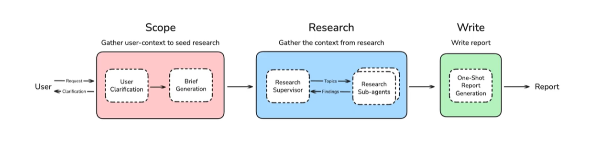

# 5 — Framework survey

> Every agent framework is a different answer to one question: what is the unit you program — a conversation, a crew, a graph, an agent object, a server, or a piece of code?

The restock agent from [01](01-agent-fundamentals.md) fits on a screen of plain Python. So why would anyone add a framework? Because the next requirements are not about the model. A manager must approve large orders, a run must survive a restart halfway through, and the team wants a trace of every decision. Frameworks package answers to those problems, and each one also fixes how you describe your agent. That choice is hard to undo later, so it is worth knowing what each framework makes easy and what it takes away.

---

## Scope

This note is the map. The two frameworks this course uses in depth, LangGraph and Google ADK, have full notes in [04-agentic-frameworks](../../04-agentic-frameworks/README.md), including [04 — framework selection](../../04-agentic-frameworks/notes/06-framework-selection.md). The examples here come from the AgenticAIFrameworks repo, a set of small proof-of-concept scripts, one or two per framework. Versions in that repo date from early to mid 2025; APIs have moved since, so read the snippets for shape, not for exact signatures.

---

## The comparison

| Framework | Unit you program | Control flow | Memory | Best for |
|---|---|---|---|---|
| AutoGen 0.2 | conversable agents | conversation; group chat manager picks speakers | chat history | prototyping multi-agent dialogue |
| CrewAI | role/goal/backstory agents + tasks | sequential or hierarchical process; Flows for DAGs | short/long-term, entity | role-based pipelines, business workflows |
| LangGraph | nodes and edges over typed state | explicit state machine, `Command` routing | checkpointer + store | production control, human-in-the-loop |
| Google ADK | `Agent` with tools and sub-agents | LLM-driven delegation; workflow agents | session state, memory service | Gemini/Vertex deployments |
| OpenAI Agents SDK | `Agent` + `Runner` | handoffs between agents | sessions | small OpenAI-native agents |
| smolagents | `CodeAgent` | the model writes Python as its action | step log | code-as-action, open models |
| Letta | persistent agent server | MemGPT loop with heartbeats | core/archival/recall | stateful long-lived agents |
| Pydantic AI | typed agent with dependencies | plain Python | user-managed | typed outputs, testability |
| MCP | tool server | n/a (protocol) | n/a | sharing tools across clients |
| A2A | agent server | task protocol between agents | per task | agents from different vendors |

AutoGen's own maintainers now point new work at the **Microsoft Agent Framework**, which merges AutoGen and Semantic Kernel. The AutoGen patterns in [04](04-multi-agent-design-patterns.md) still apply.

Albada's rule of thumb (mid-2025): CrewAI or the OpenAI Agents SDK to get a prototype running fast, LangGraph or AutoGen when you need control in production. He also notes that a framework isn't required: many teams build directly on the model providers' APIs (*Building Applications with AI Agents*, ch. 1). That fits Anthropic's "keep it simple" principle in [01](01-agent-fundamentals.md#workflow-vs-autonomous-agent).

Raieli and Iuculano's comparison adds three libraries from the retrieval and enterprise side (*Building AI Agents with LLMs, RAG, and Knowledge Graphs*, ch. 4). **Haystack** is built from components joined into pipelines and is strongest at question answering and search. **LlamaIndex** centers on data connection and RAG, with connectors to more than 160 data sources. **Semantic Kernel**, from Microsoft, began in C# and now also has a Python version, and it builds larger functions by composing smaller ones. They choose by language, by task, by community and by how much customization you need, which remains a sound order of questions. Their worked web agent uses LangChain's `initialize_agent`, a legacy API, so read it for the ideas rather than the calls.

---

## AutoGen

Two agents and a registered function; see [02](02-tool-use-and-react.md) and [04](04-multi-agent-design-patterns.md) for the details. The ReAct example in the repo runs the same code against Gemini or Mistral through an OpenAI-compatible `config_list`, and caches LLM calls on disk so reruns cost nothing:

```python
# illustrative: needs `autogen-agentchat` 0.2 and an LLM API key
from autogen import AssistantAgent, UserProxyAgent, register_function
from autogen.cache import Cache

assistant = AssistantAgent(
    "Assistant",
    system_message="Only use the tools you have access to. Reply TERMINATE when task is done",
    llm_config={"config_list": config_list},           # Gemini or Mistral entries
)
user_proxy = UserProxyAgent(
    "User",
    human_input_mode="ALWAYS",
    max_consecutive_auto_reply=10,
    is_termination_msg=lambda x: (x.get("content") or "").rstrip().endswith("TERMINATE"),
)
register_function(search_tool, caller=assistant, executor=user_proxy,
                  name="search_tool", description="Search the web for a given query")

with Cache.disk(cache_seed=43) as cache:               # replay identical calls from disk
    user_proxy.initiate_chat(
        assistant,
        message=react_prompt_message,                  # fills {input} in the ReAct template
        question="What is the weather and Air quality in New Delhi today?",
        cache=cache,
    )
```

The repo also has a RAG group chat built on `RetrieveUserProxyAgent`, which retrieves from a document folder before the conversation starts.

---

## CrewAI

CrewAI separates *who* (agents with a role, goal and backstory) from *what* (tasks with an expected output), both usually in YAML:

```yaml
# config/agents.yaml
researcher:
  role: "{topic} Senior Data Researcher"
  goal: "Uncover cutting-edge developments in {topic}"
  backstory: "You're a seasoned researcher with a knack for uncovering the latest developments in {topic}."
```

```python
# illustrative: needs `crewai`, an LLM API key and the YAML config above
from crewai import Agent, Crew, Process, Task
from crewai.project import CrewBase, agent, crew, task
from crewai_tools import SerperDevTool

@CrewBase
class LatestAiDevelopmentCrew:
    @agent
    def researcher(self) -> Agent:
        return Agent(config=self.agents_config["researcher"], tools=[SerperDevTool()])

    @task
    def reporting_task(self) -> Task:
        return Task(config=self.tasks_config["reporting_task"], output_file="output/report.md")

    @crew
    def crew(self) -> Crew:
        return Crew(agents=self.agents, tasks=self.tasks, process=Process.sequential)

LatestAiDevelopmentCrew().crew().kickoff(inputs={"topic": "AI Agents"})
```

The bundled DeepLearning.AI notebooks add the production features:

| Notebook | Feature |
|---|---|
| Sales pipeline | `output_pydantic` for typed task output; `Flow` with `@start()` / `@listen()` to chain crews; `kickoff_for_each` over leads |
| Project planning | a Pydantic `ProjectPlan` output; usage metrics and cost per run |
| Project report | a custom `BaseTool` subclass wrapping the Trello API |
| Support analysis | `FileReadTool`; training a crew from human feedback |

CrewAI's strength is how little code a role-based pipeline needs. Its weakness is the same: control flow is implicit in the process type, so debugging a hierarchical crew means reading traces.

---

## LangGraph

The repo's deep-research agent follows the LangChain *open deep research* layout: scope, research, write.



*Figure: the three phases of a deep-research agent (LangChain open deep research).*

| Phase | What happens | Pattern |
|---|---|---|
| Scope | clarify with the user, then write a research brief | human-in-the-loop, structured output |
| Research | a supervisor fans out to research sub-agents | hierarchical multi-agent, parallel |
| Write | one-shot report from the gathered notes | prompt chaining |

Only the scope phase is implemented in the repo. Its key move is a node that returns a `Command` to route itself:

```python
# illustrative: needs `langgraph`, a model API key and the nodes from the repo
from langgraph.graph import StateGraph, START, END
from langgraph.types import Command

class ClarifyWithUser(BaseModel):
    need_clarification: bool
    question: str
    verification: str

def clarify_with_user(state: AgentState) -> Command[Literal["write_research_brief", "__end__"]]:
    response = model.with_structured_output(ClarifyWithUser).invoke(...)
    if response.need_clarification:
        return Command(goto=END, update={"messages": [AIMessage(content=response.question)]})
    return Command(goto="write_research_brief",
                   update={"messages": [AIMessage(content=response.verification)]})

builder = StateGraph(AgentState, input_schema=AgentInputState)
builder.add_node("clarify_with_user", clarify_with_user)
builder.add_node("write_research_brief", write_research_brief)
builder.add_edge(START, "clarify_with_user")
builder.add_edge("write_research_brief", END)
```

The repo's email agent is the textbook LangGraph loop (agent node, `ToolNode`, a `should_continue` router), and its LangMem examples are covered in [03](03-memory-as-an-operating-system.md#memory-types-in-other-frameworks). For LangGraph itself start with [04-agentic-frameworks 01](../../04-agentic-frameworks/notes/01-react-from-scratch-to-langgraph.md).

**Subgraphs** are how LangGraph builds multi-agent and hierarchical systems (the HSM superstate of [01](01-agent-fundamentals.md#agents-as-state-machines)). There are two ways to attach one (*Learning LangChain*, ch. 7):

- **Add the compiled subgraph as a node** when parent and child share state keys. The shared keys are the interface. Any other keys passed in or returned are ignored.
- **Call it from a wrapper function** when the schemas differ. Map parent state into the subgraph's input, invoke it, and map the result back.

Because the interface is just the input and output schemas, different teams can build different subgraphs independently.

**Human in the loop with `interrupt`.** Koenigstein lists four patterns: approve or reject, review and edit state, review tool calls, and validate human input (*AI Agents: The Definitive Guide*, ch. 2). The tool-review version wraps any tool so that the call pauses for a decision:

```python
# illustrative: needs `langgraph` and `langchain-core`; it pauses only inside a graph with a checkpointer
def add_hitl(tool_obj: BaseTool) -> BaseTool:
    @tool(tool_obj.name, description=tool_obj.description, args_schema=tool_obj.args_schema)
    def wrapped(**tool_input):
        response = interrupt([{
            "action_request": {"action": tool_obj.name, "args": tool_input},
            "config": {"allow_accept": True, "allow_edit": True, "allow_respond": True},
        }])[0]
        if response["type"] == "accept":   return tool_obj.invoke(tool_input)
        if response["type"] == "edit":     return tool_obj.invoke(response["args"]["args"])
        if response["type"] == "response": return response["args"]   # human answer replaces the tool
        raise ValueError("unsupported response type")
    return wrapped
```

Resume with `Command(resume=...)`. The rule that matters: **when execution resumes, the interrupted node re-runs from the top**. Any side effect (an API call, a database write) placed before `interrupt()` in that node runs twice. Koenigstein's rule is stricter: keep side effects out of the interrupting node, pause first, and act only after explicit approval. The wrapper above complies, because the tool runs only after `interrupt()` returns a decision. A checkpointer is required, because the pause is a saved thread.

The rule is easy to demonstrate without a framework. This block models the resume behavior in plain Python, with the restock agent's order as the side effect:

```python
# Why a side effect must not share a node with an interrupt. This models the resume
# rule in plain Python: on resume, the interrupted node runs again from its first line.
class Pause(Exception):
    pass

ORDERS, decisions = [], []

def interrupt(question):
    if decisions:
        return decisions.pop(0)
    raise Pause(question)

def unsafe_node(state):
    ORDERS.append(state["quantity"])                     # the side effect comes first
    if interrupt("Send the confirmation email?") == "no":
        return {"emailed": False}
    return {"emailed": True}

def approve_node(state):
    return {"approved": interrupt(f"Order {state['quantity']}?") == "yes"}   # pause only

def order_node(state):
    if state["approved"]:
        ORDERS.append(state["quantity"])                 # runs once, after approval
    return state

def run_with_resume(node, state, answer):
    try:
        return node(state)
    except Pause as pause:
        print("  paused:", pause)
    decisions.append(answer)
    return node(state)                                   # resume re-runs the node

print("unsafe:")
run_with_resume(unsafe_node, {"quantity": 300}, "yes")
print("  orders placed:", ORDERS)

ORDERS.clear()
print("safe:")
state = {"quantity": 300}
state |= run_with_resume(approve_node, state, "yes")
order_node(state)
print("  orders placed:", ORDERS)
```

```text
unsafe:
  paused: Send the confirmation email?
  orders placed: [300, 300]
safe:
  paused: Order 300?
  orders placed: [300]
```

The unsafe version places two orders from one approval. The safe version pauses in one node and acts in the next, so only the pause repeats. Idempotency keys protect you further if a crash lands between the action and the checkpoint.

Dated details in these books: Koenigstein calls LangChain's `AgentExecutor` "often preferable in production". It is the legacy agent runtime, and current LangChain builds agents on LangGraph. Her examples, like the others, use the prebuilt `langgraph.prebuilt.create_react_agent`, which LangGraph 1.0 deprecates in favor of `langchain.agents.create_agent`. Check current docs before copying signatures.

---

## Google ADK

An ADK agent is a declaration: model, instruction, tools. Tools are plain functions whose docstrings become descriptions. Returning a `status` field lets the model tell success from failure.

```python
# illustrative: needs `google-adk` and a Gemini API key, run through `adk run`
from google.adk.agents import Agent

def get_weather(city: str) -> dict:
    """Retrieves the current weather report for a specified city."""
    if city.lower() == "new york":
        return {"status": "success", "report": "Sunny, 25 degrees Celsius."}
    return {"status": "error", "error_message": f"Weather for '{city}' is not available."}

root_agent = Agent(
    name="weather_time_agent",
    model="gemini-2.0-flash",
    description="Agent to answer questions about the time and weather in a city.",
    instruction="You are a helpful agent who can answer user questions about the time and weather in a city.",
    tools=[get_weather, get_current_time],
)
```

The repo's second example generates slide decks with python-pptx tools. The full ADK reference is [04-agentic-frameworks 04](../../04-agentic-frameworks/notes/04-google-adk.md); course notes from Google's five-day intensive are in [06](06-google-adk-intensive.md).

---

## OpenAI Agents SDK and smolagents

The smallest possible agents:

```python
# illustrative: needs `openai-agents` and an OpenAI API key
from agents import Agent, Runner
agent = Agent(name="Assistant", instructions="You are a helpful assistant.", model="gpt-4o-mini")
print(Runner.run_sync(agent, "Write a Fibonacci function in C++.").final_output)
```

```python
# illustrative: needs `smolagents[litellm]` and an Anthropic API key; it runs generated code, so sandbox it
from smolagents import CodeAgent, DuckDuckGoSearchTool, LiteLLMModel
model = LiteLLMModel(model_id="anthropic/claude-3-5-sonnet-latest", temperature=0.2)
agent = CodeAgent(tools=[DuckDuckGoSearchTool()], model=model)   # actions are Python snippets
agent.run("How many seconds would it take for a leopard at full speed to run through Pont des Arts?")
```

smolagents' `CodeAgent` is P22 Code Execution as the default action format: instead of one JSON tool call per step, the model writes a short program that may call several tools and compute on the results. Hugging Face's docs claim this takes fewer steps than JSON tool calling. The cost is a sandbox requirement.

---

## Protocols: MCP and A2A

| | MCP | A2A |
|---|---|---|
| Connects | a model client to tools and data | an agent to another agent |
| Server exposes | tools, resources, prompts | an agent card and tasks |
| Interaction | request/response tool calls | long-running tasks with status, streaming, push notifications |
| Example in repo | `FastMCP("research")` arXiv server ([02](02-tool-use-and-react.md#mcp-tools-served-over-a-protocol)) | AutoGen currency agent served over A2A |

The A2A example wraps an AutoGen agent in an A2A task manager (`on_send_task`, `on_send_task_subscribe` for streaming) and has the agent report a typed status, so the calling agent knows whether to wait, answer a question or give up:

```python
# A typed status tells the calling agent whether to wait, answer a question or give up.
from typing import Literal
from pydantic import BaseModel, ValidationError

class ResponseFormat(BaseModel):
    """Respond to the user in this format."""
    status: Literal["input_required", "completed", "error"] = "input_required"
    message: str

replies = [
    '{"status": "completed", "message": "Ordered 300 of itemB"}',
    '{"status": "input_required", "message": "Which warehouse?"}',
    '{"status": "done", "message": "Ordered"}',
]

for raw in replies:
    try:
        reply = ResponseFormat.model_validate_json(raw)
        print(f"{reply.status}: {reply.message}")
    except ValidationError as err:
        print("rejected:", err.errors()[0]["msg"])
```

```text
completed: Ordered 300 of itemB
input_required: Which warehouse?
rejected: Input should be 'input_required', 'completed' or 'error'
```

The third reply is the useful one: an invented status fails at the boundary, so it never reaches the calling agent's logic.

Protocol shells as a context-engineering idea are in [context 09 — protocols](../../../ai-engineering/02-context-engineering/notes/09-protocols.md).

---

## Evaluating agents: MLflow GenAI

The repo's MLflow script logs runs and scores answers with built-in LLM judges (`answer_relevance`, `faithfulness`) plus a custom judge built with `make_genai_metric` (a privacy check). Evaluation proper lives in [06-observability](../../06-observability/README.md) and [ai-engineering 06 — eval](../../../ai-engineering/06-eval/README.md).

---

## Composing patterns (book ch 10)

Lakshmanan and Hapke close the book by building one agentic workflow from earlier patterns. The useful lesson for picking a framework: you need typed outputs (P2 Grammar), tool calls (P21), a reviewer step (P17 LLM-as-Judge or P18 Reflection), guardrails (P32) and long-term memory (P28). Any of the frameworks above can host all five; they differ in which ones come built in.

| If you need | Lean toward |
|---|---|
| Explicit control flow, checkpoints, human approval mid-run | LangGraph |
| Gemini and Vertex AI deployment | Google ADK |
| A role-based pipeline with little code | CrewAI |
| Agents that remember users for months | Letta, or LangGraph + LangMem/Mem0 |
| Typed Python with tests | Pydantic AI |
| A quick OpenAI-only prototype | OpenAI Agents SDK |
| Code-as-action with open models | smolagents |

---

## Pitfalls

- **Choosing a framework before you know the control flow.** Write the steps down first. If they are a straight line, you may not need one.
- **Treating a tutorial's API as current.** This area changes quickly: AutoGen 0.2 to 0.4 to Microsoft Agent Framework, `AgentExecutor` to LangGraph, `create_react_agent` deprecated in LangGraph 1.0. Pin versions and check the docs.
- **Side effects before `interrupt()`.** The node re-runs on resume, and the action happens twice.
- **Hiding the prompt.** Role, goal and backstory templates build a prompt you did not write. Print what is actually sent before debugging behavior.
- **Assuming a framework gives you safety.** Limits, permissions and evaluation are still your job.
- **Using MCP or A2A where a function call would do.** A protocol earns its overhead when tools or agents cross team or vendor boundaries.
- **Comparing frameworks by demos.** Compare them on your hardest requirement, such as resume after a crash or a mid-run edit by a human.

---

## Try it

1. In the interrupt demo, move `ORDERS.append` in `unsafe_node` to after the `interrupt` call. How many orders are placed, and what would still go wrong if the process crashed right after the append?
2. Add a fourth reply to the `ResponseFormat` loop with no `status` field. Does it validate? Is the default a good one?
3. For each case, name a framework from the table and say why: (a) a six-month assistant that remembers each customer, (b) a compliance workflow where a reviewer edits state mid-run, (c) a fixed three-step report pipeline at a small team.
4. Take the restock agent. What is the first requirement that would make you leave plain Python?

<details>
<summary>Answers</summary>

1. One order, because the pause now happens first. If the process crashes after the append and before the checkpoint, the resume repeats the node and orders again, so the write also needs an idempotency key.
2. It validates, with `status="input_required"`, since the field has a default. That is a questionable default for a missing field: a bad reply now looks like a question to the user, so a required field may be safer.
3. (a) Letta, or LangGraph with LangMem or Mem0, because long-term memory is the core need. (b) LangGraph, for checkpoints and interrupts. (c) Possibly none; plain code, or CrewAI if the team wants role-based templates.
4. Human approval that must survive a restart. It needs durable state, and that is what LangGraph's checkpointer provides. Tracing is the other common trigger.

</details>

---

## Interview checklist

| Question | Short answer |
|---|---|
| CrewAI vs LangGraph? | Roles and tasks with implicit flow vs an explicit state graph |
| What is code-as-action? | The model writes Python that calls tools, instead of one JSON call per step |
| MCP vs A2A? | Tools for a model vs tasks between agents |
| Why does AutoGen 0.2 code look different from current AutoGen? | 0.4 rewrote it as event-driven; Microsoft Agent Framework is the successor |
| What should a tool return on failure? | A status and a readable error, so the model can recover |
| Why must side effects not share a node with `interrupt()`? | On resume the node re-runs from the start, so the side effect would run twice |
| Two ways to add a LangGraph subgraph? | As a node directly when keys are shared, or via a wrapper that transforms state when schemas differ |
| When would you use no framework? | When the loop is simple and you need neither checkpoints nor multi-agent routing. Many teams build directly on provider APIs |
| What do you get from a framework that a loop does not give you? | Durable state and resume, human approval, tracing and routing primitives. You pay in abstraction and in churn |

---

## Next

→ [06 — Google ADK intensive](06-google-adk-intensive.md): context types, the agentic SDLC, protocols and skills, as taught in Google's course.
