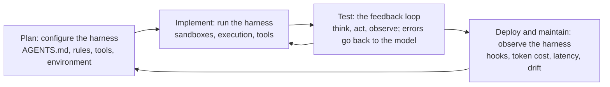

# 6 — Google ADK intensive: context, harness, protocols and skills

> What Google's five-day AI Agents Intensive (vibe-coding edition) adds to this pillar, Days 1–3: agentic engineering versus vibe coding, context types, the agent harness, interoperability protocols and agent skills.

The restock agent now has tools, memory, a reviewer and a framework. Its policy has also grown to a page of rules that sit in the system prompt on every call, including the calls that have nothing to do with ordering. This is what happens to most agents that succeed: they accumulate instructions until the instructions get in the way. Google's course is about the engineering around that problem, and its central advice is that the leverage lies less in the model than in what you put around it. These are course notes rather than an ADK reference, so treat the claims as the course's framing, not as measurements.

For ADK itself (agents, tools, sessions, deployment) read [04-agentic-frameworks](../../04-agentic-frameworks/README.md). The deeper treatments of the ideas here are [context engineering](../../../ai-engineering/02-context-engineering/README.md) and [harness engineering](../../../ai-engineering/03-harness-engineering/README.md). The course's Days 4 and 5 (security and evaluation; spec-driven production) are not written up here, so this chapter does not report them. [07](07-guardrails-and-autonomy.md) and [06-observability](../../06-observability/README.md) cover those subjects from other sources.

---

## The course

The [course page on Kaggle](https://www.kaggle.com/competitions/5-day-ai-agents-intensive-vibecoding-course-with-google) lists five units, each with a whitepaper, a companion podcast and codelabs:

| Day | Unit | Reading and listening |
|---|---|---|
| 1 | Introduction to agents and vibe coding | [The New SDLC With Vibe Coding](https://www.kaggle.com/whitepaper-the-new-SDLC-with-vibe-coding); [podcast](https://www.youtube.com/watch?v=cbzmr7vt4XA) |
| 2 | Agent tools and interoperability | [Agent Tools & Interoperability](https://www.kaggle.com/whitepaper-agent-tools-and-interoperability); [podcast](https://www.youtube.com/watch?v=GjjKXqxFTOY) |
| 3 | Agent skills | [Agent Skills](https://www.kaggle.com/whitepaper-agent-skills); [podcast](https://www.youtube.com/watch?v=uYURYHhpmKc) |
| 4 | Vibe-coding agent security and evaluation | Not written up here |
| 5 | Spec-driven, production-grade development | Not written up here |

---

## Day 1: from vibe coding to agentic engineering

### The stakes decide the method

Vibe coding and agentic engineering are ends of a spectrum, and the right position depends on the stakes. A weekend prototype can be pure vibe coding: describe it, run it, and throw it away if it breaks. A production API handling financial transactions needs agentic engineering, with specifications, tests and review. Most real work falls in between, so the skill is deciding where to draw the line for each task. The restock agent would sit toward the strict end the moment it can spend money, even if its first version was a prototype.

### Tests and evals answer different questions

The course draws a line that is worth keeping. **Tests** verify the deterministic parts of a system: this function, given this input, returns that output. **Evals** verify the parts that are not deterministic: whether the agent took a sensible path, chose the right tools and produced a final answer that meets the bar. Evals split further into **output evaluation**, which checks the result, and **trajectory evaluation**, which checks the steps.

Trajectory evaluation matters because a good answer can hide a bad process:

```python
# A test checks a deterministic function; an eval checks what the agent did.
def weeks_of_cover(on_hand, peak):
    return on_hand / peak

assert weeks_of_cover(100, 90) < 2                     # test: same answer every run

REQUIRED_BEFORE = {"place_order": ["get_stock"]}       # policy: look before you buy

def eval_run(run, expected_item):
    called = [step["tool"] for step in run["steps"]]
    output_ok = expected_item in run["answer"]
    trajectory_ok = all(
        need in called[:called.index(tool)]
        for tool, needs in REQUIRED_BEFORE.items() if tool in called
        for need in needs)
    return output_ok, trajectory_ok

careful = {"steps": [{"tool": "get_stock"}, {"tool": "place_order"}], "answer": "Ordered 300 of itemB"}
lucky = {"steps": [{"tool": "place_order"}], "answer": "Ordered 300 of itemB"}
wrong = {"steps": [{"tool": "get_stock"}, {"tool": "place_order"}], "answer": "Ordered 300 of itemA"}

print(f"{'run':8} {'output':7} trajectory")
for name, run in [("careful", careful), ("lucky", lucky), ("wrong", wrong)]:
    output_ok, trajectory_ok = eval_run(run, "itemB")
    print(f"{name:8} {output_ok!s:7} {trajectory_ok}")
```

```text
run      output  trajectory
careful  True    True
lucky    True    False
wrong    False   True
```

The `lucky` run is the dangerous one. An output check passes it, although it ordered without looking at the stock and will fail the first time the stock figures matter. This is the same argument as the [reflection failures in 01](01-agent-fundamentals.md#workflow-vs-autonomous-agent): the agent's final words are not evidence of how it got there. The course's phrasing is that a well-defined eval suite communicates intent to an agent more precisely than natural language, which makes specifications and evals the same activity.

### Six types of context

The course defines context engineering as giving an agent rich, structured information about the codebase, architecture, conventions and intent, and it names six types:

| Type | What it holds | In the restock agent |
|---|---|---|
| **Instructions** | Role, goals and operational boundaries | "Order just in time" |
| **Knowledge** | Retrieved documents, diagrams, domain data | The supplier contract |
| **Memory** | Short-term session logs and long-term persistent state | Last Monday's delivery-time change |
| **Examples** | Few-shot demonstrations and reference patterns | A worked reorder decision |
| **Tools** | Definitions of the APIs, scripts and services it can call | `get_stock`, `place_order` |
| **Guardrails** | Hard constraints, format rules, safety validations | The 500-unit limit |

The course also separates **static** context, loaded on every run, from **dynamic** context, loaded when a task calls for it. Skills, below, are its main technique for the second kind.

### How the software lifecycle changes

The whitepaper walks through what agents change at each phase:

- **Requirements and planning.** Conversations with an AI produce user stories, API schemas and working prototypes at once, which shortens feedback loops.
- **Design and architecture.** Humans still make the critical trade-offs. AI scaffolds applications and keeps new modules in line with the conventions once the path is set.
- **Implementation.** The work moves from writing to reviewing and guiding. Agents can generate multi-file features, but developers spend significant time verifying and debugging them.
- **Testing and QA.** Tests become the main way to communicate intent to an agent, and evaluation covers both outputs and trajectories.
- **Review and deployment.** AI gives a first-pass review for security and style. Pipelines use agents to monitor health and to predict risks or roll back.
- **Maintenance.** AI makes legacy code easier to approach and automates chores such as framework migrations.

Human judgment and taste, and the skill of verifying output, stay constant through all of this. The course's practical tips follow from that: define specifications early, monitor the trajectory and not just the result, and design the factory rather than the code. In other words, your job moves from implementing to building the systems of guardrails, tests and context that produce the code. Most agent failures, the course argues, are configuration failures in tools, prompts and guardrails rather than failures of the model.

### Agent = model + harness

The harness is everything around the model, and it is where that configuration lives. The whitepaper maps it onto the lifecycle in four stages:



During planning, the developer writes the instructions and rule files, sets up the environment, chooses the tools and sets the rules the agent cannot break. During implementation, the agent runs in sandboxes with its tools. During testing, orchestration logic and guardrails drive the loop: run the code, capture the error, return it to the model, try again. During review and deployment, deterministic hooks run and the observability layer tracks token costs, latency and drift, so engineers can audit why the agent made a given decision. This is the Model + Harness structure from [01](01-agent-fundamentals.md#the-formula), and [harness engineering](../../../ai-engineering/03-harness-engineering/README.md) treats it in depth.

### Conductor or orchestrator

The course describes two working modes. A **conductor** directs one agent in real time, and this suits complex logic, tricky debugging and unfamiliar codebases, where you need to understand each change as it is made. An **orchestrator** delegates asynchronously, often to several agents, and this suits well-defined work such as bug fixes, features built on established patterns, migrations and test generation. Orchestrating takes a different set of skills: specifying tasks without ambiguity, breaking large tasks into pieces an agent can finish, judging output quickly, and designing the constraints, tests and feedback loops that keep agents productive.

### The 80% problem and the real cost

Agents can quickly generate about 80% of a feature. The remaining 20%, meaning edge cases, error handling, integration points and subtle correctness requirements, needs deep contextual knowledge that current models often lack. The 80% figure is the course's rule of thumb, not a measurement, but it matches the pattern of this pillar: the demo is the easy part.

This is why the course frames the economics as total cost of ownership. Agents reduce capital expenditure, the upfront cost of building something, but operational expenditure, the ongoing cost of running, fixing and maintaining it, remains. Code that is cheap to generate and expensive to keep is not cheap.

---

## Day 2: tools and interoperability

The whitepaper's argument is that open protocols replace the technical debt of custom integrations, and it compares them to standard screw sizes and data formats: uniform parts that let machinery work with the rest of the world.

| Protocol | Connects | Purpose |
|---|---|---|
| **MCP** (Model Context Protocol) | Model to data and tools | A standard way to expose tools and data ([02](02-tool-use-and-react.md#mcp-tools-served-over-a-protocol)) |
| **A2A** (Agent2Agent) | Agent to agent | Tasks across vendors and teams ([05](05-framework-survey.md#protocols-mcp-and-a2a)) |
| **A2UI** (Agent-to-User Interface) | Agent to interface | Generative user interfaces |
| **AP2** (Agent Payments Protocol) | Agent to payment | Secure machine-to-machine payment |
| **UCP** (Universal Commerce Protocol) | Agent to commerce | Machine-to-machine commerce |

The course's checklist for adding an MCP server starts with security, since a public community server runs code and handles data you did not write. Before adopting one, check its prerequisites, identify its scope and access criteria, include its specification in what the coding agent reads, and settle how it authenticates. The course suggests services such as Model Armor as an additional screen. If the restock agent's supplier offered an MCP server, this checklist applies in full, because a tool description from a third party is untrusted text that reaches your model.

---

## Day 3: agent skills

### Too much context is also a failure

Adding context stops helping at some point, and the course calls the result attention dilution and context rot: the model has more to read and pays less attention to what matters. Its summary is that the challenge is giving the model the right information at the right time, not more of it. The technique is **progressive disclosure**.

A skill is a directory with a required `SKILL.md` and optional folders:

```text
restock-policy/
  SKILL.md        required: name, description, activation criteria, instructions, usage guidance
  scripts/        optional: executable code for deterministic logic
  references/     optional: large domain knowledge kept out of the prompt, such as manuals and rules
  assets/         optional: JSON schemas, templates, email formats
```

The agent's system prompt carries only each skill's name and description. It reads the body when a task matches, and it opens a reference only if the body sends it there:

```python
# Progressive disclosure with the standard library: load a skill's metadata always,
# its body when it is activated, and its references only when the body points to them.
import pathlib, tempfile

SKILL_MD = """---
name: restock-policy
description: Rules for reorder decisions. Use when deciding whether or how much to reorder stock.
---
# Restock policy
1. Read current stock with get_stock. Never rely on remembered figures.
2. Compare weeks of cover at peak sales with the delivery time.
3. Orders above 500 units need a person's approval.
4. For penalty clauses, read references/supplier-terms.md.
"""

def tokens(text):
    return len(text) // 4                              # a rough rule of thumb, enough to compare

root = pathlib.Path(tempfile.mkdtemp()) / "restock-policy"
(root / "references").mkdir(parents=True)
(root / "SKILL.md").write_text(SKILL_MD)
(root / "references" / "supplier-terms.md").write_text("Clause text. " * 2000)

def read_metadata(skill_dir):
    _, front, _ = (skill_dir / "SKILL.md").read_text().split("---\n", 2)
    return dict(line.split(": ", 1) for line in front.strip().splitlines())

def read_body(skill_dir):
    return (skill_dir / "SKILL.md").read_text().split("---\n", 2)[2]

meta = read_metadata(root)
line = f"- {meta['name']}: {meta['description']}"      # all the system prompt carries
body = read_body(root)
reference = (root / "references" / "supplier-terms.md").read_text()

print("level 1, always loaded:", line)
print(f"level 1: {tokens(line):>5} tokens")
print(f"level 2: {tokens(body):>5} tokens, when the task matches the description")
print(f"level 3: {tokens(reference):>5} tokens, only if the body sends the agent there")

SKILLS = 50
print(f"\n{SKILLS} skills, all loaded up front: {SKILLS * (tokens(line) + tokens(body) + tokens(reference)):,} tokens")
print(f"{SKILLS} skills, one activated:        {SKILLS * tokens(line) + tokens(body):,} tokens")
```

```text
level 1, always loaded: - restock-policy: Rules for reorder decisions. Use when deciding whether or how much to reorder stock.
level 1:    25 tokens
level 2:    66 tokens, when the task matches the description
level 3:  6500 tokens, only if the body sends the agent there

50 skills, all loaded up front: 329,550 tokens
50 skills, one activated:        1,316 tokens
```

The numbers come from a rough four-characters-per-token estimate and a padded reference file, so read them as orders of magnitude. The shape is the point: the always-loaded cost grows with the number of skills only through a short line each, so a single agent can hold many specialties. It also shows the design's weak point, since the description has to carry the whole decision to activate. A vague description means the skill never loads, and nothing reports the failure.

### Skills, MCP and agent.md

These three are easy to confuse, and they answer different questions:

| Mechanism | Answers | Loaded |
|---|---|---|
| **agent.md** | What is always true here? Global instructions | Always |
| **Skills** | How do I do this kind of task? | When the task matches |
| **MCP** | What can I reach? Data, APIs and platforms | Tool definitions up front, unless the client defers them |

### Are multi-agent systems losing favor?

The course makes a sharp claim here: multi-agent systems are losing favor because a single general-purpose agent can load skills dynamically, which avoids the costs of deploying, routing between and maintaining many agents and memory stores.

That partly conflicts with [04](04-multi-agent-design-patterns.md), so it is worth separating what it does and does not establish. It is a framing from the course, not a measured comparison. It is well supported where the agents differ mainly in their instructions, because that is what a skill replaces. It does not cover the other reasons to split agents: running work in parallel, keeping a sub-task's context out of the main thread, giving a reviewer independence, and holding different permissions. Skills share one context and one set of credentials. A sensible default is to start with one agent and skills, and to split only for one of those reasons, as [Cemri's failure modes](04-multi-agent-design-patterns.md#why-multi-agent-systems-fail) would suggest anyway.

---

## Pitfalls

- **Vibe coding past its stakes.** A prototype that starts handling money or personal data has changed categories, even if the code has not.
- **Evaluating only the final answer.** A lucky run passes. Check the steps that matter, such as look-before-acting, on every run.
- **Stuffing the system prompt.** Every always-on line costs tokens on every call and competes for attention. Move task-specific rules into skills.
- **Writing a vague skill description.** The description is the only activation signal, and a miss is silent. Test it with prompts that should and should not trigger the skill.
- **Installing community MCP servers casually.** A third party's tool descriptions and outputs reach your model. Check scope, access and authentication first.
- **Assuming the last 20% will go as fast as the first 80%.** Edge cases and integration points take most of the time, so plan for them.
- **Counting only build cost.** Generated code still has to be run, fixed and maintained.
- **Blaming the model first.** The course's claim is that most agent failures are configuration failures. Check the tools, prompts and guardrails before changing the model.

---

## Try it

1. In the skill loader, make the `description` read "Restock things." Which level of the design does this damage, and how would you test for it?
2. Add a `bypass` run to the eval: `place_order` first, then `get_stock`, with a correct answer. What does `eval_run` report, and why does order matter?
3. Sort these into agent.md, a skill or an MCP server: "this repo uses uv", the steps for preparing a release, read access to the order database, the template for a supplier email.
4. Take the restock agent and list its context under the six types. Which are static, and which should load only when needed?

<details>
<summary>Answers</summary>

1. Level 1. The body and references are fine, but the agent can no longer tell when to use them. Keep a small set of prompts that should and should not trigger the skill, and check which skills get activated.
2. `(True, False)`, because `get_stock` is not in the calls before `place_order`. Looking at the stock after ordering cannot inform the order, so a check of tool membership alone would miss it.
3. "Uses uv": agent.md. Release steps: a skill. Order database: MCP. Email template: an asset inside a skill.
4. Static: instructions and tool definitions, plus hard guardrails, which should be in code. Dynamic: knowledge such as the contract, examples for unusual cases, and memory, which is retrieved as needed.

</details>

---

## Interview checklist

| Question | Short answer |
|---|---|
| Tests vs evals? | Tests check deterministic behavior; evals check non-deterministic behavior: trajectory, tool choice and answer quality |
| Why evaluate the trajectory as well as the output? | A correct answer can come from a bad process, such as acting without checking, which fails later |
| Name six types of context | Instructions, knowledge, memory, examples, tools, guardrails |
| What is a harness? | Everything around the model: instructions, tools, sandboxes, orchestration, guardrails, hooks, observability |
| Conductor vs orchestrator? | Real-time direction for hard or unfamiliar work; asynchronous delegation for well-defined work |
| What is progressive disclosure? | Metadata always loaded, the body on activation, references on demand, so context cost stays small |
| Skills vs MCP vs agent.md? | How to do a task; what can be reached; what is always true |
| Do skills replace multi-agent systems? | Where agents differ only in instructions, yes. Not for parallelism, context isolation, reviewer independence or separate permissions |
| What is the 80% problem? | Agents generate most of a feature fast; edge cases and integration need the expertise. The figure is a rule of thumb |
| Why talk about total cost of ownership? | Agents cut build cost, but running, fixing and maintaining remain, and they can dominate |

---

## Next

→ [07 — guardrails and autonomy](07-guardrails-and-autonomy.md): how to limit what the agent can do, and where people stay in the loop.
