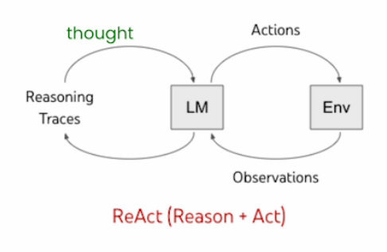
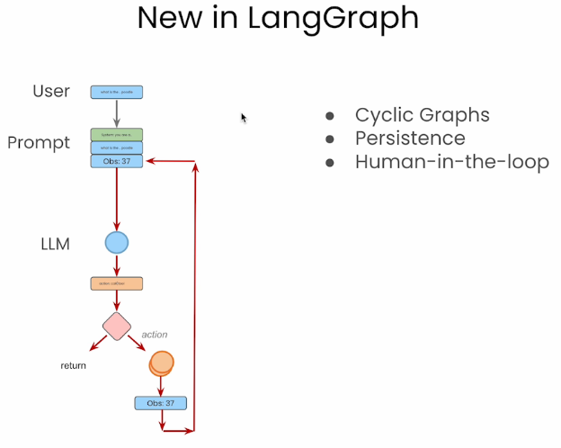
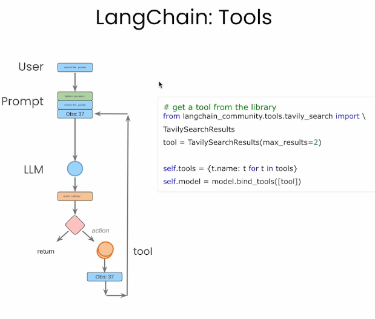
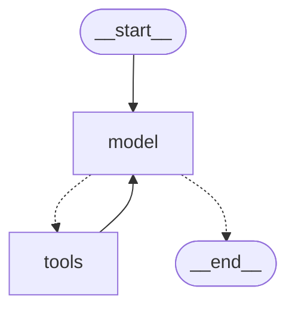

# 1 — ReAct from Scratch, then in LangGraph

An agent framework is a set of decisions someone else made about a loop you could write yourself. This chapter writes that loop by hand, watches it fail in the ways real agents fail, then rebuilds it as a two-node LangGraph `StateGraph` so you can point at exactly which lines the framework took over. The same research agent, built here, runs through every chapter of this pillar: persisted and paused in [note 02](02-agentic-search-persistence-streaming.md), given memory in [note 03](03-long-term-memory-with-langgraph.md), rebuilt on Google ADK in [note 04](04-google-adk.md), traced in [note 05](05-langsmith.md), and measured against the others in [note 06](06-framework-selection.md).

Course: DeepLearning.AI, *AI Agents in LangGraph* (Harrison Chase, Rotem Weiss), lessons L1 and L2. The theory of why an agent is a cyclic graph is in [ai-engineering/05-graph-engineering 02 — graph primitives](../../../ai-engineering/05-graph-engineering/notes/02-graph-primitives.md) and [03 — state and reducers](../../../ai-engineering/05-graph-engineering/notes/03-state-and-reducers.md). This chapter is the mechanics.

---

## The lab: one agent, no API key

Every block in this chapter runs offline, against the real `langgraph` package. From [practice/01-research-agent/](../practice/01-research-agent/):

```bash
uv run --with langgraph --with langchain-core python demo_01_react.py
```

The lab has three framework-neutral parts in [research_lab.py](../practice/01-research-agent/research_lab.py), which is the design [note 06](06-framework-selection.md) argues for: tools and prompts stay plain, and each framework gets a thin adapter.

| Part | What it is | Why it is built this way |
|---|---|---|
| `CORPUS` | Six short summaries of this pillar's sources | A research question with real answers, and no network |
| `search`, `read_source`, `publish_report` | Plain Python functions | Tool logic is written and tested once; only the wrapping differs by framework |
| `decide(question, observations)` | A scripted stand-in for the model | Deterministic, so outputs below are reproducible. It sees only what a real model would see |

The stub replaces inference, not orchestration. Everything a framework actually does (routing, state merging, checkpoints, events) runs for real. What you cannot learn from it is how a live model behaves, so where model behaviour matters this chapter also gives the Claude version as a marked illustrative block.

The question the agent answers is one this pillar has a stake in:

```python
from research_lab import QUESTION, search, read_source

print(QUESTION)
print(search(QUESTION))
print(read_source("wang-2025"))
```

```text
Why do framework agents get stuck in loops, and what stops them?
furgale-2026 | NOOA: agents as Python objects, validated termination
wang-2025 | Agent developer practices: framework failure study
dibia-2024 | AutoGen Studio: declarative agents and a profiler
Logic control caused more than a third of the agent failures studied, with task termination alone at 21.63 percent of them. Recursive tool or agent calls that never stop show up as a named failure pattern.
```

---

## The split of work



*Figure: the ReAct loop from L1. The LLM decides; the surrounding code runs the action and feeds back the observation. Source: ksm26/AI-Agents-in-LangGraph, `images/l1_1.png`.*

| Who | Does what |
|---|---|
| LLM | Reads the transcript, writes a `Thought`, picks an `Action` and its input, or writes the `Answer` |
| Your code | Parses the action, looks it up in a registry, runs it, appends `Observation: ...`, calls the LLM again |
| Loop guard | Caps turns (`max_turns`) so a model that never answers can't spin forever |

ReAct ([Yao et al., 2022, preprint](https://arxiv.org/abs/2210.03629)) is the name for interleaving reasoning and acting in one transcript. Everything else in this pillar is a framework that owns some part of the right-hand column.

That third row deserves more attention than its size suggests. In the largest empirical study of agent frameworks to date, [Wang et al. (2025, preprint)](https://arxiv.org/abs/2512.01939) classified discussions from 1,575 GitHub agent projects and put logic control behind more than a third of reported failures, with task termination alone at 21.63%. Their worked example of the pattern is a research agent and an analyst looping forever. Those shares come from LLM-assisted classification with expert review of GitHub threads, so read them as what developers complain about, not as a failure rate. Even so, the lesson for a first agent is that the stop condition is real design work and not a detail.

---

## L1 — the agent as a plain class

The course's agent is a message list plus a call. Nothing else. This is the course code, kept because it is the clearest statement of how little an agent needs.

```python
# illustrative: course code, needs OPENAI_API_KEY and the openai package
from openai import OpenAI
client = OpenAI()

class Agent:
    def __init__(self, system=""):
        self.system = system
        self.messages = []
        if self.system:
            self.messages.append({"role": "system", "content": system})

    def __call__(self, message):
        self.messages.append({"role": "user", "content": message})
        result = self.execute()
        self.messages.append({"role": "assistant", "content": result})
        return result

    def execute(self):
        completion = client.chat.completions.create(
            model="gpt-4o", temperature=0, messages=self.messages)
        return completion.choices[0].message.content
```

### The prompt is the protocol

Before native tool calling, the "API" between model and code was a text format the prompt teaches by example. Here is the course's prompt:

```text
You run in a loop of Thought, Action, PAUSE, Observation.
At the end of the loop you output an Answer
Use Thought to describe your thoughts about the question you have been asked.
Use Action to run one of the actions available to you - then return PAUSE.
Observation will be the result of running those actions.

Your available actions are:
calculate:
e.g. calculate: 4 * 7 / 3
average_dog_weight:
e.g. average_dog_weight: Collie

Example session:
Question: How much does a Bulldog weigh?
Thought: I should look the dogs weight using average_dog_weight
Action: average_dog_weight: Bulldog
PAUSE
Observation: A Bulldog weights 51 lbs
Answer: A bulldog weights 51 lbs
```

| Token | Who writes it | Purpose |
|---|---|---|
| `Thought:` | model | Scratchpad; makes the next action conditional on stated reasoning |
| `Action: name: input` | model | The tool call, in a parseable line |
| `PAUSE` | model | "Stop generating, run the tool" |
| `Observation:` | code | The tool result, fed back as the next user turn |
| `Answer:` | model | Termination signal |

### Tools and the registry

Tools are plain functions, and a dictionary maps the name the model writes to the callable. This is the course's registry, which runs as is:

```python
def calculate(what):
    return eval(what)          # course code: never eval model output outside a sandbox

def average_dog_weight(name):
    if name in "Scottish Terrier": return "Scottish Terriers average 20 lbs"
    elif name in "Border Collie":  return "a Border Collies average weight is 37 lbs"
    elif name in "Toy Poodle":     return "a toy poodles average weight is 7 lbs"
    else:                          return "An average dog weights 50 lbs"

known_actions = {"calculate": calculate, "average_dog_weight": average_dog_weight}
print(known_actions["average_dog_weight"]("Border Collie"), "|", known_actions["calculate"]("37 + 20"))
```

```text
a Border Collies average weight is 37 lbs | 57
```

The course first drives this by hand (call the agent, run the tool yourself, paste `Observation: ...` back) for "I have 2 dogs, a border collie and a scottish terrier. What is their combined weight": three tool rounds (two weights, one sum) before the answer. Doing it by hand once is the fastest way to see what the loop automates.

### The loop, on the research agent

The research agent's tools fit the same registry. The lab's `query()` is the course's loop with two changes: the model is the stub, and an unknown action becomes an observation instead of an exception, so the model gets a chance to recover.

```python
import re
from agent_scratch import PROMPT, KNOWN_ACTIONS, text_model

action_re = re.compile(r"^Action: (\w+): (.*)$")

def query(question, max_turns=6, model=text_model):
    messages = [{"role": "system", "content": PROMPT}, {"role": "user", "content": question}]
    for turn in range(max_turns):
        reply = model(messages)
        messages.append({"role": "assistant", "content": reply})
        actions = [m for m in map(action_re.match, reply.split("\n")) if m]
        if not actions:                        # no Action line: the model answered
            return reply
        name, arg = actions[0].groups()
        if name not in KNOWN_ACTIONS:
            observation = f"ERROR: no action named {name}"
        else:
            observation = KNOWN_ACTIONS[name](arg)
        print(f"turn {turn}: {name}({arg[:32]}...)")
        messages.append({"role": "user", "content": f"Observation: {observation}"})
    return None                                # out of turns: tell the caller, don't pretend

print(query(QUESTION))
```

```text
turn 0: search(Why do framework agents get stuc...)
turn 1: read_source(furgale-2026...)
turn 2: read_source(wang-2025...)
Answer: Requiring a validated typed result before an agent may stop prevents unsupported declarations of completion [furgale-2026]. Logic control caused more than a third of the agent failures studied, with task termination alone at 21.63 percent of them [wang-2025].
```

Now the failure from the Wang study. A model that keeps deciding one more search might help is not a bug you can see in the code; the loop is doing what it was told. Only the guard stops it, and `None` is the honest result:

```python
stubborn = lambda messages: text_model(messages, behavior="stubborn")
print("result:", query(QUESTION, max_turns=3, model=stubborn))
```

```text
turn 0: search(Why do framework agents get stuc...)
turn 1: search(Why do framework agents get stuc...)
turn 2: search(Why do framework agents get stuc...)
result: None
```

| Weakness of the hand-rolled loop | What replaces it in L2 |
|---|---|
| Regex parsing of free text; a stray format breaks it | Native tool calling (`bind_tools`), structured `tool_calls` |
| One action per turn (`actions[0]`) | The model can emit several tool calls in one message |
| Unknown tool raises and kills the run in the course code | Return "bad tool name, retry" as the observation |
| State is a private list on one object | Typed graph state with a reducer |
| No pause, resume, or inspection | Checkpointer + threads ([note 02](02-agentic-search-persistence-streaming.md)) |

### The same loop on the Claude API

Native tool calling removes the regex. The text protocol survives only as a teaching device: the model now returns structured `tool_use` blocks, and the loop runs until `stop_reason` is no longer `tool_use`. The Anthropic SDK also has a tool runner that owns this loop, so you only write the tools. Both forms need a key, so this block is illustrative; the loop logic is what the stub tested above.

```python
# illustrative: needs ANTHROPIC_API_KEY. Refusal fallback is enabled (the beta header and `fallbacks`).
import anthropic
from anthropic import beta_tool
from research_lab import QUESTION, SYSTEM_PROMPT, search as search_corpus

client = anthropic.Anthropic()

@beta_tool
def search(query: str) -> str:
    """Search the research corpus and return the best source ids, one per line.

    Args:
        query: Keywords or a question to look up.
    """
    return search_corpus(query)

runner = client.beta.messages.tool_runner(
    model="claude-opus-5-5",
    max_tokens=16000,
    system=SYSTEM_PROMPT,
    tools=[search],
    messages=[{"role": "user", "content": QUESTION}],
    betas=["server-side-fallback-2026-07-01"],
    fallbacks="default",
)
for message in runner:
    print(message.stop_reason, [block.type for block in message.content])
```

Three rules for current Claude models apply whichever loop you use. A tool result that failed should come back with `is_error: true` so the model can adapt. Several results from one assistant turn go back together in one user message. And the model is not guaranteed to call a tool when `tool_choice` is `auto`: on Opus 5.5, Sonnet 5.5 and Fable 5.1 a forced `tool_choice` returns a 400, so steer with the prompt, check the reply for a `tool_use` block, and re-prompt if it is missing.

---

## L2 — the same agent as a graph



*Figure: what LangGraph adds over a LangChain chain: cycles, persistence, human-in-the-loop. Source: ksm26/AI-Agents-in-LangGraph, `images/l2_2.png`.*



*Figure: the LangChain pieces (prompt templates, tools, chat model) the graph nodes call. Source: ksm26/AI-Agents-in-LangGraph, `images/l2_1.png`.*

| LangGraph component | Role in this agent |
|---|---|
| State (`TypedDict`) | The shared object every node reads and returns updates to |
| Reducer (`Annotated[..., add_messages]`) | How a node's update merges into state: append, not overwrite |
| Node | A Python function `state -> partial update` |
| Edge | Fixed transition (`tools → model`) |
| Conditional edge | A function of state that picks the next node (`model → tools` or `END`) |
| `START` edge | Where a run starts |
| `compile()` | Freezes the graph into a runnable with `invoke` / `stream` |

A note on the word *graph*. Wang et al. describe LangGraph as DAG-based, and that is not right for what you are about to build. The loop-back edge makes this graph cyclic, which is the whole point of it. [Zhou et al. (2023, preprint)](https://arxiv.org/abs/2309.07870) argued for the same structure before LangGraph existed: their Agents library writes a plan as a graph of states with transition rules and runs a `while not finished` loop over it, for the stated reason that symbolic control is more stable than a prompt alone.

### State and reducer

```python
from typing import Annotated, TypedDict
from langchain_core.messages import AnyMessage
from langgraph.graph.message import add_messages

class AgentState(TypedDict):
    messages: Annotated[list[AnyMessage], add_messages]
```

Without the reducer, each node's `{"messages": [msg]}` would replace the list. With it, the transcript accumulates. This is the one line that carries the conversation; reducers in general are in [graph-engineering 03](../../../ai-engineering/05-graph-engineering/notes/03-state-and-reducers.md). The course uses `operator.add`, which only appends. `add_messages` also replaces a message whose `id` already exists, which human-in-the-loop edits rely on in [note 02](02-agentic-search-persistence-streaming.md).

### The graph

The lab's stub, `StubChatModel`, subclasses LangChain's `BaseChatModel`. LangGraph cannot tell it from a real model, so the rest is ordinary production code. Swap the first line of `build_agent` for `ChatAnthropic(model="claude-opus-5-5")` and nothing else changes.

```python
from langchain_core.messages import SystemMessage, ToolMessage
from langchain_core.tools import tool as as_tool
from langgraph.graph import END, START, StateGraph
from agent_langgraph import StubChatModel, show
from research_lab import SYSTEM_PROMPT, publish_report

TOOLS = {f.__name__: as_tool(f) for f in (search, read_source, publish_report)}

def build_agent(model=None):
    model = (model or StubChatModel()).bind_tools(list(TOOLS.values()))

    def call_model(state: AgentState):
        return {"messages": [model.invoke([SystemMessage(SYSTEM_PROMPT), *state["messages"]])]}

    def call_tools(state: AgentState):
        results = []
        for call in state["messages"][-1].tool_calls:
            if call["name"] not in TOOLS:          # let the model recover instead of crashing
                results.append(ToolMessage(f"ERROR: no tool named {call['name']}", tool_call_id=call["id"]))
                continue
            results.append(ToolMessage(TOOLS[call["name"]].invoke(call["args"]), tool_call_id=call["id"]))
        return {"messages": results}

    def route(state: AgentState):
        return "tools" if state["messages"][-1].tool_calls else END

    graph = StateGraph(AgentState)
    graph.add_node("model", call_model)
    graph.add_node("tools", call_tools)
    graph.add_edge(START, "model")
    graph.add_conditional_edges("model", route, ["tools", END])
    graph.add_edge("tools", "model")
    return graph.compile()

agent = build_agent()
show(agent.invoke({"messages": [("user", QUESTION)]})["messages"])
```

```text
model  -> search({'query': 'Why do framework agents get stuck in loops, and what stops them?'})
tool   <- furgale-2026 | NOOA: agents as Python objects, validated termination ; w
model  -> read_source({'source_id': 'furgale-2026'})
tool   <- Requiring a validated typed result before an agent may stop prevents u
model  -> read_source({'source_id': 'wang-2025'})
tool   <- Logic control caused more than a third of the agent failures studied,
model  => Requiring a validated typed result before an agent may stop prevents unsupported declarations of completion [furgale-2026]. Logic control caused more than a third of the agent failures studied, with task termination alone at 21.63 percent of them [wang-2025].
```

LangGraph will draw what you built, which beats trusting your memory of the edges. This is `agent.get_graph().draw_mermaid()`, trimmed of its styling lines:



The dotted lines are the conditional edge and the solid `tools --> model` is the loop.

| L1 line | L2 equivalent |
|---|---|
| `messages.append(...)` | Node returns `{"messages": [...]}`; the reducer appends |
| `action_re.match` | `message.tool_calls` (structured, from the API) |
| `if not actions: return` | `route` + conditional edge to `END` |
| `for turn in range(max_turns)` | The `tools → model` edge; cap with `recursion_limit` in the run config |
| `"Observation: ..."` | `ToolMessage(tool_call_id=...)` matched to the call |

`tool_call_id` matters: the provider rejects a transcript where a tool result does not answer a tool call in the preceding assistant message.

### The guard moved, it did not vanish

`max_turns` became `recursion_limit`, and it counts graph steps, not model calls. A model call plus its tool run is two steps, so a limit of 9 buys about four rounds. It raises an exception rather than returning, which forces the caller to decide what a run that never finished means:

```python
from langgraph.errors import GraphRecursionError

stubborn_agent = build_agent(StubChatModel(behavior="stubborn"))
try:
    stubborn_agent.invoke({"messages": [("user", QUESTION)]}, {"recursion_limit": 9})
except GraphRecursionError as error:
    print(type(error).__name__, "->", str(error).split(".")[0])
```

```text
GraphRecursionError -> Recursion limit of 9 reached without hitting a stop condition
```

### What the course ran

The course's L2 uses Tavily and `gpt-4o`, so it needs keys; the queries are still worth knowing, because each tests a different property of the loop.

| Query | What it shows |
|---|---|
| Weather in SF | One tool call, one loop back, answer |
| Weather in SF **and** LA | Two `tool_calls` in one assistant message, run in one `tools` step. That is why `call_tools` loops |
| Super Bowl → state → GDP | Sequential dependency: each search needs the last answer. The course swaps to gpt-4o here because gpt-3.5 dropped hops |

The prompt it used is a good template for a research agent: "You are a smart research assistant. Use the search engine to look up information. You are allowed to make multiple calls (either together or in sequence). Only look up information when you are sure of what you want."

---

## API drift since the course

The course pins 2024-era packages. The ideas hold; some names moved. Checked against `langgraph` 1.2.19, `langchain` 1.4.7 and `langchain-core` 1.7.3.

| Course code | Current equivalent |
|---|---|
| `graph.set_entry_point("llm")` | `graph.add_edge(START, "llm")` (both still work) |
| `langchain_community...TavilySearchResults` | `langchain_tavily.TavilySearch` |
| Hand-written `Agent` class | `langchain.agents.create_agent(model, tools, system_prompt=...)`. `langgraph.prebuilt.create_react_agent` still runs but its docstring now marks it deprecated in favour of `create_agent` |
| `ChatOpenAI(model=...)` | `init_chat_model("anthropic:claude-opus-5-5")` for provider-agnostic code |
| `temperature=0` on every model | Remove for Claude: `temperature` is not accepted on current Claude models |
| `operator.add` reducer | `add_messages`, which also merges by message id |

Check the current [LangGraph docs](https://docs.langchain.com/oss/python/langgraph/overview) before copying any import. Version churn is a documented cost here, not a nuisance: Wang et al. attribute 23.53% of the failures they classified to version and dependency issues, naming conflicts between `langchain-core` and `langgraph` among the examples.

---

## Labs

| Lab | Where | Runs |
|---|---|---|
| Research agent, no framework and LangGraph | [practice/01-research-agent/](../practice/01-research-agent/README.md): `agent_scratch.py`, `agent_langgraph.py`, `demo_01_react.py` | Offline, no key |
| L1 ReAct from scratch | [upstream Lesson_1_Student.ipynb](https://github.com/ksm26/AI-Agents-in-LangGraph/blob/main/Lesson_1_Student.ipynb) | Needs `OPENAI_API_KEY` |
| L2 LangGraph components | [upstream Lesson_2_Student.ipynb](https://github.com/ksm26/AI-Agents-in-LangGraph/blob/main/Lesson_2_Student.ipynb) | Needs `OPENAI_API_KEY`, `TAVILY_API_KEY`; `draw_png` needs graphviz |

---

## Pitfalls

| Pitfall | What you see | Fix |
|---|---|---|
| Treating "no tool call" as "done" | The agent stops early with a confident, unsupported answer | Validate the answer before accepting it. See the termination evidence in [note 06](06-framework-selection.md#what-the-evidence-says) |
| No loop guard, or one you never test | A stuck run burns tokens until something external kills it | Set `recursion_limit` deliberately and catch `GraphRecursionError`. Test with a stubborn stub, as above |
| Reading `recursion_limit` as model calls | The limit trips at half the rounds you expected | It counts graph steps. Each round is at least two |
| A node that returns the whole list with `operator.add` | The transcript doubles each step | Return only the new messages. The reducer merges |
| A tool exception that kills the run | One bad argument ends the whole job | Catch it in the tool node and return the error as a `ToolMessage` so the model can adapt |
| Dropping `tool_call_id` | The provider returns 400 on the next call | Match each `ToolMessage` to its call. This is why the stub reads ids and not positions |
| Copying course `eval` | Remote code execution from model output | Don't copy it. Use a parser such as `ast.literal_eval`, or a real sandbox |

---

## Try it

1. Change `decide` in a copy of the lab so the first `read_source` receives a bad id. Confirm the graph recovers and the answer still cites two sources.
2. Set `recursion_limit` to 8 on the normal agent, then to 7. Before you run them, predict which one raises.
3. Replace `add_messages` with `operator.add` and make `call_tools` return `state["messages"] + results`. Print the message count and explain it.

<details>
<summary>Answers</summary>

1. `read_source` returns `ERROR: unknown source ...`; the unknown id goes into `tried` so `decide` moves to the next hit. The tool node never raises, which is the point of returning errors as observations.
2. Tested on this lab: 8 passes and 7 raises. The normal run is seven node steps (four model, three tools), and LangGraph needs the limit to exceed the last step it runs. The off-by-one is the thing to learn, so set the limit from a measured run and not from arithmetic.
3. The list grows quadratically, because each update is appended to a list that already holds it. `add_messages` would have deduplicated by id; `operator.add` cannot.

</details>

---

## Interview checklist

| Question | Answer |
|---|---|
| What is the minimum an agent needs? | A model call, a tool registry, a loop, and a stop condition. Everything else is convenience or durability |
| What does ReAct mean? | Interleaving reasoning and acting in one transcript, each action's result fed back as an observation |
| Why is a conditional edge better than a regex on model text? | It routes on structured `tool_calls` from the API, so a formatting slip cannot change control flow |
| What does a reducer do? | It defines how a node's partial update merges into shared state. Without one, updates overwrite |
| How do you stop a runaway agent in LangGraph? | `recursion_limit` in the run config. It counts graph steps and raises `GraphRecursionError` |
| Why return tool errors instead of raising? | The model can read an error and try something else; an exception ends the run |
| What replaced `create_react_agent`? | `langchain.agents.create_agent`, per the deprecation notice in LangGraph 1.2.19's docstring |
| Why do frameworks matter less than they look for a basic agent? | The loop is short. Frameworks pay off at durability, approval gates, and observability, not at the loop |

---

## Next

[02-agentic-search-persistence-streaming.md](02-agentic-search-persistence-streaming.md) gives this graph a better search tool and a checkpointer, so it can remember threads, stream tokens, and pause for a human before it publishes.
