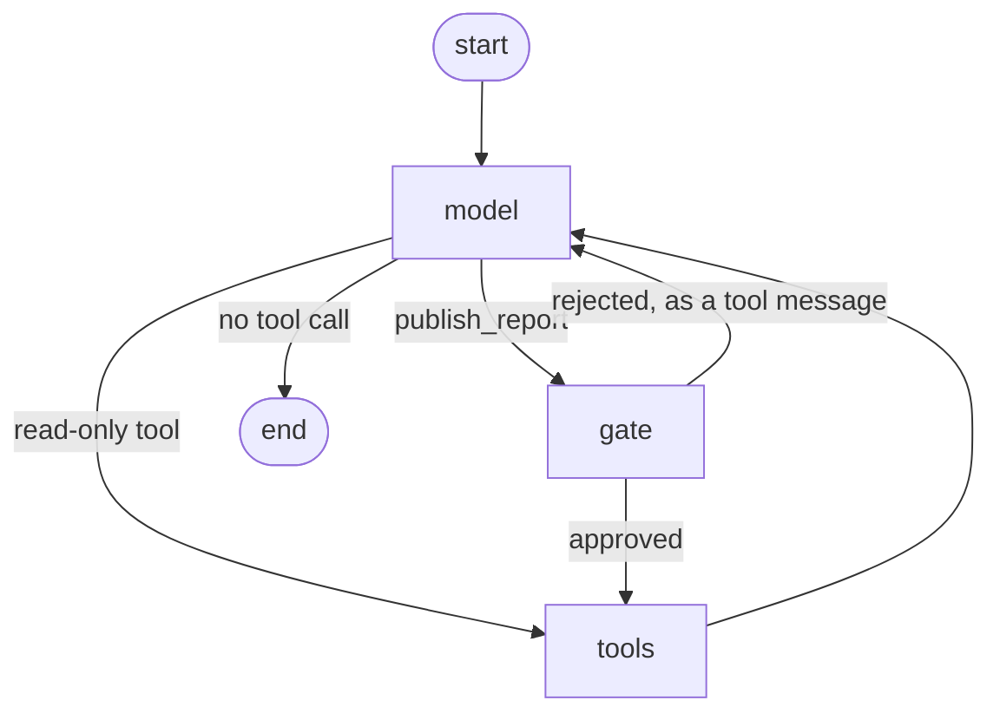

# 2 — Agentic Search, Persistence and Streaming

The agent from [note 01](01-react-from-scratch-to-langgraph.md) runs once, forgets everything, shows nothing until it finishes, and would publish a report with nobody looking. Those four gaps are what stands between a demo and something you would leave running. This chapter closes them on the same research agent: a search tool shaped for agents rather than people, a checkpointer that turns one run into a resumable thread, streaming so a person can watch it work, and approval gates that rest on the checkpointer. It ends with the first graph in the course that is more than `model ⇄ tools`, a multi-node writer with a revision budget.

Course: *AI Agents in LangGraph*, L3–L6. L5 and L6 notebooks are not in the snapshot this note was condensed from; those sections follow the course README, its L6 figure and the LangGraph docs, and the code below is written for the lab and tested on it. Theory: [graph-engineering 04 — durable execution and interrupts](../../../ai-engineering/05-graph-engineering/notes/04-durable-execution-and-interrupts.md).

All non-illustrative code runs offline against `langgraph` 1.2.19 and `langgraph-checkpoint-sqlite`, from [practice/01-research-agent/](../practice/01-research-agent/README.md):

```bash
uv run --with langgraph --with langgraph-checkpoint-sqlite python demo_02_agentic.py
```

---

## L3 — agentic search


*Figure: search as a tool. The agent writes the query; the tool returns context ready for the next model call. Source: ksm26/AI-Agents-in-LangGraph, `images/l3_1.png`.*


*Figure: what an agent-oriented search API does behind one call: split into sub-queries, retrieve sources, chunk each, score and filter, return top-k. Source: ksm26/AI-Agents-in-LangGraph, `images/l3_2.png`.*

A search engine built for people returns links, because a person will click, skim and discard. A model cannot skim for free. Every token of navigation bar is a token it pays for and might believe. The lesson contrasts two ways to answer "what is the current weather in San Francisco?".

| | Human-oriented search + scrape | Agent-oriented search (Tavily) |
|---|---|---|
| Call | DuckDuckGo `DDGS().text(query)` → list of URLs | `client.search(query, max_results=1)` |
| Next step | `requests.get(url)`, BeautifulSoup, pick tags, strip whitespace | None |
| Output | A wall of page text with navigation and ads | Structured content (the weather comes back as JSON-like text) |
| Tokens into the model | Thousands, mostly noise | Hundreds, mostly signal |
| Failure mode | Rate limits, layout changes, blocked scrapers | Vendor dependency and cost |

```python
# illustrative: L3 agent-oriented search, needs TAVILY_API_KEY and the tavily-python package
import os
from tavily import TavilyClient
client = TavilyClient(api_key=os.environ["TAVILY_API_KEY"])

result = client.search("What is in Nvidia's new Blackwell GPU?", include_answer=True)
result["answer"]                         # synthesised answer string
result = client.search(query, max_results=1)
result["results"][0]["content"]          # the top source's cleaned content
```

```python
# illustrative: L3 baseline it replaces, needs network plus duckduckgo-search, requests, beautifulsoup4
from duckduckgo_search import DDGS
import requests, re
from bs4 import BeautifulSoup

urls = [r["href"] for r in DDGS().text(query, max_results=6)]
soup = BeautifulSoup(requests.get(urls[0], headers={"User-Agent": "Mozilla/5.0"}).text, "html.parser")
text = re.sub(r"\s+", " ", "\n".join(t.get_text(" ", strip=True)
                                       for t in soup.find_all(["h1", "h2", "h3", "p"])))
```

The lab makes the cost visible without a network. Same source, two tool shapes: one returns the page as a scraper would see it, the other returns what the model needs. The boilerplate here is invented for the demonstration, so the ratio shows the mechanism and not a measurement of any real site.

```python
from research_lab import CORPUS, QUESTION, count_tokens, read_source, search

BOILERPLATE = "Home | Products | Pricing | Sign in | Accept all cookies | Subscribe to our newsletter\n" * 12

def scrape_page(source_id):
    return f"{BOILERPLATE}<h1>{CORPUS[source_id]['title']}</h1>\n{CORPUS[source_id]['text']}\n{BOILERPLATE}"

print("scraped page:", count_tokens(scrape_page("wang-2025")), "tokens")
print("agent tool:  ", count_tokens(read_source("wang-2025")), "tokens")
print("search hits: ", count_tokens(search(QUESTION)), "tokens for three candidate sources")
```

```text
scraped page: 588 tokens
agent tool:   51 tokens
search hits:  48 tokens for three candidate sources
```

The split of `search` from `read_source` is itself a design choice. Search returns ids and titles, which are cheap, and the model pays for full text only for the sources it picks. **Tool output is context**, so a tool that returns clean, short, structured results is a context-engineering decision and not a convenience ([ai-engineering/02-context-engineering 10 — tools](../../../ai-engineering/02-context-engineering/notes/10-tools-and-multi-agent.md)). The same holds for tool descriptions. [Wang et al. (2025, preprint)](https://arxiv.org/abs/2512.01939) report, from developer feedback on MCP, prompts of about 11.7k tokens where MCP instructions made up about 40%, and a tool description over 1,200 characters causing a 400 error in one client. Those are individual reports, not measured averages, but they point the same way.

---

## L4 — persistence

A checkpointer saves the graph state after every node, keyed by a thread id. The same compiled graph then serves many independent conversations, and a run becomes something you can pause, inspect, resume or rewind. Nothing about the agent's logic changes.

```python
from langgraph.checkpoint.memory import InMemorySaver
from agent_langgraph import StubChatModel, build_agent, show

agent = build_agent(checkpointer=InMemorySaver())

def tool_calls(messages):
    return [c["name"] for m in messages if m.type == "ai" for c in m.tool_calls]

thread_1 = {"configurable": {"thread_id": "1"}}
first = agent.invoke({"messages": [("user", QUESTION)]}, thread_1)
print("thread 1, first ask: ", tool_calls(first["messages"]))

second = agent.invoke({"messages": [("user", "Summarise that in one line.")]}, thread_1)
print("thread 1, follow-up: ", tool_calls(second["messages"][len(first["messages"]):]), "new tool calls")

other = agent.invoke({"messages": [("user", QUESTION)]}, {"configurable": {"thread_id": "2"}})
print("thread 2, same words:", tool_calls(other["messages"]))
print("messages held:", len(second["messages"]), "in thread 1,", len(other["messages"]), "in thread 2")
```

```text
thread 1, first ask:  ['search', 'read_source', 'read_source']
thread 1, follow-up:  [] new tool calls
thread 2, same words: ['search', 'read_source', 'read_source']
messages held: 10 in thread 1, 8 in thread 2
```

The follow-up on thread 1 calls no tools, because the sources are already in that thread's state. Thread 2 starts from nothing. The course makes the same point with weather:

| Turn | Thread | Result |
|---|---|---|
| "What is the weather in sf?" | 1 | Searches, answers |
| "What about in la?" | 1 | Understands "what about" from saved history |
| "Which one is warmer?" | 1 | Compares SF and LA from state |
| "Which one is warmer?" | 2 | Asks "which ones?": a fresh thread has no history |

### What a checkpoint actually is

Each entry in the history is a full snapshot of state plus `next`, the nodes still to run. Reading the list for one run shows the whole mechanism, and shows why the guard in note 01 counts steps.

```python
history = list(agent.get_state_history({"configurable": {"thread_id": "2"}}))
for snapshot in reversed(history):
    print(f"step {snapshot.metadata['step']:>2}  next={str(snapshot.next):<16} messages={len(snapshot.values.get('messages', []))}")
```

```text
step -1  next=('__start__',)   messages=0
step  0  next=('model',)       messages=1
step  1  next=('tools',)       messages=2
step  2  next=('model',)       messages=3
step  3  next=('tools',)       messages=4
step  4  next=('model',)       messages=5
step  5  next=('tools',)       messages=6
step  6  next=('model',)       messages=7
step  7  next=()               messages=8
```

### Durable means it survives the process

`InMemorySaver` dies with the interpreter. A file-backed saver does not, which is the property you actually want from persistence. Here two separately built agents share nothing but a database file, which stands in for a process restart.

```python
import sqlite3, tempfile, os
from langgraph.checkpoint.sqlite import SqliteSaver

path = os.path.join(tempfile.mkdtemp(), "threads.db")
config = {"configurable": {"thread_id": "report-7"}}

with sqlite3.connect(path, check_same_thread=False) as connection:
    build_agent(checkpointer=SqliteSaver(connection)).invoke({"messages": [("user", QUESTION)]}, config)

with sqlite3.connect(path, check_same_thread=False) as connection:     # a new "process"
    restored = build_agent(checkpointer=SqliteSaver(connection)).get_state(config)
    print(len(restored.values["messages"]), "messages restored; last:", restored.values["messages"][-1].content[:48])
```

```text
8 messages restored; last: Requiring a validated typed result before an age
```

| Checkpointer | Use |
|---|---|
| `InMemorySaver` (`MemorySaver`) | Tests, notebooks |
| `SqliteSaver` / `AsyncSqliteSaver` (package `langgraph-checkpoint-sqlite`) | Single-process apps, local dev |
| `PostgresSaver` (package `langgraph-checkpoint-postgres`) | Production, multiple workers |

A checkpointer is **short-term memory**: one thread's state. Facts that must survive across threads go in a store, which is [note 03](03-long-term-memory-with-langgraph.md).

The course's own version needs keys, and its `SqliteSaver.from_conn_string(":memory:")` line is now a context manager:

```python
# illustrative: L4 course shape, needs OPENAI_API_KEY and TAVILY_API_KEY
from langgraph.checkpoint.sqlite import SqliteSaver

with SqliteSaver.from_conn_string(":memory:") as memory:
    abot = Agent(model, [tool], system=prompt, checkpointer=memory)   # the Agent class from L2
    thread = {"configurable": {"thread_id": "1"}}
    for event in abot.graph.stream({"messages": [HumanMessage("What is the weather in sf?")]}, thread):
        for v in event.values():
            print(v["messages"])
```

### Double texting

A thread is also where a second message collides with a run that hasn't finished: the user fixes a typo or adds a constraint mid-run. The design options and their costs are in [harness 07](../../../ai-engineering/03-harness-engineering/notes/07-orchestration.md#double-texting-the-same-problem-in-a-chat-app). LangGraph's deployment server picks one per request with `multitask_strategy` (*Learning LangChain*, ch. 9):

| Strategy | What happens to run 1 | Use when |
|---|---|---|
| `reject` | Keeps running; the new message is refused | Runs are short or side-effecting and must not overlap |
| `enqueue` | Finishes; the new message runs next as its own run | Each message is an independent request |
| `interrupt` | Stops, keeps its checkpointed progress; the new input continues the thread | The follow-up refines the same task |
| `rollback` | Discarded; the new input runs as if it were the first | The follow-up replaces the first message |

`interrupt` is the natural fit for chat and the hardest to get right: any tool call run 1 already executed has happened, so its side effects must be idempotent or recorded in state, and a half-finished tool-call turn must be cleaned up before the next model call. The book calls the server LangGraph Platform, since renamed LangSmith Deployment; check the current docs for the parameter. It needs the server, so it is not run here.

---

## L4 — streaming

A research run takes a while. In one measured setup, Wang et al. put retrieval-augmented agent latency at 3.2–5.6 seconds per query, about 1.8 times direct generation (A100, batch size 1). A person staring at a blank screen for that long assumes it broke, and a developer debugging it wants to see each step. Streaming answers both at different grain.

| Method | Unit | Use |
|---|---|---|
| `graph.stream(input, config, stream_mode="updates")` | One event per node: the state update it returned | Show steps ("searching…", "answering…") |
| `graph.stream(..., stream_mode="messages")` | `(token chunk, metadata)` pairs, with the node name in `metadata` | Typewriter output in a UI |
| `graph.astream_events(input, config, version="v2")` | Every inner event, including model token chunks | Fine-grained UIs, custom instrumentation |

```python
agent = build_agent()
for update in agent.stream({"messages": [("user", QUESTION)]}, stream_mode="updates"):
    for node, change in update.items():
        last = change["messages"][-1]
        print(f"{node:<6}", last.tool_calls[0]["name"] if getattr(last, "tool_calls", None) else last.content[:50])
```

```text
model  search
tools  furgale-2026 | NOOA: agents as Python objects, val
model  read_source
tools  Requiring a validated typed result before an agent
model  read_source
tools  Logic control caused more than a third of the agen
model  Requiring a validated typed result before an agent
```

Token mode is what a chat UI wants. `StubChatModel` has a real `_stream`, so LangGraph takes the same code path as a live model. Empty content on a chunk means the model is emitting a tool call, which is why the UI code filters it.

```python
words = []
for chunk, meta in agent.stream({"messages": [("user", QUESTION)]}, stream_mode="messages"):
    if meta["langgraph_node"] == "model" and chunk.content:
        words.append(chunk.content)
print(len(words), "chunks. First six:", words[:6])
```

```text
51 chunks. First six: ['I ', 'need ', 'sources ', 'before ', 'I ', 'can ']
```

The course used `astream_events` with `version="v1"` and an async checkpointer. It still teaches the shape, but `version="v2"` is the current schema and `stream_mode="messages"` covers the common case without the event firehose. Asynchronous graphs need an async checkpointer, and `AsyncSqliteSaver` now lives at `langgraph.checkpoint.sqlite.aio`.

```python
# illustrative: L4 course token streaming, needs OPENAI_API_KEY and TAVILY_API_KEY
from langgraph.checkpoint.sqlite.aio import AsyncSqliteSaver

async with AsyncSqliteSaver.from_conn_string(":memory:") as memory:
    abot = Agent(model, [tool], system=prompt, checkpointer=memory)
    thread = {"configurable": {"thread_id": "4"}}
    async for event in abot.graph.astream_events({"messages": messages}, thread, version="v2"):
        if event["event"] == "on_chat_model_stream":
            content = event["data"]["chunk"].content
            if content:              # empty content = the model is emitting a tool call
                print(content, end="|")
```

---

## L5 — human in the loop

The checkpointer is what makes pausing possible: a paused graph is just a saved checkpoint waiting for the next `invoke` on the same thread, so the human can take a week and the server can restart in between. Wang et al. single out LangGraph's breakpoints as suiting high-stakes review, and [Zhou et al. (2023, preprint)](https://arxiv.org/abs/2309.07870) had an `is_human` flag on agents for the same reason. The research agent has one action that deserves the gate: `publish_report` cannot be unsent.

The course pattern is static: compile with `interrupt_before`, and the graph stops before the tool node every time. Here it walks the agent up to the publish call, then a reviewer edits the title and resumes.

```python
from research_lab import PUBLISHED

agent = build_agent(checkpointer=InMemorySaver(), interrupt_before=["tools"])
config = {"configurable": {"thread_id": "review"}}
agent.invoke({"messages": [("user", QUESTION + " Then publish a report.")]}, config)

while agent.get_state(config).values["messages"][-1].tool_calls[0]["name"] != "publish_report":
    agent.invoke(None, config)                     # approve the read-only steps

state = agent.get_state(config)
pending = state.values["messages"][-1]
print("paused before:", state.next, "| wants:", pending.tool_calls[0]["name"], "| published so far:", len(PUBLISHED))

pending.tool_calls[0]["args"]["title"] = "Why agents loop, reviewed"
agent.update_state(config, {"messages": [pending]})   # same id, so add_messages replaces it
print("messages after edit:", len(agent.get_state(config).values["messages"]), "(replaced, not appended)")

agent.invoke(None, config)
print("published:", PUBLISHED[-1]["title"])
```

```text
paused before: ('tools',) | wants: publish_report | published so far: 0
messages after edit: 8 (replaced, not appended)
published: Why agents loop, reviewed
```

Stopping before every tool call is a blunt instrument when only one tool is dangerous, and reviewers who approve fifty harmless searches stop reading. The current API is `interrupt()` called inside a node, which pauses only when the code path reaches it and hands the reviewer a payload. Below, a gate node catches `publish_report`, and `Command(resume=...)` carries the decision back in.



```python
from langchain_core.messages import SystemMessage, ToolMessage
from langgraph.graph import END, START, StateGraph
from langgraph.types import Command, interrupt
from agent_langgraph import TOOLS, AgentState
from research_lab import SYSTEM_PROMPT

def build_gated_agent(checkpointer):
    model = StubChatModel().bind_tools(list(TOOLS.values()))

    def call_model(state: AgentState):
        return {"messages": [model.invoke([SystemMessage(SYSTEM_PROMPT), *state["messages"]])]}

    def call_tools(state: AgentState):
        return {"messages": [ToolMessage(TOOLS[c["name"]].invoke(c["args"]), tool_call_id=c["id"])
                             for c in state["messages"][-1].tool_calls]}

    def gate(state: AgentState):
        print("  gate node runs")                  # printed twice per approval: see Pitfalls
        call = state["messages"][-1].tool_calls[0]
        decision = interrupt({"action": call["name"], "title": call["args"]["title"]})
        if decision == "approve":
            return Command(goto="tools")
        refusal = ToolMessage(f"REJECTED by reviewer: {decision}", tool_call_id=call["id"])
        return Command(goto="model", update={"messages": [refusal]})

    def route(state: AgentState):
        calls = state["messages"][-1].tool_calls
        if not calls:
            return END
        return "gate" if calls[0]["name"] == "publish_report" else "tools"

    graph = StateGraph(AgentState)
    graph.add_node("model", call_model)
    graph.add_node("tools", call_tools)
    graph.add_node("gate", gate, destinations=("tools", "model"))
    graph.add_edge(START, "model")
    graph.add_conditional_edges("model", route, ["tools", "gate", END])
    graph.add_edge("tools", "model")
    return graph.compile(checkpointer=checkpointer)

gated = build_gated_agent(InMemorySaver())
PUBLISHED.clear()
for thread, decision in (("yes", "approve"), ("no", "cites only two sources, widen it")):
    config = {"configurable": {"thread_id": thread}}
    paused = gated.invoke({"messages": [("user", QUESTION + " Then publish a report.")]}, config)
    print("paused on:", paused["__interrupt__"][0].value["action"], "| next:", gated.get_state(config).next)
    done = gated.invoke(Command(resume=decision), config)
    print(f"reviewer said {decision!r}: published={len(PUBLISHED)}; last tool result: {done['messages'][-2].content[:50]}")
```

```text
  gate node runs
paused on: publish_report | next: ('gate',)
  gate node runs
reviewer said 'approve': published=1; last tool result: published: Why agents loop
  gate node runs
paused on: publish_report | next: ('gate',)
  gate node runs
reviewer said 'cites only two sources, widen it': published=1; last tool result: REJECTED by reviewer: cites only two sources, wide
```

The read-only tools ran without asking. The rejection reached the model as an ordinary tool result, so a live model can read why it was refused and revise. The stub simply stops, which is the honest limit of a scripted model.

### Rewinding

Every checkpoint is addressable, so you can go back to one and run forward from there. This is how you reproduce a failure, and how you fork a thread to try a different decision without losing the original.

```python
config = {"configurable": {"thread_id": "yes"}}
history = list(gated.get_state_history(config))
print("checkpoints on the thread:", len(history), "| at the end, next =", history[0].next)
before_gate = next(s for s in history if s.next == ("gate",))
print("rewound to step", before_gate.metadata["step"], "next =", before_gate.next)
replay = gated.invoke(None, before_gate.config)     # runs forward from that checkpoint
print("paused again:", "__interrupt__" in replay, "| checkpoints now:", len(list(gated.get_state_history(config))))
```

```text
checkpoints on the thread: 12 | at the end, next = ()
rewound to step 7 next = ('gate',)
  gate node runs
paused again: True | checkpoints now: 13
```

| Operation | API | What it is for |
|---|---|---|
| Pause | `interrupt_before=[node]` (static) or `interrupt()` inside a node (dynamic, current API) | Approval gates |
| Inspect | `get_state(config)` → `.values`, `.next`, `.tasks` | Show the pending action |
| Resume | `invoke(None, config)` / `Command(resume=...)` | Continue as planned |
| Edit | `update_state(config, values)` | Correct the plan before it runs |
| Time travel | `get_state_history(config)`, invoke with a past `.config` | Replay or branch |

Updating a message in place relies on the reducer: the course replaces `operator.add` with a custom reducer that overwrites a message whose `id` already exists, and built-in `add_messages` does this for you. Where to put gates is a design question covered in [graph-engineering 04](../../../ai-engineering/05-graph-engineering/notes/04-durable-execution-and-interrupts.md).

---

## L6 — from a loop to a writing pipeline


*Figure: the L6 essay-writer graph and its node prompts. Source: ksm26/AI-Agents-in-LangGraph, `images/l6_1.png`.*

The first graph in the course that is more than `llm ⇄ action`. Each node is one prompt with one job, and state has several typed keys instead of a single message list.

| Node | Prompt's job | Writes to state |
|---|---|---|
| `plan` | "Write a high-level outline of the essay" | `plan` |
| `research_plan` | "Generate a list of search queries… 3 max", then run them | `content` (search results) |
| `generate` | "Write excellent 5-paragraph essays… if the user provides critique, respond with a revised version" | `draft`, `revision_number` |
| `should_continue` (edge) | Stop if `revision_number > max_revisions` | none |
| `reflect` | Critique the draft | `critique` |
| `research_critique` | Search queries to address the critique | `content` |

Below is the same shape for a research report, with deterministic functions where the course has prompts. The control flow and state are the real thing, and the revision budget means a critic that is never satisfied still terminates.

```python
import operator
from typing import Annotated, TypedDict

class ReportState(TypedDict):
    task: str
    plan: str
    content: Annotated[list[str], operator.add]   # accumulates across research rounds
    draft: str
    critique: str
    revision_number: int
    max_revisions: int

def plan(state):
    return {"plan": f"Answer: {state['task']}"}

def research(state):
    query = state["critique"] or state["task"]
    ids = [line.split(" | ")[0] for line in search(query).splitlines()][:1 + state["revision_number"]]
    return {"content": [i for i in ids if i not in state["content"]]}

def generate(state):
    return {"draft": " ".join(f"[{source}]" for source in state["content"]),
            "revision_number": state["revision_number"] + 1}

def should_continue(state):
    return END if state["revision_number"] > state["max_revisions"] else "reflect"

def reflect(state):
    return {"critique": f"only {len(state['content'])} sources, find more about termination loops"}

writer = StateGraph(ReportState)
for node in (plan, research, generate, reflect):
    writer.add_node(node.__name__, node)
writer.add_edge(START, "plan")
writer.add_edge("plan", "research")
writer.add_edge("research", "generate")
writer.add_conditional_edges("generate", should_continue, {END: END, "reflect": "reflect"})
writer.add_edge("reflect", "research")

result = writer.compile().invoke({"task": QUESTION, "plan": "", "content": [], "draft": "", "critique": "",
                                  "revision_number": 0, "max_revisions": 2})
print(result["revision_number"], "drafts ->", result["draft"])
```

```text
3 drafts -> [furgale-2026] [liu-2026] [wang-2025]
```

This is generate-then-verify with a revision budget, the "highest-yield first graph" in [graph-engineering 05 — topology patterns](../../../ai-engineering/05-graph-engineering/notes/05-topology-patterns.md). `max_revisions` lives in state rather than in a closure, so it is checkpointed and can be changed per run. It is also a second loop guard, tighter than `recursion_limit` and with a graceful exit: the run ends with the best draft and not an exception.

---

## Labs

| Lab | Where | Runs |
|---|---|---|
| Threads, history, gates, rewind, writer | [practice/01-research-agent/demo_02_agentic.py](../practice/01-research-agent/demo_02_agentic.py) | Offline, no key |
| L3 agentic search | [upstream Lesson_3_Student.ipynb](https://github.com/ksm26/AI-Agents-in-LangGraph/blob/main/Lesson_3_Student.ipynb) | Needs `TAVILY_API_KEY`; DDG part needs network |
| L4 persistence and streaming | [upstream Lesson_4_Student.ipynb](https://github.com/ksm26/AI-Agents-in-LangGraph/blob/main/Lesson_4_Student.ipynb) | Needs `OPENAI_API_KEY`, `TAVILY_API_KEY` |
| L5 HITL, L6 essay writer | [DeepLearning.AI course page](https://www.deeplearning.ai/short-courses/ai-agents-in-langgraph/) | Course platform only; not in the upstream repo |

---

## Pitfalls

| Pitfall | What you see | Fix |
|---|---|---|
| Code before `interrupt()` with a side effect | It runs twice: the node re-executes from its top on resume, as the gate output above shows | Put side effects after the interrupt or in the next node, and make them idempotent |
| `interrupt` or `interrupt_before` with no checkpointer | A pause has nowhere to be saved. The graph cannot resume | Compile with a checkpointer. `InMemorySaver` is enough to test |
| `InMemorySaver` in production | Every paused approval vanishes on deploy | Use a database-backed saver. Prove it with the two-agent test above |
| Reusing a thread id across users | One user sees another's history | Derive thread ids from the session on the server, never from model output |
| Editing a tool call by appending a new message | The transcript holds two assistant turns and the provider may reject it | Keep the message `id` so `add_messages` replaces it |
| Gating every tool | Reviewers stop reading | Gate on the side effect, using `interrupt()` in the path that reaches it |
| Expecting replay to undo the world | A rewind reruns nodes, and a real API call happens twice | Rewinding moves the graph's state only. External effects need idempotency keys |

---

## Try it

1. Rewrite `gate` so the print happens after the `interrupt()` call. Count the prints per approval and explain the difference.
2. Run the rewind block twice in a row, then count checkpoints. Are the old ones gone?
3. Give `writer` a `reflect` that returns an empty critique after two sources, and make `should_continue` stop on an empty critique. How many drafts now?

<details>
<summary>Answers</summary>

1. Once. Code after `interrupt()` only runs on the resumed pass. The first pass raises at that line, and the resumed pass re-runs the node from the top with `interrupt()` returning the decision.
2. Not gone. A replay appends new checkpoints that branch from the old one, so the original history stays addressable.
3. Fewer: the critic now ends the loop before the budget does. Keep the budget anyway, as the guard for a critic that never empties.

</details>

---

## Interview checklist

| Question | Answer |
|---|---|
| Checkpointer versus store? | A checkpointer is per-thread state at every step. A store holds items that outlive a thread, across threads and users |
| How does human-in-the-loop work in LangGraph? | The graph saves a checkpoint and stops. A later `invoke` on the same thread resumes it, with `Command(resume=...)` for dynamic interrupts |
| Static versus dynamic interrupts? | `interrupt_before` stops at a node every time. `interrupt()` stops only on the code path that reaches it, with a payload for the reviewer |
| What happens to code above `interrupt()` on resume? | The node runs again from its top, so that code executes twice |
| Why does `update_state` not duplicate the message? | `add_messages` replaces any message whose `id` already exists |
| What is an agent-oriented search tool? | One that returns cleaned, ranked, short results, so no scraping step follows and tokens go to signal |
| Which streaming mode for a chat UI? | `stream_mode="messages"`, filtering on the node name and on empty content |
| What does time travel not do? | It does not undo external side effects. It only moves graph state |

---

## Next

[03-long-term-memory-with-langgraph.md](03-long-term-memory-with-langgraph.md): a checkpointer remembers one thread. A store remembers the user across threads, as semantic, episodic and procedural memory, and the research agent stops re-reading what it already knows.
