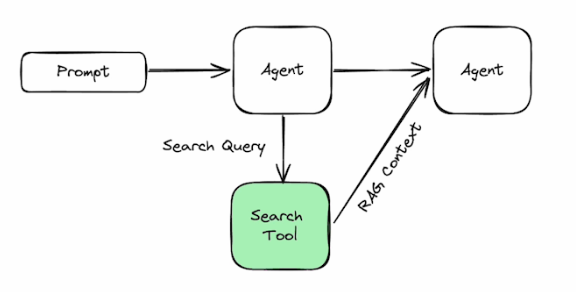
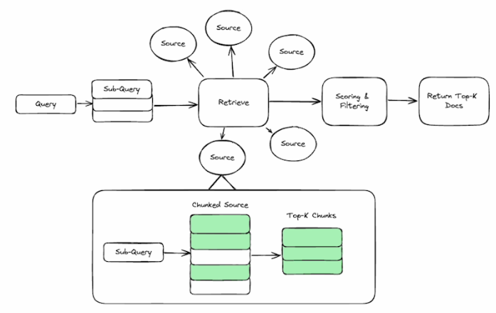
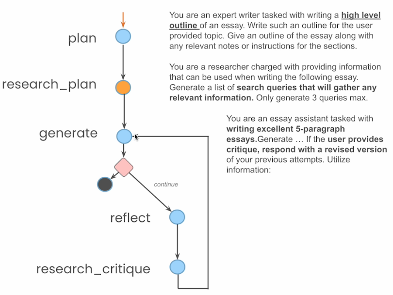

# 2 — Agentic Search, Persistence and Streaming

> Three upgrades to the note-01 graph: a search tool shaped for agents rather than people, a checkpointer that turns one run into a resumable thread, and token streaming. Then the two lessons that build on them: human-in-the-loop and a multi-node essay writer.

Course: *AI Agents in LangGraph*, L3–L6. L5 and L6 notebooks are not in the snapshot this note was condensed from; those sections follow the course README, its L6 figure and the LangGraph docs, and say so. Theory: [graph-engineering 04 — durable execution and interrupts](../../../ai-engineering/05-graph-engineering/notes/04-durable-execution-and-interrupts.md).

---

## L3 — agentic search



*Figure: search as a tool. The agent writes the query; the tool returns context ready for the next model call. Source: ksm26/AI-Agents-in-LangGraph, `images/l3_1.png`.*



*Figure: what an agent-oriented search API does behind one call: split into sub-queries, retrieve sources, chunk each, score and filter, return top-k. Source: ksm26/AI-Agents-in-LangGraph, `images/l3_2.png`.*

The lesson contrasts two ways to answer "what is the current weather in San Francisco?".

| | Human-oriented search + scrape | Agent-oriented search (Tavily) |
|---|---|---|
| Call | DuckDuckGo `DDGS().text(query)` → list of URLs | `client.search(query, max_results=1)` |
| Next step | `requests.get(url)`, BeautifulSoup, pick tags, strip whitespace | None |
| Output | A wall of page text with navigation and ads | Structured content (the weather comes back as JSON-like text) |
| Tokens into the model | Thousands, mostly noise | Hundreds, mostly signal |
| Failure mode | Rate limits, layout changes, blocked scrapers | Vendor dependency and cost |

```python
# L3 — agent-oriented search: one call, an answer and ranked sources (needs TAVILY_API_KEY)
import os
from tavily import TavilyClient
client = TavilyClient(api_key=os.environ["TAVILY_API_KEY"])

result = client.search("What is in Nvidia's new Blackwell GPU?", include_answer=True)
result["answer"]                         # synthesised answer string
result = client.search(query, max_results=1)
result["results"][0]["content"]          # the top source's cleaned content
```

```python
# L3 — the baseline it replaces: search engine + scraper (runs offline-ish, but brittle)
from duckduckgo_search import DDGS
import requests, re
from bs4 import BeautifulSoup

urls = [r["href"] for r in DDGS().text(query, max_results=6)]
soup = BeautifulSoup(requests.get(urls[0], headers={"User-Agent": "Mozilla/5.0"}).text, "html.parser")
text = re.sub(r"\s+", " ", "\n".join(t.get_text(" ", strip=True)
                                       for t in soup.find_all(["h1", "h2", "h3", "p"])))
```

**Takeaway.** Tool output is context. A tool that returns clean, short, structured results is a context-engineering decision, not a convenience ([ai-engineering/02-context-engineering 10 — tools](../../../ai-engineering/02-context-engineering/notes/10-tools-and-multi-agent.md)).

---

## L4 — persistence

A checkpointer saves the graph state after every node, keyed by a thread id. The same compiled graph then serves many independent conversations.

```python
# L4 — add a checkpointer; nothing else in the note-01 Agent changes
from langgraph.checkpoint.sqlite import SqliteSaver
memory = SqliteSaver.from_conn_string(":memory:")
# newer langgraph-checkpoint-sqlite: `with SqliteSaver.from_conn_string(":memory:") as memory:`

self.graph = graph.compile(checkpointer=memory)     # inside Agent.__init__

thread = {"configurable": {"thread_id": "1"}}
for event in abot.graph.stream({"messages": [HumanMessage("What is the weather in sf?")]}, thread):
    for v in event.values():
        print(v["messages"])
```

| Turn | Thread | Result |
|---|---|---|
| "What is the weather in sf?" | 1 | Searches, answers |
| "What about in la?" | 1 | Understands "what about" from saved history |
| "Which one is warmer?" | 1 | Compares SF and LA from state |
| "Which one is warmer?" | 2 | Asks "which ones?": a fresh thread has no history |

| Checkpointer | Use |
|---|---|
| `InMemorySaver` (`MemorySaver`) | Tests, notebooks |
| `SqliteSaver` / `AsyncSqliteSaver` | Single-process apps, local dev |
| `PostgresSaver` | Production, multiple workers |

A checkpointer is **short-term memory**: one thread's state. Facts that must survive across threads go in a store, which is [note 03](03-long-term-memory-with-langgraph.md).

## L4 — streaming

Two granularities:

| Method | Unit | Use |
|---|---|---|
| `graph.stream(input, thread)` | One event per node: the state update it returned | Show steps ("searching…", "answering…") |
| `graph.astream_events(input, thread, version=...)` | Every inner event, including model token chunks | Typewriter output in a UI |

```python
# L4 — token streaming; async checkpointer required for the async API
from langgraph.checkpoint.aiosqlite import AsyncSqliteSaver   # moved: langgraph.checkpoint.sqlite.aio
memory = AsyncSqliteSaver.from_conn_string(":memory:")
abot = Agent(model, [tool], system=prompt, checkpointer=memory)

thread = {"configurable": {"thread_id": "4"}}
async for event in abot.graph.astream_events({"messages": messages}, thread, version="v1"):
    if event["event"] == "on_chat_model_stream":
        content = event["data"]["chunk"].content
        if content:              # empty content = the model is emitting a tool call
            print(content, end="|")
```

Current LangGraph also offers `graph.stream(..., stream_mode="messages")` for token chunks without the event firehose; `version="v2"` is the current `astream_events` schema.

---

## L5 — human in the loop (notebook not in snapshot)

The checkpointer is what makes pausing possible: a paused graph is just a saved checkpoint waiting for the next `invoke` on the same thread. The course pattern interrupts before the tool node so a person can approve each search.

```python
# L5 pattern (reconstructed from the course outline and LangGraph docs, not the missing notebook)
self.graph = graph.compile(checkpointer=memory, interrupt_before=["action"])

abot.graph.invoke({"messages": [HumanMessage("Whats the weather in LA?")]}, thread)
state = abot.graph.get_state(thread)
state.next                                   # ('action',) — paused before the tool runs
state.values["messages"][-1].tool_calls      # inspect what it wants to do

abot.graph.invoke(None, thread)              # approve: resume from the checkpoint
# or edit: replace the tool call, then resume
last = state.values["messages"][-1]
last.tool_calls[0]["args"]["query"] = "current weather in Louisville"
abot.graph.update_state(thread, {"messages": [last]})   # same message id → replaced, not appended
abot.graph.invoke(None, thread)
# time travel: list past checkpoints and resume from any of them
for s in abot.graph.get_state_history(thread): ...
```

| Operation | API | What it is for |
|---|---|---|
| Pause | `interrupt_before=[node]` (static) or `interrupt()` inside a node (dynamic, current API) | Approval gates |
| Inspect | `get_state(thread)` → `.values`, `.next` | Show the pending action |
| Resume | `invoke(None, thread)` / `Command(resume=...)` | Continue as planned |
| Edit | `update_state(thread, values)` | Correct the plan before it runs |
| Time travel | `get_state_history(thread)`, invoke with a past `checkpoint_id` | Replay or branch |

Updating a message in place relies on the reducer: the course replaces `operator.add` with a custom reducer that overwrites a message whose `id` already exists. Built-in `add_messages` does this for you. Where to put gates is a design question covered in [graph-engineering 04](../../../ai-engineering/05-graph-engineering/notes/04-durable-execution-and-interrupts.md).

---

## L6 — essay writer (notebook not in snapshot)



*Figure: the L6 essay-writer graph and its node prompts. Source: ksm26/AI-Agents-in-LangGraph, `images/l6_1.png`.*

The first graph in the course that is more than `llm ⇄ action`. Each node is one prompt with one job.

| Node | Prompt's job | Writes to state |
|---|---|---|
| `plan` | "Write a high-level outline of the essay" | `plan` |
| `research_plan` | "Generate a list of search queries… 3 max", then run them | `content` (search results) |
| `generate` | "Write excellent 5-paragraph essays… if the user provides critique, respond with a revised version" | `draft`, `revision_number` |
| `should_continue` (edge) | Stop if `revision_number > max_revisions` | — |
| `reflect` | Critique the draft | `critique` |
| `research_critique` | Search queries to address the critique | `content` |

```python
# L6 shape (from the figure): typed state with several keys, not just messages
class EssayState(TypedDict):
    task: str
    plan: str
    draft: str
    critique: str
    content: list[str]
    revision_number: int
    max_revisions: int

builder.add_conditional_edges("generate", should_continue, {END: END, "reflect": "reflect"})
builder.add_edge("reflect", "research_critique")
builder.add_edge("research_critique", "generate")
```

This is generate-then-verify with a revision budget, the "highest-yield first graph" in [graph-engineering 05 — topology patterns](../../../ai-engineering/05-graph-engineering/notes/05-topology-patterns.md).

---

## Labs

| Lab | Where | Runs |
|---|---|---|
| L3 agentic search | [upstream Lesson_3_Student.ipynb](https://github.com/ksm26/AI-Agents-in-LangGraph/blob/main/Lesson_3_Student.ipynb) | Needs `TAVILY_API_KEY`; DDG part needs network |
| L4 persistence and streaming | [upstream Lesson_4_Student.ipynb](https://github.com/ksm26/AI-Agents-in-LangGraph/blob/main/Lesson_4_Student.ipynb) | Needs `OPENAI_API_KEY`, `TAVILY_API_KEY` |
| L5 HITL, L6 essay writer | [DeepLearning.AI course page](https://www.deeplearning.ai/short-courses/ai-agents-in-langgraph/) | Course platform only; not in the upstream repo |

---

→ Next: [03-long-term-memory-with-langgraph.md](03-long-term-memory-with-langgraph.md) — a checkpointer remembers one thread; a store remembers the user, across threads, as semantic, episodic and procedural memory.
