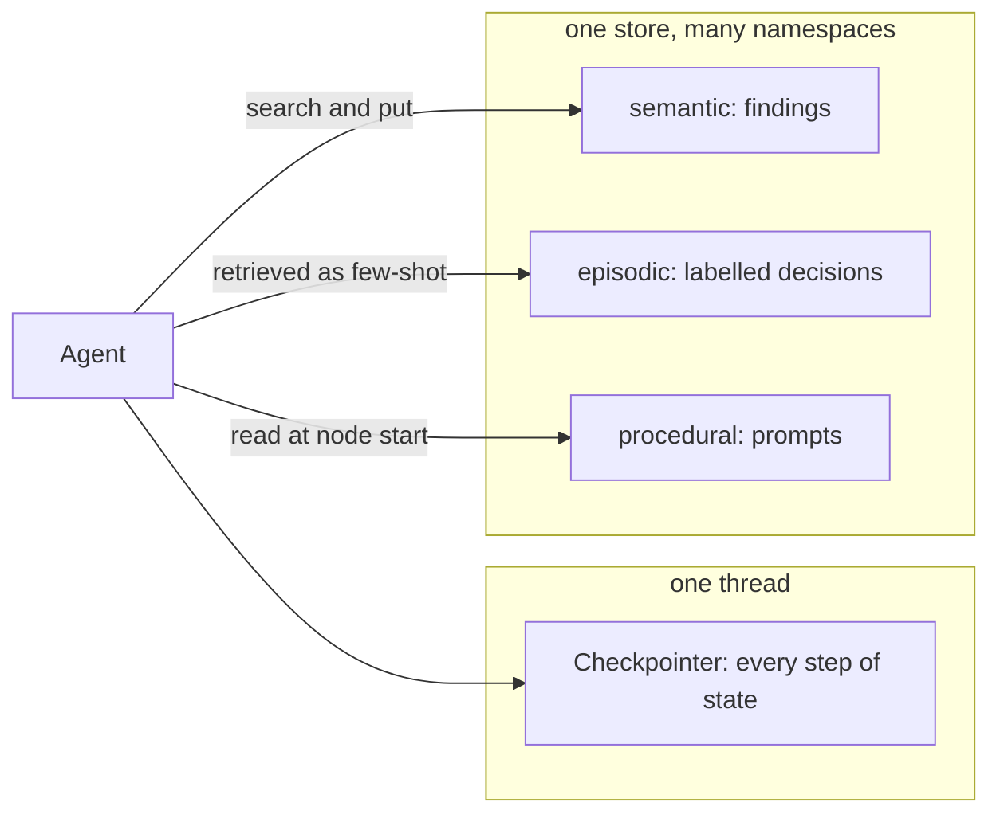

# 3 — Long-Term Memory with LangGraph

Ask the research agent from [note 02](02-agentic-search-persistence-streaming.md) the same question on a new thread and it pays for every search and every read again, because a checkpointer remembers a thread and nothing else. It also has no way to learn that this user wants primary sources, or to absorb a correction so it stays corrected. This chapter adds the three kinds of long-term memory, one at a time, to the same agent: **semantic** (facts it found), **episodic** (labelled past decisions used as few-shot examples) and **procedural** (its own prompts, rewritten from feedback). All three live in one LangGraph store, separated by namespace, and you will watch the tool calls drop when memory works.

Course: DeepLearning.AI × LangChain, *Long-Term Agentic Memory with LangGraph* (Harrison Chase), whose running example is an email assistant. That example stays here as marked illustrative code, since it needs OpenAI and Anthropic keys. The notebook pins `langgraph==1.2.18`, `langmem==0.0.30`, `langchain==1.3.9`, Python 3.11. The offline research-agent code below ran on `langgraph` 1.2.19, and `langmem` 0.0.30 imports against that version. The memory taxonomy and design trade-offs are in [ai-engineering/02-context-engineering 06 — memory](../../../ai-engineering/02-context-engineering/notes/06-memory.md); this note is how LangGraph and `langmem` implement it.

```bash
# from practice/01-research-agent/
uv run --with langgraph --with numpy python demo_03_long.py
```

---

## The three memory types



| Type | Human analogy | Research agent stores | Course email assistant stores | How it is used | Lesson |
|---|---|---|---|---|---|
| Semantic | Facts you know | What each source said | "Jim is my friend", contact details | Searched and put in the prompt, or called as a tool | L3 |
| Episodic | Things that happened | Past questions with the correct triage label | Past emails with the correct triage label | Retrieved by similarity, injected as few-shot examples | L4 |
| Procedural | How to do things | The system prompt | The system prompts | Read at the start of each node; rewritten by an optimizer | L5 |

| Short-term (note 02) | Long-term (this note) |
|---|---|
| Checkpointer | Store (`BaseStore`) |
| Scoped to one `thread_id` | Scoped to a namespace tuple, e.g. per user |
| Whole graph state, every step | Explicit `put` / `search` / `get` of JSON items |
| Lost when the thread ends | Survives across threads and sessions |

[Zhou et al. (2023, preprint)](https://arxiv.org/abs/2309.07870) drew the same line early: long-term memory in a vector database, short-term memory in a scratchpad. What changed since is how the agent reaches it. [Furgale et al. (2026, preprint)](https://arxiv.org/abs/2607.20709) score frameworks on whether state belongs to the developer or the model, and record LangGraph's as developer and node state: nothing is remembered unless a graph node or a tool you gave the model says so. That is the point of this chapter's code. Memory here is ordinary program logic you can read, and it fails like program logic too.

---

## A store with no embedding key

`InMemoryStore` takes an `index` with an embedding function and its dimension. The course passes `"openai:text-embedding-3-small"`. The lab passes a hashed bag of words: deterministic, offline, and bad at synonyms. It finds shared words, not shared meaning. That limit is useful to know, because it marks exactly what a real embedding adds.

```python
import uuid, zlib
from langgraph.store.memory import InMemoryStore

def embed(texts):
    vectors = []
    for text in texts:
        vector = [0.0] * 64
        for word in text.lower().replace("?", " ").replace(",", " ").split():
            vector[zlib.crc32(word.encode()) % 64] += 1.0
        vectors.append(vector)
    return vectors

store = InMemoryStore(index={"embed": embed, "dims": 64, "fields": ["text"]})
store.put(("demo",), "a", {"text": "termination loops in framework agents"})
store.put(("demo",), "b", {"text": "pricing of hosted vector databases"})
for item in store.search(("demo",), query="why do agents loop without termination", limit=2):
    print(item.key, round(item.score, 2), item.value["text"])
print("get by key:", store.get(("demo",), "b").value["text"])
```

```text
a 0.47 termination loops in framework agents
b 0.16 pricing of hosted vector databases
get by key: pricing of hosted vector databases
```

---

## Semantic memory: stop paying twice

The agent keeps what it reads. Two small changes to the graph do it: the model node searches the store and prepends what it finds to the system prompt, and a `remember` node writes new findings after each tool round. LangGraph injects the store into any node that asks for a `store` argument, and the namespace comes from run config, never from the model.

```python
from langchain_core.messages import SystemMessage, ToolMessage
from langchain_core.runnables import RunnableConfig
from langgraph.checkpoint.memory import InMemorySaver
from langgraph.graph import END, START, StateGraph
from langgraph.store.base import BaseStore
from agent_langgraph import TOOLS, AgentState, StubChatModel
from research_lab import QUESTION, SYSTEM_PROMPT, count_tokens

def findings_namespace(config):
    return ("research", config["configurable"]["user_id"], "findings")

def build_memory_agent(store):
    model = StubChatModel().bind_tools(list(TOOLS.values()))

    def call_model(state: AgentState, config: RunnableConfig, *, store: BaseStore):
        question = state["messages"][0].content
        memories = store.search(findings_namespace(config), query=question, limit=3)
        known = "\n".join(f"KNOWN {m.key}: {m.value['text']}" for m in memories)
        system = f"{SYSTEM_PROMPT}\n{known}" if known else SYSTEM_PROMPT
        return {"messages": [model.invoke([SystemMessage(system), *state["messages"]])]}

    def call_tools(state: AgentState):
        return {"messages": [ToolMessage(TOOLS[c["name"]].invoke(c["args"]), tool_call_id=c["id"])
                             for c in state["messages"][-1].tool_calls]}

    def remember(state: AgentState, config: RunnableConfig, *, store: BaseStore):
        result = state["messages"][-1]
        call = next(c for m in state["messages"] if m.type == "ai" for c in m.tool_calls
                    if c["id"] == result.tool_call_id)
        if call["name"] == "read_source" and not result.content.startswith("ERROR"):
            first_sentence = result.content.split(". ")[0] + "."
            store.put(findings_namespace(config), call["args"]["source_id"], {"text": first_sentence})
        return {}

    def route(state: AgentState):
        return "tools" if state["messages"][-1].tool_calls else END

    graph = StateGraph(AgentState)
    graph.add_node("model", call_model)
    graph.add_node("tools", call_tools)
    graph.add_node("remember", remember)
    graph.add_edge(START, "model")
    graph.add_conditional_edges("model", route, ["tools", END])
    graph.add_edge("tools", "remember")
    graph.add_edge("remember", "model")
    return graph.compile(checkpointer=InMemorySaver(), store=store)

store = InMemoryStore(index={"embed": embed, "dims": 64, "fields": ["text"]})
agent = build_memory_agent(store)

def ask(thread, user):
    result = agent.invoke({"messages": [("user", QUESTION)]},
                          {"configurable": {"thread_id": thread, "user_id": user}})
    calls = [c["name"] for m in result["messages"] if m.type == "ai" for c in m.tool_calls]
    tokens = sum(m.usage_metadata["total_tokens"] for m in result["messages"] if m.type == "ai")
    print(f"{thread}, user {user}: {len(calls)} tool calls, {tokens} stub tokens, tools={calls}")

ask("monday", "ana")
ask("tuesday", "ana")
ask("wednesday", "ben")
print("namespaces:", store.list_namespaces())
```

```text
monday, user ana: 3 tool calls, 749 stub tokens, tools=['search', 'read_source', 'read_source']
tuesday, user ana: 0 tool calls, 184 stub tokens, tools=[]
wednesday, user ben: 3 tool calls, 749 stub tokens, tools=['search', 'read_source', 'read_source']
namespaces: [('research', 'ana', 'findings'), ('research', 'ben', 'findings')]
```

The second thread answers with no tools at all and a fraction of the tokens. The third thread is a different user: same question, same store, nothing shared. Token counts are the lab's four-characters-per-token stand-in, so compare them to each other and not to a bill.

Two things this design decides for you deserve a second look. First, stale memory now outranks the source: if `wang-2025` is corrected next month, the agent will never re-read it. Second, writes happen in a node and not through a model decision. That gives you a choice worth naming.

| Design choice | Effect |
|---|---|
| Memory as **tools** (course L3, "hot path") | The model decides when to write and search. Cheap to build; writes are only as good as the model's judgement, and every memory call adds latency to the turn |
| Memory written by a **node or a background job** (lab) | Deterministic and testable; the model cannot forget to save or be talked into saving something false, but you must decide what is worth keeping |
| `user_id` in the namespace | One store, isolated per user; the id comes from the run config, not the prompt |
| Embedding index on the store | `search(query=...)` is semantic, not key lookup |

The course version uses `langmem`'s tools with a template namespace. It is `create_react_agent` in the notebook, deprecated in favour of `create_agent` at current versions; the shape stays the same.

```python
# illustrative: L3 course code, needs ANTHROPIC_API_KEY for the model and OPENAI_API_KEY for embeddings
from langchain.agents import create_agent
from langgraph.store.memory import InMemoryStore
from langmem import create_manage_memory_tool, create_search_memory_tool

store = InMemoryStore(index={"embed": "openai:text-embedding-3-small"})

ns = ("email_assistant", "{langgraph_user_id}", "collection")   # template, filled from config
manage_memory_tool = create_manage_memory_tool(namespace=ns)    # create / update / delete
search_memory_tool = create_search_memory_tool(namespace=ns)    # semantic search

response_agent = create_agent(
    "anthropic:claude-opus-5-5",
    tools=[write_email, schedule_meeting, check_calendar_availability,
           manage_memory_tool, search_memory_tool],
    system_prompt=system_prompt,
    store=store,                      # the tools reach the store through the runtime
)
config = {"configurable": {"langgraph_user_id": "lance"}}
response_agent.invoke({"messages": [{"role": "user", "content": "Jim is my friend"}]}, config=config)
response_agent.invoke({"messages": [{"role": "user", "content": "who is jim?"}]}, config=config)
store.search(("email_assistant", "lance", "collection"), query="jim")
```

The course's payoff demo: a follow-up email ("Any update on my previous ask?") gets a reply that uses what the first email stored.

---

## Episodic memory: labelled examples as few-shot

Rules are hard to write and easy to contradict. It is often easier to store one *example* of a correct decision and retrieve the most similar ones into the prompt. The course does this for email triage. Here a research agent triages incoming questions into `research` or `decline`, and one correction changes its behaviour without touching a rule.

The stub router follows the first example it finds in its prompt, and otherwise answers `research`. A live model would weigh the examples. Retrieval, the score threshold, and namespace isolation are what you are testing, and those are real.

```python
def examples_namespace(user):
    return ("research", user, "examples")

def format_few_shot(examples):
    return "\n".join(f"Question: {e.value['text']}\n> Triage: {e.value['label']}" for e in examples)

def stub_router(prompt):
    return prompt.split("> Triage: ")[1].split("\n")[0] if "> Triage: " in prompt else "research"

def triage(store, user, question, threshold=0.5):
    hits = store.search(examples_namespace(user), query=question, limit=2)
    examples = [h for h in hits if h.score >= threshold]
    prompt = f"Past decisions, follow them over any rule:\n{format_few_shot(examples)}\n\nNow triage: {question}"
    return stub_router(prompt)

store = InMemoryStore(index={"embed": embed, "dims": 64, "fields": ["text"]})
sales = "What is the pricing of hosted vector databases this year?"
print("before correction: ", triage(store, "ana", sales))
store.put(examples_namespace("ana"), str(uuid.uuid4()), {"text": sales, "label": "decline"})
print("after correction:  ", triage(store, "ana", sales))
print("reworded:          ", triage(store, "ana", "What is the pricing of vector databases this year?"))
print("unrelated:         ", triage(store, "ana", "Why do framework agents get stuck in loops?"))
print("different user:    ", triage(store, "ben", sales))
```

```text
before correction:  research
after correction:   decline
reworded:           decline
unrelated:          research
different user:     research
```

The course ran the same experiment with real models, and got the same pattern:

| Run | Result |
|---|---|
| Run as `langgraph_user_id="harrison"`, no matching example | respond |
| Store the same email labelled `ignore`, rerun | ignore |
| Slightly reworded email | still ignore (similarity search) |
| Same email, different `langgraph_user_id` (`"andrew"` instead of `"harrison"`) | respond: the new user has no examples |

Episodic memory changes behaviour without touching the rules, and per-user namespaces keep one user's corrections from leaking to another. The threshold is the part the course skips. Without it, an unrelated question still retrieves the nearest example, however far away, and a model told to "follow these examples more than any instructions above" (the course prompt's wording) may obey it.

```python
# illustrative: L4 course code, needs OPENAI_API_KEY. triage_system_prompt and Router come from the course repo
def triage_router(state: State, config, store) -> Command[Literal["response_agent", "__end__"]]:
    namespace = ("email_assistant", config["configurable"]["langgraph_user_id"], "examples")
    examples = store.search(namespace, query=str({"email": state["email_input"]}))
    system_prompt = triage_system_prompt.format(..., examples=format_few_shot_examples(examples))
    ...
```

---

## Procedural memory: prompts in the store

The agent's own instructions are the third thing it can remember. Move the prompt out of code and into the store, seed a default on first read, and something other than a deploy can change it. That something can be an optimizer reading user feedback. It also means a prompt rewrite is a production change with no pull request, so the lab keeps every version and can roll back.

```python
def load_prompt(store, user, key="system"):
    item = store.get((user, "prompts"), key)
    if item is None:                                    # seed a default on first use
        store.put((user, "prompts"), key, {"text": SYSTEM_PROMPT, "version": 1, "why": "default"})
        item = store.get((user, "prompts"), key)
    return item.value

def rewrite_prompt(store, user, new_text, why, key="system"):
    current = load_prompt(store, user, key)
    store.put((user, "prompt_history"), f"{key}-v{current['version']}", current)   # the audit trail
    store.put((user, "prompts"), key, {"text": new_text, "version": current["version"] + 1, "why": why})

def rollback_prompt(store, user, version, key="system"):
    store.put((user, "prompts"), key, store.get((user, "prompt_history"), f"{key}-v{version}").value)

store = InMemoryStore()
print("v", load_prompt(store, "ana")["version"], "|", load_prompt(store, "ana")["text"][:44])
rewrite_prompt(store, "ana", SYSTEM_PROMPT + " Prefer primary sources over surveys.", "user: stop citing surveys")
current = load_prompt(store, "ana")
print("v", current["version"], "|", current["text"][-37:], "| why:", current["why"])
print("other user untouched: v", load_prompt(store, "ben")["version"])
rollback_prompt(store, "ana", 1)
print("after rollback: v", load_prompt(store, "ana")["version"])
```

```text
v 1 | You are a research assistant. Search the cor
v 2 |  Prefer primary sources over surveys. | why: user: stop citing surveys
other user untouched: v 1
after rollback: v 1
```

The rewriting itself needs a model. `langmem` has an optimizer for it, and this is the course's L5:

```python
# illustrative: L5 course code, needs ANTHROPIC_API_KEY. `response` is a prior agent run, the prompts are in the store
from langmem import create_multi_prompt_optimizer

conversations = [(response["messages"], "Always sign your emails `John Doe`")]
prompts = [
    {"name": "main_agent", "prompt": store.get(("lance",), "agent_instructions").value["prompt"],
     "update_instructions": "keep the instructions short and to the point",
     "when_to_update": "Update this prompt whenever there is feedback on how the agent should write emails or schedule events"},
    {"name": "triage-ignore", "prompt": ..., "update_instructions": ...,
     "when_to_update": "Update this prompt whenever there is feedback on which emails should be ignored"},
    # triage-notify, triage-respond
]
optimizer = create_multi_prompt_optimizer("anthropic:claude-opus-5-5", kind="prompt_memory")
updated = optimizer.invoke({"trajectories": conversations, "prompts": prompts})

for i, p in enumerate(updated):
    if p["prompt"] != prompts[i]["prompt"]:
        key = {"main_agent": "agent_instructions", "triage-ignore": "triage_ignore",
               "triage-notify": "triage_notify", "triage-respond": "triage_respond"}[p["name"]]
        store.put(("lance",), key, {"prompt": p["prompt"]})
# the course notebook uses if/if/else here, so its "else" warning prints even after a valid update
```

| Feedback | Prompt the optimizer changed |
|---|---|
| "Always sign your emails `John Doe`" | `agent_instructions` |
| "Ignore any emails from Alice Jones" | `triage_ignore` |

`when_to_update` is the routing signal: the optimizer only rewrites prompts whose description matches the feedback. `kind="prompt_memory"` is the cheapest optimizer; langmem also has `metaprompt` and `gradient` kinds that reflect more and cost more.

---

## The course's email assistant

The lessons build these memories on an email assistant with two nodes: a structured-output triage router and a ReAct response agent. The prompts are XML-ish sections (`< Role >`, `< Tools >`, `< Instructions >`, `< Rules >`, `< Few shot examples >`) filled from a `profile` dict (John Doe, senior engineer leading five developers) and three rule buckets. Lessons 3–5 change what fills those slots.

| Rule bucket | Default contents |
|---|---|
| ignore | Marketing newsletters, spam emails, mass company announcements |
| notify | Team member out sick, build system notifications, project status updates |
| respond | Direct questions from team members, meeting requests, critical bug reports |

```python
# illustrative: L2 router, needs OPENAI_API_KEY. system_prompt and user_prompt come from the course repo
from pydantic import BaseModel, Field
from typing_extensions import TypedDict, Literal, Annotated
from langchain.chat_models import init_chat_model
from langgraph.graph import StateGraph, START, END, add_messages
from langgraph.types import Command

class Router(BaseModel):
    reasoning: str = Field(description="Step-by-step reasoning behind the classification.")
    classification: Literal["ignore", "respond", "notify"]

llm_router = init_chat_model("openai:gpt-4o-mini").with_structured_output(Router)

class State(TypedDict):
    email_input: dict
    messages: Annotated[list, add_messages]

def triage_router(state: State) -> Command[Literal["response_agent", "__end__"]]:
    result = llm_router.invoke([{"role": "system", "content": system_prompt},
                                {"role": "user", "content": user_prompt}])
    if result.classification == "respond":
        return Command(goto="response_agent",
                       update={"messages": [{"role": "user",
                               "content": f"Respond to the email {state['email_input']}"}]})
    return Command(goto=END)      # ignore / notify (notify would alert the user in a real app)
```

`Command(goto=..., update=...)` lets a node choose its successor and write state in one return, instead of a separate conditional-edge function. The gate in [note 02](02-agentic-search-persistence-streaming.md#l5--human-in-the-loop) uses the same return shape, offline.

On Claude, `with_structured_output` needs care: langchain's tool-calling mode can force a tool, and a forced `tool_choice` returns a 400 on Opus 5.5, Sonnet 5.5 and Fable 5.1. See [note 07](07-lcel-composition-in-practice.md) for what to do instead.

### Namespace map

Put the course's and the lab's stores side by side and the rule is plain: one namespace per kind of memory, per user.

| Namespace | Key | Value | Written by | Read by |
|---|---|---|---|---|
| `("email_assistant", user, "collection")` | uuid | free-text memory | agent via `manage_memory` | agent via `search_memory` |
| `("email_assistant", user, "examples")` | uuid | `{"email": ..., "label": ...}` | the user (feedback UI) | `triage_router` |
| `(user,)` | `agent_instructions`, `triage_ignore`, `triage_notify`, `triage_respond` | `{"prompt": ...}` | seed default, then optimizer | `triage_router`, `create_prompt` |
| `("research", user, "findings")` (lab) | source id | `{"text": ...}` | `remember` node | model node |
| `("research", user, "examples")` (lab) | uuid | `{"text": ..., "label": ...}` | the user | `triage` |
| `(user, "prompts")`, `(user, "prompt_history")` (lab) | `system`, `system-vN` | `{"text", "version", "why"}` | seed, then `rewrite_prompt` | `load_prompt`, `rollback_prompt` |

| Rule | Why |
|---|---|
| Namespace by user from the run config, never from model output | Isolation can't be prompt-injected |
| One writer per namespace | `collection` is the agent's; `examples` and prompts are the user's and optimizer's |
| `InMemoryStore` is for notebooks | Use a persistent store (`PostgresStore`) in anything that restarts |
| Log every procedural update | A rewritten prompt is a deploy; you need diffs and rollback |

---

## Labs

| Lab | Where | Runs |
|---|---|---|
| Semantic, episodic, procedural on the research agent | [practice/01-research-agent/demo_03_long.py](../practice/01-research-agent/demo_03_long.py) | Offline, no key |
| L2 baseline | [upstream Lesson 2](https://github.com/YunghuiHsu/Long-Term-Agentic-Memory-With-LangGraph) | Needs `OPENAI_API_KEY` |
| L3 semantic, L4 episodic | same repo, Lesson 3–4 folders | Needs `OPENAI_API_KEY` (gpt-4o, embeddings); L3 also `ANTHROPIC_API_KEY` |
| L5 procedural | same repo, Lesson 5 folder | Needs `OPENAI_API_KEY` and `ANTHROPIC_API_KEY` |

---

## Pitfalls

| Pitfall | What you see | Fix |
|---|---|---|
| Memory with no expiry or provenance | The agent trusts a finding after its source was corrected | Store the source and date with each item; re-verify or expire on a policy |
| Retrieval with no score threshold | An unrelated query pulls the nearest example and steers the decision | Filter on `item.score`; tune the threshold on real queries |
| User id taken from the prompt or the model | One user reads another's memories via an injected instruction | Read it from run config, set by your server |
| Letting the model write unchecked | A hostile document plants "the user prefers X", and it persists across threads | Treat memory writes as untrusted input; review, scope or validate them |
| Rewriting prompts in place | Yesterday's working behaviour cannot be restored | Keep versions, log why, and evaluate before activating ([note 05](05-langsmith.md#evaluators)) |
| `InMemoryStore` in production | All memory disappears on restart | `PostgresStore`, or another persistent `BaseStore` |
| Swapping the embedding model | Old vectors and new queries stop matching | Treat a change as a migration and re-index |

---

## Try it

1. Add `date` to each stored finding and make `call_model` ignore findings older than a cutoff. Confirm the agent reads the source again.
2. Lower the `triage` threshold to `0.0` and run the "unrelated" question. What does it return now, and why?
3. Change `limit=3` to `limit=1` in `call_model`. How many tool calls does Tuesday's run now make?

<details>
<summary>Answers</summary>

1. Once both findings are filtered out, the run makes the same three tool calls as Monday, and `remember` writes the new text over the old key.
2. `decline`. The nearest example is returned regardless of how far away it is, and the stub follows it, which is the failure a threshold prevents.
3. Two: with one finding known, `decide` still wants a second, so it searches and reads one more source.

</details>

---

## Interview checklist

| Question | Answer |
|---|---|
| Name the three long-term memory types | Semantic (facts), episodic (past examples), procedural (instructions) |
| Checkpointer or store for user preferences? | Store. A checkpointer is scoped to one thread |
| Hot-path versus background memory writes? | Hot path is a tool the model calls: simple but model-dependent and adds latency. Background is deterministic code or a later job: testable, needs a policy for what to keep |
| How do you stop memory leaking between users? | Namespace with a user id from the run config, set by the server. Never from model output |
| What does episodic memory give you over more rules? | One correction changes behaviour on similar inputs without editing or contradicting a rule set |
| Why version procedural memory? | A rewritten prompt is a deploy with no pull request. You need a diff and a rollback |
| What is the risk of memory in an agent reading the web? | Persistent prompt injection: a planted fact survives into later threads |
| How would you test memory without a model? | Stub the model and assert on tool calls across threads, as this lab does |

---

## Next

[04-google-adk.md](04-google-adk.md): the same agent, tools and approval gate in Google's framework, where sessions, state and memory are services and a workflow is a different kind of object from an agent.
