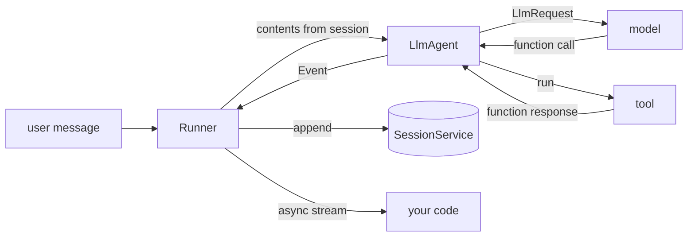

# 4 — Google ADK

Google's Agent Development Kit answers the same question as LangGraph with a different first noun. In LangGraph you draw a graph and an agent is a shape in it. In ADK you declare an agent and a `Runner` drives it, emitting a stream of events into a session. This chapter rebuilds the research agent from [note 01](01-react-from-scratch-to-langgraph.md) on `google-adk`, with the same tools and the same scripted model behind a different adapter, then walks through what ADK does with the things [notes 02](02-agentic-search-persistence-streaming.md) and [03](03-long-term-memory-with-langgraph.md) built by hand: the loop guard, state, approval, memory, and pipelines. It finishes on the part with no LangGraph equivalent, a built-in evaluator.

Everything below ran on `google-adk` 2.13.0 with `google-genai` 2.34.0, offline. Docs moved from `google.github.io/adk-docs` to [adk.dev](https://adk.dev/), and much of the older tutorial material you will find uses shells that are now deprecated. Those are marked below. From [practice/01-research-agent/](../practice/01-research-agent/README.md):

```bash
uv run --with 'google-adk[eval]' python demo_04_google.py
```

---

## The same agent on a new runtime

ADK lets you plug in a model by subclassing `BaseLlm`. The lab's `StubLlm` turns ADK's `LlmRequest` into the same `decide()` call the LangGraph stub makes, so any difference you see below comes from the framework. Tools are the same plain functions from `research_lab.py`: ADK reads the signature and docstring to build the schema, and there is no decorator to add.

```python
import asyncio
from google.adk.agents import LlmAgent
from agent_adk import StubLlm, ask, show
from research_lab import QUESTION, SYSTEM_PROMPT, publish_report, read_source, search

agent = LlmAgent(name="research_agent", model=StubLlm(), instruction=SYSTEM_PROMPT,
                 tools=[search, read_source, publish_report])

events = asyncio.run(ask(agent, QUESTION))
show(events)
```

```text
model  -> search({'query': 'Why do framework agents get stuck in loops, and what stops them?'})
tool   <- furgale-2026 | NOOA: agents as Python objects, validated termination ; w
model  -> read_source({'source_id': 'furgale-2026'})
tool   <- Requiring a validated typed result before an agent may stop prevents u
model  -> read_source({'source_id': 'wang-2025'})
tool   <- Logic control caused more than a third of the agent failures studied,
model  => Requiring a validated typed result before an agent may stop prevents unsupported declarations of completion [furgale-2026]. Logic control caused more than a third of the agent failures studied, with task termination alone at 21.63 percent of them [wang-2025].
```

That is the same trajectory and the same answer as the LangGraph run in note 01, and that is the point of a stub. The loop is now hidden inside the runner, which is what the next table captures.



| Primitive | What it is | LangGraph counterpart |
|---|---|---|
| `LlmAgent` (alias `Agent`) | Model, instruction, tools, optional sub-agents | The `model` and `tools` nodes plus the edge between them |
| `FunctionTool` | A Python function wrapped as a tool; a bare function is wrapped for you | `@tool` |
| `Runner` | Executes an agent or workflow, yields events, appends them to the session | `graph.invoke` / `stream` |
| `SessionService` | Stores a conversation's events and state | Checkpointer |
| `Event` | One thing that happened (a model reply, a tool result) with its author and token usage | One entry from `stream_mode="updates"` |
| `session.state` | Mutable dict shared across turns | State keys with reducers |
| `MemoryService` | Search across past sessions | `BaseStore` |
| `Workflow` | A graph of nodes with `edges`, replacing the older pipeline shells | `StateGraph` |

### What ADK does differently

| Dimension | Google ADK | LangGraph |
|---|---|---|
| **Core unit** | `Agent` (stateful, has identity) | `Node` (function on shared state) |
| **Composition** | Recursive tree: `Agent(sub_agents=[...])`, or a `Workflow` | Directed graph, cycles allowed: `graph.add_edge(A, B)` |
| **Control flow** | Agent decides (LLM chooses tool/sub-agent); `Workflow` for code-chosen paths | Explicit: conditional edges + routing functions |
| **State** | Mutable dict via `ToolContext`, changes recorded on events | `TypedDict` passed through; nodes return diffs |
| **Execution** | `runner.run_async()` → async event generator | `graph.invoke(state)` → final state dict |
| **Observability** | Plugins and lifecycle callbacks: `before/after_model`, `before/after_tool` | Callbacks in `config={"callbacks": [...]}` |
| **Default model** | Gemini (configured via `model=` param) | None: any chat model you pass |

The sharpest independent summary is in [Furgale et al. (2026, preprint)](https://arxiv.org/abs/2607.20709), which scored 14 frameworks from docs and source at pinned snapshots (`google-adk` 2.3.0 there). They credit ADK with typed input and output at agent boundaries through `output_schema` and `input_schema`, named artifacts as durable handles, and a model-side vocabulary for control through `transfer_to_agent` and `exit_loop`, alongside a developer-side workflow language. The same authors built a competing system and score it highest, so take the ranking lightly and the facts about each framework as a useful map.

### Events are the transcript

Everything that happens becomes an event, and the session keeps them. That makes the run easy to audit, and token usage comes attached to each event instead of through a callback:

```python
for event in events:
    kinds = [("call " + p.function_call.name) if p.function_call else ("result " + p.function_response.name)
             if p.function_response else "text" for p in event.content.parts]
    print(f"{event.author:<15} {kinds}", event.usage_metadata.total_token_count if event.usage_metadata else "")
```

```text
research_agent  ['text', 'call search'] 93
research_agent  ['result search']
research_agent  ['text', 'call read_source'] 273
research_agent  ['result read_source']
research_agent  ['text', 'call read_source'] 450
research_agent  ['result read_source']
research_agent  ['text'] 677
```

---

## The loop guard

`RunConfig(max_llm_calls=...)` is ADK's `recursion_limit`. It counts model calls, which is easier to reason about than graph steps, and it is an error rather than a quiet stop. Here is the stubborn model again:

```python
from google.adk.agents.run_config import RunConfig

stubborn = LlmAgent(name="stubborn", model=StubLlm(behavior="stubborn"), instruction=SYSTEM_PROMPT, tools=[search])
try:
    asyncio.run(ask(stubborn, QUESTION, run_config=RunConfig(max_llm_calls=5)))
except Exception as error:
    print(type(error).__name__, "->", error)
```

```text
LlmCallsLimitExceededError -> Max number of llm calls limit of `5` exceeded
```

---

## State: three scopes and a template

A tool that declares a `tool_context` parameter gets access to session state. ADK hides that parameter from the model's schema, so it cannot be spoofed by a tool argument. State keys use prefixes for scope, and an agent's instruction can interpolate state with `{key}`, which is how pipelines pass data without touching the transcript. `output_key` saves the agent's final text to state.

```python
from google.adk.sessions import InMemorySessionService
from google.adk.tools import ToolContext
import research_lab

def read_source(source_id: str, tool_context: ToolContext) -> str:
    """Return the full text of one source and record that it was read.

    Args:
        source_id: An id returned by search.
    """
    tool_context.state["sources_read"] = tool_context.state.get("sources_read", []) + [source_id]
    tool_context.state["user:reads_ever"] = tool_context.state.get("user:reads_ever", 0) + 1
    tool_context.state["temp:last_id"] = source_id
    return research_lab.read_source(source_id)

agent = LlmAgent(name="research_agent", model=StubLlm(), tools=[search, read_source],
                 instruction=SYSTEM_PROMPT + " Audience: {audience?}", output_key="last_answer")

async def run_twice():
    service = InMemorySessionService()
    await service.create_session(app_name="lab", user_id="u1", session_id="one", state={"audience": "engineers"})
    await ask(agent, QUESTION, service, "one")
    await ask(agent, QUESTION, service, "two")
    for session_id in ("one", "two"):
        state = (await service.get_session(app_name="lab", user_id="u1", session_id=session_id)).state
        print(session_id, {k: (v[:28] if k == "last_answer" else v) for k, v in state.items()})

asyncio.run(run_twice())
```

```text
one {'audience': 'engineers', 'last_answer': 'I need sources before I can ', 'sources_read': ['furgale-2026', 'wang-2025'], 'user:reads_ever': 4}
two {'last_answer': 'I need sources before I can ', 'sources_read': ['furgale-2026', 'wang-2025'], 'user:reads_ever': 4}
```

| Prefix | Lifetime | Example |
|---|---|---|
| none | This session | `sources_read` |
| `user:` | Every session of this user | `user:reads_ever` above, visible in session two |
| `app:` | Every user of this app | A shared feature flag |
| `temp:` | This invocation only, never stored | `temp:last_id` above, absent from both printouts |

The `{audience?}` trailing `?` makes the variable optional. Without it, a missing key raises at run time, which is usually what you want for required context.

---

## Approval: confirmation as a function call

ADK models a pending approval as a function call back to your application. Wrap the tool with `require_confirmation=True`, and on its first call ADK emits a call to `adk_request_confirmation`, and marks its id as long-running. You answer with a function response carrying `confirmed`. As with LangGraph's `interrupt()`, the wait lives in durable session storage and not in a stack frame.

```python
from google.adk.runners import Runner
from google.adk.tools import FunctionTool
from google.genai import types
from research_lab import PUBLISHED

agent = LlmAgent(name="research_agent", model=StubLlm(), instruction=SYSTEM_PROMPT,
                 tools=[search, read_source, FunctionTool(publish_report, require_confirmation=True)])

async def review(confirmed):
    service = InMemorySessionService()
    PUBLISHED.clear()
    events = await ask(agent, QUESTION + " Then publish a report.", service, "review")
    request = next(p.function_call for e in events for p in e.content.parts
                   if p.function_call and p.function_call.name == "adk_request_confirmation")
    print("paused on:", request.name, "| published:", len(PUBLISHED))

    answer = types.Part(function_response=types.FunctionResponse(
        id=request.id, name=request.name, response={"confirmed": confirmed}))
    runner = Runner(app_name="lab", agent=agent, session_service=service)
    async for event in runner.run_async(user_id="u1", session_id="review",
                                        new_message=types.Content(role="user", parts=[answer])):
        pass
    print(f"confirmed={confirmed}: published={len(PUBLISHED)}")

asyncio.run(review(True))
asyncio.run(review(False))
```

```text
paused on: adk_request_confirmation | published: 0
confirmed=True: published=1
paused on: adk_request_confirmation | published: 0
confirmed=False: published=0
```

---

## Guardrails: plugins at the runner

An agent-level callback protects one agent. A guardrail you mean to enforce everywhere belongs on the runner, and in ADK that means a plugin: `Runner(plugins=[...])`. `Runner` has no `callbacks` argument, despite what some older snippets show. Returning a dict from `before_tool_callback` skips the tool and hands that dict to the model as the result.

```python
from google.adk.plugins.base_plugin import BasePlugin

class BlockUnknownSources(BasePlugin):
    def __init__(self):
        super().__init__(name="block_unknown_sources")

    async def before_tool_callback(self, *, tool, tool_args, tool_context):
        if tool.name == "read_source" and tool_args["source_id"] == "wang-2025":
            return {"result": "ERROR: this source is under review"}
        return None

agent = LlmAgent(name="research_agent", model=StubLlm(), instruction=SYSTEM_PROMPT, tools=[search, research_lab.read_source])
show(asyncio.run(ask(agent, QUESTION, plugins=[BlockUnknownSources()])))
```

```text
model  -> search({'query': 'Why do framework agents get stuck in loops, and what stops them?'})
tool   <- furgale-2026 | NOOA: agents as Python objects, validated termination ; w
model  -> read_source({'source_id': 'furgale-2026'})
tool   <- Requiring a validated typed result before an agent may stop prevents u
model  -> read_source({'source_id': 'wang-2025'})
tool   <- ERROR: this source is under review
model  -> read_source({'source_id': 'dibia-2024'})
tool   <- A declarative JSON specification lets teams compose and export multi-a
model  => Requiring a validated typed result before an agent may stop prevents unsupported declarations of completion [furgale-2026]. A declarative JSON specification lets teams compose and export multi-agent workflows [dibia-2024].
```

The stub treats the blocked read as a failed read and moves on to the next hit, which is the behaviour you want from a model given an error it can read. The same hook list gives you `before_model_callback` and `after_model_callback` for redaction or caching, and [note 05](05-langsmith.md) uses it for tracing.

---

## Delegation and pipelines

ADK has two ways to compose, and choosing between them is the same choice as model-chosen versus code-chosen routing in [note 06](06-framework-selection.md).

**Delegation** gives an agent `sub_agents`, and ADK adds a `transfer_to_agent` tool whose target the model chooses. Below, a stub coordinator hands off to the research agent.

```python
from typing import AsyncGenerator
from google.adk.models import BaseLlm, LlmResponse

class AlwaysTransfer(BaseLlm):
    model: str = "router-stub"
    async def generate_content_async(self, llm_request, stream=False) -> AsyncGenerator[LlmResponse, None]:
        call = types.FunctionCall(id="t1", name="transfer_to_agent", args={"agent_name": "research_agent"})
        yield LlmResponse(content=types.Content(role="model", parts=[types.Part(function_call=call)]))

specialist = LlmAgent(name="research_agent", model=StubLlm(), instruction=SYSTEM_PROMPT, tools=[search, research_lab.read_source],
                      description="Answers research questions from the corpus.")
coordinator = LlmAgent(name="coordinator", model=AlwaysTransfer(), instruction="Route to a specialist.", sub_agents=[specialist])
events = asyncio.run(ask(coordinator, QUESTION))
print([e.author for e in events])
```

```text
['coordinator', 'coordinator', 'research_agent', 'research_agent', 'research_agent', 'research_agent', 'research_agent', 'research_agent', 'research_agent']
```

**Workflows** fix the path in code. The current API is `Workflow`, a graph with `edges`. Its nodes can be plain functions that receive the previous node's output as `node_input`, and an LLM agent can be one of them. Run it through `Runner(node=...)`:

```python
from google.adk.workflow import START, Workflow

def find_sources(node_input):
    return search(QUESTION).splitlines()[0].split(" | ")[0]

def read_top(node_input):
    return {"id": node_input, "text": research_lab.read_source(node_input)}

def format_answer(node_input):
    return f"{node_input['text'].split('. ')[0]}. [{node_input['id']}]"

pipeline = Workflow(name="research_pipeline", edges=[(START, find_sources, read_top, format_answer)])

async def run_pipeline():
    service = InMemorySessionService()
    await service.create_session(app_name="lab", user_id="u1", session_id="wf")
    runner = Runner(app_name="lab", node=pipeline, session_service=service)
    message = types.Content(role="user", parts=[types.Part(text=QUESTION)])
    async for event in runner.run_async(user_id="u1", session_id="wf", new_message=message):
        if event.output is not None:
            print(event.author, "->", str(event.output)[:66])

asyncio.run(run_pipeline())
```

```text
research_pipeline -> furgale-2026
research_pipeline -> {'id': 'furgale-2026', 'text': 'Requiring a validated typed result
research_pipeline -> Requiring a validated typed result before an agent may stop preven
```

`SequentialAgent`, `ParallelAgent` and `LoopAgent` still import and run, but their docstrings at 2.13.0 mark them deprecated in favour of `Workflow`, to be removed in a future version, with the caveat that a `Workflow` cannot yet be an `LlmAgent` sub-agent. If you need a pipeline as a delegation target today, that caveat decides it. You will still meet the old form in most tutorials:

```python
# illustrative: deprecated shell form, shown so you recognise it. preprocessor, grader, reporter are LlmAgents needing a model
from google.adk.agents import SequentialAgent

pipeline = SequentialAgent(name="eval_pipeline", sub_agents=[preprocessor, grader, reporter])
```

---

## Memory across sessions

`MemoryService` is ADK's long-term store. You add a finished session to it and search by query, and the prebuilt `load_memory` tool exposes that search to the model. The in-memory implementation matches keywords. Production implementations use a managed retrieval service. This is the same semantic-memory idea as [note 03](03-long-term-memory-with-langgraph.md), offered as a service with a narrower API: there is no procedural memory or namespace of your own design.

```python
from google.adk.memory import InMemoryMemoryService

async def remember_and_search():
    sessions, memory = InMemorySessionService(), InMemoryMemoryService()
    agent = LlmAgent(name="research_agent", model=StubLlm(), instruction=SYSTEM_PROMPT, tools=[search, research_lab.read_source])
    await ask(agent, QUESTION, sessions, "past")
    await memory.add_session_to_memory(await sessions.get_session(app_name="lab", user_id="u1", session_id="past"))
    found = await memory.search_memory(app_name="lab", user_id="u1", query="loops termination")
    other = await memory.search_memory(app_name="lab", user_id="someone-else", query="loops termination")
    print(len(found.memories), "events found for u1;", len(other.memories), "for someone else")

asyncio.run(remember_and_search())
```

```text
2 events found for u1; 0 for someone else
```

---

## Built-in evaluation

This is the feature that most separates ADK from LangGraph, which leaves evaluation to LangSmith or your own harness ([note 05](05-langsmith.md)). `tool_trajectory_avg_score` compares the tools an agent called against the expected list, so it catches a run that reached a good answer by the wrong route. It also needs no judge model, so it runs offline and belongs in CI.

The evaluator imports an agent module exposing `root_agent` ([research_eval/agent.py](../practice/01-research-agent/research_eval/agent.py)) and reads a `*.test.json` case file with a `test_config.json` beside it ([eval/](../practice/01-research-agent/eval/)):

```json
{"criteria": {"tool_trajectory_avg_score": 1.0}}
```

```python
from google.adk.evaluation import AgentEvaluator

asyncio.run(AgentEvaluator.evaluate("research_eval", "eval/loops.test.json", num_runs=1, print_detailed_results=False))
print("trajectory matched")

import json, shutil, tempfile, os
case = json.load(open("eval/loops.test.json"))
case["eval_cases"][0]["conversation"][0]["intermediate_data"]["tool_uses"].pop()
folder = tempfile.mkdtemp()
shutil.copy("eval/test_config.json", folder)
json.dump(case, open(os.path.join(folder, "wrong.test.json"), "w"))
try:
    asyncio.run(AgentEvaluator.evaluate("research_eval", os.path.join(folder, "wrong.test.json"), num_runs=1, print_detailed_results=False))
except AssertionError as error:
    print("wrong expectation fails:", str(error).strip().splitlines()[0][:70])
```

```text
trajectory matched
wrong expectation fails: Following are all the test failures. If you looking to get more detail
```

`AgentEvaluator.evaluate` is an async call that takes the module path and a file or folder. It raises `AssertionError` on failure, so it fits directly into a pytest test. `adk test` runs such files under pytest, `adk eval` runs eval sets from the command line, and `adk web` adds a browser UI for building cases from a live session. Those three were checked to exist on the CLI (`adk --help`), and the UI was not exercised here. [Dibia et al. (EMNLP 2024 System Demonstrations)](https://aclanthology.org/2024.emnlp-demo.8/) describe why that kind of tool earns its keep: AutoGen Studio drew over 200K installs in five months, and its authors found the debugging view and profiler central to how people worked. They also say plainly that such a tool is not production-ready, and list offline evaluation as future work, the part ADK ships.

### Metrics at 2.13.0

`PrebuiltMetrics` in this version lists 17 metrics. The common ones:

| Metric | What it measures | Needs |
|---|---|---|
| `tool_trajectory_avg_score` | Tool call sequence vs. expected | Nothing: runs offline |
| `tool_call_count_v1`, `token_usage_v1`, `inference_call_count_v1`, `invocation_duration_v1` | Cost and duration | Nothing beyond the run; not exercised here |
| `response_match_score` | Text overlap with the reference response | Local scoring; needs the `eval` extra |
| `final_response_match_v2` | Semantic match to the golden response | A judge model |
| `hallucinations_v1` | Unsupported claims vs. tool outputs | A judge model |
| `rubric_based_final_response_quality_v1`, `rubric_based_tool_use_quality_v1` | Your own criteria | A judge model |
| `safety_v1` | Harmful content | Vertex AI |
| `multi_turn_task_success_v1`, `multi_turn_trajectory_quality_v1` | Whole-conversation outcomes | Vertex AI |

The criteria file can weight several together:

```json
{
  "criteria": {
    "tool_trajectory_avg_score": 0.8,
    "rubric_based_final_response_quality_v1": {
      "threshold": 0.8,
      "rubrics": [{"rubric_id": "language", "rubric_content": {"text_property": "The response is in the same language as the query."}}]
    }
  }
}
```

That second config was not run, because it needs a judge model. The trajectory check is what to reach for first, for the reason the Wang loop study in [note 06](06-framework-selection.md#what-the-evidence-says) makes clear: a looping agent shows up in the trajectory long before it shows up in a score on its final answer. The earlier version of this note also listed Vertex pointwise, pairwise and AutoSxS managed evaluation as reachable through ADK. I could not confirm that from the 2.13.0 package beyond its Vertex facade for the metrics above, so check [adk.dev](https://adk.dev/evaluate/) before relying on it.

---

## Running it on a real model

Swapping the stub for a live model changes one argument. ADK passes a bare string to its model registry: a Gemini name goes to the Gemini API, and `AnthropicLlm` calls the Claude API directly. `max_tokens` and `system_instruction` are handled by the wrapper. Leave `temperature` unset, since current Claude models do not accept it, and do not set a forced tool choice.

```python
# illustrative: needs GOOGLE_API_KEY for the first agent and ANTHROPIC_API_KEY for the second
from google.adk.agents import LlmAgent
from google.adk.models.anthropic_llm import AnthropicLlm
from research_lab import SYSTEM_PROMPT, search, read_source

on_gemini = LlmAgent(name="research_agent", model="gemini-3.5-flash", instruction=SYSTEM_PROMPT, tools=[search, read_source])
on_claude = LlmAgent(name="research_agent", model=AnthropicLlm(model="claude-opus-5-5"), instruction=SYSTEM_PROMPT, tools=[search, read_source])
```

The ADK wrapper uses the plain Messages API, so the refusal fallback beta from [note 01](01-react-from-scratch-to-langgraph.md#the-same-loop-on-the-claude-api) is not turned on here.

---

## Labs

| Lab | Where | Runs |
|---|---|---|
| Research agent on ADK | [practice/01-research-agent/agent_adk.py](../practice/01-research-agent/agent_adk.py), `demo_04_google.py` | Offline, no key |
| Trajectory eval | [practice/01-research-agent/eval/](../practice/01-research-agent/eval/), [research_eval/](../practice/01-research-agent/research_eval/) | Offline, needs `google-adk[eval]` |
| Docs quickstart | [adk.dev](https://adk.dev/) | Needs a Gemini key |
| DataCamp *Build Agents with ADK* | [course page](https://www.datacamp.com/courses/google-build-agents-with-agent-development-kit-adk) | DataCamp subscription |

---

## Pitfalls

| Pitfall | What you see | Fix |
|---|---|---|
| Following a tutorial that uses `LoopAgent` | It runs, with a deprecation warning, and will break later | Use `Workflow` unless you need the pipeline as a sub-agent |
| `Runner(callbacks=[...])` from old snippets | `TypeError` | `Runner(plugins=[...])`, or callbacks on the `LlmAgent` |
| `AgentEvaluator(agent=..., eval_config=...)` from old snippets | It is a static helper, not an object you construct | `await AgentEvaluator.evaluate(module, path)` |
| Missing the eval extra | Import errors on the evaluator | Install `google-adk[eval]` |
| Forgetting `?` in `{key?}` | A missing optional key raises during the run | Use `?` for optional, keep it off for required keys |
| Writing `temp:` state and expecting it next turn | The key is gone | Use a plain key for the session, or `user:` across sessions |
| Treating `require_confirmation` as a UI | Nothing happens until your code answers the function call | Build the resume path and test both answers, as above |
| Assuming `InMemoryMemoryService` is semantic | A synonym finds nothing | It matches keywords. Use a retrieval-backed service in production |

---

## Try it

1. Add a second `output_key` agent to a `Workflow` by making one node an `LlmAgent`. What does the next node receive as `node_input`?
2. Change `tool_trajectory_avg_score` in `eval/test_config.json` to `0.5` and rerun the wrong expectation. Does it pass?
3. Add `after_tool_callback` to the plugin above so it records each tool's elapsed time. Where would you store that value so it survives the invocation but not the session?

<details>
<summary>Answers</summary>

1. It receives the previous node's output, for an agent its final response. Print `node_input` to see the exact shape at your version. That habit is the point here, since this API is new.
2. Run it and read the score. The evaluator compares this run's score to your threshold, so you need the number from the detailed results (`print_detailed_results=True`) before you can pick a threshold on purpose.
3. On the plugin instance or in `temp:` state for the invocation only. If you need it after the run, put it in the trace ([note 05](05-langsmith.md)) and not in session state, because session state is for the agent.

</details>

---

## Interview checklist

| Question | Answer |
|---|---|
| What is the main structural difference between ADK and LangGraph? | ADK's unit is an agent driven by a runner that emits events. LangGraph's is a node in a graph you draw |
| What replaced `SequentialAgent` and `LoopAgent`? | `Workflow`, a graph with `edges`. The old shells are deprecated at 2.13.0. `Workflow` cannot yet be an `LlmAgent` sub-agent |
| How do you cap an ADK agent's loop? | `RunConfig(max_llm_calls=n)`, which raises `LlmCallsLimitExceededError` |
| What are the state prefixes? | None for the session, `user:` across a user's sessions, `app:` across the app, `temp:` for one invocation |
| How does human approval work? | `FunctionTool(fn, require_confirmation=True)` emits an `adk_request_confirmation` call. You resume by sending a function response with `confirmed` |
| Where do you put a guardrail that must always apply? | In a `BasePlugin` passed to `Runner(plugins=[...])`, which covers every agent and tool the runner drives |
| What does `tool_trajectory_avg_score` catch that response scoring misses? | A good answer reached by a wrong or looping route |
| Can ADK run non-Gemini models? | Yes: `BaseLlm` is a small interface. `AnthropicLlm` calls Claude directly, and `LiteLlm` reaches others |

---

## Next

[05-langsmith.md](05-langsmith.md): trace the LangGraph and the ADK agents in one platform, and turn those traces into a dataset and an experiment. The open-source alternative is [06-observability/01](../../06-observability/notes/01-tracing-with-langfuse.md).
