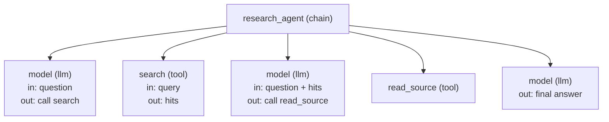

# 5 — LangSmith: tracing the research agent

The stuck run in [note 01](01-react-from-scratch-to-langgraph.md) ended with one line, `GraphRecursionError`, and that line tells you the agent ran out of budget without telling you why. To find out you need the steps, in order, with what went into each and what came out. That record is a trace. This chapter traces the same research agent from notes 01 to 04 with [LangSmith](https://docs.langchain.com/langsmith/observability), LangChain's hosted tracing and evaluation platform, first on LangGraph and then on ADK, reads a failing run, and turns traces into a dataset and an experiment.

LangSmith is a hosted service, so its UI needs an account and a `LANGSMITH_API_KEY`. Its Python SDK does not need either to build runs, and that is what makes the chapter runnable. Everything below ran on `langsmith` 0.14.16 with no key, against a real `langsmith.Client` whose two network calls are replaced by a dictionary. The payloads you see are the ones the SDK would post. Blocks that need the service are marked `# illustrative` and say what they need. From [practice/01-research-agent/](../practice/01-research-agent/README.md):

```bash
uv run --with langgraph --with 'google-adk[eval]' --with langsmith --with wrapt python demo_05_langsmith.py
```

---

## Why an agent needs a trace

A service log records requests and errors. An agent's failure often contains neither: every call returns 200, and the model simply does something unhelpful twelve times. [Wang et al. (preprint, Dec 2025)](https://arxiv.org/abs/2512.01939) classified 8,710 developer discussions from 1,575 GitHub agent projects, and more than a third of the failures were in logic control, with task termination alone at 21.63%. Performance was another 16.03%. Neither shows up as an exception at the point where it goes wrong. You see them only by reading the sequence of steps, which is why tools built for agent developers keep arriving at the same feature. [Dibia et al. (EMNLP 2024 System Demonstrations)](https://aclanthology.org/2024.emnlp-demo.8/) name debugging and sensemaking as one of the four design patterns of AutoGen Studio, and built a profiler that reports messages, tokens and cost, and tool success per run.

A trace is a tree. The root is one invocation of the agent. Each child is one step, and each step can have its own children. Every node, which LangSmith calls a run, has a type (`chain`, `llm`, `tool`), inputs, outputs, an error, and start and end times.



Three questions become easy with that tree in hand. Which step did this wrong answer come from? Where did the time and tokens go? Did this run take the route you expected? The last one is the same check as ADK's `tool_trajectory_avg_score` in [note 04](04-google-adk.md#built-in-evaluation), and it does not need the answer to be wrong to catch a problem.

---

## A decorator that does nothing until you ask

The smallest unit is `@traceable`, which turns a function call into a run. With no environment variables set it is a pass-through, so you can leave it in library code. A context manager turns it on for a block and says where to send the runs, and that is the seam this lab uses.

```python
import asyncio
from langsmith import traceable, tracing_context
from langsmith.utils import tracing_is_enabled
from research_lab import QUESTION, read_source, search
from trace_capture import CaptureClient, print_tree


@traceable(name="find_and_read", run_type="chain")
def find_and_read(query: str) -> str:
    hits = traced_search(query)
    return traced_read(hits.split(" | ")[0])


@traceable(name="search", run_type="tool")
def traced_search(query: str) -> str:
    return search(query)


@traceable(name="read_source", run_type="tool")
def traced_read(source_id: str) -> str:
    return read_source(source_id)


print("tracing on with no env vars:", tracing_is_enabled())
print("still returns:", find_and_read("loops")[:44])

client = CaptureClient()
with tracing_context(enabled=True, client=client, project_name="lab"):
    find_and_read("loops")
print_tree(client)
```

```text
```

[`trace_capture.py`](../practice/01-research-agent/trace_capture.py) is twelve lines: a subclass of the real `Client` that stores what `create_run` and `update_run` receive. Here is one of those payloads. The fields are worth a look, because every feature in the UI reads them.

```python
run = next(r for r in client.captured.values() if r["name"] == "search")
for field in ("name", "run_type", "inputs", "outputs", "session_name", "dotted_order"):
    print(f"{field:13}", str(run.get(field))[:74])
print("parent set:   ", run["parent_run_id"] is not None, "| same trace:", run["trace_id"] != run["id"])
```

```text
```

`dotted_order` is how the tree stays a tree when runs arrive out of order over the network: each run's value is its parent's value plus its own start time and id. `trace_id` is the root's id, so every step in one invocation can be fetched together.

---

## Tracing the LangGraph agent

LangGraph runs on LangChain's callback system, and LangSmith's tracer is a callback. Nothing in the agent changes. With the environment variables set, it attaches itself. Here it is attached by hand, so that it can be pointed at the capture client. The `run_name`, `tags` and `metadata` keys of the config are what you later filter by, so set them on every production call.

```python
from langchain_core.tracers.langchain import LangChainTracer
from agent_langgraph import StubChatModel, build_agent


def trace_graph(agent, question, **config):
    """Invoke the graph with a tracer on a fresh capture client."""
    client = CaptureClient()
    tracer = LangChainTracer(client=client, project_name="lab")
    config = {"callbacks": [tracer], "run_name": "research_agent", "tags": ["lab"],
              "metadata": {"framework": "langgraph", "prompt_version": "v1"}, **config}
    error = None
    try:
        agent.invoke({"messages": [("user", question)]}, config)
    except Exception as exc:
        error = exc
    tracer.wait_for_futures()
    return client, error


graph_client, _ = trace_graph(build_agent(), QUESTION)
print(len(graph_client.captured), "runs")
print_tree(graph_client)
```

```text
```

Seven graph steps became nineteen runs, because the tracer records structure as well as work. Each node is a `chain` run, the routing function is a child of the node it follows, and the chat model and tool sit underneath. The `llm` run holds the prompt and token counts, and you can read the bill for the whole trace straight off it.

```python
def usage(client):
    """Sum what the llm runs report, the number a trace view shows at its root."""
    llm_runs = [r for r in client.captured.values() if r["run_type"] == "llm"]
    tokens = 0
    for run in llm_runs:
        message = run["outputs"]["generations"][0][0]["message"]["kwargs"]
        tokens += message["usage_metadata"]["total_tokens"]
    return len(llm_runs), tokens


calls, tokens = usage(graph_client)
print(f"model calls: {calls}, stub tokens: {tokens}")
root = next(r for r in graph_client.captured.values() if r["name"] == "research_agent")
print("metadata:", {k: v for k, v in root["extra"]["metadata"].items() if k in ("framework", "prompt_version")})
print("tags:", root["tags"])
```

```text
```

---

## Tracing the ADK agent

An earlier version of this note said that ADK has no auto-instrumentation and needs `@traceable` wrapped around each call. That was true once. At `langsmith` 0.14.16 there is an [integration](https://docs.langchain.com/langsmith/trace-with-google-adk), `configure_google_adk`, that patches the ADK runner, agent, model flow and tools. It needs `wrapt`, which is not a dependency of `langsmith` itself. Without it the function logs `Missing dependency` and returns `False`, so check that return value.

```python
from langsmith.integrations.google_adk import configure_google_adk
from agent_adk import ask, build_agent as build_adk_agent

print("patched:", configure_google_adk(name="research_agent", project_name="lab",
                                        metadata={"framework": "google-adk"}, tags=["lab"]))


async def trace_adk():
    client = CaptureClient()
    with tracing_context(enabled=True, client=client, project_name="lab"):
        await ask(build_adk_agent(), QUESTION)
    return client

adk_client = asyncio.run(trace_adk())
print(len(adk_client.captured), "runs")
print_tree(adk_client)
```

```text
```

Set the two trees side by side and the two frameworks' models show through. The question and the tools are the same, and so are the three tool calls.

| | LangGraph | ADK |
|---|---|---|
| How it attaches | Callback, automatic once the env vars are set | `configure_google_adk()`, called once at startup |
| Runs for this question | 19 | 9 |
| Steps it records | Every node and edge function, and the model and tools under them | The session, the agent, each model call and each tool |
| Where a routing bug shows | A `route` run with its output | Only as the next model call, since routing is inside the agent |

LangGraph's tree is bigger because the graph is yours and the trace reports all of it. ADK's is smaller because the loop lives in the framework. Neither is more correct, but the difference matters when you write a filter or an evaluator against trace structure, because such code does not port across frameworks.

### When there is no integration

For your own code, or a framework without an integration, `RunTree` is the layer under all of this. You create the root, create children, and post and patch them yourself. Here it is inside an ADK plugin, the same hook that held the guardrail in [note 04](04-google-adk.md#guardrails-plugins-at-the-runner), and it records only tool calls, which is sometimes all you want.

```python
from google.adk.plugins import BasePlugin
from langsmith.run_trees import RunTree


class ToolTracer(BasePlugin):
    def __init__(self, client):
        super().__init__(name="tool_tracer")
        self.client, self.root, self.open = client, None, {}

    async def before_run_callback(self, *, invocation_context):
        question = invocation_context.user_content.parts[0].text
        self.root = RunTree(name="research_agent", run_type="chain", inputs={"question": question},
                            client=self.client, project_name="lab")
        self.root.post()

    async def before_tool_callback(self, *, tool, tool_args, tool_context):
        run = self.root.create_child(name=tool.name, run_type="tool", inputs=tool_args)
        run.post()
        self.open[tool_context.function_call_id] = run

    async def after_tool_callback(self, *, tool, tool_args, tool_context, result):
        run = self.open.pop(tool_context.function_call_id)
        run.end(outputs={"result": str(result)[:40]})
        run.patch()

    async def after_run_callback(self, *, invocation_context):
        self.root.end(outputs={})
        self.root.patch()


plugin_client = CaptureClient()
asyncio.run(ask(build_adk_agent(), QUESTION, plugins=[ToolTracer(plugin_client)]))
print_tree(plugin_client)
```

```text
```

---

## Reading a failing run

Now the run this chapter opened with. The stubborn model from [note 01](01-react-from-scratch-to-langgraph.md) never stops searching. The tracer records the failure on the root run, so the failure and the steps that led to it are in one place. What you do next is the part worth practising: look at the tool runs, not at the error.

```python
from collections import Counter

stuck_client, error = trace_graph(build_agent(StubChatModel(behavior="stubborn")), QUESTION,
                                  recursion_limit=9)
print("raised:", type(error).__name__)
root = next(r for r in stuck_client.captured.values() if r["name"] == "research_agent")
print("root error:", root["error"].splitlines()[0][:70])

tool_runs = sorted((r for r in stuck_client.captured.values() if r["run_type"] == "tool"),
                   key=lambda r: r["dotted_order"])
for run in tool_runs:
    print(run["name"], "|", run["inputs"]["query"][-22:], "|", run["outputs"]["output"].content[:32]
          if run.get("outputs") else None)
print("tools used:", Counter(r["name"] for r in tool_runs), "| read_source calls:",
      sum(r["name"] == "read_source" for r in tool_runs))
print("model calls, tokens:", usage(stuck_client))
```

```text
```

Each search has a different query string, so a check for identical repeated calls would not have fired. What the trace shows is a pattern: the model keeps searching and never reads. That is the agent-tool layer, which is where Wang et al. place 72% of the recursive-call failures they found. You can write it as a rule over the tree and run it on every trace in production.

```python
def looks_stuck(client, max_same_tool=3):
    """Flag a trace where one tool ran repeatedly with no other tool in between."""
    names = [r["name"] for r in sorted(client.captured.values(), key=lambda r: r["dotted_order"])
             if r["run_type"] == "tool"]
    longest = run_length = 0
    for previous, current in zip([None, *names], names):
        run_length = run_length + 1 if previous == current else 1
        longest = max(longest, run_length)
    return longest > max_same_tool


print("healthy run flagged:", looks_stuck(graph_client))
print("stubborn run flagged:", looks_stuck(stuck_client))
```

```text
```

The trace tells you what happened, not how to prevent it. The loop guard in [note 01](01-react-from-scratch-to-langgraph.md) caps the damage, and the stronger fix is to change what counts as done. [Furgale et al. (preprint, Jul 2026)](https://arxiv.org/abs/2607.20709) require a validated typed result before their agents may stop. They report that 77% of OpenCode's failed GPT-5.5 trials on Terminal-Bench ended within ten steps, the opposite failure from this one: an agent that replies without a tool call and is taken to be finished. Both are logic-control failures, both are invisible in the final message, and both are obvious in a trace.

---

## Datasets

A dataset is a named set of examples, each with `inputs` and, usually, reference `outputs`. It is what turns "this run looked wrong" into "this case can never regress unnoticed".

```python
# illustrative: needs LANGSMITH_API_KEY and a LangSmith workspace.
from langsmith import Client

client = Client()
dataset = client.create_dataset("research-agent-v1", description="Questions with the sources a good answer cites")
client.create_examples(dataset_id=dataset.id, examples=[
    {"inputs": {"question": "Why do framework agents get stuck in loops, and what stops them?"},
     "outputs": {"sources": ["furgale-2026", "wang-2025"]}},
    {"inputs": {"question": "What is the pricing of hosted vector databases?"},
     "outputs": {"sources": []}},
])
```

The fastest way to seed one is from traces you already have: open a run in the UI and choose "Add to dataset". The stubborn run above is exactly the kind of case you want in there. Failures seeded this way reflect what your users really ask, which a list you wrote at your desk will not.

---

## Evaluators

An evaluator is a function that scores one run against one example, and `evaluate()` runs your agent over a dataset with those evaluators. Most of it does not need the service. `upload_results=False` with a list of `Example` objects runs everything locally, and that is how this lab exercises the real function. It prints a beta warning at this version.

```python
import uuid
from datetime import datetime, timezone
from langsmith.evaluation import evaluate
from langsmith.schemas import Example


def run_research(inputs, model=None):
    """The target: question in, the answer and its route out."""
    result = build_agent(model).invoke({"messages": [("user", inputs["question"])]},
                                       {"recursion_limit": 9})
    calls = [c["name"] for m in result["messages"] if m.type == "ai" for c in m.tool_calls]
    return {"answer": result["messages"][-1].content, "tools": calls}


def cites_expected(run, example):
    """Every source the example expects appears as a citation, and nothing else does."""
    cited = set(re.findall(r"\[([\w-]+)\]", run.outputs["answer"]))
    return {"key": "cites_expected", "score": float(cited == set(example.outputs["sources"]))}


def read_before_answering(run, example):
    """Route check: if the answer cites anything, a read_source call must have happened."""
    needs_read = bool(example.outputs["sources"])
    return {"key": "read_before_answering",
            "score": float(not needs_read or "read_source" in run.outputs["tools"])}


def example(question, sources):
    return Example(id=uuid.uuid4(), dataset_id=DATASET_ID, created_at=datetime.now(timezone.utc),
                   inputs={"question": question}, outputs={"sources": sources})


import re
DATASET_ID = uuid.uuid4()
EXAMPLES = [example(QUESTION, ["furgale-2026", "wang-2025"]),
            example("How do no-code tools help people debug multi-agent systems?", ["dibia-2024", "furgale-2026"]),
            example("What do commit histories show about maintaining agent frameworks?", ["liu-2026"]),
            example("What is the pricing of hosted vector databases?", [])]


def experiment(target, prefix):
    rows = list(evaluate(target, data=EXAMPLES, evaluators=[cites_expected, read_before_answering],
                         upload_results=False, client=CaptureClient(), experiment_prefix=prefix,
                         max_concurrency=0))
    scores = {}
    for row in rows:
        question = row["example"].inputs["question"]
        scores[question] = {r.key: r.score for r in row["evaluation_results"]["results"]}
    return scores


baseline = experiment(run_research, "baseline")
for question, score in baseline.items():
    print(f"{question[:44]:46}", score)
```

```text
```

The third example fails on purpose. The agent always wants two sources and cited `wang-2025` as well, so this evaluator treats the extra citation as wrong. Is that a defect in the agent, or an example written too tightly? Only a person can decide, which leads to the two usual kinds of evaluator for this agent.

| Evaluator | Kind | What it catches |
|---|---|---|
| `cites_expected` | Exact match | Wrong or invented citations. The corpus ids are the ground truth |
| `read_before_answering` | Route check | A correct answer reached without reading anything, for example from memory |
| Claim support | LLM judge | A citation attached to a claim the source does not make |
| Answer relevance | LLM judge | A well-cited answer to a different question |

Start with the first two. They are cheap and deterministic, so you can run them on every change. Add a judge only for what they cannot express, and read its reasoning by hand at first, for the reason the next section gives.

### Comparing two experiments

Each `evaluate()` call is an experiment, and the point of an experiment is to compare it with another one on the same data. The second variant here is the stubborn model, standing in for a prompt change that went wrong. It raises at its step limit, and catching that in the target means the failure is scored instead of stopping the whole experiment.

```python
def stubborn_target(inputs):
    try:
        return run_research(inputs, model=StubChatModel(behavior="stubborn"))
    except Exception as exc:
        return {"answer": f"FAILED: {type(exc).__name__}", "tools": []}


variant = experiment(stubborn_target, "stubborn")
for name, scores in (("baseline", baseline), ("stubborn", variant)):
    for key in ("cites_expected", "read_before_answering"):
        print(f"{name:9}{key:24}{sum(s[key] for s in scores.values()) / len(scores):.2f}")
```

```text
```

Note the question with no expected sources: the failed run scores 1.0 on it for both metrics, because saying nothing cites nothing. An average hides that. In the LangSmith UI the Experiments tab lines up runs example by example, which is how you spot it, and against the service the same call needs only the dataset name.

```python
# illustrative: needs LANGSMITH_API_KEY and the dataset created above.
results = evaluate(run_research, data="research-agent-v1",
                   evaluators=[cites_expected, read_before_answering],
                   experiment_prefix="prompt-v2", metadata={"prompt_version": "v2"})
```

### Testing whether a cheaper model is good enough

*Prompt Engineering for Generative AI* (ch. 4) walks through the most common reason to run an eval: checking whether a cheaper model can take over a task. The setup:

1. GPT-4 classifies a set of bank-transaction descriptions into a `transaction_type` and a `transaction_category`. **Those labels are treated as ground truth.**
2. Mixtral 8x7b (`mistral-small` in Mistral's API) runs the same chain, `prompt | model | StrOutputParser() | remove_back_slashes | PydanticOutputParser`. The extra step strips backslashes Mistral put into JSON keys.
3. An exact-match comparison against the GPT-4 labels scores Mistral at **77.5%**. The book doesn't give the number of transactions.
4. GPT-3.5-turbo runs the same chain in JSON mode (`response_format={"type": "json_object"}`), and a GPT-4 pairwise judge (`labeled_pairwise_string`) compares the two smaller models against the reference and explains its choice.

Four things to know before copying this setup:

- **The score measures agreement with GPT-4, not correctness.** Where GPT-4 mislabels a transaction, a small model that gets it right scores as wrong. The book's own warning covers the judge too: "if GPT-4 is bad at a task, it may also be bad at evaluating that task", so read the judge's reasoning by hand. Spot-check a sample of the reference labels before trusting any accuracy against them ([06-eval](../../../ai-engineering/06-eval/README.md)).
- **Parse failures count as wrong answers.** The loop's `except` branch writes a `None` row instead of crashing, and `None` never matches. So the 77.5% mixes misclassifications with output that failed to parse. Track the parse-failure rate as its own metric. A model that classifies well but formats badly needs a different fix (JSON mode, `with_structured_output`) from one that classifies badly.
- **Exact match needs no framework.** The book says so itself: a string comparison is a pandas one-liner. The LLM judges are where a library earns its place. For near-miss answers, the book points to Levenshtein and embedding-distance evaluators.
- **The API is legacy.** `load_evaluator(...)` and `evaluate_string_pairs(...)` come from `langchain.evaluation`. In current code, store the GPT-4 labels as dataset `outputs`, write exact match as a custom evaluator like `cites_expected` above, and run both models through `evaluate()` as two experiments. Use LangSmith's pairwise comparison for the head-to-head.

The book's case for doing this at all still holds. If the small model is good enough, the task gets cheaper and faster, and an open-weights model can run on your own servers so sensitive data never leaves. Its advice is to test against the hosted API first, before self-hosting.


---

## Annotation queues

Evaluators catch what you can write down. For the rest, a person has to look, and a queue decides which traces earn that attention. A sensible feed for this agent is every trace that `looks_stuck` flags, plus a sample of low judge scores. Reviewers label traces in the UI, and those labels become dataset examples.

```python
# illustrative: needs LANGSMITH_API_KEY. run_ids are the ids of traces already uploaded.
queue = client.create_annotation_queue(name="research-agent-review",
                                       description="Traces flagged as stuck or low confidence")
client.add_runs_to_annotation_queue(queue.id, run_ids=[str(run_id) for run_id in flagged_run_ids])
```

The signatures were checked against the 0.14.16 client, and the service was not called. See the [annotation queue docs](https://docs.langchain.com/langsmith/annotation-queues).

---

## Going live

Everything above needs only three environment variables to reach the real service. The `LANGCHAIN_*` names from older tutorials still work: `get_env_var` checks `LANGSMITH_*` first, then `LANGCHAIN_*`. The code does not change. Delete the capture client, and the `@traceable` functions, the LangGraph tracer and `configure_google_adk` all send to the project you named.

```bash
# illustrative: the key comes from a LangSmith workspace.
export LANGSMITH_TRACING=true
export LANGSMITH_API_KEY=<key>
export LANGSMITH_PROJECT=research-agent
```

To trace a real model, swap the stub and keep everything else. Both of these need keys, an Anthropic key and a LangSmith key.

```python
# illustrative: needs ANTHROPIC_API_KEY and LANGSMITH_API_KEY.
from anthropic import Anthropic
from langchain_anthropic import ChatAnthropic
from langsmith.wrappers import wrap_anthropic

agent = build_agent(ChatAnthropic(model="claude-opus-5-5"))  # LangGraph: traced by the callback
agent.invoke({"messages": [("user", QUESTION)]}, {"recursion_limit": 25, "run_name": "research_agent"})

client = wrap_anthropic(Anthropic())  # raw SDK: each messages.create becomes an llm run
reply = client.messages.create(model="claude-opus-5-5", max_tokens=1024,
                               messages=[{"role": "user", "content": QUESTION}])
```

Two decisions come before turning this on in production.

**What leaves your network.** Traces hold prompts, retrieved documents and tool results, so anything sensitive in those goes to the service. `Client` takes `hide_inputs`, `hide_outputs` and `anonymizer` arguments for this. Those parameters were checked in the signature and not exercised here. If the data cannot leave at all, [Langfuse in pillar 06](../../06-observability/notes/01-tracing-with-langfuse.md) is the self-hosted route, with the same tree-of-runs idea.

**How much to keep.** The SDK reads a `LANGSMITH_TRACING_SAMPLING_RATE` setting. Sampling the healthy traffic is reasonable, but a sample that drops the failing run is useless, so keep every trace with an error and every flagged one.

Tracing also adds latency budgets of its own. Wang et al. report that retrieval-augmented agents took 3.2 to 5.6 seconds per query, about 1.8 times direct inference, on an A100 at batch size 1. That is the sort of number a trace lets you break down by step, and it is the reason the SDK batches uploads in a background thread instead of blocking the call.

---

## Pitfalls

| Pitfall | What you see | Fix |
|---|---|---|
| Setting only `LANGSMITH_API_KEY` | No traces, no error | Set `LANGSMITH_TRACING=true` too. `tracing_is_enabled()` tells you the state |
| `configure_google_adk()` without `wrapt` | No ADK traces. It logs `Missing dependency` and returns `False` | Install `wrapt` and check the return value |
| A short script exits before the upload | Traces missing or partial, since uploads are batched in the background | Call `client.flush()` on the client you use, or `wait_for_all_tracers()` for LangChain runs, before exit |
| Reading only the root run | "It errored at the limit", with no idea why | Open the tool runs and look at the sequence |
| A loop check that looks for identical calls | The stubborn run above passes, since every query differs | Check for the pattern, such as the same tool with no read in between |
| Averaging experiment scores | A run that did nothing scores 1.0 on the no-sources case | Compare example by example, and include cases where doing nothing is wrong |
| Writing evaluators against one framework's tree | They break when you port from LangGraph to ADK, as the two trees above show | Have the target return its route, as `run_research` does, and score that |
| Copying `routing_accuracy`-style `run.outputs` keys without checking | `KeyError` in the evaluator | Print `row["run"].outputs` once. Outputs have whatever shape your target returned |
| Sending raw prompts from a regulated workload | Sensitive data in a third-party service | `hide_inputs`, `anonymizer`, or a self-hosted tracer |

---

## Try it

1. Add `date` to the `metadata` in `trace_graph`, then print it from the root run. Which runs in the tree inherit it, and why would that matter for filtering?
2. Tighten `looks_stuck` so that the healthy agent, which reads two sources in a row, would be flagged. What is the smallest `max_same_tool` that does it, and what does that teach about choosing a threshold?
3. Fix the third example so that the baseline scores 1.0 on all four cases, without changing the agent. Then say whether you just fixed a bug or hid one.

<details>
<summary>Answers</summary>

1. The tracer copies config metadata to the run and its descendants, so print `extra["metadata"]` on the `llm` run to confirm. It matters because a filter on a child run, such as all model calls on `prompt_version=v2`, works without walking up to the root.
2. `max_same_tool=1`. The healthy trace has `read_source` twice in a row, and a limit of 1 flags any repetition. A threshold set without looking at healthy traces flags normal work, so measure the healthy distribution first.
3. Change the expected list to `["liu-2026", "wang-2025"]`. Whether that is honest depends on whether `wang-2025` answers the question. Rewriting expected output until it passes is how a dataset stops measuring anything, so make that change only after reading the source.

</details>

---

## Interview checklist

| Question | Answer |
|---|---|
| What is a trace, in one sentence? | A tree of runs for one invocation, each with a type, inputs, outputs, error and timing |
| Why is tracing more important for agents than for ordinary services? | The common failures, such as logic control and termination, raise no exception at the step that goes wrong, so only the sequence of steps shows them |
| How does LangSmith attach to LangGraph? | Through LangChain's callback system. `LANGSMITH_TRACING=true` is enough, with no code change |
| How does it attach to ADK? | `configure_google_adk()` patches the runner, agent, model flow and tools. `RunTree` in a plugin is the manual route |
| How do you test tracing without an account? | Pass a client that stores runs, as `CaptureClient` does, through `tracing_context` or `LangChainTracer`. `evaluate()` also takes `upload_results=False` |
| What is `dotted_order`? | A sort key built from the ancestors' start times and ids. It rebuilds the tree when runs arrive out of order |
| What are the cheap evaluators to start with for a research agent? | Exact match on citations, and a route check on the tools used. Add LLM judges only for what those cannot express |
| Why is agreement with GPT-4 not accuracy? | The labels may be wrong, so a model that is right can score as wrong. Spot-check the reference labels first |
| LangSmith or Langfuse? | LangSmith for the tightest LangChain and LangGraph fit, hosted. Langfuse for open source and self-hosting. See [note 06](06-framework-selection.md) |

---

## Next

[06-framework-selection.md](06-framework-selection.md): put the three builds of this agent side by side, measure what each costs, and weigh that against what the research says about how these frameworks fail. The tracing platform choice is in there too.
