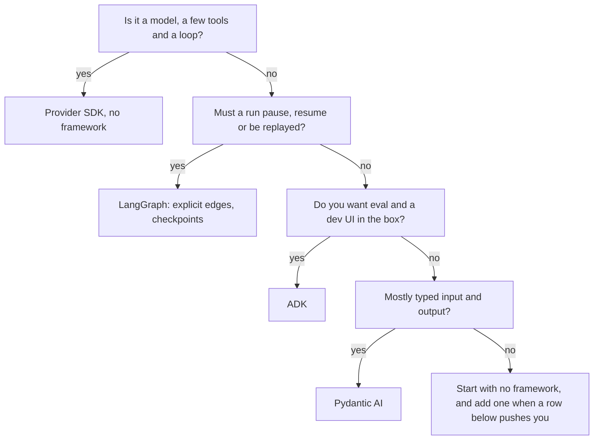

# 6 — Framework Selection

> Pick the framework from the shape of the work, not the brand: how much control flow you must own, where state lives, which model you are tied to, and how you will trace and evaluate it. Start with no framework when you can.

You now have the same research agent three times: a hand-written loop, a LangGraph graph and an ADK agent. They answer the question identically, so nothing in a demo can tell you which to keep. What separates them is what each one costs to run, how each one behaves when the model will not stop, what you can get out of it when you leave, and what happens to it when the framework ships a new version. This note measures the first three on the lab, takes the fourth from two empirical studies, and turns all of it into a decision. Framework details move fast, and the dimensions below move slowly, so check each framework's docs for current APIs.

Everything marked as measured ran offline against the stub model, on `langgraph` 1.2.19 and `google-adk` 2.13.0. From [practice/01-research-agent/](../practice/01-research-agent/README.md):

```bash
uv run --with langgraph --with 'google-adk[eval]' python demo_06_selection.py
```

The decision, in one figure:



---

## First question: do you need one?

Anthropic's *Building Effective Agents* and *12-Factor Agents* make the same point: most production "agents" are a model call, a few tools and a loop you can read. Note 01's L1 agent is 40 lines.

| Signal | Framework earns its keep? |
|---|---|
| One model, a handful of tools, no pause/resume | No: a loop over the provider SDK's tool calling |
| You need checkpointed threads, HITL approval, or replay | Yes: durable execution is hard to hand-roll correctly |
| Several specialised steps with auditable routing | Yes: an explicit graph |
| You need built-in eval and a dev UI for non-engineers | Probably: ADK or a hosted platform |
| You are prototyping the prompt, not the system | No: framework abstractions hide what the model sees |

The cost of a framework is indirection: when a run goes wrong you debug the framework's prompt assembly and state merging as well as your own logic. [ai-engineering/05-graph-engineering 06 — when not to build a graph](../../../ai-engineering/05-graph-engineering/notes/06-when-not-to-build-a-graph.md) covers the same trade from the topology side.

---

## What the three builds cost

Before weighing features, measure the overhead. [`compare.py`](../practice/01-research-agent/compare.py) runs the same scripted agent through each build. The model is a stub, so there is no network and no inference. These numbers isolate what the framework adds, and nothing else.

```python
import compare

compare.main()
```

```text
                  cold s    ms/run   lines
no framework        0.03      0.04      55
langgraph           0.34      1.46      85
google-adk          0.56      4.22      67
```

`cold s` is the median of three fresh interpreters importing the agent and running it once. `ms/run` is the median of 200 runs in one process. `lines` counts non-blank, non-comment lines of the build file on this machine, and it includes each stub. Resolving the dependencies with `uv pip compile` gave 38 packages for `langgraph` and 48 for `google-adk`, against none for the loop.

Read those numbers in proportion. A real model call takes seconds, so an extra 4 ms per run is invisible in a chat agent. The cold start matters only where processes are short-lived, such as a serverless function. The package count matters more than either, because each package is a release you have to absorb, and the study below finds that this is where a lot of developer pain sits. Lines of code barely differ, and the LangGraph file is the longest because it writes its graph out instead of using a prebuilt.

---

## How each build stops when the model won't

The lab's `stubborn` behaviour never stops searching. Termination alone accounts for 21.63% of the failures in the study below, so it is worth comparing what each build does with it out of the box. The code counts model calls with the default settings.

```python
import asyncio
import logging

from langgraph.errors import GraphRecursionError

import agent_adk
import agent_langgraph
import agent_scratch
from research_lab import QUESTION

logging.disable(logging.ERROR)   # ADK logs the limit error with a full traceback before raising it


class CountingChat(agent_langgraph.StubChatModel):
    calls: list = []

    def _generate(self, *args, **kwargs):
        self.calls.append(1)
        return super()._generate(*args, **kwargs)


class CountingLlm(agent_adk.StubLlm):
    calls: list = []

    async def generate_content_async(self, *args, **kwargs):
        self.calls.append(1)
        async for response in super().generate_content_async(*args, **kwargs):
            yield response


scratch_calls = []


def stuck_text_model(messages):
    scratch_calls.append(1)
    return agent_scratch.text_model(messages, behavior="stubborn")


print("no framework returned", agent_scratch.query(QUESTION, model=stuck_text_model, verbose=False),
      "after", len(scratch_calls), "calls")

graph_model = CountingChat(behavior="stubborn")
try:
    agent_langgraph.build_agent(graph_model).invoke({"messages": [("user", QUESTION)]})
except GraphRecursionError as error:
    print("langgraph raised", type(error).__name__, "after", len(graph_model.calls), "calls")

adk_model = CountingLlm(behavior="stubborn")
try:
    asyncio.run(agent_adk.ask(agent_adk.build_agent(adk_model), QUESTION))
except Exception as error:
    print("google-adk raised", type(error).__name__, "after", len(adk_model.calls), "calls")
```

```text
no framework returned None after 6 calls
langgraph raised GraphRecursionError after 5004 calls
google-adk raised LlmCallsLimitExceededError after 500 calls
```

Three builds give three answers, and the defaults are the point. The hand-written loop stops at the `max_turns=6` you gave it and returns `None`, so your caller has to treat that as a failure. LangGraph's default limit at this version allows more than five thousand model calls before it raises. ADK's `RunConfig` allows 500.

To put a price on it, assume each call sends 2,000 input tokens and returns 100 output tokens at Sonnet 5.5's $2 and $10 per million. Each call costs half a cent, so 500 calls cost $2.50 and 5,004 calls cost about $25. That is a floor, because a real transcript grows with every call and the input tokens grow with it. The fix is one line in each framework: set `recursion_limit` or `max_llm_calls` deliberately, on every invocation, and test that it trips ([note 01](01-react-from-scratch-to-langgraph.md), [note 04](04-google-adk.md)).

---

## The dimensions

| Dimension | Question | Why it decides |
|---|---|---|
| Control flow | Who picks the next step: your code or the model? | Explicit edges are auditable; model-chosen handoffs are flexible |
| State | Typed shared state with reducers, a mutable session dict, or just the transcript? | Determines how parallel steps merge and what you can inspect |
| Durability | Checkpoint after every step? Resume after a crash? | Required for HITL and long runs |
| Model coupling | Any provider, or tuned for one? | Lock-in, and which features (caching, thinking) are exposed |
| Memory | Built-in cross-thread store? | Note 03 needs one |
| Observability | Native tracing, or bring your own? | Pillar 06 depends on it |
| Eval | Built-in harness? | ADK ships one; others rely on LangSmith/Langfuse/your own |
| Deployment | Library you host, or a managed runtime? | Ops burden vs vendor dependency |

The control-flow row is an old design choice. [Zhou et al. (2023-12, preprint)](https://arxiv.org/abs/2309.07870) built the AGENTS library around a symbolic graph of states that the author writes (a "standard operating procedure"), with an LLM only choosing transitions, and argued this makes agents "more stable/predictable". Treat that as a design claim: the paper reports **no benchmark, ablation or user study**, only case-study screenshots (customer service, sales, a multi-agent fiction studio). Its framework comparison is a self-scored five-column feature checklist over nine 2023 frameworks, in which AGENTS is the only one ticking all five, with no criteria or versions given. Its main loop, `while not sop.finished`, has no turn limit, so termination (see the stop-condition section above) depends on the SOP.

---

## The frameworks

| | LangGraph | Google ADK | Pydantic AI | OpenAI Agents SDK | Microsoft Agent Framework |
|---|---|---|---|---|---|
| Core unit | Node over typed state | `Agent` with sub-agents | `Agent` with typed deps and output | `Agent` with tools and handoffs | Agents plus workflows |
| Control flow | Explicit edges, conditional edges, `Command` | LLM delegation + `Workflow` graphs (the older `SequentialAgent` and `LoopAgent` shells are deprecated at 2.13.0) | Code calls agents; graph module for multi-step | Handoffs chosen by the model; guardrails | Agent orchestration plus typed graph workflows |
| State | `TypedDict` + reducers, checkpointed | `session.state` dict via `ToolContext` | Dependency injection, typed results | Run context, sessions | Thread and workflow state |
| Durability / HITL | Checkpointers, `interrupt()`, time travel (note 02) | Session services; resumability | Durable execution via integrations | `needs_approval` style HITL, sessions | Checkpointing in workflows |
| Long-term memory | `BaseStore` + langmem (note 03) | Memory service | Bring your own | Sessions; bring your own | Memory providers |
| Model coupling | Any (LangChain chat models) | Gemini-first, others via `AnthropicLlm` and `LiteLlm` | Any; strong typing focus | OpenAI-first, others via adapters | Azure OpenAI-first, others supported |
| Tracing | LangSmith native; Langfuse via callback | Callbacks; Cloud Trace; Langfuse/LangSmith via OTEL | Logfire native (OTEL) | Built-in tracing to OpenAI dashboard; exportable | OpenTelemetry |
| Eval | External (LangSmith, Langfuse) | Built in: `adk eval`, trajectory and response metrics (note 04) | `pydantic-evals` | External | External / Azure AI Foundry |
| Best when | You need explicit, durable, auditable control flow | Gemini/Vertex shop, tree-shaped agents, want eval + dev UI in the box | You want plain typed Python and minimal magic | OpenAI-centric, handoff-shaped multi-agent | .NET or Azure shop; AutoGen/Semantic Kernel migrants |

Rows marked as "bring your own" are where you will write glue. Confidence is medium on everything in this table except the LangGraph and ADK columns, which the notes in this pillar work through in code. For a second opinion, [Furgale et al. (2026, preprint)](https://arxiv.org/abs/2607.20709) scored 14 frameworks and coding harnesses from docs and source at pinned snapshots taken in July 2026. The rubric is the six capabilities of the authors' own NVIDIA system, which is the only system they score strong on all six, so use their paper as a map of each framework's facts and not as a ranking ([note 04](04-google-adk.md)).

---

## Decision table

| If your system… | Use | Note |
|---|---|---|
| Is one model + tools + a loop, no pause | Provider SDK, no framework | [01](01-react-from-scratch-to-langgraph.md) L1 |
| Needs approval gates, resume after crash, or replay | LangGraph | [02](02-agentic-search-persistence-streaming.md) |
| Must remember users across sessions and learn from feedback | LangGraph store + langmem | [03](03-long-term-memory-with-langgraph.md) |
| Runs on Gemini/Vertex and needs a built-in eval harness | ADK | [04](04-google-adk.md) |
| Is mostly typed I/O with a few model calls | Pydantic AI | — |
| Is a set of specialists that hand off to each other, on OpenAI | OpenAI Agents SDK | — |
| Lives in .NET/Azure | Microsoft Agent Framework | — |
| Has steps you can't name ahead of time (open research) | A harness with a good loop, not a graph | [graph-engineering 06](../../../ai-engineering/05-graph-engineering/notes/06-when-not-to-build-a-graph.md) |

---

## What the research says about how frameworks fail

Your own measurements cover one agent over one afternoon. Two studies cover what happens over years and across thousands of projects.

[Wang et al. (preprint, Dec 2025)](https://arxiv.org/abs/2512.01939) analysed 1,575 agent projects on GitHub and 8,710 developer discussions, summarised and classified with GPT-4 and GPT-4o (the paper names both), with 500 of the summaries reviewed by hand and no agreement figure reported. A separate set of 11,910 discussions compares ten frameworks, and LangChain contributes half of it.

| Finding | Number | What it means for your choice |
|---|---|---|
| Failures from internal logic control | More than a third | The framework does not save you from loop design. Termination and routing remain your job |
| Task termination, as a share of all failures | 21.63% | Test the stop condition before anything else |
| API limits, permissions and missing libraries | 25.61% of issues | Tool integration is where the plain-function adapter earns its keep |
| Memory persistence and latency | 16.03% | Check state growth on long threads |
| Version problems (Fig. 6 split: framework upgrades 14.12%, other dependencies 9.41%) | 23.53% | Pin versions. Budget for upgrades |
| Top-quartile projects combining several frameworks | 96% (sample size not given) | Picking one framework forever is not what successful projects do |

Popularity was a poor guide. In the paper's Table 2 LangGraph has 20.6K stars against AutoGen's 51.4K, yet shows up in more of the sampled repositories, 26 against 22. The authors' advice is to weigh ecosystem maturity and maintenance activity above stars. They also find that AutoGen and LangChain, for all their maturity, have the highest maintenance complexity, and they report LangChain's excess abstraction as a source of development difficulty.

Treat the exact percentages loosely. The paper's own text disagrees with itself: its overview gives 25.6% for termination and 14% for tool failures where the findings give 21.63% and 25.61%, and it gives LangGraph 9.6K stars in prose and 20.6K in the table. The classification is also LLM-assisted, and the sample covers only open-source projects. The ordering of the problems is more reliable than any one figure.

[Liu et al. (preprint, Jan 2026)](https://arxiv.org/abs/2601.07136) looked at the frameworks themselves: eight multi-agent systems, more than 42,000 commits and 4,700 closed issues that had a linked pull request (fewer than half of the 10,813 closed issues). Perfective work led at 40.83% of commits, then corrective at 27.36% and adaptive at 24.30%, as labelled by a fine-tuned DistilBERT commit classifier whose accuracy the paper does not report, and with LangChain supplying about a third of the pooled commits. So these projects are spending more on adding and reshaping than on fixing, and your code sits on that moving surface. The issue labels say the same: bugs (22%) and infrastructure (14%) outnumber agent-specific issues (10%), so what breaks is mostly ordinary software. Median issue resolution ran from about a day for LlamaIndex to more than ten days for Semantic Kernel and Haystack, with long right tails. LangChain, AutoGen and CrewAI are in that sample. LangGraph and ADK are not, so check a candidate's issue tracker yourself: this is a ten-minute job and the study shows the differences are large.

[Dibia et al. (EMNLP 2024 System Demonstrations)](https://aclanthology.org/2024.emnlp-demo.8/) suggest one defence. AutoGen Studio treats a workflow as a declarative JSON specification that can be exported and run elsewhere. Any time your agent's definition is data, you can keep it when the runtime changes.

The evidence behind that suggestion is thin, and the paper says so. [arXiv:2408.15247](https://arxiv.org/abs/2408.15247) (Dibia et al., EMNLP 2024 System Demonstrations) reports **over 200K package installs in 5 months and over 135 GitHub issues** as its only quantitative evidence; installs are not active or production users. It runs no user study, benchmark or comparison with other tools, and it states that the tool "is not production ready" (no authentication or security measures). Its own list of issue-driven fixes (a database layer to persist and reuse components, a test button for components and workflows) points the same way as the defence: definitions that can be stored, exported and re-run.

---

## Running two frameworks side by side

The support-agent case study in [06-observability](../../06-observability/README.md) runs the same agent on ADK and LangGraph, and this pillar's lab does the same with the research agent. What makes that workable:

| Practice | Why |
|---|---|
| Keep tools as plain functions, wrap per framework | Tool logic is tested once; only the adapter differs |
| Keep prompts outside the framework (files or a prompt registry) | Prompt changes don't fork per framework |
| One trace schema across both (same metadata keys, same score names) | Experiments compare frameworks, not tracing quirks |
| One eval dataset and one set of graders | The comparison is apples to apples |
| Put the framework name in trace metadata | Filter and diff by framework in the tracing UI |

The trace schema is [06-observability 05](../../06-observability/notes/05-support-agent-observability.md); the wiring per platform is [06-observability 01](../../06-observability/notes/01-tracing-with-langfuse.md) and [05 — LangSmith](05-langsmith.md).

---

## Tracing platform choice

| | Langfuse | LangSmith |
|---|---|---|
| Hosting | Open source, self-host or cloud | Hosted (self-host on enterprise plans) |
| LangGraph integration | `CallbackHandler` | Native: environment variables only |
| Other frameworks | Decorators, OTEL | `@traceable`, OTEL |
| Datasets and experiments | Yes | Yes |
| Prompt management | Yes | Yes (Prompt Hub) |
| MCP server for agents to query traces | Community server ([06-observability 04](../../06-observability/notes/04-langfuse-mcp-server.md)) | — |

Pick the one your team will look at every day. The data model (trace → span → score, dataset → run) is the same in both.

---

## The same agent, three ways

Here is what differs in the lab, with the shared part imported from one file. All three builds call the same `search` and `read_source` functions, and all three are driven by the same `decide()`.

```python
import agent_adk
import agent_langgraph
import agent_scratch
from research_lab import read_source, search

print("scratch uses the shared search:", agent_scratch.KNOWN_ACTIONS["search"] is search)
print("langgraph wraps it:", agent_langgraph.TOOLS["search"].func is search)
print("adk takes it as is:", search in agent_adk.build_agent().tools)

answers = {
    "no framework": agent_scratch.query(QUESTION, verbose=False).removeprefix("Answer: "),
    "langgraph": agent_langgraph.build_agent().invoke({"messages": [("user", QUESTION)]})["messages"][-1].content,
    "google-adk": asyncio.run(agent_adk.ask(agent_adk.build_agent(), QUESTION))[-1].content.parts[0].text,
}
print("all three give the same answer:", len(set(answers.values())) == 1)
print(answers["langgraph"])
```

```text
scratch uses the shared search: True
langgraph wraps it: True
adk takes it as is: True
all three give the same answer: True
Requiring a validated typed result before an agent may stop prevents unsupported declarations of completion [furgale-2026]. Logic control caused more than a third of the agent failures studied, with task termination alone at 21.63 percent of them [wang-2025].
```

| | No framework | LangGraph | ADK |
|---|---|---|---|
| The loop | About 20 lines you wrote | Two nodes and one conditional edge | Inside `Runner` |
| Threads and resume | Yours to build | Checkpointer ([note 02](02-agentic-search-persistence-streaming.md)) | Session service ([note 04](04-google-adk.md)) |
| See the exact prompt sent | Print it | Tracing ([note 05](05-langsmith.md)) | `before_model` callback or tracing |
| Swap the model | Rewrite for the other SDK | Pass another chat model | `AnthropicLlm` or `LiteLlm` |
| A stuck run by default | Stops at your `max_turns`, returns `None` | Raises after 5,004 calls | Raises after 500 calls |

Swapping the stub for a real model is one line in the two framework builds:

```python
# illustrative: needs ANTHROPIC_API_KEY, and the langchain-anthropic and anthropic packages.
from google.adk.models.anthropic_llm import AnthropicLlm
from langchain_anthropic import ChatAnthropic

graph_agent = agent_langgraph.build_agent(ChatAnthropic(model="claude-opus-5-5"))
adk_agent = agent_adk.build_agent(AnthropicLlm(model="claude-opus-5-5"))
```

---

## Lock-in checklist

Before committing, answer these for the candidate framework:

| Question | Bad answer |
|---|---|
| Can I export a run as plain messages + tool calls? | Only via the vendor's UI |
| Where is state persisted, and can I read it without the framework? | Opaque blobs only |
| Can I trace to an OTEL backend I choose? | Only the vendor's |
| Can I unit-test a node/tool without a model call? | Needs a live model |
| How many breaking releases in the last year? | More than you can absorb |

Three of those you can test in minutes, and it is worth doing before you commit. The lab's state comes out as plain data on both frameworks, and that is the export you would need to leave:

```python
def graph_export(result):
    """LangGraph messages to neutral rows."""
    rows = []
    for m in result["messages"]:
        calls = [c["name"] for c in getattr(m, "tool_calls", [])]
        rows.append({"role": m.type, "tools": calls, "text": str(m.content)[:30]})
    return rows


def adk_export(events):
    """ADK events to the same rows. Results arrive as function_response parts."""
    rows = []
    for event in events:
        for part in event.content.parts:
            if part.function_call:
                rows.append({"role": "ai", "tools": [part.function_call.name], "text": ""})
            elif part.function_response:
                rows.append({"role": "tool", "tools": [], "text": str(part.function_response.response)[:30]})
            else:
                rows.append({"role": "ai", "tools": [], "text": part.text[:30]})
    return rows


graph_rows = graph_export(agent_langgraph.build_agent().invoke({"messages": [("user", QUESTION)]}))
adk_rows = adk_export(asyncio.run(agent_adk.ask(agent_adk.build_agent(), QUESTION)))
tool_order = lambda rows: [t for r in rows for t in r["tools"]]
print("langgraph tools:", tool_order(graph_rows))
print("adk tools:      ", tool_order(adk_rows))
print("same route:", tool_order(graph_rows) == tool_order(adk_rows))
```

```text
langgraph tools: ['search', 'read_source', 'read_source']
adk tools:       ['search', 'read_source', 'read_source']
same route: True
```

With that one adapter per framework, the same evaluators score both builds, and that is what makes a comparison honest. It also shows the shape difference a migration has to absorb. LangGraph keeps a flat list of typed messages, and ADK a stream of events whose parts carry calls and results.

---

## Rules of thumb

| Rule | Why |
|---|---|
| Build the loop by hand once before adopting a framework | You learn what the framework hides ([01](01-react-from-scratch-to-langgraph.md)) |
| Choose by control flow and durability, not by demo | Those are the expensive things to change later |
| Keep tools, prompts and eval data framework-neutral | Switching cost drops to the adapter layer |
| Trace from day one, with framework and version in metadata | You can't compare what you didn't record |
| Pin versions; re-check imports against current docs | Every framework here renamed APIs within a year, and version problems (framework upgrades plus other dependencies) are 23.53% of the classified developer discussions in [Wang et al.](https://arxiv.org/abs/2512.01939) |
| Set the loop limit on every invocation | The defaults allow 500 to 5,004 model calls on a stuck run |
| Judge a framework by its maintenance record, not its stars | Stars and adoption diverge in the same study |

---

## Pitfalls

| Pitfall | What it looks like | Fix |
|---|---|---|
| Choosing from a demo | Every framework's happy path looks the same, as the three identical answers above show | Decide on the stuck run, the resume and the export |
| Trusting the default loop limit | A stuck run costs far more than anyone planned, and only a spend alert catches it | Set `recursion_limit` or `max_llm_calls` on each invocation, with a test that trips it |
| Treating a returned `None` as an answer | The hand-rolled loop gives up silently and your UI shows nothing | Raise, or return a typed failure the caller must handle |
| Writing tools against one framework's types | Migrating means rewriting and retesting every tool | Plain functions, with a thin adapter per framework |
| Reading stars as adoption | You pick a popular repo with thin maintenance | Look at releases, issue resolution times and real dependents |
| Comparing with different traces and data | The "faster" framework was only running easier cases | One dataset, one set of graders, one trace schema |
| Unpinned dependencies | An upgrade breaks an agent you did not touch | Pin versions and run the eval set on every upgrade |

---

## Try it

1. Rerun `compare.py` on your machine. Which of the three columns changes the most from the table above, and why?
2. Add `{"recursion_limit": 9}` to the LangGraph invocation, and `RunConfig(max_llm_calls=4)` to the ADK one. How many model calls does each now allow? Predict before you run.
3. Change `query()` in `agent_scratch.py` so a stuck run raises instead of returning `None`. What must its callers now do?
4. Answer the lock-in checklist for a framework you have not used, from its docs alone. Which question took longest to answer?

<details>
<summary>Answers</summary>

1. Usually `cold s` and `ms/run` move with the machine and the package cache, and `lines` does not move at all. The first run after a cache miss is much slower, which is why the script takes medians.
2. LangGraph spends two steps per round, so a limit of 9 allows 5 model calls. This is the same count as note 01's stuck run. ADK's limit counts model calls directly, so 4 means 4, and the fifth attempt raises.
3. Callers must catch the exception or let it propagate. That is the point: a failure now has to be handled somewhere, where `None` could be printed as an empty answer.
4. Expect the state question to be slow, because docs tend to describe the API and not the stored format. A slow answer is itself useful evidence about lock-in.

</details>

---

## Interview checklist

| Question | Answer |
|---|---|
| When do you not need a framework? | One model, a few tools and no pause or resume: a loop over the provider's tool calling is enough |
| What does a framework actually buy you? | Durable execution, HITL, replay, tracing hooks and an eval harness, at the price of indirection and dependencies |
| How do you compare two frameworks fairly? | Same tools, same prompts, same dataset, same graders and one trace schema, with the framework name in the metadata |
| What does a stub model let you measure? | Framework overhead alone: cold start, per-run cost and control behaviour, with no network or inference in the numbers |
| What is the most common failure class in agent frameworks? | Logic control, more than a third of failures in Wang et al., and termination is the biggest part of it |
| What happens by default when a LangGraph or ADK agent never stops? | LangGraph 1.2.19 raises `GraphRecursionError` after 5,004 model calls, and ADK 2.13.0 raises `LlmCallsLimitExceededError` after 500. Set both explicitly |
| Are GitHub stars a good selection signal? | No. Stars and adoption diverge in Wang et al. Check maintenance, issue resolution and real dependents |
| How do you reduce lock-in? | Plain-function tools, prompts in files, neutral eval data, OTEL traces and an export of each run to plain rows |
| LangSmith or Langfuse? | LangSmith for the tightest LangChain fit when hosted is acceptable. Langfuse when you need open source and self-hosting |

---

## Next

[07-lcel-composition-in-practice.md](07-lcel-composition-in-practice.md) drops one layer down, to the chains that sit inside graph nodes: moving data through steps, structured output, and a model-written plan you can validate before you run it.
