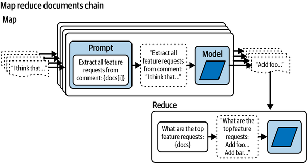

# 7 — LCEL Composition in Practice

> The layer under LangGraph: how data moves through a chain, how to fan a step out, three ways to get structured output, and the point where a chain should become a graph.

Inside the research agent's `model` node there is usually more than one model call. A real report needs the findings pulled out first, then the gaps in them, then a write-up that needs both of those and the original question. Written by hand, that is a pile of dictionaries where one forgotten key fails three steps later. LCEL is the small language LangChain offers for this plumbing, and it stays useful right up to the point where the plan is decided at runtime and a graph takes over. This note builds that report chain, adds fan-out with a cap, gets structured output three ways, validates a plan the model wrote, and runs map-reduce over the lab's corpus.

The code runs offline on `langchain-core` 1.7.3, with a stub model from [`agent_lcel.py`](../practice/01-research-agent/agent_lcel.py) that replies from a function of the prompt. From [practice/01-research-agent/](../practice/01-research-agent/README.md):

```bash
uv run --with langchain-core python demo_07_lcel.py
```

---

## Where this sits

The building blocks are covered in [01-llm-fundamentals note 11](../../01-llm-fundamentals/notes/11-langchain-basics.md): chat models, prompt templates, `with_structured_output`, the Runnable methods, and LCEL vs `@chain`. This note picks up where that one stops, with the plumbing that makes multi-step chains work, drawn from *Prompt Engineering for Generative AI* (ch. 4). Everything in notes 01–03 here is a LangGraph node that could contain one of these chains.

Both books pin 2024-era APIs. Where this note modernises a book example, it says so, and the [version table](#book-apis-and-their-current-form) at the end lists every change.

---

## Moving data through a chain

A chain's steps pass one value along. Once a later prompt needs a key from an earlier step **and** a key from the original input, you need four primitives (*Prompt Engineering for Generative AI*, ch. 4):

| Primitive | Does | Typical use |
|---|---|---|
| `RunnablePassthrough()` | Passes its input through unchanged | Keep the original input alongside a computed value |
| `RunnablePassthrough.assign(k=…)` | Passes the input through and adds key `k` | Accumulate keys step by step (current idiom; the book builds dicts by hand) |
| `itemgetter("k")` | Pulls one key out of a dict input | Feed a prompt variable from the incoming dict |
| `RunnableLambda(f)` / a plain `lambda` | Wraps a function | Reshape a value between steps |
| `RunnableParallel(a=…, b=…)` or a dict | Runs its branches on the same input and returns a dict | Fan one input into several chains |

The book's film-script generator chains characters, then plot, then scenes, and each later prompt needs the genre from the input plus the outputs so far. The research report has the same shape: findings, then gaps, then a report that needs all of them.

```python
from langchain_core.output_parsers import StrOutputParser
from langchain_core.prompts import ChatPromptTemplate
from langchain_core.runnables import RunnablePassthrough

from agent_lcel import RuleModel
from research_lab import CORPUS, QUESTION


def rule(prompt: str) -> str:
    """Stands in for a model. Each step's reply depends only on how its prompt begins."""
    if prompt.startswith("Findings"):
        return "Termination causes 21.63% of failures [wang-2025]."
    if prompt.startswith("Gaps"):
        return "No study measures the cost of a stuck run."
    return "REPORT\n" + prompt


model = RuleModel(rule=rule)
to_text = StrOutputParser()
findings_prompt = ChatPromptTemplate.from_template("Findings for: {question}")
gaps_prompt = ChatPromptTemplate.from_template("Gaps in: {findings}")
report_prompt = ChatPromptTemplate.from_template("Report.\nQ: {question}\nF: {findings}\nG: {gaps}")

pipeline = (
    RunnablePassthrough.assign(findings=findings_prompt | model | to_text)   # {question} + findings
    | RunnablePassthrough.assign(gaps=gaps_prompt | model | to_text)         # ... + gaps
    | RunnablePassthrough.assign(report=report_prompt | model | to_text)     # ... + report
)
result = pipeline.invoke({"question": QUESTION})
print(list(result))
print(result["report"])
```

```text
['question', 'findings', 'gaps', 'report']
REPORT
Report.
Q: Why do framework agents get stuck in loops, and what stops them?
F: Termination causes 21.63% of failures [wang-2025].
G: No study measures the cost of a stuck run.
```

The book builds the same thing from explicit dicts with `itemgetter` on every key. `.assign` is the same idea with less to get wrong: a template variable can't go missing because someone forgot to carry it forward.

**The first element must be a runnable.** A dict is coerced to `RunnableParallel` when its values are runnables or callables. A dict holding plain values (the book's example is `{"age": 18}`) is not, and neither is a plain string. Order matters too, and getting it wrong can be silent. `model | prompt` composes, and with a one-variable template it runs as well, because the template wraps whatever it receives.

```python
for label, build in [("string first", lambda: "some text" | model),
                     ("plain dict first", lambda: {"age": 18} | model)]:
    try:
        build()
        print(label, "composed")
    except TypeError as error:
        print(label, "-> TypeError")

backwards = model | findings_prompt     # composes and runs, and no model sees this prompt
print("model | prompt returns a", type(backwards.invoke("Findings for: anything")).__name__)
```

```text
string first -> TypeError
plain dict first -> TypeError
model | prompt returns a ChatPromptValue
```

### Sequential when a step needs the one before

The book generates nine scenes. It could write every scene's script in parallel, but chooses not to: each scene's prompt gets a **summary of the previous scene**, a one-item buffer memory, so characters don't repeat themselves. That is the real trade-off in chain design. Parallel is faster. Sequential lets a step see what came before. The book's rule of thumb is that long sequential chains suit server-side jobs, where nobody is watching a spinner.

The book also points out that a chain lets you **mix models per step**: a strong model for ideation, a cheap one for bulk generation. It is the same per-node agency decision as in [graph note 02](../../../ai-engineering/05-graph-engineering/notes/02-graph-primitives.md#spend-agency-per-node).

### Fan out with a concurrency cap

`.batch()` runs inputs in parallel threads. Cap it, or a large batch becomes a rate-limit incident. The stub below records how many calls are in flight at once:

```python
import threading
import time

in_flight, peak, lock = 0, 0, threading.Lock()


def slow_rule(prompt: str) -> str:
    """Sleeps like a network call and tracks the most calls running at once."""
    global in_flight, peak
    with lock:
        in_flight += 1
        peak = max(peak, in_flight)
    time.sleep(0.02)
    with lock:
        in_flight -= 1
    return prompt.split("about ")[-1]


slow_chain = ChatPromptTemplate.from_template("Summarise: about {source}") | RuleModel(rule=slow_rule) | to_text
inputs = [{"source": source_id} for source_id in CORPUS]
for cap in (1, 2, 6):
    peak = 0
    start = time.perf_counter()
    answers = slow_chain.batch(inputs, config={"max_concurrency": cap})
    print(f"cap {cap}: peak {peak}, {time.perf_counter() - start:.2f}s, in input order: {answers == list(CORPUS)}")
```

```text
cap 1: peak 1, 0.15s, in input order: True
cap 2: peak 2, 0.07s, in input order: True
cap 6: peak 6, 0.03s, in input order: True
```

The book passes `RunnableConfig(max_concurrency=5)`, which is the same dictionary. `abatch` is the async form. Results come back in input order.

---

## Three ways to get structured output

| Route | How | Use when | Fails by |
|---|---|---|---|
| **Output parser** | `parser.get_format_instructions()` into the prompt, `parser.parse()` on the text | The provider has no tool calling or JSON mode | The model ignores the instructions; you need a retry or fixing parser ([01 note 11](../../01-llm-fundamentals/notes/11-langchain-basics.md#building-block-3-structured-output-and-parsers)) |
| **Tool calling** | `bind_tools([Schema])` then `PydanticToolsParser(tools=[Schema])` | You want several objects from one call (parallel calls), or a choice between schemas | The model calls no tool, or invents arguments |
| **`with_structured_output`** | `model.with_structured_output(Schema)` | One object of one known shape: the default | Validation errors on weak models; check with `include_raw=True` |

Two things the book adds about tool calling (*Prompt Engineering for Generative AI*, ch. 4):

- **`tool_choice`** controls whether the model must call a tool. `auto` (default) lets it decide, `none` forbids calls, and naming a function forces that one. Force the call when the step's only job is extraction; an `auto` model can answer in prose and skip it. Check your provider first: on Claude Opus 5.5 a forced tool choice returns a 400, so use `auto` with a clear instruction, or structured outputs ([claude-api docs](https://platform.claude.com/docs/en/api/overview)).
- **Models hallucinate function parameters.** The book's fix is to be more explicit in the system message. The stronger fix is to validate arguments in code before acting on them, and to return validation errors to the model as an observation ([01](01-react-from-scratch-to-langgraph.md)).

Parallel tool calls are how one call extracts a list. The book's `create_extraction_chain_pydantic` returns two `Person` objects from one sentence. That helper is legacy; current code is `bind_tools([Person])` plus `PydanticToolsParser`, or `with_structured_output` over a wrapper model with `people: list[Person]`.

Here are all three routes on one finding. The stub replies with JSON, which is what a model following the instruction or calling the tool would produce.

```python
import json

from langchain_core.output_parsers import PydanticOutputParser, PydanticToolsParser
from pydantic import BaseModel, Field, ValidationError


class Finding(BaseModel):
    source_id: str
    claim: str
    percent: float | None = Field(default=None, description="The number the claim rests on, if any")


reply = json.dumps({"source_id": "wang-2025", "claim": "Termination causes failures", "percent": 21.63})
stub = RuleModel(rule=lambda prompt: reply)

parser = PydanticOutputParser(pydantic_object=Finding)
print("parser:", (stub | parser).invoke("Extract one finding.").percent)
print("instructions it adds:", parser.get_format_instructions()[:48] + "...")

tools = stub.bind_tools([Finding]) | PydanticToolsParser(tools=[Finding])
print("tools: ", tools.invoke("Extract one finding.")[0].percent)

print("schema:", stub.with_structured_output(Finding).invoke("Extract one finding.").percent)

bad = RuleModel(rule=lambda prompt: json.dumps({"source_id": "wang-2025", "percent": "about a fifth"}))
try:
    bad.with_structured_output(Finding).invoke("Extract one finding.")
except ValidationError as error:
    print("validation:", error.error_count(), "errors:", [e["loc"][0] for e in error.errors()])
```

```text
parser: 21.63
instructions it adds: The output should be formatted as a JSON instanc...
tools:  21.63
schema: 21.63
validation: 2 errors: ['claim', 'percent']
```

The last block is the hallucination case. The model invented a value of the wrong type and left out a required field, and the schema caught both before anything acted on them. That error text is what you feed back to the model as an observation.

---

## Query planning: a plan is a DAG

When one user request holds several intents that depend on each other, ask the model for a **plan with dependencies** first, then execute it (*Prompt Engineering for Generative AI*, ch. 4). The book's schema, modernised from `pydantic.v1` and `PydanticOutputParser`:

```python
from graphlib import TopologicalSorter, CycleError


class Query(BaseModel):
    id: int
    question: str
    dependencies: list[int] = Field(default_factory=list,
                                    description="ids of queries whose answers this one needs")


class QueryPlan(BaseModel):
    query_graph: list[Query]


plan_reply = json.dumps({"query_graph": [
    {"id": 1, "question": "How often do agents fail to terminate?"},
    {"id": 2, "question": "What validates completion?"},
    {"id": 3, "question": "Does validation address the failure rate?", "dependencies": [1, 2]},
]})
user_request = "Why do agents get stuck, and would validated termination fix it?"
planner = RuleModel(rule=lambda prompt: plan_reply).with_structured_output(QueryPlan)
plan = planner.invoke(user_request)
print([(q.id, q.dependencies) for q in plan.query_graph])
```

```text
[(1, []), (2, []), (3, [1, 2])]
```

The book stops at the parsed plan. Executing it is where things break, because the model can reference an id that doesn't exist or create a cycle. Validate the plan, then run it in waves:

```python
def run_plan(plan: QueryPlan, answer_one) -> dict[int, str]:
    by_id = {q.id: q for q in plan.query_graph}
    missing = {d for q in plan.query_graph for d in q.dependencies} - by_id.keys()
    if missing:
        raise ValueError(f"plan references unknown ids {missing}")
    ts = TopologicalSorter({q.id: q.dependencies for q in plan.query_graph})
    ts.prepare()                                   # raises CycleError on a cyclic plan
    answers: dict[int, str] = {}
    while ts.is_active():
        ready = ts.get_ready()                     # every query whose dependencies are answered
        for qid in ready:                          # independent: could be one .batch() call
            q = by_id[qid]
            answers[qid] = answer_one(q.question, {d: answers[d] for d in q.dependencies})
        ts.done(*ready)
    return answers


def answer_one(question: str, context: dict[int, str]) -> str:
    return f"[{question[:22]} | using {sorted(context)}]"


for qid, answer in run_plan(plan, answer_one).items():
    print(qid, answer)

for label, graph in [("unknown id", [Query(id=1, question="a", dependencies=[9])]),
                     ("cycle", [Query(id=1, question="a", dependencies=[2]),
                                Query(id=2, question="b", dependencies=[1])])]:
    try:
        run_plan(QueryPlan(query_graph=graph), answer_one)
    except (ValueError, CycleError) as error:
        print(label, "->", type(error).__name__)
```

```text
1 [How often do agents fa | using []]
2 [What validates complet | using []]
3 [Does validation addres | using [1, 2]]
unknown id -> ValueError
cycle -> CycleError
```

This is HuggingGPT's task-planning stage in miniature ([graph note 05](../../../ai-engineering/05-graph-engineering/notes/05-topology-patterns.md#manager-agents-as-tools)). It also marks where LCEL runs out. Once the plan is decided at runtime, you want LangGraph's `Send` for the fan-out, plus a checkpointer if any step is slow ([graph note 03](../../../ai-engineering/05-graph-engineering/notes/03-state-and-reducers.md#dynamic-fan-out-the-send-api)).

---

## Map-reduce over documents

The four document-chain strategies (stuff, refine, map-reduce, map-rerank) are tabulated in [01 note 11](../../01-llm-fundamentals/notes/11-langchain-basics.md#patterns-from-the-books-worth-knowing). Map-reduce is the one worth building yourself, because it is just `batch` followed by `invoke`:


*Image Source: James Phoenix & Mike Taylor, *Prompt Engineering for Generative AI* (O'Reilly, 2024), Fig. 4-7*

```python
def map_reduce_rule(prompt: str) -> str:
    if prompt.startswith("Extract"):
        source_id, text = prompt.removeprefix("Extract one claim from ").split(": ", 1)
        return f"{text.split('. ')[0].rstrip('.')} [{source_id}]"
    claims = prompt.splitlines()[1:]
    return f"{len(claims)} claims. First: {claims[0]}"


stub = RuleModel(rule=map_reduce_rule)
map_chain = ChatPromptTemplate.from_template("Extract one claim from {source_id}: {text}") | stub | to_text
reduce_chain = ChatPromptTemplate.from_template("Combine these claims:\n{claims}") | stub | to_text

partials = map_chain.batch([{"source_id": sid, "text": doc["text"]} for sid, doc in CORPUS.items()],
                           config={"max_concurrency": 5})
print(reduce_chain.invoke({"claims": "\n".join(partials)}))
```

```text
6 claims. First: Logic control caused more than a third of the agent failures studied, with task termination alone at 21.63 percent of them [wang-2025]
```

The book's version is `load_summarize_chain(chain_type="map_reduce")`, which is legacy. Two failure cases from its Table 4-1 carry over:

- **The reduce step can overflow.** If the joined partials don't fit, the legacy chain compresses them recursively, which adds complexity and loses document order. Tag each partial with its source before joining, and collapse in batches.
- **Each map call sees one document.** Anything that spans documents, such as a contradiction between two comments, is invisible to the map step. Use refine, or a final pass over the originals, when that matters.

---

## Few-shot selection and prompt files

`FewShotChatMessagePromptTemplate` and the example selectors are listed in [01 note 11](../../01-llm-fundamentals/notes/11-langchain-basics.md#building-block-2-prompt-templates). What the book adds is the limits (*Prompt Engineering for Generative AI*, ch. 4):

- **Overfitting to the examples.** The model copies the examples' content, not just their format. The book's mitigations are to reword, to tell the model to use the examples only for format, or to fine-tune when few-shot isn't enough.
- **Examples compete with the answer for tokens.** `LengthBasedExampleSelector` drops examples as the user input grows. Give it a token counter (the book uses tiktoken) rather than its default word count, or the budget is wrong for code and non-English text.
- **`load_prompt` doesn't round-trip every template type.** The book's fallback is pickle or plain `.txt` files. Skip pickle: loading a pickle runs arbitrary code. Keep prompts as text, YAML or Jinja files under version control, and build the template in code.

---

## Book APIs and their current form

| Book code | Problem | Current form |
|---|---|---|
| `from langchain_openai.llms import ChatOpenAI` (*Learning LangChain*, ch. 1) | Import error: `ChatOpenAI` lives in `langchain_openai.chat_models` (or top-level `langchain_openai`) | `init_chat_model(...)` or `from langchain_openai import ChatOpenAI` |
| `OpenAI(model="gpt-3.5-turbo")` via `langchain_openai.llms` (*Learning LangChain*, ch. 1) | Completion-endpoint class with a chat-only model | A chat model; the completion `LLM` interface is legacy |
| `from pydantic.v1 import BaseModel` (*PEfGAI*, ch. 4) | Pydantic v1 shim | `from pydantic import BaseModel` (LangChain ≥ 0.3 is Pydantic v2) |
| `PydanticOutputParser` for JSON objects | Works, but relies on the model following prose instructions | `with_structured_output` |
| `create_extraction_chain_pydantic` | Legacy helper | `bind_tools` + `PydanticToolsParser` |
| `load_summarize_chain(chain_type=…)` | Legacy chain | `batch` + `invoke` as above, or a LangGraph map-reduce with `Send` |
| `load_evaluator("labeled_pairwise_string")` | Legacy `langchain.evaluation` | LangSmith `evaluate()` with an LLM-as-judge evaluator ([05](05-langsmith.md#evaluators)) |
| `chat(messages=…)` (calling the model directly) | Deprecated `__call__` | `.invoke(...)` |

---

## Pitfalls

| Pitfall | What it looks like | Fix |
|---|---|---|
| Carrying keys by hand | `KeyError` for a template variable three steps later | `RunnablePassthrough.assign`, so each step adds to the input |
| Prompt and model in the wrong order | `model \| prompt` composes and may even run, returning a prompt where you expected an answer | Test each chain once with a stub model, and check the output type |
| An uncapped `.batch()` | Rate-limit errors on large inputs, with every worker retrying at once | Always pass `max_concurrency` |
| Trusting a parsed object | The JSON parses and the arguments are invented | Validate with a schema, and feed the errors back as an observation |
| Executing a plan unchecked | A cycle hangs the run, or an unknown id raises halfway through paid work | Validate ids and cycles before the first step |
| Assuming a forced `tool_choice` works everywhere | A 400 on models that reject it | Check the provider, and use `auto` or structured outputs |
| Joining partials without their sources | The reduce step can't cite, and overflows on long documents | Tag each partial, and collapse in batches |
| Keeping a chain past its limit | Dynamic fan-out and retries written as nested lambdas | Move to a graph when the steps are decided at runtime or need a checkpoint |

---

## Try it

1. Add a fourth `.assign` step to the report pipeline, `title`, that needs only `report`. What is in the final dictionary?
2. In the concurrency example, predict the elapsed time at cap 3, then run it. How does it scale?
3. Change the plan so query 1 depends on query 3. What does `run_plan` do, and at which line?
4. Make the map step of map-reduce return nothing for one source. What happens to the reduce step, and how would you detect it?

<details>
<summary>Answers</summary>

1. `question`, `findings`, `gaps`, `report` and `title`. `assign` only ever adds keys, so `title`'s prompt can use `report` without any other step changing.
2. About two rounds of the sleep, near 0.05 s with overhead. Six inputs at 0.02 s each take about `ceil(6 / cap) * 0.02` s, plus thread and chain overhead.
3. It raises `CycleError` at `ts.prepare()`, before any answer is computed, because 1 needs 3 and 3 needs 1.
4. An empty line joins the rest and the reduce step counts one extra blank claim without any complaint. Check for empty partials before the reduce, and count how many sources contributed.

</details>

---

## Interview checklist

| Question | Answer |
|---|---|
| What is LCEL for? | Composing runnables with `\|` so that streaming, batching and tracing come for free across prompt, model and parser |
| What does `RunnablePassthrough.assign` do? | Passes the input through and adds a computed key, so later steps see both |
| When is sequential better than parallel? | When a step needs what the previous one produced. The book's scenes each get a summary of the last scene |
| How do you stop `.batch()` causing rate-limit errors? | `max_concurrency` in the config |
| Name three routes to structured output | Output parser with format instructions, tool calling with `PydanticToolsParser`, and `with_structured_output`, the default |
| What do you do about hallucinated tool arguments? | Validate in code before acting, and return the validation error as an observation |
| How do you execute a query plan safely? | Check for unknown ids and cycles, then run in topological waves, each wave in parallel |
| What are map-reduce's two failure modes? | The reduce step can overflow, and a map step can't see anything that spans documents |
| When should a chain become a graph? | When the steps are chosen at runtime, or you need retries with state, checkpoints or human approval |

---

## Next

This closes the pillar. Forward to [05-RL](../../05-RL/README.md) for how the models inside these agents are post-trained, or to [06-observability](../../06-observability/README.md) for tracing and evaluating these agents in production. The graph theory behind notes 01 to 03 is in [ai-engineering/05-graph-engineering](../../../ai-engineering/05-graph-engineering/README.md), and [06 — framework selection](06-framework-selection.md) is the note to reread before you choose.
