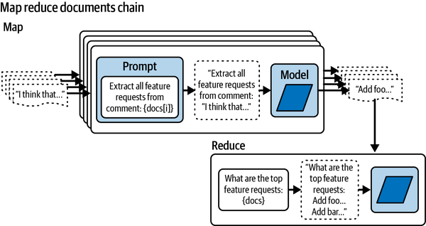

# 7 — LCEL Composition in Practice

> The layer under LangGraph: how data moves through a chain, how to fan a step out, three ways to get structured output, and the point where a chain should become a graph.

---

## Where this sits

The building blocks are covered in [01-llm-fundamentals note 04](../../01-llm-fundamentals/notes/04-langchain-basics.md): chat models, prompt templates, `with_structured_output`, the Runnable methods, and LCEL vs `@chain`. This note picks up where that one stops, with the plumbing that makes multi-step chains work, drawn from *Prompt Engineering for Generative AI* (ch. 4). Everything in notes 01–03 here is a LangGraph node that could contain one of these chains.

Both books pin 2024-era APIs. Where this note modernises a book example, it says so, and the [version table](#book-apis-and-their-current-form) at the end lists every change.

---

## Moving data through a chain

A chain's steps pass one value along. Once a later prompt needs a key from an earlier step **and** a key from the original input, you need four primitives (*Prompt Engineering for Generative AI*, ch. 4):

| Primitive | Does | Typical use |
|---|---|---|
| `RunnablePassthrough()` | Passes its input through unchanged | Keep the original input alongside a computed value |
| `RunnablePassthrough.assign(k=…)` | Passes the input through and adds key `k` | Accumulate keys step by step (current idiom; the book builds dicts by hand) |
| `itemgetter("k")` | Pulls one key out of a dict input | Feed a prompt variable from the incoming dict |
| `RunnableLambda(f)` / a plain `lambda` | Wraps a function | Reshape a value between steps |
| `RunnableParallel(a=…, b=…)` or a dict | Runs its branches on the same input and returns a dict | Fan one input into several chains |

The book's film-script generator chains characters → plot → scenes. Each later prompt needs the genre from the input plus the outputs so far:

```python
from operator import itemgetter
from langchain_core.output_parsers import StrOutputParser
from langchain_core.runnables import RunnablePassthrough

characters = character_prompt | model | StrOutputParser()
plot       = plot_prompt      | model | StrOutputParser()   # needs genre + characters
scenes     = scene_prompt     | model | StrOutputParser()   # needs genre + characters + plot

pipeline = (
    RunnablePassthrough.assign(characters=characters)        # {"genre"} -> {"genre", "characters"}
    | RunnablePassthrough.assign(plot=plot)                  # ... + "plot"
    | RunnablePassthrough.assign(scenes=scenes)              # ... + "scenes"
)
pipeline.invoke({"genre": "fantasy"})
```

The book builds the same thing from explicit dicts with `itemgetter` on every key. `.assign` is the same idea with less to get wrong: a template variable can't go missing because someone forgot to carry it forward.

**The first element must be a runnable.** A dict is coerced to `RunnableParallel` when its values are runnables or callables. A dict holding plain values (the book's example is `{"age": 18}`) is not, and neither is a plain f-string, so `"text" | model` raises. Order matters too: `model | prompt` composes without complaint and then feeds an `AIMessage` into a template that expected a dict.

### Sequential when the next step needs the last one

The book generates nine scenes. It could write every scene's script in parallel, but chooses not to: each scene's prompt gets a **summary of the previous scene**, a one-item buffer memory, so characters don't repeat themselves. That is the real trade-off in chain design. Parallel is faster. Sequential lets a step see what came before. The book's rule of thumb is that long sequential chains suit server-side jobs, where nobody is watching a spinner.

The book also points out that a chain lets you **mix models per step**: a strong model for ideation, a cheap one for bulk generation. It is the same per-node agency decision as in [graph note 02](../../../ai-engineering/05-graph-engineering/notes/02-graph-primitives.md#spend-agency-per-node).

### Fan out with a concurrency cap

`.batch()` runs inputs in parallel threads. Cap it, or a large batch becomes a rate-limit incident:

```python
results = chain.batch(inputs, config={"max_concurrency": 5})   # book: RunnableConfig(max_concurrency=5)
```

`abatch` is the async form. Results come back in input order.

---

## Three ways to get structured output

| Route | How | Use when | Fails by |
|---|---|---|---|
| **Output parser** | `parser.get_format_instructions()` into the prompt, `parser.parse()` on the text | The provider has no tool calling or JSON mode | The model ignores the instructions; you need a retry or fixing parser ([01 note 04](../../01-llm-fundamentals/notes/04-langchain-basics.md#building-block-3-structured-output-and-parsers)) |
| **Tool calling** | `bind_tools([Schema])` then `PydanticToolsParser(tools=[Schema])` | You want several objects from one call (parallel calls), or a choice between schemas | The model calls no tool, or invents arguments |
| **`with_structured_output`** | `model.with_structured_output(Schema)` | One object of one known shape: the default | Validation errors on weak models; check with `include_raw=True` |

Two things the book adds about tool calling (*Prompt Engineering for Generative AI*, ch. 4):

- **`tool_choice`** controls whether the model must call a tool. `auto` (default) lets it decide, `none` forbids calls, and naming a function forces that one. Force the call when the step's only job is extraction; an `auto` model can answer in prose and skip it.
- **Models hallucinate function parameters.** The book's fix is to be more explicit in the system message. The stronger fix is to validate arguments in code before acting on them, and to return validation errors to the model as an observation ([01](01-react-from-scratch-to-langgraph.md)).

Parallel tool calls are how one call extracts a list. The book's `create_extraction_chain_pydantic` returns two `Person` objects from one sentence. That helper is legacy; current code is `bind_tools([Person])` plus `PydanticToolsParser`, or `with_structured_output` over a wrapper model with `people: list[Person]`.

---

## Query planning: a plan is a DAG

When one user request holds several intents that depend on each other, ask the model for a **plan with dependencies** first, then execute it (*Prompt Engineering for Generative AI*, ch. 4). The book's schema, modernised from `pydantic.v1` and `PydanticOutputParser`:

```python
from graphlib import TopologicalSorter, CycleError
from pydantic import BaseModel, Field

class Query(BaseModel):
    id: int
    question: str
    dependencies: list[int] = Field(default_factory=list,
                                    description="ids of queries whose answers this one needs")

class QueryPlan(BaseModel):
    query_graph: list[Query]

plan = model.with_structured_output(QueryPlan).invoke(user_request)
```

The book stops at the parsed plan. Executing it is where things break, because the model can reference an id that doesn't exist or create a cycle. Validate the plan, then run it in waves:

```python
def run_plan(plan: QueryPlan, answer_one) -> dict[int, str]:
    by_id = {q.id: q for q in plan.query_graph}
    missing = {d for q in plan.query_graph for d in q.dependencies} - by_id.keys()
    if missing:
        raise ValueError(f"plan references unknown ids {missing}")
    ts = TopologicalSorter({q.id: q.dependencies for q in plan.query_graph})
    ts.prepare()                                   # raises CycleError on a cyclic plan
    answers: dict[int, str] = {}
    while ts.is_active():
        ready = ts.get_ready()                     # every query whose dependencies are answered
        for qid in ready:                          # independent: could be one .batch() call
            q = by_id[qid]
            answers[qid] = answer_one(q.question, {d: answers[d] for d in q.dependencies})
        ts.done(*ready)
    return answers
```

This is HuggingGPT's task-planning stage in miniature ([graph note 05](../../../ai-engineering/05-graph-engineering/notes/05-topology-patterns.md#manager-agents-as-tools)). It also marks where LCEL runs out. Once the plan is decided at runtime, you want LangGraph's `Send` for the fan-out, plus a checkpointer if any step is slow ([graph note 03](../../../ai-engineering/05-graph-engineering/notes/03-state-and-reducers.md#dynamic-fan-out-the-send-api)).

---

## Map-reduce over documents

The four document-chain strategies (stuff, refine, map-reduce, map-rerank) are tabulated in [01 note 04](../../01-llm-fundamentals/notes/04-langchain-basics.md#patterns-from-the-books-worth-knowing). Map-reduce is the one worth building yourself, because it is just `batch` followed by `invoke`:


*Image Source: James Phoenix & Mike Taylor, *Prompt Engineering for Generative AI* (O'Reilly, 2024), Fig. 4-7*

```python
map_chain    = map_prompt    | model | StrOutputParser()
reduce_chain = reduce_prompt | model | StrOutputParser()

partials = map_chain.batch([{"doc": d} for d in docs], config={"max_concurrency": 5})
answer   = reduce_chain.invoke({"docs": "\n\n".join(partials)})
```

The book's version is `load_summarize_chain(chain_type="map_reduce")`, which is legacy. Two failure cases from its Table 4-1 carry over:

- **The reduce step can overflow.** If the joined partials don't fit, the legacy chain compresses them recursively, which adds complexity and loses document order. Tag each partial with its source before joining, and collapse in batches.
- **Each map call sees one document.** Anything that spans documents, such as a contradiction between two comments, is invisible to the map step. Use refine, or a final pass over the originals, when that matters.

---

## Few-shot selection and prompt files

`FewShotChatMessagePromptTemplate` and the example selectors are listed in [01 note 04](../../01-llm-fundamentals/notes/04-langchain-basics.md#building-block-2-prompt-templates). What the book adds is the limits (*Prompt Engineering for Generative AI*, ch. 4):

- **Overfitting to the examples.** The model copies the examples' content, not just their format. The book's mitigations are to reword, to tell the model to use the examples only for format, or to fine-tune when few-shot isn't enough.
- **Examples compete with the answer for tokens.** `LengthBasedExampleSelector` drops examples as the user input grows. Give it a token counter (the book uses tiktoken) rather than its default word count, or the budget is wrong for code and non-English text.
- **`load_prompt` doesn't round-trip every template type.** The book's fallback is pickle or plain `.txt` files. Skip pickle: loading a pickle runs arbitrary code. Keep prompts as text, YAML or Jinja files under version control, and build the template in code.

---

## Book APIs and their current form

| Book code | Problem | Current form |
|---|---|---|
| `from langchain_openai.llms import ChatOpenAI` (*Learning LangChain*, ch. 1) | Import error: `ChatOpenAI` lives in `langchain_openai.chat_models` (or top-level `langchain_openai`) | `init_chat_model(...)` or `from langchain_openai import ChatOpenAI` |
| `OpenAI(model="gpt-3.5-turbo")` via `langchain_openai.llms` (*Learning LangChain*, ch. 1) | Completion-endpoint class with a chat-only model | A chat model; the completion `LLM` interface is legacy |
| `from pydantic.v1 import BaseModel` (*PEfGAI*, ch. 4) | Pydantic v1 shim | `from pydantic import BaseModel` (LangChain ≥ 0.3 is Pydantic v2) |
| `PydanticOutputParser` for JSON objects | Works, but relies on the model following prose instructions | `with_structured_output` |
| `create_extraction_chain_pydantic` | Legacy helper | `bind_tools` + `PydanticToolsParser` |
| `load_summarize_chain(chain_type=…)` | Legacy chain | `batch` + `invoke` as above, or a LangGraph map-reduce with `Send` |
| `load_evaluator("labeled_pairwise_string")` | Legacy `langchain.evaluation` | LangSmith `evaluate()` with an LLM-as-judge evaluator ([05](05-langsmith.md#evaluators)) |
| `chat(messages=…)` (calling the model directly) | Deprecated `__call__` | `.invoke(...)` |

---

→ Back to [06 — framework selection](06-framework-selection.md), or forward to the graph theory in [ai-engineering/05-graph-engineering](../../../ai-engineering/05-graph-engineering/README.md).
