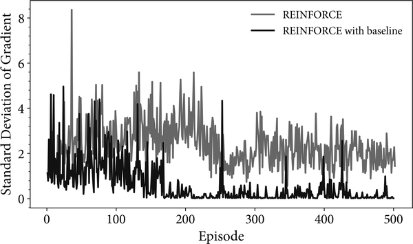
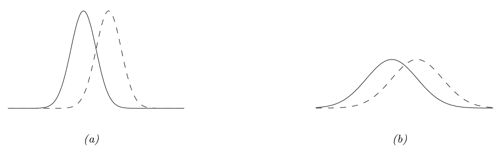
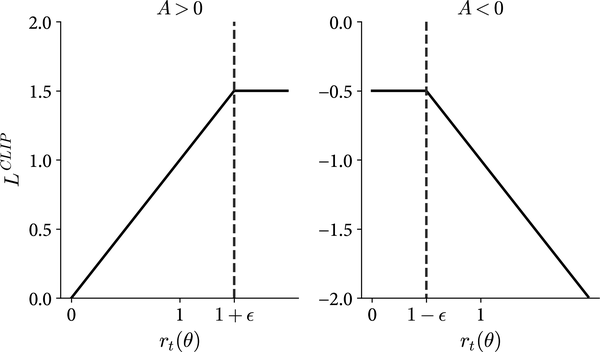
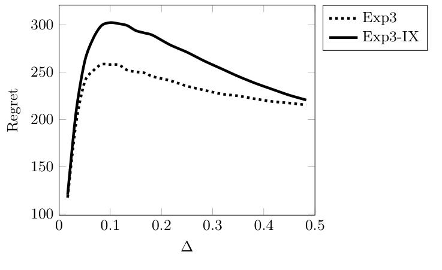

# 1 — RL Foundations for LLMs

The treasure-hunt lab from [00](00-rl-in-plain-language.md) needs about 10,000 games to win a puzzle with an 11-move answer, and yet the same family of ideas now trains models that reason and write code. This chapter is the bridge. It puts precise notation on agent, reward, policy and value, then follows one thread from the Q-learning table in that lab to the PPO clip used on language models, and stops to explain why each step was needed. Every piece is tied to the place LLM RL uses it.

**Where the rest went.** Multi-agent RL and RL in RAG now live in [11](11-multi-agent-and-rag-rl.md#multi-agent-rl-marl); imitation learning, hierarchy, problem design and scaling live in [10](10-engineering-rl-systems.md#learning-from-experts-imitation-and-inverse-rl).

**For RLHF pipeline depth** (SFT → reward model → PPO, Bradley-Terry, reward hacking):
see [02 — RLHF pipeline](02-rlhf-pipeline.md)

**For algorithm comparison** (PPO vs DPO vs GRPO vs KTO/ORPO):
see [03 — Preference optimization](03-preference-optimization.md)

---

## Foundations

Unlike supervised learning (trained on a labeled answer key) or unsupervised learning
(finds patterns in unlabeled data), RL relies on **trial and error**. An agent learns
to make decisions by interacting with an unknown environment, maximizing cumulative
reward over time. Sutton and Barto's definition is "learning what to do, how to map situations to actions, so as to maximize a numerical reward signal", with trial-and-error search and delayed reward as its two defining features. They list four elements: a **policy**, a **reward signal** that defines the goal, a **value function** (expected total future reward, which is what the agent actually chases: "states of highest value, not highest reward"), and an optional **model**. They call value estimation "arguably the most important thing that has been learned about reinforcement learning over the last six decades", and it is what separates RL from evolutionary search over policies, which scores whole games and ignores what happened within them (*RL: An Introduction*, ch. 1).

### Markov Decision Process (MDP)

The mathematical foundation of RL. Formally: a tuple `(S, A, P, R, γ)` where:

- **S** — state space: the set of all situations the agent can observe
- **A** — action space: the set of all decisions the agent can make
- **P(s'|s, a)** — transition function: probability of reaching state s' after taking
  action a in state s
- **R(s, a)** — reward function: scalar feedback received after taking action a in state s
- **γ** — discount factor (0 ≤ γ ≤ 1): how much to weight future vs. immediate rewards

**Markov property:** The next state depends only on the current state and action, not
on the full history. This is the key simplifying assumption that makes RL tractable.
When the agent sees only part of the state, the problem is a **POMDP** (partially
observable MDP). The agent then has to keep a *belief state*, its own estimate of the true
state, built from the history: stacked frames, a recurrent network, or a filter
(*Reinforcement Learning*, ch. 8). An LLM agent is in a POMDP by construction. Its context
window is the belief state, and context engineering is belief-state engineering.

**Return.** The agent maximizes the discounted sum of future rewards, not the next reward:

```
G_t = r_{t+1} + γ·r_{t+2} + γ²·r_{t+3} + … = r_{t+1} + γ·G_{t+1}
```

γ near 0 makes the agent myopic and γ near 1 makes it far-sighted. With a constant reward of +1 per step the discounted return is `1/(1−γ)`, and the undiscounted return of a continuing task is infinite, which is why discounting exists (*RL: An Introduction*, ch. 3). The same chapter states the **reward hypothesis**: all goals and purposes can be thought of as maximizing the expected cumulative sum of a scalar signal. Its corollary is the reward-design rule of this pillar: the reward tells the agent *what* you want, not *how*. Reward chess for winning, not for taking pieces. The recursive form on the
right is what every algorithm below exploits. Winder's test for whether a problem needs RL at
all comes from it: the problem has to be *sequential* and *strategic*. A recommender trained
by supervised learning to maximize the next click learns click-bait. One trained on the return
can trade a click now for a returning user later (*Reinforcement Learning*, ch. 1 and 9).

### Core components

- **Agent:** The learner and decision-maker
- **Environment:** Everything outside the agent's control that turns an action into a new
  state and a reward. Winder treats it as a bounded context in the domain-driven-design sense:
  you decide where the agent ends and the environment begins (*Reinforcement Learning*, ch. 9)
- **State / observation:** The state is the full description of the environment; the
  observation is the part the agent sees. They coincide only in a fully observable MDP
- **Action:** The decision the agent makes given the state
- **Reward:** Scalar feedback (positive or negative) after taking an action
- **Policy (π):** The strategy mapping states to actions — the thing being optimized.
  Policies can be deterministic (`π(s) → a`) or stochastic (`π(a|s) → [0,1]`)

### Value functions and the Bellman equations

Three quantities appear in every algorithm in this pillar:

```
V^π(s)    = E_π[ G_t | s_t = s ]                 how good is this state under π
Q^π(s, a) = E_π[ G_t | s_t = s, a_t = a ]        how good is this action here, then follow π
A^π(s, a) = Q^π(s, a) − V^π(s)                   how much better than π's average is this action
```

Substituting the recursive return gives the **Bellman expectation equation**, and asking for
the best action gives the **Bellman optimality equation**:

```
V^π(s)  = Σ_a π(a|s) Σ_s' P(s'|s,a) [ R(s,a) + γ·V^π(s') ]
Q*(s,a) = Σ_s' P(s'|s,a) [ R(s,a) + γ·max_a' Q*(s',a') ]
```

The value of a state is the immediate reward plus the discounted value of where you land.
That one idea lets an agent learn from single steps instead of waiting for the end of an
episode. Winder's point is that the Bellman update is the fixed constraint on all of RL: new
algorithms change how they represent state, explore or regularize, but "underneath, all RL
algorithms are value-based or policy-based" (*Reinforcement Learning*, ch. 9).

The advantage `A` is the quantity LLM RL actually optimizes. PPO estimates it with a critic,
and GRPO estimates it from a group of sampled answers (see
[policy gradients](#policy-gradients-from-reinforce-to-the-ppo-clip) below).

**Three ways to estimate value** (*Reinforcement Learning*, ch. 2–3; *RL: An Introduction*, ch. 5–6, detailed in [01b](01b-algorithm-families-td-and-dqn.md)):

| Method | Needs a model of P? | Updates from | Bias / variance |
|---|---|---|---|
| Dynamic programming | Yes | The Bellman equation over all next states | Exact, but only with a known model |
| Monte Carlo | No | The full return `G_t` at the end of an episode | Unbiased, high variance, episodic only |
| Temporal difference (TD) | No | One step plus its own estimate: `r + γ·V(s')` | Biased (it *bootstraps*), low variance, online |

All three are instances of **generalized policy iteration**: evaluate the current policy,
make it greedier against that evaluation, repeat.

Two worked examples make the table concrete. In a 5×5 gridworld with γ = 0.9, off-grid moves costing −1, and a square A that pays +10 and teleports the agent, the equiprobable random policy values A at only 8.8, below its immediate reward (B's +5 is worth 5.3), because the destination square is worth less than the one it left; values near the bottom edge go negative from bumping the wall. The optimal values rise to 24.4 for A, computed from the Bellman optimality equation (*RL: An Introduction*, ch. 3, Figs 3.2 and 3.5). In a 4×4 gridworld with −1 per step and a random policy, iterative policy evaluation yields greedy policies that are already optimal after three sweeps, so full evaluation is wasted work, and truncating it to one sweep gives **value iteration** (*RL: An Introduction*, ch. 4, Fig. 4.1 and Example 4.1). DP needs a known model and is polynomial in states and actions; direct policy search is exponential. Even so, one sweep of backgammon's more than 10^20 states at a million updates per second would take over a thousand years, which is why everything after DP samples instead (*RL: An Introduction*, ch. 4).

Two facts from a short tutorial summary of RL ([arXiv:2301.01379](https://arxiv.org/abs/2301.01379) (Ahilan, 2023-01, preprint)) explain why the table's methods differ beyond bias and variance. Repeated Bellman expectation backups converge because the backup is a γ-contraction in the infinity norm, which needs γ < 1 in an infinite-horizon problem. And on a fixed batch of experience, Monte Carlo converges to the value that minimises squared error on the observed returns, while TD(0) converges to the value of the maximum-likelihood Markov model of that data, so the two can disagree. The paper is a proof-sketch summary of Sutton and Barto and Silver's course, with no experiments, and stops before PPO.

### Algorithm families, temporal difference and DQN

The value-based, policy-based and actor-critic families, model-free against model-based, on- against off-policy, Q-learning against SARSA, n-step returns with GAE, and DQN with offline RL moved to [01b](01b-algorithm-families-td-and-dqn.md). The policy-gradient sections below build on them, so read 01b first if the TD error δ or the on-policy/off-policy distinction is new.

### Policy gradients: from REINFORCE to the PPO clip

Policy gradient methods parameterize the policy directly and climb the gradient of expected
return. The **policy gradient theorem** gives that gradient without differentiating through
the environment:

```
∇_θ J(θ) = E_π[ Ψ_t · ∇_θ log π_θ(a_t | s_t) ]
```

`∇ log π` (a gradient is just the slope per parameter; [derivatives, numerically](../../09-llms-from-scratch/notes/01-micrograd.md#derivatives-numerically)) points toward making the action taken more likely; `Ψ_t` says by how much. Winder's
summary of ch. 5 is that the policy gradient algorithms differ *only* in what they use for
Ψ (*Reinforcement Learning*, ch. 5, Eq. 5-11):

| Ψ_t | Algorithm | Note |
|---|---|---|
| `G_t` (full return) | REINFORCE | Unbiased, very high variance, waits for the episode to end |
| `G_t − b(s_t)` | REINFORCE with baseline | Same expectation, far lower variance |
| `r + γ·V(s') − V(s)` = δ_t | One-step actor-critic | Critic supplies the baseline and bootstraps |
| n-step or GAE advantage `Â_t` | A2C / PPO | The bias–variance dial |
| reward minus the mean of the other k−1 samples | RLOO | Leave-one-out baseline, no critic, whole completion is one action |
| group-normalized reward | GRPO | Baseline from sibling samples, no critic |

**What the theorem says exactly.** Sutton and Barto's version (ch. 13, Sec. 13.2) states that `∇J(θ) ∝ Σ_s μ(s) Σ_a q_π(s,a)·∇π(a|s,θ)`, with no derivative of the state distribution μ. The constant is the average episode length in the episodic case, and it is 1 (an equality) in the continuing case. REINFORCE is the sampled form, `θ ← θ + α·G_t·∇π(A_t|S_t)/π(A_t|S_t)`, and the book calls `∇ln π` the eligibility vector. The baseline identity behind the next paragraph is one line: `Σ_a b(s)·∇π(a|s) = b(s)·∇1 = 0`, so any `b` that does not depend on the action leaves the expected update unchanged. Their one-step actor-critic is the Ψ = δ_t row of the table (the book notes it is sometimes called A2C), and its critic adds bias even though a Monte Carlo critic would too (ch. 13, Sec. 13.5).

**Why a baseline.** With raw returns, a policy that happens to fail early gets a large update
even if it was good. In Pong every early episode scores near −21, so every action gets pushed
down. Subtracting a baseline turns "was this good?" into "was this better than usual?". The
expectation is unchanged because `E[∇ log π · b(s)] = 0`. Winder measured the effect on one
CartPole run:


*Image Source: Phil Winder, *Reinforcement Learning* (O'Reilly, 2020), Fig. 5-4. The printed
caption repeats Fig. 5-3's "average rewards"; the axis and the text show this is gradient
standard deviation*

The textbook shows the same gap on its short corridor (reward −1 per step, identical features in every state, actions switched in the middle state): REINFORCE with a state-value baseline (α_θ = 2⁻⁹, α_w = 2⁻⁶) learns much faster than plain REINFORCE at its best step size (2⁻¹³), averaged over 100 runs of 1,000 episodes (read from Fig. 13.2). The book adds that the value step size is easy to set, about 0.1/E[‖∇v̂‖²] for a linear critic, while the policy step size is "much less clear" (ch. 13, Sec. 13.4). The same corridor shows why a stochastic policy is worth having: the best policy goes right with probability about 0.59 for a value of about −11.6, while ε-greedy with ε = 0.1 is stuck with policies worth less than −44 (ch. 13, Ex. 13.1). The chapter has no trust region, clip or GAE; those rows rest on the other sources.

Once the policy is decent, plain REINFORCE keeps making large updates that knock it about; the
baseline version settles. That is what "variance reduction" means in the papers. GRPO's
`(r_i − mean(r)) / std(r)` over a group of completions for the same prompt is this baseline
computed empirically instead of learned ([03](03-preference-optimization.md)).

**REINFORCE comes back once the policy is pretrained.** The variance case against REINFORCE was
built on agents trained from random or weak initializations. Ahmadian et al.
([arXiv:2402.14740](https://arxiv.org/abs/2402.14740), ACL 2024) argue that a pretrained, SFT'd LLM
puts most of its probability on a few tokens, so the gradients are already low-variance and PPO's
machinery buys little. In RLHF on Anthropic-HH and TL;DR with Pythia-6.9B and Llama-7B:

- PPO's clip fired on **fewer than 5% of samples per batch**. Removing the clip and then the ratio,
  which reduces PPO to vanilla policy gradient, did not hurt.
- Reward rose monotonically with the GAE λ: λ = 1, the unbiased Monte Carlo return, was best.
- Treating the whole completion as one action, with a REINFORCE or **RLOO** leave-one-out baseline
  (Kool et al., 2019), beat token-level PPO. RLOO with k = 4 beat PPO by **10.3, 14.5 and 32.1
  GPT-4-judged win-rate points** on the three dataset–model pairs, and it beat DPO and RAFT too.

The same recipe works outside language. Pinto et al. ([arXiv:2302.08242](https://arxiv.org/abs/2302.08242),
ICML 2023) take a maximum-likelihood vision model and tune it with REINFORCE, drawing a second sample
as the baseline. They add no KL term and no critic, and on COCO detection mAP rose **from 39.2% to
54.3%** with a ViT-B. Both papers credit the pretrained initialization. Neither study measures reward
over-optimization, and Ahmadian et al. report only LLM-judged win rates.

```python
import torch

def reinforce_with_baseline_loss(logp, returns, values):
    # logp: log π(a_t|s_t) for the actions taken; returns: G_t; values: V(s_t)
    adv = (returns - values).detach()            # no gradient through the baseline
    policy_loss = -(adv * logp).mean()           # ascend E[A · ∇log π]
    value_loss = (returns - values).pow(2).mean()
    return policy_loss + 0.5 * value_loss

logp = torch.tensor([-0.7, -1.2], requires_grad=True)
values = torch.tensor([1.0, 1.0], requires_grad=True)
loss = reinforce_with_baseline_loss(logp, torch.tensor([3.0, 0.0]), values)
loss.backward()
print(round(loss.item(), 3), logp.grad.tolist())  # better-than-baseline action: pushed up
```

```text
1.35 [-1.0, 0.5]
```

**Actor-critic tuning.** In Winder's CartPole experiments the n-step actor-critic learned far
faster than REINFORCE with baseline once the policy step size was raised; the Monte Carlo
version "acts like a brake". He recommends that the critic learn at least as fast as the
actor. With the actor's rate fixed, a critic rate of ~0.1 worked best, 0.01 did slightly better
in the long run, and 0.5 was unstable (*Reinforcement Learning*, ch. 5, CartPole with tile-coded
linear features). A critic that lags the actor feeds it stale advantages, and one that jumps
around feeds it noisy ones.

**Off-policy correction.** To reuse data from an older policy π_old, weight each sample by the
**importance ratio** `r_t(θ) = π_θ(a_t|s_t) / π_old(a_t|s_t)`. Winder's illustration recovers the
mean of a loaded die, 4.3, from rolls of a fair one by reweighting each face
(*Reinforcement Learning*, ch. 6). Large ratios make the estimate's variance explode, which is
why every practical method clips or constrains them.

**Trust regions.** A policy gradient step that is too large can destroy a good policy, and
nothing in the gradient tells you how large is too large. TRPO constrains each update to a
small KL divergence ([KL, defined](../../01-llm-fundamentals/notes/06-pretraining-data-and-objectives.md#entropy-cross-entropy-kl-and-perplexity); [worked derivation](../../../data-analytics/04-bayesian-analysis/notes/06-bayesian-machine-learning.md#variational-inference-and-the-vae-week-5)) from the previous policy, solved with conjugate gradients. It works, but it
is expensive and awkward with shared policy/value networks. A KL *penalty* with coefficient β is
simpler but β is hard to tune (*Reinforcement Learning*, ch. 6). RLHF keeps that penalty, but
against the frozen reference model rather than the previous iterate
([02](02-rlhf-pipeline.md); why the penalty is *reverse* KL: [12](12-rlhf-failure-modes.md#overoptimization)).

Murphy derives where the trust region comes from (*RL: A Comprehensive Overview*, ch. 3, Sec. 3.3). The new policy's return is bounded below by a surrogate minus a penalty proportional to the total-variation distance between old and new policies, scaled by 2γC/(1−γ)². A KL bound δ implies a TV bound through δ = ε²/2, so maximising the surrogate under a KL limit improves the policy monotonically in theory. TRPO expands the surrogate to first order and the KL to second order, steps along the natural gradient `F⁻¹g` with size √(2δ/vᵀFv), solves for it by conjugate gradient and backtracks until the constraint holds. The step is measured in KL, not parameter distance, because the same shift in a Gaussian's mean matters far more when its variance is small:


*Image Source: Murphy, [*Reinforcement Learning: A Comprehensive Overview*](https://arxiv.org/abs/2412.05265) (2024), Fig. 3.1 (reproduced from Honkela et al.)*

The Fisher matrix F is the local KL metric, so it rescales each parameter by how much it moves the distribution. For off-policy actors, V-trace truncation at c = 1 and ρ = 1 worked best in IMPALA, one agent playing 57 Atari games (as reported in ch. 3, Sec. 3.4). The chapter runs no experiments and has no LLM method (no GRPO, DPO or KL-to-reference penalty). Its control-as-inference section shows that a KL-regularised objective with a uniform prior is maximum-entropy RL, the setting of SAC. Swapping in a reference-policy prior gives the RLHF objective form; that link is this note's, not the chapter's.

**The PPO clip** replaces the trust region with a clipped surrogate:

```
L_CLIP(θ) = E_t[ min( r_t(θ)·Â_t ,  clip(r_t(θ), 1−ε, 1+ε)·Â_t ) ]
L_PPO     = L_CLIP − c1·(V_θ(s_t) − V_target)² + c2·H[π_θ(·|s_t)]
```


*Image Source: Phil Winder, *Reinforcement Learning* (O'Reilly, 2020), Fig. 6-5*

Read the plot as "where does the gradient vanish". With a positive advantage the objective
stops rewarding increases in the action's probability once `r > 1+ε`. With a negative advantage
it stops rewarding decreases once `r < 1−ε`. Outside those zones the unclipped term applies in
full, so a change that makes things *worse* is never clipped. The `min` makes the objective a
pessimistic lower bound on the unclipped one. Schulman et al. used ε between 0.1 and 0.3. The
full objective adds a value loss weighted by c1 when policy and value share a network, and an
entropy bonus weighted by c2, which some of their experiments set to zero (*Reinforcement
Learning*, ch. 6).

```python
import torch

def ppo_clip_loss(logp_new, logp_old, adv, eps=0.2):
    ratio = (logp_new - logp_old).exp()
    unclipped = ratio * adv
    clipped = ratio.clamp(1 - eps, 1 + eps) * adv
    return -torch.min(unclipped, clipped).mean()   # minimize the negative lower bound

adv = torch.tensor([1.0])
for ratio in [1.1, 1.5, 3.0]:
    logp_new = torch.log(torch.tensor([ratio])).requires_grad_()
    loss = ppo_clip_loss(logp_new, torch.zeros(1), adv)
    loss.backward()
    print(f"ratio {ratio}: loss {loss.item():.2f}, gradient {logp_new.grad.item():.2f}")
```

```text
ratio 1.1: loss -1.10, gradient -1.10
ratio 1.5: loss -1.20, gradient 0.00
ratio 3.0: loss -1.20, gradient 0.00
```

> **Contradicts.** Winder describes the negative-advantage case as "at low ratios … the policy
> parameters will continue to change at the same rate", and says PPO ignores the importance
> sampling "when the policy is improving (take bigger steps)" (*Reinforcement Learning*, ch. 6).
> His own Fig. 6-5 shows the reverse. For A < 0 and r < 1−ε the objective is flat, so the
> gradient is zero and that sample stops pushing. For A > 0 the clip caps the gain at 1+ε, so
> improving moves are the ones that get limited. Use the plot, not that paragraph.

> **Framing differs.** Winder files PPO under off-policy methods, as importance sampling of
> advantages under the old policy. [03](03-preference-optimization.md) calls it on-policy
> actor-critic. Both are defensible. PPO collects data with the current policy and throws it
> away after a few epochs, so it is on-policy; within those epochs the policy drifts from the
> one that sampled the data, and the ratio and clip correct for that small staleness. Clip
> variants used in LLM RL, such as DAPO's *clip-higher*, which raises the upper bound only, are
> adjustments to the plot above.

**Off-policy actor-critics for continuous control.** DDPG learns a deterministic policy with a
Q-critic, replay, soft target updates and action noise. TD3 fixes its overestimation with
clipped double-Q, delayed policy updates and target-policy smoothing; Winder recommends TD3
over DDPG (*Reinforcement Learning*, ch. 6). Neither is used for LLMs. They matter here only
because MADDPG ([11](11-multi-agent-and-rag-rl.md#multi-agent-rl-marl)) is built on DDPG.

### Entropy and maximum-entropy RL (SAC)

The entropy of a policy ([defined](../../01-llm-fundamentals/notes/06-pretraining-data-and-objectives.md#entropy-cross-entropy-kl-and-perplexity)), `H[π(·|s)] = −Σ_a π(a|s) log π(a|s)`, measures how spread out its
action choices are. **Maximum-entropy RL** adds it to the reward, so the agent is paid to stay
random wherever randomness costs little:

```
J(π) = E_π[ Σ_t r_t + α·H[π(·|s_t)] ]        α = temperature
π*(a|s) ∝ exp( Q_soft(s,a) / α )            the optimal policy is a softmax over soft Q-values
```

**Soft actor-critic (SAC)** learns soft Q-functions off-policy from a replay buffer and fits the
policy by minimizing the KL divergence to that [softmax](../../01-llm-fundamentals/notes/04-decoding-and-inference-behaviour.md#decoding), using a reparameterized Gaussian for
continuous actions. Most implementations tune α automatically toward a target entropy, commonly
`−|A|` for an action space with |A| dimensions (*Reinforcement Learning*, ch. 7).

Winder's grid demo shows both sides of α. A soft Q-learning agent visits states far more evenly
than an ε-greedy one. At α = 1, though, the entropy bonus outweighs the goal reward of 1, and
the agent learns to hang around the high-entropy middle of the grid instead of reaching the
goal. Annealing α from 0.5 to 0.005 fixes it: explore early, become Q-learning-like late
(*Reinforcement Learning*, ch. 7). SAC is also sensitive to reward scale, for the same reason:
α only means something relative to the size of the rewards.

**Why this matters for LLMs.** Replace the entropy bonus with a KL penalty to a reference
policy and the same derivation goes through:

```
max_π E[r] − β·KL(π || π_ref)   ⇒   π*(y|x) ∝ π_ref(y|x) · exp( r(x,y) / β )
```

Entropy regularization is the special case where π_ref is uniform. This closed form is the
starting point of DPO, which inverts it to express the reward through the policy
([03](03-preference-optimization.md)). The RLHF objective in [02](02-rlhf-pipeline.md) is
max-entropy RL with the pretrained model as the prior. Schulman, Chen and Abbeel showed that
entropy-regularized policy gradients and soft Q-learning are equivalent, which Winder cites as
the bridge between the value and policy families (*Reinforcement Learning*, ch. 7).

> **Dated.** Winder's Table 7-1 shows SAC ahead of PPO on most MuJoCo tasks at 1M steps, for
> example Humanoid 4,831–5,723 for SAC against 806 for PPO. He adds that results vary widely
> by implementation and that papers rarely publish raw curves (*Reinforcement Learning*,
> ch. 7). That holds for continuous control. SAC plays no part in LLM training: the action
> space is discrete, rollouts are generated fresh, and the KL anchor to π_ref does the
> regularizing job. In RLVR the live entropy problem is the opposite one. DAPO reports policy
> entropy *collapsing* early in GRPO-style training, so the model stops sampling alternative
> solutions. Its clip-higher fix raises only the upper clip bound, which leaves room to raise the
> probability of unlikely tokens ([arXiv:2503.14476](https://arxiv.org/abs/2503.14476); the
> fix is listed in [05](05-post-training-for-agents.md)).

### Exploration vs. exploitation

A fundamental tension: should the agent **exploit** the best action it knows (maximize
immediate reward) or **explore** new actions that might yield higher rewards in the long
run? Strategies:
- **ε-greedy:** With probability ε, take a random action; otherwise exploit. Murphy notes it explores every action with probability at least ε/|A| forever, so it is suboptimal unless ε is annealed to 0 (*RL: A Comprehensive Overview*, ch. 1, Sec. 1.3.5). Boltzmann selection is smoother: with τ = 1, estimated rewards of 4.90 and 5.10 give about 0.45 and 0.55, where ε-greedy would give a hard 0.05/0.95 split (his Table 1.2, with ε = 0.1 and two actions; the Boltzmann values check against exp(R̂/τ))
- **UCB (Upper Confidence Bound):** Choose actions with high uncertainty to reduce
  uncertainty faster. Guarantees are in the regret block below (*Bandit Algorithms*, ch. 7)
- **Entropy regularization (SAC; optional in PPO):** Add an entropy bonus to the objective to
  encourage diverse action distributions. The PPO paper includes one for its Atari runs and
  turns it off for continuous control ([arXiv:1707.06347](https://arxiv.org/abs/1707.06347)).
  GRPO as published has no entropy term; its only regularizer is the KL penalty to the
  reference model ([arXiv:2402.03300](https://arxiv.org/abs/2402.03300)).

- **Measured on the 10-armed testbed** (2,000 random problems, rewards N(q*, 1), 1,000 steps): greedy gets about 1 reward per step against 1.54 possible; ε = 0.1 never exceeds 91% optimal actions; optimistic initial values (Q₁ = +5, α = 0.1) start worse than ε-greedy and end better, but only help stationary problems; UCB with c = 2 beats ε = 0.1 after the first k steps (`A = argmax[Q(a) + c·√(ln t / N(a))]`); a gradient bandit with a baseline is unaffected when every mean shifts by +4, and without the baseline degrades. The gradient bandit's expected update equals the gradient of expected reward, so it is stochastic gradient ascent and the direct ancestor of REINFORCE below, with the baseline only reducing variance. Across a parameter sweep from 1/128 to 4, every method traces an inverted U, and UCB comes out best on this problem (*RL: An Introduction*, ch. 2). Exact Bayesian lookahead over 1,000 two-action steps has 2^2000 leaves, which is why Thompson sampling is used instead.
- **Regret and the noisy TV (Murphy, ch. 7).** Regret measures return lost against the best policy in hindsight. For a tabular episodic MDP with horizon H, S states, A actions and T steps, the optimal minimax regret is O(√(HSAT)) (*RL: A Comprehensive Overview*, ch. 7, Sec. 7.1). Exact Bayes-optimal planning merges identical belief states, yet a bandit with n arms and horizon h still has O(h^2n) of them (about 10^12 for the two-arm, 1,000-step case above), and Gittins indices solve only the infinite-horizon discounted, context-free case (Sec. 7.2.1). Posterior sampling is the cheap alternative: sample one model from the posterior each episode and act greedily on it. Prompting an LLM to do this worked on 3-state RiverSwim and failed at 4 states (as reported, Sec. 7.2.2). Rewarding raw prediction error as intrinsic motivation invites the *noisy TV* problem, an agent that stares at unpredictable noise, while information gain, ICM or a KL reward avoid it (Sec. 7.4).
- **Regret guarantees (Lattimore & Szepesvári).** Regret is R_n = nμ* − E[ΣX_t], which equals Σ_i Δ_i·E[T_i(n)], the gap times the expected pull count of each arm (*Bandit Algorithms*, ch. 4, Lemma 4.5). Bounds below assume k arms, horizon n and 1-subgaussian rewards unless stated.
  - *Explore-then-commit* on two arms with gap Δ, tuned to Δ: R_n ≤ min{nΔ, Δ + (4/Δ)(1 + max{0, log(nΔ²/4)})}. A commit time chosen from n alone gives only O(n^(2/3)) (ch. 6, Eq. 6.6, Exercise 6.5).
  - *UCB* with confidence δ = 1/n²: R_n ≤ 3ΣΔ_i + Σ 16 log n/Δ_i, and gap-free 8√(nk log n) + 3ΣΔ_i. It needs n in advance (ch. 7). The anytime variant: limsup R_n/log n ≤ Σ 2/Δ_i (ch. 8). MOSS drops the log factor, 39√(kn) + ΣΔ_i (ch. 9, Thm 9.1). For Bernoulli rewards KL-UCB has limsup R_n/log n ≤ ΣΔ_i/d(μ_i, μ*) and is never worse than UCB, since d ≥ 2Δ² (ch. 10, Thm 10.6).
  - *Adversarial rewards in [0,1]:* Exp3 with η = √(2 log k/(nk)) gets R_n ≤ √(2nk log k) in expectation, yet its regret is heavy-tailed: some bandit has P(regret ≥ n/4) > 1/131 (ch. 11, Thm 11.2, Note 1). Exp3-IX biases the estimator upward, so with probability 1−δ the regret is O(√(nk log(k/δ))) (ch. 12). In the book's k = 5, n = 10⁴ run its *expected* regret is higher than Exp3's (Fig. 12.1).
  - *Floors.* Any policy has some Gaussian instance with R_n ≥ (1/27)√((k−1)n) once n ≥ k−1 (ch. 15, Thm 15.2, sketched in ch. 13). A policy consistent on an unstructured class has liminf R_n/log n ≥ Σ Δ_i/d_inf; for unit-variance Gaussians that is Σ 2/Δ_i, so the UCB asymptotics above are tight (ch. 16, Thm 16.2 and Table 16.1; the 2/Δ form is our substitution). Beating that line on one instance costs regret elsewhere (Fig. 16.1). Expected regret ≤ B√((k−1)n) also forces a tail: some Gaussian instance has regret ≥ ¼·min{n, (1/B)√((k−1)n·log(1/4δ))} with probability ≥ δ (ch. 17, Thm 17.1).


*Image Source: Lattimore & Szepesvári, *Bandit Algorithms* (Cambridge University Press, 2020), Fig. 16.1. Schematic.*


*Image Source: Lattimore & Szepesvári, *Bandit Algorithms* (Cambridge University Press, 2020), Fig. 12.1.*

- **Softmax (Boltzmann) selection:** sample actions with probability ∝ `exp(Q/τ)`. Unlike
  ε-greedy, which explores uniformly, it explores in proportion to how promising each action
  looks. Winder recommends feeding it advantages rather than raw values (*Reinforcement
  Learning*, ch. 2 and 9)
- **Thompson sampling:** keep a posterior over each action's value, draw a sample, act
  greedily on the draw

In LLM contexts, temperature sampling at inference time is the primary exploration
mechanism during data collection. It is the softmax rule above, with logits in place of Q.

**Intrinsic motivation** adds a bonus for novelty when the extrinsic reward is sparse
(*Reinforcement Learning*, ch. 9). Count-based bonuses reward rarely visited states. Curiosity
rewards the error of a learned next-state predictor, and so gets stuck in front of a "noisy TV"
whose next frame is unpredictable. Random network distillation avoids that trap: it rewards the
error in predicting a *fixed random* network's embedding of the current observation, which a
static noisy screen does not keep generating. Winder's caution is that all of these work locally
and by reshaping the reward. Before reaching for them, try a denser reward, a demonstrator or a
simpler problem. Exploration needs prior knowledge, which is precisely what a pretrained LLM
brings.

**Contextual bandits** are the one-step case: observe a context, pick an action, get a
reward, with no state carried forward. It is the right model for recommendation, routing and
prompt or model selection. See [Bayesian bandits](../../../data-analytics/04-bayesian-analysis/notes/03-priors-and-bandits.md#bayesian-bandits-thompson-sampling) in data
analytics for the case with no context, and for Thompson sampling. Two results anchor it:

- **LinUCB** ([arXiv:1003.0146](https://arxiv.org/abs/1003.0146), Li et al., 2010) fits a
  ridge regression per arm and picks the arm with the highest upper confidence bound. On over
  33M events from the Yahoo! front-page news module it got a 12.5% click lift over a
  context-free bandit. The paper's other lasting contribution is **replay evaluation**: a
  bandit policy can be scored offline, without bias, on logs collected under a uniformly
  random policy.
- **Thompson sampling with neural nets** ([arXiv:1802.09127](https://arxiv.org/abs/1802.09127),
  Riquelme et al., 2018) benchmarked approximate Bayesian deep nets as posteriors. Many methods
  that work in supervised learning did poorly here because their uncertainty estimates converge
  too slowly for online decisions. The robust choice was **NeuralLinear**: a network learns a
  representation, and an exact Bayesian linear regression on its last layer supplies the
  uncertainty.

- **Linear and expert-advised bandits (Lattimore & Szepesvári).** With a known feature map and 1-subgaussian noise, LinUCB keeps a ridge estimate and a confidence ellipsoid. If θ* stays inside it with probability 1−δ, the regret is at most √(8·n·β_n·log(det V_n/det V_0)) (ch. 19, Thm 19.2), which is O(d√n·log(nL)) for δ = 1/n (Cor. 19.3). In the book's d = 5, n = 5,000 sphere run LinUCB's regret stays under 500 as the arm count k grows to 1,000, while UCB's climbs past 4,000 (Fig. 19.1). For adversarial contexts, Exp4 over M experts gets √(2nk log M), with oblivious experts and known n. A finite policy class Φ gives √(2nk log|Φ|), against 2√(nk|C|log k) for one Exp3 per context (ch. 18, Thm 18.1).


*Image Source: Lattimore & Szepesvári, *Bandit Algorithms* (Cambridge University Press, 2020), Fig. 19.1.*

Zhou's survey ([arXiv:1508.03326](https://arxiv.org/abs/1508.03326)) covers the wider family:
stochastic vs adversarial rewards, and UCB vs Thompson variants.

### RL applied to LLMs

LLMs are trained using RL primarily at two stages:

1. **RLHF alignment (post-pretraining):** The LLM is the policy; each token is an
   action; the reward model scores completed responses. See [02-rlhf-pipeline.md](02-rlhf-pipeline.md).

2. **Agentic RL (tool use, retrieval, reasoning):** The LLM takes multi-step actions
   in an environment (web browser, code executor, knowledge base). Rewards are task
   completion signals. This section and the next cover this use case.

Kumar et al.'s survey ([arXiv:2502.21321](https://arxiv.org/abs/2502.21321) (2025-03, preprint)) sorts post-training into fine-tuning, RL and test-time scaling, and states the two update rules this note uses: PPO's clipped ratio with a learned critic, and GRPO's group-normalised advantage (r - mean) / std with no critic. It runs no experiments, and the figures it relays carry no setup, so use it as a map and go to the cited papers for numbers. Its Table 1 has doubtful rows, and its DPO reference points at a different paper.

Tie et al.'s larger survey ([arXiv:2503.06072](https://arxiv.org/abs/2503.06072) (2025-03, preprint)) writes the notation chain this note uses (advantage as Q minus V, the PPO clip, the KL-penalised reward, the DPO derivation, reasoning as an MDP) and tabulates alignment methods by reward type and on/off-policy, but runs no experiments, never writes out GRPO's advantage, and has contradictory R1 details and implausible parameter counts in its Table 1, so cite it for taxonomy only.

A third use is still experimental: **RL in place of next-token prediction.** Reinforcement Pre-Training makes every token of a corpus a verifiable task. The model reasons, guesses the next token, and gets reward 1 for an exact byte-prefix match ([arXiv:2506.08007](https://arxiv.org/abs/2506.08007) (Dong et al., 2025-06, preprint)). Thinking before each token comes from Quiet-STaR ([arXiv:2403.09629](https://arxiv.org/abs/2403.09629) (Zelikman et al., COLM 2024)), which instead rewarded a rationale by how much it raised the true token's likelihood. Starting from R1-Distill-Qwen-14B, it was trained with GRPO on 4,428 OmniMATH problems, keeping only high-entropy token positions. **Next-token accuracy on the hard split went from 20.4% to 23.8%**, about level with R1-Distill-Qwen-32B. The headline "+22 points on MMLU-Pro over the 32B" compares RPT reasoning against the 32B answering directly. Against the same 14B in reasoning mode the gain is 2.2 points (68.9→71.1), and on SuperGPQA 2.9 (36.1→39.0). The corpus is math only, the start is already a reasoning model, and there is one model size, so "scales RL to web text" is the goal, not the result.

---

## RLHF and DPO — pointer

The RLHF pipeline (SFT → reward model → PPO) and preference optimization algorithms
(DPO, GRPO, KTO, ORPO) are covered in depth in this pillar:

- **RLHF pipeline:** [02-rlhf-pipeline.md](02-rlhf-pipeline.md) — three stages,
  Bradley-Terry model, KL penalty, reward hacking failure modes
- **Algorithm comparison:** [03-preference-optimization.md](03-preference-optimization.md)
  — PPO vs DPO vs GRPO vs KTO/IPO/ORPO, decision framework
- **DeepSeek-R1 story:** [08-reasoning-rl-deepseek-r1.md](08-reasoning-rl-deepseek-r1.md)
- **Constitutional AI / RLAIF:** [04-constitutional-ai.md](04-constitutional-ai.md)
  — AI-generated feedback, critique-revision loop, scaling alignment

---

## Tooling

**Python RL frameworks:**
- **HuggingFace TRL** — RLHF, DPO, GRPO training on top of HuggingFace models.
  The standard library for preference optimization. [docs](https://huggingface.co/docs/trl/)
- **OpenRLHF** — distributed RLHF training; supports PPO at large scale

**Classic RL environments:**
- **Gymnasium** (successor to OpenAI Gym) — the `reset()` / `step(action)` interface. Winder
  recommends wrapping a real system in the same interface as the simulator so agents move
  between them unchanged (*Reinforcement Learning*, ch. 9)

**MARL simulators and frameworks:**
- **Ray RLlib** — general-purpose RL with multi-agent support
- **PyMARL** — MARL-specific: QMIX, COMA, VDN implementations
- **PettingZoo** — multi-agent Gymnasium-compatible environments

## Pitfalls

- **Reading a learned value as ground truth.** Q-learning's max favours estimates that are too high, and function approximation with bootstrapping can diverge. Check learned values against real returns before trusting them.
- **Copying the off-policy habit into LLM training.** The cliff world shows on-policy methods value what the agent will actually do. Reusing old rollouts without a ratio and a clip, as in PPO, or a staleness cap ([10](10-engineering-rl-systems.md#scaling-actors-and-learners)), silently trains on another policy's data.
- **Treating the PPO clip as a guard against all large changes.** It stops the incentive to move further past the bound in the helpful direction. It does not cap the ratio itself, so several epochs can still push past 1+ε. Track the KL divergence as well.
- **Dropping the baseline to simplify.** REINFORCE without a baseline or group normalization has variance large enough to hide all progress on sparse rewards.
- **Assuming the discount is cosmetic.** A low γ can make the far goal invisible, and γ close to 1 on long episodes raises variance.

## Try it

1. Change the `q_update` example so `done=True`. What is `Q[3]["right"]` now, and what information did the agent lose?
2. In the PPO block, add a sample with `adv = -1.0` and ratios 0.5, 0.9 and 1.5. For which ratio is the gradient zero?
3. Set `gamma` to 0.9 in the lab (`discount_factor` in `rl_agent.py`), rerun 10,000 episodes, then compare the win rate with the default. Explain the result using the bootstrapped target.

<details><summary>Answers</summary>

1. −0.05, which is 0.1 × −0.5. The target drops the bootstrapped next-state value, so the agent no longer sees the payoff ahead.
2. Ratio 0.5. With a negative advantage the objective is flat below 1−ε, and 0.9 and 1.5 still push the probability down. This matches Fig. 6-5 above and not the book's paragraph, as the note under the plot says.
3. It still won 100 of 100 test games at 10,000 episodes in our run. Eleven moves out, the treasure's discounted worth falls from about 90 to about 35, while the small pickup bonuses keep the early moves pointing the right way. Remove those bonuses as well and the lab's exercise 2 shows how much they were doing.

</details>

## Interview checklist

| Question | Answer |
|---|---|
| Q-learning vs SARSA? | Q-learning bootstraps from the best next action and learns the greedy policy (off-policy). SARSA bootstraps from the action actually taken and learns the exploring policy (on-policy). |
| What does a baseline do in REINFORCE? | It subtracts expected return so that only better- or worse-than-expected actions move the policy. Variance falls, and the gradient stays unbiased. |
| What is GAE? | A λ-weighted sum of TD errors, trading bias (λ near 0) against variance (λ near 1). |
| Why does PPO clip? | To reuse a batch for several epochs without the policy moving too far from the one that collected it, and without TRPO's second-order machinery. |
| Is PPO on-policy? | Data collection is on-policy and data is discarded soon after. The ratio corrects for drift within those few epochs. |
| How does max-entropy RL differ? | It adds policy entropy to the objective, so the agent keeps options open while it optimizes reward. |
| Which family do LLMs use and why? | Policy methods. The action space is the whole vocabulary at each step, and no table or argmax over next actions is practical. |

## Next

[01b — Algorithm families, TD and DQN](01b-algorithm-families-td-and-dqn.md) is the value-based half that this note's Bellman section leads into (read it before the policy gradients if TD or off-policy learning is new). [02 — RLHF pipeline](02-rlhf-pipeline.md) applies the policy-gradient half of this note to language models. [05-RL README](../README.md) has the full reading order, and [03-agentic-foundations](../../03-agentic-foundations/README.md) covers the agents (ReAct, Reflexion) these methods train. The depth notes on algorithms and on Constitutional AI are [03](03-preference-optimization.md) and [04](04-constitutional-ai.md).
