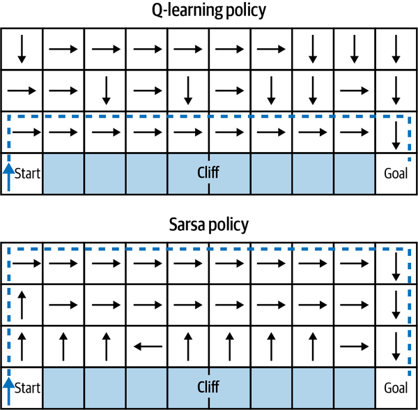
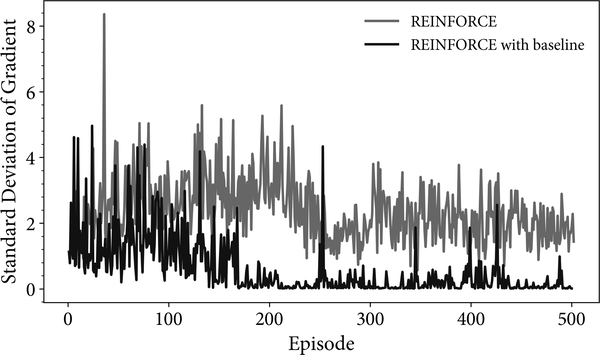
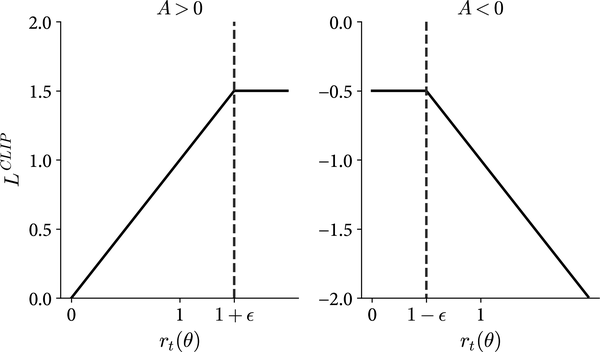

# 1 — RL Foundations for LLMs

The treasure-hunt lab from [00](00-rl-in-plain-language.md) needs about 10,000 games to win a puzzle with an 11-move answer, and yet the same family of ideas now trains models that reason and write code. This chapter is the bridge. It puts precise notation on agent, reward, policy and value, then follows one thread from the Q-learning table in that lab to the PPO clip used on language models, and stops to explain why each step was needed. Every piece is tied to the place LLM RL uses it.

**Where the rest went.** Multi-agent RL and RL in RAG now live in [11](11-multi-agent-and-rag-rl.md#multi-agent-rl-marl); imitation learning, hierarchy, problem design and scaling live in [10](10-engineering-rl-systems.md#learning-from-experts-imitation-and-inverse-rl).

**For RLHF pipeline depth** (SFT → reward model → PPO, Bradley-Terry, reward hacking):
see [02 — RLHF pipeline](02-rlhf-pipeline.md)

**For algorithm comparison** (PPO vs DPO vs GRPO vs KTO/ORPO):
see [03 — Preference optimization](03-preference-optimization.md)

---

## Foundations

Unlike supervised learning (trained on a labeled answer key) or unsupervised learning
(finds patterns in unlabeled data), RL relies on **trial and error**. An agent learns
to make decisions by interacting with an unknown environment, maximizing cumulative
reward over time.

### Markov Decision Process (MDP)

The mathematical foundation of RL. Formally: a tuple `(S, A, P, R, γ)` where:

- **S** — state space: the set of all situations the agent can observe
- **A** — action space: the set of all decisions the agent can make
- **P(s'|s, a)** — transition function: probability of reaching state s' after taking
  action a in state s
- **R(s, a)** — reward function: scalar feedback received after taking action a in state s
- **γ** — discount factor (0 ≤ γ ≤ 1): how much to weight future vs. immediate rewards

**Markov property:** The next state depends only on the current state and action, not
on the full history. This is the key simplifying assumption that makes RL tractable.
When the agent sees only part of the state, the problem is a **POMDP** (partially
observable MDP). The agent then has to keep a *belief state*, its own estimate of the true
state, built from the history: stacked frames, a recurrent network, or a filter
(*Reinforcement Learning*, ch. 8). An LLM agent is in a POMDP by construction. Its context
window is the belief state, and context engineering is belief-state engineering.

**Return.** The agent maximizes the discounted sum of future rewards, not the next reward:

```
G_t = r_{t+1} + γ·r_{t+2} + γ²·r_{t+3} + … = r_{t+1} + γ·G_{t+1}
```

γ near 0 makes the agent myopic and γ near 1 makes it far-sighted. The recursive form on the
right is what every algorithm below exploits. Winder's test for whether a problem needs RL at
all comes from it: the problem has to be *sequential* and *strategic*. A recommender trained
by supervised learning to maximize the next click learns click-bait. One trained on the return
can trade a click now for a returning user later (*Reinforcement Learning*, ch. 1 and 9).

### Core components

- **Agent:** The learner and decision-maker
- **Environment:** Everything outside the agent's control that turns an action into a new
  state and a reward. Winder treats it as a bounded context in the domain-driven-design sense:
  you decide where the agent ends and the environment begins (*Reinforcement Learning*, ch. 9)
- **State / observation:** The state is the full description of the environment; the
  observation is the part the agent sees. They coincide only in a fully observable MDP
- **Action:** The decision the agent makes given the state
- **Reward:** Scalar feedback (positive or negative) after taking an action
- **Policy (π):** The strategy mapping states to actions — the thing being optimized.
  Policies can be deterministic (`π(s) → a`) or stochastic (`π(a|s) → [0,1]`)

### Value functions and the Bellman equations

Three quantities appear in every algorithm in this pillar:

```
V^π(s)    = E_π[ G_t | s_t = s ]                 how good is this state under π
Q^π(s, a) = E_π[ G_t | s_t = s, a_t = a ]        how good is this action here, then follow π
A^π(s, a) = Q^π(s, a) − V^π(s)                   how much better than π's average is this action
```

Substituting the recursive return gives the **Bellman expectation equation**, and asking for
the best action gives the **Bellman optimality equation**:

```
V^π(s)  = Σ_a π(a|s) Σ_s' P(s'|s,a) [ R(s,a) + γ·V^π(s') ]
Q*(s,a) = Σ_s' P(s'|s,a) [ R(s,a) + γ·max_a' Q*(s',a') ]
```

The value of a state is the immediate reward plus the discounted value of where you land.
That one idea lets an agent learn from single steps instead of waiting for the end of an
episode. Winder's point is that the Bellman update is the fixed constraint on all of RL: new
algorithms change how they represent state, explore or regularize, but "underneath, all RL
algorithms are value-based or policy-based" (*Reinforcement Learning*, ch. 9).

The advantage `A` is the quantity LLM RL actually optimizes. PPO estimates it with a critic,
and GRPO estimates it from a group of sampled answers (see
[policy gradients](#policy-gradients-from-reinforce-to-the-ppo-clip) below).

**Three ways to estimate value** (*Reinforcement Learning*, ch. 2–3):

| Method | Needs a model of P? | Updates from | Bias / variance |
|---|---|---|---|
| Dynamic programming | Yes | The Bellman equation over all next states | Exact, but only with a known model |
| Monte Carlo | No | The full return `G_t` at the end of an episode | Unbiased, high variance, episodic only |
| Temporal difference (TD) | No | One step plus its own estimate: `r + γ·V(s')` | Biased (it *bootstraps*), low variance, online |

All three are instances of **generalized policy iteration**: evaluate the current policy,
make it greedier against that evaluation, repeat.

### Algorithm families

**Value-based:** The agent estimates the expected long-term return (the "value") of
states or state-action pairs, then acts greedily. Examples: Q-Learning, DQN (Deep Q-Networks). DQN ([arXiv:1312.5602](https://arxiv.org/abs/1312.5602), Mnih et al., 2013) learned Q-values straight from raw pixels with a CNN. Its experience replay buffer broke the correlation between consecutive frames. With one architecture and one set of hyperparameters it played seven Atari games and beat a human expert on three. Both the games and the "one agent, no per-game tuning" rule came from the **Arcade Learning Environment** ([arXiv:1207.4708](https://arxiv.org/abs/1207.4708), Bellemare et al., JAIR 2013). ALE's authors tuned on five training games and reported on 50 test games drawn at random, the train/test split applied to environments. Their own SARSA(λ) agents on hand-built features beat trivial baselines in only 40 of 55 games, and sparse-reward games such as Montezuma's Revenge defeated everything. DQN's contribution was to learn the features from pixels.

**Policy-based:** Directly optimize the policy without an explicit value function.
Policy gradient methods compute `∇E[R]` and update `π_θ` toward higher-reward trajectories.
They sample from a distribution rather than maximize over actions, which is why they scale to
huge or continuous action spaces where a `max_a` is infeasible (*Reinforcement Learning*,
ch. 9). An LLM choosing one token from a vocabulary of tens of thousands, at every step, is
such a space.

**Actor-Critic:** Hybrid approach. An "actor" decides actions (policy); a "critic"
estimates value (how good the state is), providing a lower-variance signal for updating
the actor. PPO ([arXiv:1707.06347](https://arxiv.org/abs/1707.06347)) became the default
actor-critic algorithm for deep RL and for RLHF. For LLM reasoning with verifiable rewards,
critic-free GRPO has largely taken over ([03](03-preference-optimization.md)).

**Model-free vs. model-based:** Model-free agents learn purely from experience.
Model-based agents learn the transition function P(s'|s,a) and use it for planning —
more sample-efficient but harder to learn accurate models.

**On-policy vs. off-policy.** An *on-policy* method learns about the policy that is
generating the data (SARSA, REINFORCE, A2C, PPO). An *off-policy* method learns about one
policy, the *target*, from data generated by another, the *behavior* policy (Q-learning, DQN,
DDPG, SAC). Off-policy methods can reuse old data from a replay buffer, logs or a
demonstrator; the price is a mismatch between the two distributions that has to be corrected,
usually by importance sampling (*Reinforcement Learning*, ch. 1, 3 and 6).

> **Dated.** Winder writes that "most state-of-the-art algorithms are off-policy"
> (*Reinforcement Learning*, ch. 1). That held for 2020 benchmarks such as Atari and MuJoCo.
> LLM RL in 2025–26 is mostly on-policy: PPO and GRPO sample fresh completions from the current
> policy at every step. Winder's case for off-policy learning was exploration. A pretrained
> prior already makes on-policy samples informative, which removes much of that argument.

### Temporal-difference learning: Q-learning vs. SARSA

TD learning updates an estimate toward a one-step target. The gap between target and
estimate is the **TD error** δ, the single most reused quantity in RL:

```
δ_t = r_{t+1} + γ·V(s_{t+1}) − V(s_t)          TD error
V(s_t) ← V(s_t) + α·δ_t                         TD(0) update
```

Two control algorithms differ in one term of the target (*Reinforcement Learning*, ch. 3):

```
Q-learning (off-policy):  Q(s,a) ← Q(s,a) + α [ r + γ·max_a' Q(s',a') − Q(s,a) ]
SARSA      (on-policy):   Q(s,a) ← Q(s,a) + α [ r + γ·Q(s',a')        − Q(s,a) ]   a' ~ π
```

```python
def q_update(Q, s, a, r, s_next, done, alpha=0.1, gamma=0.99):
    target = r if done else r + gamma * max(Q[s_next].values())  # SARSA: Q[s_next][a_next]
    Q[s][a] += alpha * (target - Q[s][a])                        # alpha * TD error

# One step of a corridor: moving right from cell 3 costs 0.5 and lands next to a known payoff
Q = {3: {"left": 0.0, "right": 0.0}, 4: {"left": 0.0, "right": 10.0}}
q_update(Q, s=3, a="right", r=-0.5, s_next=4, done=False)
print(round(Q[3]["right"], 3))   # 0.1 * (-0.5 + 0.99 * 10.0 - 0.0)
```

```text
0.94
```

Q-learning bootstraps from the best next action, so it learns the value of the greedy policy
while it explores with ε-greedy. SARSA bootstraps from the action it actually takes next, so it
learns the value of the exploring policy, random slips included. Winder's cliff world shows the
consequence. Each step costs −1, falling off the cliff costs −100 and ends the episode, and the
agent explores with ε-greedy:


*Image Source: Phil Winder, *Reinforcement Learning* (O'Reilly, 2020), Fig. 3-3*

Q-learning finds the shortest path along the cliff edge, which is optimal only if the agent
never makes a random move. SARSA learns the safe route, because its value estimates include the
chance that an ε-greedy step kicks it over the edge. The on-policy agent optimizes the policy it
will actually run. That is the same argument LLM RL makes for on-policy rollouts.

**n-step returns and eligibility traces.** One step is the low-variance, high-bias extreme;
the full Monte Carlo return is the other. An n-step target uses n real rewards before
bootstrapping, and TD(λ) blends all n with weights `(1−λ)λ^(n−1)` via an eligibility trace
(*Reinforcement Learning*, ch. 3). Multi-step targets help most when rewards are sparse or
delayed. **GAE**, the advantage estimator inside PPO for RLHF, is exactly this λ-weighting
applied to TD errors:

```
Â_t = Σ_{l≥0} (γλ)^l · δ_{t+l}          λ = 0 → one-step TD;  λ = 1 → Monte Carlo minus V
```

### Deep Q-networks and learning from logs

DQN made Q-learning work with a neural network by fixing two sources of instability
(*Reinforcement Learning*, ch. 4):

- **Experience replay** samples past transitions at random, which breaks the correlation
  between consecutive steps.
- A **target network**, a lagged copy of the Q-network, computes `max_a' Q(s',a')` so the
  target does not move with every update.

DQN also uses the Huber loss, which is linear for large errors and so caps the gradient from
outliers. The `max` in the target overestimates values whenever estimates are noisy. **Double
Q-learning** picks the action with one network and scores it with the other. Rainbow
combines that with prioritized replay, dueling (V + A) heads, n-step targets, noisy-net
exploration and distributional returns.

**Offline (batch) RL** learns from a fixed log with no further interaction. Winder trains a
DQN agent on the replay buffer of another DQN agent on CartPole, with no environment access.
Its Q-values diverge, climbing on a log scale, and its reward stays poor. The `max` keeps
choosing actions that are not in the data, and with no way to try them nothing corrects the
optimistic estimate. Batch-constrained Q-learning (BCQ) converges on the same buffer because
it only considers actions a generative model says the log could contain (*Reinforcement
Learning*, ch. 4). The lesson carries over directly to LLMs. Offline preference methods such as
DPO ([03](03-preference-optimization.md)) are batch RL on a fixed preference set, and they
share its limit: the policy improves only where the data has coverage. Online and on-policy
methods keep the advantage of being able to check their own guesses.

Decision Transformer removes the `max` instead of constraining it
([arXiv:2106.01345](https://arxiv.org/abs/2106.01345) (Chen et al., NeurIPS 2021)). A small
GPT is trained on the log as interleaved (return-to-go, state, action) tokens with a plain
action-prediction loss, then prompted at test time with the return you want. With no learned
value function to optimize, there is nothing for unseen actions to exploit. On nine D4RL
locomotion logs it **averaged 74.7 against 63.9 for CQL**, the strongest pessimistic
Q-learning baseline. When rewards were withheld until the end of the episode, CQL collapsed
(Hopper medium-replay: 2.0) while Decision Transformer barely moved (78.5). The limits are in
the same paper. Behavior cloning on only the top 10% of trajectories matched it on average
(56.7 against 56.1), although picking that percentile needs environment rollouts. And it
exceeded the best return in its data only sometimes (Seaquest). Offline RL here becomes the
same conditional next-token problem an LLM solves.

### Policy gradients: from REINFORCE to the PPO clip

Policy gradient methods parameterize the policy directly and climb the gradient of expected
return. The **policy gradient theorem** gives that gradient without differentiating through
the environment:

```
∇_θ J(θ) = E_π[ Ψ_t · ∇_θ log π_θ(a_t | s_t) ]
```

`∇ log π` points toward making the action taken more likely; `Ψ_t` says by how much. Winder's
summary of ch. 5 is that the policy gradient algorithms differ *only* in what they use for
Ψ (*Reinforcement Learning*, ch. 5, Eq. 5-11):

| Ψ_t | Algorithm | Note |
|---|---|---|
| `G_t` (full return) | REINFORCE | Unbiased, very high variance, waits for the episode to end |
| `G_t − b(s_t)` | REINFORCE with baseline | Same expectation, far lower variance |
| `r + γ·V(s') − V(s)` = δ_t | One-step actor-critic | Critic supplies the baseline and bootstraps |
| n-step or GAE advantage `Â_t` | A2C / PPO | The bias–variance dial |
| reward minus the mean of the other k−1 samples | RLOO | Leave-one-out baseline, no critic, whole completion is one action |
| group-normalized reward | GRPO | Baseline from sibling samples, no critic |

**Why a baseline.** With raw returns, a policy that happens to fail early gets a large update
even if it was good. In Pong every early episode scores near −21, so every action gets pushed
down. Subtracting a baseline turns "was this good?" into "was this better than usual?". The
expectation is unchanged because `E[∇ log π · b(s)] = 0`. Winder measured the effect on one
CartPole run:


*Image Source: Phil Winder, *Reinforcement Learning* (O'Reilly, 2020), Fig. 5-4. The printed
caption repeats Fig. 5-3's "average rewards"; the axis and the text show this is gradient
standard deviation*

Once the policy is decent, plain REINFORCE keeps making large updates that knock it about; the
baseline version settles. That is what "variance reduction" means in the papers. GRPO's
`(r_i − mean(r)) / std(r)` over a group of completions for the same prompt is this baseline
computed empirically instead of learned ([03](03-preference-optimization.md)).

**REINFORCE comes back once the policy is pretrained.** The variance case against REINFORCE was
built on agents trained from random or weak initializations. Ahmadian et al.
([arXiv:2402.14740](https://arxiv.org/abs/2402.14740), ACL 2024) argue that a pretrained, SFT'd LLM
puts most of its probability on a few tokens, so the gradients are already low-variance and PPO's
machinery buys little. In RLHF on Anthropic-HH and TL;DR with Pythia-6.9B and Llama-7B:

- PPO's clip fired on **fewer than 5% of samples per batch**. Removing the clip and then the ratio,
  which reduces PPO to vanilla policy gradient, did not hurt.
- Reward rose monotonically with the GAE λ: λ = 1, the unbiased Monte Carlo return, was best.
- Treating the whole completion as one action, with a REINFORCE or **RLOO** leave-one-out baseline
  (Kool et al., 2019), beat token-level PPO. RLOO with k = 4 beat PPO by **10.3, 14.5 and 32.1
  GPT-4-judged win-rate points** on the three dataset–model pairs, and it beat DPO and RAFT too.

The same recipe works outside language. Pinto et al. ([arXiv:2302.08242](https://arxiv.org/abs/2302.08242),
ICML 2023) take a maximum-likelihood vision model and tune it with REINFORCE, drawing a second sample
as the baseline. They add no KL term and no critic, and on COCO detection mAP rose **from 39.2% to
54.3%** with a ViT-B. Both papers credit the pretrained initialization. Neither study measures reward
over-optimization, and Ahmadian et al. report only LLM-judged win rates.

```python
import torch

def reinforce_with_baseline_loss(logp, returns, values):
    # logp: log π(a_t|s_t) for the actions taken; returns: G_t; values: V(s_t)
    adv = (returns - values).detach()            # no gradient through the baseline
    policy_loss = -(adv * logp).mean()           # ascend E[A · ∇log π]
    value_loss = (returns - values).pow(2).mean()
    return policy_loss + 0.5 * value_loss

logp = torch.tensor([-0.7, -1.2], requires_grad=True)
values = torch.tensor([1.0, 1.0], requires_grad=True)
loss = reinforce_with_baseline_loss(logp, torch.tensor([3.0, 0.0]), values)
loss.backward()
print(round(loss.item(), 3), logp.grad.tolist())  # better-than-baseline action: pushed up
```

```text
1.35 [-1.0, 0.5]
```

**Actor-critic tuning.** In Winder's CartPole experiments the n-step actor-critic learned far
faster than REINFORCE with baseline once the policy step size was raised; the Monte Carlo
version "acts like a brake". He recommends that the critic learn at least as fast as the
actor. With the actor's rate fixed, a critic rate of ~0.1 worked best, 0.01 did slightly better
in the long run, and 0.5 was unstable (*Reinforcement Learning*, ch. 5, CartPole with tile-coded
linear features). A critic that lags the actor feeds it stale advantages, and one that jumps
around feeds it noisy ones.

**Off-policy correction.** To reuse data from an older policy π_old, weight each sample by the
**importance ratio** `r_t(θ) = π_θ(a_t|s_t) / π_old(a_t|s_t)`. Winder's illustration recovers the
mean of a loaded die, 4.3, from rolls of a fair one by reweighting each face
(*Reinforcement Learning*, ch. 6). Large ratios make the estimate's variance explode, which is
why every practical method clips or constrains them.

**Trust regions.** A policy gradient step that is too large can destroy a good policy, and
nothing in the gradient tells you how large is too large. TRPO constrains each update to a
small KL divergence from the previous policy, solved with conjugate gradients. It works, but it
is expensive and awkward with shared policy/value networks. A KL *penalty* with coefficient β is
simpler but β is hard to tune (*Reinforcement Learning*, ch. 6). RLHF keeps that penalty, but
against the frozen reference model rather than the previous iterate
([02](02-rlhf-pipeline.md)).

**The PPO clip** replaces the trust region with a clipped surrogate:

```
L_CLIP(θ) = E_t[ min( r_t(θ)·Â_t ,  clip(r_t(θ), 1−ε, 1+ε)·Â_t ) ]
L_PPO     = L_CLIP − c1·(V_θ(s_t) − V_target)² + c2·H[π_θ(·|s_t)]
```


*Image Source: Phil Winder, *Reinforcement Learning* (O'Reilly, 2020), Fig. 6-5*

Read the plot as "where does the gradient vanish". With a positive advantage the objective
stops rewarding increases in the action's probability once `r > 1+ε`. With a negative advantage
it stops rewarding decreases once `r < 1−ε`. Outside those zones the unclipped term applies in
full, so a change that makes things *worse* is never clipped. The `min` makes the objective a
pessimistic lower bound on the unclipped one. Schulman et al. used ε between 0.1 and 0.3. The
full objective adds a value loss weighted by c1 when policy and value share a network, and an
entropy bonus weighted by c2, which some of their experiments set to zero (*Reinforcement
Learning*, ch. 6).

```python
import torch

def ppo_clip_loss(logp_new, logp_old, adv, eps=0.2):
    ratio = (logp_new - logp_old).exp()
    unclipped = ratio * adv
    clipped = ratio.clamp(1 - eps, 1 + eps) * adv
    return -torch.min(unclipped, clipped).mean()   # minimize the negative lower bound

adv = torch.tensor([1.0])
for ratio in [1.1, 1.5, 3.0]:
    logp_new = torch.log(torch.tensor([ratio])).requires_grad_()
    loss = ppo_clip_loss(logp_new, torch.zeros(1), adv)
    loss.backward()
    print(f"ratio {ratio}: loss {loss.item():.2f}, gradient {logp_new.grad.item():.2f}")
```

```text
ratio 1.1: loss -1.10, gradient -1.10
ratio 1.5: loss -1.20, gradient 0.00
ratio 3.0: loss -1.20, gradient 0.00
```

> **Contradicts.** Winder describes the negative-advantage case as "at low ratios … the policy
> parameters will continue to change at the same rate", and says PPO ignores the importance
> sampling "when the policy is improving (take bigger steps)" (*Reinforcement Learning*, ch. 6).
> His own Fig. 6-5 shows the reverse. For A < 0 and r < 1−ε the objective is flat, so the
> gradient is zero and that sample stops pushing. For A > 0 the clip caps the gain at 1+ε, so
> improving moves are the ones that get limited. Use the plot, not that paragraph.

> **Framing differs.** Winder files PPO under off-policy methods, as importance sampling of
> advantages under the old policy. [03](03-preference-optimization.md) calls it on-policy
> actor-critic. Both are defensible. PPO collects data with the current policy and throws it
> away after a few epochs, so it is on-policy; within those epochs the policy drifts from the
> one that sampled the data, and the ratio and clip correct for that small staleness. Clip
> variants used in LLM RL, such as DAPO's *clip-higher*, which raises the upper bound only, are
> adjustments to the plot above.

**Off-policy actor-critics for continuous control.** DDPG learns a deterministic policy with a
Q-critic, replay, soft target updates and action noise. TD3 fixes its overestimation with
clipped double-Q, delayed policy updates and target-policy smoothing; Winder recommends TD3
over DDPG (*Reinforcement Learning*, ch. 6). Neither is used for LLMs. They matter here only
because MADDPG ([11](11-multi-agent-and-rag-rl.md#multi-agent-rl-marl)) is built on DDPG.

### Entropy and maximum-entropy RL (SAC)

The entropy of a policy, `H[π(·|s)] = −Σ_a π(a|s) log π(a|s)`, measures how spread out its
action choices are. **Maximum-entropy RL** adds it to the reward, so the agent is paid to stay
random wherever randomness costs little:

```
J(π) = E_π[ Σ_t r_t + α·H[π(·|s_t)] ]        α = temperature
π*(a|s) ∝ exp( Q_soft(s,a) / α )            the optimal policy is a softmax over soft Q-values
```

**Soft actor-critic (SAC)** learns soft Q-functions off-policy from a replay buffer and fits the
policy by minimizing the KL divergence to that softmax, using a reparameterized Gaussian for
continuous actions. Most implementations tune α automatically toward a target entropy, commonly
`−|A|` for an action space with |A| dimensions (*Reinforcement Learning*, ch. 7).

Winder's grid demo shows both sides of α. A soft Q-learning agent visits states far more evenly
than an ε-greedy one. At α = 1, though, the entropy bonus outweighs the goal reward of 1, and
the agent learns to hang around the high-entropy middle of the grid instead of reaching the
goal. Annealing α from 0.5 to 0.005 fixes it: explore early, become Q-learning-like late
(*Reinforcement Learning*, ch. 7). SAC is also sensitive to reward scale, for the same reason:
α only means something relative to the size of the rewards.

**Why this matters for LLMs.** Replace the entropy bonus with a KL penalty to a reference
policy and the same derivation goes through:

```
max_π E[r] − β·KL(π || π_ref)   ⇒   π*(y|x) ∝ π_ref(y|x) · exp( r(x,y) / β )
```

Entropy regularization is the special case where π_ref is uniform. This closed form is the
starting point of DPO, which inverts it to express the reward through the policy
([03](03-preference-optimization.md)). The RLHF objective in [02](02-rlhf-pipeline.md) is
max-entropy RL with the pretrained model as the prior. Schulman, Chen and Abbeel showed that
entropy-regularized policy gradients and soft Q-learning are equivalent, which Winder cites as
the bridge between the value and policy families (*Reinforcement Learning*, ch. 7).

> **Dated.** Winder's Table 7-1 shows SAC ahead of PPO on most MuJoCo tasks at 1M steps, for
> example Humanoid 4,831–5,723 for SAC against 806 for PPO. He adds that results vary widely
> by implementation and that papers rarely publish raw curves (*Reinforcement Learning*,
> ch. 7). That holds for continuous control. SAC plays no part in LLM training: the action
> space is discrete, rollouts are generated fresh, and the KL anchor to π_ref does the
> regularizing job. In RLVR the live entropy problem is the opposite one. DAPO reports policy
> entropy *collapsing* early in GRPO-style training, so the model stops sampling alternative
> solutions. Its clip-higher fix raises only the upper clip bound, which leaves room to raise the
> probability of unlikely tokens ([arXiv:2503.14476](https://arxiv.org/abs/2503.14476); the
> fix is listed in [05](05-post-training-for-agents.md)).

### Exploration vs. exploitation

A fundamental tension: should the agent **exploit** the best action it knows (maximize
immediate reward) or **explore** new actions that might yield higher rewards in the long
run? Strategies:
- **ε-greedy:** With probability ε, take a random action; otherwise exploit
- **UCB (Upper Confidence Bound):** Choose actions with high uncertainty to reduce
  uncertainty faster
- **Entropy regularization (SAC; optional in PPO):** Add an entropy bonus to the objective to
  encourage diverse action distributions. The PPO paper includes one for its Atari runs and
  turns it off for continuous control ([arXiv:1707.06347](https://arxiv.org/abs/1707.06347)).
  GRPO as published has no entropy term; its only regularizer is the KL penalty to the
  reference model ([arXiv:2402.03300](https://arxiv.org/abs/2402.03300)).

- **Softmax (Boltzmann) selection:** sample actions with probability ∝ `exp(Q/τ)`. Unlike
  ε-greedy, which explores uniformly, it explores in proportion to how promising each action
  looks. Winder recommends feeding it advantages rather than raw values (*Reinforcement
  Learning*, ch. 2 and 9)
- **Thompson sampling:** keep a posterior over each action's value, draw a sample, act
  greedily on the draw

In LLM contexts, temperature sampling at inference time is the primary exploration
mechanism during data collection. It is the softmax rule above, with logits in place of Q.

**Intrinsic motivation** adds a bonus for novelty when the extrinsic reward is sparse
(*Reinforcement Learning*, ch. 9). Count-based bonuses reward rarely visited states. Curiosity
rewards the error of a learned next-state predictor, and so gets stuck in front of a "noisy TV"
whose next frame is unpredictable. Random network distillation avoids that trap: it rewards the
error in predicting a *fixed random* network's embedding of the current observation, which a
static noisy screen does not keep generating. Winder's caution is that all of these work locally
and by reshaping the reward. Before reaching for them, try a denser reward, a demonstrator or a
simpler problem. Exploration needs prior knowledge, which is precisely what a pretrained LLM
brings.

**Contextual bandits** are the one-step case: observe a context, pick an action, get a
reward, with no state carried forward. It is the right model for recommendation, routing and
prompt or model selection. Two results anchor it:

- **LinUCB** ([arXiv:1003.0146](https://arxiv.org/abs/1003.0146), Li et al., 2010) fits a
  ridge regression per arm and picks the arm with the highest upper confidence bound. On over
  33M events from the Yahoo! front-page news module it got a 12.5% click lift over a
  context-free bandit. The paper's other lasting contribution is **replay evaluation**: a
  bandit policy can be scored offline, without bias, on logs collected under a uniformly
  random policy.
- **Thompson sampling with neural nets** ([arXiv:1802.09127](https://arxiv.org/abs/1802.09127),
  Riquelme et al., 2018) benchmarked approximate Bayesian deep nets as posteriors. Many methods
  that work in supervised learning did poorly here because their uncertainty estimates converge
  too slowly for online decisions. The robust choice was **NeuralLinear**: a network learns a
  representation, and an exact Bayesian linear regression on its last layer supplies the
  uncertainty.

Zhou's survey ([arXiv:1508.03326](https://arxiv.org/abs/1508.03326)) covers the wider family:
stochastic vs adversarial rewards, and UCB vs Thompson variants.

### RL applied to LLMs

LLMs are trained using RL primarily at two stages:

1. **RLHF alignment (post-pretraining):** The LLM is the policy; each token is an
   action; the reward model scores completed responses. See [02-rlhf-pipeline.md](02-rlhf-pipeline.md).

2. **Agentic RL (tool use, retrieval, reasoning):** The LLM takes multi-step actions
   in an environment (web browser, code executor, knowledge base). Rewards are task
   completion signals. This section and the next cover this use case.

---

## RLHF and DPO — pointer

The RLHF pipeline (SFT → reward model → PPO) and preference optimization algorithms
(DPO, GRPO, KTO, ORPO) are covered in depth in this pillar:

- **RLHF pipeline:** [02-rlhf-pipeline.md](02-rlhf-pipeline.md) — three stages,
  Bradley-Terry model, KL penalty, reward hacking failure modes
- **Algorithm comparison:** [03-preference-optimization.md](03-preference-optimization.md)
  — PPO vs DPO vs GRPO vs KTO/IPO/ORPO, decision framework
- **DeepSeek-R1 story:** [08-reasoning-rl-deepseek-r1.md](08-reasoning-rl-deepseek-r1.md)
- **Constitutional AI / RLAIF:** [04-constitutional-ai.md](04-constitutional-ai.md)
  — AI-generated feedback, critique-revision loop, scaling alignment

---

## Tooling

**Python RL frameworks:**
- **HuggingFace TRL** — RLHF, DPO, GRPO training on top of HuggingFace models.
  The standard library for preference optimization. [docs](https://huggingface.co/docs/trl/)
- **OpenRLHF** — distributed RLHF training; supports PPO at large scale

**Classic RL environments:**
- **Gymnasium** (successor to OpenAI Gym) — the `reset()` / `step(action)` interface. Winder
  recommends wrapping a real system in the same interface as the simulator so agents move
  between them unchanged (*Reinforcement Learning*, ch. 9)

**MARL simulators and frameworks:**
- **Ray RLlib** — general-purpose RL with multi-agent support
- **PyMARL** — MARL-specific: QMIX, COMA, VDN implementations
- **PettingZoo** — multi-agent Gymnasium-compatible environments

## Pitfalls

- **Reading a learned value as ground truth.** Q-learning's max favours estimates that are too high, and function approximation with bootstrapping can diverge. Check learned values against real returns before trusting them.
- **Copying the off-policy habit into LLM training.** The cliff world shows on-policy methods value what the agent will actually do. Reusing old rollouts without a ratio and a clip, as in PPO, or a staleness cap ([10](10-engineering-rl-systems.md#scaling-actors-and-learners)), silently trains on another policy's data.
- **Treating the PPO clip as a guard against all large changes.** It stops the incentive to move further past the bound in the helpful direction. It does not cap the ratio itself, so several epochs can still push past 1+ε. Track the KL divergence as well.
- **Dropping the baseline to simplify.** REINFORCE without a baseline or group normalization has variance large enough to hide all progress on sparse rewards.
- **Assuming the discount is cosmetic.** A low γ can make the far goal invisible, and γ close to 1 on long episodes raises variance.

## Try it

1. Change the `q_update` example so `done=True`. What is `Q[3]["right"]` now, and what information did the agent lose?
2. In the PPO block, add a sample with `adv = -1.0` and ratios 0.5, 0.9 and 1.5. For which ratio is the gradient zero?
3. Set `gamma` to 0.9 in the lab (`discount_factor` in `rl_agent.py`), rerun 10,000 episodes, then compare the win rate with the default. Explain the result using the bootstrapped target.

<details><summary>Answers</summary>

1. −0.05, which is 0.1 × −0.5. The target drops the bootstrapped next-state value, so the agent no longer sees the payoff ahead.
2. Ratio 0.5. With a negative advantage the objective is flat below 1−ε, and 0.9 and 1.5 still push the probability down. This matches Fig. 6-5 above and not the book's paragraph, as the note under the plot says.
3. It still won 100 of 100 test games at 10,000 episodes in our run. Eleven moves out, the treasure's discounted worth falls from about 90 to about 35, while the small pickup bonuses keep the early moves pointing the right way. Remove those bonuses as well and the lab's exercise 2 shows how much they were doing.

</details>

## Interview checklist

| Question | Answer |
|---|---|
| Q-learning vs SARSA? | Q-learning bootstraps from the best next action and learns the greedy policy (off-policy). SARSA bootstraps from the action actually taken and learns the exploring policy (on-policy). |
| What does a baseline do in REINFORCE? | It subtracts expected return so that only better- or worse-than-expected actions move the policy. Variance falls, and the gradient stays unbiased. |
| What is GAE? | A λ-weighted sum of TD errors, trading bias (λ near 0) against variance (λ near 1). |
| Why does PPO clip? | To reuse a batch for several epochs without the policy moving too far from the one that collected it, and without TRPO's second-order machinery. |
| Is PPO on-policy? | Data collection is on-policy and data is discarded soon after. The ratio corrects for drift within those few epochs. |
| How does max-entropy RL differ? | It adds policy entropy to the objective, so the agent keeps options open while it optimizes reward. |
| Which family do LLMs use and why? | Policy methods. The action space is the whole vocabulary at each step, and no table or argmax over next actions is practical. |

## Next

[02 — RLHF pipeline](02-rlhf-pipeline.md) applies the policy-gradient half of this note to language models. [05-RL README](../README.md) has the full reading order, and [03-agentic-foundations](../../03-agentic-foundations/README.md) covers the agents (ReAct, Reflexion) these methods train. The depth notes on algorithms and on Constitutional AI are [03](03-preference-optimization.md) and [04](04-constitutional-ai.md).
