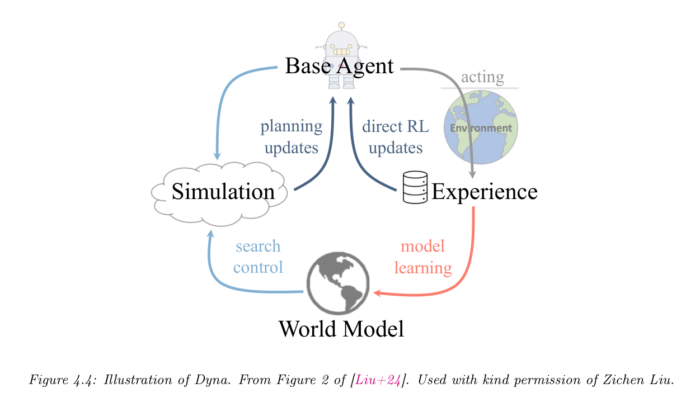
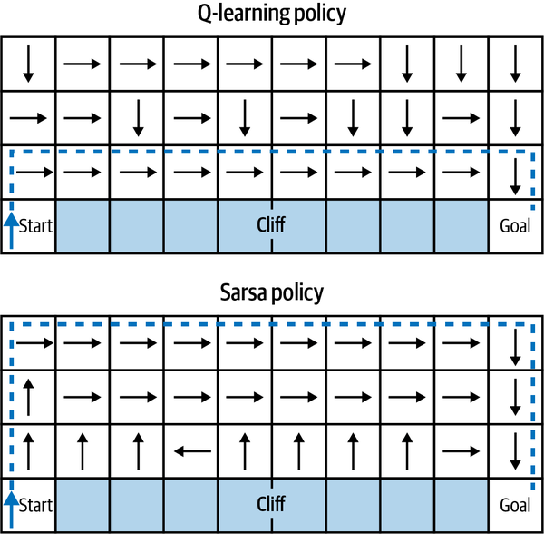
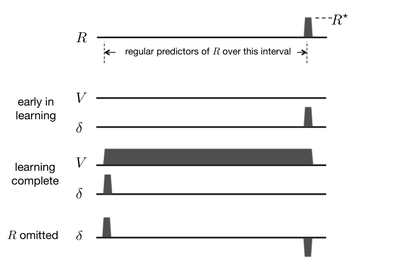
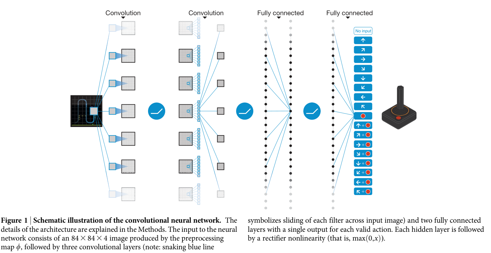
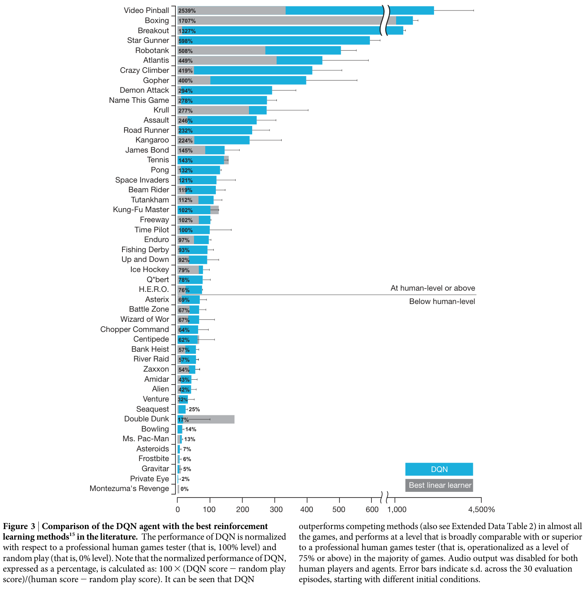
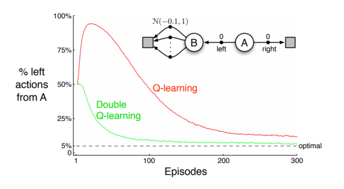
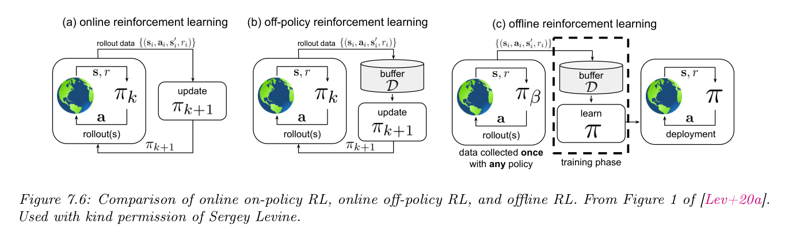

# 1b — Algorithm families, temporal difference and DQN

[01](01-rl-foundations.md) set up the MDP, the return and the Bellman equations. This note says how agents actually learn from them: the value-based, policy-based and actor-critic families, model-free against model-based, on-policy against off-policy, the temporal-difference update that Q-learning and SARSA share, n-step returns and GAE, and the deep-learning step that made Q-learning work on pixels and on logs. [01](01-rl-foundations.md#policy-gradients-from-reinforce-to-the-ppo-clip) picks up again with policy gradients.

## Algorithm families

**Value-based:** The agent estimates the expected long-term return (the "value") of
states or state-action pairs, then acts greedily. Examples: Q-Learning, DQN (Deep Q-Networks). DQN ([arXiv:1312.5602](https://arxiv.org/abs/1312.5602), Mnih et al., 2013) learned Q-values straight from raw pixels with a CNN. Its experience replay buffer broke the correlation between consecutive frames. With one architecture and one set of hyperparameters it played seven Atari games and beat a human expert on three. Both the games and the "one agent, no per-game tuning" rule came from the **Arcade Learning Environment** ([arXiv:1207.4708](https://arxiv.org/abs/1207.4708), Bellemare et al., JAIR 2013). ALE's authors tuned on five training games and reported on 50 test games drawn at random, the train/test split applied to environments. Their own SARSA(λ) agents on hand-built features beat trivial baselines in only 40 of 55 games, and sparse-reward games such as Montezuma's Revenge defeated everything. DQN's contribution was to learn the features from pixels. The 2015 Nature version, with replay and a target network, is under [Deep Q-networks](#deep-q-networks-and-learning-from-logs).

**Policy-based:** Directly optimize the policy without an explicit value function.
Policy gradient methods compute `∇E[R]` and update `π_θ` toward higher-reward trajectories.
They sample from a distribution rather than maximize over actions, which is why they scale to
huge or continuous action spaces where a `max_a` is infeasible (*Reinforcement Learning*,
ch. 9). An LLM choosing one token from a vocabulary of tens of thousands, at every step, is
such a space.

**Actor-Critic:** Hybrid approach. An "actor" decides actions (policy); a "critic"
estimates value (how good the state is), providing a lower-variance signal for updating
the actor. PPO ([arXiv:1707.06347](https://arxiv.org/abs/1707.06347)) became the default
actor-critic algorithm for deep RL and for RLHF. For LLM reasoning with verifiable rewards,
critic-free GRPO has largely taken over ([03](03-preference-optimization.md)).

**Model-free vs. model-based:** Model-free agents learn purely from experience.
Model-based agents learn the transition function P(s'|s,a) and use it for planning —
more sample-efficient but harder to learn accurate models.

**Dyna: one value function fed by real and simulated experience.** Sutton and Barto's Dyna-Q learns a model from real steps and then spends *n* planning updates per step on transitions it replays from that model, with the same Q-learning update as for real ones. On a 47-state maze (+1 only at the goal, γ = 0.95, α = 0.1, ε = 0.1, 30 repetitions, the first episode about 1,700 steps for every n), the agent with no planning (n = 0) needed about 25 episodes to reach a near-optimal path, and n = 50 took three. Planning adds no new information. It spreads the single reward it found back along the path in one episode instead of one step per episode (*RL: An Introduction*, ch. 8, Ex. 8.1, Figs 8.2–8.3).

```python
def dyna_q_step(Q, model, s, a, r, s2, n=50, alpha=0.1, gamma=0.95):
    Q[s][a] += alpha * (r + gamma * max(Q[s2].values()) - Q[s][a])   # learn from the real step
    model[(s, a)] = (r, s2)                                          # deterministic model
    for _ in range(n):                                               # plan from remembered pairs
        (ps, pa), (pr, ps2) = random.choice(list(model.items()))
        Q[ps][pa] += alpha * (pr + gamma * max(Q[ps2].values()) - Q[ps][pa])
```

A model learned once can go stale. When a shortcut opened after 3,000 steps in a maze, plain Dyna-Q never switched to it, because its model said the old route was the only one it knew. Dyna-Q+ adds a bonus κ√τ to simulated rewards, where τ is the steps since the pair was last tried for real, and so keeps testing whether the world changed (Exs 8.2–8.3; κ is "some small" value that the book does not give). Two ways to spend planning updates well: prioritized sweeping queues the pairs whose value just changed and works backward from them, which sped up mazes of 47 to 6,016 states by a factor of 5 to 10 at n = 5 (reported from Peng and Williams, 1993), and an expected update costs about *b* times a sample update at branching factor *b*, so when the budget is tight sampled updates win (Fig. 8.7). On-policy trajectory sampling beat uniform sampling early but lost later, more strongly at small branching factors (200 random tasks of 1,000 states, Fig. 8.8, which the authors call "not conclusive"). Every result is tabular with a deterministic model. The decision-time cousins, rollouts and Monte Carlo tree search (selection, expansion, simulation, backup), are in [09](09-test-time-search-and-training.md) (*RL: An Introduction*, ch. 8).

DreamerV3 ([arXiv:2301.04104](https://arxiv.org/abs/2301.04104) (Hafner et al., Nature 2025; numbers from arXiv v2)) shows
the current form of the idea; its references reach back to Dyna (Sutton, 1991). It learns a world
model from replayed experience, then trains the actor on rollouts of about 16 predicted latent
states and the critic on those plus replayed trajectories at lower weight. It acts by sampling the
actor with no lookahead planning. **One hyperparameter table
held across 8 benchmark domains and over 150 tasks.** On 57 Atari games at 200M steps it reached a
gamer-normalized median of 830%, against 693% for MuZero and 180% for PPO. Model size and replay ratio
still change per benchmark, so "fixed" doesn't mean nothing is set. It isn't best everywhere either:
EfficientMuZero leads at Atari100k (gamer mean 190% vs 125%, under a different protocol), and it scores 0.01
on BSuite exploration against 0.68 for Bootstrapped DQN. In Minecraft all 10 runs found a diamond
within 100M steps with no human data, while no PPO, IMPALA or Rainbow run did. That is a claim about
runs: only 0.4% of episodes at the 100M budget got a diamond, on a setup the authors modified and with a protocol they
set themselves. Every domain is a simulator or a game, and none of its experiments involve LLMs.

**On-policy vs. off-policy.** An *on-policy* method learns about the policy that is
generating the data (SARSA, REINFORCE, A2C, PPO). An *off-policy* method learns about one
policy, the *target*, from data generated by another, the *behavior* policy (Q-learning, DQN,
DDPG, SAC). Off-policy methods can reuse old data from a replay buffer, logs or a
demonstrator; the price is a mismatch between the two distributions that has to be corrected,
usually by importance sampling (*Reinforcement Learning*, ch. 1, 3 and 6).

> **Dated.** Winder writes that "most state-of-the-art algorithms are off-policy"
> (*Reinforcement Learning*, ch. 1). That held for 2020 benchmarks such as Atari and MuJoCo.
> LLM RL in 2025–26 is mostly on-policy: PPO and GRPO sample fresh completions from the current
> policy at every step. Winder's case for off-policy learning was exploration. A pretrained
> prior already makes on-policy samples informative, which removes much of that argument.

Murphy's overview (*RL: A Comprehensive Overview*, ch. 1, Table 1.1) arranges the same families by what is learned and whether the method is on- or off-policy: SARSA, REINFORCE, A2C and TRPO/PPO on-policy; Q-learning, DDPG and SAC off-policy. It calls value-based RL approximate dynamic programming. Two of its worked numbers are worth keeping. With γ = 0.99, a terminal reward of 1.0 reached in 15 steps is worth 0.99¹⁵ = 0.86, and in 17 steps 0.84, so discounting prices delay even at γ near 1. Setting γ = 1 − 1/T gives an effective horizon of about T steps: at 0.1 s per step, γ = 0.95 corresponds to 2 seconds. His Eq. 1.35 as printed drops the learning rate from the Q-learning update (a probable typo).

Murphy's chapter on model-based RL splits the use of a model in two (*RL: A Comprehensive Overview*, ch. 4, Sec. 4.1). **Decision-time planning** searches from the current state and throws the search away (forward search, MCTS with the UCT rule, model-predictive control). **Background planning** uses the model to train a policy or value function that then acts without search, which is Dyna and Dreamer. The learning-signal argument is the one above: he cites a result that learning the dynamics needs fewer samples than learning the policy, and contrasts the OpenAI robot hand, a model-free controller that needed 100 years of simulated experience for the Rubik's-cube task. Forward search to depth d costs O((|S|·|A|)^d), which is why sparse sampling and MCTS sample instead. His worked example shows why open-loop plans lose in stochastic environments: on a 9-state, 2-action, horizon-2 problem the best fixed action sequence earns 20, while a closed-loop policy that reacts to where it lands earns 30 (Fig. 4.3). The lineage in his chapter runs AlphaZero (trains on the MCTS visit-count policy), MuZero (adds a learned reward and latent model) and EfficientZero (adds a self-prediction loss, which he calls the biggest of its three gains, with no numbers), and DreamerV3 reached Minecraft diamonds without demonstrations but took 17 days of training. DreamerV4 instead trains purely in imagination on 2,500 hours of reward-free Minecraft video. The chapter reports results from other papers and runs no experiment of its own.


*Image Source: Murphy, [*Reinforcement Learning: A Comprehensive Overview*](https://arxiv.org/abs/2412.05265) (2024), Fig. 4.4, from Liu et al. (2024), used with permission*

## Monte Carlo control and importance sampling

Monte Carlo learns from complete episodes only, so it needs no model but cannot update mid-episode. **First-visit** MC averages the returns that follow the first visit to each state, and its error falls as 1/√n. In blackjack (infinite deck, γ = 1, 200 states of player sum, dealer card and usable ace) the "stick only on 20 or 21" policy is evaluated well after 500,000 games. Exploring starts, which begin episodes at every state-action pair, find a policy that matches Thorp's basic strategy except for one notch (*RL: An Introduction*, ch. 5, Exs 5.1 and 5.3). The authors call convergence of Monte Carlo with exploring starts "one of the most fundamental open theoretical questions in RL".

Learning from another policy's episodes takes **importance sampling**: weight each return by the ratio of the two policies' probabilities of the trajectory. The ordinary estimator is unbiased with unbounded variance. The weighted one is biased, with the bias going to zero, and the book calls it "strongly preferred" in practice. A one-state loop with true value 1 shows the failure (target always left, behaviour 50/50, ten runs): ordinary importance sampling does not settle on 1 "even after millions of episodes", while the weighted estimator is exactly 1 from the first episode that ends left. On blackjack (target value about −0.27726 at dealer 2, player 13 with a usable ace, 100 runs) both are close after 1,000 episodes, but weighted has far lower early error (Exs 5.4–5.5, Figs 5.3–5.4). The incremental form keeps a cumulative weight `C` per pair:

```python
def off_policy_mc_episode(Q, C, episode, pi_prob, b_prob, gamma=1.0):
    G, W = 0.0, 1.0
    for s, a, r in reversed(episode):          # r is the reward received after (s, a)
        G = gamma * G + r
        C[s][a] += W
        Q[s][a] += (W / C[s][a]) * (G - Q[s][a])
        W *= pi_prob(a, s) / b_prob(a, s)
        if W == 0: break                       # the target policy never takes this action
```

The same ratio is the importance weight in PPO and in corrections for stale rollouts, and the same variance problem is why PPO clips it. Off-policy MC control learns only from the tails of episodes after the last non-greedy action, and the book says there is "insufficient experience" to judge how serious that is.

## Temporal-difference learning: Q-learning vs. SARSA

TD learning updates an estimate toward a one-step target. The gap between target and
estimate is the **TD error** δ, the single most reused quantity in RL:

```
δ_t = r_{t+1} + γ·V(s_{t+1}) − V(s_t)          TD error
V(s_t) ← V(s_t) + α·δ_t                         TD(0) update
```

Two control algorithms differ in one term of the target (*Reinforcement Learning*, ch. 3):

```
Q-learning (off-policy):  Q(s,a) ← Q(s,a) + α [ r + γ·max_a' Q(s',a') − Q(s,a) ]
SARSA      (on-policy):   Q(s,a) ← Q(s,a) + α [ r + γ·Q(s',a')        − Q(s,a) ]   a' ~ π
```

```python
def q_update(Q, s, a, r, s_next, done, alpha=0.1, gamma=0.99):
    target = r if done else r + gamma * max(Q[s_next].values())  # SARSA: Q[s_next][a_next]
    Q[s][a] += alpha * (target - Q[s][a])                        # alpha * TD error

# One step of a corridor: moving right from cell 3 costs 0.5 and lands next to a known payoff
Q = {3: {"left": 0.0, "right": 0.0}, 4: {"left": 0.0, "right": 10.0}}
q_update(Q, s=3, a="right", r=-0.5, s_next=4, done=False)
print(round(Q[3]["right"], 3))   # 0.1 * (-0.5 + 0.99 * 10.0 - 0.0)
```

```text
0.94
```

Q-learning bootstraps from the best next action, so it learns the value of the greedy policy
while it explores with ε-greedy. SARSA bootstraps from the action it actually takes next, so it
learns the value of the exploring policy, random slips included. Winder's cliff world shows the
consequence. Each step costs −1, falling off the cliff costs −100 and ends the episode, and the
agent explores with ε-greedy:


*Image Source: Phil Winder, *Reinforcement Learning* (O'Reilly, 2020), Fig. 3-3*

Q-learning finds the shortest path along the cliff edge, which is optimal only if the agent
never makes a random move. SARSA learns the safe route, because its value estimates include the
chance that an ε-greedy step kicks it over the edge. The on-policy agent optimizes the policy it
will actually run. That is the same argument LLM RL makes for on-policy rollouts. Sutton and Barto's cliff walk (undiscounted, ε = 0.1, 500 episodes, Ex. 6.6) gives the same verdict: Q-learning learns the edge path but has the worse online reward (*RL: An Introduction*, ch. 6).

**Why TD, and what it converges to.** On a 5-state random walk (start in the middle, +1 only on the right exit, undiscounted, V initialised to 0.5, RMS error over 100 runs) TD(0) was consistently better than constant-α Monte Carlo across step sizes (Ex. 6.2). On a fixed batch the two reach different answers. With eight episodes (`A,0,B,0` once; `B,1` six times; `B,0` once) both give V(B) = 3/4, but Monte Carlo gives V(A) = 0 because the one episode through A earned 0, while TD(0) gives V(A) = 3/4 because it learns that A leads to B. TD finds the value that is exactly right for the maximum-likelihood model of the data. Computing that directly costs about n² memory and n³ steps for n states, and TD approximates it in order-n memory (Exs 6.3–6.4). The MC error is also a sum of TD errors, `G_t − V(S_t) = Σ γ^(k−t) δ_k`, exactly when V is fixed (Eq. 6.6). The book notes that nobody has proved TD learns faster than Monte Carlo.

**Expected SARSA and the maximisation bias.** Expected SARSA replaces the sampled next action with its expectation under the policy, `r + γ Σ_a π(a|s')·Q(s',a)`. It removes the variance from sampling `a'`, and with a greedy target policy it is exactly Q-learning. On cliff walking (ε = 0.1) it kept SARSA's lead over Q-learning across a wide range of step sizes (Fig. 6.3: interim over 100 episodes and 50,000 runs, asymptotic over 100,000 episodes and 10 runs). The `max` in Q-learning's target causes overestimation. In a two-state MDP where every action after the left move has reward N(−0.1, 1), ε-greedy Q-learning took left about 5% more often than optimal even at the asymptote (ε = 0.1, α = 0.1, γ = 1). **Double Q-learning** keeps two tables, picks the argmax with one and scores it with the other, and was essentially unaffected (10,000 runs). It doubles memory and leaves per-step compute unchanged (Ex. 6.7, Fig. 6.5; *RL: An Introduction*, ch. 6).

**n-step returns and eligibility traces.** One step is the low-variance, high-bias extreme;
the full Monte Carlo return is the other. An n-step target uses n real rewards before
bootstrapping, and TD(λ) blends all n with weights `(1−λ)λ^(n−1)` via an eligibility trace
(*Reinforcement Learning*, ch. 3). Multi-step targets help most when rewards are sparse or
delayed. **GAE**, the advantage estimator inside PPO for RLHF, is exactly this λ-weighting
applied to TD errors:

```
Â_t = Σ_{l≥0} (γλ)^l · δ_{t+l}          λ = 0 → one-step TD;  λ = 1 → Monte Carlo minus V
```

Sutton and Barto's n-step chapter supplies the justification. The worst-state error of the expected n-step return is at most γⁿ times the worst-state error of the current estimate, which is why n-step TD converges. On a 19-state random walk (values start at 0, RMS error over the first 10 episodes, 100 repetitions, n swept against α) "methods with an intermediate value of n worked best", better than both one-step TD and Monte Carlo. The curves exist only in Fig. 7.2, so there is no number to quote. In a gridworld with one reward, 10-step SARSA strengthens the last ten actions on the path after one episode, where one-step SARSA strengthens only the last (Fig. 7.4). The costs are an n-step delay before each update and more memory. The λ-return is the geometric average `G^λ = (1−λ) Σ_n λ^(n−1) G_{t:t+n}`, whose weights are positive and sum to 1, and its backward-view form is the trace `z_t = γλ·z_{t−1} + ∇v`, `w ← w + α·δ_t·z_t`. That is TD(λ): it updates every step and works on continuing tasks. The chapter never mentions advantage estimation, so it supports GAE only through this machinery. Across a random walk, cart-pole, Mountain Car and Puddle World, "an intermediate mixture appears to be the best choice", and λ = 1 is often the poorest even though its asymptotic error bound is loosest at λ = 0 (plots only, reported from earlier papers). With a neural network, traces roughly double memory and compute per step (*RL: An Introduction*, ch. 12).

Off-policy n-step learning inherits the importance-sampling variance described above, which forces small step sizes. Two remedies: a **control variate**, `G = ρ(R + γG') + (1 − ρ)V`, which leaves the estimate unchanged when ρ = 0 instead of dragging the target to zero, and the **tree-backup** return, which weights each branch by the target policy's probability and needs no importance ratio. Tree-backup's caveat is that when the two policies differ a lot, bootstrapping may span only a few steps even if n is large. Q(σ) interpolates between SARSA (σ = 1) and tree-backup (σ = 0), and the authors present it as new and unevaluated (*RL: An Introduction*, ch. 7).

**The same δ in animals.** The textbook's psychology chapter shows that δ is older than the algorithm. The Rescorla–Wagner model of classical conditioning changes an association by `α·(R − v̂)`, an error-correction rule, which is why a second stimulus added to an already-predicted reward is blocked: no error is left to learn from. The real-time TD model with γ = 0 reduces to it. Bootstrapping also explains second-order conditioning, because the `γv̂(S') − v̂(S)` term is treated like a reward (*RL: An Introduction*, ch. 14, Sec. 14.2). Chapter 15 reports the neural counterpart as a hypothesis: phasic dopamine activity matches δ, not the reward. The worked case is tabular TD(0) on one trial with a separate internal stimulus per time step, γ ≈ 1 and V initialised at zero. δ first equals the reward, moves back to the earliest predictor as learning completes, is zero at a fully predicted reward, and goes negative if the reward is omitted:


*Image Source: Sutton & Barto, *Reinforcement Learning: An Introduction* (MIT Press, 2018), Fig. 15.4*

The chapter lists where the model misfits (when a reward arrives early, dopamine cells do not dip at the omitted time) and says the authors are not neuroscientists. It also shows that an actor-critic network's two parts differ only in their eligibility trace: `∇v̂` for the critic and `∇ln π` for the actor, both driven by the same δ (ch. 15, Sec. 15.8). For LLM RL the carry-over is plain: a fully predicted reward carries no learning signal. That is the baseline and advantage idea, with the critic or the group mean playing the part of the prediction.

## Function approximation and the deadly triad

Everything above kept one number per state. With a parameterised value `v̂(s, w)` the update is `w ← w + α·[target − v̂(S,w)]·∇v̂(S,w)`. A Monte Carlo target is an unbiased sample of the true value, so this is true gradient descent. A bootstrapped target (TD, n-step) depends on `w` itself, and the update ignores that dependence, which is why these are called **semi-gradient** methods (*RL: An Introduction*, ch. 9, Sec. 9.3). Linear semi-gradient TD(0) still converges on-policy to the TD fixed point, whose value error is at most 1/(1−γ) times the best achievable (a result reported from Tsitsiklis and Van Roy, 1997). The same chapter warns that off the on-policy distribution "bootstrapping methods using function approximation may actually diverge to infinity" (ch. 9). On a 1000-state random walk with 10 aggregated groups, gradient Monte Carlo needed 100,000 episodes (α = 2·10⁻⁵) to settle, and TD(0) settled at a worse asymptote than Monte Carlo while n-step TD learned faster (100 runs, 20 groups of 50 states; ch. 9, Exs 9.1–9.2). The step size to start from is `α = (τ·E[xᵀx])⁻¹` for a trace of τ updates, not the 1/t schedule of the tabular case.

For control, semi-gradient SARSA is the same update on `q̂(S,A,w)`. On Mountain Car with 8 tile-coded tilings, intermediate bootstrapping again won: n = 4 was best in a sweep of n = 1, 2, 4, 8, 16 over the first 50 episodes (100 runs; ch. 10, Fig. 10.4). Two limits matter later. Function approximation loses the policy improvement theorem, so ε-greedy action-value control has no guarantee of improving and linear SARSA only "enters a bounded region near" a good solution instead of converging. And in continuing tasks the discounted return of a policy is `r(π)/(1−γ)`, so γ cannot change which policy is best; it is a solver parameter, and the average-reward formulation is the honest objective (ch. 10, Sec. 10.4). The policy-gradient theorem (ch. 13, [01](01-rl-foundations.md#policy-gradients-from-reinforce-to-the-ppo-clip)) is the book's answer to the first problem.

**The deadly triad.** Instability appears when three things are combined: function approximation, bootstrapping and off-policy training. "If any two elements of the deadly triad are present, but not all three, then instability can be avoided" (*RL: An Introduction*, ch. 11, Sec. 11.3). The smallest example has two states valued `w` and `2w`, reward 0 and one repeated transition. Each off-policy semi-gradient TD(0) update multiplies `w` by `1 + α(2γ − 1)`, which exceeds 1 whenever γ > 0.5, whatever the step size:

```python
alpha, gamma, w = 0.1, 0.99, 1.0
for _ in range(50):
    w += alpha * (gamma * 2 * w - w)     # target 2w from the next state, estimate w
print(round(w, 1))                       # 107.2, and it keeps growing
```

Baird's counterexample is a full 7-state, 2-action MDP with 8 linear weights and zero reward. With γ = 0.99, α = 0.01 and initial weights (1,1,1,1,1,1,10,1), semi-gradient TD(0) and the expected DP version both diverge (ch. 11, Figs 11.1–11.2). Fitting least squares at every DP step does not rescue it, but "averagers" such as nearest-neighbour regression are stable, and tile coding and neural networks are not guaranteed. Q-learning with an ε-greedy behaviour policy has never been seen to diverge in the linear case, and the book says there is no theory for it. Dropping to SARSA removes the off-policy corner of the triad for model-free control; off-policy learning is needed when many value functions are learned in parallel from one stream. Gradient-TD (GTD2, TDC) descends the projected Bellman error at roughly double the cost, and TDC drives that error to zero on Baird's example while the value error still sits near 2 after 1,000 steps (α = 0.005, β = 0.05; ch. 11, Fig. 11.5). Emphatic-TD converges in expectation but its sampled variance is too high to run (ch. 11). The chapter does not mention DQN, replay or target networks. Linking them to the triad below is this note's inference: replay and a lagged target network are practical damping for the bootstrapping-plus-off-policy-plus-network case, not a result of the chapter.

## Deep Q-networks and learning from logs

DQN made Q-learning work with a neural network by damping the instability that the deadly triad
predicts (*Reinforcement Learning*, ch. 4):

- **Experience replay** samples past transitions at random, which breaks the correlation
  between consecutive steps.
- A **target network**, a lagged copy of the Q-network, computes `max_a' Q(s',a')` so the
  target does not move with every update.

DQN also uses the Huber loss, which is linear for large errors and so caps the gradient from
outliers. The `max` in the target overestimates values whenever estimates are noisy. **Double
Q-learning** picks the action with one network and scores it with the other (*RL: An Introduction*, ch. 6, Ex. 6.7). Rainbow
combines that with prioritized replay, dueling (V + A) heads, n-step targets, noisy-net
exploration and distributional returns.

**What the 2015 paper measured.** [Mnih et al., *Nature* 2015](https://doi.org/10.1038/nature14236) is the version with the target network. It trained one network per game, with the same architecture and hyperparameters on all 49 Atari games, for 50 million frames (about 38 days of game time), and tested over 30 episodes of up to 5 minutes at ε = 0.05. **DQN beat the best earlier RL method on 43 of the 49 games and reached more than 75% of a professional human tester's score on 29** (100 × (DQN − random)/(human − random); one tester with about 2 hours of practice per game). The input is the last 4 frames at 84×84, passed through conv 32 filters 8×8 stride 4, conv 64 4×4 stride 2, conv 64 3×3 stride 1 and a 512-unit dense layer, with one output per action (4 to 18). Training used a 1-million-frame replay memory, minibatches of 32, RMSProp at learning rate 0.00025, γ = 0.99, ε annealed from 1.0 to 0.1 over the first million frames, a target network cloned every 10,000 updates, and one update per 4 frames. Rewards were clipped to ±1 and the TD error to [−1, 1]. The authors tuned these informally on five games (Pong, Breakout, Seaquest, Space Invaders, Beam Rider) and then held them fixed.


*Image Source: Mnih et al., [Human-level control through deep reinforcement learning](https://doi.org/10.1038/nature14236) (Nature, 2015), Fig. 1*

The ablation is the part to remember. On five games, 10 million frames, best of three learning rates and the best checkpoint's average episode score, the four combinations of replay and target network gave:

| Game | Replay + target | Replay only | Target only | Neither |
|---|---|---|---|---|
| Breakout | 316.8 | 240.7 | 10.2 | 3.2 |
| Enduro | 1006.3 | 831.4 | 141.9 | 29.1 |
| River Raid | 7446.6 | 4102.8 | 2867.7 | 1453.0 |
| Seaquest | 2894.4 | 822.6 | 1003.0 | 275.8 |
| Space Invaders | 1088.9 | 826.3 | 373.2 | 302.0 |

Removing replay costs far more than removing the target network, and a single linear layer on the same pixels with both tricks scored 3.0 on Breakout and 62.0 on Enduro against 316.8 and 1006.3 (Extended Data Tables 3 and 4, read from the rendered tables). The tricks are best-checkpoint maxima from one setup, with no seeds or variance reported, so read the ordering and not the gaps.


*Image Source: Mnih et al., [Human-level control through deep reinforcement learning](https://doi.org/10.1038/nature14236) (Nature, 2015), Fig. 3. Error bars are the s.d. over 30 evaluation episodes.*

What it does not do: Montezuma's Revenge scores 0, and the authors say games needing "more temporally extended planning strategies" remain a major challenge. Reward clipping means the agent cannot tell a small reward from a large one, uniform replay treats every transition alike (prioritised replay is named as future work), and the memory holds only the most recent million frames.


*Image Source: Murphy, [*Reinforcement Learning: A Comprehensive Overview*](https://arxiv.org/abs/2412.05265) (2024), Fig. 2.8, reproduced from Sutton & Barto Fig. 6.5 with permission*

Maximization bias in one picture: state B has many actions whose rewards are drawn from N(−0.1, 1.0), so going left from A is worth −0.1 and is wrong, yet Q-learning with ε = 0.1 picks left most of the time early on because the max over noisy estimates is positive. The curve is averaged over 10,000 runs (Murphy, ch. 2, Sec. 2.5.3). Murphy's survey also lists Rainbow's six parts as double DQN, prioritized replay, C51, n-step with n = 3, dueling and noisy nets, and says each adds diminishing returns (read from his Fig. 2.9; no ablation numbers are printed). On the Atari-100k benchmark, which uses 26 of the 46 ALE games, the best method as of 2024, BBF, ranks its tricks by importance: a larger residual network, a higher update-to-data ratio, periodic soft resets, then n-step annealing (n from 10 to 3, γ from 0.97 to 0.997) (Schwarzer et al., 2023, as reported by Murphy). Target networks can be a periodic copy or an EMA of the weights (ρ ≈ 0.999). Murphy also reports Gallici et al. (2024) proving that off-policy nonlinear TD converges when the final-layer weights are bounded, the penultimate layer is wide and the critic input is norm-bounded (LayerNorm or RMSNorm), a modern answer to the deadly triad. His chapter only names distributional RL (C51, IQN) and defers it to a later section, so don't cite it for those methods.


**A concrete DQN configuration (dated: 2017 textbook, TF 1.x code).** Buduma and Locascio's Breakout agent stacks 4 frames of 84×84 grayscale as input channels, then conv 32 filters 8×8 stride 4, conv 64 filters 4×4 stride 2, conv 64 filters 3×3 stride 1, a 512-unit dense layer and one Q-value per action. It uses Adam at 1e-3, γ = 0.98, batch 32, one update every 4 steps, a target-network sync every 16 steps, 100 random warm-up steps and a 5,000-transition replay queue that drops the oldest entry, with ε annealed linearly from 1.0 to 0.01. The chapter calls a γ "between 0.99 and 0.97" typical and shows the undiscounted sum of rewards as the naive alternative that "lacks any sense of urgency" (*Fundamentals of Deep Learning*, ch. 9). Treat the numbers as the shape of a setup, not a recipe. It prints no scores (only an upward reward curve, one run), and its prose ("update our target Q-network once every four batches", 1,000 episodes) disagrees with its own code (every 16 steps, 5,000 episodes). It also reports from Mnih et al. (2016), without hardware or setup, that A3C learns Breakout in under 12 hours where DQN "may take 3 to 4 days"; the mechanism it gives is that asynchronous actors in many environments decorrelate each batch, so no replay buffer is needed. The coverage stops at 2016, so Double and dueling heads, prioritized replay and PPO are absent. On the value head, Murphy reports that a Gaussian-smoothed histogram loss (HL-Gauss) beat MSE, two-hot and C51 in Farebrother et al. (2024), especially for large networks, and only conjectures why (robustness to noisy, non-stationary targets) (*RL: A Comprehensive Overview*, ch. 7, Sec. 7.3).

**Offline (batch) RL** learns from a fixed log with no further interaction. Winder trains a
DQN agent on the replay buffer of another DQN agent on CartPole, with no environment access.
Its Q-values diverge, climbing on a log scale, and its reward stays poor. The `max` keeps
choosing actions that are not in the data, and with no way to try them nothing corrects the
optimistic estimate. Batch-constrained Q-learning (BCQ) converges on the same buffer because
it only considers actions a generative model says the log could contain (*Reinforcement
Learning*, ch. 4). The lesson carries over directly to LLMs. Offline preference methods such as
DPO ([03](03-preference-optimization.md)) are batch RL on a fixed preference set, and they
share its limit: the policy improves only where the data has coverage. Online and on-policy
methods keep the advantage of being able to check their own guesses.


*Image Source: Murphy, [*Reinforcement Learning: A Comprehensive Overview*](https://arxiv.org/abs/2412.05265) (2024), Fig. 7.6, from Levine et al. (2020), used with permission*

Murphy's survey names the same bottleneck: with no way to test actions the log never took, the policy "will be deployed on new states that it may not have seen", and out-of-distribution generalization is "the main bottleneck for current offline RL methods" (*RL: A Comprehensive Overview*, ch. 7, Sec. 7.7). Its fixes are policy constraints (a KL penalty, AWR), pessimistic value estimates (CQL, ensemble variance), model-based penalties (MOPO) and return-conditioned sequence models. It adds that return conditioning fails in stochastic environments, because a high return in the log may have been luck. It reports no benchmark numbers for these, so cite Decision Transformer's own paper below for numbers.

Decision Transformer removes the `max` instead of constraining it
([arXiv:2106.01345](https://arxiv.org/abs/2106.01345) (Chen et al., NeurIPS 2021)). A small
GPT is trained on the log as interleaved (return-to-go, state, action) tokens with a plain
action-prediction loss, then prompted at test time with the return you want. With no learned
value function to optimize, there is nothing for unseen actions to exploit. On nine D4RL
locomotion logs it **averaged 74.7 against 63.9 for CQL**, the strongest pessimistic
Q-learning baseline. When rewards were withheld until the end of the episode, CQL collapsed
(Hopper medium-replay: 2.0) while Decision Transformer barely moved (78.5). The limits are in
the same paper. Behavior cloning on only the top 10% of trajectories matched it on average
(56.7 against 56.1), although picking that percentile needs environment rollouts. And it
exceeded the best return in its data only sometimes (Seaquest). Offline RL here becomes the
same conditional next-token problem an LLM solves.

## Pitfalls

- **Using ordinary importance sampling on long trajectories.** The ratio is a product of per-step ratios, so its variance is unbounded. Prefer the weighted form, a control variate or a clip.
- **Trusting a planning model after the world changes.** Dyna-Q kept the old route in the shortcut maze. Give simulated transitions an exploration bonus or refresh the model.
- **Taking the max over noisy estimates.** Q-learning's target is biased upward. Double Q-learning or a target network reduces it.
- **Assuming a larger n is better.** On the 19-state walk the best n was intermediate, and off-policy n-step methods lose their bootstrapping horizon when the policies differ.

## Try it

1. In `dyna_q_step`, set `n=0` and run it on a corridor of ten cells with +1 at the end. How many episodes before the first cell points the right way, compared with `n=50`?
2. Compute batch Monte Carlo and TD(0) values of A and B for the eight-episode example above by hand.
3. In `off_policy_mc_episode`, what is `W` after an action the target policy never takes, and what does the loop do?

<details><summary>Answers</summary>

1. With n = 0 the reward reaches one cell back per episode, so about ten episodes. With n = 50 replayed updates spread it back in one or two. Exact counts depend on ε and the seed.
2. Monte Carlo: V(B) = 3/4, V(A) = 0. TD(0): V(B) = 3/4, V(A) = 3/4.
3. `W` becomes 0 and the loop breaks, since every earlier step in the episode would get zero weight.

</details>

## Interview checklist

| Question | Answer |
|---|---|
| Ordinary vs weighted importance sampling? | Ordinary is unbiased with unbounded variance. Weighted is biased but the bias vanishes, and its variance is far lower, so it is preferred in practice. |
| Why does TD beat Monte Carlo on a batch? | TD(0) converges to the value of the maximum-likelihood Markov model of the data, so it uses structure (A leads to B). Monte Carlo fits the observed returns only. |
| What does Expected SARSA change? | It uses the expectation over next actions instead of a sample, which removes the variance of choosing `a'`. With a greedy target it is Q-learning. |
| What is maximisation bias? | The max over noisy estimates is biased upward. Double Q-learning selects with one table and evaluates with the other. |
| What does planning buy in Dyna? | No new information, but each real transition is propagated through the model, so credit spreads in far fewer episodes. |
| Why n-step? | Intermediate n trades the bias of one-step bootstrapping against the variance of the full return. |

---

## Next

[01 — policy gradients](01-rl-foundations.md#policy-gradients-from-reinforce-to-the-ppo-clip) takes the actor half of the actor-critic split to the PPO clip, then maximum entropy, exploration and how RL maps onto LLMs. [02 — RLHF pipeline](02-rlhf-pipeline.md) then applies them to language models.
