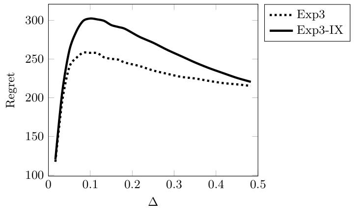
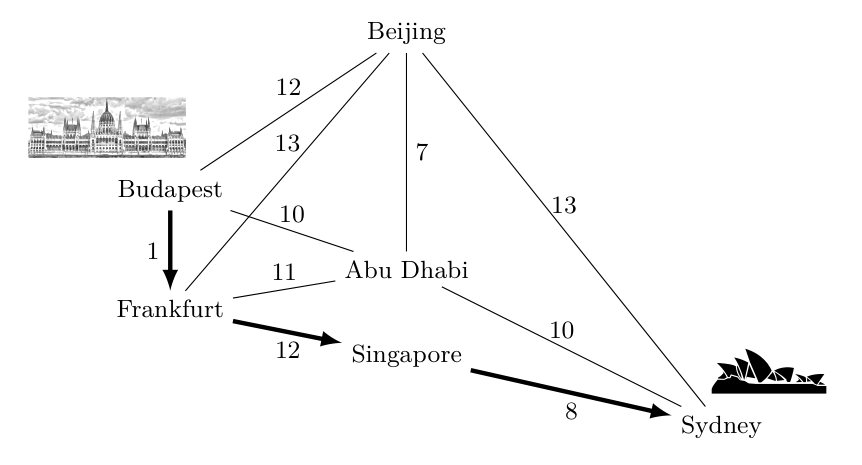

# 1c — Bandits: regret, confidence bounds and Exp3

A bandit is the one-state case of the problem in [01](01-rl-foundations.md): no transitions, only a choice of arm and a reward. It isolates exploration, which [01](01-rl-foundations.md#exploration-vs-exploitation) treats in a paragraph, and it is where regret, the cost of not knowing, is best understood. This note holds the guarantees: the testbed numbers, regret for explore-then-commit, UCB and its variants, Exp3 for adversarial rewards, the lower bounds, and contextual and linear bandits. Thompson sampling with no context is in [DA 04/03](../../../data-analytics/04-bayesian-analysis/notes/03-priors-and-bandits.md#bayesian-bandits-thompson-sampling).

## Stochastic bandits and regret

- **Measured on the 10-armed testbed** (2,000 random problems, rewards N(q*, 1), 1,000 steps): greedy gets about 1 reward per step against 1.54 possible; ε = 0.1 never exceeds 91% optimal actions; optimistic initial values (Q₁ = +5, α = 0.1) start worse than ε-greedy and end better, but only help stationary problems; UCB with c = 2 beats ε = 0.1 after the first k steps (`A = argmax[Q(a) + c·√(ln t / N(a))]`); a gradient bandit with a baseline is unaffected when every mean shifts by +4, and without the baseline degrades. The gradient bandit's expected update equals the gradient of expected reward, so it is stochastic gradient ascent and the direct ancestor of [REINFORCE](01-rl-foundations.md#policy-gradients-from-reinforce-to-the-ppo-clip), with the baseline only reducing variance. Across a parameter sweep from 1/128 to 4, every method traces an inverted U, and UCB comes out best on this problem (*RL: An Introduction*, ch. 2). Exact Bayesian lookahead over 1,000 two-action steps has 2^2000 leaves, which is why Thompson sampling is used instead.
- **Regret and the noisy TV (Murphy, ch. 7).** Regret measures return lost against the best policy in hindsight. For a tabular episodic MDP with horizon H, S states, A actions and T steps, the optimal minimax regret is O(√(HSAT)) (*RL: A Comprehensive Overview*, ch. 7, Sec. 7.1). Exact Bayes-optimal planning merges identical belief states, yet a bandit with n arms and horizon h still has O(h^2n) of them (about 10^12 for the two-arm, 1,000-step case above), and Gittins indices solve only the infinite-horizon discounted, context-free case (Sec. 7.2.1). Posterior sampling is the cheap alternative: sample one model from the posterior each episode and act greedily on it. Prompting an LLM to do this worked on 3-state RiverSwim and failed at 4 states (as reported, Sec. 7.2.2). Rewarding raw prediction error as intrinsic motivation invites the *noisy TV* problem, an agent that stares at unpredictable noise, while information gain, ICM or a KL reward avoid it (Sec. 7.4).
- **Regret guarantees (Lattimore & Szepesvári).** Regret is R_n = nμ* − E[ΣX_t], which equals Σ_i Δ_i·E[T_i(n)], the gap times the expected pull count of each arm (*Bandit Algorithms*, ch. 4, Lemma 4.5). Bounds below assume k arms, horizon n and 1-subgaussian rewards unless stated.
  - *Explore-then-commit* on two arms with gap Δ, tuned to Δ: R_n ≤ min{nΔ, Δ + (4/Δ)(1 + max{0, log(nΔ²/4)})}. A commit time chosen from n alone gives only O(n^(2/3)) (ch. 6, Eq. 6.6, Exercise 6.5).
  - *UCB* with confidence δ = 1/n²: R_n ≤ 3ΣΔ_i + Σ 16 log n/Δ_i, and gap-free 8√(nk log n) + 3ΣΔ_i. It needs n in advance (ch. 7). The anytime variant: limsup R_n/log n ≤ Σ 2/Δ_i (ch. 8). MOSS drops the log factor, 39√(kn) + ΣΔ_i (ch. 9, Thm 9.1). For Bernoulli rewards KL-UCB has limsup R_n/log n ≤ ΣΔ_i/d(μ_i, μ*) and is never worse than UCB, since d ≥ 2Δ² (ch. 10, Thm 10.6).
  - *Adversarial rewards in [0,1]:* Exp3 with η = √(2 log k/(nk)) gets R_n ≤ √(2nk log k) in expectation, yet its regret is heavy-tailed: some bandit has P(regret ≥ n/4) > 1/131 (ch. 11, Thm 11.2, Note 1). Exp3-IX biases the estimator upward, so with probability 1−δ the regret is O(√(nk log(k/δ))) (ch. 12). In the book's k = 5, n = 10⁴ run its *expected* regret is higher than Exp3's (Fig. 12.1).
  - *Floors.* Any policy has some Gaussian instance with R_n ≥ (1/27)√((k−1)n) once n ≥ k−1 (ch. 15, Thm 15.2, sketched in ch. 13). A policy consistent on an unstructured class has liminf R_n/log n ≥ Σ Δ_i/d_inf; for unit-variance Gaussians that is Σ 2/Δ_i, so the UCB asymptotics above are tight (ch. 16, Thm 16.2 and Table 16.1; the 2/Δ form is our substitution). Beating that line on one instance costs regret elsewhere (Fig. 16.1). Expected regret ≤ B√((k−1)n) also forces a tail: some Gaussian instance has regret ≥ ¼·min{n, (1/B)·√((k−1)n)·log(1/(4δ))} with probability ≥ δ (ch. 17, Thm 17.1).

*Image Source: Lattimore & Szepesvári, *Bandit Algorithms* (Cambridge University Press, 2020), Fig. 16.1. Schematic.*

*Image Source: Lattimore & Szepesvári, *Bandit Algorithms* (Cambridge University Press, 2020), Fig. 12.1.*

## Adversarial bandits and Exp3

The UCB and Thompson rules above assume each arm pays from a fixed distribution. **Exp3** ([Auer, Cesa-Bianchi, Freund & Schapire, SIAM J. Comput. 2002](https://doi.org/10.1137/s0097539701398375), from a FOCS 1995 abstract) drops that assumption: rewards in [0, 1] may be chosen by an adversary in advance, and the goal is to lose little against the best single arm in hindsight (*weak regret*). The paper has no experiments, only proofs.

![Pseudo-code box for Exp3: initialise every weight to 1; each round set each arm's probability to a mix of its normalised weight and gamma over K, draw an arm, observe a reward in [0,1], set the estimate to the reward over the arm's probability for the pulled arm and zero otherwise, then multiply each weight by exp of gamma times its estimate over K.](../sources/images/auer-2002-exp3-fig1.png)
*Image Source: Auer et al., [The Nonstochastic Multiarmed Bandit Problem](https://doi.org/10.1137/s0097539701398375) (SIAM J. Comput., 2002), Fig. 1*

The estimator is the importance weighting from [the Monte Carlo section](01b-algorithm-families-td-and-dqn.md#monte-carlo-control-and-importance-sampling). Only the pulled arm's reward is seen, so it is divided by the probability of having pulled it, which makes the estimate unbiased for every arm, pulled or not. The γ/K of uniform exploration keeps every probability above γ/K, which bounds the estimate by K/γ and stops an early run of low rewards from freezing an arm out.

- **Bound.** For any γ in (0, 1] and any horizon, G_max − E[G_Exp3] ≤ (e − 1)·γ·G_max + K ln K/γ (Thm 3.1). With a known g ≥ G_max and γ = min{1, √(K ln K/((e − 1)g))} the regret is at most 2.63·√(g·K ln K) (Cor. 3.2); with g = T, that is O(√(T·K ln K)). The adversary is oblivious, and the extension to adaptive adversaries is asserted and left to the reader (Sec. 9). The regret guarantees above state the textbook form of the same bound, in an η parameterisation.
- **Floor.** For any algorithm there is a reward distribution (one random arm pays Bernoulli(1/2 + ε), the rest Bernoulli(1/2), ε = ¼·min{√(K/T), 1}) with expected weak regret at least (1/20)·min{√(KT), T} (Thm 5.1). The √(ln K) gap to the upper bound is left open. It does not contradict the O(ln T) rates of stochastic bandits, because there the distributions stay fixed as T grows and here they depend on K and T.
- **Variants.** Plain Exp3 needs g or T. Exp3.1 restarts it in epochs of growing g and needs neither, at 8√(e − 1)·√(G_max·K ln K) + 8(e − 1)K + 2K ln K (Thm 4.1). The paper gives no high-probability bound for Exp3 itself, since the estimate's variance can reach 1/p, and argues informally that its regret could be as large as T^(3/4). Exp3.P adds a confidence bonus to each estimate and then holds with probability ≥ 1 − δ, but only for a known T (Thm 6.3). Exp4 takes advice from N experts and pays K ln N/γ, so the cost is logarithmic in N (Thm 7.1). Exp3.S shares weight among arms to track a sequence with H − 1 switches, at about H·√(KT ln(KT)) (Cor. 8.2).

## Contextual and linear bandits

**Contextual bandits** are the one-step case: observe a context, pick an action, get a
reward, with no state carried forward. It is the right model for recommendation, routing and
prompt or model selection. See [Bayesian bandits](../../../data-analytics/04-bayesian-analysis/notes/03-priors-and-bandits.md#bayesian-bandits-thompson-sampling) in data
analytics for the case with no context, and for Thompson sampling. Two results anchor it:

- **LinUCB** ([arXiv:1003.0146](https://arxiv.org/abs/1003.0146), Li et al., 2010) fits a
  ridge regression per arm and picks the arm with the highest upper confidence bound. On over
  33M events from the Yahoo! front-page news module it got a 12.5% click lift over a
  context-free bandit. The paper's other lasting contribution is **replay evaluation**: a
  bandit policy can be scored offline, without bias, on logs collected under a uniformly
  random policy.
- **Thompson sampling with neural nets** ([arXiv:1802.09127](https://arxiv.org/abs/1802.09127),
  Riquelme et al., 2018) benchmarked approximate Bayesian deep nets as posteriors. Many methods
  that work in supervised learning did poorly here because their uncertainty estimates converge
  too slowly for online decisions. The robust choice was **NeuralLinear**: a network learns a
  representation, and an exact Bayesian linear regression on its last layer supplies the
  uncertainty.

- **Linear and expert-advised bandits (Lattimore & Szepesvári).** With a known feature map and 1-subgaussian noise, LinUCB keeps a ridge estimate and a confidence ellipsoid. If θ* stays inside it with probability 1−δ, the regret is at most √(8·n·β_n·log(det V_n/det V_0)) (ch. 19, Thm 19.2), which is O(d√n·log(nL)) for δ = 1/n (Cor. 19.3). In the book's d = 5, n = 5,000 sphere run LinUCB's regret stays under 500 as the arm count k grows to 1,000, while UCB's climbs to about 4,000 (Fig. 19.1). For adversarial contexts, Exp4 over M experts gets √(2nk log M), with oblivious experts and known n. A finite policy class Φ gives √(2nk log|Φ|), against 2√(nk|C|log k) for one Exp3 per context (ch. 18, Thm 18.1).

*Image Source: Lattimore & Szepesvári, *Bandit Algorithms* (Cambridge University Press, 2020), Fig. 19.1.*

Zhou's survey ([arXiv:1508.03326](https://arxiv.org/abs/1508.03326)) covers the wider family:
stochastic vs adversarial rewards, and UCB vs Thompson variants.

### Confidence sets, designs and sparsity for linear bandits

- **The confidence ellipsoid, and what it costs.** LinUCB's set comes from penalised least squares, θ̂_t = V_t(λ)⁻¹ΣA_sX_s with V_t(λ) = λI + ΣA_sA_sᵀ. A covering argument works for a fixed design (radius of order √(d log 6 + log 1/δ)) but fails in a bandit, where V_t is random. The method of mixtures replaces the covering with a Gaussian integral, and gives a set that holds for all t at once: with probability ≥ 1−δ, ‖θ̂_t − θ*‖_{V_t(λ)} < √λ‖θ*‖₂ + √(2 log(1/δ) + log(det V_t(λ)/λ^d)). With λ = 1 and ‖A_t‖ ≤ L the radius is m₂ + √(2 log(1/δ) + d log(1 + nL²/d)), the fixed-design rate up to a √(log n) factor. The √d is unavoidable, and the book advises using the log-determinant form inside an algorithm and the trace form only to state bounds. Its method of mixtures is said to improve a lot on covering in practice (*Bandit Algorithms*, ch. 20, Thm 20.5, Notes 1–3; the proof is theory only, with no experiment).
- **Designing the exploration.** For a fixed action set, choose a distribution π on the arms that minimises g(π) = max_a ‖a‖²_{V(π)⁻¹}. The Kiefer–Wolfowitz theorem says the minimum is d, equal to the log-det maximiser, with a support of at most d(d+1)/2 arms. Playing each arm n_a = 2π(a)g(π)·log(1/δ)/ε² times makes every confidence width at most ε with probability 1−δ, in about 2d·log(1/δ)/ε² rounds. An approximate design with g ≤ (1+ε)g* costs only a (1+ε)^½ factor in regret, and Frank–Wolfe, which moves weight toward argmax_a ‖a‖²_{V(π_k)⁻¹}, finds one in O(d log log|A| + d/ε) steps from a uniform start (*Bandit Algorithms*, ch. 21, Thm 21.1 and Eq. 21.3). The geometry is John's ellipsoid: the support sits on the boundary of the smallest centred ellipsoid containing the arms.
- **Phased elimination for k arms (Algorithm 12).** In phase ℓ set ε_ℓ = 2^(−ℓ), play each surviving arm T_ℓ(a) = (2dπ_ℓ(a)/ε_ℓ²)·log(kℓ(ℓ+1)/δ) times with π_ℓ the design on the survivors, compute θ̂_ℓ from that phase's data only, and keep the arms with max_b⟨θ̂_ℓ, b−a⟩ ≤ 2ε_ℓ. Because each phase's actions depend only on earlier phases, the fixed-design bound applies, and the regret is O(√(dn log(nk))), a factor √d better than LinUCB for moderate k. It needs a fixed finite action set, tolerates a misspecification of size ε at an extra nε√d·log n, and the book calls the changing-set variants (SupLinUCB) less practical than LinUCB or Thompson sampling (ch. 22, Thm 22.1 and Notes 2–3).
- **Sparsity.** If θ has few non-zeros, the ambient d need not enter. On the hypercube [−1,1]^d, selective explore-then-commit stops exploring each coordinate once its interval excludes zero and gets R_n ≤ 3‖θ‖₁ + C·Σ_{i:θ_i≠0} log n/|θ_i|, and in the worst case 3‖θ‖₁ + C′‖θ‖₀·√(n log n), without knowing ‖θ‖₀ (ch. 23, Thm 23.2; it needs n in advance). For general action sets, OLR-UCB converts any online sparse regression regret bound into a confidence set, with expected regret of about √(d·n·m₀) up to log factors for ‖θ‖₀ ≤ m₀. The sparse predictor behind it is not computationally efficient, m₀ must be known, and the dependence on d remains (Thm 23.6, Note 1; the exact final bound is garbled in our copy of the text, so the form is ours). Even a 2-sparse problem cannot beat √(dn), since a d-armed bandit is a linear bandit on the unit vectors.
- **Floors for linear bandits.** On the hypercube [−1,1]^d with N(0,1) noise, some θ makes any policy's regret at least (e⁻²/8)·d√n, so the ch. 19 bound is tight up to logs; on the unit ball it is d√n/(16√3). This does not contradict the √(dn log(nk)) of phased elimination, since a hypercube has k = 2^d corners and log k is then about d. A sparsity-p problem (d = pk, "p k-armed bandits played at once with only the summed reward seen") still needs √(pdn)/8, so the ambient dimension stays in the rate. And a policy that is O(√n) on exactly linear instances must pay Ω(k√n) on some k-armed instance, so the hoped-for adaptive bound over misspecified models is impossible; what is reachable is about d√n + εn√d, for ε the model's worst-case error (ch. 24, Thms 24.1–24.4; the constants are small and not tight).
- **Why optimism is not optimal here.** Asymptotically, a consistent policy (regret o(n^p) for every p>0) on a finite linear bandit with Gaussian noise must shrink every suboptimal arm's confidence width below its gap, and its regret is at least c(A,θ)·log n, with c the optimum of Σα(a)Δ_a subject to ‖a‖²_{H_α⁻¹} ≤ Δ_a²/2, H_α = Σα(a)aaᵀ. The worked case: d = 2, arms e₁, e₂ and a₃ = (1−ε, γε), θ = (1,0). Arm a₃ is almost parallel to the best arm, so only pulling the clearly bad arm e₂ (gap 1) separates them, and the optimal rate is c = 2γ², independent of ε. An optimistic algorithm never pulls e₂ more than about 1 + 4c² log n times, so it plays a₃ about log n/ε² times, a regret of Ω(log n/ε) that is arbitrarily worse. The book says Thompson sampling does not escape this, and that algorithms matching c(A,θ) are impractical in finite time, so a practical asymptotically optimal linear bandit is open (ch. 25, Cor. 25.2 and Sec. 25.2; the sketch of the Ω(1/ε) claim is not a full proof).
- **Exp3 for adversarial linear bandits.** Exp3 extends to a finite action set A that spans R^d. Sample A_t from P_t(a) = γπ(a) + (1−γ)·softmax(−ηΣ_{s<t}Ŷ_s(a)), observe Y_t = ⟨A_t, y_t⟩, then estimate the loss of every arm by least squares, Ŷ_t = Q_t⁻¹A_tY_t with Q_t = Σ_aP_t(a)aaᵀ, which is unbiased. With the Kiefer–Wolfowitz design as the exploration distribution π and γ = η·g(π), the regret is at most 2√(3dn log k): it depends on d and only on log k, not k. The finite-armed Exp3 is the case A = {e₁,…,e_d}, and exploration, which is optional there, is essential here. A hypercube has 2^d corners, so a naive implementation (O(kd + d³) per round) is infeasible; continuous exponential weights gives 2d√(3n(1+log₊(2n/d))) but needs log-concave sampling, which the authors call not very practical with the theoretically justified parameters (*Bandit Algorithms*, ch. 27, Thms 27.1 and 27.3; no experiments). The O(√n) rate cannot be improved.
- **Background from convex analysis.** The one idea from ch. 26 a practitioner needs is that exponential weights (softmax) is mirror descent with the unnormalised negentropy, whose Bregman divergence on the simplex is the KL divergence; the rest of that chapter (Legendre functions, Bregman projections) is the toolbox for the proofs and adds no result of its own.
- **FTRL and mirror descent, the general recipe.** Mirror descent steps a_{t+1} = argmin_a (η⟨a,y_t⟩ + D_F(a,a_t)); follow-the-regularised-leader plays argmin_a (ηΣ_{s≤t}⟨a,y_s⟩ + F(a)), the best action in hindsight under a regularised loss. They coincide only for a Legendre F, a domain inside A and a constant rate; with projections or changing rates they differ, and FTRL is the usual choice for time-varying rates. A quadratic F gives online gradient descent a_{t+1} = a_t − ηy_t, and negentropy on the simplex gives exponential weights a_{t+1,i} ∝ exp(−ηΣ_s y_{s,i}), so Exp3 is mirror descent on importance-weighted losses. The bandit recipe is to replace y_t by an unbiased estimate and play a random action whose mean is the iterate, at no extra expected regret since losses are linear. Full-information regret is √n on the unit ball (η = √(1/n)) and √(2n log d) on the simplex (η = √(2 log d/n)); the potential has to match the geometry, since a Euclidean one on the simplex gives O(√(nd)). With the potential F(a) = −log(1−‖a‖) − ‖a‖, FTRL on the unit ball reaches 2√(3nd log n) (η = √(log n/(3dn))), a √d better than continuous exponential weights. A different potential, −2Σ√a_i (INF), removes Exp3's √(log k) and gives √(8kn) (*Bandit Algorithms*, ch. 28, Props 28.6–28.7, Thm 28.11, Ex. 28.15; theory only).
- **Stochastic and adversarial are one model.** A stochastic linear bandit reduces to an adversarial one by appending a coordinate, A_aug = {(a,1)}, with loss vector (θ, η_t), so the adversarial regret bound applies; the augmented sets are not balls, so the adversary is stronger, which is how Ω(d√n) (stochastic) and O(√(dn log n)) (adversarial) can both hold on the unit ball. With noise on the parameter (θ_t drawn i.i.d.), the noise variance is AᵀΣA, 1/d under uniform play on the sphere against 1 in the standard model, which is the √d gap. If you do not know whether the environment is stochastic, running the adversarial algorithm usually works but may need different tuning. With changing action sets, LinUCB has about d√n regret against the per-round best action, and no algorithm is known with small regret against the adversarial analogue for continuous parameter sets (*Bandit Algorithms*, ch. 29, Secs 29.2–29.4).

### Structured, changing and pure-exploration settings

- **Combinatorial bandits (ch. 30).** The action is a binary vector a ∈ {0,1}^d with at most m ones: a path (edges are coordinates), a top-m ad slate, or one choice per part in the multi-task bandit. With bandit feedback you see only ⟨a, y⟩, the total; with semi-bandit feedback you see the coordinates you played, as in Fig. 30.1 where the route's 21 hours arrive either as one number or as 1 + 12 + 8.

*Image Source: Lattimore & Szepesvári, *Bandit Algorithms* (Cambridge University Press, 2020), Fig. 30.1.*

  Exp3 for linear bandits works but pays a factor m for bandit feedback, 2m√(3dn log|A|) (Thm 30.1); the m^{3/2} dependence is tight (Cohen et al. 2017, cited by the book). With semi-bandit feedback, mirror descent with negentropy reaches √(2nmd(1+log(d/m))) (η = √(2m(1+log(d/m))/(nd))), against a lower bound of order √(dnm). Exp3 itself is intractable for general action sets (repeated travelling salesman is the example), because it keeps a weight per action. Follow-the-perturbed-leader needs only one linear-optimisation oracle call per round: add Laplace noise to the cumulative loss estimates and play the minimiser, for regret m√(2(1+e²)nd(1+log d)) provided ηm ≥ 1 (about O(nd) work in total). Its loss estimates need the probability of each coordinate, which geometric resampling supplies: redraw the perturbation until the coordinate recurs and use the capped count K as an inverse-probability weight, Ŷ = min(β,K)·A·y (*Bandit Algorithms*, ch. 30, Secs 30.1–30.4; theory only).
- **Non-stationary bandits (ch. 31).** Plain Exp3 is vacuous when the best arm switches: its regret is measured against one fixed arm. Tracking regret compares with the best sequence of arms having at most m switches. Exp4 with every such sequence as an expert gets O(√(nmk log(kn/m))), against a lower bound of Ω(√(nmk)) (Sec. 31.1). Mirror descent on the simplex clipped at α = √(m/(nk)), reaches a regret of at most αn(k−1) + m log(1/α)/η + ηnk/2 and needs no sequence enumeration; not knowing m costs a factor √m. In the stochastic case with known change points the rate is O((m + mk/Δ_min) log(n/m)). A sharp negative result: an algorithm with O(log n) regret in the stationary case must suffer Ω(n/log n) regret once two changes happen (Thm 31.2), so robustness to drift costs the stationary rate. For practice the book offers discounted UCB (discounted pull counts T^γ_i and means, bonus √(α/T^γ_i · log Σ_j T^γ_j)) and sliding-window UCB (the same over the last τ rounds, log(t∧τ)), neither with a minimax guarantee; with total variation V of the means the rate is (V k log k)^{1/3} n^{2/3}. The chapter has no change-point detector and no experiments, so a detector or extra context (season, day of week) is the first thing to try before switching algorithms (*Bandit Algorithms*, ch. 31, Secs 31.1–31.4).
- **Ranking (ch. 32).** Treating each of the l!/(l−m)! rankings as an arm fails, since it ignores the structure. A click model gives it: with item attractiveness α, document-based is v(a,k) = α(a(k))·1[k ≤ m]; position-based multiplies by a position factor χ(k) (use it when a click does not leave the page); cascade has the user scan down and click the first attractive item, χ(a,k) = ∏_{k'<k}(1−α(a(k'))) (use it when a click navigates away). The parameter counts are l, m + l and l. TopRank assumes only the generic conditions of Assumption 32.1, such as swapping items i and j scaling the click probability by α(i)/α(j). It keeps a graph of pairs shown, with high confidence, to be ordered, splits items into blocks of mutually undecided minimal elements, fills slots block by block shuffling uniformly inside a block, and adds an edge when the click difference S_tij exceeds √(2N_tij log(c√N_tij/δ)). With δ = 1/n the regret is O(Σ_j Σ_{i≤min(m,j−1)} α(i) log n/Δ_ij), Δ_ij = α(i) − α(j), and O(√(m³ l n log n)) worst-case, linear in l. In the cascade model with independent Bernoulli attractiveness, α can be estimated without randomising: CascadeUCB uses Hoeffding bounds and CascadeKL-UCB Chernoff bounds, and the KL form matters because most items have barely positive attractiveness. The offline problem of the best fixed ranking is NP-hard, with greedy reaching (1−1/e) of it (Radlinski et al. 2008, as reported there). The adversarial document-based version has regret √(2·m·l·n·(1+log l)) as an exercise, and the book says a genuinely practical large-scale ranker is still missing; no experiments are given (*Bandit Algorithms*, ch. 32, Secs 32.1–32.4, Notes 2 and 5).
- **Pure exploration (ch. 33).** When the goal is to recommend an arm rather than collect reward, the measure is simple regret, the gap of the arm recommended after n rounds. Uniform exploration gets min_Δ[Δ + Σ_{gap>Δ} gap·exp(−⌊n/k⌋ gap²/4)]: exponentially fast on a fixed instance, O(√(k log k/n)) worst-case, against a minimax rate Θ(√(k/n)) (Thm 33.1, Cor. 33.3). A low-cumulative-regret policy is a poor identifier: recommending its empirical play distribution gives simple regret R_n/n, but the error probability then decays only polynomially (Note 2). Two protocols exist. Fixed confidence, with a risk δ given and a random stopping time τ, has the lower bound E[τ] ≥ c*(ν) log(1/(4δ)); for two unit-variance Gaussian arms c*⁻¹ = (μ₁−μ₂)²/8, with half the samples on each arm. Track-and-stop attains it as δ→0: pull the least-sampled arm if it has at most √t pulls, otherwise the arm that most lags its optimal share t·α̂_i, and stop when a likelihood-ratio statistic crosses β_t(δ) ≈ 2k log t + log(1/δ) (Gaussian arms only, with the √t rate and threshold untuned). Fixed budget n is served by sequential halving: ⌈log₂k⌉ phases, each giving every surviving arm ⌊n/(L|A_ℓ|)⌋ fresh pulls and keeping the better half; the error is at most 3 log₂(k)·exp(−n/(16 H₂ log₂k)) with H₂ = max_i i/Δ_i². Against uniform exploration it is slightly worse with all gaps equal (exponent n Δ²/(k log k) against nΔ²/k) but much better with one hard arm at gap Δ and the rest at 1 (nΔ² against nΔ²/k), because it stops spending samples on arms already decided. The authors doubt exact identification is practical, since any near-best arm will do, which simple regret captures better. Successive elimination and LUCB are not in this chapter (only a hint in Exercise 33.11), so they are not claimed here (*Bandit Algorithms*, ch. 33, Secs 33.1–33.4, Notes 2, 5; theory only).

### Bayesian bandits and Thompson sampling

- **Bayesian regret is a weaker claim (ch. 34).** Bayesian regret averages frequentist regret over a prior, BR_n = ∫R_n(π,ν)dQ(ν), so a bound on it does not give a bound on any single instance, while a pointwise bound R_n ≤ f(ν) gives BR_n ≤ E[f(ν)]. The Bayes-optimal policy minimises it and can still have positive Bayesian regret, since it cannot know the best arm in round one. The updates that matter in practice are conjugate: Beta(a,b) becomes Beta(a+x, b+1−x) after a Bernoulli x, with predictive success probability (a+S_t)/(a+b+t); a Gaussian prior with known noise gives a precision-weighted posterior mean, μ_t = (μ/σ² + S_t)/(1/σ² + t) and σ_t² = (1/σ² + t)⁻¹ for unit-variance noise. In a Bernoulli bandit with independent Beta priors each arm updates only from its own pulls. Two analogies come with caveats: exponential weights with rate 1 is the Bayes posterior over experts (log-loss regret ≤ log k), but for general losses the rate must be far smaller; and ridge regression is the posterior mean under a Gaussian prior (the measure-theoretic parts of the chapter, on rigorous posteriors and non-uniqueness, are background only) (*Bandit Algorithms*, ch. 34, Secs 34.3, 34.6, Notes 2 and 5).
- **The Bayesian optimal policy is rarely computable (ch. 35).** For a fixed prior the optimal Bayesian regret is o(√n), and for regular priors it is Θ(log² n) (Lai 1987, as reported there); over worst-case priors it is Θ(√(kn)). The one-armed Bernoulli bandit against a known arm μ₂ can be solved by backwards induction on the sufficient statistic in O(n²), against O(n) for a frequentist stopping rule. With n = 500, μ₂ = 1/2 and a uniform prior, the frequentist rule is better for μ₁ > 1/2, much worse near and below 1/2 (a peak near 9), and loses on average over the prior (Fig. 35.2). With discounting the problem has an index solution: the Gittins index g(x) is the smallest retirement charge at which the learner is indifferent, and playing the arm with the largest index is optimal for geometric discounting, independent arms and one pull per round (Thm 35.9). It fails for other discount shapes and for multiple plays, and a finite horizon is generally not an index policy. Computing the indices of a finite chain costs O(|S|⁴) (Varaiya's algorithm); exact dynamic programming with n = 50 and k = 5 Bernoulli arms has about 10¹¹ states. The undiscounted index g_n(s) = sup_τ E[Σr]/E[τ−1] is a strong heuristic whose Gaussian form looks like UCB (Lattimore 2016, as reported there) (*Bandit Algorithms*, ch. 35, Secs 35.1–35.5, Notes 2, 7–9).

*Image Source: Lattimore & Szepesvári, *Bandit Algorithms* (Cambridge University Press, 2020), Fig. 35.2.*

- **Thompson sampling: the bounds (ch. 36).** Each round sample an environment from the posterior and play its best arm, equivalently play each arm with its posterior probability of being best. The key fact is that A* and the played arm have the same law given the history, so the UCB proof goes through: Bayesian regret is O(√(kn log n)) for any prior on k arms with 1-subgaussian rewards (Thm 36.1; the log factor can be removed, Bubeck & Liu 2013). With unit-variance Gaussian arms, the improper-prior update N(μ̂_i(t), 1/t) gives lim R_n/log n = Σ 2/Δ_i and R_n ≤ C√(nk log n), so it is asymptotically optimal there (Thm 36.3), though not minimax optimal (Θ(√(nk log k)), Agrawal & Goyal 2013). Linear Thompson sampling samples θ_t from the posterior and solves a linear program for the best action, which avoids the intractable maximisation over the confidence set that LinUCB needs for large action sets; its Bayesian regret is O(d√(n log n log(n/d))), matching LinUCB (Thm 36.4), but the frequentist version with the inflated sampling covariance rV⁻¹, r = Θ(d), pays a √d more, O~(d^{3/2}√n), and that inflation is necessary (Hamidi & Bayati 2020, as reported there). It is not asymptotically optimal for finite linear bandits, by the chapter 25 argument above. An information-theoretic argument gives √(kn log k /2) for any prior on adversarial rewards, and −2Σ√p_i gives √(2nk) (*Bandit Algorithms*, ch. 36, Secs 36.1–36.5, Notes 1, 2, 6, 10, 11).
- **Thompson sampling: the measured and the broken.** In the book's two-armed Gaussian run (μ = (0.2, 0), n = 2,000, 100,000 runs) Thompson sampling averaged 29.9 regret against 23.8 for AdaUCB, and its regret has a much heavier tail; a single instance, with no number given for plain UCB. A prior that underestimates an arm can leave it almost never played, so no data corrects it (Note 5; Exercise 36.16 sets μ = (0, 1/10), n = 1,000). The chapter says plainly that when randomisation helps is still unclear (*Bandit Algorithms*, ch. 36, Experiment 36.1, p. 465, Notes 2, 5).

### Partial monitoring and Markov decision processes

- **Partial monitoring (ch. 37).** A game is a loss matrix L and a feedback matrix Φ: you pay L[a,i] but see only the symbol Φ[a,i]. Bandits are Φ = L and full information is Φ revealing the outcome. Every finite adversarial game falls into one of four classes by linear algebra on (L, Φ): trivial (no regret), easy (Θ(√n), locally observable: loss differences between neighbouring actions are estimable from the feedback of those actions), hard (Θ(n^{2/3}), globally but not locally observable) or hopeless (Ω(n)). Matching pennies with a costly third action, which reveals the outcome at cost c (the spam-label example), is hard for c > 1/2 (Ω(n^{2/3}) from a randomised adversary at p = 1/2 ± n^{-1/3}). A single exponential-weights algorithm over Pareto-optimal actions with a convex-programme exploration distribution covers all cases, with regret O(v_loc k^{3/2}√(n log k)) on locally observable and O((v_glo k n)^{2/3}(log k)^{1/3}) on globally observable games; the constants can be exponential in the outcome count d, and the authors call the field poorly understood. Dynamic pricing is a game of this type (feedback is sold or not), but the chapter classifies none of the worked examples beyond matching pennies (*Bandit Algorithms*, ch. 37, Secs 37.1–37.8, Thms 37.11–37.14, Ex. 37.3, Note 14).
- **Markov decision processes (ch. 38).** The bandit becomes an MDP once actions change the state; the [definitions and Bellman equations](01-rl-foundations.md#markov-decision-process-mdp) are in 01, and the book works with the average reward ρ*. It requires a finite diameter D, the worst-case expected time to reach one state from another under the best policy, and D ≥ log_A S − 3. Learning with traps (unreachable states) is hopeless against an informed agent. UCRL2 plans optimistically over an L1 confidence ball around the empirical transitions, and re-plans only when some state-action count doubles; planning every round can give linear regret. Its regret is O(D S √(An log n)) with known rewards, against a lower bound of Ω(√(DSAn)), a gap of at least √(DS). It breaks if an unreachable state pays more than ρ*, since D is then infinite. The bounds are vacuous for large state spaces, value or policy iteration is preferred over the ellipsoid method in practice, and an episodic algorithm improves to O~(√(HSAn)) (Azar et al. 2017, as reported there). RiverSwim (action right moves up with probability 0.3, stays with 0.6, falls back with 0.1) is the book's hard-exploration exercise. A bandit is the S = 1 case and the Fig. 38.3 lower-bound tree embeds one (*Bandit Algorithms*, ch. 38, Secs 38.1–38.7, Notes 12–13).

## Pitfalls

- **Quoting a regret rate without its setup.** The bounds above assume k arms, horizon n and 1-subgaussian rewards; a rate for one reward class says nothing about another.

## Try it

1. A 2-armed Gaussian bandit has gap Δ = 0.2 and n = 10,000. Evaluate the explore-then-commit bound with the commit time tuned to Δ, and compare with nΔ.

2. In a fixed-budget best-arm problem with k = 8 arms, how many phases does sequential halving run, and how many pulls does each surviving arm get in phase 1 with n = 2,400?

3. A ranking page shows 5 ads and a click sends the user to the advertiser's site. Which click model fits, and why?

Answers

1. Δ + (4/Δ)(1 + log(nΔ²/4)) = 0.2 + 20·(1 + log 100) = 0.2 + 20·5.605 = 112.3, against nΔ = 2,000.
2. L = ⌈log₂ 8⌉ = 3 phases; phase 1 gives each of the 8 arms ⌊2,400/(3·8)⌋ = 100 pulls, then keeps the top 4.
3. The cascade model: the user scans down and the first click leaves the page, so only the first attractive item is clicked; a position-based model fits when a click does not leave the page.

## Interview checklist

| Question | Answer |
|---|---|
| What is regret? | The reward lost against always pulling the best arm, which equals the sum over arms of the gap times the expected pull count. |
| Why is Thompson sampling attractive for large action sets? | Linear Thompson sampling needs one linear programme per round, where LinUCB needs a maximisation over the confidence set; the regret rate matches in the Bayesian case. |
| Bayesian or frequentist regret? | Bayesian regret averages over a prior and does not bound any single instance; frequentist regret holds per instance. |
| When is best-arm identification the right goal? | When you recommend one arm after exploring, not when you pay for every pull; the two goals need different algorithms. |
| What does UCRL2 add over UCB? | Optimism over transition models of an MDP, re-planned only when a state-action count doubles; regret scales with the diameter. |

---

## Next

[01](01-rl-foundations.md#policy-gradients-from-reinforce-to-the-ppo-clip) goes on to policy gradients, the actor half of the actor-critic split from [01b](01b-algorithm-families-td-and-dqn.md). [02 — RLHF pipeline](02-rlhf-pipeline.md) applies them to language models.
