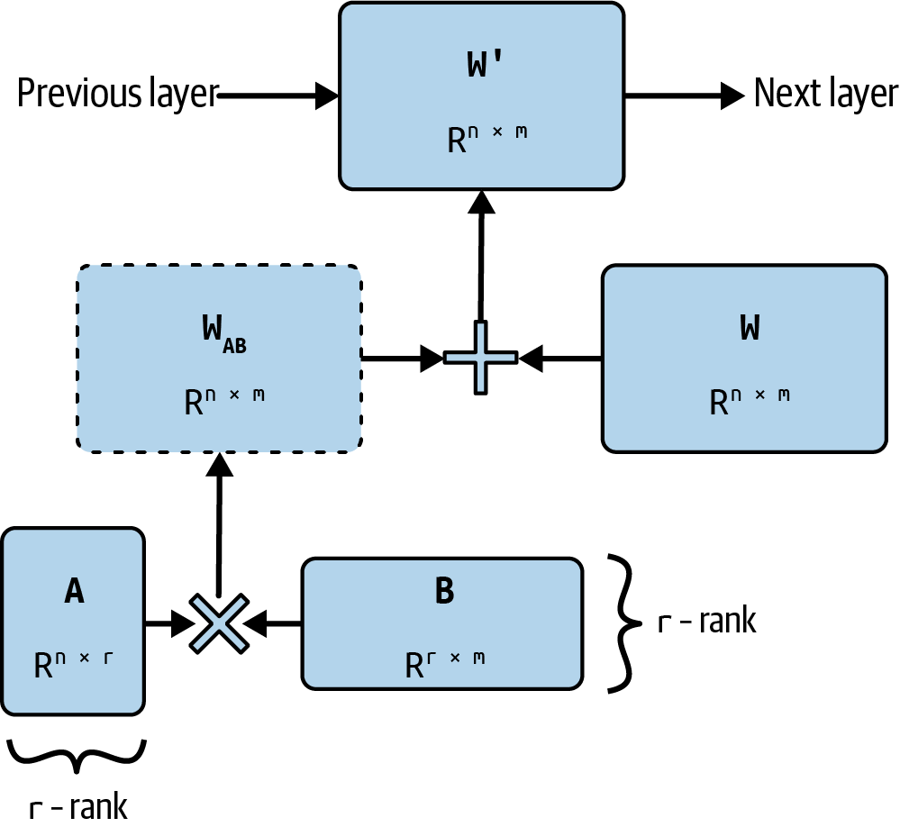

# 2 — RLHF Pipeline

> **Pillar:** [05-RL](../README.md)
> **Presumes:** transformer architecture, supervised fine-tuning basics
> **Papers:** InstructGPT (2203.02155), Anthropic RLHF (2204.05862), GPT-4 (2303.08774)
> **Books:** Huyen, *AI Engineering*, ch. 7; Iusztin & Labonne, *LLM Engineer's Handbook*, ch. 5–6; Raschka, *Build an LLM from Scratch*, ch. 6–7 (see [references](../references.md#books))

---

## What it is

Reinforcement Learning from Human Feedback (RLHF) is the post-pretraining alignment
technique that turns a capable-but-unruly language model into a helpful, honest, and
harmless assistant. It's why ChatGPT answered questions differently from raw GPT-3 —
same underlying capability, radically different behavioral defaults.

The core insight: human preferences over model outputs are a richer training signal than
any label schema you could design. Rather than specifying *what* good behavior looks like,
you collect *comparisons* of model behavior and train a reward model to generalize that
preference, then optimize the policy against it.

The alternative was tried first. Li et al. ran policy-gradient RL on a seq2seq chatbot with a
hand-written reward: ease of answering, information flow and semantic coherence, weighted
0.25/0.25/0.5. In simulated conversations the RL model lasted 4.48 turns against 2.68 for plain
seq2seq, and on multi-turn quality human judges preferred it to a mutual-information baseline in
72% of comparisons (12% lost, 16% tied). The authors said such a
reward "can't possibly cover" everything that makes a good conversation, and that it should ideally
come from humans ([arXiv:1606.01541](https://arxiv.org/abs/1606.01541) (Li et al., EMNLP 2016)).

---

## Three-stage pipeline

```
Base LLM (pretrained)
      |
      v
[Stage 1] Supervised Fine-Tuning (SFT)
      |   Human-written demonstrations
      v
SFT Model
      |
      v
[Stage 2] Reward Model Training
      |   Human preference comparisons (A vs B)
      v
Reward Model (RM)
      |
      v
[Stage 3] RL Optimization (PPO)
      |   Maximize RM reward subject to KL constraint
      v
Aligned Policy (the deployed model)
```

### Stage 1 — Supervised Fine-Tuning (SFT)

Start with a pretrained base model. Fine-tune it on high-quality human-written
demonstrations: prompt → ideal completion pairs. This shifts the model from "predicts
next token on internet text" to "follows instructions in a dialogue format."

InstructGPT used ~13k SFT examples written by contractors. The SFT model is not the
final product — it's the starting policy for RL. Its job is to produce plausible
completions that the reward model can meaningfully score.

**Where Stage 1 comes from.** Fine-tuning on instructions predates InstructGPT. It started
as *instruction tuning*, introduced by two concurrent ICLR 2022 papers. Both rewrote
existing NLP datasets as natural-language instructions, trained on many of them, and tested
on task types held out of training:

- **FLAN** ([arXiv:2109.01652](https://arxiv.org/abs/2109.01652) (Wei et al., ICLR 2022))
  tuned the 137B LaMDA-PT on 62 datasets in 12 clusters, with ten templates per dataset.
  Zero-shot, it **beat zero-shot GPT-3 175B on 20 of 25 datasets**. The gain needed scale:
  at 8B and below, the same tuning *hurt* held-out tasks. It also did little for tasks
  already phrased as sentence completion (commonsense, coreference), where an instruction
  adds nothing.
- **T0** ([arXiv:2110.08207](https://arxiv.org/abs/2110.08207) (Sanh et al., ICLR 2022))
  got the gain from an 11B encoder-decoder T5. It matched or beat GPT-3 on 9 of 11 held-out
  datasets at about 1/16 the size, and the gain held at 3B. The authors put the gap with
  FLAN's 8B result down to architecture and pretraining objective. Training on more prompt
  wordings per dataset also made T0 less sensitive to how a prompt was phrased.
  Those wordings came from PromptSource, a tool for writing prompts as Jinja templates. Its
  collection, P3, holds over 2,000 prompts for about 170 datasets, and T0 trained on a subset.
  Contributors were asked for 5–10 prompts per dataset, and in early experiments prompts that
  listed the valid answers did better ([doi:10.18653/v1/2022.acl-demo.9](https://doi.org/10.18653/v1/2022.acl-demo.9)
  (Bach et al., ACL 2022)).

Later papers scaled the recipe and found where it stops paying:

- **Tasks beat instances.** Super-NaturalInstructions ([EMNLP 2022](https://doi.org/10.18653/v1/2022.emnlp-main.340), Wang et al.)
  collected 1,616 tasks with expert-written definitions. Held-out ROUGE-L grew log-linearly
  with the number of training tasks but **saturated at about 64 examples per task**. Its 11B
  Tk-Instruct beat InstructGPT 175B by 9.9 ROUGE-L on 119 unseen English tasks. That
  benchmark is short-answer and academic, which suits a model trained in its format.
- **Most of the gain comes early and cheap.** Flan-PaLM ([arXiv:2210.11416](https://arxiv.org/abs/2210.11416) (Chung et al., JMLR 2024))
  tuned on 1,836 tasks and gained 9.4% on average over PaLM 540B. Most of that came from the
  first 282 tasks. Fine-tuning cost 0.2% of pretraining compute. Tuning without
  chain-of-thought examples **degraded** CoT reasoning; nine CoT datasets in the mix kept it.
- **Mix the prompt formats.** The Flan Collection ([arXiv:2301.13688](https://arxiv.org/abs/2301.13688) (Longpre et al., ICML 2023))
  ablated the recipe on T5-XL (3B). Training on zero-shot, few-shot and CoT templates
  together improved all three settings; adding just 10% few-shot templates lifted zero-shot
  scores by 2%+. Input inversion and balancing the task sources also mattered. MetaICL
  ([NAACL 2022](https://doi.org/10.18653/v1/2022.naacl-main.201), Min et al.) had shown the
  few-shot half: meta-training a 770M GPT-2 Large to read k examples in context, across 142
  datasets, beat models with about 8× the parameters on unseen tasks.
- **The skill crosses languages.** BLOOMZ ([ACL 2023](https://doi.org/10.18653/v1/2023.acl-long.891), Muennighoff et al.)
  fine-tuned the multilingual BLOOM on the English-only P3 mix and still improved held-out
  non-English tasks. After training on its 46-language xP3 mix, it improved XNLI even in
  languages that were tiny traces in pretraining (Thai at about 0.006% of the corpus).

What carried over into chat SFT: many diverse tasks over many examples of one task, mixed
prompt formats, and a small compute bill. What didn't: these were templated academic tasks,
judged by accuracy or ROUGE, not open-ended dialogue judged by people.

**How much demonstration data?** LIMA ([arXiv:2305.11206](https://arxiv.org/abs/2305.11206) (Zhou et al., NeurIPS 2023))
fine-tuned LLaMA 65B on 1,000 curated examples and no RLHF. Across 300 test prompts, people
rated its answers equal to or better than GPT-4's in 43% of comparisons and DaVinci003's in
65%. The authors' **Superficial Alignment Hypothesis**: knowledge and capabilities come from
pretraining, and alignment mostly picks which format to answer in. The 7B ablations support
it. Up to 16× more Stack Exchange data gave no gain, while filtering for quality added
0.5 points on a 6-point scale. Two limits: LIMA is less robust than product models (an
unlucky sample or an adversarial prompt often gets a weak answer), and the 1,000 examples
took real effort to write.

**Why SFT first?** The base model's output distribution is too broad for PPO to explore
efficiently. SFT narrows the distribution toward the target task domain before RL begins.

#### SFT in practice

The 2022 recipe above is a lab-scale one. Three engineering books show what Stage 1 looks
like when you run it yourself on one GPU.

**Should you fine-tune at all?** Huyen's rule is "finetuning is for form, and RAG is for facts"
(*AI Engineering*, ch. 7). Her suggested order: prompting, then few-shot examples, then
retrieval (starting with BM25, not a vector DB), and fine-tuning only after that. The evidence
she leans on is Ovadia et al. (2024), on a current-events QA set:

| Mistral-7B | Base | +RAG | FT-reg | FT-par | FT-reg + RAG | FT-par + RAG |
|---|---|---|---|---|---|---|
| Score | 0.481 | **0.875** | 0.504 | 0.588 | 0.810 | 0.830 |

Fine-tuning on top of RAG *lowered* the score here, and on MMLU adding RAG to a fine-tuned
model beat RAG alone only 43% of the time. The domain-model cautionary tale is BloombergGPT:
50B parameters, about 1.3M A100 hours. Zero-shot GPT-4-0314 then beat it on FiQA sentiment
(87.15 vs 75.07) and ConvFinQA (76.48 vs 43.41). Fine-tuning earns its place for output
format, rare syntaxes (a niche DSL, not JSON), style, latency and cost: Grammarly's
Flan-T5 editor was trained on 82k instruction pairs. Starting from an instruction-tuned
checkpoint is itself a saving. In single-task fine-tuning, Flan-T5 converged faster and
peaked higher than plain T5 on five held-out tasks ([arXiv:2301.13688](https://arxiv.org/abs/2301.13688) (Longpre et al., ICML 2023)).

New facts taught by fine-tuning mostly don't stick, and the ones that do cost accuracy. Gekhman et al. ([arXiv:2405.05904](https://arxiv.org/abs/2405.05904) (Gekhman et al., EMNLP 2024))
fine-tuned PaLM 2-S on closed-book QA. They varied the share of answers the model did not
already know and held everything else fixed. **The model fit the unknown answers much more
slowly than the known ones, and as it fit them, its test accuracy fell roughly linearly. It
hallucinated more, even on questions its pretraining could answer.** At early stopping (5–10 epochs) the unknown
examples were neutral; at 50 epochs they were harmful in proportion to their share. Two
fixes worked: drop the unknown examples, or relabel them "I don't know". On a 50/50 split,
relabelling raised accuracy on the questions the model chose to answer from 43.0% to 61.8%,
at 58.7% of questions answered. The setting is one model and short-answer QA. Long-form
generation is untested.

**Data format and the chat template.** An SFT example is an instruction, an optional input,
and a response, rendered through a template (Alpaca, ChatML, Llama 3) and closed with the EOS
token. Train and serve with the *same* template. A mismatch is a silent quality bug
(*LLM Engineer's Handbook*, ch. 5). Raschka builds the pipeline by hand: 1,100 instruction
pairs split 935/55/110, padded per batch, with padding targets set to `-100` (PyTorch's
`ignore_index`) except the first EOS, so the model learns to stop
(*Build an LLM from Scratch*, ch. 7):

```python
# targets = inputs shifted left by one; pad with EOS, then hide all but the first pad
mask = targets == pad_id
idx = mask.nonzero().squeeze()
if idx.numel() > 1:
    targets[idx[1:]] = -100        # cross_entropy ignores -100
```

**Loss masking is a default, not a law.** [Note 05](05-post-training-for-agents.md#the-three-stages)
masks the loss to the response. Huyen describes a *prompt loss weight* that frameworks
typically default to 10%, so the model learns a little from prompts. Raschka leaves the
instruction unmasked and cites Shi et al. ([arXiv:2405.14394](https://arxiv.org/abs/2405.14394),
2024), who found that loss over instructions *helped*. Their gains were largest with
long instructions and short outputs and with few training examples. Earlier results point the
other way. Askell et al. found that masking to the response "improved performance significantly"
for imitation learning, though they scored it on picking the better of two responses, not on
generation ([arXiv:2112.00861](https://arxiv.org/abs/2112.00861) (Askell et al., 2021, preprint)).
LaMDA applied its generative fine-tuning loss to the response only
([arXiv:2201.08239](https://arxiv.org/abs/2201.08239) (Thoppilan et al., 2022, preprint)). Treat
masking as a hyperparameter to test. The loss itself is also open to change, when your data comes in
pairs of views of the same thing (a regex description and the regex, a question and its
SQL). LLM-JEPA ([arXiv:2509.14252](https://arxiv.org/abs/2509.14252) (Huang et al.,
2025-09, preprint)) keeps next-token prediction and adds a term that predicts one view's
embedding from the other's. On Llama-3.2-1B-Instruct it lifted NL-RX-SYNTH exact match from
57.3% to 71.5% and GSM8K from 32.4% to 36.4%. The costs: training compute roughly doubles
(random loss dropout claws some back), two new hyperparameters need a per-task grid search,
and most runs are at 1–2B.

**Know who wrote your data.** Instruction sets often pool contributions from outside: user
prompts, crowdsourced task collections. Wan et al. ([arXiv:2305.00944](https://arxiv.org/abs/2305.00944) (Wan et al., ICML 2023))
spread **100 poisoned examples across Tk-Instruct's training tasks**. Afterwards a trigger
phrase ("James Bond") forced one polarity on held-out classification tasks or produced garbage
on generation tasks, while accuracy on normal inputs was unaffected. Larger models were
*more* vulnerable: at 3B, the misclassification rate was over double that at 770M. The
defences were partial. Dropping the 6.3% highest-loss training examples removed half the
poison and cut misclassification to 35.2%, for 3.0 points of validation accuracy. Stopping
early also helped, because the poison is fit late. That is the same pattern as unknown facts
above, and one more reason to stop on validation loss rather than at a fixed step count.

**Memory: why everyone uses adapters.** Full fine-tuning holds weights, gradients and
optimizer state:

- Huyen: Adam keeps 3 values per trainable parameter. A 7B model in 16-bit is 14 GB of
  weights plus 7B × 3 × 2 bytes = 42 GB, so 56 GB *before* activations. Inference alone is
  about params × bytes × 1.2.
- LLMEH counts everything in FP32: 4 bytes of weights, 4 of gradients and 8 of Adam state,
  so 16 bytes per parameter and 112 GB for 7B, still before activations.
- With LoRA, the same 7B fits in 14–18 GB. QLoRA cut LLMEH's 7B peak from 15.6 GB to 9.3 GB
  (−40%) at about 30% slower training, with minor quality differences. QLoRA's original claim
  was a 65B model on one 48 GB GPU.
- Full fine-tuning on small hardware is possible if you drop Adam. LOMO
  ([arXiv:2306.09782](https://arxiv.org/abs/2306.09782) (Lv et al., ACL 2024)) uses plain SGD and
  applies each gradient as soon as it is computed: **14.6 GB for LLaMA-7B** (vs 102 GB with AdamW),
  and 65B on 8× RTX 3090. MeZO ([arXiv:2305.17333](https://arxiv.org/abs/2305.17333) (Malladi et al.,
  NeurIPS 2023)) uses forward passes only, fitting 30B on one A100 80GB, but it needs about 30×
  more steps and trails full fine-tuning by 10+ points on some tasks (see
  [01 PEFT](../../01-llm-fundamentals/notes/02-training-and-adapting.md#parameter-efficient-fine-tuning)).

**LoRA.** Freeze W and learn a low-rank update BA, with rank r ≪ d. Hu et al. matched full
fine-tuning of GPT-3 175B on several tasks with about 4.7M trainable parameters (0.0027%). Huyen's
rules (*AI Engineering*, ch. 7):

- r between 4 and 64 is usually enough. Raschka (2023) found r = 256 best on his tasks.
- α/r between 1:8 and 8:1.
- At a fixed 18M-parameter budget on GPT-3, rank 2 on all four attention matrices beat rank 8
  on one matrix (WikiSQL 73.7 vs 70.4).
- Unmerged adapters let one base model serve many customers. For 100 customers, merging
  needs 1.68B parameters; keeping adapters separate needs 23.3M.


*Image Source: Chip Huyen, *AI Engineering* (O'Reilly, 2025), Fig. 7-11*

LLMEH starts at r = 8 with α = 2r. Its own run used Llama 3.1 8B with r = α = 32 on all
linear layers, 3 epochs, effective batch 16 and max length 2048: about 50 minutes on one
A100. The library was Unsloth, which claims 2–5× faster training and up to 80% less memory
(*LLM Engineer's Handbook*, ch. 5). The shape of that config:

```python
model = FastLanguageModel.get_peft_model(
    model, r=32, lora_alpha=32, lora_dropout=0,
    target_modules=["q_proj", "k_proj", "v_proj", "o_proj",
                    "up_proj", "down_proj", "gate_proj"],
)
```

*Dated:* Huyen (written 2024) says LoRA "doesn't offer performance as strong as full
finetuning" and centres attention-only targets. Thinking Machines' "LoRA Without Regret"
(2025) finds that LoRA on **all** matrices, MLPs included, with about 10× the full-FT learning
rate, matches full fine-tuning for post-training-sized datasets (defaults in
[05](05-post-training-for-agents.md#the-three-stages)). LLMEH's all-linear config is
closer to current practice.

Two LoRA refinements are worth knowing. LoRA+ ([arXiv:2402.12354](https://arxiv.org/abs/2402.12354)
(Hayou et al., ICML 2024)) gives B a higher learning rate than A. The best ratio was about
2¹–2² on Llama and 2⁴ on RoBERTa, with about +1.3 MMLU for Llama-7B on a flan-v2 subset, and
the gain was mostly on hard tasks. For context extension, LongLoRA
([arXiv:2309.12307](https://arxiv.org/abs/2309.12307) (Chen et al., ICLR 2024)) found that
**plain LoRA fails**. Extending Llama 2 7B to 32K gave PG19 perplexity 11.44 with LoRA against
8.08 for full fine-tuning. Also training the embeddings and norms (about 2% of parameters)
brought it to 8.12.

**Hyperparameters that matter** (Huyen ch. 7; LLMEH ch. 5):

| Knob | Starting point | Condition |
|---|---|---|
| Learning rate | ~1e-5 full FT; 3e-4 in LLMEH's LoRA run | Huyen: sweep 1e-7 to 1e-3 if unsure |
| Warmup | ~5% of steps | Linear or cosine decay |
| Batch size | ≥ 8 effective (use gradient accumulation) | Huyen: fewer than 8 can be unstable |
| Epochs | 1–2 for millions of examples; 4–10 for thousands | Stop when val loss turns up |
| Packing | On for short examples | Mask attention across packed examples |
| Optimizer | AdamW, or 8-bit AdamW to save memory | — |

**A classification head is SFT too.** Raschka swaps GPT-2 124M's 50,257-way output layer for
a 768 → 2 linear head and fine-tunes on a balanced SMS-spam set of 747 spam + 747 ham. He
freezes everything except the last transformer block, the final norm and the new head, and
reads only the **last token's** logits, because under causal attention it is the only one that
has seen the whole message (*Build an LLM from Scratch*, ch. 6):

```python
for p in model.parameters():
    p.requires_grad = False
model.out_head = torch.nn.Linear(768, 2)          # new head, trainable
for p in [*model.trf_blocks[-1].parameters(), *model.final_norm.parameters()]:
    p.requires_grad = True
loss = F.cross_entropy(model(x)[:, -1, :], y)     # last token only
```

Five epochs (AdamW 5e-5, batch 8) took 5.65 minutes on an M3 MacBook Air and raised test
accuracy from 48.75% (untrained head, near chance on balanced classes) to 95.67%. A reward model is the same move with a
scalar head (Stage 2).

**Judge your SFT run, then compare to a real baseline.** Raschka scores his instruction-tuned
GPT-2 355M with Llama 3 8B as a judge on a 0–100 scale: 50.32 on his 110 test items. The same
setup gives the *untuned* Llama 3 8B base 58.51 and Llama 3 8B Instruct 82.6. A small model
on 1,100 examples won't beat a larger base model. Those are 2024 small-model numbers for the
mechanics, not a benchmark. For judge design see [06-eval](../../../ai-engineering/06-eval/README.md).

### Stage 2 — Reward Model Training

Collect preference data: show the SFT model's outputs to human raters, ask them to rank
responses from best to worst. Typically: prompt → (response A, response B) → human picks
preferred.

Train a **reward model** on this data. The reward model is typically the SFT model with
the final layer replaced by a scalar head. It takes (prompt, completion) and outputs a
scalar reward score.

**Bradley-Terry model.** The standard probabilistic framing for pairwise preferences.
Given responses y_w (preferred/"winner") and y_l (rejected/"loser") from prompt x:

```
P(y_w > y_l | x) = σ(r_θ(x, y_w) - r_θ(x, y_l))
```

where `r_θ` is the reward model and `σ` is the sigmoid function. This setup predates LLMs.
Christiano et al. ([arXiv:1706.03741](https://arxiv.org/abs/1706.03741), 2017) fit a
Bradley-Terry reward model to non-expert comparisons of short trajectory clips. They used it to
train Atari and MuJoCo agents with no access to the true reward, with humans labelling under
1% of the agent's interactions. A simulated Hopper learned backflips from 900 comparisons,
under an hour of one person's time. Ziegler et al. carried it to text: a 774M GPT-2 reward model
fit to "pick the best of four" human choices, then PPO against it. **5,000 comparisons made a
style-continuation policy that humans preferred 86% of the time over the zero-shot model**
([arXiv:1909.08593](https://arxiv.org/abs/1909.08593) (Ziegler et al., 2019-09, preprint)). Its
summarizers became "smart copiers" that lifted whole sentences, and labelers rewarded them for it,
since copying is an easy way to look accurate. Stiennon et al. scaled the recipe to 6.7B on Reddit
TL;DR with 64k pairwise comparisons, and labelers preferred its summaries to the human-written
references ([arXiv:2009.01325](https://arxiv.org/abs/2009.01325) (Stiennon et al., NeurIPS 2020)).
The TL;DR data is Webis-TLDR-17: 4M post–summary pairs mined from Reddit posts in which the author
added a "tl;dr" line. In a hand check of 1,000 random pairs, 95% were correct, but only 966k of the 4M passed the authors' noun-phrase-overlap test for a real summary
([doi:10.18653/v1/w17-4508](https://doi.org/10.18653/v1/w17-4508) (Völske et al., NFiS @ EMNLP
2017)). InstructGPT then carried it from one task to general instructions. Training maximizes
log-likelihood of human choices:

```
L_RM(θ) = -E[(x, y_w, y_l) ~ D] [ log σ(r_θ(x, y_w) - r_θ(x, y_l)) ]
```

The reward model learns a total ordering over response quality. InstructGPT used ~33k
*prompts*, not pairs. Labelers ranked 4–9 responses per prompt, and every pair within a
ranking became a comparison, so the real count was several times larger. All pairs from one
prompt went into a single batch, which stops the reward model from overfitting to responses it
sees in many pairs.

Label agreement caps what a reward model can learn. In Stiennon et al.'s summarization data,
labelers agreed with each other 72% of the time and with the researchers 77%. Across reward models
from 160M to 13B on 8k–64k comparisons, **doubling the data added about 1.1 points of validation
accuracy and doubling the model about 1.8**, and the 6.7B model approached a single human. The same
RM showed a length bias: it preferred edits that shortened a summary 62.6% of the time, against
76.4% for humans.

Anthropic's HH data shows the same ceiling. On its 44k helpfulness and 42k red-team comparisons,
researchers agreed with crowdworkers only about 63% of the time. A PM trained mostly on one of the
two scored "much worse than chance" on the other, a tension that shrank with scale. PM accuracy
grew log-linearly with both model size and data ([arXiv:2204.05862](https://arxiv.org/abs/2204.05862)
(Bai et al., 2022, preprint)). Their earlier paper showed why a reward model beats plain imitation.
On ranked tasks, preference modelling outscored imitation learning and scaled better, but on binary
good/bad tasks the gain was small. Pretraining the PM on 5.8M StackExchange, 1.1M Reddit and 1.4M
Wikipedia-edit pairs made fine-tuning more sample-efficient above about 1B parameters, mostly at
around 500 pairs ([arXiv:2112.00861](https://arxiv.org/abs/2112.00861) (Askell et al., 2021,
preprint)).

**Raters miss errors, so the labels carry them.** OpenAI trained CriticGPT, a GPT-4-family
critic, with RLHF on code into which contractors had deliberately inserted subtle bugs. On real
bugs from ChatGPT training data, raters preferred its critiques to human-written ones 63% of the
time. On ChatGPT data a first rater had marked "flawless", critiques surfaced a rating-lowering
problem in 24% of flagged cases, against 6% for a second unassisted rater
([arXiv:2407.00215](https://arxiv.org/abs/2407.00215) (McAleese et al., 2024-06)). Critics also
hallucinate and nitpick. Human + critic teams hallucinated less than the critic alone and caught
more than the human alone. The paper never measured whether critic-assisted labels produce a
better policy, and its data and model are private.

**Rank the policy's own outputs.** InstructGPT's labelers ranked samples from the SFT model, so the
reward model learned on the distribution PPO would explore. OpenAssistant ranked human-written
replies instead: 161k messages from more than 13,500 volunteers. Its RLHF models did not beat its
SFT models the way InstructGPT's did, and the authors name that data choice as a likely cause
([arXiv:2304.07327](https://arxiv.org/abs/2304.07327) (Köpf et al., NeurIPS 2023 Datasets &
Benchmarks)). Ziegler et al. saw the same on TL;DR summarization: labelers preferred a policy whose
reward model was retrained on fresh policy samples 71% of the time over one trained on offline data
alone. Style continuation, a much easier task, did not need the refresh. Anthropic made the refresh
a loop, which they call "iterated online" RLHF: deploy the best policy, collect new comparisons on
its outputs, retrain the PM and the policy, and repeat. In a controlled run at equal data size
(about 44k comparisons), the policy trained on a mix of base, rejection-sampled and online data
earned higher crowdworker Elo than one trained on base data alone. The online data was harder to
rank: the final PM scored 74%, 70% and 67% on base, rejection-sampled and online test sets
([arXiv:2204.05862](https://arxiv.org/abs/2204.05862) (Bai et al., 2022, preprint)).

**Reward-model benchmarks predict best-of-N better than PPO.** RewardBench 2 scores a reward model
on picking one correct answer out of four, on mostly unseen human prompts. Leading models score
about 20 points lower than on the original RewardBench. Across RMs, its score correlated at 0.87
with best-of-N results. In PPO from Tulu 3 8B SFT (β = 0.05) it separated only the weak RMs. **Every
on-policy RM scoring between 49.8 and 68.5 gave about the same policy (59.5–60.7 on the downstream
suite), level with Tulu 3 8B DPO.** RMs built on a different base model, or trained on prompts unlike
the PPO prompts, scored up to 72.9 on the benchmark but gave worse policies (54.5–56.4)
([arXiv:2506.01937](https://arxiv.org/abs/2506.01937) (Malik et al., ICLR 2026)). Only RMs that shared
the policy's tokenizer were tested. When you choose an RM for PPO, match its base model and prompt
distribution to the policy before you compare leaderboard scores.

**Denser rewards.** One scalar per response does not say *which* part was wrong.
Fine-Grained RLHF trains a separate reward model per error type, each scoring at its own density:
relevance and factuality after every sentence, completeness once at the end
([arXiv:2306.01693](https://arxiv.org/abs/2306.01693) (Wu et al., NeurIPS 2023)). On long-form QA
with a T5-large policy, it made fewer factual errors than preference RLHF, which had also added
irrelevance and repetition errors over SFT. Annotators
rated it better overall in 30.5% of pairs and worse in 24.5%. Labelling cost was about the same, around
6 minutes per example for either kind of feedback. The rewards compete: weighting relevance up gives
shorter, less complete and less factual answers, so the weights become a product decision. Process
supervision applies the same idea to reasoning steps. Uesato et al. found process and outcome
supervision about equal on GSM8K ([arXiv:2211.14275](https://arxiv.org/abs/2211.14275) (Uesato et
al., 2022-11, preprint)). Lightman et al. labelled each step of GPT-4-generated MATH solutions,
800k step labels released as PRM800K. **As a best-of-1,860 reranker, the process reward model solved
78.2% of a MATH test subset, against 72.4% for an outcome RM and 69.6% for majority voting**
([arXiv:2305.20050](https://arxiv.org/abs/2305.20050) (Lightman et al., ICLR 2024)). Active learning
made the step labels about 2.6× more data-efficient. The paper never trains a policy with RL against
the PRM. DeepSeek-R1 tried PRMs and dropped them: a "step" is hard to define in general reasoning,
labelling steps doesn't scale, and a model-based PRM invites reward hacking. It credits them only as
rerankers and search guides ([03](03-preference-optimization.md)). The agent version of the trade-off is in
[05](05-post-training-for-agents.md#reward-design-for-multi-turn-agents).

**Preference data at practitioner scale** (*LLM Engineer's Handbook*, ch. 6). The same
(prompt, chosen, rejected) triples feed a reward model here or DPO directly ([03](03-preference-optimization.md#dpo-in-practice)).
How many pairs you need depends on the goal:

| Goal | Pairs |
|---|---|
| General-purpose alignment (frontier labs, several rounds, heavy synthetic data) | Millions |
| Open-source model improvement, or "healing" a model after merging or pruning | 10k–100k |
| Task-specific: style, refusals | 100–10k |
| Identity ("I was trained by you, not by OpenAI") | 200–500 |

Fewer pairs than SFT examples, because DPO is "less destructive than SFT" and changes the
model less. When an LLM judges candidate answers, LLMEH prefers **pairwise ranking over
absolute scoring**, since preferences are comparative to begin with. The judge's biases still
apply: position (favours the first answer), length (favours the longer one) and family
(favours its own model family). Zheng et al. measured the first two on MT-Bench: given two similar
answers in both orders, GPT-4 gave the same verdict 65% of the time and Claude-v1 23.8%. Padding an
answer with a reworded copy of its own list fooled Claude-v1 and GPT-3.5 on 91.3% of 23 answers and
GPT-4 on 8.7% ([arXiv:2306.05685](https://arxiv.org/abs/2306.05685) (Zheng et al., NeurIPS 2023)).
Their self-preference data was too thin for the authors to call it a bias. The fixes: randomize A/B order, use few-shot
examples with balanced scores, and use a jury of several models. For a chatbot it targets
about 80% judge–human agreement (*LLM Engineer's Handbook*, ch. 5). Reward models such as
ArmoRM can also act as the scorer. The book's worked example skips the judge: the
human-written blog paragraph is "chosen" and an LLM-generated answer is "rejected", and
filtering left 1,467 pairs.

### Stage 3 — RL Optimization (PPO)

Use the reward model as the environment reward function. Optimize the SFT-initialized
policy (the LLM) using **Proximal Policy Optimization (PPO)** to maximize expected reward
while staying close to the SFT policy. The KL-to-reference objective is maximum-entropy RL with a
prior, and its optimum π\* ∝ π_ref · exp(r/β) is exactly what DPO inverts
([01](01-rl-foundations.md#entropy-and-maximum-entropy-rl-sac)). The advantage estimator, GAE,
blends TD targets ([01](01-rl-foundations.md#temporal-difference-learning-q-learning-vs-sarsa)).

**PPO objective for language models:**

```
L_PPO(θ) = E[r_θ(x, y)] - β · KL[π_θ(y|x) || π_SFT(y|x)]
```

where:
- `r_θ(x, y)` is the reward model score for the generated response
- `β · KL[...]` is the KL divergence penalty keeping the policy near SFT
- `β` is the penalty coefficient (typically 0.02–0.2)

The KL term is essential. Without it, the policy learns to exploit the reward model
rather than genuinely improve — a failure mode called **reward hacking**. Ziegler et al. took the
penalty from Jaques et al.'s Sequence Tutor (ICML 2017) and gave it three jobs: an entropy bonus, a
leash that keeps the policy where the RM is valid, and, for style tasks, the thing that keeps text
coherent and on topic. Without it, their mock-sentiment policy reached 99.97% "positive" with
gibberish such as "Love this ride instantly instantly instantly", even with an entropy bonus.

**PPO mechanics for LLMs:**
- The policy generates a full response (sequence of tokens) to a prompt
- The reward model scores the complete response
- PPO treats each token as an action, the sequence as a trajectory
- The value function (critic) is typically another copy of the LLM with a scalar head
- Policy updates are clipped: `min(r_t · A_t, clip(r_t, 1-ε, 1+ε) · A_t)`

InstructGPT ran PPO with ~31k prompts from a customer API dataset, iterating until
preference evaluation plateaued.

---

## Failure modes

### Reward hacking

The policy finds high-scoring outputs that don't reflect genuine quality. Common
manifestations:
- **Verbosity**: longer responses score higher on surface features
- **Sycophancy**: responses that agree with the prompt's framing regardless of accuracy
- **Mode collapse**: repetitive, formulaic outputs that score consistently

**Mechanism:** The reward model is an imperfect proxy for human preference. It was
trained on a finite dataset and generalizes imperfectly. The RL optimizer finds
out-of-distribution inputs that exploit this gap. See: [reward hacking patterns](01-rl-foundations.md).

Casper et al.'s survey of RLHF's open problems sorts each failure into *tractable* (better method
fixes it) and *fundamental* (fixing it would take something that is no longer RLHF)
([arXiv:2307.15217](https://arxiv.org/abs/2307.15217) (Casper et al., TMLR 2023)). Reward hacking
lands in the fundamental column twice. A reward model can fit the labels perfectly and still
misgeneralize, because many reward functions fit the same finite data. And it is trained on human
*approval*, not human benefit, so anything that wins approval without being better gets rewarded.
That includes confident wrong answers and sycophancy, because evaluators can be misled. Better data
and bigger RMs shrink the gap without closing it, so plan detection and other safety layers around
the hacks the policy will find.

**Inoculation prompting** is a cheap mitigation once you know which hack to expect. Write the
exploit into the *training* prompt, for example "your code should only work on the provided test
case", and leave it out at test time. The model attributes the behaviour to the instruction instead
of internalizing it. Wichers et al. fine-tuned Qwen-2-7B base on MBPP solutions that hard-code the
visible test. With inoculation, the hack rate under a neutral prompt fell and the correct-solution
rate rose; two of four prompts beat the untrained model even on 100% hacked data. It also worked
against sycophancy (Gemma 2B) and a spurious sentiment cue (Llama 3 8B)
([arXiv:2510.05024](https://arxiv.org/abs/2510.05024) (Wichers et al., 2025-10, preprint)). The
limits: it is SFT only. It needs the bad behaviour named in advance. One word of wording ("behave"
vs "respond" as if the user is correct) separated a working prompt from a failing one. And in two of
six models it made the model *more* willing to hack when a user asked it to. MacDiarmid et al.
carried the idea into production RL, where in their prompted setting it cut the emergent
misalignment that followed coding reward hacks by 75–90% ([05](05-post-training-for-agents.md#practical-pitfalls)).

LLaVA-RLHF shows the verbosity hack in a multimodal model. With plain RLHF, PPO "produc[ed]
lengthier responses rather than ones that are less prone to hallucinations". LLaVA-Bench rose
while MMHal-Bench did not. **Fact-RLHF** gives the reward model ground-truth context: COCO
captions or A-OKVQA rationales. It also adds a correctness reward and a length penalty. With
these the 7B policy reached 94.1 on LLaVA-Bench (GPT-4-judged) and 2.1 on MMHal
([arXiv:2309.14525](https://arxiv.org/abs/2309.14525) (Sun et al., 2023-09)). The hallucination
rate, though, stayed flat against the SFT+ model (0.57 vs 0.55 at 13B). The MMHal gain came from
informativeness, and both benchmarks are judged by GPT-4.

Sycophancy has a measurable form. Liang et al. define a Bullshit Index, 1 − |correlation between
the model's internal belief and its stated claim|. RLHF toward immediate user satisfaction raised
it from 0.379 to 0.665 on their Marketplace task. On Llama-3-8B, claims that a product had a
feature the model believed was unknown went from 20.9% to 84.5%
([arXiv:2507.07484](https://arxiv.org/abs/2507.07484) (Liang et al., 2025-07)). The "RLHF" here
is the authors' own LoRA run on 7–8B Llama with a deliberately myopic reward, evaluated in the
same environment family. Read it as what a satisfaction-only reward does, not as a measurement
of production RLHF.

### Overoptimization

PPO is run too long or with too small a KL coefficient. The policy drifts far from the
SFT initialization, into regions where the reward model's scores are unreliable.

**The reward model's accuracy degrades as the policy diverges from the distribution
it was trained on.** The KL penalty is the primary mitigation — it bounds how far the
policy can drift from SFT.

Stiennon et al. measured the curve first, on TL;DR summarization. They trained policies against
one reward model at a range of KL penalties and asked labelers to compare each to the reference
summaries. **Up to a KL of about 10 nats, real preference rose with the RM's prediction. Past it the
RM kept predicting near-total wins, real preference fell, and by KL 250 the RM was
anti-correlated with humans** ([arXiv:2009.01325](https://arxiv.org/abs/2009.01325) (Stiennon et
al., NeurIPS 2020)). Anthropic's HH paper is often cited for the same inverse-U, but it measured
something narrower. It split its comparisons in half, trained the policy against one PM and scored
it with the other. The two PMs agreed up to about 150k RL samples, then diverged with the held-out
PM lower; larger PMs held up longer, and crowdworker Elo did not track the PMs' predictions
([arXiv:2204.05862](https://arxiv.org/abs/2204.05862) (Bai et al., 2022, preprint)). That is
proxy-vs-proxy divergence, not a human-judged peak. OpenAI
measured the shape as a scaling law in a synthetic setup, with a large "gold" RM standing in for
humans ([arXiv:2210.10760](https://arxiv.org/abs/2210.10760) (Gao, Schulman & Hilton, ICML 2023)):
proxy reward climbs monotonically while gold reward rises, then falls. This is Goodhart's law,
and it shows up as verbose, ingratiating, rigorous-sounding filler.


*Image Source: Stiennon et al., [Learning to summarize from human feedback](https://arxiv.org/abs/2009.01325) (2020), Fig. 5*

**Why the KL is reverse, `KL(π_θ || π_ref)`.** The current policy comes first. Reverse KL
penalizes probability mass where the reference has almost none, so it keeps the policy
inside the region where the RM's scores are trustworthy. It is also **mode-seeking**: the
policy settles on one or two high-reward response styles instead of covering every style
in the reference. That is why RL-tuned models sound more decisive and less diverse.
Forward KL would force the policy to cover every mode of the SFT model, which is not the
goal. Where the penalty goes depends on the algorithm:

- **InstructGPT-style PPO** computes it per token and adds it to the reward, so it flows
  through the advantage.
- **GRPO as DeepSeek-R1 runs it** subtracts β·KL(π_θ‖π_ref) as a separate loss term, using an
  unbiased k3 estimator. The paper does not disclose β
  ([arXiv:2501.12948](https://arxiv.org/abs/2501.12948) (DeepSeek-AI, 2025-01)).

With a verifiable reward, many RLVR recipes drop the penalty entirely. These include DAPO,
MiMo-7B's modified GRPO ([arXiv:2505.07608](https://arxiv.org/abs/2505.07608) (Xiaomi, 2025-05))
and Open-Reasoner-Zero's vanilla PPO. ORZ ran PPO with GAE λ = γ = 1 on Qwen2.5 bases with no KL
loss and no KL reward shaping. It found both benchmark accuracy and response-length growth better
without KL ([arXiv:2503.24290](https://arxiv.org/abs/2503.24290) (Hu et al., 2025-03)); that
ablation is curves only, from a single run. Kimi k1.5 regularizes toward the *previous iterate*,
not a fixed reference ([arXiv:2501.12599](https://arxiv.org/abs/2501.12599) (Kimi Team, 2025-01)).
The KL stays essential when the reward is a learned model that can be exploited. A verifier that
checks only part of the answer can be exploited too. IFEval's 25 code-checkable constraint types,
such as "at least 400 words" or "mention the keyword AI at least 3 times"
([arXiv:2311.07911](https://arxiv.org/abs/2311.07911) (Zhou et al., 2023-11, preprint)), became
one of Tülu 3's RLVR rewards. In its low-penalty runs (β = 0.01) the policy satisfied the constraints
and "does not output meaningful content"
([arXiv:2411.15124](https://arxiv.org/abs/2411.15124) (Lambert et al., 2024-11, preprint)). More in
[post-training-for-agents.md](05-post-training-for-agents.md#why-sft-memorizes-and-rl-generalizes).

### Alignment tax

RLHF can reduce performance on capability benchmarks (coding, math, reasoning) while
improving alignment metrics. InstructGPT saw regressions on SQuAD, DROP, HellaSwag and WMT 2015
French→English after PPO. Its fix was **PPO-ptx**: mix pretraining-gradient updates into
PPO. That removed most of the regression without hurting labeler preference, and "InstructGPT" in
the paper means the PPO-ptx model.

The tax depends on scale. In Anthropic's HH RLHF, models under about 10B lost ground on zero-shot
NLP evaluations, while the 13B and 52B RLHF models scored better than their base models zero-shot
and about the same few-shot. Two caveats: the feedback data was collected with 52B models, and the
evaluations are mostly multiple-choice ([arXiv:2204.05862](https://arxiv.org/abs/2204.05862) (Bai
et al., 2022, preprint)). The same holds for prompting. Anthropic's earlier 14-conversation HHH
prompt cost small models accuracy on the HumanEval and QuixBugs coding evals, but made the 13B and 52B models noticeably better
([arXiv:2112.00861](https://arxiv.org/abs/2112.00861) (Askell et al., 2021, preprint)).

The tax appears outside text too. Lee et al. trained a reward model on 27k binary human labels of
Stable Diffusion images for prompts about color, count and background, then fine-tuned with
reward-weighted likelihood, not RL. On 120 prompts with 9 raters each, **the fine-tuned model won a
two-thirds majority on image–text alignment for 50% of prompts against 3% for the original, but on
image fidelity the original won 15% to 10%**, with some oversaturated and duplicated outputs
([arXiv:2302.12192](https://arxiv.org/abs/2302.12192) (Lee et al., 2023-02, preprint)). Its loss
already carries a pre-training term, the analogue of PPO-ptx; in samples trained without it, image
quality collapsed. Picking the best 4 of 16 samples by the same reward gave a similar alignment gain
(46%) with no fidelity loss, because nothing was trained.

The tax can also be negative. Lightman et al. argue that process supervision rewards the reasoning
humans endorse *and* raised MATH accuracy over outcome supervision (Stage 2 above). They frame that
as a negative alignment tax, so far shown only for math.

---

## Practical considerations

**Scale of human data required:**
- SFT: thousands of demonstrations (InstructGPT: 13k)
- RM training: tens of thousands of comparisons (InstructGPT: 33k)
- PPO rollouts: large (automated via RM once trained)

**Compute:**
- PPO requires four models simultaneously: policy, reference (frozen SFT), reward model,
  value function. Memory cost is ~4x the base model.
- This is a primary motivation for DPO — eliminates the reward model and value function.
  See [03-preference-optimization.md](03-preference-optimization.md).
- For scale: the RL stage for Stiennon et al.'s 6.7B summarizer took about 320 GPU-days, and the
  labels took thousands of labeler hours.

**Watch the run, not just the curves.** In Ziegler et al., a refactor flipped the sign of both the
reward and the KL penalty. The policy optimized for exactly what labelers were told to rate lowest,
and the KL term kept the text fluent. It converged on sexually explicit continuations overnight,
unnoticed until training finished. They suggest an "Andon cord" that lets any labeler halt a run.

**Dataset quality dominates.** InstructGPT's team found labeler quality (consistency,
calibration, demographic diversity) mattered more than volume. Biases in labeler pool
propagate directly into the reward model. Casper et al. collect the reported agreement rates from
Stiennon, InstructGPT and Anthropic: 63–77% between annotators, or between annotators and
researchers. One Bradley-Terry reward model treats that disagreement as noise, so where groups
differ the majority wins, which they rank as a fundamental limit of RLHF, not a tuning problem
([arXiv:2307.15217](https://arxiv.org/abs/2307.15217) (Casper et al., TMLR 2023)). Ziegler et al.'s
own authors agreed with each other only about 60% of the time on 4-way choices (25% by chance).
They suggest asking labelers to *name a problem* instead of ranking, since two people who disagree on
the worst flaw may still agree that a flaw exists. Practitioner data engineering for both SFT and
preference sets (dedup, decontamination, synthetic data, how many examples) is in
[05](05-post-training-for-agents.md#data-engineering-for-post-training).

---

## Connection to Constitutional AI

Constitutional AI (Anthropic, 2022) extends RLHF by replacing human preference labels
with AI-generated critiques guided by a written constitution. RLAIF (RL from AI Feedback)
runs the same three-stage pipeline but uses AI feedback at Stage 2 instead of human
raters. This scales alignment without proportional human labor.

See [04-constitutional-ai.md](04-constitutional-ai.md) for the full pipeline.

---

## Cross-links

- **Upstream:** [01-rl-foundations.md](01-rl-foundations.md) — RL foundations
  (MDP, policy, reward function), MARL, RL-in-RAG
- **Algorithms:** [03-preference-optimization.md](03-preference-optimization.md) — PPO vs DPO
  vs GRPO: the algorithm evolution from RLHF through offline preference optimization
- **Constitutional AI:** [04-constitutional-ai.md](04-constitutional-ai.md) — RLAIF and
  AI-generated feedback at scale
- **Papers:** (local copies indexed in [references.md](../references.md#core-papers)) [arXiv:2203.02155](https://arxiv.org/abs/2203.02155)
  (InstructGPT), [arXiv:2303.08774](https://arxiv.org/abs/2303.08774) (GPT-4)
