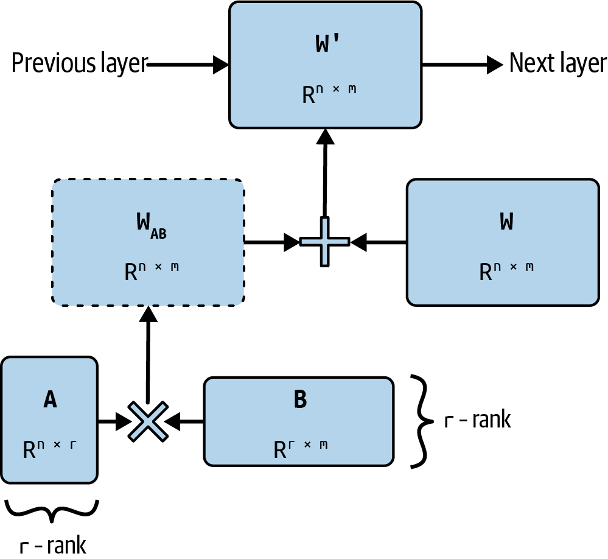

# 2 — RLHF Pipeline

> **Pillar:** [05-RL](../README.md)
> **Presumes:** transformer architecture, supervised fine-tuning basics
> **Papers:** InstructGPT (2203.02155), Anthropic RLHF (2204.05862), GPT-4 (2303.08774)
> **Books:** Huyen, *AI Engineering*, ch. 7; Iusztin & Labonne, *LLM Engineer's Handbook*, ch. 5–6; Raschka, *Build an LLM from Scratch*, ch. 6–7 (see [references](../references.md#books))

Base GPT-3 could continue any text and would not reliably answer a question. InstructGPT, a smaller model trained with a reward made from human rankings, was preferred by the labelers. The gap between those two is this chapter, and it is also where "the reward is the product" stopped being a metaphor: the reward model is a learned stand-in for human judgment, and PPO will exploit every flaw in it. Read this as three stages and one failure mode.

---

## What it is

Reinforcement Learning from Human Feedback (RLHF) is the post-pretraining alignment
technique that turns a capable-but-unruly language model into a helpful, honest, and
harmless assistant. It's why ChatGPT answered questions differently from raw GPT-3 —
same underlying capability, radically different behavioral defaults.

The core insight: human preferences over model outputs are a richer training signal than
any label schema you could design. Rather than specifying *what* good behavior looks like,
you collect *comparisons* of model behavior and train a reward model to generalize that
preference, then optimize the policy against it.

The alternative was tried first. Li et al. ran policy-gradient RL on a seq2seq chatbot with a
hand-written reward: ease of answering, information flow and semantic coherence, weighted
0.25/0.25/0.5. In simulated conversations the RL model lasted 4.48 turns against 2.68 for plain
seq2seq, and on multi-turn quality human judges preferred it to a mutual-information baseline in
72% of comparisons (12% lost, 16% tied). The authors said such a
reward "can't possibly cover" everything that makes a good conversation, and that it should ideally
come from humans ([arXiv:1606.01541](https://arxiv.org/abs/1606.01541) (Li et al., EMNLP 2016)).

---

## Three-stage pipeline

```text
Base LLM (pretrained)
      |
      v
[Stage 1] Supervised Fine-Tuning (SFT)
      |   Human-written demonstrations
      v
SFT Model
      |
      v
[Stage 2] Reward Model Training
      |   Human preference comparisons (A vs B)
      v
Reward Model (RM)
      |
      v
[Stage 3] RL Optimization (PPO)
      |   Maximize RM reward subject to KL constraint
      v
Aligned Policy (the deployed model)
```

### Stage 1 — Supervised Fine-Tuning (SFT)

Start with a pretrained base model. Fine-tune it on high-quality human-written
demonstrations: prompt → ideal completion pairs. This shifts the model from "predicts
next token on internet text" to "follows instructions in a dialogue format."

InstructGPT used ~13k SFT examples written by contractors. The SFT model is not the
final product — it's the starting policy for RL. Its job is to produce plausible
completions that the reward model can meaningfully score.

**Why SFT first?** The base model's output distribution is too broad for PPO to explore
efficiently. SFT narrows the distribution toward the target task domain before RL begins.

#### SFT in practice

The 2022 recipe above is a lab-scale one. Three engineering books show what Stage 1 looks
like when you run it yourself on one GPU.

**Should you fine-tune at all?** Huyen's rule is "finetuning is for form, and RAG is for facts"
(*AI Engineering*, ch. 7). Her suggested order: prompting, then few-shot examples, then
retrieval (starting with BM25, not a vector DB), and fine-tuning only after that. The evidence
she leans on is Ovadia et al. (2024), on a current-events QA set:

| Mistral-7B | Base | +RAG | FT-reg | FT-par | FT-reg + RAG | FT-par + RAG |
|---|---|---|---|---|---|---|
| Score | 0.481 | **0.875** | 0.504 | 0.588 | 0.810 | 0.830 |

Fine-tuning on top of RAG *lowered* the score here, and on MMLU adding RAG to a fine-tuned
model beat RAG alone only 43% of the time. The domain-model cautionary tale is BloombergGPT
([arXiv:2303.17564](https://arxiv.org/abs/2303.17564) (Wu et al., 2023, preprint)):
50B parameters, a budget of about 1.3M A100 hours. In Huyen's table, from Li et al. (2023), zero-shot GPT-4-0314
then beat it on FiQA sentiment (weighted F1 87.15 vs 75.07, BloombergGPT at 5 shots) and
ConvFinQA (accuracy 76.48 vs 43.41) (*AI Engineering*, ch. 7). The BloombergGPT scores are
the ones in Wu et al.'s own table, not a rerun alongside GPT-4. Fine-tuning earns its place for output
format, rare syntaxes (a niche DSL, not JSON), style, latency and cost: Grammarly's
Flan-T5 editor was trained on 82k instruction pairs. Starting from an instruction-tuned
checkpoint is itself a saving. In single-task fine-tuning, Flan-T5 converged faster and
peaked higher than plain T5 on five held-out tasks ([arXiv:2301.13688](https://arxiv.org/abs/2301.13688) (Longpre et al., ICML 2023)).

New facts taught by fine-tuning mostly don't stick, and the ones that do cost accuracy. Gekhman et al. ([arXiv:2405.05904](https://arxiv.org/abs/2405.05904) (Gekhman et al., EMNLP 2024))
fine-tuned PaLM 2-S on closed-book QA. They varied the share of answers the model did not
already know and held everything else fixed. **The model fit the unknown answers much more
slowly than the known ones, and as it fit them, its test accuracy fell roughly linearly. It
hallucinated more, even on questions its pretraining could answer.** At early stopping (5–10 epochs) the unknown
examples were neutral; at 50 epochs they were harmful in proportion to their share. Two
fixes worked: drop the unknown examples, or relabel them "I don't know". On a 50/50 split,
relabelling raised accuracy on the questions the model chose to answer from 43.0% to 61.8%,
at 58.7% of questions answered. The setting is one model and short-answer QA. Long-form
generation is untested.

**Data format and the chat template.** An SFT example is an instruction, an optional input,
and a response, rendered through a template (Alpaca, ChatML, Llama 3) and closed with the EOS
token. Train and serve with the *same* template. A mismatch is a silent quality bug
(*LLM Engineer's Handbook*, ch. 5). Raschka builds the pipeline by hand: 1,100 instruction
pairs split 935/55/110, padded per batch, with padding targets set to `-100` (PyTorch's
`ignore_index`) except the first EOS, so the model learns to stop
(*Build an LLM from Scratch*, ch. 7):

```python
import torch

pad_id = 50256
inputs = torch.tensor([11, 22, 33, pad_id, pad_id, pad_id])
# targets = inputs shifted left by one; pad with EOS, then hide all but the first pad
targets = torch.cat([inputs[1:], torch.tensor([pad_id])])
mask = targets == pad_id
idx = mask.nonzero().squeeze()
if idx.numel() > 1:
    targets[idx[1:]] = -100        # cross_entropy ignores -100
print(targets.tolist())
```

```text
[22, 33, 50256, -100, -100, -100]
```

**Loss masking is a default, not a law.** [Note 05](05-post-training-for-agents.md#the-three-stages)
masks the loss to the response. Huyen describes a *prompt loss weight* that frameworks
typically default to 10%, so the model learns a little from prompts. Raschka leaves the
instruction unmasked and cites Shi et al. ([arXiv:2405.14394](https://arxiv.org/abs/2405.14394),
2024), who found that loss over instructions *helped*. Their gains were largest with
long instructions and short outputs and with few training examples. Earlier results point the
other way. Askell et al. found that masking to the response "improved performance significantly"
for imitation learning, though they scored it on picking the better of two responses, not on
generation ([arXiv:2112.00861](https://arxiv.org/abs/2112.00861) (Askell et al., 2021, preprint)).
LaMDA applied its generative fine-tuning loss to the response only
([arXiv:2201.08239](https://arxiv.org/abs/2201.08239) (Thoppilan et al., 2022, preprint)). Treat
masking as a hyperparameter to test. The loss itself is also open to change, when your data comes in
pairs of views of the same thing (a regex description and the regex, a question and its
SQL). LLM-JEPA ([arXiv:2509.14252](https://arxiv.org/abs/2509.14252) (Huang et al.,
2025-09, preprint)) keeps next-token prediction and adds a term that predicts one view's
embedding from the other's. On Llama-3.2-1B-Instruct it lifted NL-RX-SYNTH exact match from
57.3% to 71.5% and GSM8K from 32.4% to 36.4%. The costs: training compute roughly doubles
(random loss dropout claws some back), two new hyperparameters need a per-task grid search,
and most runs are at 1–2B.

**Know who wrote your data.** Instruction sets often pool contributions from outside: user
prompts, crowdsourced task collections. Wan et al. ([arXiv:2305.00944](https://arxiv.org/abs/2305.00944) (Wan et al., ICML 2023))
spread **100 poisoned examples across Tk-Instruct's training tasks**. Afterwards a trigger
phrase ("James Bond") forced one polarity on held-out classification tasks or produced garbage
on generation tasks, while accuracy on normal inputs was unaffected. Larger models were
*more* vulnerable: at 3B, the misclassification rate was over double that at 770M. The
defences were partial. Dropping the 6.3% highest-loss training examples removed half the
poison and cut misclassification to 35.2%, for 3.0 points of validation accuracy. Stopping
early also helped, because the poison is fit late. That is the same pattern as unknown facts
above, and one more reason to stop on validation loss rather than at a fixed step count.

**Memory: why everyone uses adapters.** Full fine-tuning holds weights, gradients and
optimizer state:

- Huyen: Adam keeps 3 values per trainable parameter. A 7B model in 16-bit is 14 GB of
  weights plus 7B × 3 × 2 bytes = 42 GB, so 56 GB *before* activations. Inference alone is
  about params × bytes × 1.2.
- LLMEH counts everything in FP32: 4 bytes of weights, 4 of gradients and 8 of Adam state,
  so 16 bytes per parameter and 112 GB for 7B, still before activations. These are two different
  budgets: about 2 bytes per parameter to *serve* in fp16, 16 to *train* in fp32 with Adam
  ([float formats](../../../programming/computer-science/notes/04-numbers-and-memory.md#smaller-floats)).
- With LoRA, the same 7B fits in 14–18 GB. QLoRA cut LLMEH's 7B peak from 15.6 GB to 9.3 GB
  (−40%) at about 30% slower training, with minor quality differences. QLoRA's original claim
  was a 65B model on one 48 GB GPU.
- Full fine-tuning on small hardware is possible if you drop Adam. LOMO
  ([arXiv:2306.09782](https://arxiv.org/abs/2306.09782) (Lv et al., ACL 2024)) uses plain SGD and
  applies each gradient as soon as it is computed: **14.6 GB for LLaMA-7B** (vs 102 GB with AdamW),
  and 65B on 8× RTX 3090. MeZO ([arXiv:2305.17333](https://arxiv.org/abs/2305.17333) (Malladi et al.,
  NeurIPS 2023)) uses forward passes only, fitting 30B on one A100 80GB, but it needs about 30×
  more steps and trails full fine-tuning by 10+ points on some tasks (see
  [01 PEFT](../../01-llm-fundamentals/notes/09-peft-and-fine-tuning-in-practice.md#parameter-efficient-fine-tuning)).

**LoRA.** Freeze W and learn a low-rank update BA, with rank r ≪ d. Hu et al. matched full
fine-tuning of GPT-3 175B on several tasks with about 4.7M trainable parameters (0.0027%). Huyen's
rules (*AI Engineering*, ch. 7):

- r between 4 and 64 is usually enough. Raschka (2023) found r = 256 best on his tasks.
- α/r between 1:8 and 8:1.
- At a fixed 18M-parameter budget on GPT-3, rank 2 on all four attention matrices beat rank 8
  on one matrix (WikiSQL 73.7 vs 70.4).
- Unmerged adapters let one base model serve many customers. For 100 customers, merging
  needs 1.68B parameters; keeping adapters separate needs 23.3M.


*Image Source: Chip Huyen, *AI Engineering* (O'Reilly, 2025), Fig. 7-11*

LLMEH starts at r = 8 with α = 2r. Its own run used Llama 3.1 8B with r = α = 32 on all
linear layers, 3 epochs, effective batch 16 and max length 2048: about 50 minutes on one
A100. The library was Unsloth, which claims 2–5× faster training and up to 80% less memory
(*LLM Engineer's Handbook*, ch. 5). The shape of that config:

```python
# illustrative: needs Unsloth, a GPU and a loaded base model
model = FastLanguageModel.get_peft_model(
    model, r=32, lora_alpha=32, lora_dropout=0,
    target_modules=["q_proj", "k_proj", "v_proj", "o_proj",
                    "up_proj", "down_proj", "gate_proj"],
)
```

*Dated:* Huyen (written 2024) says LoRA "doesn't offer performance as strong as full
finetuning" and centres attention-only targets. Thinking Machines' "LoRA Without Regret"
(2025) finds that LoRA on **all** matrices, MLPs included, with about 10× the full-FT learning
rate, matches full fine-tuning for post-training-sized datasets (defaults in
[05](05-post-training-for-agents.md#the-three-stages)). LLMEH's all-linear config is
closer to current practice.

Two LoRA refinements are worth knowing. LoRA+ ([arXiv:2402.12354](https://arxiv.org/abs/2402.12354)
(Hayou et al., ICML 2024)) gives B a higher learning rate than A. The best ratio was about
2¹–2² on Llama and 2⁴ on RoBERTa, with about +1.3 MMLU for Llama-7B on a flan-v2 subset, and
the gain was mostly on hard tasks. For context extension, LongLoRA
([arXiv:2309.12307](https://arxiv.org/abs/2309.12307) (Chen et al., ICLR 2024)) found that
**plain LoRA fails**. Extending Llama 2 7B to 32K gave PG19 perplexity 11.44 with LoRA against
8.08 for full fine-tuning. Also training the embeddings and norms (about 2% of parameters)
brought it to 8.12.

**Hyperparameters that matter** (Huyen ch. 7; LLMEH ch. 5):

| Knob | Starting point | Condition |
|---|---|---|
| Learning rate | ~1e-5 full FT; 3e-4 in LLMEH's LoRA run | Huyen: sweep 1e-7 to 1e-3 if unsure |
| Warmup | ~5% of steps | Linear or cosine decay |
| Batch size | ≥ 8 effective (use gradient accumulation) | Huyen: fewer than 8 can be unstable |
| Epochs | 1–2 for millions of examples; 4–10 for thousands | Stop when val loss turns up |
| Packing | On for short examples | Mask attention across packed examples |
| Optimizer | AdamW, or 8-bit AdamW to save memory | — |

**A classification head is SFT too.** Raschka swaps GPT-2 124M's 50,257-way output layer for
a 768 → 2 linear head and fine-tunes on a balanced SMS-spam set of 747 spam + 747 ham. He
freezes everything except the last transformer block, the final norm and the new head, and
reads only the **last token's** logits (the raw pre-softmax scores, [see](../../01-llm-fundamentals/notes/06-pretraining-data-and-objectives.md#entropy-cross-entropy-kl-and-perplexity)), because under causal attention it is the only one that
has seen the whole message (*Build an LLM from Scratch*, ch. 6):

```python
import torch
import torch.nn.functional as F

class TinyGPT(torch.nn.Module):       # stand-in with the attribute names Raschka's model uses
    def __init__(self):
        super().__init__()
        self.embed = torch.nn.Embedding(100, 768)
        self.trf_blocks = torch.nn.Sequential(torch.nn.Linear(768, 768), torch.nn.Linear(768, 768))
        self.final_norm = torch.nn.LayerNorm(768)
        self.out_head = torch.nn.Linear(768, 100)
    def forward(self, x):
        return self.out_head(self.final_norm(self.trf_blocks(self.embed(x))))

torch.manual_seed(0)
model = TinyGPT()
x, y = torch.randint(0, 100, (4, 8)), torch.tensor([0, 1, 1, 0])

for p in model.parameters():
    p.requires_grad = False
model.out_head = torch.nn.Linear(768, 2)          # new head, trainable
for p in [*model.trf_blocks[-1].parameters(), *model.final_norm.parameters()]:
    p.requires_grad = True
loss = F.cross_entropy(model(x)[:, -1, :], y)     # last token only

trainable = sum(p.numel() for p in model.parameters() if p.requires_grad)
total = sum(p.numel() for p in model.parameters())
print(f"loss {loss.item():.3f}; training {trainable:,} of {total:,} weights")
```

```text
loss 0.466; training 593,666 of 1,261,058 weights
```

Five epochs (AdamW 5e-5, batch 8) took 5.65 minutes on an M3 MacBook Air and raised test
accuracy from 48.75% (untrained head, near chance on balanced classes) to 95.67%. A reward model is the same move with a
scalar head (Stage 2).

**Judge your SFT run, then compare to a real baseline.** Raschka scores his instruction-tuned
GPT-2 355M with Llama 3 8B as a judge on a 0–100 scale: 50.32 on his 110 test items. The same
setup gives the *untuned* Llama 3 8B base 58.51 and Llama 3 8B Instruct 82.6. A small model
on 1,100 examples won't beat a larger base model. Those are 2024 small-model numbers for the
mechanics, not a benchmark. For judge design see [08-eval](../../08-eval/README.md).

**Where the demonstrations come from.** Instruction tuning, InstructGPT's labeler counts and the data engineering behind a good SFT set are in [06](06-data-and-environments.md#where-the-demonstrations-came-from).

### Stage 2 — Reward Model Training

Collect preference data: show the SFT model's outputs to human raters, ask them to rank
responses from best to worst. Typically: prompt → (response A, response B) → human picks
preferred.

Train a **reward model** on this data. The reward model is typically the SFT model with
the final layer replaced by a scalar head. It takes (prompt, completion) and outputs a
scalar reward score.

**Bradley-Terry model.** The standard probabilistic framing for pairwise preferences.
Given responses y_w (preferred/"winner") and y_l (rejected/"loser") from prompt x:

```
P(y_w > y_l | x) = σ(r_θ(x, y_w) - r_θ(x, y_l))
```

where `r_θ` is the reward model and `σ` is the sigmoid function (squashes a score difference into a probability). This setup predates LLMs.
Christiano et al. ([arXiv:1706.03741](https://arxiv.org/abs/1706.03741), 2017) fit a
Bradley-Terry reward model to non-expert comparisons of short trajectory clips. They used it to
train Atari and MuJoCo agents with no access to the true reward, with humans labelling under
1% of the agent's interactions. A simulated Hopper learned backflips from 900 comparisons,
under an hour of one person's time. Ziegler et al. carried it to text: a 774M GPT-2 reward model
fit to "pick the best of four" human choices, then PPO against it. **5,000 comparisons made a
style-continuation policy that humans preferred 86% of the time over the zero-shot model**
([arXiv:1909.08593](https://arxiv.org/abs/1909.08593) (Ziegler et al., 2019-09, preprint)). Its
summarizers became "smart copiers" that lifted whole sentences, and labelers rewarded them for it,
since copying is an easy way to look accurate. Stiennon et al. scaled the recipe to 6.7B on Reddit
TL;DR with 64k pairwise comparisons, and labelers preferred its summaries to the human-written
references ([arXiv:2009.01325](https://arxiv.org/abs/2009.01325) (Stiennon et al., NeurIPS 2020)).
The TL;DR data is Webis-TLDR-17: 4M post–summary pairs mined from Reddit posts in which the author
added a "tl;dr" line. In a hand check of 1,000 random pairs, 95% were correct, but only 966k of the 4M passed the authors' noun-phrase-overlap test for a real summary
([doi:10.18653/v1/w17-4508](https://doi.org/10.18653/v1/w17-4508) (Völske et al., NFiS @ EMNLP
2017)). InstructGPT then carried it from one task to general instructions. Training maximizes
log-likelihood of human choices:

```
L_RM(θ) = -E[(x, y_w, y_l) ~ D] [ log σ(r_θ(x, y_w) - r_θ(x, y_l)) ]
```

The reward model learns a total ordering over response quality. InstructGPT used ~33k
*prompts*, not pairs. Labelers ranked 4–9 responses per prompt, and every pair within a
ranking became a comparison, so the real count was several times larger. All pairs from one
prompt went into a single batch, which stops the reward model from overfitting to responses it
sees in many pairs.

Label agreement caps what a reward model can learn. In Stiennon et al.'s summarization data,
labelers agreed with each other 72% of the time and with the researchers 77%. Across reward models
from 160M to 13B on 8k–64k comparisons, **doubling the data added about 1.1 points of validation
accuracy and doubling the model about 1.8**, and the 6.7B model approached a single human. The same
RM showed a length bias: it preferred edits that shortened a summary 62.6% of the time, against
76.4% for humans.

Anthropic's HH data shows the same ceiling. On its 44k helpfulness and 42k red-team comparisons,
researchers agreed with crowdworkers only about 63% of the time. A PM trained mostly on one of the
two scored "much worse than chance" on the other, a tension that shrank with scale. PM accuracy
grew log-linearly with both model size and data ([arXiv:2204.05862](https://arxiv.org/abs/2204.05862)
(Bai et al., 2022, preprint)). Their earlier paper showed why a reward model beats plain imitation.
On ranked tasks, preference modelling outscored imitation learning and scaled better, but on binary
good/bad tasks the gain was small. Pretraining the PM on 5.8M StackExchange, 1.1M Reddit and 1.4M
Wikipedia-edit pairs made fine-tuning more sample-efficient above about 1B parameters, mostly at
around 500 pairs ([arXiv:2112.00861](https://arxiv.org/abs/2112.00861) (Askell et al., 2021,
preprint)).

**Raters miss errors, so the labels carry them.** OpenAI trained CriticGPT, a GPT-4-family
critic, with RLHF on code into which contractors had deliberately inserted subtle bugs. On real
bugs from ChatGPT training data, raters preferred its critiques to human-written ones 63% of the
time. On ChatGPT data a first rater had marked "flawless", critiques surfaced a rating-lowering
problem in 24% of flagged cases, against 6% for a second unassisted rater
([arXiv:2407.00215](https://arxiv.org/abs/2407.00215) (McAleese et al., 2024-06)). Critics also
hallucinate and nitpick. Human + critic teams hallucinated less than the critic alone and caught
more than the human alone. The paper never measured whether critic-assisted labels produce a
better policy, and its data and model are private.

**Rank the policy's own outputs.** InstructGPT's labelers ranked samples from the SFT model, so the
reward model learned on the distribution PPO would explore. OpenAssistant ranked human-written
replies instead: 161k messages from more than 13,500 volunteers. Its RLHF models did not beat its
SFT models the way InstructGPT's did, and the authors name that data choice as a likely cause
([arXiv:2304.07327](https://arxiv.org/abs/2304.07327) (Köpf et al., NeurIPS 2023 Datasets &
Benchmarks)). Ziegler et al. saw the same on TL;DR summarization: labelers preferred a policy whose
reward model was retrained on fresh policy samples 71% of the time over one trained on offline data
alone. Style continuation, a much easier task, did not need the refresh. Anthropic made the refresh
a loop, which they call "iterated online" RLHF: deploy the best policy, collect new comparisons on
its outputs, retrain the PM and the policy, and repeat. In a controlled run at equal data size
(about 44k comparisons), the policy trained on a mix of base, rejection-sampled and online data
earned higher crowdworker Elo than one trained on base data alone. The online data was harder to
rank: the final PM scored 74%, 70% and 67% on base, rejection-sampled and online test sets
([arXiv:2204.05862](https://arxiv.org/abs/2204.05862) (Bai et al., 2022, preprint)).

**Reward-model benchmarks predict best-of-N better than PPO.** RewardBench 2 scores a reward model
on picking one correct answer out of four, on mostly unseen human prompts. Leading models score
about 20 points lower than on the original RewardBench. Across RMs, its score correlated at 0.87
with best-of-N results. In PPO from Tulu 3 8B SFT (β = 0.05) it separated only the weak RMs. **Every
on-policy RM scoring between 49.8 and 68.5 gave about the same policy (59.5–60.7 on the downstream
suite), level with Tulu 3 8B DPO.** RMs built on a different base model, or trained on prompts unlike
the PPO prompts, scored up to 72.9 on the benchmark but gave worse policies (54.5–56.4)
([arXiv:2506.01937](https://arxiv.org/abs/2506.01937) (Malik et al., ICLR 2026)). Only RMs that shared
the policy's tokenizer were tested. When you choose an RM for PPO, match its base model and prompt
distribution to the policy before you compare leaderboard scores. Size still counts once the RM is
matched. NVIDIA ran the same GRPO recipe on a 7B reasoning policy with Bradley-Terry RMs built on
Qwen2.5-Instruct backbones from 7B to 72B. **The 7B RM was hacked by length (its ArenaHard score
dropped sharply under style control), and the 72B RM gave about 3 points more AIME25**, although
the RMs' RewardBench scores spanned only 92.0 to 95.2. With the 72B RM, KL, sequence-level loss and tanh reward shaping were
no longer needed; with the 7B RM they stretched the stable run from 350 to 950 steps
([arXiv:2512.13607](https://arxiv.org/abs/2512.13607) (Wang et al., 2025-12, tech report)).

**A reward model can reason before it scores.** RM-R1 trains a generative RM to sort each pair into
chat or reasoning, then either write weighted rubrics or solve the problem itself before it picks a
winner. Training is distillation of under 9k o3/Claude traces, then GRPO with a ±1 correctness
reward ([arXiv:2505.02387](https://arxiv.org/abs/2505.02387) (Chen et al., ICLR 2026)). **The 14B
model averaged 79.6 across RewardBench, RM-Bench and RMB, above INF-ORM-Llama3.1-70B (78.8) and
GPT-4o (77.7)**, and the 32B models reached 81.2–81.5. On a 32B base, RL alone reached 89.5 on
RewardBench and the full recipe 91.4. On equal data, answer-only SFT trailed it by 3.8 points on
average. The cost is a long chain of thought per comparison, and the authors measure no policy
trained against it.
Z-Reward, a text-to-image reward model, shows the cost can be distilled away. A 27B reasoning
teacher scores each image as a distribution over rubric bins, and a 9B student learns that
distribution by KL with no reasoning tokens. **The student reached 88.6% human-preference accuracy
against the teacher's 89.6%, from one output token**, where on-policy distillation of the full
traces reached 83.1% at about 750 tokens. Reading the reward as the expected score, not the parsed
score token, also trained better: 3.8 and 4.2 both print as "4" and get the same advantage
([arXiv:2606.09076](https://arxiv.org/abs/2606.09076) (Jin et al., 2026-06, preprint)). The test
set is internal to Alibaba's image team.

**Denser rewards.** One scalar per response does not say *which* part was wrong.
Fine-Grained RLHF trains a separate reward model per error type, each scoring at its own density:
relevance and factuality after every sentence, completeness once at the end
([arXiv:2306.01693](https://arxiv.org/abs/2306.01693) (Wu et al., NeurIPS 2023)). On long-form QA
with a T5-large policy, it made fewer factual errors than preference RLHF, which had also added
irrelevance and repetition errors over SFT. Annotators
rated it better overall in 30.5% of pairs and worse in 24.5%. Labelling cost was about the same, around
6 minutes per example for either kind of feedback. The rewards compete: weighting relevance up gives
shorter, less complete and less factual answers, so the weights become a product decision. Process
supervision applies the same idea to reasoning steps. Uesato et al. found process and outcome
supervision about equal on GSM8K ([arXiv:2211.14275](https://arxiv.org/abs/2211.14275) (Uesato et
al., 2022-11, preprint)). Lightman et al. labelled each step of GPT-4-generated MATH solutions,
800k step labels released as PRM800K. **As a best-of-1,860 reranker, the process reward model solved
78.2% of a MATH test subset, against 72.4% for an outcome RM and 69.6% for majority voting**
([arXiv:2305.20050](https://arxiv.org/abs/2305.20050) (Lightman et al., ICLR 2024)). Active learning
made the step labels about 2.6× more data-efficient. The paper never trains a policy with RL against
the PRM. DeepSeek-R1 tried PRMs and dropped them: a "step" is hard to define in general reasoning,
labelling steps doesn't scale, and a model-based PRM invites reward hacking. It credits them only as
rerankers and search guides ([03](03-preference-optimization.md)). Even as a reranker, a PRM can get worse
with more samples. It penalizes a wrong step that a later step fixes, and in best-of-N on PRM800K
with Qwen2.5-72B-Math-Instruct, a PRM's accuracy fell from 0.70 at N = 2 to 0.58 at N = 24.
Training the same 1.5B scorer also on pairs of merged consecutive steps (HRM) rose instead, from 0.72
to 0.80 ([arXiv:2503.13551](https://arxiv.org/abs/2503.13551) (Wang et al., 2025-03, preprint); the
test set is about 90 problems with no error bars). The agent version of the trade-off is in
[07](07-reward-design-and-tool-calling.md#reward-design-for-multi-turn-agents).

You can fit the Bradley-Terry model itself in a few lines. Below, four answers have hidden quality scores, a simulated labeler compares random pairs, and the "reward model" is one learned number per answer, trained by gradient ascent on the log-likelihood:

```python
import numpy as np

rng = np.random.default_rng(0)
true_quality = np.array([2.0, 1.0, 0.0, -1.0])   # hidden score of four answers
n = len(true_quality)

def p_prefer(score_a, score_b):                  # Bradley-Terry
    return 1 / (1 + np.exp(score_b - score_a))

pairs = rng.integers(0, n, size=(2000, 2))
pairs = pairs[pairs[:, 0] != pairs[:, 1]]
a_wins = rng.random(len(pairs)) < p_prefer(true_quality[pairs[:, 0]], true_quality[pairs[:, 1]])
winner = np.where(a_wins, pairs[:, 0], pairs[:, 1])
loser = np.where(a_wins, pairs[:, 1], pairs[:, 0])

scores = np.zeros(n)                             # the tiny "reward model"
for _ in range(500):
    p = p_prefer(scores[winner], scores[loser])
    grad = np.zeros(n)
    np.add.at(grad, winner, 1 - p)               # gradient of log p(winner beats loser)
    np.add.at(grad, loser, -(1 - p))
    scores += 0.5 * grad / len(winner)

print("true  (centered):", np.round(true_quality - true_quality.mean(), 2))
print("learned         :", np.round(scores - scores.mean(), 2))
print(f"P(answer 0 beats answer 1): {p_prefer(scores[0], scores[1]):.2f}, true {p_prefer(2.0, 1.0):.2f}")
```

```text
true  (centered): [ 1.5  0.5 -0.5 -1.5]
learned         : [ 1.54  0.65 -0.52 -1.67]
P(answer 0 beats answer 1): 0.71, true 0.73
```

Only the differences between scores are identified, which is why the output is centered. A real reward model replaces the table of numbers with a network over (prompt, response), so it can score text it has never compared.

**Getting preference data without a labeling team.** How many pairs a goal needs, and how practitioners generate and filter them, is in [06](06-data-and-environments.md#preference-data-at-practitioner-scale).

### Stage 3 — RL Optimization (PPO)

Use the reward model as the environment reward function. Optimize the SFT-initialized
policy (the LLM) using **Proximal Policy Optimization (PPO)** to maximize expected reward
while staying close to the SFT policy. The KL-to-reference objective is maximum-entropy RL with a
prior, and its optimum π\* ∝ π_ref · exp(r/β) is exactly what DPO inverts
([01](01-rl-foundations.md#entropy-and-maximum-entropy-rl-sac)). The advantage estimator, GAE,
blends TD targets ([01](01-rl-foundations.md#temporal-difference-learning-q-learning-vs-sarsa)).

**PPO objective for language models:**

```
L_PPO(θ) = E[r_θ(x, y)] - β · KL[π_θ(y|x) || π_SFT(y|x)]
```

where:
- `r_θ(x, y)` is the reward model score for the generated response
- `β · KL[...]` is the KL divergence penalty ([KL, defined](../../01-llm-fundamentals/notes/06-pretraining-data-and-objectives.md#entropy-cross-entropy-kl-and-perplexity)) keeping the policy near SFT
- `β` is the penalty coefficient (typically 0.02–0.2)

The KL term is essential. Without it, the policy learns to exploit the reward model
rather than genuinely improve — a failure mode called **reward hacking**. Ziegler et al. took the
penalty from Jaques et al.'s Sequence Tutor (ICML 2017) and gave it three jobs: an entropy bonus, a
leash that keeps the policy where the RM is valid, and, for style tasks, the thing that keeps text
coherent and on topic. Without it, their mock-sentiment policy reached 99.97% "positive" with
gibberish such as "Love this ride instantly instantly instantly", even with an entropy bonus.

**PPO mechanics for LLMs:**
- The policy generates a full response (sequence of tokens) to a prompt
- The reward model scores the complete response
- PPO treats each token as an action, the sequence as a trajectory
- The value function (critic) is typically another copy of the LLM with a scalar head
- Policy updates are clipped: `min(r_t · A_t, clip(r_t, 1-ε, 1+ε) · A_t)`

InstructGPT ran PPO with ~31k prompts from a customer API dataset, iterating until
preference evaluation plateaued.

**Which PPO tricks matter for an LLM.** Zheng et al. ablated the standard PPO implementation
details on a 7B LLaMA-family SFT model with an HH reward model. Vanilla PPO's reward and losses
converged smoothly while the policy collapsed into longer, lower-perplexity responses that humans
and GPT-4 rated worse, so **reward and loss curves did not show the collapse; response length,
perplexity and KL to the SFT model did**. The fixes that held over long runs were policy
constraints, chiefly a token-level KL penalty (0.05, against Anthropic's 0.001), plus reward
normalize-and-clip and pre-training the critic. The entropy bonus failed with a 10% change in its
clip threshold, and PPO from the pretrained model without SFT broke the model's language ability. The
resulting "PPO-max" beat its SFT model on English harmless prompts in 62% of human comparisons
against 5% ([arXiv:2307.04964](https://arxiv.org/abs/2307.04964) (Zheng et al., 2023-07,
preprint)). It is one model size, mostly ablated on a Chinese subset with curves rather than
held-out scores, and the authors say the setup favours stability over final quality.

---

## Failure modes

Three failures are specific to this pipeline. **Reward hacking** is output that scores high with the reward model and low with people, often as verbosity or sycophancy. **Overoptimization** is what happens as PPO drifts from the SFT model into regions where the reward model is unreliable: predicted reward keeps rising while real preference turns down, which is why the KL penalty exists. The **alignment tax** is capability benchmarks falling as alignment scores rise. [12 — RLHF failure modes](12-rlhf-failure-modes.md) has the evidence and the mitigations for all three. Read it next.

---

## Practical considerations

**Scale of human data required:**
- SFT: thousands of demonstrations (InstructGPT: 13k)
- RM training: tens of thousands of comparisons (InstructGPT: 33k)
- PPO rollouts: large (automated via RM once trained)

**Compute:**
- PPO requires four models simultaneously: policy, reference (frozen SFT), reward model,
  value function. Memory cost is ~4x the base model.
- This is a primary motivation for DPO — eliminates the reward model and value function.
  See [03-preference-optimization.md](03-preference-optimization.md).
- For scale: the RL stage for Stiennon et al.'s 6.7B summarizer took about 320 GPU-days, and the
  labels took thousands of labeler hours.

**Extra compute buys less in RLHF than in pre-training.** Hou et al. trained over 20 GLM-4 policies
and outcome RMs at 9B, 32B and 200B with PPO and GRPO ([arXiv:2412.06000](https://arxiv.org/abs/2412.06000)
(Hou et al., 2024-12, preprint)). **With a fixed 32B RM, the average gain on MATH, GPQA and
LiveCodeBench fell from 4.4 points for a 9B policy to 1.9 for a 200B one.** Sampling 4 responses per
prompt instead of 1 gave most of the benefit, and 16 gained little more. Past 200k prompts the
training reward kept climbing while downstream scores flattened early. A bigger RM helped reasoning,
but its policy gain lagged far behind the same RM's best-of-N gain, and on AlignBench the 9B RM did
better. For the RM itself, more distinct prompts beat more responses per prompt at equal data size.
PPO and GRPO scored within a point of each other. This is one model family with learned rewards,
not verifiable ones, so read it as a limit of RM-driven RLHF, not of RL in general.

**Watch the run, not just the curves.** In Ziegler et al., a refactor flipped the sign of both the
reward and the KL penalty. The policy optimized for exactly what labelers were told to rate lowest,
and the KL term kept the text fluent. It converged on sexually explicit continuations overnight,
unnoticed until training finished. They suggest an "Andon cord" that lets any labeler halt a run.

**Dataset quality dominates.** InstructGPT's team found labeler quality (consistency,
calibration, demographic diversity) mattered more than volume. Biases in labeler pool
propagate directly into the reward model. Casper et al. collect the reported agreement rates from
Stiennon, InstructGPT and Anthropic: 63–77% between annotators, or between annotators and
researchers. One Bradley-Terry reward model treats that disagreement as noise, so where groups
differ the majority wins, which they rank as a fundamental limit of RLHF, not a tuning problem
([arXiv:2307.15217](https://arxiv.org/abs/2307.15217) (Casper et al., TMLR 2023)). Ziegler et al.'s
own authors agreed with each other only about 60% of the time on 4-way choices (25% by chance).
They suggest asking labelers to *name a problem* instead of ranking, since two people who disagree on
the worst flaw may still agree that a flaw exists. Practitioner data engineering for both SFT and
preference sets (dedup, decontamination, synthetic data, how many examples) is in
[06](06-data-and-environments.md#data-engineering-for-post-training).

---

## Connection to Constitutional AI

Constitutional AI (Anthropic, 2022) extends RLHF by replacing human preference labels
with AI-generated critiques guided by a written constitution. RLAIF (RL from AI Feedback)
runs the same three-stage pipeline but uses AI feedback at Stage 2 instead of human
raters. This scales alignment without proportional human labor.

See [04-constitutional-ai.md](04-constitutional-ai.md) for the full pipeline.

## Pitfalls

- **Skipping the SFT baseline.** Run the eval after Stage 1. Without that number you can't tell what RL added.
- **Trusting reward during training.** Reward rises as the policy overfits the reward model. Track a held-out human or judge score, and stop when it turns down.
- **Train/serve template mismatch.** A different chat template at serving is a silent quality bug.
- **Setting the KL coefficient once.** Too low and the policy drifts into hacks, too high and it barely changes. Tune it against the held-out score.
- **Mixing reward-model and policy data.** A reward model scored on its own training prompts looks better than it is.

## Try it

1. In the mask block, remove all the padding from `inputs`. Which positions become `-100`, and why does the code guard with `idx.numel() > 1`?
2. In the Bradley-Terry toy, cut the 2,000 comparisons to 50 and try several seeds. Which is steadier, the order of the scores or the gaps between them? How does that bear on Stage 2 labeling budgets?
3. Run the Bradley-Terry toy with every comparison involving answer 3 removed. Where does it end up in the ranking?

<details><summary>Answers</summary>

1. None: `[22, 33, 50256]`. The shifted-in pad is the first EOS, and it stays as a target. `squeeze()` then returns a 0-dimensional tensor, on which `idx[1:]` would fail, and the guard avoids that.
2. The order is steadier. At seed 0 we got `[1.35 0.35 -0.38 -1.31]` against a true `[1.5 0.5 -0.5 -1.5]`, and the gaps move more than the order from seed to seed. This toy has only four answers to compare; a reward model has to generalize to new text, which is why real budgets are far larger.
3. It never moves from its starting score, so the worst answer lands above answer 2: we got `[1.0 0.01 -1.01 0.0]`. A reward model has no reason to be right outside its pairs, which is the out-of-distribution route to reward hacking.

</details>

## Interview checklist

| Question | Answer |
|---|---|
| Name the three stages. | SFT on demonstrations, reward model on ranked pairs, PPO against the reward model with a KL penalty to the SFT model. |
| How many models does PPO RLHF hold in memory? | Four: policy, reference, reward model, value model. |
| Why pairs instead of scores? | Humans compare more consistently than they score. Bradley-Terry turns comparisons into a scalar. |
| Why a KL penalty? | It keeps the policy where the reward model can be trusted and limits reward hacking. |
| What is reward hacking? | Output that scores high on the reward model and low with humans, often seen as verbosity or sycophancy. |
| What is the alignment tax? | Capability benchmarks falling while alignment metrics improve. InstructGPT reduced it with PPO-ptx, by mixing pretraining-gradient updates into PPO. |

## Next

[03 — Preference optimization](03-preference-optimization.md) removes models from this stack: PPO to DPO to GRPO. [04 — Constitutional AI](04-constitutional-ai.md) replaces the human labels. [01](01-rl-foundations.md) holds the RL foundations (MDP, policy, reward). Papers: [arXiv:2203.02155](https://arxiv.org/abs/2203.02155) (InstructGPT) and [arXiv:2303.08774](https://arxiv.org/abs/2303.08774) (GPT-4), with local copies indexed in [references.md](../references.md#core-papers).
