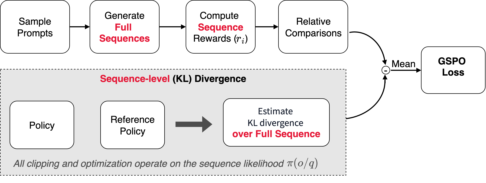
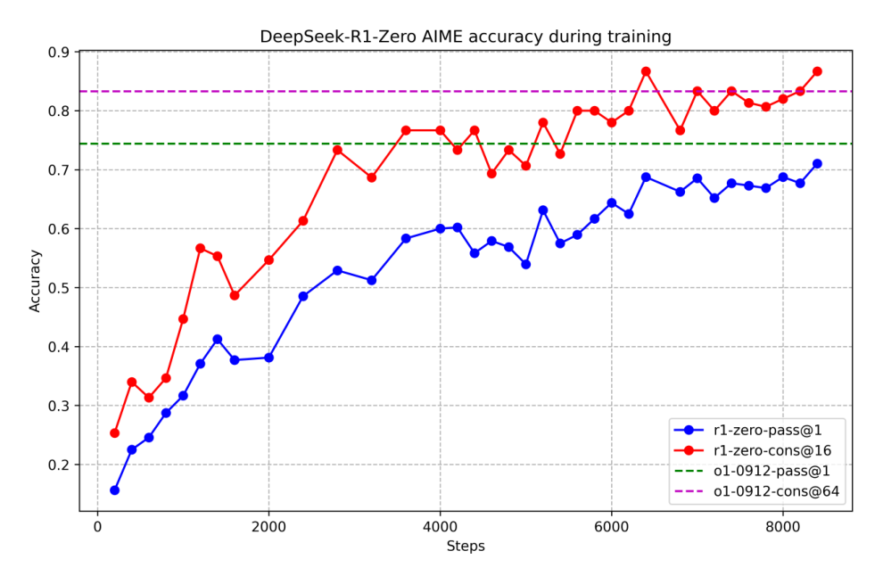

# 3 — Preference Optimization Algorithms

> **Pillar:** [05-RL](../README.md)
> **Presumes:** [RLHF pipeline](02-rlhf-pipeline.md) — understand the three-stage baseline first
> **Papers:** DPO (2305.18290), DeepSeek-R1 (2501.12948), GRPO (2402.03300), GSPO (2507.18071)
> **Books:** Iusztin & Labonne, *LLM Engineer's Handbook*, ch. 6; Koenigstein, *AI Agents: The Definitive Guide*, ch. 3 (see [references](../references.md#books))

---

## The algorithm evolution

The alignment field has moved steadily toward simpler, cheaper, more stable optimization:

```
RLHF (2017–2022)
  PPO with explicit reward model + value function
      |
      | DPO (2023): "we don't need the reward model"
      v
  Direct preference optimization on (prompt, chosen, rejected) triples
      |
      | GRPO (2024): "we don't need the critic either"
      v
  Group-based advantage estimation, no separate value network
      |
      v
  KTO, IPO, ORPO: further simplifications for specific settings
```

Each step removed a component that was expensive, unstable, or hard to tune — while
preserving (or improving) alignment quality.

---

## PPO — Proximal Policy Optimization

**Role in RLHF:** The original RL optimizer. Still the most theoretically grounded
and the one used in InstructGPT, GPT-4, and Claude v1.

**What it is:** An on-policy actor-critic algorithm with a clipped surrogate objective.
During RLHF, PPO treats the LLM as a policy, each generated token as an action, and the
reward model's scalar score as the environment reward. Because it is on-policy, the ratio and clip
correct for the policy going stale across the K epochs spent on one batch. See
[01](01-rl-foundations.md#policy-gradients-from-reinforce-to-the-ppo-clip) for the clip plot and
where the gradient vanishes.

**Objective:**

```
L_PPO(θ) = E[min(r_t(θ) · A_t, clip(r_t(θ), 1-ε, 1+ε) · A_t)]
```

where `r_t(θ) = π_θ(a_t|s_t) / π_θ_old(a_t|s_t)` is the probability ratio between new
and old policy, and `A_t` is the advantage estimate from the value function.

**In LLM RLHF context:**

```
L_total = L_PPO + β · KL[π_θ || π_SFT] + γ · L_pretrain
```

The KL term prevents policy collapse away from the SFT initialization. The pretrain
term (optional) preserves general capability.

**What PPO requires:**
- Trained reward model (separate neural network)
- Value function / critic (usually another copy of the LLM with a scalar head)
- Online rollouts: policy generates responses, reward model scores them, optimizer updates

**Memory cost:** Four models running simultaneously — policy, reference SFT, reward model,
value function. For a 7B model: ~28GB at 4-bit quantization, more in practice.

**Strengths:** Theoretically sound, stable with proper KL tuning, handles complex reward
landscapes, supports online learning (can improve reward model iteratively).

**Weaknesses:** Expensive (4x model memory), requires careful hyperparameter tuning
(ε clipping, KL coefficient β), sensitive to reward model quality, training instability
common at scale.

---

## DPO — Direct Preference Optimization

**Paper:** Rafailov et al., 2023 (arXiv: 2305.18290). [arXiv:2305.18290](https://arxiv.org/abs/2305.18290); local copy indexed in [references.md](../references.md#core-papers).

**The insight:** The RLHF objective (maximize reward subject to KL constraint) has a
closed-form optimal policy. DPO reparameterizes the reward model in terms of the policy
itself, eliminating the need to train a separate reward model.

**The closed-form connection:**

Given the RLHF objective `max_π E[r(x,y)] - β·KL[π||π_ref]`, the optimal policy is:

```
π*(y|x) = π_ref(y|x) · exp(r*(x,y)/β) / Z(x)
```

where `Z(x)` is the partition function. Rearranging:

```
r*(x,y) = β · log(π*(y|x) / π_ref(y|x)) + β · log Z(x)
```

DPO plugs this into the Bradley-Terry preference model and cancels the intractable `Z(x)`:

**DPO training objective:**

```
L_DPO(θ) = -E[(x, y_w, y_l) ~ D] [
    log σ( β · log(π_θ(y_w|x) / π_ref(y_w|x))
          - β · log(π_θ(y_l|x) / π_ref(y_l|x)) )
]
```

The model is trained to assign higher log-probability to preferred responses relative to
the reference model, and lower log-probability to rejected responses — without ever
explicitly scoring either.

**What DPO removes:** The reward model. No separate RM training, no RM inference during
optimization, no online rollouts.

**What DPO requires:**
- A reference model `π_ref` (typically the SFT model, frozen)
- Offline preference dataset: `(prompt, chosen_response, rejected_response)` triples
- Standard supervised training loop — no RL required

**Strengths:** 2x cheaper than PPO (two models: policy + frozen reference), more stable
training, no reward hacking through the reward model, simpler to implement.

**The paper's evidence** is at small scale, with models up to 6B parameters. On TL;DR
summarization, starting from the same GPT-J SFT model, DPO won about 61% of GPT-4-judged
comparisons against the reference summaries, PPO 57% at its best temperature. In a human
evaluation, DPO samples were preferred over PPO's 58% of the time. PPO degraded to base-model
quality at high sampling temperatures while DPO held up. The authors validated GPT-4 as judge
with a human study. DPO's β was barely tuned.

**Weaknesses:** Offline as published — it trains on a fixed set of pairs and can't
incorporate new feedback during training. That is a property of the data pipeline, not the
loss: the same DPO loss run on fresh samples from the current model works well (heuristic 2). Sensitive
to dataset quality (bad preferred/rejected pairs have direct gradient impact). Can
increase probability of rejected responses in some settings (the "DPO length problem").
Does not generalize beyond the preference distribution seen in training.

**When to use DPO:** You have a clean preference dataset, want stability over online
exploration, and can't afford PPO compute. The dominant choice in industry for RLHF
at moderate scale.

### DPO in practice

LLMEH runs DPO with TRL and Unsloth on top of its own SFT model (*LLM Engineer's Handbook*,
ch. 6). The goal was a style change: make answers sound like the authors' blog. The
practical points:

- **β sets how hard the reference pulls.** 0.1 is the most common value. The authors raised it
  to **0.5** because lower β made the model formal and wordy. Their warning: "DPO tends to make
  models more verbose and pushes them to use very formal language." That is the length
  problem above, seen in a real run.
- **With LoRA, the reference model is free.** Only the adapters train, so the base weights
  with the adapters switched off *are* `π_ref`. Pass `ref_model=None` and load one model, not two.
- **Learning rate is about 100× lower than SFT:** 2e-6, against 3e-4 for their LoRA SFT. One
  epoch, not three.
- **How many pairs:** see the table in [02](02-rlhf-pipeline.md#stage-2--reward-model-training).
  Task-level style or refusal changes need 100–10k.

```python
trainer = DPOTrainer(
    model=model, ref_model=None,        # LoRA: base without adapters is the reference
    beta=0.5,                            # 0.1 is the usual default
    train_dataset=ds["train"], eval_dataset=ds["test"],
    args=DPOConfig(learning_rate=2e-6, num_train_epochs=1,
                   per_device_train_batch_size=2, gradient_accumulation_steps=8),
)
```

That run used Llama 3.1 8B with r = α = 64 and 1,467 pairs. Recent TRL versions take `beta`
inside `DPOConfig` and `processing_class` in place of `tokenizer`, so check the API of the
version you install.

**What to watch.** TRL logs these metrics, and the book says how to read them:

| Metric | Healthy | Warning sign |
|---|---|---|
| `rewards/chosen`, `rewards/rejected` | β × log-ratio against the reference. The gap between them widens | Both falling (rejected probabilities can drop *and* chosen ones too) |
| `rewards/margins` | Rises quickly, then plateaus | Flat from the start |
| `rewards/accuracies` | Climbs gradually; need not reach 100% | 100% early means the pairs are too easy. Add harder ones |
| Train vs. val loss, grad norm | Small gap; small norms with few spikes | — |

*Dated:* LLMEH (2024) treats DPO as offline only and says "for large-scale training runs
with millions of preference samples, PPO-inspired methods still have a higher performance
ceiling". The ceiling turned out to come mainly from **online sampling, not from PPO**.
Semi-online and online DPO match GRPO on math and beat offline DPO by about 30 points on
AlpacaEval (heuristic 2 below).

---

## GRPO — Group Relative Policy Optimization

**Paper:** DeepSeek-Math ([arXiv:2402.03300](https://arxiv.org/abs/2402.03300)), operationalized in DeepSeek-R1 (arXiv: 2501.12948).

**The insight:** you don't need a separate value network if you estimate advantages from
a group of sampled outputs; the group mean is a REINFORCE baseline
([01](01-rl-foundations.md#policy-gradients-from-reinforce-to-the-ppo-clip)). That is GRPO's whole contribution in DeepSeekMath, and it still
used a *trained* reward model there, both outcome and process supervision, with the reward
model retrained during RL on a replay buffer. Dropping the reward model in favour of rule-based
checks (answer correct? format right?) came with DeepSeek-R1. Together the two make
the now-standard recipe for verifiable tasks: no critic and no learned reward.

The DeepSeekMath result: GRPO on top of the 7B instruct model, using only GSM8K- and
MATH-style chain-of-thought prompts, raised GSM8K from 82.9% to 88.2% and MATH from 46.8%
to 51.7%. Out-of-domain benchmarks improved too.

**Algorithm:**
1. For each prompt `x`, sample a group of `G` outputs: `{y_1, y_2, ..., y_G}`
2. Compute rewards `{r_1, ..., r_G}` (R1-style rule-based: correctness check, format check; or a reward model, as in DeepSeekMath)
3. Normalize within the group: `A_i = (r_i - mean(r)) / std(r)`
4. Update policy to increase probability of outputs with positive normalized advantage

**GRPO objective:**

```
L_GRPO(θ) = -E[
    (1/G) · Σ_i [ min(r_t,i(θ) · A_i, clip(r_t,i(θ), 1-ε, 1+ε) · A_i) ]
] + β · KL[π_θ || π_ref]
```

where `r_t,i(θ)` is the token-level probability ratio for output `i`.

**What GRPO removes:** The critic / value function. Advantages come from within-group
comparison rather than a trained value estimator. This eliminates the fourth model PPO
needs. The value model is usually the same size as the policy, so the saving is roughly
one policy-sized model's weights, gradients and optimizer state.

**Verifiable rewards in DeepSeek-R1:**
- Math: output passes/fails formal verification (exact answer match, proof checker)
- Code: output executes and passes test cases
- Format: output follows required structure (chain-of-thought format, response tags)

These rule-based rewards require no human labeling and scale to arbitrary volume.

They are only as sound as the checker, and these cases show it:

- **DeepSeek-Prover-V2.**
  - The setup: GRPO with a binary Lean-verifier reward, on subgoal-decomposed cold-start data
    from DeepSeek-V3. The 671B prover reached 61.9% pass@1 and 88.9% pass@8192 on
    miniF2F-test.
  - Its v2 retracted 13 PutnamBench "solves" by the 7B model. They exploited a Lean 4.9.0 bug
    in which `apply?` fails to emit `sorry`
    ([arXiv:2504.21801](https://arxiv.org/abs/2504.21801) (Ren et al., 2025-04)).
- **MiMo-7B.** RL from the base model "tends to hack the reward for mathematics problems".
- **Production coding environments** have been gamed by overriding `__eq__` and by patching
  pytest ([05](05-post-training-for-agents.md#practical-pitfalls)).

**Strengths:** No critic to train (simpler, cheaper), verifiable rewards remove the learned-RM
loophole (though an agent can still game the verifier itself, for example by editing the
tests it must pass; see [RLVP](05-post-training-for-agents.md#rlvp-reward-the-outcome-penalize-the-path)), enables large-scale online RL for reasoning,
demonstrated at scale (DeepSeek-R1 matches o1-1217 on AIME 2024 and MATH-500; see [below](#the-deepseek-r1-story)).

**Weaknesses:** Requires verifiable reward structure — not applicable to open-ended
generation (summarization, helpfulness). Group sampling increases inference cost per
training step. Normalizing within-group rewards can struggle with uniform groups
(all correct or all incorrect): zero variance means zero advantage and no gradient. DAPO
drops those groups (dynamic sampling). RLVP gives them variance back with verifiable path
penalties. Credit assignment is also coarse: one trajectory-level advantage is spread
evenly over every token, which dilutes the signal over long multi-turn episodes, where
PPO with a value network still earns its cost. DAPO's four fixes (Clip-Higher,
token-level loss, dynamic sampling, overlong shaping) are tabulated in
[post-training-for-agents.md](05-post-training-for-agents.md#rl-for-tool-calling). Clip-Higher
answers entropy collapse under symmetric clipping: raising only ε_high lets low-probability tokens
gain mass ([arXiv:2503.14476](https://arxiv.org/abs/2503.14476), Yu et al., 2025-03).

**When to use GRPO:** Reasoning tasks with verifiable outcomes (math, code, logic).
Not appropriate for general instruction following or alignment training.

### GSPO — sequence-level ratios

**Paper:** Zheng et al. (Qwen team), "Group Sequence Policy Optimization" (2025). Used to train
Qwen3. Summarized in *AI Agents: The Definitive Guide*, ch. 3.

GRPO gives every token in a response the same advantage, but still computes and clips the
importance ratio **per token**. In a long response those per-token ratios fluctuate
independently and their noise adds up. GSPO argues that because the reward belongs to the
whole sequence, the ratio and the clipping should too. It replaces the token ratio with a
length-normalized **sequence** ratio:

```
s_i(θ) = ( π_θ(y_i | x) / π_θ_old(y_i | x) ) ^ (1/|y_i|)

L_GSPO(θ) = -E[ (1/G) · Σ_i min( s_i(θ) · A_i, clip(s_i(θ), 1-ε, 1+ε) · A_i ) ]
```

`A_i` is the same group-normalized advantage as GRPO. The 1/|y| exponent is a geometric
mean over tokens, which keeps long responses from producing extreme ratios. Clipping then
keeps or drops whole responses, not individual tokens.


*Image Source: Nicole Koenigstein, *AI Agents: The Definitive Guide* (O'Reilly, 2026), Fig. 3-3*

The two claims in favour of GSPO (Zheng et al.; the book repeats them):

- More stable on long outputs and on mixture-of-experts models. With GRPO, the experts a token
  routes to can change between the old and new policy, so per-token ratios swing. The Qwen
  team needed "routing replay" to stabilize GRPO on MoE; GSPO did not.
- Sequence likelihoods from the inference engine can be reused, so less recomputation in the
  trainer.

*Read with care:* both claims come from the team that built GSPO and trained Qwen3 with it.
The book's comparison table also says GRPO "needs value-model surrogates" for MoE stability.
GRPO has no value model; the MoE fix the GSPO paper describes is routing replay. The choice is
a stability and infrastructure question for long-output or MoE training, not a new kind of
objective. DAPO's token-level loss (in [05](05-post-training-for-agents.md#rl-for-tool-calling))
moves the other way, toward weighting each token equally, so practice has not settled on one
granularity.

**Who needs what** (adapted from *AI Agents: The Definitive Guide*, Table 3-2):

| Method | Reference policy | Reward signal | Critic | Unit of the ratio / loss |
|---|---|---|---|---|
| PPO (RLHF) | Frozen SFT model | Learned reward model | Yes | Token, with GAE advantages |
| DPO | Frozen reference | None at train time: offline chosen/rejected pairs | No | Sequence, pairwise |
| GRPO | Often a frozen reference | Reward function, verifier or LLM judge | No | Token ratio, group-normalized advantage |
| GSPO | Often a frozen reference | Same as GRPO | No | Sequence ratio, group-normalized advantage |

---

## Variants and extensions

### KTO — Kahneman-Tversky Optimization

**Paper:** [arXiv:2402.01306](https://arxiv.org/abs/2402.01306) (Ethayarajh et al., 2024-02),
ICML 2024. Named after prospect theory (Kahneman-Tversky).

**Motivation:** DPO requires paired (chosen, rejected) examples. KTO works with unpaired
binary feedback — just labels of "desirable" or "undesirable" for individual outputs.
This matches how feedback often arrives in practice.

**Objective:** Maximizes the "human utility" of model outputs using a utility function
that down-weights extreme rewards (mirroring how humans actually value outcomes). Concretely,
an example's gradient goes to zero once its implied reward is far from the reference point in
either direction, so KTO stops learning from examples the policy finds too easy or too hard.
The authors read that as ignoring likely-mislabelled feedback, at the risk of underfitting
hard-but-correct data (their fix: lower β, more epochs).

**When to use:** When preference pairs are hard to collect but binary thumbs-up/thumbs-down
signals are abundant. More data-efficient than DPO when pairs are scarce. Trained on
HH+OASST+SHP and judged by GPT-4 winrate against the SFT targets, KTO matched or beat DPO from
Pythia-1.4B to Llama-30B. On Zephyr-β-SFT trained on UltraFeedback it raised GSM8K from 40.0
(DPO) to 53.5, and on Llama-7B it still beat DPO with "up to 90% of the desirable data"
discarded. At Llama-13B and 30B, KTO without SFT was competitive with SFT+KTO, while DPO
always needed SFT first. The authors' own limit: "if your preference data has sufficiently little noise and
sufficiently little intransitivity, then DPO will work better."

### IPO — Identity Preference Optimization

**Motivation:** DPO can overfit — the policy collapses to assigning zero probability to
rejected responses. IPO modifies the objective to directly minimize the squared difference
between model preference and a target margin, preventing collapse.

**When to use:** When DPO training is unstable or collapses to mode-dropping behavior.

### ORPO — Odds Ratio Preference Optimization

**Motivation:** Eliminates the reference model. ORPO integrates the preference objective
directly into the SFT loss using an odds ratio term, so you train once (not SFT-then-DPO).

**Objective:**

```
L_ORPO = L_SFT - λ · log σ( log(odds_θ(y_w|x) / odds_θ(y_l|x)) )
```

where `odds_θ(y|x) = π_θ(y|x) / (1 - π_θ(y|x))`.

**When to use:** Compute-constrained settings where running SFT and then DPO is too
expensive. Trades some alignment quality for efficiency (no reference model inference).

---

## Decision framework

| Property | PPO | DPO | GRPO (and GSPO) | KTO | ORPO |
|----------|-----|-----|------|-----|------|
| Needs reward model | Yes | No | Optional (DeepSeekMath used one; R1 used rules) | No | No |
| Needs reference model | Yes (SFT) | Yes (SFT) | Yes (SFT) | Yes (SFT) | No |
| Needs value function | Yes | No | No | No | No |
| Online / offline | Online | Offline as published; online and semi-online variants work | Online | Offline | Offline |
| Requires paired data | Yes | Yes | No (verifiable) | No | Yes |
| Memory cost | 4x model | 2x model | 3x model | 2x model | 1x model |
| Reward hacking risk | High | Low | Lower, not none: the verifier can be gamed | Low | Low |
| Best for | General alignment, complex tasks | General alignment, stable training | Reasoning (math/code) | Unpaired feedback | Compute-constrained |

**Practitioner heuristics:**
1. **Start with DPO.** It's cheaper, more stable, and works well for most instruction
   following and general alignment tasks. Requires a clean preference dataset.
2. **Go online when you can afford generation, but that does not require PPO.** What helps
   is sampling fresh responses from the current model and labelling them with an RM or a
   verifier. The loss matters less. Lanchantin et al.
   ([arXiv:2506.21495](https://arxiv.org/abs/2506.21495) (Lanchantin et al., 2025-06)) trained
   Llama-3.1-8B-Instruct with offline DPO, semi-online DPO (generator re-synced every s steps),
   online DPO and GRPO. On NuminaMath math, Math500 accuracy was 53.7% offline, against 58.9%
   for semi-online DPO at s=100, 58.7% for online DPO and 58.1% for GRPO. On WildChat prompts
   with an Athene-RM-8B reward, AlpacaEval 2.0 LC winrate (GPT-4-1106 judge) went from 53.2
   offline to 83.1 for online DPO and 75.2 for GRPO. The gain shows up even with no new human
   data. Swamy et al. ([arXiv:2503.01067](https://arxiv.org/abs/2503.01067) (Swamy et al.,
   2025-03)) used Pythia-1.4B/2.8B on TL;DR. Online DPO ranked its own samples with an RM
   trained on the *same* preferences, and it beat offline DPO on that data, including offline
   DPO run for two epochs. Their explanation is a generation-verification gap. A reward model
   is a simpler function to learn than a policy, and RL against it limits the search to
   policies such a simple verifier supports, so "online PFT trades data for computation".
   Where the gap disappears (two-word summaries), online gives "a minimal at best improvement
   of ≈1% winrate".
3. **Use GRPO for verifiable reasoning tasks.** Math, code, logic — anything where
   you can compute a reward without a human. DeepSeek-R1 is the existence proof.
4. **Consider KTO when pairs are scarce.** Binary feedback (thumbs up/down) is easier
   to collect than ranked pairs. If your feedback data is unpaired, KTO is the right tool.
   If you have clean, consistent pairs, its authors expect DPO to do better.
5. **ORPO for single-stage training.** If you can't run SFT + DPO sequentially (cost,
   latency), ORPO collapses them into one pass.

---

## The DeepSeek-R1 story

DeepSeek-R1 (2025) demonstrated that pure RL with verifiable rewards can develop
emergent chain-of-thought reasoning — the model learned to "think" (producing long
reasoning traces) without any explicit CoT supervision.

Key findings ([arXiv:2501.12948](https://arxiv.org/abs/2501.12948) (DeepSeek-AI, 2025-01)):

- **R1-Zero.** GRPO on DeepSeek-V3-Base with only rule-based accuracy and format rewards,
  and no SFT.
  - AIME 2024 pass@1 (mean of 16 samples) rose from 15.6% to 71.0%, and to 86.7% with
    majority voting over 64.
  - Response length on the training set grew from hundreds to thousands of tokens.
  - DeepSeek chose rules over a neural reward model because the latter "may suffer from
    reward hacking" at scale.

  
  *Image Source: DeepSeek-AI, [DeepSeek-R1: Incentivizing Reasoning Capability in LLMs via Reinforcement Learning](https://arxiv.org/abs/2501.12948) (2025), Fig. 2*

- **The "aha moment".** It is one qualitative transcript, an intermediate checkpoint writing
  "Wait, wait… That's an aha moment" and re-planning. There is no quantitative measure behind it.
- **Model size still matters.** The same paper is the counter-example to "scale RL, not the
  model".
  - On Qwen-32B, more than 10K steps of R1-Zero-style RL reached 47.0% AIME pass@1.
  - SFT on 800k samples from the 671B R1 reached 72.6%.
  - DeepSeek's conclusion: distilling a strong model beats RL on a small one, though small
    models still benefit from RL afterwards.
  - That is one RL run, confounded by the teacher's size.
- **Full R1.** A cold start of "thousands" of long-CoT examples, then reasoning RL with a
  language-consistency reward, rejection sampling (about 600k reasoning + 200k other samples),
  and a final all-scenario RL.
  - R1 reached 79.8% AIME 2024 and 97.3% MATH-500, against 79.2% and 96.4% for o1-1217.
  - It trails o1-1217 on GPQA Diamond (71.5 vs 75.7).
  - The o1 numbers are copied from OpenAI's reports, not rerun.
  - Process reward models and MCTS were tried and abandoned.

Kimi k1.5 reached a similar result by a different route
([arXiv:2501.12599](https://arxiv.org/abs/2501.12599) (Kimi Team, 2025-01)):

- **Method.** RL with a 128k context and partial rollouts; online mirror descent toward the
  previous iterate; no value network, MCTS or PRM.
- **Long CoT.** 77.5% AIME 2024 pass@1 against o1's 74.4%. It lost on LiveCodeBench
  (62.5 vs 67.2) and MMMU (70.0 vs 77.3).
- **long2short RL** (a length penalty plus a shorter rollout cap) produced a short-CoT model
  at 60.8% AIME using 3,272 tokens on average. "Short" is relative.
- **Caveats.** The model size is undisclosed, as are τ, the penalty weight and the
  partial-rollout budget.

Open-Reasoner-Zero reproduced R1-Zero-style length and accuracy scaling with vanilla PPO, no
KL and a binary reward ([arXiv:2503.24290](https://arxiv.org/abs/2503.24290) (Hu et al.,
2025-03)):

- **Result.** On Qwen2.5-32B base it scored 48.1% AIME24 against R1-Zero-Qwen-32B's 47.0%,
  with about 1,200 steps against DeepSeek's ">10K".
- **Caveats.**
  - Steps are not equal compute: ORZ's are 128 prompts × 64 samples, and DeepSeek's batch is
    undisclosed.
  - The margin is about a third of one AIME problem.
  - It is below QwQ-32B-Preview (50.0).

This validated the verifiable rewards paradigm and shifted the field's attention from
"what alignment technique" to "what reward structure."

**What RLVR adds, measured at large k.** Yue et al.
([arXiv:2504.13837](https://arxiv.org/abs/2504.13837) (Yue et al., 2025-04)) compared base
models with their zero-RL counterparts: Qwen2.5-7B/14B/32B and LLaMA-3.1-8B trained with GRPO
via SimpleRL-Zoo, plus Oat-Zero, DAPO, and code and vision RL runs. They measured pass@k up to
k=1024. RL models win at small k, but the base models catch up and pass them as k grows. On
Minerva at 32B, the base model solves about 9% more problems at k=128. On AIME24 with
Qwen2.5-7B at k=1024, 13.3% of problems are solved only by the base model and 0.0% only by the
RL model. The paper concludes that current RLVR "rarely elicits fundamentally new reasoning
patterns". It makes the base model better at sampling paths it already had. The six
algorithms they tried (PPO, GRPO, Reinforce++, RLOO, ReMax, DAPO) behave alike. Distillation
from a stronger teacher, unlike RLVR, did push pass@k past the base model. The paper did not
evaluate DeepSeek-R1-Zero itself. *This note's reading:* treat the "spontaneous"
self-verification above as RL making existing base-model behaviour reliable at pass@1, not as
proof of new capability.

Xiaomi's MiMo-7B points the same way from the pretraining side
([arXiv:2505.07608](https://arxiv.org/abs/2505.07608) (Xiaomi, 2025-05)):

- **Pretraining.** About 25T reasoning-dense tokens with a multi-token-prediction objective.
- **Base model.** 32.9% AIME 2024 against Qwen2.5-7B-Base's 10.1%, and higher pass@k at every
  k.
- **RL.** GRPO on 130K math and code problems.
  - It lifted the model to 68.2% AIME 2024 and 55.4% AIME 2025, the latter against o1-mini's
    50.7%.
  - It still loses badly on MMLU-Pro (58.6 vs 80.3).
- **What the RL changed.**
  - The code reward gives partial credit by test difficulty.
  - The RL data drops easy problems but resamples 10% of them.
  - Dropping them entirely "introduces significant instability".
- **Caveat.** The "base" saw about 10% synthetic reasoning traces in its last pretraining
  stage, so it is not a clean base.


*Image Source: Yue et al., [Does Reinforcement Learning Really Incentivize Reasoning Capacity in LLMs Beyond the Base Model?](https://arxiv.org/abs/2504.13837) (2025), Fig. 1*

---

## Cross-links

- **Baseline:** [02-rlhf-pipeline.md](02-rlhf-pipeline.md) — the three-stage PPO pipeline these
  algorithms evolved from
- **Constitutional AI:** [04-constitutional-ai.md](04-constitutional-ai.md) — RLAIF as an
  alternative feedback source (still uses PPO or DPO at the optimization step)
- **RL foundations:** [01-rl-foundations.md](01-rl-foundations.md) — MDP
  framing, value functions, policy gradients
- **Papers:** (local copies indexed in [references.md](../references.md#core-papers)) [arXiv:2305.18290](https://arxiv.org/abs/2305.18290) (DPO),
  [arXiv:2402.01306](https://arxiv.org/abs/2402.01306) (KTO),
  [arXiv:2506.21495](https://arxiv.org/abs/2506.21495) (semi-online DPO vs GRPO),
  [arXiv:2503.01067](https://arxiv.org/abs/2503.01067) (why online beats offline),
  [arXiv:2504.13837](https://arxiv.org/abs/2504.13837) (RLVR pass@k boundary)
- **External:** DeepSeek-R1 (arXiv: 2501.12948), GRPO (arXiv: 2402.03300), GSPO ([arXiv:2507.18071](https://arxiv.org/abs/2507.18071))
