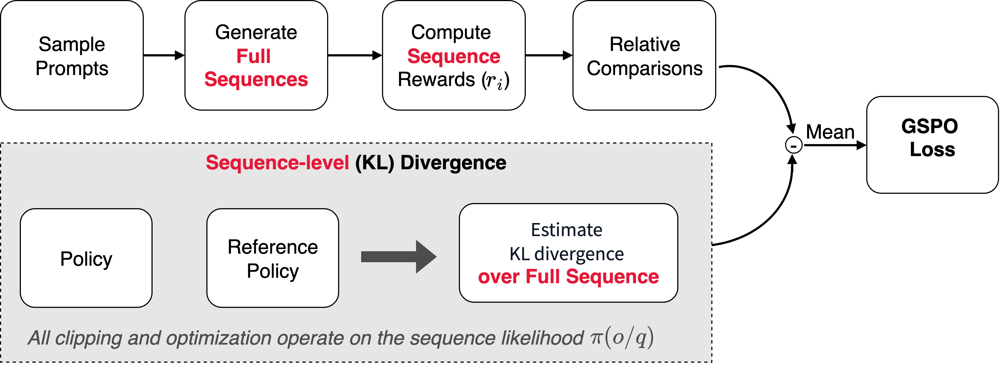

# 3 — Preference Optimization Algorithms

> **Pillar:** [05-RL](../README.md)
> **Presumes:** [RLHF pipeline](02-rlhf-pipeline.md) — understand the three-stage baseline first
> **Papers:** DPO (2305.18290), DeepSeek-R1 (2501.12948), GRPO (2402.03300), GSPO (2507.18071)
> **Books:** Iusztin & Labonne, *LLM Engineer's Handbook*, ch. 6; Koenigstein, *AI Agents: The Definitive Guide*, ch. 3 (see [references](../references.md#books))

The three-stage pipeline in [02](02-rlhf-pipeline.md) holds four models in memory and stakes everything on a reward model that the policy learns to cheat. Each algorithm here answers one question: what can we remove? DPO removes the reward model and the rollouts. GRPO removes the critic and, with a checkable answer, the reward model too. This chapter gives the objective of each, a small runnable version of the two that matter most, and a framework for choosing.

---

## The algorithm evolution

The alignment field has moved steadily toward simpler, cheaper, more stable optimization:

```text
RLHF (2017–2022)
  PPO with explicit reward model + value function
      |
      | DPO (2023): "we don't need the reward model"
      v
  Direct preference optimization on (prompt, chosen, rejected) triples
      |
      | GRPO (2024): "we don't need the critic either"
      v
  Group-based advantage estimation, no separate value network
      |
      v
  KTO, IPO, ORPO, SimPO: further simplifications for specific settings
  SPIN, SPPO: self-play, with the model's own samples as the opponent
```

Each step removed a component that was expensive, unstable, or hard to tune — while
preserving (or improving) alignment quality.

The diagram skips a side branch. In 2023, DPO had offline rivals: ranking losses (RRHF, PRO,
SLiC) and language-based ones that put a "good"/"bad" prefix on each response and train with
SFT (Chain of Hindsight, conditional behavior cloning). Few open models used any of them. In a
mid-2023 survey table of 27 open aligned models, **none used PPO, one used a ranking loss and two
used a language-based one; the rest were SFT or LoRA on distilled data**
([arXiv:2307.12966](https://arxiv.org/abs/2307.12966) (Wang et al., 2023-07, preprint)).

---

## PPO — Proximal Policy Optimization

**Role in RLHF:** The original RL optimizer. Still the most theoretically grounded
and the one used in InstructGPT, GPT-4, and Claude v1.

**What it is:** An on-policy actor-critic algorithm with a clipped surrogate objective.
During RLHF, PPO treats the LLM as a policy, each generated token as an action, and the
reward model's scalar score as the environment reward. Because it is on-policy, the ratio and clip
correct for the policy going stale across the K epochs spent on one batch. See
[01](01-rl-foundations.md#policy-gradients-from-reinforce-to-the-ppo-clip) for the clip plot and
where the gradient vanishes.

**Objective:**

```
L_PPO(θ) = E[min(r_t(θ) · A_t, clip(r_t(θ), 1-ε, 1+ε) · A_t)]
```

where `r_t(θ) = π_θ(a_t|s_t) / π_θ_old(a_t|s_t)` is the probability ratio between new
and old policy, and `A_t` is the advantage estimate from the value function.

**In LLM RLHF context:**

```
L_total = L_PPO + β · KL[π_θ || π_SFT] + γ · L_pretrain
```

The KL term prevents policy collapse away from the SFT initialization. The pretrain
term (optional) preserves general capability.

**What PPO requires:**
- Trained reward model (separate neural network)
- Value function / critic (usually another copy of the LLM with a scalar head)
- Online rollouts: policy generates responses, reward model scores them, optimizer updates

**Memory cost:** Four models running simultaneously — policy, reference SFT, reward model,
value function. For a 7B model: ~28GB at 4-bit quantization, more in practice.

**Strengths:** Theoretically sound, stable with proper KL tuning, handles complex reward
landscapes, supports online learning (can improve reward model iteratively).

**Weaknesses:** Expensive (4x model memory), requires careful hyperparameter tuning
(ε clipping, KL coefficient β), sensitive to reward model quality, training instability
common at scale.

**PPO on a verifiable reward predates R1.** ReFT ran PPO after an SFT warm-up, with the reward
taken from the final answer alone and no reward model
([arXiv:2401.08967](https://arxiv.org/abs/2401.08967) (Luong et al., ACL 2024)). The training
questions were the same ones SFT used. On GSM8K with CodeLLaMA-7B and GPT-3.5-written CoT, it
raised accuracy from 43.6% to 53.3% (natural-language CoT) and from 63.7% to 75.3% (program
CoT). It needed more epochs than SFT. It also **reward-hacked multiple-choice MathQA**: with only
A–E as the answer space, a wrong chain that lands on the right letter still gets full reward.

**Much of PPO's machinery may be unnecessary for LLM RLHF.** Ahmadian et al.
([arXiv:2402.14740](https://arxiv.org/abs/2402.14740) (Ahmadian et al., ACL 2024)) trained
Pythia-6.9B and Llama-7B on Anthropic-HH and TL;DR. The clip was active on fewer than 5% of
samples per batch, and removing the clip, and then the ratio, did not hurt. **RLOO with k = 4
samples beat PPO by 10.3–32.1 GPT-4-judged win-rate points, and also beat DPO and RAFT.**
Because the pretrained policy already starts close to good, low-variance REINFORCE over whole
completions is enough ([01](01-rl-foundations.md#policy-gradients-from-reinforce-to-the-ppo-clip)).

---

## DPO — Direct Preference Optimization

**Paper:** Rafailov et al., 2023 (arXiv: 2305.18290). [arXiv:2305.18290](https://arxiv.org/abs/2305.18290); local copy indexed in [references.md](../references.md#core-papers).

**The insight:** The RLHF objective (maximize reward subject to KL constraint) has a
closed-form optimal policy. DPO reparameterizes the reward model in terms of the policy
itself, eliminating the need to train a separate reward model.

**The closed-form connection:**

Given the RLHF objective `max_π E[r(x,y)] - β·KL[π||π_ref]`, the optimal policy is:

```
π*(y|x) = π_ref(y|x) · exp(r*(x,y)/β) / Z(x)
```

where `Z(x)` is the partition function. Rearranging:

```
r*(x,y) = β · log(π*(y|x) / π_ref(y|x)) + β · log Z(x)
```

DPO plugs this into the Bradley-Terry preference model and cancels the intractable `Z(x)`:

**DPO training objective:**

```
L_DPO(θ) = -E[(x, y_w, y_l) ~ D] [
    log σ( β · log(π_θ(y_w|x) / π_ref(y_w|x))
          - β · log(π_θ(y_l|x) / π_ref(y_l|x)) )
]
```

The model is trained to assign higher log-probability to preferred responses relative to
the reference model, and lower log-probability to rejected responses — without ever
explicitly scoring either.

**What DPO removes:** The reward model. No separate RM training, no RM inference during
optimization, no online rollouts.

**What DPO requires:**
- A reference model `π_ref` (typically the SFT model, frozen)
- Offline preference dataset: `(prompt, chosen_response, rejected_response)` triples
- Standard supervised training loop — no RL required

**Strengths:** 2x cheaper than PPO (two models: policy + frozen reference), more stable
training, no reward hacking through the reward model, simpler to implement.

**The paper's evidence** is at small scale, with models up to 6B parameters. On TL;DR
summarization, starting from the same GPT-J SFT model, DPO won about 61% of GPT-4-judged
comparisons against the reference summaries, PPO 57% at its best temperature. In a human
evaluation, DPO samples were preferred over PPO's 58% of the time. PPO degraded to base-model
quality at high sampling temperatures while DPO held up. The authors validated GPT-4 as judge
with a human study. DPO's β was barely tuned.

**Weaknesses:** Offline as published — it trains on a fixed set of pairs and can't
incorporate new feedback during training. That is a property of the data pipeline, not the
loss: the same DPO loss run on fresh samples from the current model works well (heuristic 2). Sensitive
to dataset quality (bad preferred/rejected pairs have direct gradient impact). Can
increase probability of rejected responses in some settings (the "DPO length problem";
SimPO, [13](13-preference-variants.md#simpo--no-reference-model-length-normalized-reward), measures it).
Does not generalize beyond the preference distribution seen in training.

**When to use DPO:** You have a clean preference dataset, want stability over online
exploration, and can't afford PPO compute. The dominant choice in industry for RLHF
at moderate scale.

You can see what the objective pays for with four cases and no model at all. Each case passes in the log-probabilities the policy and the reference give to the chosen and the rejected answers:

```python
import numpy as np

def dpo_loss(logp_w, logp_l, ref_w, ref_l, beta=0.1):
    margin = beta * ((logp_w - ref_w) - (logp_l - ref_l))
    return np.log1p(np.exp(-margin))             # -log sigmoid(margin)

ref_w, ref_l = -20.0, -20.0                      # reference likes both answers equally
for label, logp_w, logp_l in [("no change", -20, -20),
                              ("shifted to chosen", -15, -25),
                              ("shifted to rejected", -25, -15),
                              ("both more likely", -15, -15)]:
    print(f"{label:<20} loss={dpo_loss(logp_w, logp_l, ref_w, ref_l):.3f}")
```

```text
no change            loss=0.693
shifted to chosen    loss=0.313
shifted to rejected  loss=1.313
both more likely     loss=0.693
```

Only the *relative* shift pays. Making both answers more likely leaves the loss at log 2, so the policy can't win by turning up everything.

### DPO in practice

LLMEH runs DPO with TRL and Unsloth on top of its own SFT model (*LLM Engineer's Handbook*,
ch. 6). The goal was a style change: make answers sound like the authors' blog. The
practical points:

- **β sets how hard the reference pulls.** 0.1 is the most common value. The authors raised it
  to **0.5** because lower β made the model formal and wordy. Their warning: "DPO tends to make
  models more verbose and pushes them to use very formal language." That is the length
  problem above, seen in a real run.
- **With LoRA, the reference model is free.** Only the adapters train, so the base weights
  with the adapters switched off *are* `π_ref`. Pass `ref_model=None` and load one model, not two.
- **Learning rate is about 100× lower than SFT:** 2e-6, against 3e-4 for their LoRA SFT. One
  epoch, not three.
- **How many pairs:** see the table in [06](06-data-and-environments.md#preference-data-at-practitioner-scale).
  Task-level style or refusal changes need 100–10k.

```python
# illustrative: needs TRL, a GPU, a loaded LoRA model and a preference dataset
trainer = DPOTrainer(
    model=model, ref_model=None,        # LoRA: base without adapters is the reference
    beta=0.5,                            # 0.1 is the usual default
    train_dataset=ds["train"], eval_dataset=ds["test"],
    args=DPOConfig(learning_rate=2e-6, num_train_epochs=1,
                   per_device_train_batch_size=2, gradient_accumulation_steps=8),
)
```

That run used Llama 3.1 8B with r = α = 64 and 1,467 pairs. Recent TRL versions take `beta`
inside `DPOConfig` and `processing_class` in place of `tokenizer`, so check the API of the
version you install.

**What to watch.** TRL logs these metrics, and the book says how to read them:

| Metric | Healthy | Warning sign |
|---|---|---|
| `rewards/chosen`, `rewards/rejected` | β × log-ratio against the reference. The gap between them widens | Both falling (rejected probabilities can drop *and* chosen ones too) |
| `rewards/margins` | Rises quickly, then plateaus | Flat from the start |
| `rewards/accuracies` | Climbs gradually; need not reach 100% | 100% early means the pairs are too easy. Add harder ones |
| Train vs. val loss, grad norm | Small gap; small norms with few spikes | — |

Falling chosen rewards matter most on reasoning, where one correct answer faces many wrong ones. Eurus trained Mistral-7B on UltraInteract, 220K correct/incorrect action pairs over math, code and logic problems. **DPO lowered the SFT model's average over 12 benchmarks from 46.5 to 44.5, and LeetCode from 20.0 to 8.3. KTO raised it to 48.8 and NCA to 48.1.** DPO's chosen rewards went below zero, while KTO's and NCA's kept rising. At 70B the rewards went to −∞ and DPO did not train at all. The same idea helped the reward model: adding −log σ(r_chosen) − log σ(−r_rejected) to the Bradley–Terry loss raised RewardBench reasoning from 77.5 to 87.0. This is one dataset and β = 0.1, with GPT-3.5 Turbo writing the correct actions and the explanation read from reward curves ([arXiv:2404.02078](https://arxiv.org/abs/2404.02078) (Yuan et al., 2024-04, preprint)).

*Dated:* LLMEH (2024) treats DPO as offline only and says "for large-scale training runs
with millions of preference samples, PPO-inspired methods still have a higher performance
ceiling". The ceiling turned out to come mainly from **online sampling, not from PPO**.
Semi-online and online DPO match GRPO on math and beat offline DPO by about 30 points on
AlpacaEval (heuristic 2 below).

Zephyr-7B shows DPO's place in a distilled pipeline
([arXiv:2310.16944](https://arxiv.org/abs/2310.16944) (Tunstall et al., COLM 2024)).
Mistral-7B was first fine-tuned on 200k filtered UltraChat dialogues. It was then trained with
DPO on UltraFeedback pairs scored by GPT-4. It reached 7.34 on MT-Bench, against 6.86 for
Llama-2-Chat-70B, with no human labels and a few hours on 16 A100s. **DPO without the SFT stage
collapsed (4.76). SFT on the chosen responses alone was worse than DPO on the same pairs (6.19
vs 7.00).** DPO overfit to 100% training accuracy after one epoch without hurting MT-Bench.
Three DPO epochs on a one-epoch SFT model worked best, and a longer SFT made extra DPO regress.
The judge was GPT-4, which favours models distilled from it.

Tülu 2 took Zephyr's DPO recipe unchanged (UltraFeedback, 3 epochs, β = 0.1, learning rate
5e-7) to Llama-2 at 7B, 13B and 70B ([arXiv:2311.10702](https://arxiv.org/abs/2311.10702)
(Ivison et al., 2023-11, preprint)). **The same hyperparameters were stable at every size and
raised AlpacaEval by 8.5 to 11.2 points, while MMLU, GSM8K and BBH moved by 3.5 points or less.**
The cost landed where the data was thin: the SFT and DPO mixes are mostly English, and the
multilingual TydiQA fell by 13.5 points at 13B and 17.8 at 70B. Mean AlpacaEval answer length
rose by about 40% at 70B (1,011 to 1,414), so part of the win-rate gain is the
length bias above. All gains are on GPT-4-judged benchmarks, and the paper does not compare DPO
with PPO.

The preference does not have to come from a person. FactTune samples ten biographies per
prompt and prefers whichever has the higher share of claims that FactScore finds supported in
Wikipedia ([arXiv:2311.08401](https://arxiv.org/abs/2311.08401) (Tian et al., ICLR 2024)). **On
Llama-2-7B, DPO on those pairs raised the correct share of biography claims from 0.701 (SFT) to
0.895, against 0.748 for Llama-2-Chat**, and cut incorrect claims per answer from 5.19 to 2.00.
The reference-free variant uses the model's own agreement over 20 resamples of each claim, and
reached 0.846. It was the only method that both added correct facts and removed wrong ones; ITI
and DoLa traded one for the other. Human checkers agreed with the gain (0.58 to 0.85 on
Llama-1 biographies). The answers turn terser and less conversational, though, and it is 7B only,
on 296 training people and 150 medical conditions.

Quote-Tuning uses a cheaper automatic signal still: the share of character 25-grams that a Bloom
filter finds in the Pile's Wikipedia. It keeps one pair per prompt out of 32 samples, and the
two answers must be within 10% of each other in length
([arXiv:2404.03862](https://arxiv.org/abs/2404.03862) (Zhang et al., NAACL 2025)). **On Natural
Questions, DPO on about 20k such pairs lifted Llama-2-7B-Chat's quoted share from 34.9% to 54.5%,
above best-of-32 reranking (50.4%), at unchanged answer length.** TruthfulQA truthful-and-informative
rose 46.6 to 51.5, and MMLU, GSM8K, BBH and HellaSwag each fell by under 1.6. Without the length
filter, answers came out about 10% shorter. The score counts many short quotes the same as a few
long ones, and it says nothing about whether the quoted text answers the question.

---

## GRPO — Group Relative Policy Optimization

**Paper:** DeepSeek-Math ([arXiv:2402.03300](https://arxiv.org/abs/2402.03300)), operationalized in DeepSeek-R1 (arXiv: 2501.12948).

**The insight:** you don't need a separate value network if you estimate advantages from
a group of sampled outputs; the group mean is a REINFORCE baseline
([01](01-rl-foundations.md#policy-gradients-from-reinforce-to-the-ppo-clip)). That is GRPO's whole contribution in DeepSeekMath, and it still
used a *trained* reward model there, both outcome and process supervision, with the reward
model retrained during RL on a replay buffer. Dropping the reward model in favour of rule-based
checks (answer correct? format right?) came with DeepSeek-R1. Together the two make
the now-standard recipe for verifiable tasks: no critic and no learned reward.

The DeepSeekMath result: GRPO on top of the 7B instruct model, using only GSM8K- and
MATH-style chain-of-thought prompts, raised GSM8K from 82.9% to 88.2% and MATH from 46.8%
to 51.7%. Out-of-domain benchmarks improved too.

**Algorithm:**
1. For each prompt `x`, sample a group of `G` outputs: `{y_1, y_2, ..., y_G}`
2. Compute rewards `{r_1, ..., r_G}` (R1-style rule-based: correctness check, format check; or a reward model, as in DeepSeekMath)
3. Normalize within the group: `A_i = (r_i - mean(r)) / std(r)`
4. Update policy to increase probability of outputs with positive normalized advantage

**GRPO objective:**

```
L_GRPO(θ) = -E[
    (1/G) · Σ_i [ min(r_t,i(θ) · A_i, clip(r_t,i(θ), 1-ε, 1+ε) · A_i) ]
] + β · KL[π_θ || π_ref]
```

where `r_t,i(θ)` is the token-level probability ratio for output `i`.

Step 3 is the whole advantage estimator. Here it is on the group shapes a real run produces:

```python
import numpy as np

def grpo_advantages(rewards, eps=1e-4):
    r = np.asarray(rewards, dtype=float)
    return (r - r.mean()) / (r.std() + eps)

groups = {"mixed verifier": [1, 0, 0, 1, 0, 0, 0, 1],
          "all correct": [1] * 8,
          "all wrong": [0] * 8,
          "with a format bonus": [1.2, 0.2, 0.0, 1.2, 0.2, 0.0, 0.2, 1.0]}
for name, rewards in groups.items():
    print(f"{name:<20}", np.round(grpo_advantages(rewards), 2))
```

```text
mixed verifier       [ 1.29 -0.77 -0.77  1.29 -0.77 -0.77 -0.77  1.29]
all correct          [0. 0. 0. 0. 0. 0. 0. 0.]
all wrong            [0. 0. 0. 0. 0. 0. 0. 0.]
with a format bonus  [ 1.4 -0.6 -1.   1.4 -0.6 -1.  -0.6  1. ]
```

An all-pass or all-fail group gets zero advantage and teaches nothing, so problem difficulty has to be matched to the model. A format bonus splits the tied wrong answers into better and worse ones.

**What GRPO removes:** The critic / value function. Advantages come from within-group
comparison rather than a trained value estimator. This eliminates the fourth model PPO
needs. The value model is usually the same size as the policy, so the saving is roughly
one policy-sized model's weights, gradients and optimizer state.

**Verifiable rewards in DeepSeek-R1:**
- Math: output passes/fails formal verification (exact answer match, proof checker)
- Code: output executes and passes test cases
- Format: output follows required structure (chain-of-thought format, response tags)

These rule-based rewards require no human labeling and scale to arbitrary volume.

They are only as sound as the checker, and these cases show it:

- **DeepSeek-Prover-V2.**
  - The setup: GRPO with a binary Lean-verifier reward, on subgoal-decomposed cold-start data
    from DeepSeek-V3. The 671B prover reached 61.9% pass@1 and 88.9% pass@8192 on
    miniF2F-test. It builds on DeepSeek-Prover v1, which reached 46.3% on miniF2F-test
    (pass@64) through expert iteration over 8M autoformalized Lean statements
    ([arXiv:2405.14333](https://arxiv.org/abs/2405.14333) (Xin et al., 2024-05, preprint)).
  - Its v2 retracted 13 PutnamBench "solves" by the 7B model. They exploited a Lean 4.9.0 bug
    in which `apply?` fails to emit `sorry`
    ([arXiv:2504.21801](https://arxiv.org/abs/2504.21801) (Ren et al., 2025-04)).
- **MiMo-7B.** RL from the base model "tends to hack the reward for mathematics problems".
- **Production coding environments** have been gamed by overriding `__eq__` and by patching
  pytest ([05](05-post-training-for-agents.md#practical-pitfalls)).

**Strengths:** No critic to train (simpler, cheaper), verifiable rewards remove the learned-RM
loophole (though an agent can still game the verifier itself, for example by editing the
tests it must pass; see [RLVP](07-reward-design-and-tool-calling.md#rlvp-reward-the-outcome-penalize-the-path)), enables large-scale online RL for reasoning,
demonstrated at scale (DeepSeek-R1 matches o1-1217 on AIME 2024 and MATH-500; see [below](08-reasoning-rl-deepseek-r1.md#the-deepseek-r1-story)).

**Weaknesses:** Requires verifiable reward structure — not applicable to open-ended
generation (summarization, helpfulness). Group sampling increases inference cost per
training step. Normalizing within-group rewards can struggle with uniform groups
(all correct or all incorrect): zero variance means zero advantage and no gradient. DAPO
drops those groups (dynamic sampling). RLVP gives them variance back with verifiable path
penalties. HERO gives them variance back with a reward model, but bounded inside the
verifier's bands: RM scores are min-max scaled to [−α, α] for wrong answers and [1−β, 1+β]
for right ones. With α + β < 1, a wrong answer can never outscore a right one
([arXiv:2510.07242](https://arxiv.org/abs/2510.07242) (Tao et al., 2025-10, preprint)).
Qwen3-4B-Base was trained on 2k easy-to-verify OpenMathReasoning problems. On four
verifiable math benchmarks HERO averaged 62.0, against 58.3 for verifier-only and 56.4 for
RM-only. On two hard-to-verify sets judged by GPT-4o, it scored 66.3 against 57.1 and 54.6.
Credit assignment is also coarse: one trajectory-level advantage is spread
evenly over every token, which dilutes the signal over long multi-turn episodes, where
PPO with a value network still earns its cost. DAPO's four fixes (Clip-Higher,
token-level loss, dynamic sampling, overlong shaping) are tabulated in
[post-training-for-agents.md](07-reward-design-and-tool-calling.md#rl-for-tool-calling). Clip-Higher
answers entropy collapse under symmetric clipping: raising only ε_high lets low-probability tokens
gain mass ([arXiv:2503.14476](https://arxiv.org/abs/2503.14476) (Yu et al., NeurIPS 2025)).
The setup was Qwen2.5-32B base, DAPO-Math-17K, a ±1 answer reward, no KL, and ε 0.2/0.28.
DAPO added the fixes one at a time, in a single order, and scored each step on AIME 2024
avg@32. Naive GRPO scored 30. Overlong filtering raised it to 36, Clip-Higher to 38, soft
overlong punishment to 41, token-level loss to 42, and dynamic sampling to 50. **Dynamic
sampling, the last step, gave the biggest gain in this order.** It drops only prompts whose accuracy is
exactly 0 or 1 and refills the batch. The overlong penalty applies only to responses between
16k and 20k tokens. The 50 beat DeepSeek-R1-Zero-Qwen-32B's 47 "with 50% training steps", but
the two runs used different evaluation settings.

**Several rewards break the group normalization.** Summing the rewards first and then
normalizing within the group merges different reward combinations. With two binary rewards
and two rollouts, totals of (0,1), (0,2) and (1,2) all become advantages (−0.71, +0.71).
GDPO normalizes each reward within the group, sums them, then normalizes over the batch
([arXiv:2601.05242](https://arxiv.org/abs/2601.05242) (Liu et al., 2026-01, preprint)).
For tool calling on Qwen2.5-1.5B-Instruct, GDPO scored 32.8 average accuracy on BFCL-v3,
against 30.2 for GRPO (5 runs). On math, both GDPO and GRPO were trained with a 4k-token length reward, and both
**lost AIME accuracy against the untrained model** while cutting length violations. On
DeepSeek-R1-1.5B, AIME went 29.8 base, 23.1 GRPO, 29.4 GDPO. So "beats GRPO" is not "beats
the starting point". Reward weights did not reliably set priorities when the objectives
differed in difficulty. Making the easy reward conditional on the hard one worked better.

**GRPO needs per-token log-probabilities.** Masked diffusion LMs do not factorize left to
right, so they cannot supply them directly. d1
([arXiv:2504.12216](https://arxiv.org/abs/2504.12216) (Zhao et al., 2025-04, preprint))
estimates them with a mean-field decomposition and a single unmasking pass under a random
prompt mask. On LLaDA-8B-Instruct, this diffu-GRPO beat SFT in all 12 task and length setups.
SFT followed by RL took Countdown from 20.7% to 42.2%.

**When to use GRPO:** Reasoning tasks with verifiable outcomes (math, code, logic).
Not appropriate for general instruction following or alignment training.

### GSPO — sequence-level ratios

**Paper:** Zheng et al. (Qwen team), "Group Sequence Policy Optimization"
([arXiv:2507.18071](https://arxiv.org/abs/2507.18071) (Zheng et al., 2025-07, preprint)).
The paper says GSPO "contributed to" the *latest* Qwen3 models, which is not the same as saying
it trained the original Qwen3. Summarized in *AI Agents: The Definitive Guide*, ch. 3.

GRPO gives every token in a response the same advantage, but still computes and clips the
importance ratio **per token**. In a long response those per-token ratios fluctuate
independently and their noise adds up. GSPO argues that because the reward belongs to the
whole sequence, the ratio and the clipping should too. It replaces the token ratio with a
length-normalized **sequence** ratio:

```
s_i(θ) = ( π_θ(y_i | x) / π_θ_old(y_i | x) ) ^ (1/|y_i|)

L_GSPO(θ) = -E[ (1/G) · Σ_i min( s_i(θ) · A_i, clip(s_i(θ), 1-ε, 1+ε) · A_i ) ]
```

`A_i` is the same group-normalized advantage as GRPO. The 1/|y| exponent is a geometric
mean over tokens, which keeps long responses from producing extreme ratios. Clipping then
keeps or drops whole responses, not individual tokens.


*Image Source: Nicole Koenigstein, *AI Agents: The Definitive Guide* (O'Reilly, 2026), Fig. 3-3*

The two claims in favour of GSPO (Zheng et al.; the book repeats them):

- More stable on long outputs and on mixture-of-experts models. With GRPO, the experts a token
  routes to can change between the old and new policy, so per-token ratios swing. The Qwen
  team needed "routing replay" to stabilize GRPO on MoE; GSPO did not.
- Sequence likelihoods from the inference engine can be reused, so less recomputation in the
  trainer.

*Read with care:* both claims come from the team that built GSPO and trained Qwen3 with it.
The evidence is thin. It consists of training curves on one cold-start model from
Qwen3-30B-A3B-Base, scored on AIME'24 avg@32, LiveCodeBench and CodeForces, with no tables and
no seeds. The baseline was GRPO *with* routing replay. GSPO clips at 3e-4/4e-4 on the sequence
ratio, against 0.2/0.27 for GRPO's token ratio. It clipped 15% of tokens against GRPO's 0.13%,
yet trained more efficiently. In that 48-layer MoE, about 10% of the activated experts changed
after each update.
The book's comparison table also says GRPO "needs value-model surrogates" for MoE stability.
GRPO has no value model; the MoE fix the GSPO paper describes is routing replay. The choice is
a stability and infrastructure question for long-output or MoE training, not a new kind of
objective. DAPO's token-level loss (in [07](07-reward-design-and-tool-calling.md#rl-for-tool-calling))
moves the other way, toward weighting each token equally, so practice has not settled on one
granularity.

GMPO sits between the two: it keeps GRPO's **per-token clipping** but takes the geometric mean
of the token ratios, `(Π_t ρ_t)^(1/|o|)`, as the sequence weight, which is GSPO's ratio with the
clip moved inside the product
([arXiv:2507.20673](https://arxiv.org/abs/2507.20673) (Zhao et al., 2025-07, preprint)).
Because one outlier token no longer dominates the weight, it can clip far wider, at
(e^-0.4, e^0.4) ≈ (0.67, 1.49) against GRPO's (0.8, 1.2). On MATH levels 3–5 with 8 rollouts and
greedy Pass@1 over five math benchmarks, **GMPO beat GRPO by 1.4–4.1 points** (63.4 against 59.3
on R1-Distill-Qwen-7B), and the ablations are close to one another. Sequence-level clipping scored
about the same (52.6 against 52.7), no clipping scored 52.3, and dropping the 1/|o| exponent scored
52.0, from single runs with no seeds. The more useful evidence is the training curves: higher
entropy, lower KL, a steadier gradient norm, and on a small MoE trained on CountDown GRPO
collapsed after about 250 steps while GMPO did not. GSPO is not among its baselines.

**Who needs what** (adapted from *AI Agents: The Definitive Guide*, Table 3-2):

| Method | Reference policy | Reward signal | Critic | Unit of the ratio / loss |
|---|---|---|---|---|
| PPO (RLHF) | Frozen SFT model | Learned reward model | Yes | Token, with GAE advantages |
| DPO | Frozen reference | None at train time: offline chosen/rejected pairs | No | Sequence, pairwise |
| GRPO | Often a frozen reference | Reward function, verifier or LLM judge | No | Token ratio, group-normalized advantage |
| GSPO | Often a frozen reference | Same as GRPO | No | Sequence ratio, group-normalized advantage |
| RLOO | Often a frozen reference | Reward model or verifier | No | Sequence; baseline is the mean of the other k−1 rewards (Kool et al. 2019; Ahmadian et al. 2024) |

---

## Variants and extensions

DPO has spawned a family, each member changing one thing. **KTO** takes unpaired thumbs up or down. **IPO** swaps in a squared loss to stop pairs collapsing. **ORPO** folds the preference term into SFT, so there is one training run and no reference model. **SimPO** normalizes by length. **DiscoPOP** searched for a loss automatically. **SPIN, SPPO, DITTO and RLHI** build pairs from the model's own samples or from logged chats. [13 — Preference variants](13-preference-variants.md) has the numbers and limits for each. The framework below chooses among all of them.

---

## Decision framework

| Property | PPO | DPO | GRPO (and GSPO) | KTO | ORPO |
|----------|-----|-----|------|-----|------|
| Needs reward model | Yes | No | Optional (DeepSeekMath used one; R1 used rules) | No | No |
| Needs reference model | Yes (SFT) | Yes (SFT) | Yes (SFT) | Yes (SFT) | No |
| Needs value function | Yes | No | No | No | No |
| Online / offline | Online | Offline as published; online and semi-online variants work | Online | Offline | Offline |
| Requires paired data | Yes | Yes | No (verifiable) | No | Yes |
| Memory cost | 4x model | 2x model | 3x model | 2x model | 1x model |
| Reward hacking risk | High | Low | Lower, not none: the verifier can be gamed | Low | Low |
| Best for | General alignment, complex tasks | General alignment, stable training | Reasoning (math/code) | Unpaired feedback | Compute-constrained |

**Practitioner heuristics:**
1. **Start with DPO.** It's cheaper, more stable, and works well for most instruction
   following and general alignment tasks. Requires a clean preference dataset. Tülu 3 ran a
   controlled comparison on the same preference mix. Untuned PPO against a reward model scored
   a slightly lower average than DPO, and took about 28 hours on two nodes, against about 4
   hours on one node for DPO. So the team kept length-normalized DPO for preferences and used
   PPO only for verifiable rewards
   ([arXiv:2411.15124](https://arxiv.org/abs/2411.15124) (Lambert et al., 2024-11, preprint)).
2. **Go online when you can afford generation, but that does not require PPO.** What helps
   is sampling fresh responses from the current model and labelling them with an RM or a
   verifier. The loss matters less. Lanchantin et al.
   ([arXiv:2506.21495](https://arxiv.org/abs/2506.21495) (Lanchantin et al., 2025-06)) trained
   Llama-3.1-8B-Instruct with offline DPO, semi-online DPO (generator re-synced every s steps),
   online DPO and GRPO. On NuminaMath math, Math500 accuracy was 53.7% offline, against 58.9%
   for semi-online DPO at s=100, 58.7% for online DPO and 58.1% for GRPO. On WildChat prompts
   with an Athene-RM-8B reward, AlpacaEval 2.0 LC winrate (GPT-4-1106 judge) went from 53.2
   offline to 83.1 for online DPO and 75.2 for GRPO. The gain shows up even with no new human
   data. Swamy et al. ([arXiv:2503.01067](https://arxiv.org/abs/2503.01067) (Swamy et al.,
   2025-03)) used Pythia-1.4B/2.8B on TL;DR. Online DPO ranked its own samples with an RM
   trained on the *same* preferences, and it beat offline DPO on that data, including offline
   DPO run for two epochs. Their explanation is a generation-verification gap. A reward model
   is a simpler function to learn than a policy, and RL against it limits the search to
   policies such a simple verifier supports, so "online PFT trades data for computation".
   Where the gap disappears (two-word summaries), online gives "a minimal at best improvement
   of ≈1% winrate". RLHF Workflow published an open recipe
   ([arXiv:2405.07863](https://arxiv.org/abs/2405.07863) (Dong et al., TMLR 2024)). It ran
   three rounds of iterative DPO on its own Llama-3-8B SFT model, with 20k prompts per round,
   16 samples each and best-vs-worst pairs ranked by an open BT reward model. Against vanilla
   DPO on the same model, AlpacaEval 2 LC went from 22.5 to 31.3 and Arena-Hard from 22.4 to
   29.1. **Online loops amplify the reward model's length bias.** A character-length penalty
   cut the average Arena-Hard response length from 656 to 382 (the paper gives no unit). LC rose to 38.1, but Arena-Hard,
   which has no length control, fell to 22.1. Online is not automatic, though. Tülu 3 ran online DPO from a DPO
   checkpoint for 200k episodes on math, with a learned RM as the labeller. It gave little or no
   gain on GSM8K and lowered MATH, so it was dropped from the recipe (Lambert et al., 2024).
3. **Use GRPO for verifiable reasoning tasks.** Math, code, logic — anything where
   you can compute a reward without a human. DeepSeek-R1 is the existence proof.
4. **Consider KTO when pairs are scarce.** Binary feedback (thumbs up/down) is easier
   to collect than ranked pairs. If your feedback data is unpaired, KTO is the right tool.
   If you have clean, consistent pairs, its authors expect DPO to do better.
5. **ORPO for single-stage training.** If you can't run SFT + DPO sequentially (cost,
   latency), ORPO collapses them into one pass.

## Pitfalls

- **Picking DPO for reasoning.** Offline preference pairs can't explore answers no one wrote down. Where a checker exists, online methods tend to win, as the comparisons in this chapter report.
- **Picking GRPO with no sound checker.** It amplifies whatever the reward likes, including checker bugs. Audit the checker first.
- **Ignoring length drift with DPO.** A longer chosen answer becomes the thing learned. Check average length before and after, and consider a length-normalized variant. Or make length part of the instruction: LIFT adds "answer in N words or less" to the prompts and, when the limit falls between the two answers, flips the pair so the longer winner loses. On 3,200 OpenAssistant pairs with Llama-2-70B-Base, **length-instruction violations fell from 65.8% under plain DPO to 7.1%**, and length-instructed win rate rose from 4.6% to 13.6%. R-DPO's length penalty only got to 45.0%, and standard AlpacaEval 2 did not drop. The same runs show length-controlled AlpacaEval can still be moved from 23% to 29% just by changing the requested length. The constraint is a word count from one fixed template, max only, and the judge is GPT-4 ([arXiv:2406.17744](https://arxiv.org/abs/2406.17744) (Yuan et al., 2024-06, preprint)).
- **Losing diversity to best-vs-worst pairs.** Win rate can rise while every sample says the same thing. Asked for a random persona, Llama-3.1-8B-Instruct named "Astrid" over 10% of the time, and online DPO cut the share of unique attributes from 24% to 9%. DivPO keeps the DPO loss and changes only the pair: the chosen is the *least* likely response within ρ of the top reward, and the rejected is the most likely one near the bottom. Online DivPO reached 54% unique attributes at the same reward-model score. Trained on WildChat prompts, AlpacaEval 2 LC was 44.1 at ρ = 0.2 against 41.3 for DPO, with more unique words (1,178 against 995; the seed model had 1,393). Push ρ to 0.5 and quality drops to 31.3. All runs use Llama-3.1-8B-Instruct and ArmoRM as the reward ([arXiv:2501.18101](https://arxiv.org/abs/2501.18101) (Lanchantin et al., 2025-01, preprint)).
- **Comparing runs across different group sizes.** `G` changes the variance of the advantage, so compare at a fixed group size.
- **All-pass or all-fail groups.** The advantage is zero, and the group teaches nothing. If most groups are like that, change the problem difficulty, not the algorithm.

## Try it

1. In the DPO block, call `dpo_loss` with `beta=0.5` and then `beta=5` on the "shifted to chosen" case. What happens to the loss, and what does that mean for how far the policy needs to move?
2. Pass `correct = [1,1,1,1,1,1,1,0]` to `grpo_advantages`. What weight does the one failure get, and what does this say about easy problems?
3. Add a DPO case where chosen and rejected both fall by the same amount. Predict the loss before you run it.

<details><summary>Answers</summary>

1. It falls from 0.313 to 0.007, and then to about zero, because β multiplies the margin. With a large β a small shift already satisfies the loss, so the policy stays closer to the reference.
2. About −2.65, against 0.38 for each success. The rare failure gets a large push, and one sample dominates on easy problems.
3. Unchanged at 0.693. DPO depends only on the *difference* between the two log-ratios.

</details>

## Interview checklist

| Question | Answer |
|---|---|
| What does DPO optimize? | A logistic loss on the gap between the log-ratios of chosen and rejected against a frozen reference, with no reward model or sampling. |
| What does β do in DPO? | It sets how hard the reference pulls. Lower β moves further and tends to get wordier. |
| Why did GRPO drop the critic? | Advantage comes from comparison within a group of samples, saving roughly a policy-sized value model. |
| When offline, when online? | Offline for style and refusal with pairs available. Online for reasoning and tasks where a checker can score new behaviour. |
| Why GSPO? | Token-level ratios fit poorly with whole-sequence rewards, so it uses a sequence-level ratio. |
| What is DPO's main failure? | Length and format drift, plus no way to discover behaviour outside the dataset. |

## Next

[04 — Constitutional AI](04-constitutional-ai.md) keeps the optimizer and replaces the source of the preference labels. For what GRPO did for reasoning, go to [08 — DeepSeek-R1](08-reasoning-rl-deepseek-r1.md). Baseline: [02](02-rlhf-pipeline.md); foundations: [01](01-rl-foundations.md). Papers (local copies indexed in [references.md](../references.md#core-papers)): [arXiv:2305.18290](https://arxiv.org/abs/2305.18290) (DPO), [arXiv:2402.01306](https://arxiv.org/abs/2402.01306) (KTO), [arXiv:2506.21495](https://arxiv.org/abs/2506.21495) (semi-online DPO vs GRPO), [arXiv:2503.01067](https://arxiv.org/abs/2503.01067) (why online beats offline), [arXiv:2504.13837](https://arxiv.org/abs/2504.13837) (RLVR pass@k boundary), DeepSeek-R1 ([arXiv:2501.12948](https://arxiv.org/abs/2501.12948)), GRPO ([arXiv:2402.03300](https://arxiv.org/abs/2402.03300)), GSPO ([arXiv:2507.18071](https://arxiv.org/abs/2507.18071)).
