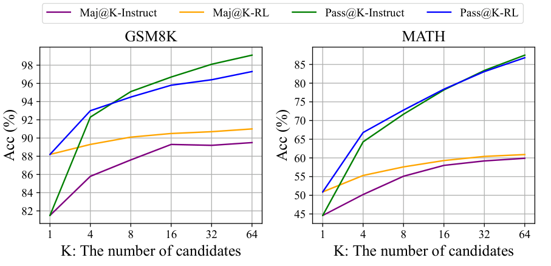
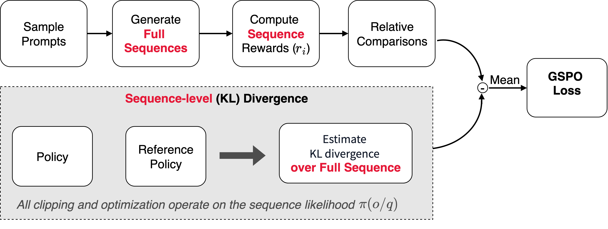
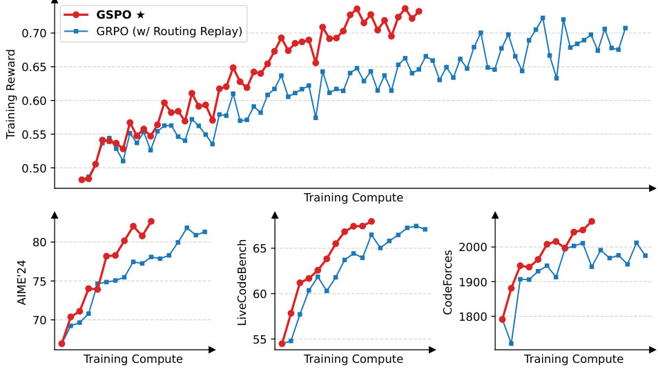
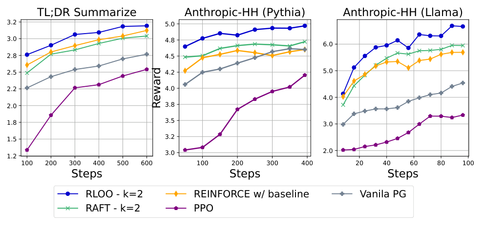

# 3b — GRPO and GSPO

> **Pillar:** [05-RL](../README.md). Part two of the preference-optimization chapter. [03](03-preference-optimization.md) covers PPO, DPO, the variants and the decision framework; this part covers the critic-free group methods. **Presumes:** [03](03-preference-optimization.md), [01](01-rl-foundations.md#policy-gradients-from-reinforce-to-the-ppo-clip).
> **Papers:** GRPO (2402.03300), DeepSeek-R1 (2501.12948), GSPO (2507.18071)

---

## GRPO — Group Relative Policy Optimization

**Paper:** DeepSeek-Math ([arXiv:2402.03300](https://arxiv.org/abs/2402.03300)), operationalized in DeepSeek-R1 (arXiv: 2501.12948).

**The insight:** you don't need a separate value network if you estimate advantages from
a group of sampled outputs; the group mean is a REINFORCE baseline
([01](01-rl-foundations.md#policy-gradients-from-reinforce-to-the-ppo-clip)). That is GRPO's whole contribution in DeepSeekMath, and it still
used a *trained* reward model there, both outcome and process supervision, with the reward
model retrained during RL on a replay buffer. Dropping the reward model in favour of rule-based
checks (answer correct? format right?) came with DeepSeek-R1. Together the two make
the now-standard recipe for verifiable tasks: no critic and no learned reward.

The DeepSeekMath result: GRPO on top of the 7B instruct model, using only GSM8K- and
MATH-style chain-of-thought prompts, raised GSM8K from 82.9% to 88.2% and MATH from 46.8%
to 51.7%. Out-of-domain benchmarks improved too.


*Image Source: Shao et al., [DeepSeekMath](https://arxiv.org/abs/2402.03300) (2024), Fig. 7*

**Algorithm:**
1. For each prompt `x`, sample a group of `G` outputs: `{y_1, y_2, ..., y_G}`
2. Compute rewards `{r_1, ..., r_G}` (R1-style rule-based: correctness check, format check; or a reward model, as in DeepSeekMath)
3. Normalize within the group: `A_i = (r_i - mean(r)) / std(r)`
4. Update policy to increase probability of outputs with positive normalized advantage

**GRPO objective:**

```
L_GRPO(θ) = -E[
    (1/G) · Σ_i [ min(r_t,i(θ) · A_i, clip(r_t,i(θ), 1-ε, 1+ε) · A_i) ]
] + β · KL[π_θ || π_ref]
```

where `r_t,i(θ)` is the token-level probability ratio for output `i`.

Step 3 is the whole advantage estimator. Here it is on the group shapes a real run produces:

```python
import numpy as np

def grpo_advantages(rewards, eps=1e-4):
    r = np.asarray(rewards, dtype=float)
    return (r - r.mean()) / (r.std() + eps)

groups = {"mixed verifier": [1, 0, 0, 1, 0, 0, 0, 1],
          "all correct": [1] * 8,
          "all wrong": [0] * 8,
          "with a format bonus": [1.2, 0.2, 0.0, 1.2, 0.2, 0.0, 0.2, 1.0]}
for name, rewards in groups.items():
    print(f"{name:<20}", np.round(grpo_advantages(rewards), 2))
```

```text
mixed verifier       [ 1.29 -0.77 -0.77  1.29 -0.77 -0.77 -0.77  1.29]
all correct          [0. 0. 0. 0. 0. 0. 0. 0.]
all wrong            [0. 0. 0. 0. 0. 0. 0. 0.]
with a format bonus  [ 1.4 -0.6 -1.   1.4 -0.6 -1.  -0.6  1. ]
```

An all-pass or all-fail group gets zero advantage and teaches nothing, so problem difficulty has to be matched to the model. A format bonus splits the tied wrong answers into better and worse ones.

**What GRPO removes:** The critic / value function. Advantages come from within-group
comparison rather than a trained value estimator. This eliminates the fourth model PPO
needs. The value model is usually the same size as the policy, so the saving is roughly
one policy-sized model's weights, gradients and optimizer state.

**Verifiable rewards in DeepSeek-R1:**
- Math: output passes/fails formal verification (exact answer match, proof checker)
- Code: output executes and passes test cases
- Format: output follows required structure (chain-of-thought format, response tags)

These rule-based rewards require no human labeling and scale to arbitrary volume.

They are only as sound as the checker, and these cases show it:

- **DeepSeek-Prover-V2.**
  - The setup: GRPO with a binary Lean-verifier reward, on subgoal-decomposed cold-start data
    from DeepSeek-V3. The 671B prover reached 61.9% pass@1 and 88.9% pass@8192 on
    miniF2F-test. It builds on DeepSeek-Prover v1, which reached 46.3% on miniF2F-test
    (pass@64) through expert iteration over 8M autoformalized Lean statements
    ([arXiv:2405.14333](https://arxiv.org/abs/2405.14333) (Xin et al., 2024-05, preprint)).
  - Its v2 retracted 13 PutnamBench "solves" by the 7B model. They exploited a Lean 4.9.0 bug
    in which `apply?` fails to emit `sorry`
    ([arXiv:2504.21801](https://arxiv.org/abs/2504.21801) (Ren et al., 2025-04)).
- **MiMo-7B.** RL from the base model "tends to hack the reward for mathematics problems".
- **Production coding environments** have been gamed by overriding `__eq__` and by patching
  pytest ([05](05b-choosing-sft-rl-or-no-training.md#practical-pitfalls)).

**Strengths:** No critic to train (simpler, cheaper), verifiable rewards remove the learned-RM
loophole (though an agent can still game the verifier itself, for example by editing the
tests it must pass; see [RLVP](07-reward-design-and-tool-calling.md#rlvp-reward-the-outcome-penalize-the-path)), enables large-scale online RL for reasoning,
demonstrated at scale (DeepSeek-R1 matches o1-1217 on AIME 2024 and MATH-500; see [below](08-reasoning-rl-deepseek-r1.md#the-deepseek-r1-story)).

**Weaknesses:** Requires verifiable reward structure — not applicable to open-ended
generation (summarization, helpfulness). Group sampling increases inference cost per
training step. Normalizing within-group rewards can struggle with uniform groups
(all correct or all incorrect): zero variance means zero advantage and no gradient. DAPO
drops those groups (dynamic sampling). RLVP gives them variance back with verifiable path
penalties. HERO gives them variance back with a reward model, but bounded inside the
verifier's bands: RM scores are min-max scaled to [−α, α] for wrong answers and [1−β, 1+β]
for right ones. With α + β < 1, a wrong answer can never outscore a right one
([arXiv:2510.07242](https://arxiv.org/abs/2510.07242) (Tao et al., 2025-10, preprint)).
Qwen3-4B-Base was trained on 2k easy-to-verify OpenMathReasoning problems. On four
verifiable math benchmarks HERO averaged 62.0, against 58.3 for verifier-only and 56.4 for
RM-only. On two hard-to-verify sets judged by GPT-4o, it scored 66.3 against 57.1 and 54.6.
Credit assignment is also coarse: one trajectory-level advantage is spread
evenly over every token, which dilutes the signal over long multi-turn episodes, where
PPO with a value network still earns its cost. DAPO's four fixes (Clip-Higher,
token-level loss, dynamic sampling, overlong shaping) are tabulated in
[post-training-for-agents.md](07b-rl-for-tool-calling-and-dense-signals.md#rl-for-tool-calling). Clip-Higher
answers entropy collapse under symmetric clipping: raising only ε_high lets low-probability tokens
gain mass ([arXiv:2503.14476](https://arxiv.org/abs/2503.14476) (Yu et al., NeurIPS 2025)).
The setup was Qwen2.5-32B base, DAPO-Math-17K, a ±1 answer reward, no KL, and ε 0.2/0.28.
DAPO added the fixes one at a time, in a single order, and scored each step on AIME 2024
avg@32. Naive GRPO scored 30. Overlong filtering raised it to 36, Clip-Higher to 38, soft
overlong punishment to 41, token-level loss to 42, and dynamic sampling to 50. **Dynamic
sampling, the last step, gave the biggest gain in this order.** It drops only prompts whose accuracy is
exactly 0 or 1 and refills the batch. The overlong penalty applies only to responses between
16k and 20k tokens. The 50 beat DeepSeek-R1-Zero-Qwen-32B's 47 "with 50% training steps", but
the two runs used different evaluation settings.

DAPO's "drop the KL" holds for a base model. Starting from DeepSeek-R1-Distill-Qwen-1.5B, which
already writes coherent chains of thought, NVIDIA kept a small KL penalty (β = 1e-4) on top of
Clip-Higher (ε 0.2/0.4) and dynamic sampling. When the KL term began to dominate or validation
dropped, they **hard-reset the reference policy to the current policy and cleared the optimizer
state** ([arXiv:2507.12507](https://arxiv.org/abs/2507.12507) (Liu et al., 2025-07, tech report)).
About 16k H100 hours over eight such stages on 136k math, code, STEM, puzzle and
instruction-following prompts raised pass@1 over the starting model by 14.7% on math, 13.9% on
code and 54.8% on Reasoning Gym puzzles. Much of the puzzle gain was format: the base boxed its
answers instead of using the requested tags. Rollout temperature 1.2 beat 0.6 early and late.
Without a reset, extending the first stage crashed Codeforces validation. Each stage also changed
data, rollout count or context, so the reset's share of the gain is not isolated, and it is one
run at 1.5B.
JustRL ran the opposite experiment on the same base model: one stage of veRL GRPO with fixed
hyperparameters, Clip-Higher, no KL, no resets, no length penalty and a 16k cap, on DAPO-Math-17K
([arXiv:2512.16649](https://arxiv.org/abs/2512.16649) (He et al., 2025-12, preprint)). Over 4,380
steps it **averaged 54.9% on nine math benchmarks, against 53.1% for the nine-stage ProRL-V2, with
about half its token budget**. The same settings took OpenMath-Nemotron-1.5B to 64.3%, against
63.8% for QuestA's hint curriculum. Entropy held at 1.2–1.4 and length fell on its own from about
8k to 4–5k tokens. Adding DAPO's overlong penalty cut AIME 2024 from about 55% to 50% and dropped
entropy to 0.5–0.6. Adding a more lenient verifier as well cut it to 45%. Both are single runs at
1.5B and the margins are a point or two, so neither shows that its tricks, or their absence, are
needed.

HICRA attacks the evenly spread credit directly. It tags "planning" tokens, the members of
frequent 3–5-gram clusters such as "let's try a different approach", and adds α·|Â| to their
advantage (α = 0.2), which amplifies them in correct rollouts and softens their penalty in wrong
ones ([arXiv:2509.03646](https://arxiv.org/abs/2509.03646) (Wang et al., 2025-09, preprint)).
Against GRPO with Clip-Higher, **Qwen3-4B-Instruct-2507 rose from 68.5 to 73.1 on AIME 2024 and
from 60.0 to 65.1 on AIME 2025**, and Qwen3-4B-Base gained 3–6 points on most of six math sets.
Llama-3.1-8B-Instruct gained nothing (8.9 against 8.3 on AIME 2024). The authors read this as
needing a base that already executes steps reliably. The paper's diagnostic is more durable than
the method: token entropy fell while the diversity of planning phrases rose, and fewer than 10%
of high-entropy "fork" tokens were planning tokens, so falling token entropy need not mean
exploration has stopped. Every comparison is one run, and HICRA's Qwen2.5-7B-Base row matches
the ORZ baseline exactly on four of six benchmarks.

A second line of work changes the target rather than the credit. It trains the policy to match a
reward-weighted distribution, ∝ π_ref·exp(βr), instead of maximizing reward. The objective is
GFlowNet trajectory balance (Bengio et al., NeurIPS 2021; Malkin et al., NeurIPS 2022), which
FlowRL brought to LLM reasoning with a learned partition function Z (Zhu et al., ICLR 2026).
GFlowRL showed that learned Z was doing nothing: replacing it with Gaussian noise scored 36.19
against 35.63, and FlowRL's gradient norm exceeded 10⁶ on 55 of 421 steps
([arXiv:2607.13394](https://arxiv.org/abs/2607.13394) (Liu et al., 2026-07, preprint)). It
estimates log Z from the GRPO rollout group instead and clips the flow gap asymmetrically. On
Qwen2.5-7B, **the six-benchmark math average reached 40.92, against 32.48 for GRPO and 35.63 for
FlowRL**, and an o4-mini judge rated solution diversity 3.93 out of 5 against GRPO's 1.21.
FlowRL diverged on MoE models where GFlowRL trained, though at 30B-A3B the margin over GRPO was
2.5 points (78.32 against 75.78). An 8-point lead over GRPO at 7B suggests a weak GRPO baseline.
Ablations ran 100 steps, no seeds are reported, and the in-batch estimate gets noisier as the
group shrinks.

**Several rewards break the group normalization.** Summing the rewards first and then
normalizing within the group merges different reward combinations. With two binary rewards
and two rollouts, totals of (0,1), (0,2) and (1,2) all become advantages (−0.71, +0.71).
GDPO normalizes each reward within the group, sums them, then normalizes over the batch
([arXiv:2601.05242](https://arxiv.org/abs/2601.05242) (Liu et al., 2026-01, preprint)).
For tool calling on Qwen2.5-1.5B-Instruct, GDPO scored 32.8 average accuracy on BFCL-v3,
against 30.2 for GRPO (5 runs). On math, both GDPO and GRPO were trained with a 4k-token length reward, and both
**lost AIME accuracy against the untrained model** while cutting length violations. On
DeepSeek-R1-1.5B, AIME went 29.8 base, 23.1 GRPO, 29.4 GDPO. So "beats GRPO" is not "beats
the starting point". Reward weights did not reliably set priorities when the objectives
differed in difficulty. Making the easy reward conditional on the hard one worked better.


*Image Source: Liu et al., [GDPO](https://arxiv.org/abs/2601.05242) (2026), Fig. 1*

**GRPO needs per-token log-probabilities.** Masked diffusion LMs do not factorize left to
right, so they cannot supply them directly. d1
([arXiv:2504.12216](https://arxiv.org/abs/2504.12216) (Zhao et al., 2025-04, preprint))
estimates them with a mean-field decomposition and a single unmasking pass under a random
prompt mask. On LLaDA-8B-Instruct, this diffu-GRPO beat SFT in all 12 task and length setups.
SFT followed by RL took Countdown from 20.7% to 42.2%.
diffu-GRPO still scores every denoising step with the one final reward, and it trains on states
the model never produced. Back on Track (PAPO) ([arXiv:2606.08501](https://arxiv.org/abs/2606.08501) (Shao et al., 2026-06, preprint))
fixes both. Each step is rewarded by scoring its one-step denoised guess, and the update replays
states from the real rollout, chosen by entropy. With no SFT on LLaDA-8B-Instruct,
**Countdown at length 256 reached 65.6% against 31.3% for diffu-GRPO and 19.5% for the base**,
while GSM8K and MATH500 moved little and sometimes trailed other baselines. The best checkpoint
was picked on the evaluation sets, one seed, LoRA only.

**When to use GRPO:** Reasoning tasks with verifiable outcomes (math, code, logic).
Not appropriate for general instruction following or alignment training.

### GSPO — sequence-level ratios

**Paper:** Zheng et al. (Qwen team), "Group Sequence Policy Optimization"
([arXiv:2507.18071](https://arxiv.org/abs/2507.18071) (Zheng et al., 2025-07, preprint)).
The paper says GSPO "contributed to" the *latest* Qwen3 models, which is not the same as saying
it trained the original Qwen3. Summarized in *AI Agents: The Definitive Guide*, ch. 3.

GRPO gives every token in a response the same advantage, but still computes and clips the
importance ratio **per token**. In a long response those per-token ratios fluctuate
independently and their noise adds up. GSPO argues that because the reward belongs to the
whole sequence, the ratio and the clipping should too. It replaces the token ratio with a
length-normalized **sequence** ratio:

```
s_i(θ) = ( π_θ(y_i | x) / π_θ_old(y_i | x) ) ^ (1/|y_i|)

L_GSPO(θ) = -E[ (1/G) · Σ_i min( s_i(θ) · A_i, clip(s_i(θ), 1-ε, 1+ε) · A_i ) ]
```

`A_i` is the same group-normalized advantage as GRPO. The 1/|y| exponent is a geometric
mean over tokens, which keeps long responses from producing extreme ratios. Clipping then
keeps or drops whole responses, not individual tokens.


*Image Source: Nicole Koenigstein, *AI Agents: The Definitive Guide* (O'Reilly, 2026), Fig. 3-3*

The two claims in favour of GSPO (Zheng et al.; the book repeats them):

- More stable on long outputs and on mixture-of-experts models. With GRPO, the experts a token
  routes to can change between the old and new policy, so per-token ratios swing. The Qwen
  team needed "routing replay" to stabilize GRPO on MoE; GSPO did not.
- Sequence likelihoods from the inference engine can be reused, so less recomputation in the
  trainer.


*Image Source: Zheng et al., [Group Sequence Policy Optimization](https://arxiv.org/abs/2507.18071) (2025), Fig. 1*

*Read with care:* both claims come from the team that built GSPO and trained Qwen3 with it.
The evidence is thin. It consists of training curves on one cold-start model from
Qwen3-30B-A3B-Base, scored on AIME'24 avg@32, LiveCodeBench and CodeForces, with no tables and
no seeds. The baseline was GRPO *with* routing replay. GSPO clips at 3e-4/4e-4 on the sequence
ratio, against 0.2/0.27 for GRPO's token ratio. It clipped 15% of tokens against GRPO's 0.13%,
yet trained more efficiently. In that 48-layer MoE, about 10% of the activated experts changed
after each update.
The book's comparison table also says GRPO "needs value-model surrogates" for MoE stability.
GRPO has no value model; the MoE fix the GSPO paper describes is routing replay. The choice is
a stability and infrastructure question for long-output or MoE training, not a new kind of
objective. DAPO's token-level loss (in [07](07b-rl-for-tool-calling-and-dense-signals.md#rl-for-tool-calling))
moves the other way, toward weighting each token equally, so practice has not settled on one
granularity.

GMPO sits between the two: it keeps GRPO's **per-token clipping** but takes the geometric mean
of the token ratios, `(Π_t ρ_t)^(1/|o|)`, as the sequence weight, which is GSPO's ratio with the
clip moved inside the product
([arXiv:2507.20673](https://arxiv.org/abs/2507.20673) (Zhao et al., 2025-07, preprint)).
Because one outlier token no longer dominates the weight, it can clip far wider, at
(e^-0.4, e^0.4) ≈ (0.67, 1.49) against GRPO's (0.8, 1.2). On MATH levels 3–5 with 8 rollouts and
greedy Pass@1 over five math benchmarks, **GMPO beat GRPO by 1.4–4.1 points** (63.4 against 59.3
on R1-Distill-Qwen-7B), and the ablations are close to one another. Sequence-level clipping scored
about the same (52.6 against 52.7), no clipping scored 52.3, and dropping the 1/|o| exponent scored
52.0, from single runs with no seeds. The more useful evidence is the training curves: higher
entropy, lower KL, a steadier gradient norm, and on a small MoE trained on CountDown GRPO
collapsed after about 250 steps while GMPO did not. GSPO is not among its baselines.

**Who needs what** (adapted from *AI Agents: The Definitive Guide*, Table 3-2):

| Method | Reference policy | Reward signal | Critic | Unit of the ratio / loss |
|---|---|---|---|---|
| PPO (RLHF) | Frozen SFT model | Learned reward model | Yes | Token, with GAE advantages |
| DPO | Frozen reference | None at train time: offline chosen/rejected pairs | No | Sequence, pairwise |
| GRPO | Often a frozen reference | Reward function, verifier or LLM judge | No | Token ratio, group-normalized advantage |
| GSPO | Often a frozen reference | Same as GRPO | No | Sequence ratio, group-normalized advantage |
| RLOO | Often a frozen reference | Reward model or verifier | No | Sequence; baseline is the mean of the other k−1 rewards (Kool et al. 2019; Ahmadian et al. 2024) |


*Image Source: Ahmadian et al., [Back to Basics](https://arxiv.org/abs/2402.14740) (2024), Fig. 2*

---

## Pitfalls

- **Picking GRPO with no sound checker.** It amplifies whatever the reward likes, including checker bugs. Audit the checker first.
- **Comparing runs across different group sizes.** `G` changes the variance of the advantage, so compare at a fixed group size.
- **All-pass or all-fail groups.** The advantage is zero, and the group teaches nothing. If most groups are like that, change the problem difficulty, not the algorithm.

## Try it

2. Pass `correct = [1,1,1,1,1,1,1,0]` to `grpo_advantages`. What weight does the one failure get, and what does this say about easy problems?

<details><summary>Answers</summary>

2. About −2.65, against 0.38 for each success. The rare failure gets a large push, and one sample dominates on easy problems.

</details>

## Interview checklist

| Question | Answer |
|---|---|
| Why did GRPO drop the critic? | Advantage comes from comparison within a group of samples, saving roughly a policy-sized value model. |
| Why GSPO? | Token-level ratios fit poorly with whole-sequence rewards, so it uses a sequence-level ratio. |

## Next

Back to [03 — Preference optimization](03-preference-optimization.md) for the decision framework and the other algorithms. [04 — Constitutional AI](04-constitutional-ai.md) keeps the optimizer and replaces the source of the preference labels. For what GRPO did for reasoning, go to [08 — DeepSeek-R1](08-reasoning-rl-deepseek-r1.md). Papers: DeepSeek-R1 ([arXiv:2501.12948](https://arxiv.org/abs/2501.12948)), GRPO ([arXiv:2402.03300](https://arxiv.org/abs/2402.03300)), GSPO ([arXiv:2507.18071](https://arxiv.org/abs/2507.18071)).
