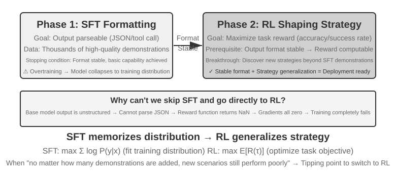
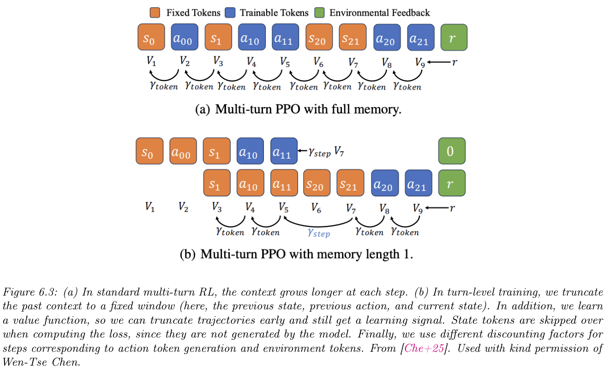

# 5 — Post-Training for Agents

> **Pillar:** [05-RL](../README.md)
> **Presumes:** [02-rlhf-pipeline.md](02-rlhf-pipeline.md), [03-preference-optimization.md](03-preference-optimization.md)
> **Source:** Bojie Li, *AI Agents in Depth* (2026), ch. 8 — [book-en/chapter8.md](https://github.com/bojieli/ai-agent-book/blob/main/book-en/chapter8.md) (Apache-2.0)
> **Also folded in:** Huyen, *AI Engineering*, ch. 8; *LLM Engineer's Handbook*, ch. 5; Albada, *Building Applications with AI Agents*, ch. 7; Koenigstein, *AI Agents: The Definitive Guide*, ch. 3; Raieli & Iuculano, *Building AI Agents with LLMs, RAG, and Knowledge Graphs*, ch. 8 (see [references](../references.md#books))

The Q-learning agent in the treasure-hunt lab needs about 10,000 games, and an LLM agent wins the same game on its first try in 18 moves. So when is training weights worth it at all, and what should it be? This chapter is the decision guide every agent team needs. Two threads run through it: **SFT memorizes, RL generalizes**, and **data and environment matter more than algorithms**, a thread the next chapter, [06](06-data-and-environments.md#data-and-environment--algorithm), picks up.

---

## The three stages


*Figure 8-11, SFT→RL Two-Stage Training Pipeline; Mid-training Precedes These Two Behavioral-Alignment Stages. From Li, [*AI Agents in Depth*](https://github.com/bojieli/ai-agent-book/blob/main/book-en/chapter8.md) (Apache-2.0).*

| Stage | Data | Objective | What it learns | Cost |
|---|---|---|---|---|
| **Pretraining** | Raw internet text | Next-token prediction | Language, world knowledge, basic reasoning | Millions to tens of millions of USD |
| **SFT** | Thousands to tens of thousands of input → output demos | Next-token prediction, with loss **masked to the response** | Instruction following, format, style, process protocol | Hours to days |
| **RL** | Task + reward function (no reference answer) | Maximize expected reward | Transferable strategy; solutions no one demonstrated | Often 10–100× SFT |

**SFT is pretraining on different data.** Same loss, same mechanism. The only engineering difference is loss masking, so the model learns to answer rather than to ask. Because it maximizes the likelihood of one reference answer, SFT encodes **protocol knowledge** (how to say or do things). It does not encode large amounts of **factual knowledge**. Facts come from pretraining, continued pretraining or RAG.

**SFT before RL.** RL scores the model's own outputs. If the output isn't parseable JSON or a valid tool call, the reward can't be computed, and RL learns from noise. SFT establishes the form, then RL pursues the strategy. The book calls this "form first, spirit second". Two boundary cases:

- A strong enough base model can skip SFT. DeepSeek-R1-Zero learned reflection and long chains of thought from pure RL.
- The cost was poor readability and mixed languages, so R1 added cold-start SFT back.
- With a smaller base model and strict structured output (Llama-3.2-Vision-11B in Exp 7-11), RL without SFT fails completely.

**A worked open recipe: Tülu 3.** The table compresses post-training into SFT then RL. Open
recipes usually put a preference stage between them. Tülu 3 is the fully open reference: data,
code, intermediate checkpoints and evals for every stage
([arXiv:2411.15124](https://arxiv.org/abs/2411.15124) (Lambert et al., 2024-11, preprint)). It
goes SFT → DPO → RLVR on Llama-3.1 base models. The 8B numbers on its development suite:

| Stage | Data | Avg. | Biggest moves |
|---|---|---|---|
| SFT | 939k prompt-completion pairs | 60.6 | Sets format and safety (93.1) |
| DPO (length-normalized) | ~354k pairs, Tülu 3 SFT completions against other models', judged by an LLM | 64.7 | AlpacaEval 2 LC 12.4 → 33.5, MATH 31.5 → 42.0, IFEval 72.8 → 81.1 |
| RLVR (PPO, binary verifier reward) | ~30k GSM8K, MATH and IFEval-constraint prompts | 65.1 | GSM8K 84.3 → 87.6, MATH 42.0 → 43.7, IFEval 81.1 → 82.4 |

**At 8B the preference stage did most of the general lifting. RLVR was a targeted top-up on the
skills it had verifiers for.** At 70B, RLVR left the average flat (76.2 → 76.2), and GSM8K was
already saturated at 93.5. At 405B, RLVR on MATH alone took MATH from 59.9 to 67.3 in 75 steps
and had not plateaued when compute ran out. A verifier also defines what RLVR measures. The IFEval rewards are its 25 code-checkable
constraint types, such as "write in more than 400 words"
([arXiv:2311.07911](https://arxiv.org/abs/2311.07911) (Zhou et al., 2023-11, preprint)). On
IFEval-OOD, which keeps the task but uses constraints outside IFEval's set, Tülu 3 8B scored
24.3, against 82.4 on IFEval. Llama-3.1-8B-Instruct scored 26.1, so the gap is not specific to
Tülu. The authors suspect that models in general overfit IFEval's constraint set.

Other open reports reorder or drop stages:

- **Phi-4** (14B) is SFT plus two DPO rounds, with no RL ([arXiv:2412.08905](https://arxiv.org/abs/2412.08905) (Abdin et al., 2024-12, tech report)). Its first DPO round uses *pivotal token search*: each pair differs by a single token where the estimated chance of a correct answer jumps. Over SFT, that round took GPQA from 47.3 to 53.6 and MATH from 77.1 to 80.5. The second, judge-labelled DPO round mostly helped the GPT-4-judged ArenaHard (56.7 → 69.8 on its own).

  
  *Image Source: Abdin et al., [Phi-4 Technical Report](https://arxiv.org/abs/2412.08905) (2024), Fig. 3*
- **Hermes 4** is SFT only ([arXiv:2508.18255](https://arxiv.org/abs/2508.18255) (Teknium et al., 2025-08, tech report)). It ran its ~1,000 RL verifier environments as rejection-sampling filters for SFT data, not as a training loop.
- **Llama-Nemotron** wraps the recipe in five stages: architecture search, distillation plus continued pretraining, SFT, reasoning RL, then a short instruction-following and RLHF pass ([arXiv:2505.00949](https://arxiv.org/abs/2505.00949) (Bercovich et al., 2025-05, preprint)).
- **Command A** (111B) trains in parallel and merges ([arXiv:2504.00698](https://arxiv.org/abs/2504.00698) (Cohere, 2025-04, tech report)). Six SFT experts (code, safety, RAG and agents, math, multilingual, long context) all start from one instruction-tuned checkpoint and are linearly averaged with hand-searched weights. Six RL experts then start from that soup and are averaged again, before a final pass of best-of-N SFT, offline preference tuning and online RL. **The merge kept experts' scores to within 1.8% on average**, with code preserved worst; a few low-learning-rate SFT steps on the merged weights recovered most of the rest. SLERP and task vectors gave no gain over plain averaging. The report has no single-model baseline at the same compute, so it shows that merging works, not that it beats one sequential run.

**LoRA defaults** (from Schulman / Thinking Machines, "LoRA Without Regret", 2025):

- Apply LoRA to **all** weight matrices, especially the MLPs. Attention-only LoRA loses accuracy.
- Use a learning rate about **10×** the full fine-tuning rate.
- Use rank 64–256 for SFT. Rank 8–32, or even 1, is enough for RL, because each RL episode carries little information.

---

## Why SFT memorizes and RL generalizes

SFT is behaviour cloning, and it inherits behaviour cloning's covariate-shift failure: one early
mistake puts the model in states the demonstrations never covered
([10](10-engineering-rl-systems.md#learning-from-experts-imitation-and-inverse-rl)).

| | SFT | RL |
|---|---|---|
| Objective | Maximum likelihood of the reference | Expected reward |
| Signal | Dense: every token supervised | Sparse: one scalar per rollout |
| Learns | Fixed input → output mapping | Strategy that produces good outcomes |
| Under distribution shift | Applies the old answer and degrades | Re-solves and stays stable |
| Sample efficiency / stability | High / high | Low / low |
| Distribution shape | **Mass-covering**: spreads probability over every mode in the demos | **Mode-seeking**: [reverse KL](../../01-llm-fundamentals/notes/06-pretraining-data-and-objectives.md#entropy-cross-entropy-kl-and-perplexity) concentrates on a few high-reward modes, so outputs are more decisive but less diverse |

**Evidence: GeneralPoints and V-IRL** (Chu et al. 2025, "SFT Memorizes, RL Generalizes", arXiv:2501.17161). Same base model and same compute; the only variable is SFT vs. RL (PPO with a value network).

| Shift (train → test) | RL | SFT |
|---|---|---|
| 24-game rules: J/Q/K = 10 → 11/12/13 (GP-L) | +3.5 pp | −8.1 pp |
| Card colour: black suits → red (GP-VL) | +17.6 pp (23.6 → 41.2%) | −9.9 pp |
| Navigation: absolute → relative directions (V-IRL-L) | +11.0 pp | **−79.5 pp** |
| Street views: New York → 9 other cities (V-IRL-VL) | 16.7 → **77.8%** | 16.7 → 11.1% |

RL also improved the **visual encoder**, because the outcome signal backpropagates into perception. SFT overfit to reasoning-token patterns and lost recognition accuracy. Over-trained SFT also leaves RL unable to recover OOD performance. Stop SFT once format is stable and basic capability is present.

Two open reasoning reports show the same trade-off on text. K2-Think ran one GRPO recipe on
~92k verifiable Guru prompts from two starting points
([arXiv:2509.07604](https://arxiv.org/abs/2509.07604) (Cheng et al., 2025-09, tech report)).
**Starting from Qwen2.5-32B base, RL gained about 40% on AIME 2024 over training. Starting from
the long-CoT SFT checkpoint, it gained about 5%, then plateaued and began to degrade.** The SFT
start still finished higher in absolute terms. The authors read it as heavy SFT narrowing what RL
can explore. Llama-Nemotron's 253B model hit the same problem, and the team started RL from an
earlier SFT checkpoint, not their best-scoring one, "to improve final RL outcomes"
([arXiv:2505.00949](https://arxiv.org/abs/2505.00949) (Bercovich et al., 2025-05, preprint)).
Neither report gives a rule for when to stop SFT.

The same split shows up on agentic data when RL reuses the SFT trajectories. PivotRL takes the
expert trajectories an SFT run would imitate, keeps only the turns where sampled actions
sometimes pass and sometimes fail (on τ²-bench and SWE-Bench, 71% of random turns gave GRPO
no signal), and runs GRPO on one-turn rollouts from those states. Its reward accepts any action
the verifier judges equivalent, not only an exact match to the expert action. On
Qwen3-30B-A3B-Thinking with identical data, **SFT cost an average 9.83 points across eight
non-agentic benchmarks (AIME25 86.0 → 21.6 after terminal training), while PivotRL moved them
+0.21** ([arXiv:2603.21383](https://arxiv.org/abs/2603.21383) (Yi et al., 2026-03, preprint)).
In-domain it beat SFT on τ²-bench, Terminal-Bench and BrowseComp but lost on SWE-Bench
Verified (32.7 vs 37.4). With exact-match reward it scored 57.3 on τ²-bench, below SFT's 58.4. Matching
end-to-end RL's SWE-Bench accuracy took about 4× fewer rollout turns. The paper reports no seeds, runs
the end-to-end comparison on one benchmark only, and has no replay-regularized SFT baseline.

A turn where outcomes are mixed is not always a turn where the action matters. In a Gemma pilot,
every rollout made the same clean refusal while the reward swung between 0 and 1, so a filter on
mixed outcomes would have kept it. Critical-State RL ranks candidate turns by how much the
expected return varies *across actions* at that turn. It estimates this from the base policy,
with 8 actions and 4 continuations per action, then trains only the chosen call. On no-think
Gemma-4-26B-A4B, **BFCL v4 multi-turn missing-function items rose from 14.0% to 28.3% (±1.5,
4 seeds) when training the recovery turn it picked, and fell to 9.5% when training the decision
turn instead** ([arXiv:2609.24985](https://arxiv.org/abs/2609.24985) (Chen et al., 2026-09,
preprint)). Missing-parameter items gained 3.8 points. Full multi-turn return-to-go credit hit
0.997 on the training gym but scored 45% on BFCL missing-parameter items, against 47.3%. The best turn changed with the
model: Nemotron gained on the decision turn. The alternatives are single seeds, and people
propose the candidate turns.

RL done before the agent loop can also leave a better starting point for it. Kimi-Dev mid-trained
Qwen2.5-72B on about 150B tokens of GitHub diffs, PR commits and synthetic reasoning data, cold-started it with SFT, then ran
outcome-only RL on single-turn Agentless bug-fixing (0/1 test reward). It reached 60.4% on
SWE-bench Verified in that workflow, with test-time self-play, and **48.6% as a SWE-Agent after SFT on 5k Claude 3.7
trajectories, with no agentic RL**. The RL prior reached the base prior's best agent pass@1
with **2²³ agent SFT tokens, against 1.5 × 2²⁸ for the base**, roughly 48× fewer
([arXiv:2509.23045](https://arxiv.org/abs/2509.23045) (Yang et al., 2025-09, preprint)). Against
the SFT-only prior the edge is small. SFT was better zero-shot, and the two ended
"slightly" apart after 300 steps of end-to-end agent RL. Given enough agent data, the out-of-distribution advantage of
both priors over base disappeared. One model family, and no error bars on the data sweep.

The gap shows up on search agents too. KARL trains GLM 4.5 Air on two of six enterprise-search
tasks (BrowseComp-Plus and TREC-Biogen) with an iterative, large-batch off-policy RL loss (OAPL).
The questions are ones the model synthesizes from each corpus, kept when its own 8 rollouts solve
them only sometimes. The comparison is SFT distilled from the two single-task RL experts.
**Parallel sampling lifted the distilled model six points in distribution (69.1 → 75.3) but
almost nothing on the four held-out tasks (59.4 → 59.6), where multi-task RL with 10 parallel
rollouts reached 62.7** ([arXiv:2603.05218](https://arxiv.org/abs/2603.05218) (Chang et al.,
2026-03, preprint)). With a single call, KARL scored 58.9 on the authors' six-task benchmark,
against 58.6 for Claude Sonnet 4.5 and 52.6 for its base, at under $0.10 per query at list
prices. The agent has one tool (vector search), the held-out tasks are the rest of the same
suite, the baselines ran in the authors' harness, and no seeds are reported.

**Why RL's ceiling is higher: it is online.**

1. **Offline is capped by the data; online is capped by the task.** SFT can at best match its demonstrator, so 60-point demos never make a 90-point student. RL reinforces anything that scores well. Llama-Nemotron-Ultra (253B) shows the cap directly. SFT on DeepSeek-R1 traces got it to 66.4 on GPQA-Diamond, short of the teacher's 71.5. About 140k H100-hours of GRPO took it to **76.0, past the teacher** ([arXiv:2505.00949](https://arxiv.org/abs/2505.00949) (Bercovich et al., 2025-05, preprint)). SimpleVLA-RL invented a "pushcut" grasp that no human demonstrated. The cap still has a floor under it: the base model. On math, code and visual-reasoning benchmarks, zero-RL models beat their base models at pass@1 but lose to them at large k. Base Qwen2.5-32B solves about 9% more Minerva problems at k=128 than its RL-trained version. So current RLVR mostly re-weights paths the base model could already sample ([arXiv:2504.13837](https://arxiv.org/abs/2504.13837) (Yue et al., 2025-04); details in [08](08-reasoning-rl-deepseek-r1.md#the-deepseek-r1-story)). The floor holds for agents, where tool-calling skills were assumed to come from post-training. Across 14 open base and post-trained pairs from Gemma-4, Ministral-3, Qwen2.5 and Qwen3.5 (3B–35B) on BFCL v4 multi-turn, WebShop and ACEBench, base models with a light prompt-and-parsing harness passed their post-trained versions at large k in most settings. On WebShop, gemma-4-31B base reached **over 85% pass@128 against 56% for the instruct model**, and post-training shrank the share of tasks solved only sometimes from 87.6% to 30.0%, pushing them to always-solved or never-solved ([arXiv:2610.01509](https://arxiv.org/abs/2610.01509) (Oh et al., 2026-10, preprint)). Larger models crossed over sooner: on WebShop, after about 3 samples at 31B against more than 128 at 4B. The instruct models' recipes are undisclosed and their thinking mode was off, though turning it on did not change the trend. The authors' fix, a per-prompt rollout temperature set from a Beta posterior on the prompt's success rate, raised both pass@1 and pass@128 for PPO and GRPO on Qwen2.5-7B-Instruct in Sokoban and FrozenLake over five seeds. For PPO on Sokoban that was 46.5→61.1 pass@1 and 55.0→69.7 pass@128, though it was still below the base model's 76.6.
2. **Verifying is easier than generating.** SFT needs someone to write the right answer. RL only needs a way to recognize one, such as an answer key, a test suite or a proof checker. This asymmetry is the basis of RLVR. It holds for rule-based checkers. An LLM used as the verifier is itself an attack surface: a lone ":" or "Thought process:" drew false-positive rates of up to 35% from GPT-4o and 60–90% from LLaMA3-70B-Instruct and Qwen2.5-72B-Instruct, and General-Verifier passed a single blank space 66.8% of the time on MATH. Chain-of-thought with majority voting didn't fix it. Training the verifier on ~20k truncated, first-sentence-only answers labelled wrong did ([arXiv:2507.08794](https://arxiv.org/abs/2507.08794) (Zhao et al., 2025-07)).
3. **On-policy data fixes covariate shift.** An imitator drifts into states its demonstrations never covered, and its error grows roughly as T² with trajectory length. Training on your own trajectories brings that down to roughly T.

---

## Classic RL vs. LLM+RL: why priors win

Tabular Q-learning (Bellman update, ε-greedy, TD learning; see [01-rl-foundations.md](01-rl-foundations.md)) assumes a **closed action space**. An LLM's action space is open-ended natural language and tool calls. It also adds a new kind of action: **thinking**, which changes no external state but improves the next action.

| | Q-learning (Exp 7-1) | LLM agent (Exp 7-2) |
|---|---|---|
| Treasure-hunt game, 11-move optimum | ~10,000 episodes to 100% win (0% at 1,000) | Won on the **first try** in 18 moves |
| Wall-clock | 10 s total | 1–2 min per game |
| Rules change | Retrain from scratch | Adapts by reasoning |

To Q-learning, "door", "key" and "sword" are opaque symbols. The LLM brings priors. Shunyu Yao's "The Second Half" traces OpenAI's own reversal:

1. Algorithms first (Atari).
2. Then environments (Gym, Universe, Dota).
3. Then priors (GPT-3 → WebGPT → ChatGPT).

The working order is **prior > environment > algorithm**. Classic RL still wins where simulation is cheap and repeatable. In the real world, every trial costs a phone call or a browser session, and sample efficiency dominates.

Why do priors matter so much? Because the chance of hitting a long path by accident compounds at each move. Here is an 11-move path among four actions per move, where `P` is the chance that the policy picks the right move:

```python
import numpy as np

rng = np.random.default_rng(0)
PATH_LENGTH, ACTIONS = 11, 4         # treasure-hunt-sized: 11 right moves, 4 choices each

def success_rate(p_right_move, episodes=200_000):
    hits = rng.random((episodes, PATH_LENGTH)) < p_right_move
    return hits.all(axis=1).mean()

print(f"uniform exploration, exact:  {(1 / ACTIONS) ** PATH_LENGTH:.2e}")
for p in [0.25, 0.5, 0.7, 0.9]:
    rate = success_rate(p)
    expected = 1 / p ** PATH_LENGTH
    print(f"P(right move)={p:.2f}  simulated first-win rate={rate:.5f}  expected episodes to first win={expected:,.0f}")
```

```text
uniform exploration, exact:  2.38e-07
P(right move)=0.25  simulated first-win rate=0.00000  expected episodes to first win=4,194,304
P(right move)=0.50  simulated first-win rate=0.00046  expected episodes to first win=2,048
P(right move)=0.70  simulated first-win rate=0.01979  expected episodes to first win=51
P(right move)=0.90  simulated first-win rate=0.31486  expected episodes to first win=3
```

A uniform policy expects to need millions of tries. A prior that is right 70% of the time needs about fifty. That is the entire difference between tabula rasa exploration and an LLM's.

**Lab:** [practice/01-q-learning-treasure-hunt](../practice/01-q-learning-treasure-hunt/) reproduces Exp 7-1 offline. The Exp 7-2 LLM agent is [upstream](https://github.com/bojieli/ai-agent-book/tree/main/chapter1/learning-from-experience) and needs an API key.

**The other direction: LLMs inside a classic RL loop.** Everything else in this note trains
the LLM. Raieli & Iuculano summarize the reverse, where a conventional RL agent keeps its own
policy and an LLM helps it (*Building AI Agents with LLMs, RAG, and Knowledge Graphs*, ch. 8,
after Cao et al.'s survey, [arXiv:2404.00282](https://arxiv.org/abs/2404.00282)). The LLM can
fill one of four roles:

| Role | What the LLM does | Main limit |
|---|---|---|
| Information processor | Turns instructions or observations into features or a formal task language | Extra compute; frozen features degrade under real-world shift |
| Reward designer | Scores behaviour from a prompt (implicit), or writes reward-function code (explicit, e.g. Eureka-style) | Only as good as its pretraining knowledge of the task |
| Decision-maker | Prunes a huge action space to plausible candidates, or acts directly as a sequence model | Inherits the LLM's biases; costly at inference |
| Generator | World-model simulator for model-based RL, or explainer of the policy | Its abstract knowledge may not match the environment |

The reward-designer row is the same idea as RULER and generative reward models in [07](07-reward-design-and-tool-calling.md#judges-as-rewards-ruler-art-and-rllm). The
generator row is ZeroSearch ([arXiv:2505.04588](https://arxiv.org/abs/2505.04588) (Sun et al., 2025-05, preprint)) and DreamGym (in [Data and environment](06-data-and-environments.md#data-and-environment--algorithm)).
*Dated:* the book ends by saying its later LLM agents involve "no training" because training an LLM
is too hard. That was a fair 2024 default for application teams, but agentic RL (ART, rLLM,
veRL, in [07](07-reward-design-and-tool-calling.md)) has since made training the agent loop itself routine.


**Multi-turn RL, as Murphy lays it out.** A single-turn LLM task is a contextual bandit with one sparse reward at the end-of-sequence token and a per-token KL penalty to the reference. An agent loop is a longer-horizon MDP, and he gives three fixes (*RL: A Comprehensive Overview*, ch. 6, Sec. 6.2.5). RAGEN's StarPO loop trains think-then-act trajectories with REINFORCE-style updates, which he says does not work well on long horizons for two reasons: the context grows every turn and the return has high variance. Turn-level training answers both by truncating the history to a fixed window and learning a critic so that GAE gives a signal before the episode ends, with actor and critic warm-started from an instruction-tuned model (Fig. 6.3). Invalid actions, such as a malformed tool call, can be handled by truncating the rollout there, restarting from the failing state, or resampling the action and continuing. ReBN replaces the critic with a GRPO-like normalization of returns.


*Image Source: Murphy, [*Reinforcement Learning: A Comprehensive Overview*](https://arxiv.org/abs/2412.05265) (2024), Fig. 6.3, from Chen et al. (2025), used with permission*

His one measured example is small. On GuessTheNumber-v0-easy (numbers 1–10, at most 4 turns, reward 1 for success, −0.1 for a format error), Qwen3-4B-Instruct-2507 trained with ReBN for 20 steps of 32 episodes each (LoRA rank 8, learning rate 4e-5, γ = 0.9, about 20 minutes) went from 0.8 to 1.0 average reward, and action tokens per step fell from about 900 to about 500. It is one run on a toy game with no seeds, so read it as a demonstration of the loop, not evidence about the method. The same walkthrough averages the loss over transitions, not tokens, to avoid favoring long thinking traces.

---

## Pitfalls

- **Skipping SFT on a small model with strict output.** Symptom: the reward can't be computed because outputs don't parse, and RL learns from noise. With Llama-3.2-Vision-11B and strict structured output (Exp 7-11), RL without SFT failed completely. Fix: run SFT until the format is stable, then start RL. Only a strong base model, as with DeepSeek-R1-Zero, can skip it, and R1 still added cold-start SFT back for readability.
- **Over-training SFT before RL.** Symptom: RL gains little, then plateaus. K2-Think gained about 40% on AIME 2024 from the base model, against about 5% from the long-CoT SFT checkpoint. Fix: stop SFT once format and basic capability are there. Llama-Nemotron started RL from an earlier SFT checkpoint for this reason.
- **Trusting an LLM verifier as if it were a rule.** Symptom: reward rises while answers empty out. A lone ":" drew false-positive rates of up to 35% from GPT-4o. Fix: use rule-based checkers where they exist, and train an LLM verifier on truncated answers labelled wrong.
- **Reading an RLVR gain off the verifier's own constraint set.** Symptom: a strong in-distribution score that doesn't transfer. Tülu 3 8B scored 82.4 on IFEval and 24.3 on IFEval-OOD. Fix: hold out constraint types, not only prompts.
- **Exploring an open action space from scratch.** Symptom: thousands of episodes before the first win. Q-learning needed about 10,000 games where an LLM agent won on its first try. Fix: start from a pretrained prior and train on top of it.

Pitfalls of running SFT and RL in practice (reward hacking, simulators, compute) are in [05b](05b-choosing-sft-rl-or-no-training.md#practical-pitfalls).

## Try it

1. Use the exploration block to find the per-move probability at which an 11-move path needs about 100 expected tries. What does that tell you about how much a prior has to help?
2. Run the [treasure hunt lab](../practice/01-q-learning-treasure-hunt/) with `--stochastic --episodes 10000`, and compare the result with the deterministic win rate.

<details><summary>Answers</summary>

1. Near 0.66, since 1 / 0.66¹¹ is about 100. A prior doesn't need to be certain. Moving from 0.25 to 0.66 per move saves more than four orders of magnitude, because the gain compounds over the path.
2. In four runs at 10,000 episodes we saw 100/100 three times and 0/100 once, against 100/100 for each deterministic run. The same settings can succeed or fail outright, which is why [10](10-engineering-rl-systems.md#engineering-an-rl-problem) insists on several seeds. The [lab README](../practice/01-q-learning-treasure-hunt/README.md), exercise 5, asks which noise source hurts most.

</details>

The full lab table for this chapter is in [05b](05b-choosing-sft-rl-or-no-training.md#labs).

## Interview checklist

| Question | Answer |
|---|---|
| Why does SFT come before RL? | RL scores the model's own outputs. If they don't parse as JSON or a valid tool call, the reward can't be computed, so SFT sets the form and RL then pursues the strategy ("form first, spirit second"). |
| What does SFT teach, and what doesn't it? | Protocol knowledge: format, style, process. It maximizes the likelihood of one reference, so it is a poor store of facts, which come from pretraining, continued pretraining or RAG. |
| Why does RL generalize where SFT memorizes? | RL optimizes reward on its own on-policy samples, so it re-solves under shift. In Chu et al., navigation with relative directions moved RL +11.0 pp and SFT −79.5 pp, at the same base model and compute. |
| Can RL beat the model it was distilled from? | Yes, because online training is capped by the task, not the data. Llama-Nemotron-Ultra reached 66.4 on GPQA-Diamond from SFT on R1 traces (teacher 71.5), and 76.0 after GRPO. |
| Why does an LLM need so few trials next to Q-learning? | Its prior makes the open-ended action space navigable. *Door* and *key* already mean something, so exploration is targeted, not blind. |
| What are sensible LoRA defaults? | All weight matrices, especially the MLPs, a learning rate about 10× full fine-tuning, rank 64–256 for SFT and 8–32 (even 1) for RL. |

## Next

[05b — Choosing SFT, RL or no training](05b-choosing-sft-rl-or-no-training.md) takes these mechanics to the decision: what SFT is still good for, how far you get without touching weights, and the practical pitfalls once you train.
