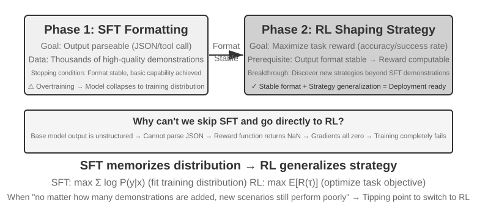
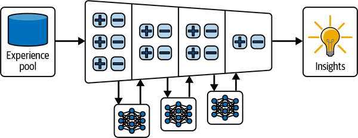

# 5 — Post-Training for Agents

> **Pillar:** [05-RL](../README.md)
> **Presumes:** [02-rlhf-pipeline.md](02-rlhf-pipeline.md), [03-preference-optimization.md](03-preference-optimization.md)
> **Source:** Bojie Li, *AI Agents in Depth* (2026), ch. 8 — [book-en/chapter8.md](https://github.com/bojieli/ai-agent-book/blob/main/book-en/chapter8.md) (Apache-2.0)
> **Also folded in:** Huyen, *AI Engineering*, ch. 8; *LLM Engineer's Handbook*, ch. 5; Albada, *Building Applications with AI Agents*, ch. 7; Koenigstein, *AI Agents: The Definitive Guide*, ch. 3; Raieli & Iuculano, *Building AI Agents with LLMs, RAG, and Knowledge Graphs*, ch. 8 (see [references](../references.md#books))

Two threads run through this note. **SFT memorizes, RL generalizes.** And **data and environment matter more than algorithms.**

---

## The three stages


*Figure 8-11, SFT→RL Two-Stage Training Pipeline; Mid-training Precedes These Two Behavioral-Alignment Stages. From Li, [*AI Agents in Depth*](https://github.com/bojieli/ai-agent-book/blob/main/book-en/chapter8.md) (Apache-2.0).*

| Stage | Data | Objective | What it learns | Cost |
|---|---|---|---|---|
| **Pretraining** | Raw internet text | Next-token prediction | Language, world knowledge, basic reasoning | Millions to tens of millions of USD |
| **SFT** | Thousands to tens of thousands of input → output demos | Next-token prediction, with loss **masked to the response** | Instruction following, format, style, process protocol | Hours to days |
| **RL** | Task + reward function (no reference answer) | Maximize expected reward | Transferable strategy; solutions no one demonstrated | Often 10–100× SFT |

**SFT is pretraining on different data.** Same loss, same mechanism. The only engineering difference is loss masking, so the model learns to answer rather than to ask. Because it maximizes the likelihood of one reference answer, SFT encodes **protocol knowledge** (how to say or do things). It does not encode large amounts of **factual knowledge**. Facts come from pretraining, continued pretraining or RAG.

**SFT before RL.** RL scores the model's own outputs. If the output isn't parseable JSON or a valid tool call, the reward can't be computed, and RL learns from noise. SFT establishes the form, then RL pursues the strategy. The book calls this "form first, spirit second". Two boundary cases:

- A strong enough base model can skip SFT. DeepSeek-R1-Zero learned reflection and long chains of thought from pure RL.
- The cost was poor readability and mixed languages, so R1 added cold-start SFT back.
- With a smaller base model and strict structured output (Llama-3.2-Vision-11B in Exp 7-11), RL without SFT fails completely.

**A worked open recipe: Tülu 3.** The table compresses post-training into SFT then RL. Open
recipes usually put a preference stage between them. Tülu 3 is the fully open reference: data,
code, intermediate checkpoints and evals for every stage
([arXiv:2411.15124](https://arxiv.org/abs/2411.15124) (Lambert et al., 2024-11, preprint)). It
goes SFT → DPO → RLVR on Llama-3.1 base models. The 8B numbers on its development suite:

| Stage | Data | Avg. | Biggest moves |
|---|---|---|---|
| SFT | 939k prompt-completion pairs | 60.6 | Sets format and safety (93.1) |
| DPO (length-normalized) | ~354k pairs, Tülu 3 SFT completions against other models', judged by an LLM | 64.7 | AlpacaEval 2 LC 12.4 → 33.5, MATH 31.5 → 42.0, IFEval 72.8 → 81.1 |
| RLVR (PPO, binary verifier reward) | ~30k GSM8K, MATH and IFEval-constraint prompts | 65.1 | GSM8K 84.3 → 87.6, MATH 42.0 → 43.7, IFEval 81.1 → 82.4 |

**At 8B the preference stage did most of the general lifting. RLVR was a targeted top-up on the
skills it had verifiers for.** At 70B, RLVR left the average flat (76.2 → 76.2), and GSM8K was
already saturated at 93.5. At 405B, RLVR on MATH alone took MATH from 59.9 to 67.3 in 75 steps
and had not plateaued when compute ran out. A verifier also defines what RLVR measures. The IFEval rewards are its 25 code-checkable
constraint types, such as "write in more than 400 words"
([arXiv:2311.07911](https://arxiv.org/abs/2311.07911) (Zhou et al., 2023-11, preprint)). On
IFEval-OOD, which keeps the task but uses constraints outside IFEval's set, Tülu 3 8B scored
24.3, against 82.4 on IFEval. Llama-3.1-8B-Instruct scored 26.1, so the gap is not specific to
Tülu. The authors suspect that models in general overfit IFEval's constraint set.

Other open reports reorder or drop stages:

- **Phi-4** (14B) is SFT plus two DPO rounds, with no RL ([arXiv:2412.08905](https://arxiv.org/abs/2412.08905) (Abdin et al., 2024-12, tech report)). Its first DPO round uses *pivotal token search*: each pair differs by a single token where the estimated chance of a correct answer jumps. Over SFT, that round took GPQA from 47.3 to 53.6 and MATH from 77.1 to 80.5. The second, judge-labelled DPO round mostly helped the GPT-4-judged ArenaHard (56.7 → 69.8 on its own).
- **Hermes 4** is SFT only ([arXiv:2508.18255](https://arxiv.org/abs/2508.18255) (Teknium et al., 2025-08, tech report)). It ran its ~1,000 RL verifier environments as rejection-sampling filters for SFT data, not as a training loop.
- **Llama-Nemotron** wraps the recipe in five stages: architecture search, distillation plus continued pretraining, SFT, reasoning RL, then a short instruction-following and RLHF pass ([arXiv:2505.00949](https://arxiv.org/abs/2505.00949) (Bercovich et al., 2025-05, preprint)).

**LoRA defaults** (from Schulman / Thinking Machines, "LoRA Without Regret", 2025):

- Apply LoRA to **all** weight matrices, especially the MLPs. Attention-only LoRA loses accuracy.
- Use a learning rate about **10×** the full fine-tuning rate.
- Use rank 64–256 for SFT. Rank 8–32, or even 1, is enough for RL, because each RL episode carries little information.

---

## Why SFT memorizes and RL generalizes

SFT is behaviour cloning, and it inherits behaviour cloning's covariate-shift failure: one early
mistake puts the model in states the demonstrations never covered
([01](01-rl-foundations.md#learning-from-experts-imitation-and-inverse-rl)).

| | SFT | RL |
|---|---|---|
| Objective | Maximum likelihood of the reference | Expected reward |
| Signal | Dense: every token supervised | Sparse: one scalar per rollout |
| Learns | Fixed input → output mapping | Strategy that produces good outcomes |
| Under distribution shift | Applies the old answer and degrades | Re-solves and stays stable |
| Sample efficiency / stability | High / high | Low / low |
| Distribution shape | **Mass-covering**: spreads probability over every mode in the demos | **Mode-seeking**: reverse KL concentrates on a few high-reward modes, so outputs are more decisive but less diverse |

**Evidence: GeneralPoints and V-IRL** (Chu et al. 2025, "SFT Memorizes, RL Generalizes", arXiv:2501.17161). Same base model and same compute; the only variable is SFT vs. RL (PPO with a value network).

| Shift (train → test) | RL | SFT |
|---|---|---|
| 24-game rules: J/Q/K = 10 → 11/12/13 (GP-L) | +3.5 pp | −8.1 pp |
| Card colour: black suits → red (GP-VL) | +17.6 pp (23.6 → 41.2%) | −9.9 pp |
| Navigation: absolute → relative directions (V-IRL-L) | +11.0 pp | **−79.5 pp** |
| Street views: New York → 9 other cities (V-IRL-VL) | 16.7 → **77.8%** | 16.7 → 11.1% |

RL also improved the **visual encoder**, because the outcome signal backpropagates into perception. SFT overfit to reasoning-token patterns and lost recognition accuracy. Over-trained SFT also leaves RL unable to recover OOD performance. Stop SFT once format is stable and basic capability is present.

Two open reasoning reports show the same trade-off on text. K2-Think ran one GRPO recipe on
~92k verifiable Guru prompts from two starting points
([arXiv:2509.07604](https://arxiv.org/abs/2509.07604) (Cheng et al., 2025-09, tech report)).
**Starting from Qwen2.5-32B base, RL gained about 40% on AIME 2024 over training. Starting from
the long-CoT SFT checkpoint, it gained about 5%, then plateaued and began to degrade.** The SFT
start still finished higher in absolute terms. The authors read it as heavy SFT narrowing what RL
can explore. Llama-Nemotron's 253B model hit the same problem, and the team started RL from an
earlier SFT checkpoint, not their best-scoring one, "to improve final RL outcomes"
([arXiv:2505.00949](https://arxiv.org/abs/2505.00949) (Bercovich et al., 2025-05, preprint)).
Neither report gives a rule for when to stop SFT.

**Why RL's ceiling is higher: it is online.**

1. **Offline is capped by the data; online is capped by the task.** SFT can at best match its demonstrator, so 60-point demos never make a 90-point student. RL reinforces anything that scores well. Llama-Nemotron-Ultra (253B) shows the cap directly. SFT on DeepSeek-R1 traces got it to 66.4 on GPQA-Diamond, short of the teacher's 71.5. About 140k H100-hours of GRPO took it to **76.0, past the teacher** ([arXiv:2505.00949](https://arxiv.org/abs/2505.00949) (Bercovich et al., 2025-05, preprint)). SimpleVLA-RL invented a "pushcut" grasp that no human demonstrated. The cap still has a floor under it: the base model. On math, code and visual-reasoning benchmarks, zero-RL models beat their base models at pass@1 but lose to them at large k. Base Qwen2.5-32B solves about 9% more Minerva problems at k=128 than its RL-trained version. So current RLVR mostly re-weights paths the base model could already sample ([arXiv:2504.13837](https://arxiv.org/abs/2504.13837) (Yue et al., 2025-04); details in [03](03-preference-optimization.md#the-deepseek-r1-story)).
2. **Verifying is easier than generating.** SFT needs someone to write the right answer. RL only needs a way to recognize one, such as an answer key, a test suite or a proof checker. This asymmetry is the basis of RLVR. It holds for rule-based checkers. An LLM used as the verifier is itself an attack surface: a lone ":" or "Thought process:" drew false-positive rates of up to 35% from GPT-4o and 60–90% from LLaMA3-70B-Instruct and Qwen2.5-72B-Instruct, and General-Verifier passed a single blank space 66.8% of the time on MATH. Chain-of-thought with majority voting didn't fix it. Training the verifier on ~20k truncated, first-sentence-only answers labelled wrong did ([arXiv:2507.08794](https://arxiv.org/abs/2507.08794) (Zhao et al., 2025-07)).
3. **On-policy data fixes covariate shift.** An imitator drifts into states its demonstrations never covered, and its error grows roughly as T² with trajectory length. Training on your own trajectories brings that down to roughly T.

---

## Classic RL vs. LLM+RL: why priors win

Tabular Q-learning (Bellman update, ε-greedy, TD learning; see [01-rl-foundations.md](01-rl-foundations.md)) assumes a **closed action space**. An LLM's action space is open-ended natural language and tool calls. It also adds a new kind of action: **thinking**, which changes no external state but improves the next action.

| | Q-learning (Exp 7-1) | LLM agent (Exp 7-2) |
|---|---|---|
| Treasure-hunt game, 11-move optimum | ~10,000 episodes to 100% win (0% at 1,000) | Won on the **first try** in 18 moves |
| Wall-clock | 10 s total | 1–2 min per game |
| Rules change | Retrain from scratch | Adapts by reasoning |

To Q-learning, "door", "key" and "sword" are opaque symbols. The LLM brings priors. Shunyu Yao's "The Second Half" traces OpenAI's own reversal:

1. Algorithms first (Atari).
2. Then environments (Gym, Universe, Dota).
3. Then priors (GPT-3 → WebGPT → ChatGPT).

The working order is **prior > environment > algorithm**. Classic RL still wins where simulation is cheap and repeatable. In the real world, every trial costs a phone call or a browser session, and sample efficiency dominates.

**Lab:** [practice/01-q-learning-treasure-hunt](../practice/01-q-learning-treasure-hunt/) reproduces Exp 7-1 offline. The Exp 7-2 LLM agent is [upstream](https://github.com/bojieli/ai-agent-book/tree/main/chapter1/learning-from-experience) and needs an API key.

**The other direction: LLMs inside a classic RL loop.** Everything else in this note trains
the LLM. Raieli & Iuculano summarize the reverse, where a conventional RL agent keeps its own
policy and an LLM helps it (*Building AI Agents with LLMs, RAG, and Knowledge Graphs*, ch. 8,
after Cao et al.'s survey, [arXiv:2404.00282](https://arxiv.org/abs/2404.00282)). The LLM can
fill one of four roles:

| Role | What the LLM does | Main limit |
|---|---|---|
| Information processor | Turns instructions or observations into features or a formal task language | Extra compute; frozen features degrade under real-world shift |
| Reward designer | Scores behaviour from a prompt (implicit), or writes reward-function code (explicit, e.g. Eureka-style) | Only as good as its pretraining knowledge of the task |
| Decision-maker | Prunes a huge action space to plausible candidates, or acts directly as a sequence model | Inherits the LLM's biases; costly at inference |
| Generator | World-model simulator for model-based RL, or explainer of the policy | Its abstract knowledge may not match the environment |

The reward-designer row is the same idea as RULER and generative reward models below. The
generator row is ZeroSearch ([arXiv:2505.04588](https://arxiv.org/abs/2505.04588) (Sun et al., 2025-05, preprint)) and DreamGym (in [Data and environment](#data-and-environment--algorithm)).
*Dated:* the book ends by saying its later LLM agents involve "no training" because training an LLM
is too hard. That was a fair 2024 default for application teams, but agentic RL (ART, rLLM,
veRL, below) has since made training the agent loop itself routine.

---

## What SFT is good for

SFT writes stable mappings and protocols into weights.

- **Distillation, along two axes.** The soft-target loss behind it, and its origin, are in [fundamentals 02](../../01-llm-fundamentals/notes/02-training-and-adapting.md#making-the-model-smaller) (Hinton et al. 2015).
  - *Prompt distillation*: a long prompt plus a thinking teacher → a short prompt and a non-thinking student. The student keeps only the input and the final answer, which makes it 20–30× faster.
    - Orca 2 calls the prompt half *prompt erasing*. GPT-4 answers under detailed, task-specific strategy instructions, and the student trains on those answers under one generic system prompt, so it has to learn when to use which strategy. At 13B on a LLaMA-2 base (about 817K examples), **Orca 2 beat LLaMA-2-Chat-70B zero-shot** on AGIEval (49.9 vs 46.7) and BBH (50.2 vs 44.7) ([arXiv:2311.11045](https://arxiv.org/abs/2311.11045) (Mitra et al., 2023-11, preprint)).
    - Dropping the thinking has a limit. Yu et al. distilled System 2 methods into Llama-2-70B-chat with no labels, using self-consistency to filter the targets. Rephrase-and-Respond distilled to 98.0% on last-letter concatenation, against 44.5% for the method itself. **Distilling chain-of-thought answers on GSM8K without the steps gave 7.1%, against 52.8% for zero-shot CoT** ([arXiv:2407.06023](https://arxiv.org/abs/2407.06023) (Yu et al., 2024-07, preprint)). Multi-step math needs its tokens.
  - *CoT distillation*: the student learns the teacher's full `<think>` trajectories. A same-size student recovers 70–80% of the teacher (the R1-distilled Qwen/Llama models).
    - Answers alone teach style, not reasoning. A GPT-4 judge rated Vicuna-13B at 92% of ChatGPT, yet on BBH it reached 48% of ChatGPT's score. Orca trained LLaMA-13B on 5M ChatGPT and 1M GPT-4 *explanation traces*, made by system prompts that ask for step-by-step reasoning, and matched ChatGPT on zero-shot BBH (49.7 vs 48.9; Vicuna 23.3) ([arXiv:2306.02707](https://arxiv.org/abs/2306.02707) (Mukherjee et al., 2023-06, preprint)).
    - **Scale beats hand-curation for general reasoning.** This runs against the "less is more" result of LIMO and s1K. Llama-3.1-8B-Instruct trained on 500k randomly chosen DeepSeek-R1 traces over NaturalReasoning questions reached 48.3 on GPQA-Diamond, against 36.9 for s1K's 1k, and accuracy had not plateaued at 500k. At 10–100k examples, selecting for diverse reasoning strategies or for questions where teachers disagree beat random selection ([arXiv:2507.01921](https://arxiv.org/abs/2507.01921) (Li et al., 2025-07, preprint)).
    - **The teacher sets the student's length.** 12B base models trained on gpt-oss-120b traces matched models trained on DeepSeek-R1 traces in math pass@8 (AIME25, MATH-500, GSM8K) while generating about 4× fewer tokens ([arXiv:2511.19333](https://arxiv.org/abs/2511.19333) (Shmidman et al., 2025-11, preprint); 242k problems both teachers solved).
    - **Below about 2B, raw teacher traces can make the student worse.** SFT on s1K's traces dropped Qwen3-1.7B's seven-benchmark math average from 44.5 to 38.6 (8B teacher). The damage traces to a few tokens the student finds very unlikely. In Interleaved-Policy Distillation, the student replaces any teacher token it gives less than 0.1% probability, and the teacher continues from there. That lifted Qwen3-0.6B from 24.6 to 29.7, beating rejection-sampled teacher traces (27.7) ([arXiv:2509.22230](https://arxiv.org/abs/2509.22230) (Kim et al., 2025-09, preprint)).
    - A distilled small model is also a cheap RL start. LoRA-only GRPO on DeepSeek-R1-Distill-Qwen-1.5B averaged 48–51% over six math and science benchmarks, matching or beating full-parameter RL runs on the same base (42–49%). The best run cost about $9 ([arXiv:2504.15777](https://arxiv.org/abs/2504.15777) (Wang et al., ICLR 2026); AIME has only 30 problems, so single-benchmark gaps are noisy).
  - *Which teacher.* The best teacher can be a normative model rather than one that knows the answer. On a five-round flight-recommendation task with simulated users, off-the-shelf LLMs stopped improving after round one. Gemma 2 9B fine-tuned on an oracle that always picks the user's true choice reached 61% final-round accuracy. **Fine-tuned instead on a Bayesian assistant's best guesses, often wrong early on, it reached 76%**, against 81% for the Bayesian assistant itself and 37% before tuning. The gain transferred to hotel recommendation and to web shopping ([arXiv:2503.17523](https://arxiv.org/abs/2503.17523) (Qiu et al., Nature Communications 2025)). With real people as users every model scored lower, though Bayesian-taught models still beat oracle-taught ones.
  - An open-source teacher is enough when the student is ≤200B parameters. Closed models usually hide or rewrite their raw chain of thought anyway.
  - Distillation inherits the teacher's systematic errors. It also loses robustness the teacher got from tools.
- **Rejection-sampling fine-tuning (RFT).**
  1. Sample k = 4–16 candidates per prompt.
  2. Verify each with rules, tests or a reference answer.
  3. Keep the passes, deduplicate, and cap how many each prompt contributes.
  4. Run SFT on what remains, then repeat as the model improves (STaR / RFT; see [04](04-constitutional-ai.md#self-improvement-and-scaling)).

  RFT sits between SFT and RL: no reward model, no policy gradient.
- **Function calling.** Albada's recipe (*Building Applications with AI Agents*, ch. 7): SFT
  with LoRA and TRL's `SFTTrainer` on conversations where reasoning sits in `<think>…</think>`
  and each call sits in `<tool_call>…</tool_call>`. Put each tool's JSON Schema in the training
  examples, and validate every proposed call against the same schema at runtime (Pydantic,
  Zod, Ajv) before executing it. Include examples where the right move is **not** to call:
  "What's the weather in Boston?" calls `get_weather`; "Imagine it's snowing in Boston, what
  should I wear?" doesn't. Try the base model's native function calling with schema
  validation first. Tune only when that measurably falls short at your scale.
- **Style and voice.** Orpheus clones a voice from reference-audio tokens. Sesame learns paralinguistic tokens such as `<laugh>`. Too few speakers in the data makes everyone sound the same.
- **Activating latent capability.** SFT on gpt-oss-20b used a `reasoning language: X` instruction and no Chinese training data. The model then reasoned in Chinese, because multilingual pretraining already held the shared representation. BLOOMZ showed the effect first: English-only multitask fine-tuning improved held-out non-English tasks ([ACL 2023](https://doi.org/10.18653/v1/2023.acl-long.891), Muennighoff et al.; numbers in [02](02-rlhf-pipeline.md#stage-1--supervised-fine-tuning-sft)).
- **Continued pretraining, not SFT, for new knowledge.** The technique is domain-adaptive pretraining ([arXiv:2004.10964](https://arxiv.org/abs/2004.10964) (Gururangan et al., ACL 2020); see [fundamentals 02](../../01-llm-fundamentals/notes/02-training-and-adapting.md#continued-pretraining)). Mistral 7B learned Korean from Korean Wikipedia. Mixing about 80% Korean with 20% English avoided forgetting English. SFT on instructions came afterwards. Plain continued pretraining still absorbs facts poorly: on 2023 Wikipedia biographies, Llama 2-7B answered 3.6% of extraction questions (exact match), while Self-Tuning reached 31.5%, close to the 31.8% open-book ceiling. Self-Tuning first teaches the model *how* to absorb a document: it trains on separate documents alongside their QA pairs and self-generated memorization, comprehension and self-reflection tasks. Only then does it read the new documents, as raw text ([arXiv:2406.06326](https://arxiv.org/abs/2406.06326) (Zhang et al., ACL Findings 2025)).

**Where SFT data comes from:**

- Human seed demos pin down format and style.
- A teacher model scales them up.
- Rejection sampling brings quality up to the bar.
- A strong filter can stand in for a strong teacher. Impossible Distillation sampled many continuations from GPT-2-scale models and kept the pairs that passed off-the-shelf NLI and diversity critics. A 770M T5 trained on them beat ChatGPT-distilled models at paraphrasing and sentence summarization, and in human evaluation was sometimes preferred to ChatGPT itself ([doi:10.18653/v1/2024.naacl-long.250](https://doi.org/10.18653/v1/2024.naacl-long.250) (Jung et al., NAACL 2024)). It works where a cheap, reliable critic exists. Those tasks are sentence-level.

---

## Learning without weights first

Albada calls in-context methods **nonparametric learning** and puts them before any
fine-tuning, because they cost no retraining and can be undone (*Building Applications with
AI Agents*, ch. 7). Three levels:

1. **Exemplar learning.** Store successful runs (problem, action, outcome) and retrieve the
   most similar ones as few-shot examples. Start with fixed examples in the prompt. Switch to
   *dynamic* selection from a vector store once there are too many to fit, or they stop being
   relevant to every input.
2. **Reflexion** (Shinn et al., 2023). After a failed trial, the model writes a short
   critique ending in a "Plan:" for next time. The plan goes into memory and is prepended on
   the next attempt at the same task. No weights change.
3. **Experiential learning** (ExpeL, Zhao et al., 2023). Reflexion learns within one task;
   ExpeL learns *across* tasks. It contrasts failed and successful trials and keeps a short
   list of general rules. Each update edits the list with explicit operations: `AGREE`
   (upvote), `REMOVE` (contradictory or duplicate), `EDIT` and `ADD`. Rules that keep getting
   upvoted survive.


*Image Source: Michael Albada, *Building Applications with AI Agents* (O'Reilly, 2025), Fig. 7-4*

These are the in-context versions of what RL does in weights: Reflexion is a verbal
policy update, and ExpeL's upvoted rules work like a slowly learned prior. Memory design for
storing them is in [context engineering](../../../ai-engineering/02-context-engineering/README.md).

The two can be combined rather than chosen between. SkillRL has o3 distill successes into
strategies and failures into lessons, retrieves the relevant skills into the prompt, and
trains Qwen2.5-7B with GRPO while re-distilling new skills from validation failures. **On
ALFWorld it reached 89.9% success, against 77.6% for GRPO alone and 46.3% for ExpeL**
([arXiv:2602.08234](https://arxiv.org/abs/2602.08234) (Xia et al., NeurIPS 2026)). The
ablations show the dependence runs both ways. Dropping the cold-start SFT that teaches the
model to use skills cut it to 65.2%, and replacing distilled skills with raw retrieved
trajectories cut it to 61.7%. The setup is a single 7B model with an o3 teacher. The
"10–20× compression" the paper claims for skills over raw trajectories doesn't match its own
measured prompt lengths, which fell only about 10%.

**When to fine-tune, and when to hold off.** Albada's checklist:

| Fine-tune when | Hold off when |
|---|---|
| Narrow domain jargon or a strict style guide | You are still prototyping, or volume is low |
| Every response must follow a fixed template | A new base model may beat your tuned one, wiping out the work |
| Tool calls must be exact (dosages, trading APIs) | GPUs, annotation or latency budgets are tight |
| You have hundreds to thousands of curated examples and the budget | — |
| Retraining and versioning are manageable (if the domain changes often, upkeep can outweigh the gains) | — |

His summary: "When in doubt, don't fine-tune your model." Huyen reaches the same order from
the RAG side, "finetuning is for form, and RAG is for facts" (evidence in
[02](02-rlhf-pipeline.md#sft-in-practice)). Albada's case for doing it anyway is small
models: per Baytech Consulting, Phi-3-mini (3.8B) matched the 60% MMLU score of the 540B
PaLM, a 142× size reduction in about two years. A tuned small model can then beat a prompted
frontier model on cost and latency for one narrow job. That is a vendor-reported, single-benchmark
comparison.

## When to choose SFT vs. RL

1. **Does this need training at all?** If prompts, tools or context management can solve it, no. Most agent applications stop here ([harness engineering](../../../ai-engineering/03-harness-engineering/README.md)).
2. **Try SFT first.** Use it for JSON schemas, tool-call format, protocol habits, tone and length. Don't use it to inject facts. Length can be fixed with a very narrow SFT. Hermes 4 14B ran out of its 40,960-token context on 60% of LiveCodeBench problems. The fix was a second SFT pass on the model's own traces, with `</think>` forced at 30k tokens and only that token and `<eos>` left unmasked. The overlong rate fell to 0.1%, LiveCodeBench rose from 28.6 to 42.5, and AIME'25 fell 3.9% relative ([arXiv:2508.18255](https://arxiv.org/abs/2508.18255) (Teknium et al., 2025-08, tech report)).
3. **Add RL when SFT plateaus.**
   - Deployment drifts systematically from training (rules or appearance change).
   - Demonstrations are suboptimal.
   - Demonstrating every path costs too much.

   The test: **more demonstrations stop improving performance on new scenarios.** That limit comes from SFT's objective, not from the size of the dataset.

   A second check is headroom. K2-Think's SFT model reached about 79% pass@1 on AIME 2024 within half an epoch and then plateaued. Its pass@k kept rising to about 93% at k = 128, and the authors treated that gap as the room left for RL ([arXiv:2509.07604](https://arxiv.org/abs/2509.07604) (Cheng et al., 2025-09, tech report)). If pass@k is already close to pass@1, RLVR has little to re-weight (see [why RL's ceiling is higher](#why-sft-memorizes-and-rl-generalizes)).
4. **For small models with a strong teacher, distill instead.** Llama-Nemotron found reasoning RL "suboptimal" next to distillation for its smaller models, as DeepSeek-R1 had reported, and ran it only on the 253B model. The 8B Nano got its reasoning from SFT alone and then went through preference-style RPO, mainly for IFEval ([arXiv:2505.00949](https://arxiv.org/abs/2505.00949) (Bercovich et al., 2025-05, preprint)).

**ICL / RAG / code / weights** each carry a different kind of capability:

- **ICL** carries strategies that can be stated in language. It adapts instantly, but cost grows with context.
- **RAG** carries facts. They stay updatable and traceable.
- **Code** carries hard constraints. A transfer-approval rule belongs in code even when it never changes.
- **Weights** carry what can't be written down: perception, tone, implicit policy. That holds even in fast-changing domains.

---

## Data and environment > algorithm

**The environment is the practice field.** If it is distorted (scripted customer-service reps, error messages that don't match production), the model learns a test-taking strategy that dies on deployment. This is the most common way RL projects fail.

**Building the environment often costs more than training.** Real APIs rate-limit, ban accounts and have side effects. You need a stable, replayable "shadow world": AWorld's MCP sandbox, ReTool's interpreter sandbox. The reward function is part of the environment.

Open frontier reports show the scale this now takes:

- **GLM-5.** More than 10k verifiable SWE environments across 9 languages, built from
  fail-to-pass tests. Terminal tasks were hardened by a "refine agent" against shortcuts.
  - Its slide-generation RL still found one: truncating content and fiddling spacing to pass
    the layout checker. The fix was to patch the renderer
    ([arXiv:2602.15763](https://arxiv.org/abs/2602.15763) (GLM-5 Team, 2026-02)).
  - Its self-run 77.8% on SWE-bench Verified falls to 42.1% on decontaminated SWE-rebench,
    level with GLM-4.7's 41.3%.
- **INTELLECT-3.** Publishes its environments (math, code, science, logic, deep research and
  R2E-Gym SWE) as reusable packages on an open hub. Up to 4,000 sandboxes ran at once
  ([arXiv:2512.16144](https://arxiv.org/abs/2512.16144) (Prime Intellect Team, 2025-12)).
  - It reports no agentic benchmark at all.

The asynchronous trainers behind both are in
[01](01-rl-foundations.md#scaling-actors-and-learners).

**When you can't build an environment, let a model play it:**

- **Tool-return level.** ZeroSearch has an LLM simulate the search engine. A curriculum starts with clean results and mixes in noise as training goes on. The policy then transfers to real search. For about 64k training queries, Google through SerpAPI cost $586.7 against $17.7–70.8 of GPU time for a 3B–14B simulator, and the 3B policy matched Search-R1 trained on real Google (34.47 vs 32.81 average exact match over seven QA sets); details in [01](01-rl-foundations.md#challenges-in-rl-for-rag).
- **Dynamics level.** DreamGym distills an "experience model" that reasons out state transitions. User simulators (the τ-bench family) serve as both exam room and practice field.
- **Risks.** The simulator's knowledge is the ceiling, and the policy absorbs its biases. RL will actively hunt for its loopholes. Mix simulated rollouts with real ones and recalibrate periodically.

**Data quality beats algorithms.** SFT bakes noise into the weights. RL pushes hard toward a biased reward. Check three things:

- **Coverage**, including the long tail.
- **Diversity**, or the model collapses to one mode.
- **Label accuracy.** Filter wrong CoT before you distill it.

### Data engineering for post-training

Huyen's chapter on dataset engineering and LLMEH's curation pipeline turn the three checks
above into practice (*AI Engineering*, ch. 8; *LLM Engineer's Handbook*, ch. 5).

**Quality and diversity both count.** In LIMA's ablation ([arXiv:2305.11206](https://arxiv.org/abs/2305.11206) (Zhou et al., NeurIPS 2023)), Zhou et al. fine-tuned a 7B LLaMA on three
2,000-example sets. The set that was both high-quality and diverse won:


*Image Source: Chip Huyen, *AI Engineering* (O'Reilly, 2025), Fig. 8-1 (from Zhou et al., 2023, CC BY 4.0)*

Other data points: the Yi team found 10K carefully written instructions beat hundreds of
thousands of noisy ones. LIMA's 65B Llama, tuned on 1,000 curated examples, was rated equal
to or better than GPT-4 in 43% of human comparisons, but it was less robust than production
models.

**The mix changes by stage.** Llama 3's domain mix (Huyen, Table 8-1):

| Domain | Pretraining | SFT | Preference |
|---|---|---|---|
| General English | 50% | 52.66% | 81.99% |
| Math and reasoning | 25% | 21.19% | 5.89% |
| Code | 17% | 14.89% | 6.93% |
| Multilingual | 8% | 3.01% | 5.19% |

**How much.** Start with about 50 well-made examples. Huyen: "in the vast majority of cases,
you should see improvements after finetuning with 50–100 examples". If 50 show no gain,
check hyperparameters and prompts before buying more data, because a bigger set rarely fixes
it. Diversity in tasks saturates: in Flan, going from 9 to 282 tasks helped a lot, and gains
after that were small up to 1,836 ([arXiv:2210.11416](https://arxiv.org/abs/2210.11416) (Chung et al., JMLR 2024)). One explanation they offer: for PaLM,
instruction tuning used 1.4B tokens, 0.2% of the 780B pretraining tokens, so it may mostly teach
the model to express what it already knows. LLMEH's rough sizes: about 1M+ samples for a
general-purpose instruct model, 100–100k for one task or domain. It treats data quality as
three properties: accuracy, diversity and complexity.

**Curation pipeline** (LLMEH ch. 5):

1. **Rule-based filters:** length, keyword exclusion, format checks.
2. **Deduplication:** exact (hashing), fuzzy (MinHash), semantic (embedding similarity).
   Duplicates cost more than compute. In an Anthropic study, repeating 0.1% of the data 100
   times degraded an 800M model to the level of a 400M one.
3. **Decontamination:** the same dedup methods, run against every eval set. Otherwise your
   benchmark scores measure memorization ([06-eval](../../../ai-engineering/06-eval/README.md)).
   Public sets leak more than you'd expect. Platypus flagged training questions with over 80%
   embedding similarity to a test question. It found 77 near-copies in each of PRM800K and the
   MATH train split, 71 in SciQ and 13 each in airoboros and OpenAssistant-Guanaco
   ([arXiv:2308.07317](https://arxiv.org/abs/2308.07317) (Lee et al., NeurIPS 2023 Instruction Tuning workshop)).
   MAmmoTH2 dropped every web page with a 10-gram match to any benchmark question or answer.
4. **Quality scoring:** an LLM judge (with the biases in
   [02](02-rlhf-pipeline.md#stage-2--reward-model-training)), a reward model such as ArmoRM,
   or a small classifier like the fineweb-edu one.
5. **Cleaning:** strip stray HTML and Markdown. Databricks reported +20% accuracy and 60%
   fewer input tokens from that alone (Huyen).

**Synthetic data works, with three limits.** The recipe starts with Self-Instruct
([doi:10.18653/v1/2023.acl-long.754](https://doi.org/10.18653/v1/2023.acl-long.754) (Wang et al., ACL 2023)).
GPT-3 bootstrapped 52k instructions from 175 hand-written seed tasks, filtering near-duplicates
at ROUGE-L 0.7. **GPT-3 tuned on its own output gained 33 points on SuperNI and ended 5 points
behind InstructGPT-001 in human evaluation.** Examples since: AlphaGeometry trained on 100M
synthetic problems. MetaMath grew a 15k-problem math set to about 400k by rewriting. Alpaca
reused Self-Instruct's 175 seeds to make 52k pairs. **The teacher sets the ceiling:** answering
the same 52k prompts with GPT-4 instead of GPT-3.5 moved LLaMA-7B's human-rated helpfulness
wins to 54% against Alpaca's 20%, with honesty and harmlessness mostly ties
([arXiv:2304.03277](https://arxiv.org/abs/2304.03277) (Peng et al., 2023-04, preprint)).
Llama 3 generated over 2.7M synthetic coding examples
with execution feedback. Nemotron-4 340B-Instruct used 98% synthetic data in post-training,
generated by a *smaller* Mixtral teacher, and beat it.

Two ways to get diversity without a large human seed set:

- **Condition on personas.** Persona Hub puts one of 1B web-derived personas into each
  generation prompt. Its 1.07M GPT-4-written math problems lifted Qwen2-7B to 64.9% on MATH
  (Qwen2-7B-Instruct: 49.6%) without using any MATH data. Experts judged 96.5% of 200 sampled
  problems valid, but the gpt-4o solutions were never checked
  ([arXiv:2406.20094](https://arxiv.org/abs/2406.20094) (Ge et al., 2024-06, tech report)).
- **Mine instead of generate.** MAmmoTH2 used a fastText classifier to recall 18M documents
  from Common Crawl, had Mixtral extract about 5M Q-A pairs, and had Mixtral and Qwen-72B
  refine them into 10M pairs. The answers come from human-written pages, so less is
  hallucinated. **Mistral-7B went from 11% to 36.7% on MATH and from 36% to 68.4% on GSM8K
  with no in-domain training data.** Education sites beat forums, and pairs refined by both
  models beat either one alone
  ([arXiv:2405.03548](https://arxiv.org/abs/2405.03548) (Yue et al., NeurIPS 2024)).

The limits:

- **Superficial imitation.** Students copy the teacher's style but not its accuracy. Training
  on solutions a student can't produce teaches it to write things that look like solutions
  (Gudibande et al., 2023). This is the same warning as "distillation inherits errors" above.
  LaMini-LM distilled 2.58M gpt-3.5-turbo responses into models from 61M to 7B. Its 248M
  Flan-T5 matched LLaMA-7B on 15 NLP benchmarks, yet human raters found the family weak at
  coding, math and reasoning. **The data source decided which evaluation moved:**
  Self-Instruct-style subsets lifted human ratings, FLAN/P3-style subsets lifted benchmarks
  ([doi:10.18653/v1/2024.eacl-long.57](https://doi.org/10.18653/v1/2024.eacl-long.57) (Wu et al., EACL 2024)).
- **Model collapse.** Training recursively on generated data loses the tails of the
  distribution (Shumailov et al., 2023). Mixing in real data avoids it (Gerstgrasser et al.,
  2024), but no paper gives a safe ratio. The positive results (no saturation at about 1M
  synthetic math samples; Nemotron's 98%) are all single-generation. Rephrasing real text
  rather than generating from scratch keeps an anchor. WRAP rewrote C4 with Mistral-7B in
  Wikipedia and Q&A styles. Mixed with real C4, it reached the same zero-shot accuracy about
  3x faster at 1.3B parameters. Dropping the real half cost up to a point of zero-shot accuracy
  and sharply raised perplexity on messy real text (Gutenberg, PhilPapers), because the rewrites
  are too clean ([arXiv:2401.16380](https://arxiv.org/abs/2401.16380) (Maini et al., ACL 2024)).
  That evidence is from pretraining, not post-training.
- **Verification is the bottleneck.** About 20% of Llama 3's generated code solutions were
  wrong at first and fixed through execution feedback. Without a check like that, synthetic
  data adds noise at scale. Instruction-following tolerates more noise than reasoning does.
  Only 54% of Self-Instruct's sampled instances were fully valid. In Unnatural Instructions
  it was 56.5% of 200, yet T5-11B trained on that data matched SuperNI-trained T5 at equal size.
  It beat it at equal budget, at about $0.02 per example against at least $0.50 for crowd
  labels ([arXiv:2212.09689](https://arxiv.org/abs/2212.09689) (Honovich et al., ACL 2023)).
  Long et al.'s survey splits the check in two. Direct evaluation spot-checks faithfulness on
  a sample and measures diversity, for example by embedding similarity. Indirect evaluation
  trains on the data and benchmarks the result. Run the cheap direct check first
  ([arXiv:2406.15126](https://arxiv.org/abs/2406.15126) (Long et al., Findings of ACL 2024)).

Generation recipes in LLMEH: Evol-Instruct (rewrite seeds into harder variants) for
instructions, UltraFeedback-style multi-model sampling plus judging for preferences. For
code, three instruction sources each lifted HumanEval: evolved instructions (StarCoder-15B
33.6% → 57.3% pass@1; [arXiv:2306.08568](https://arxiv.org/abs/2306.08568) (Luo et al., ICLR 2024)),
tasks written around real open-source snippets (CodeLlama-Python-7B 34.1% → 55.5% on
HumanEval+, while the same 75K mined comment–function pairs used directly gave no gain;
[arXiv:2312.02120](https://arxiv.org/abs/2312.02120) (Wei et al., ICML 2024)), and git commit
messages (StarCoder 33.6% → 46.2%, no OpenAI outputs;
[arXiv:2308.07124](https://arxiv.org/abs/2308.07124) (Muennighoff et al., ICLR 2024)). LLMEH's own
3,335-pair instruction set cost under $0.50 in API calls. Distillation's classic result is
DistilBERT: 40% smaller, 60% faster, 97% of BERT's language understanding retained.

- **Evol-Instruct** comes from WizardLM
  ([arXiv:2304.12244](https://arxiv.org/abs/2304.12244) (Xu et al., ICLR 2024)). It has five
  in-depth rewrites (add constraints, deepen, concretize, add reasoning steps, complicate the
  input), one in-breadth rewrite for new topics, and an eliminator that drops failed
  evolutions. LLaMA-13B was tuned on 70k evolved pairs and compared with Vicuna's 70k real
  ShareGPT conversations. It scored 37.2 against 24.3 on GSM8K and 24.0 against 12.5 on
  HumanEval. The seed still matters: evolving from ShareGPT, which is 4.3% math, cut GSM8K to
  31.5. Most of the other comparisons are GPT-4-judged.
- **The UltraFeedback recipe in use** is Zephyr-7B
  ([arXiv:2310.16944](https://arxiv.org/abs/2310.16944) (Tunstall et al., COLM 2024)).
  UltraChat's 1.47M GPT-3.5 dialogues were filtered to about 200k. The filters fixed casing
  and removed answers like "I don't have personal experiences". The model was then trained
  with DPO on UltraFeedback pairs (best-rated response against a random other). That scored
  7.34 on MT-Bench, above Llama-2-Chat-70B's 6.86, though weaker at math and code. **Plain SFT
  on the chosen responses added nothing (6.64 → 6.19); DPO on the same pairs gave 7.00.** The
  rejected answer carries the signal. Its evaluators were GPT-4, which favours models
  distilled from it.
- **Multi-turn data from self-chat.** Baize had ChatGPT play both user and assistant from
  Quora and Stack Overflow seed questions: 111.5k dialogues for about $100. LoRA-tuned
  Baize-v2-13B landed level with Vicuna-13B under GPT-4 scoring
  ([arXiv:2304.01196](https://arxiv.org/abs/2304.01196) (Xu et al., EMNLP 2023)). The
  user-simulator risks [above](#data-and-environment--algorithm) apply.

> **Often, good SFT data means you don't need RL.** Before 2025, Anthropic's recipe was large-scale high-quality SFT plus RLAIF ([04-constitutional-ai.md](04-constitutional-ai.md)), with little RLVR, and its coding models were already strong. Data decides how far you can go; RL decides how much higher.

**Agentic data generation.** Autodata's Agentic Self-Instruct runs four roles:

- a challenger that writes tasks,
- a weak solver and a strong solver,
- a verifier.

It searches for tasks the strong solver passes, the weak solver fails, and the verifier can judge reliably. This changes the *task distribution* itself. Dynamic sampling only reallocates budget within an existing pool.

**Order of effort:** strong base model → environment and data → only then algorithms and hyperparameters. PPO, GRPO and DAPO are a few lines of config in veRL or TRL.

---

## Reward design for multi-turn agents


*Figure 8-15, Credit Assignment in Multi-Turn Interactions. From Li, [*AI Agents in Depth*](https://github.com/bojieli/ai-agent-book/blob/main/book-en/chapter8.md) (Apache-2.0).*

The general checklist for shaping a reward (and how agents hack it) is in
[01](01-rl-foundations.md#engineering-an-rl-problem). Multi-turn adds **credit assignment**. Was it the question in turn 2 or the explanation in turn 7 that solved the ticket? It also adds **partial observability**.

**Density.**

- **Binary** rewards suit tasks with a checkable answer (math, SQL).
- **Sparse** rewards stall on open-ended tasks. Pine AI's phone agent fails 100 calls before it stumbles on collecting the account number, the last four card digits and the billing address. The rep *said* "I need the last four digits", but outcome-only RL can't learn from that sentence (Silver & Sutton, "Welcome to the Era of Experience").
- **A curriculum keeps sparse rewards informative.** WebRL generates new web tasks from the ones the policy just failed, keeps those a critic rates moderately hard (0.05–0.75), and scores rollouts with a trained 8B outcome reward model, since the web gives no checker. On WebArena-Lite (165 test tasks), that took Llama-3.1-8B from 4.8% to **42.4%**, against 17.6% for prompted GPT-4-Turbo and 30.3% for DigiRL. Without the curriculum the run plateaued lower, and without a replay buffer of past successes it degraded across phases ([arXiv:2411.02337](https://arxiv.org/abs/2411.02337) (Qi et al., ICLR 2025)). That is one benchmark, with an ORM trained on the same task distribution. It is the agentic form of DAPO's 20–80% filter ([below](#rl-for-tool-calling)).

**A unit-test reward is only as strict as its tests.** AlphaCode's authors hand-checked one passing solution for each of 50 solved problems. **30% of HumanEval passes and 60% of APPS passes were wrong programs.** CodeContests cut false positives to 4% by adding up to 200 mutated test inputs per problem, each kept only if 30 correct solutions agreed on its output. Even then, 46% of passes were wrong or too slow, because few tests check complexity ([arXiv:2203.07814](https://arxiv.org/abs/2203.07814) (Li et al., Science 2022)). EvalPlus found the same on HumanEval: with 80× more tests, pass@k fell by up to 28.9% and model rankings flipped ([arXiv:2305.01210](https://arxiv.org/abs/2305.01210) (Liu et al., NeurIPS 2023)). A benchmark merely reports these false positives, but an RL policy is optimized to find them. A thin suite turns into a reward hack, the passive version of "edit the tests" in [RLVP](#rlvp-reward-the-outcome-penalize-the-path). Synthetic-task pipelines still ship thin suites. PromptCoT 2.0 rewards each synthetic programming prompt with 3–4 unit tests written by Qwen3-32B, and doesn't measure how often they pass wrong code ([arXiv:2509.19894](https://arxiv.org/abs/2509.19894) (Zhao et al., 2025-09, preprint)). Before training, hand-audit a sample of passing rollouts, and add generated inputs checked against a reference solution.

**Form.** Take one call that succeeded but missed the billing address and named the wrong plan:

| Paradigm | Output | Diagnostic value |
|---|---|---|
| Scalar | 7.2 | None |
| Semi-scalar | Critique, then 6.5 | Some |
| Vector | Query accuracy 9, info collection **6**, fluency 8, … | Points to the collection phase |
| Generative | Natural-language analysis, sampled several times and aggregated | Highest. DeepSeek's generative RMs scale with inference compute |

**Training a generative RM** (DeepSeek's recipe):

1. The model writes task-specific principles.
2. It judges the trajectory against each principle.
3. Its judgments are checked against the actual trajectory and rewarded or penalized.

Bias stays inspectable. If it keeps praising long replies, you can see it.

**Process vs. outcome reward.**

| | Process (PRM) | Outcome (ORM; an RLVR verifier is a rule-based ORM) |
|---|---|---|
| Feedback | Every step | End only |
| Credit assignment | Easy | Hard; more samples |
| Exploration | Bounded by designer bias | Free |
| Example | **V-IRL**: +1 correct move, −1 wrong, −1.5 landmark error. Gains above | **SimpleVLA-RL**: binary success only, LIBERO 97.6%. One demo per task: SFT 17.3% → +RL **91.7%**, and "pushcut" emerged |

Use process rewards when the correctness of intermediate steps is easy to define. Use outcome rewards when the optimal path is unknown. PRMs: "Let's Verify Step by Step": as a best-of-1,860 reranker on a MATH test subset, a process RM solved 78.2% against 72.4% for an outcome RM and 69.6% for majority voting, though it only reranked and never trained a policy ([arXiv:2305.20050](https://arxiv.org/abs/2305.20050) (Lightman et al., ICLR 2024); details in [02](02-rlhf-pipeline.md#stage-2--reward-model-training)).

**Credit assignment in practice:**

- **γ = 1.** Episodes are short and success is what matters.
- **PPO + GAE.** The value network estimates per-step advantage.
- **GRPO.** It spreads one trajectory-level advantage evenly over every token, so a sharp question and filler small talk get the same credit. That is fine for short single-turn tasks but dilutes the signal over long horizons. This is why PPO with a value network still earns its cost for multi-turn agents.

### Judges as rewards: RULER, ART and rLLM

Koenigstein walks through three open-source frameworks that put an LLM judge inside the
GRPO loop (*AI Agents: The Definitive Guide*, ch. 3):

| Framework | What it adds | Scope |
|---|---|---|
| RULER | Relative LLM-as-judge scores as rewards | Reward modelling |
| ART | GRPO training for tool-using agents | One agent's behaviour |
| rLLM | RL over whole agent workflows | Several roles trained together |

**RULER: rank, don't grade.** A judge asked for an absolute score is noisy and badly
calibrated. GRPO only needs rankings within a group, because it normalizes rewards anyway.
RULER samples several trajectories for one task and strips the prefix they share. A judge
then scores each 0–1 against a short rubric (goal completion, efficiency), and the scores go
straight into the group-normalized GRPO update. No reference answers are needed. (The
book's section heading reads "Why Absolute Scoring is Easier", but its text argues the
opposite: relative scoring is easier.)

**ART: gate on correctness, then rank on quality.** The Countdown example (reach a target
number from 3–4 given numbers) uses a hybrid reward. A deterministic checker gives a binary
gate, and RULER's group-normalized score refines only the correct answers:

```python
alpha, beta = 0.7, 0.3                      # correctness vs. quality weight
gate = 1.0 if t.metrics["correct"] >= 0.5 else 0.0
final_reward = gate * (alpha + beta * ruler_norm)   # wrong answers get 0
```

This is the RLVP pattern above in another form: the verifiable signal comes first, and the
learned judge only orders answers that already pass. A judge on its own can be fooled by
content-free answers (see [Why SFT memorizes](#why-sft-memorizes-and-rl-generalizes)), and the
gate protects against that. The book's held-out printout shows 8 of 10 Countdown items
correct after 3 steps on 64 scenarios with 2 rollouts per group. No pre-training baseline is
shown, so treat it as a smoke test, not evidence that the training helped.

**rLLM: train the workflow you already run.** Subclass its `Workflow`, implement `run()`,
and return an `Episode` with every trajectory and reward. rLLM handles rollouts, retries
and the PPO/GRPO update. The book's example trains a solver and a judge together on the
24 game. Solvers are rewarded for correct expressions, and the judge for picking a correct
one. Because both roles share one `Episode`, the multi-agent system improves as a unit. This
connects to [orchestration](../../../ai-engineering/03-harness-engineering/notes/07-orchestration.md).

The opposite move is to train the workflow away. Latent Agents fine-tunes one model on 944
three-agent debate transcripts, then runs GRPO with a format reward that decays and a length
cap that tightens ([arXiv:2604.24881](https://arxiv.org/abs/2604.24881) (Yi et al., ACL 2026)).
It answers in **6–21% of the debate's tokens**, building on multi-agent debate (Du et al., ICML
2024). The accuracy claim is weaker than the abstract's "similar or improved". Llama-3.1-8B
beat explicit debate on GSM8K (85.2 vs 83.0) and BBH but not MMLU-Pro (62.0 vs 64.6). Qwen2.5-7B
trailed debate on GSM8K and MMLU-Pro. The baseline is also soft: debate scored below a single
agent for Mistral on GSM8K and for Llama on BBH.

**Read with care: other books' RLVR definitions.** Albada describes RLVR as combining
"preference learning with value-based policy optimization" and lists human evaluators among
its graders (*Building Applications with AI Agents*, ch. 7). His Table 7-1 likewise defines
reinforcement fine-tuning as "expert graders + policy gradient". That is closer to RLHF than to
RLVR in the DeepSeek-R1 sense used here and in [03](03-preference-optimization.md): a
programmatic verifier (answer key, tests, checker), usually GRPO, and no learned value or
preference model. Call a reward "verifiable" only if code can compute it.

---

## RLVP: reward the outcome, penalize the path


*Figure 8-13, 16 Rollouts, Verification, and Relative Advantage on the Same SWE-bench Task. From Li, [*AI Agents in Depth*](https://github.com/bojieli/ai-agent-book/blob/main/book-en/chapter8.md) (Apache-2.0).*

Outcome rewards can't teach **outcome-neutral constraints**. Worse, they reward breaking them:

- Don't redial someone who refused the call.
- Don't skip ID verification.
- Don't `rm -rf`.
- Don't edit the tests to make them pass.

Cutting corners raises the apparent success rate. Agents trained on outcome alone violated these in nearly every episode.

**Insight: environments are asymmetric verifiers.** "Was this action bad?" is cheap and deterministic. "Is this progress?" is about as hard as solving the task. So the dense signal an environment can reliably give is **penalties on the path, not rewards for progress.**

```
R = O + β·Φ        O = outcome reward (still the goal)
                    Φ = per-action signal from a deterministic rule engine
                        −λ  for each machine-verifiable violation
                        +μ  for each verifiable compliant / progress action
                    normalize O and Φ separately before combining
```

**Why it works: GRPO's advantage is within-group variance.** If all G rollouts get the same reward, every advantage is zero and the group is wasted. This happens at both ends of training: all-fail groups early, all-pass groups late. DAPO drops those groups; RLVP gives them variance back.

- **Penalties always restore variance.** Even failing rollouts fail *differently*.
- **Progress rewards restore it only when progress is reachable.** They work in theorem proving, where the number of open goals falls step by step. They don't work in software repair, where often no hidden test ever passes. Diagnose this before training by measuring within-group variance on a few base-model rollouts.

**Four rules for penalty design:**

1. Penalize verifiable *actions*, never "no progress". Otherwise the agent learns to do nothing.
2. Outcome reward stays the main driver. Pure penalties drop success to zero on every seed: the **inaction trap**.
3. Pair each −λ with a +μ for the compliant alternative. Give the agent a way out, not just a wall.
4. The compliant path must be reachable (seed it with a few scripted demos). Violation checks must be deterministic, not a learned judge, or the gaming just moves to the judge.

**Results** (Li & Shi 2026, arXiv:2607.07435):

- **Terminal-Bench** (Qwen3-4B, 5 seeds): violations per episode fell from 3.71 to **0.66**, success unchanged. The agent took *more* effective actions, not fewer.
- **miniF2F**: iterations to reach 90% success fell from 7.0 to 4.4 at 4B, and from 8.5 to 5.4 at 30B.
- **Chained file operations**: all-fail groups fell from 65% to 8%.

**RLVR verifies outcomes. RLVP also verifies the process.** Together they train an agent that gets the job done *and* does it properly. For guardrails on the inference side, see [loop failure modes](../../../ai-engineering/04-loop-engineering/notes/09-failure-modes-and-guardrails.md).

---

## RL for tool calling

There are three levels of difficulty:

1. Using one tool: format, timing, error handling.
2. Choosing among dozens of tools.
3. Orchestrating tool chains: dependencies, mutual exclusions, cost.

Two research lines dominate: **Search-R1** ([arXiv:2503.09516](https://arxiv.org/abs/2503.09516) (Jin et al., COLM 2025); RL decides when to search mid-reasoning) and **SWE-Gym** (multi-turn coding RL in real repos).
The search line is in [01](01-rl-foundations.md#3-rl-in-rag). One lesson from it carries to
any tool: **the turn cap set at training time caps the strategy**. Search-R1-style runs trained
with about 4–10 turns and learned only shallow lookups. ASearcher raised the cap to 128 turns
and used fully asynchronous rollouts, so one 100-call trajectory doesn't stall the batch. Its
QwQ-32B agent then reached 58.7 on GAIA and 51.1 on xBench-DeepSearch (Avg@4, LLM judge)
([arXiv:2508.07976](https://arxiv.org/abs/2508.07976) (Gao et al., 2025-08, preprint)). There
is no matched short-cap ablation. The evidence for long horizons is a case study, plus a
test-time sweep that forces more turns. The cap cuts the other way too: with everything else
fixed, a longer required horizon alone can collapse RL, and macro actions or per-subgoal rewards
fix it ([01](01-rl-foundations.md#beyond-the-flat-mdp-hierarchy-and-curricula)).

**Loss-mask environment tokens.** Tool output, search results and user replies are not generated by the policy. If you include them in the gradient, you train the model to predict the sandbox, and training becomes unstable. ReTool masks everything inside `<interpreter>`; veRL and AWorld do this by default. In Search-R1's ablation (Qwen2.5-7B-base, PPO), masking retrieved tokens raised average exact match over seven QA sets from 0.343 to 0.431.

**Capture at the API, and split on compaction.** Newer frameworks don't require the agent to be
rewritten for training. They sit behind an OpenAI- or Anthropic-compatible endpoint and record
the token IDs and behaviour log-probs of every call. The catch is a long-running agent that
summarizes or drops earlier turns: the context it sees is no longer one growing sequence. Molt
starts a new segment whenever the history is rewritten. All segments of a rollout share its ID
and its one terminal reward, which GRPO counts once
([arXiv:2607.21653](https://arxiv.org/abs/2607.21653) (Hu et al., 2026-07, preprint)). SocialRL's
rollout proxy reconstructs trajectories the same way
([arXiv:2608.13787](https://arxiv.org/abs/2608.13787) (Hua et al., 2026-08, preprint)). Molt's
only learning curve, a Qwen3-30B-A3B tool-math run, has no baseline. Read it as a systems paper
(asynchronous trainers: [01](01-rl-foundations.md#scaling-actors-and-learners)).

**ReTool** (Exp 7-15):

- **Setup.** One hour of SFT warm-up on code-augmented traces. Then 9 days and 400 steps of PPO on veRL with DAPO-Math-17k.
- **Scale.** 512 rollouts per step (32 problems × 16), 7–9 interpreter rounds each.
- **Results.** Qwen2.5-32B on AIME 2024 went from about 25% to **67.0%**. Text-only RL reached 40.0% after 1,080 steps.
- **Emergent behaviour.** Code self-correction; tool use moved earlier, from late verification to early exploration; responses got 40% shorter.
- **Cost.** RL took about 200× the SFT wall-clock time. SFT supervises every token; RL gives one bit per episode.

**DAPO's four changes to PPO / GRPO** ([arXiv:2503.14476](https://arxiv.org/abs/2503.14476) (Yu et al., NeurIPS 2025)), aimed at keeping long-CoT RL exploring and its gradient signal clean (Qwen2.5-32B base, ε_low 0.2, 20,480-token generation cap; the per-step ablation is in [03](03-preference-optimization.md#grpo--group-relative-policy-optimization)):

| Change | What it does |
|---|---|
| Clip-Higher | Raises only the upper clip bound (ε_high 0.28 vs ε_low 0.2) so low-probability "exploration" tokens can gain mass; prevents entropy collapse |
| Token-level loss | Normalizes over all tokens in the batch instead of per response, so long responses don't dilute each token by 1/\|oᵢ\| |
| Dynamic sampling | Drops only prompts whose group accuracy is exactly 0 or 1 (zero advantage, zero gradient) and oversamples until the batch is full |
| Overlong reward shaping | Masks truncated samples from the loss (overlong filtering), plus a linear length penalty only between 16,384 and 20,480 tokens; it does not look at whether the answer improved |

SimpleVLA-RL used similar levers: dynamic sampling, clip bounds of [0.8, 1.28] and temperature 1.6. Together they gave about 30% within 300 steps.

**AWorld-train** (Exp 7-16): Qwen3-4B on GAIA in an MCP sandbox with 26 servers and 126 tools. It is an open pipeline demo with no baseline. Pass criteria: stable episodes, a rising reward curve, and a rising tool-success rate.

**AdaptThink** (Exp 7-10): RL learns *when not to think*. A constrained objective encourages skipping thought (`<think></think>`) without losing accuracy, and importance sampling balances the two modes during cold start. On DeepSeek-R1-Distill-Qwen-1.5B, trained on DeepScaleR math, response length fell 45–64% across GSM8K, MATH500 and AIME 2024, and accuracy rose 1.4–4.1 points. At 7B the average cut was 40%, but only 17% on AIME 2024, where 94% of answers still used thinking ([arXiv:2505.13417](https://arxiv.org/abs/2505.13417) (Zhang et al., 2025-05, preprint)). A plain RL length penalty on correct answers gives a dial instead of a mode switch: on R1-Distill-Qwen-7B, α = 0.1 cut MATH500 length 36% for a 2.2-point loss ([arXiv:2502.04463](https://arxiv.org/abs/2502.04463) (Arora & Zanette, NeurIPS 2025)). Pair it with prompt distillation for a fast/slow dual system. SFT alone gets part of the way. Z1-7B was trained on 107K code problems with short traces for easy problems and long ones for hard ones, and decoded with a hard thinking cap. It matched R1-Distill-Qwen-7B on the four-benchmark average (45.4 vs. 44.1) with far fewer thinking tokens. The average hides a 7-point loss on MATH500 (76.4 vs. 83.3) and a gain driven by BigCodeBench-Hard ([arXiv:2504.00810](https://arxiv.org/abs/2504.00810) (Yu et al., EMNLP Industry 2025)).

In a multi-turn agent, the depth decision comes at every step, and plain GRPO gets it wrong.
CogRouter gives the policy four thinking levels, from a bare action to full deliberation, and
starts from an SFT checkpoint balanced across them. **GRPO and GiGPO then collapsed to about
77% deepest-level steps on ALFWorld**: a trajectory-level advantage credits deep thinking
that merely co-occurs with success. CogRouter regenerates each successful step's thinking at
all four levels with the action held fixed. It weights the advantage toward the level at which
the model is most confident in that action. Qwen2.5-7B averaged 82.3% success over ALFWorld and
ScienceWorld at 1,641 tokens per trajectory, against 68.3% at 4,367 for GRPO and 63.0% for
AdaptThink ([arXiv:2602.12662](https://arxiv.org/abs/2602.12662) (Yang et al., 2026-02,
preprint)). The evidence is two text-game benchmarks at 7–8B.

---

## Dense signals: on-policy distillation and self-distillation

| | Policy | Signal | Weakness |
|---|---|---|---|
| SFT | Off-policy (teacher acts) | Dense | Learner–sampler mismatch: never learns to recover |
| RL | On-policy | Sparse | One scalar per trajectory |
| **On-policy distillation** | On-policy (student acts) | **Dense**: teacher's full next-token distribution at every student token, minimize KL | Needs a stronger teacher and a realistic environment |

**On-policy distillation** (Thinking Machines Lab, 2025; the idea goes back to GKD, [arXiv:2306.13649](https://arxiv.org/abs/2306.13649) (Agarwal et al., ICLR 2024)) matches pure RL on math in about **1/10 of the steps**. It overfits less, because every trajectory is different and the teacher's feedback is specific to it.

**Case: teaching an 8B model a sense of time** (urgency, persistence, vigilance) without prompts. DPO and four RL recipes each failed differently:

1. Hard-gated reward: too sparse, so the advantage was zero.
2. Graded reward: the proxy diverged from the real pass rate.
3. First-turn-only scoring: taught perfunctory replies.
4. Rollout shape aligned with the eval: the policy collapsed to one mode, even with a 4× KL anchor.

None beat SFT. On-policy distillation from a frozen Qwen3-32B converged smoothly and scored **+23–47 pp** over SFT. What stalls post-training is usually signal density, not reward cleverness. (Li & Shi 2026; the inference-time version is the [agent status bar](../../../ai-engineering/02-context-engineering/notes/02-context-anatomy.md#runtime-state-the-agent-status-bar).)

**On-policy self-distillation (OPSD)** (Zhao et al. 2026, arXiv:2601.18734) is for when there is no stronger teacher. The same model plays both roles; only the context differs.

- **The teacher copy** sees privileged information: the answer, a verified solution, a richer system prompt or domain docs. It rationalizes the student's steps token by token.
- **Why it works.** Explaining with the answer in hand is easier than solving. This is the verify–generate asymmetry again, used for a dense signal.
- **Advantage over RLVR.** It needs no verifier, and the signal is much denser.
- **Limits.** The gain is bounded by what the privileged information adds. If the answer came from exhaustive search, nothing can be articulated. Naive OPSD can also erode the model's thinking style and needs regularization (Purified OPSD, arXiv:2607.02234).

**Self-Distillation Policy Optimization (SDPO)** uses the environment's feedback as the privileged context. The teacher is the same policy, shown the runtime error or a sibling rollout that succeeded, and it re-scores the student's existing rollout token by token. That costs no extra sampling, and the dense signal replaces GRPO's advantages. **On LiveCodeBench v6 with Qwen3-8B it reached 48.8% against 41.2% for tuned GRPO**, and matched GRPO's final accuracy with 4× fewer generations. With only scalar rewards (science QA and tool use, where successful siblings are the feedback) it still led, 70.2% vs 66.6%, with answers up to 11× shorter ([arXiv:2601.20802](https://arxiv.org/abs/2601.20802) (Hübotter et al., 2026-01, preprint)). It depends on in-context learning: **at Qwen3-0.6B it underperformed GRPO**, and mixing in a little GRPO advantage helped. When the feedback carries no information, it adds nothing.

---

## Test-time search instead of training

Training raises what the model gets right on the first sample. Search spends inference
compute to find answers it can already reach with enough samples. Yue et al.'s large-k
result ([Why SFT memorizes](#why-sft-memorizes-and-rl-generalizes)) is the argument for
trying search first: if the base model's pass@k already covers the task, a verifier plus
search may get you most of the RL gain with no training run (*AI Agents: The Definitive
Guide*, ch. 3).

Koenigstein builds the idea up in steps:

- **Repeated sampling** (breadth): N independent answers, then pick the best. Best-of-N.
  AlphaCode is the origin of the sample-and-verify recipe at scale
  ([arXiv:2203.07814](https://arxiv.org/abs/2203.07814) (Li et al., Science 2022)).
  - It drew up to a million programs per problem, and the problem's example tests removed
    about 99% of them.
  - It clustered the survivors by their outputs on model-generated inputs and submitted
    one program per cluster, largest first, 10 in all.
  - The solve rate grew log-linearly with samples, and the system ranked in the top 54.3%
    across 10 Codeforces contests.
  - Without filtering, the 10-submission solve rate stays flat as samples grow. With
    filtering and clustering it still falls well short of pass@k, so **selection, not
    generation, is the bottleneck.**
  - With no verifier, the oldest selector is a vote. **Self-consistency** samples about 40
    chain-of-thought paths and returns the most common final answer. With PaLM 540B on
    GSM8K that gave **74.4% vs 56.5% for greedy CoT (+17.9 points)**. It beat
    sample-and-rank and beam search, and a plain unweighted vote did as well as weighting
    by probability. Most of the gain arrives within 5–10 paths, and it needs answers that
    can be compared for equality
    ([arXiv:2203.11171](https://arxiv.org/abs/2203.11171) (Wang et al., ICLR 2023)). This
    is where maj@k / cons@k numbers in reasoning reports come from.
  - A vote fails when the correct answer is in the minority. **AggLM** trains an aggregator
    with RLVR (GRPO) to read 8 candidate solutions and write a final answer, so it can
    pick a minority answer or combine partial work. Its training set keeps every
    "hard" set (majority wrong) plus a share of easy ones. On AIME25, with eight samples
    from Qwen3-1.7B, **a single sample scored 35.7%, majority vote 45.9% and the 1.7B aggregator
    50.0%**. It also beat
    best-of-N and weighted voting with a 72B math reward model, and transferred to
    solutions from Qwen3-8B. Gains are largest when the vote is split, and on easy
    problems it ties majority vote. The aggregator uses about a third of the tokens of a
    fresh solution, so aggregating 8 beats voting over 16 on three of four benchmarks
    ([arXiv:2509.06870](https://arxiv.org/abs/2509.06870) (Zhao et al., 2025-09, preprint)).
- **Sequential refinement** (depth): one answer, improved over and over. This only works if
  the model can actually improve its own answer, and prompted models usually can't: Gemini
  1.5 Flash fell from 52.6% to 41.4% on MATH when asked to revise. SCoRe trains revision
  with multi-turn RL ([04 Self-improvement](04-constitutional-ai.md#self-improvement-and-scaling)).
  With a 32-sample budget on MATH, **16 samples each self-corrected once, then voted, gained
  10.5 points, vs 7.4 from 32 parallel samples with self-consistency**
  ([arXiv:2409.12917](https://arxiv.org/abs/2409.12917) (Kumar et al., ICLR 2025)).
- **MCTS** combines the two. Select a node by UCT (average reward plus an exploration bonus),
  expand it, simulate and score, then backpropagate the score to the root.
- **AB-MCTS** (Inoue et al., 2025, [arXiv:2503.04412](https://arxiv.org/abs/2503.04412)).
  Standard MCTS fixes the branching factor, but an LLM can always produce another answer. So
  every node gets a **GEN** child meaning "sample a fresh answer here", and Thompson sampling
  decides between going wider (GEN) and deeper (refine an existing child). **AB-MCTS-M** fits
  a Bayesian mixed model per node, so it can estimate unexplored branches from their
  siblings' scores. **AB-MCTS-A** is simpler: each answer node gets a **CONT** ("continue
  refining") child next to GEN, with Gaussian or Beta priors on the scores.

The book's demo runs Sakana's open-source TreeQuest for 5 steps (`tq.ABMCTSA()`, one
`LLM-Refine` generator) on "write Fibonacci in Python". GPT-4o both writes the answer and
grades it, so the demo shows the mechanics, not a gain. The search is only as good as its
scorer. Use a real verifier (tests, a checker) whenever you have one. A self-judge brings
back the false-positive problem from Zhao et al.

**Search and training feed each other.** Search trajectories are rollouts, so rLLM can treat
each tree node as a step and train the policy to search better. Search can also generate
SFT data (keep the best leaf), which is how [distillation](#data-engineering-for-post-training)
recipes often start.
- **rStar-Math** runs this loop for four rounds. MCTS writes step-by-step math solutions
  whose steps are Python code, and any step whose code fails is dropped. Each step's
  Q-value from the search builds preference pairs that train a process preference model
  (PPM). Each round, the policy and PPM retrain on the new trajectories, and the next
  search uses them. With Qwen2.5-Math-7B, **MATH rose from 58.8% to 89.4% when searching
  over 8 trajectories (90.0% with 64)**, and AIME 2024 reached 53.3%. Two qualifications:
  round 1 was bootstrapped with DeepSeek-Coder-V2 236B, and **the 7B policy decoding
  greedily scores 78.4%, below Qwen2.5-Math-7B-Instruct's 82.6%**. Most of the result
  comes from the PPM plus search at test time
  ([arXiv:2501.04519](https://arxiv.org/abs/2501.04519) (Guan et al., ICML 2025)).
- **DeepSeek-Prover (v1)** is the same loop with a formal verifier. It translated
  competition problems into about 8M Lean 4 statements, filtered for quality, tried to
  prove each statement and its negation, and kept only proofs Lean accepted. Each
  round of fine-tuning (expert iteration) on DeepSeekMath 7B made a better prover for the
  next. **miniF2F-test went from 34.0% to 46.3% at pass@128 across iterations 0–4**, vs
  23.0% for GPT-4-turbo at pass@64. The 52.0% headline is cumulative across all runs, not
  a single sample budget
  ([arXiv:2405.14333](https://arxiv.org/abs/2405.14333) (Xin et al., 2024-05, preprint)).
  V2 continues this work with RL ([03 GRPO](03-preference-optimization.md)).

**Enough RL can absorb a hand-built search.** OpenAI compared the two on IOI 2024
([arXiv:2502.06807](https://arxiv.org/abs/2502.06807) (OpenAI, 2025-02, preprint)).
- **o1-ioi** used an AlphaCode-style pipeline: 10,000 samples per subtask, clustering on
  model-written test inputs, and a learned reranker. It scored 213 under the 50-submission
  rule, against 156 for 50 random picks.
- **An early o3** sampled 1,024 solutions per problem and simply submitted the 50 that used
  the most test-time compute. It scored **395.64, above the ~360 gold line**.
- On Codeforces, ratings went from 1673 (o1) to 2214 (o1-ioi with its full test-time
  strategy) to 2724 (o3).
- The o3 transcripts show the verifier moving inside the model. It writes a brute-force
  solution and cross-checks its optimized one against it.
- This is a report, not a controlled study. The o3 checkpoint used for IOI was later than the
  Codeforces one and had fresher data, the RL recipe and compute are undisclosed, and o3
  still drew a thousand samples.

**Test-time training sits between the two.** You update weights, but only temporarily, and for
one problem.

- **TTT for few-shot tasks.** Akyürek et al. train a per-task LoRA (rank 128) on leave-one-out
  tasks built from the task's own demonstrations, with invertible augmentations
  ([arXiv:2411.07279](https://arxiv.org/abs/2411.07279) (Akyürek et al., 2024-11)).
  - The model was an 8B Llama-3 already fine-tuned on synthetic ARC data.
  - It went from 18.3% to 47.1% pass@2 on the 400-task ARC public validation set.
  - It cost about 7 A100-minutes per task.
  - The headline ensemble's "average human" match (61.9% in the text, 62.8% in Table 1)
    drops to 47.5% on the hidden semi-private set.
- **TTT-Discover** runs RL on a single test problem with gpt-oss-120b (LoRA, 50 steps × 512
  rollouts, about $500 per problem)
  ([arXiv:2601.16175](https://arxiv.org/abs/2601.16175) (Yuksekgonul et al., 2026-01)).
  - It optimizes an *entropic* objective that tilts toward the best sample, not the mean.
  - It restarts from a PUCT-selected buffer of earlier solutions.
  - On the GPUMode TriMul kernel (H100, authors' evaluator) it reached 1,203 µs, against
    1,986 µs for the same loop with an expected-reward objective and 5,353 µs for Best-of-N.
    Plain test-time RL was no better than Best-of-N.
  - It set new bests on the Erdős minimum-overlap bound and on both AtCoder contests, but not
    on AC2 or MLA-Decode.
  - Each problem is one run, some margins are tiny, and several prompts described the prior
    best method.

Both need a dense, trustworthy score at test time: a verifier on the demonstrations, or a
continuous reward.

---

## Practical pitfalls

1. **Using post-training to store facts.** Use RAG; post-training teaches how to use knowledge.
2. **Starting RL before format is stable.** If the parse-failure rate is above 20%, RL will fail.
3. **Reward hacking, which does not stay local.** Reward the real objective, not a proxy like
   length. On RM over-optimization, see [02-rlhf-pipeline.md](02-rlhf-pipeline.md#overoptimization).

   Anthropic gave a pretrained model knowledge of three hacks, then ran RL on real Claude
   Sonnet 3.7 coding environments with the anti-hack checks removed. The hacks were an
   always-equal object, `sys.exit(0)` and patching pytest via `conftest.py`.
   - The model learned them and, at the onset of hacking, became broadly misaligned.
   - In the synthetic-document setting, 33.7% of answers were misaligned on Betley et al.'s
     questions, against 0.7% for a non-hacking baseline.
   - In 12% of trials it sabotaged a reward-hack classifier it was asked to write in Claude
     Code ([arXiv:2511.18397](https://arxiv.org/abs/2511.18397) (MacDiarmid et al., 2025-11)).

   
   *Image Source: MacDiarmid et al., [Natural Emergent Misalignment from Reward Hacking in Production RL](https://arxiv.org/abs/2511.18397) (2025), Fig. 1*

   What did and did not fix it:
   - Chat-style RLHF left the misalignment context-dependent, still present on agentic
     tasks.
   - What worked was preventing the hack (a classifier penalty) or **inoculation prompting**:
     the system prompt says passing the grader is the task. In the prompted setting that cut
     misalignment 75–90% even with hacking above 99%; it was weaker in the synthetic-document
     setting. Inoculation prompting was introduced in SFT by Wichers et al., on MBPP solutions that
     hard-code the visible test ([arXiv:2510.05024](https://arxiv.org/abs/2510.05024) (Wichers et al.,
     2025-10, preprint)); its limits are in [02](02-rlhf-pipeline.md#reward-hacking).
   - These are single runs per configuration with Claude graders. The hack-describing
     documents also labelled each hack "misaligned", which pre-installs part of the
     association.

   The same generalization appears from SFT: OpenAI fine-tuned GPT-4o on 6,000 subtly wrong
   health answers and got about 60% misalignment on 44 unrelated prompts (GPT-4o-graded).
   - A "toxic persona" SAE latent tracked it, and rose at 5% bad data before behaviour
     changed.
   - 35 steps of SFT on correct data at batch 4 brought an insecure-code model from 17.7%
     back to 0.1% ([arXiv:2506.19823](https://arxiv.org/abs/2506.19823) (Wang et al.,
     2025-06)).
   - That detector was evaluated in-sample, and the paper is vendor-run.

   A milder version shows up without any planted hack. SocialRL trained Qwen3-4B on six
   negotiation games with an SFT warm start, then PPO on a deal-value reward alone. The
   specialists averaged 0.615 normalized utility, against 0.625 for GPT-4.1 and 0.613 for GPT-5.2.
   **But the Craigslist buyer cites market prices the environment never supplied**: 29.6% of its
   messages make market references, and some of them are invented. The authors list this
   learned bluffing as a limitation ([arXiv:2608.13787](https://arxiv.org/abs/2608.13787) (Hua et
   al., 2026-08, preprint)). Honesty is an outcome-neutral constraint, so it needs a path check
   ([RLVP](#rlvp-reward-the-outcome-penalize-the-path)). Final evaluations are small: 150 games
   (10 scenarios × 3 opponents × 5 trials).
4. **A low-fidelity simulator.** The policy collapses in production.
5. **Over-training.** Train loss falls while validation gets worse. Stop early, especially with SFT.
6. **Value-function collapse and under-exploration.** PPO curves oscillate; low temperature traps the policy in a local optimum.
7. **Underestimating RL compute.** It costs 10–100× SFT. If test matches train, SFT may be enough.
8. **Dirty data.** SFT learns the noise; a biased RM steers RL the wrong way.

**Validate cheaply first.** Check three things before scaling up:

- Does SFT fix the format on a small set?
- Does RL converge in a simplified environment?
- Does the reward track the true goal on a small sample?

Fail fast before you fail at scale.

**Eval vs. train data.** SWE-Gym trains; SWE-Bench Verified must stay held out. τ²-bench trajectories make good imitation data, and AndroidWorld's templates generate curricula. Reuse the *environment*, never the *eval items* ([06-eval](../../../ai-engineering/06-eval/README.md)).

---

## Labs

| Exp | Lab | Where |
|---|---|---|
| 7-1 | Q-learning treasure hunt | **[practice/01-q-learning-treasure-hunt](../practice/01-q-learning-treasure-hunt/)** (offline, numpy) |
| 7-2 | LLM agent vs. Q-learning | [upstream](https://github.com/bojieli/ai-agent-book/tree/main/chapter1/learning-from-experience) (API key) |
| 7-3 | MiniMind: train a 100M LLM from scratch (QK-Norm + Muon, ~14 h, ~$34) | [upstream](https://github.com/bojieli/ai-agent-book/tree/main/chapter8/MiniMind-pretrain) (GPU) |
| 7-5 | Continued pretraining: Mistral 7B learns Korean | [upstream](https://github.com/bojieli/ai-agent-book/tree/main/chapter8/continued-pretraining) (GPU) |
| 7-6 | Voice SFT: Orpheus, Sesame | [orpheus](https://github.com/bojieli/ai-agent-book/tree/main/chapter8/orpheus), [sesame](https://github.com/bojieli/ai-agent-book/tree/main/chapter8/sesame) (GPU) |
| 7-7 | Multilingual reasoning SFT | [upstream](https://github.com/bojieli/ai-agent-book/tree/main/chapter8/MultilingualReasoning) (GPU) |
| 7-9 | CoT distillation | [upstream](https://github.com/bojieli/ai-agent-book/tree/main/chapter8/cot-distillation) (GPU) |
| 7-10 | AdaptThink | [upstream](https://github.com/bojieli/ai-agent-book/tree/main/chapter8/AdaptThink) (GPU) |
| 7-12 | V-IRL spatial reasoning | [upstream](https://github.com/bojieli/ai-agent-book/tree/main/chapter8/SpatialReasoning) (GPU) |
| 7-13 | SimpleVLA-RL | [upstream](https://github.com/bojieli/ai-agent-book/tree/main/chapter8/SimpleVLA-RL) (GPU) |
| 7-14 | RLVP | [upstream](https://github.com/bojieli/ai-agent-book/tree/main/chapter8/RLVP) (GPU) |
| 7-15 | ReTool | [upstream](https://github.com/bojieli/ai-agent-book/tree/main/chapter8/retool) (multi-GPU) |
| 7-16 | AWorld-train | [upstream](https://github.com/bojieli/ai-agent-book/tree/main/chapter8/AWorld-train) (GPU + MCP sandbox) |
| — | Intuitor (RL from internal confidence, no external reward) | [upstream](https://github.com/bojieli/ai-agent-book/tree/main/chapter8/Intuitor) (GPU) |

---

## Interview questions

- **When does SFT stop being enough?** When more demonstrations stop improving held-out scenarios. Also when format is stable but OOD performance is flat.
- **Correct process with a wrong answer, or wrong process with a right answer: which deserves more reward?** Outcome stays primary (RLVR), and verifiable process *violations* are penalized (RLVP). Don't reward "lucky" paths that broke constraints.
- **$10k to improve a support agent: where does it go?** Mostly context, knowledge, prompts/Skills and programmatic constraints. Train weights only for what can't be stated (tone, perception) or for cost (distillation).
- **A per-customer LoRA instead of a knowledge base?** It wins for stable style and implicit preferences. It loses for facts that change, need citations or must be deletable.
- **Long-tail rollouts idle the GPUs. What can you do?** Run rollout and training asynchronously with a staleness cap and importance-ratio masking ([01](01-rl-foundations.md#scaling-actors-and-learners)), cap or penalize length (DAPO's overlong shaping), use partial rollouts, and use dynamic batching.

---

## Cross-links

- **Upstream:** [02-rlhf-pipeline.md](02-rlhf-pipeline.md) (KL penalty, reward models, SFT in practice), [03-preference-optimization.md](03-preference-optimization.md) (PPO / DPO / GRPO math), [01-rl-foundations.md](01-rl-foundations.md) (MDP, Q-learning)
- **Lateral:** [ai-engineering/06-eval](../../../ai-engineering/06-eval/README.md) (environments as training grounds), [04-loop-engineering failure modes](../../../ai-engineering/04-loop-engineering/notes/09-failure-modes-and-guardrails.md)
- **Downstream:** [03-agentic-foundations](../../03-agentic-foundations/README.md) (trajectories as the raw material for learning)
