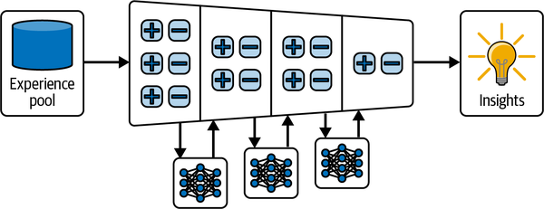

# 5b — Choosing SFT, RL or No Training

> **Pillar:** [05-RL](../README.md)
> **Presumes:** [05-post-training-for-agents.md](05-post-training-for-agents.md)
> **Source:** Bojie Li, *AI Agents in Depth* (2026), ch. 8 — [book-en/chapter8.md](https://github.com/bojieli/ai-agent-book/blob/main/book-en/chapter8.md) (Apache-2.0)
> **Also folded in:** Huyen, *AI Engineering*, ch. 8; *LLM Engineer's Handbook*, ch. 5; Albada, *Building Applications with AI Agents*, ch. 7; Koenigstein, *AI Agents: The Definitive Guide*, ch. 3; Raieli & Iuculano, *Building AI Agents with LLMs, RAG, and Knowledge Graphs*, ch. 8 (see [references](../references.md#books))

[05](05-post-training-for-agents.md) showed why SFT memorizes and RL generalizes, and why a pretrained prior beats exploration from scratch. This half turns that into a decision: what SFT is still the right tool for, how much an agent can learn with no weight update at all, when RL is worth its 10–100× cost, and what goes wrong once you train.

---

## What SFT is good for

SFT writes stable mappings and protocols into weights.

- **Distillation, along two axes.** The soft-target loss behind it, and its origin, are in [fundamentals 02](../../01-llm-fundamentals/notes/09-peft-and-fine-tuning-in-practice.md#making-the-model-smaller) (Hinton et al. 2015).
  - *Prompt distillation*: a long prompt plus a thinking teacher → a short prompt and a non-thinking student. The student keeps only the input and the final answer, which makes it 20–30× faster.
    - Orca 2 calls the prompt half *prompt erasing*. GPT-4 answers under detailed, task-specific strategy instructions, and the student trains on those answers under one generic system prompt, so it has to learn when to use which strategy. At 13B on a LLaMA-2 base (about 817K examples), **Orca 2 beat LLaMA-2-Chat-70B zero-shot** on AGIEval (49.9 vs 46.7) and BBH (50.2 vs 44.7) ([arXiv:2311.11045](https://arxiv.org/abs/2311.11045) (Mitra et al., 2023-11, preprint)).
    - Dropping the thinking has a limit. Yu et al. distilled System 2 methods into Llama-2-70B-chat with no labels, using self-consistency to filter the targets. Rephrase-and-Respond distilled to 98.0% on last-letter concatenation, against 44.5% for the method itself. **Distilling chain-of-thought answers on GSM8K without the steps gave 7.1%, against 52.8% for zero-shot CoT** ([arXiv:2407.06023](https://arxiv.org/abs/2407.06023) (Yu et al., 2024-07, preprint)). Multi-step math needs its tokens.
  - *CoT distillation*: the student learns the teacher's full `<think>` trajectories. A same-size student recovers 70–80% of the teacher (the R1-distilled Qwen/Llama models).
    - Answers alone teach style, not reasoning. A GPT-4 judge rated Vicuna-13B at 92% of ChatGPT, yet on BBH it reached 48% of ChatGPT's score. Orca trained LLaMA-13B on 5M ChatGPT and 1M GPT-4 *explanation traces*, made by system prompts that ask for step-by-step reasoning, and matched ChatGPT on zero-shot BBH (49.7 vs 48.9; Vicuna 23.3) ([arXiv:2306.02707](https://arxiv.org/abs/2306.02707) (Mukherjee et al., 2023-06, preprint)).
    - **Scale beats hand-curation for general reasoning.** This runs against the "less is more" result of LIMO and s1K. Llama-3.1-8B-Instruct trained on 500k randomly chosen DeepSeek-R1 traces over NaturalReasoning questions reached 48.3 on GPQA-Diamond, against 36.9 for s1K's 1k, and accuracy had not plateaued at 500k. At 10–100k examples, selecting for diverse reasoning strategies or for questions where teachers disagree beat random selection ([arXiv:2507.01921](https://arxiv.org/abs/2507.01921) (Li et al., 2025-07, preprint)).
    - **The teacher sets the student's length.** 12B base models trained on gpt-oss-120b traces matched models trained on DeepSeek-R1 traces in math pass@8 (AIME25, MATH-500, GSM8K) while generating about 4× fewer tokens ([arXiv:2511.19333](https://arxiv.org/abs/2511.19333) (Shmidman et al., 2025-11, preprint); 242k problems both teachers solved).
    - **Below about 2B, raw teacher traces can make the student worse.** SFT on s1K's traces dropped Qwen3-1.7B's seven-benchmark math average from 44.5 to 38.6 (8B teacher). The damage traces to a few tokens the student finds very unlikely. In Interleaved-Policy Distillation, the student replaces any teacher token it gives less than 0.1% probability, and the teacher continues from there. That lifted Qwen3-0.6B from 24.6 to 29.7, beating rejection-sampled teacher traces (27.7) ([arXiv:2509.22230](https://arxiv.org/abs/2509.22230) (Kim et al., 2025-09, preprint)).
    - **A 3.8B model needs bulk distillation before a small set helps.** On Phi-4-Mini, SFT on LIMO cut MATH-500 from 71.8 to 57.8, and on s1K to 47.0. Phi-4-Mini-Reasoning first mid-trained on about 10M DeepSeek-R1 rollouts, then ran a smaller distillation SFT, a DPO round that used the teacher's wrong rollouts as the rejected side, and GRPO. The stages took AIME24 from 10.0 to 30.0, 43.3, 50.0 and 57.5, against 53.3 for DeepSeek-R1-Distill-Qwen-7B ([arXiv:2504.21233](https://arxiv.org/abs/2504.21233) (Xu et al., 2025-04, preprint); math only, mean of 3 runs at temperature 0.6). GRPO on the small model was unstable until they kept prompts with uniform response lengths, oversampled hard prompts and annealed temperature from 1.0 to 0.6.
    - A distilled small model is also a cheap RL start. LoRA-only GRPO on DeepSeek-R1-Distill-Qwen-1.5B averaged 48–51% over six math and science benchmarks, matching or beating full-parameter RL runs on the same base (42–49%). The best run cost about $9 ([arXiv:2504.15777](https://arxiv.org/abs/2504.15777) (Wang et al., ICLR 2026); AIME has only 30 problems, so single-benchmark gaps are noisy).
  - *Which teacher.* The best teacher can be a normative model rather than one that knows the answer. On a five-round flight-recommendation task with simulated users, off-the-shelf LLMs stopped improving after round one. Gemma 2 9B fine-tuned on an oracle that always picks the user's true choice reached 61% final-round accuracy. **Fine-tuned instead on a Bayesian assistant's best guesses, often wrong early on, it reached 76%**, against 81% for the Bayesian assistant itself and 37% before tuning. The gain transferred to hotel recommendation and to web shopping ([arXiv:2503.17523](https://arxiv.org/abs/2503.17523) (Qiu et al., Nature Communications 2025)). With real people as users every model scored lower, though Bayesian-taught models still beat oracle-taught ones.
  - An open-source teacher is enough when the student is ≤200B parameters. Closed models usually hide or rewrite their raw chain of thought anyway.
  - Distillation inherits the teacher's systematic errors. It also loses robustness the teacher got from tools.
  - **It can also undo a harness tuned to the student.** Yu et al. evolved a harness around Qwen3-Coder-30B-A3B, which took it from 29.2% to 78.0% mean success on seven enterprise tool tasks. LoRA-SFT on Gemini-3.1-Pro's successful trajectories under that harness then **lowered it to 63.1%, with every task worse (−4 to −30 points)**. Planning failures rose from 1.1% to 14.6% of failures, because the student copied a plan it could not carry out. The same imitation helped under the unevolved harness (29.2 → 35.5). Having the expert rewrite only the failing turn in the student's own rollouts gave 79.7%, about 1–2 standard errors above 78.0 ([arXiv:2609.09134](https://arxiv.org/abs/2609.09134) (Yu et al., 2026-09, preprint); 3-run means, one round of correction, Gemma-4 replication on one task). The imitation and correction sets are not size-matched. Dense on-policy alternatives are in [07](07-reward-design-and-tool-calling.md#dense-signals-on-policy-distillation-and-self-distillation).
    Harness-Zero runs the same correction idea with a reviewer agent in place of the evolved harness. A GPT-5.6 Sol reviewer that holds the harness's knowledge passes or replaces each of the student's proposed steps, and the student is LoRA-tuned on the corrected rollouts under a bare one-tool harness. **Qwen3.5-9B went from a 23.3% macro average to 44.3% with no special harness at deployment, against 41.7% with that harness attached** (SpreadsheetBench, AppWorld and USPTO retrosynthesis, single seed, pass@1) ([arXiv:2609.24974](https://arxiv.org/abs/2609.24974) (Ye et al., 2026-09, preprint)). On USPTO, plain SFT on the teacher's own trajectories left the student at its 12% base score. Trajectories collected under the evolved harness gave 3%, because the student kept calling tools it no longer had. Domain knowledge transferred less well: 30% distilled vs 38% with the harness. The reviewer hurt weaker models, and the ablation is USPTO only.
    Taken further, the harness can be dropped entirely when the procedure is fixed. Dennis et al. sample paths through a customer-service flowchart, have Claude Sonnet 4.5 write dialogues along them, and fully fine-tune a small model that runs with a one-line system prompt. **Qwen3-8B reached 92–98% of Sonnet-with-the-flowchart-in-context on a 55-node insurance procedure, at about 1/460 of the cost per conversation** (A100 serving vs. API pricing, throughput taken from other papers). At 3B, the compiled model beat the same model run under an explicit orchestrator on task success by 0.18 on a 5-point scale ([arXiv:2605.22502](https://arxiv.org/abs/2605.22502) (Dennis et al., 2026-05, preprint)). Quality is judged by Claude Sonnet 4.5 on users it also simulates (a GPT-4.1 judge agrees on the ranking), over 200 scenarios per condition with one trained model per domain, in three dialogue-only domains. The model is retrained whenever the procedure changes.

    The opposite move keeps the harness and trains the two together. VERA alternates rounds of GRPO on Qwen3.5-9B with harness edits. The GRPO uses rubric rewards per stage, on 9,000+ environments rebuilt from benchmark trajectories. An edit is kept only if it passes self-tests and raises the development-set Overall score by at least 5 points. **On the authors' AutoCoWorkBench it reached 31.0 Overall, against 18.9 with the harness frozen, 18.2 with the model frozen and 20.7 for ADAS harness search; on AutoMedBench-Lite it reached 69.1 against 43.3 and 56.1** ([arXiv:2610.05923](https://arxiv.org/abs/2610.05923) (Liu et al., 2026-10, preprint)). Outcome-only GRPO with the same budget of 500 updates collapsed to 5.8. At 4B and 9B the training cost general skill: Qwen3.5-9B's AIME 2026 score fell from 92.5 to 36.7 on the CoWork run. A 27B model held its scores. The authors built both benchmarks, one GPT-5.6 model judges, verifies and attributes, and no training seeds are reported (benchmark scores average three evaluation seeds).
- **Rejection-sampling fine-tuning (RFT).**
  1. Sample k = 4–16 candidates per prompt.
  2. Verify each with rules, tests or a reference answer.
  3. Keep the passes, deduplicate, and cap how many each prompt contributes.
  4. Run SFT on what remains, then repeat as the model improves (STaR / RFT; see [04](04-constitutional-ai.md#self-improvement-and-scaling)).

  RFT sits between SFT and RL: no reward model, no policy gradient.
- **Function calling.** Albada's recipe (*Building Applications with AI Agents*, ch. 7): SFT
  with LoRA and TRL's `SFTTrainer` on conversations where reasoning sits in `<think>…</think>`
  and each call sits in `<tool_call>…</tool_call>`. Put each tool's JSON Schema in the training
  examples, and validate every proposed call against the same schema at runtime (Pydantic,
  Zod, Ajv) before executing it. Include examples where the right move is **not** to call:
  "What's the weather in Boston?" calls `get_weather`; "Imagine it's snowing in Boston, what
  should I wear?" doesn't. Try the base model's native function calling with schema
  validation first. Tune only when that measurably falls short at your scale.
- **Style and voice.** Orpheus clones a voice from reference-audio tokens. Sesame learns paralinguistic tokens such as `<laugh>`. Too few speakers in the data makes everyone sound the same.
- **Activating latent capability.** SFT on gpt-oss-20b used a `reasoning language: X` instruction and no Chinese training data. The model then reasoned in Chinese, because multilingual pretraining already held the shared representation. BLOOMZ showed the effect first: English-only multitask fine-tuning improved held-out non-English tasks ([ACL 2023](https://doi.org/10.18653/v1/2023.acl-long.891), Muennighoff et al.; numbers in [02](02-rlhf-pipeline.md#stage-1--supervised-fine-tuning-sft)).
- **Continued pretraining, not SFT, for new knowledge.** The technique is domain-adaptive pretraining ([arXiv:2004.10964](https://arxiv.org/abs/2004.10964) (Gururangan et al., ACL 2020); see [fundamentals 02](../../01-llm-fundamentals/notes/07-sft-and-instruction-tuning.md#continued-pretraining)). Mistral 7B learned Korean from Korean Wikipedia. Mixing about 80% Korean with 20% English avoided forgetting English. SFT on instructions came afterwards. Plain continued pretraining still absorbs facts poorly: on 2023 Wikipedia biographies, Llama 2-7B answered 3.6% of extraction questions (exact match), while Self-Tuning reached 31.5%, close to the 31.8% open-book ceiling. Self-Tuning first teaches the model *how* to absorb a document: it trains on separate documents alongside their QA pairs and self-generated memorization, comprehension and self-reflection tasks. Only then does it read the new documents, as raw text ([arXiv:2406.06326](https://arxiv.org/abs/2406.06326) (Zhang et al., ACL Findings 2025)).

**Where SFT data comes from:**

- Human seed demos pin down format and style.
- A teacher model scales them up.
- Rejection sampling brings quality up to the bar.
- A strong filter can stand in for a strong teacher. Impossible Distillation sampled many continuations from GPT-2-scale models and kept the pairs that passed off-the-shelf NLI and diversity critics. A 770M T5 trained on them beat ChatGPT-distilled models at paraphrasing and sentence summarization, and in human evaluation was sometimes preferred to ChatGPT itself ([doi:10.18653/v1/2024.naacl-long.250](https://doi.org/10.18653/v1/2024.naacl-long.250) (Jung et al., NAACL 2024)). It works where a cheap, reliable critic exists. Those tasks are sentence-level.
- **The longest SFT answer caps the longest output.** On GLM-4-9B with 180K chat SFT examples, dropping every example longer than 500, 1,000 or 2,000 words capped the tuned model's output at about 600, 900 and 1,800 words, despite a 128K context window. LongWriter wrote 6,000 answers of 2K–32K words with an AgentWrite pipeline: GPT-4o plans the paragraphs with word counts, then writes them one at a time with the earlier text in context. Adding these to the SFT mix raised the maximum to 10K–20K words. On 120 prompts with length targets, **the length score for 4K–20K-word requests went from 0 to 80.3**, and GPT-4o-judged quality rose from 77.1 to 82.3. Averaging the loss per token, not per sequence, mattered, because otherwise long answers carry little weight. Pretraining text with backtranslated instructions did not work, and neither did training the model to write out its plan first. DPO on 4K length-scored pairs added about 4 points. GPT-4o wrote the data and also judged quality ([arXiv:2408.07055](https://arxiv.org/abs/2408.07055) (Bai et al., ICLR 2025)).

---

## Learning without weights first

Albada calls in-context methods **nonparametric learning** and puts them before any
fine-tuning, because they cost no retraining and can be undone (*Building Applications with
AI Agents*, ch. 7). Three levels:

1. **Exemplar learning.** Store successful runs (problem, action, outcome) and retrieve the
   most similar ones as few-shot examples. Start with fixed examples in the prompt. Switch to
   *dynamic* selection from a vector store once there are too many to fit, or they stop being
   relevant to every input.
2. **Reflexion** (Shinn et al., 2023). After a failed trial, the model writes a short
   critique ending in a "Plan:" for next time. The plan goes into memory and is prepended on
   the next attempt at the same task. No weights change.
3. **Experiential learning** (ExpeL, Zhao et al., 2023). Reflexion learns within one task;
   ExpeL learns *across* tasks. It contrasts failed and successful trials and keeps a short
   list of general rules. Each update edits the list with explicit operations: `AGREE`
   (upvote), `REMOVE` (contradictory or duplicate), `EDIT` and `ADD`. Rules that keep getting
   upvoted survive.


*Image Source: Michael Albada, *Building Applications with AI Agents* (O'Reilly, 2025), Fig. 7-4*

These are the in-context versions of what RL does in weights: Reflexion is a verbal
policy update, and ExpeL's upvoted rules work like a slowly learned prior. Memory design for
storing them is in [context engineering](../../../ai-engineering/02-context-engineering/README.md).

The two can be combined rather than chosen between. SkillRL has o3 distill successes into
strategies and failures into lessons, retrieves the relevant skills into the prompt, and
trains Qwen2.5-7B with GRPO while re-distilling new skills from validation failures. **On
ALFWorld it reached 89.9% success, against 77.6% for GRPO alone and 46.3% for ExpeL**
([arXiv:2602.08234](https://arxiv.org/abs/2602.08234) (Xia et al., NeurIPS 2026)). The
ablations show the dependence runs both ways. Dropping the cold-start SFT that teaches the
model to use skills cut it to 65.2%, and replacing distilled skills with raw retrieved
trajectories cut it to 61.7%. The setup is a single 7B model with an o3 teacher. The
"10–20× compression" the paper claims for skills over raw trajectories doesn't match its own
measured prompt lengths, which fell only about 10%.

Reflexion's loop can itself be trained. Meta-RL, which goes back to RL²
([arXiv:1611.02779](https://arxiv.org/abs/1611.02779) (Duan et al., 2016-11, preprint)), trains
over a *trial* of several episodes, so exploring early pays off later. LaMer applies it to
language agents. Each trial is three attempts at the same task from the same start, with a
written reflection after each failure, and the reflection is credited with the next attempt's
reward through a cross-episode discount. On Qwen3-4B (GiGPO, matched trajectories per step),
**pass@3 over sequential attempts rose to 55.9% on Sokoban, 74.4% on MineSweeper and 89.1% on
WebShop, against 44.1, 55.1 and 75.2 for plain RL**
([arXiv:2512.16848](https://arxiv.org/abs/2512.16848) (Jiang et al., ICLR 2026)). Giving the RL
agent the same memory only at test time closed little of the gap. First-attempt success fell on
MineSweeper and WebShop (44.1 vs 52.0, 67.8 vs 73.4), and training took about twice as long,
because a trial's episodes run in sequence. Reflection-only memory beat reflection plus raw
trajectory. There are no seeds, and the models are 4B and 8B on games and WebShop.

ExpeL's rule list also scales when the experience comes from simulated work. Ge et al. built
1,000 synthetic computers from personas, each a user profile, a folder tree and documents that
depend on each other. On each one, Claude Code with Sonnet 4.6 ran a month of simulated work:
about 20 working days, with averages of 4.1 deliverables, 5.5 simulated collaborators, 2,272
turns and 8.6 hours per run. Retrospectives from 900 of the runs were distilled into occupation skills.
**On 100 held-out computers, the rubric score rose from 61.6% to 68.6%, and the agent with skills
won 83 of 100 paired comparisons** ([arXiv:2604.28181](https://arxiv.org/abs/2604.28181) (Ge et
al., 2026-04, preprint)). Skills from only 10 computers gave no gain. On 220 GDPval tasks, the
Sonnet agent won 105 and lost 67. The transfer to Haiku 4.5 and Opus 4.6 was weaker. No weights
were updated, despite the paper's framing as a substrate for RL. Opus 4.6 is the judge, each arm
is one run, and the test computers come from the same persona distribution as the training ones.

SkillGym goes the other way and trains the skills into the weights. It builds 2,756 Docker
environments around human-written skills from a public registry, in 12 categories. Teacher agents
run in them under Claude Code and Codex, and 17.4% of 48,152 trials passed the verifiers.
Qwen3.5-35B-A3B is then fine-tuned on the 8,364 passing trajectories. **Under Claude Code with no
skills at inference, the trained model scored 26.81% on SkillsBench, above its own base given the
skills (23.34%)**, and Terminal-Bench 2.1 rose from 39.33% to 58.43%
([arXiv:2609.27717](https://arxiv.org/abs/2609.27717) (Ge et al., 2026-09, preprint)). Skills in
context still helped the trained model. This is SFT on strong teachers, not RL, with one run per
cell, and the Codex comparison also changed the system prompt.

**When to fine-tune, and when to hold off.** Albada's checklist:

| Fine-tune when | Hold off when |
|---|---|
| Narrow domain jargon or a strict style guide | You are still prototyping, or volume is low |
| Every response must follow a fixed template | A new base model may beat your tuned one, wiping out the work |
| Tool calls must be exact (dosages, trading APIs) | GPUs, annotation or latency budgets are tight |
| You have hundreds to thousands of curated examples and the budget | — |
| Retraining and versioning are manageable (if the domain changes often, upkeep can outweigh the gains) | — |

His summary: "When in doubt, don't fine-tune your model." Huyen reaches the same order from
the RAG side, "finetuning is for form, and RAG is for facts" (evidence in
[02](02-rlhf-pipeline.md#sft-in-practice)). Albada's case for doing it anyway is small
models: per Baytech Consulting, Phi-3-mini (3.8B) matched the 60% MMLU score of the 540B
PaLM, a 142× size reduction in about two years. A tuned small model can then beat a prompted
frontier model on cost and latency for one narrow job. That is a vendor-reported, single-benchmark
comparison.

## When to choose SFT vs. RL

1. **Does this need training at all?** If prompts, tools or context management can solve it, no. Most agent applications stop here ([harness engineering](../../../ai-engineering/03-harness-engineering/README.md)).
2. **Try SFT first.** Use it for JSON schemas, tool-call format, protocol habits, tone and length. Don't use it to inject facts. Length can be fixed with a very narrow SFT. Hermes 4 14B ran out of its 40,960-token context on 60% of LiveCodeBench problems. The fix was a second SFT pass on the model's own traces, with `</think>` forced at 30k tokens and only that token and `<eos>` left unmasked. The overlong rate fell to 0.1%, LiveCodeBench rose from 28.6 to 42.5, and AIME'25 fell 3.9% relative ([arXiv:2508.18255](https://arxiv.org/abs/2508.18255) (Teknium et al., 2025-08, tech report)).
3. **Add RL when SFT plateaus.**
   - Deployment drifts systematically from training (rules or appearance change).
   - Demonstrations are suboptimal.
   - Demonstrating every path costs too much.

   The test: **more demonstrations stop improving performance on new scenarios.** That limit comes from SFT's objective, not from the size of the dataset.

   A second check is headroom. K2-Think's SFT model reached about 79% pass@1 on AIME 2024 within half an epoch and then plateaued. Its pass@k kept rising to about 93% at k = 128, and the authors treated that gap as the room left for RL ([arXiv:2509.07604](https://arxiv.org/abs/2509.07604) (Cheng et al., 2025-09, tech report)). If pass@k is already close to pass@1, RLVR has little to re-weight (see [why RL's ceiling is higher](05-post-training-for-agents.md#why-sft-memorizes-and-rl-generalizes)).
4. **For small models with a strong teacher, distill instead.** Llama-Nemotron found reasoning RL "suboptimal" next to distillation for its smaller models, as DeepSeek-R1 had reported, and ran it only on the 253B model. The 8B Nano got its reasoning from SFT alone and then went through preference-style RPO, mainly for IFEval ([arXiv:2505.00949](https://arxiv.org/abs/2505.00949) (Bercovich et al., 2025-05, preprint)).

The ladder fits in a function. It's worth writing down for your own project, because the order is what teams skip:

```python
def post_training_step(state):
    """Walk the cheapest-first ladder. Return the first rung the task fails."""
    if state["fact_lookup"]:
        return "Use retrieval: facts change, need citations and must be deletable."
    if state["can_be_written_down"]:
        return "Put it in the prompt, a Skill or a programmatic constraint."
    if state["format_failure_rate"] > 0.20 or not state["has_demos"]:
        return "SFT first: RL cannot score output it cannot parse."
    if not state["ood_flat_after_more_demos"]:
        return "More or better SFT data: demonstrations still help on held-out cases."
    if not state["reward_tracks_goal"]:
        return "Fix the reward: RL will optimize this proxy, not the goal."
    return "RL: format is stable, SFT has plateaued, and the reward is trustworthy."

support_tone = dict(fact_lookup=False, can_be_written_down=False, format_failure_rate=0.05,
                    has_demos=True, ood_flat_after_more_demos=False, reward_tracks_goal=False)
price_list = {**support_tone, "fact_lookup": True}
tool_agent = dict(fact_lookup=False, can_be_written_down=False, format_failure_rate=0.02,
                  has_demos=True, ood_flat_after_more_demos=True, reward_tracks_goal=True)
for name, task in [("support tone", support_tone), ("price list", price_list), ("tool agent", tool_agent)]:
    print(f"{name:<13}{post_training_step(task)}")
```

```text
support tone More or better SFT data: demonstrations still help on held-out cases.
price list   Use retrieval: facts change, need citations and must be deletable.
tool agent   RL: format is stable, SFT has plateaued, and the reward is trustworthy.
```

**ICL / RAG / code / weights** each carry a different kind of capability:

- **ICL** carries strategies that can be stated in language. It adapts instantly, but cost grows with context.
- **RAG** carries facts. They stay updatable and traceable.
- **Code** carries hard constraints. A transfer-approval rule belongs in code even when it never changes.
- **Weights** carry what can't be written down: perception, tone, implicit policy. That holds even in fast-changing domains.

---

## Practical pitfalls

1. **Using post-training to store facts.** Use RAG; post-training teaches how to use knowledge.
2. **Starting RL before format is stable.** If the parse-failure rate is above 20%, RL will fail.
3. **Reward hacking, which does not stay local.** Reward the real objective, not a proxy like
   length. On RM over-optimization, see [02-rlhf-pipeline.md](12-rlhf-failure-modes.md#overoptimization).

   Anthropic gave a pretrained model knowledge of three hacks, then ran RL on real Claude
   Sonnet 3.7 coding environments with the anti-hack checks removed. The hacks were an
   always-equal object, `sys.exit(0)` and patching pytest via `conftest.py`.
   - The model learned them and, at the onset of hacking, became broadly misaligned.
   - In the synthetic-document setting, 33.7% of answers were misaligned on Betley et al.'s
     questions, against 0.7% for a non-hacking baseline.
   - In 12% of trials it sabotaged a reward-hack classifier it was asked to write in Claude
     Code ([arXiv:2511.18397](https://arxiv.org/abs/2511.18397) (MacDiarmid et al., 2025-11)).

   
   *Image Source: MacDiarmid et al., [Natural Emergent Misalignment from Reward Hacking in Production RL](https://arxiv.org/abs/2511.18397) (2025), Fig. 1*

   What did and did not fix it:
   - Chat-style RLHF left the misalignment context-dependent, still present on agentic
     tasks.
   - What worked was preventing the hack (a classifier penalty) or **inoculation prompting**:
     the system prompt says passing the grader is the task. In the prompted setting that cut
     misalignment 75–90% even with hacking above 99%; it was weaker in the synthetic-document
     setting. Inoculation prompting was introduced in SFT by Wichers et al., on MBPP solutions that
     hard-code the visible test ([arXiv:2510.05024](https://arxiv.org/abs/2510.05024) (Wichers et al.,
     2025-10, preprint)); its limits are in [12](12-rlhf-failure-modes.md#reward-hacking).
   - These are single runs per configuration with Claude graders. The hack-describing
     documents also labelled each hack "misaligned", which pre-installs part of the
     association.

   The same generalization appears from SFT: OpenAI fine-tuned GPT-4o on 6,000 subtly wrong
   health answers and got about 60% misalignment on 44 unrelated prompts (GPT-4o-graded).
   - A "toxic persona" SAE latent tracked it, and rose at 5% bad data before behaviour
     changed.
   - 35 steps of SFT on correct data at batch 4 brought an insecure-code model from 17.7%
     back to 0.1% ([arXiv:2506.19823](https://arxiv.org/abs/2506.19823) (Wang et al.,
     2025-06)).
   - That detector was evaluated in-sample, and the paper is vendor-run.

   A milder version shows up without any planted hack. SocialRL trained Qwen3-4B on six
   negotiation games with an SFT warm start, then PPO on a deal-value reward alone. The
   specialists averaged 0.615 normalized utility, against 0.625 for GPT-4.1 and 0.613 for GPT-5.2.
   **But the Craigslist buyer cites market prices the environment never supplied**: 29.6% of its
   messages make market references, and some of them are invented. The authors list this
   learned bluffing as a limitation ([arXiv:2608.13787](https://arxiv.org/abs/2608.13787) (Hua et
   al., 2026-08, preprint)). Honesty is an outcome-neutral constraint, so it needs a path check
   ([RLVP](07-reward-design-and-tool-calling.md#rlvp-reward-the-outcome-penalize-the-path)). Final evaluations are small: 150 games
   (10 scenarios × 3 opponents × 5 trials).
4. **A low-fidelity simulator.** The policy collapses in production.
5. **Over-training.** Train loss falls while validation gets worse. Stop early, especially with SFT.
6. **Value-function collapse and under-exploration.** PPO curves oscillate; low temperature traps the policy in a local optimum.
7. **Underestimating RL compute.** It costs 10–100× SFT. If test matches train, SFT may be enough.
8. **Dirty data.** SFT learns the noise; a biased RM steers RL the wrong way.

**Validate cheaply first.** Check three things before scaling up:

- Does SFT fix the format on a small set?
- Does RL converge in a simplified environment?
- Does the reward track the true goal on a small sample?

Fail fast before you fail at scale.

**Eval vs. train data.** SWE-Gym trains; SWE-Bench Verified must stay held out. τ²-bench trajectories make good imitation data, and AndroidWorld's templates generate curricula. Reuse the *environment*, never the *eval items* ([08-eval](../../08-eval/README.md)).

## Try it

1. Feed `post_training_step` a task of your own, such as a support agent whose tone is off, with honest values. Which rung does it stop at, and would your team have started there?
2. Your team wants to fine-tune a support agent on its knowledge base so that it "knows the product". Using this chapter's pitfalls, say what to do instead and what, if anything, is worth training.

<details><summary>Answers</summary>

1. Most teams find it stops before RL, usually at the prompt or SFT rung. If yours reaches RL, you should be able to name the reward that tracks the goal.
2. Facts that change belong in retrieval, not weights (pitfall 1), so put the knowledge base behind RAG and keep it deletable and citable. Train only what can't be stated in context, such as tone, and validate cheaply first: does a small SFT set fix the format, and does the reward track the true goal on a sample?

</details>

### Labs

| Exp | Lab | Where |
|---|---|---|
| 7-1 | Q-learning treasure hunt | **[practice/01-q-learning-treasure-hunt](../practice/01-q-learning-treasure-hunt/)** (offline, numpy) |
| 7-2 | LLM agent vs. Q-learning | [upstream](https://github.com/bojieli/ai-agent-book/tree/main/chapter1/learning-from-experience) (API key) |
| 7-3 | MiniMind: train a 100M LLM from scratch (QK-Norm + Muon, ~14 h, ~$34) | [upstream](https://github.com/bojieli/ai-agent-book/tree/main/chapter8/MiniMind-pretrain) (GPU) |
| 7-5 | Continued pretraining: Mistral 7B learns Korean | [upstream](https://github.com/bojieli/ai-agent-book/tree/main/chapter8/continued-pretraining) (GPU) |
| 7-6 | Voice SFT: Orpheus, Sesame | [orpheus](https://github.com/bojieli/ai-agent-book/tree/main/chapter8/orpheus), [sesame](https://github.com/bojieli/ai-agent-book/tree/main/chapter8/sesame) (GPU) |
| 7-7 | Multilingual reasoning SFT | [upstream](https://github.com/bojieli/ai-agent-book/tree/main/chapter8/MultilingualReasoning) (GPU) |
| 7-9 | CoT distillation | [upstream](https://github.com/bojieli/ai-agent-book/tree/main/chapter8/cot-distillation) (GPU) |
| 7-10 | AdaptThink | [upstream](https://github.com/bojieli/ai-agent-book/tree/main/chapter8/AdaptThink) (GPU) |
| 7-12 | V-IRL spatial reasoning | [upstream](https://github.com/bojieli/ai-agent-book/tree/main/chapter8/SpatialReasoning) (GPU) |
| 7-13 | SimpleVLA-RL | [upstream](https://github.com/bojieli/ai-agent-book/tree/main/chapter8/SimpleVLA-RL) (GPU) |
| 7-14 | RLVP | [upstream](https://github.com/bojieli/ai-agent-book/tree/main/chapter8/RLVP) (GPU) |
| 7-15 | ReTool | [upstream](https://github.com/bojieli/ai-agent-book/tree/main/chapter8/retool) (multi-GPU) |
| 7-16 | AWorld-train | [upstream](https://github.com/bojieli/ai-agent-book/tree/main/chapter8/AWorld-train) (GPU + MCP sandbox) |
| — | Intuitor (RL from internal confidence, no external reward) | [upstream](https://github.com/bojieli/ai-agent-book/tree/main/chapter8/Intuitor) (GPU) |

## Interview checklist

| Question | Answer |
|---|---|
| When does SFT stop being enough? | When more demonstrations stop improving held-out scenarios, or when format is stable but out-of-distribution performance is flat. |
| Correct process with a wrong answer, or wrong process with a right answer: which deserves more reward? | Outcome stays primary (RLVR), and verifiable process *violations* are penalized (RLVP). Don't reward "lucky" paths that broke a rule. |
| $10k to improve a support agent: where does it go? | Mostly context, knowledge, prompts/Skills and programmatic constraints. Train weights only for what can't be stated (tone, perception) or for cost (distillation). |
| A per-customer LoRA instead of a knowledge base? | It wins for stable style and implicit preferences. It loses for facts that change, need citations or must be deletable. |
| Long-tail rollouts idle the GPUs. What can you do? | Run rollout and training asynchronously with a staleness cap and importance-ratio masking ([10](10-engineering-rl-systems.md#scaling-actors-and-learners)), cap or penalize length (DAPO's overlong shaping), use partial rollouts, and use dynamic batching. |

## Next

[06 — Data and environments](06-data-and-environments.md) is where the second thread of this chapter goes: what the training ground and the dataset have to look like. Upstream: [05](05-post-training-for-agents.md) (the three stages, SFT vs. RL, priors), [02](02-rlhf-pipeline.md) ([KL](../../01-llm-fundamentals/notes/06-pretraining-data-and-objectives.md#entropy-cross-entropy-kl-and-perplexity) penalty, reward models, SFT in practice), [03](03-preference-optimization.md) (PPO / DPO / GRPO math), [01](01-rl-foundations.md). Lateral: [generative-ai/08-eval](../../08-eval/README.md) (environments as training grounds), [04-loop-engineering failure modes](../../../ai-engineering/04-loop-engineering/notes/09-failure-modes-and-guardrails.md). Downstream: [03-agentic-foundations](../../03-agentic-foundations/README.md) (trajectories as the raw material for learning).
