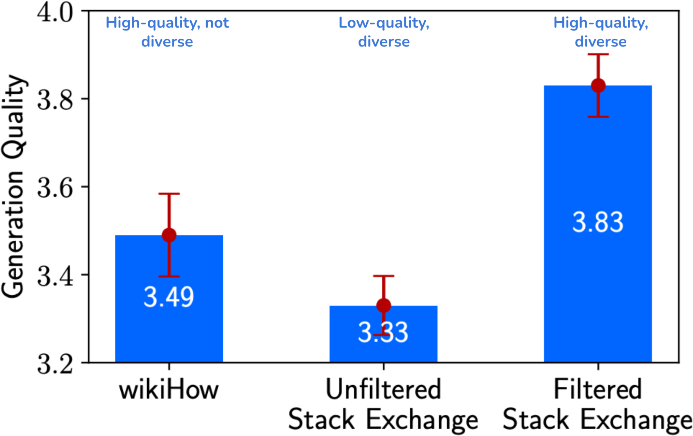

# 6 — Data and Environments

Suppose you have fixed the reward and the algorithm, and the model still falls apart in deployment. The likely culprit is whatever it practised on. A scripted customer who never pushes back teaches a test-taking strategy, and a dataset full of near-duplicates teaches less than its size suggests. Algorithms get the papers, but this chapter is about where the work and the budget actually go: environments, the demonstrations behind SFT, and the preference pairs behind DPO.

> **Pillar:** [05-RL](../README.md). **Presumes:** [05](05-post-training-for-agents.md).

---

## Data and environment > algorithm

**The environment is the practice field.** If it is distorted (scripted customer-service reps, error messages that don't match production), the model learns a test-taking strategy that dies on deployment. This is the most common way RL projects fail.

**Building the environment often costs more than training.** Real APIs rate-limit, ban accounts and have side effects. You need a stable, replayable "shadow world": AWorld's MCP sandbox, ReTool's interpreter sandbox. The reward function is part of the environment.

Open frontier reports show the scale this now takes:

- **GLM-5.** More than 10k verifiable SWE environments across 9 languages, built from
  fail-to-pass tests. Terminal tasks were hardened by a "refine agent" against shortcuts.
  - Its slide-generation RL still found one: truncating content and fiddling spacing to pass
    the layout checker. The fix was to patch the renderer
    ([arXiv:2602.15763](https://arxiv.org/abs/2602.15763) (GLM-5 Team, 2026-02)).
  - Its self-run 77.8% on SWE-bench Verified falls to 42.1% on decontaminated SWE-rebench,
    level with GLM-4.7's 41.3%.
- **INTELLECT-3.** Publishes its environments (math, code, science, logic, deep research and
  R2E-Gym SWE) as reusable packages on an open hub. Up to 4,000 sandboxes ran at once
  ([arXiv:2512.16144](https://arxiv.org/abs/2512.16144) (Prime Intellect Team, 2025-12)).
  - It reports no agentic benchmark at all.

The asynchronous trainers behind both are in
[10](10-engineering-rl-systems.md#scaling-actors-and-learners).

**When you can't build an environment, let a model play it:**

- **Tool-return level.** ZeroSearch has an LLM simulate the search engine. A curriculum starts with clean results and mixes in noise as training goes on. The policy then transfers to real search. For about 64k training queries, Google through SerpAPI cost $586.7 against $17.7–70.8 of GPU time for a 3B–14B simulator, and the 3B policy matched Search-R1 trained on real Google (34.47 vs 32.81 average exact match over seven QA sets); details in [11](11-multi-agent-and-rag-rl.md#challenges-in-rl-for-rag).
- **Dynamics level.** DreamGym distills an "experience model" that reasons out state transitions. User simulators (the τ-bench family) serve as both exam room and practice field.
- **Risks.** The simulator's knowledge is the ceiling, and the policy absorbs its biases. RL will actively hunt for its loopholes. Mix simulated rollouts with real ones and recalibrate periodically.

**Data quality beats algorithms.** SFT bakes noise into the weights. RL pushes hard toward a biased reward. Check three things:

- **Coverage**, including the long tail.
- **Diversity**, or the model collapses to one mode.
- **Label accuracy.** Filter wrong CoT before you distill it.

### Data engineering for post-training

Huyen's chapter on dataset engineering and LLMEH's curation pipeline turn the validation checks in [05](05-post-training-for-agents.md#practical-pitfalls)
into practice (*AI Engineering*, ch. 8; *LLM Engineer's Handbook*, ch. 5).

**Quality and diversity both count.** In LIMA's ablation ([arXiv:2305.11206](https://arxiv.org/abs/2305.11206) (Zhou et al., NeurIPS 2023)), Zhou et al. fine-tuned a 7B LLaMA on three
2,000-example sets. The set that was both high-quality and diverse won:


*Image Source: Chip Huyen, *AI Engineering* (O'Reilly, 2025), Fig. 8-1 (from Zhou et al., 2023, CC BY 4.0)*

Other data points: the Yi team found 10K carefully written instructions beat hundreds of
thousands of noisy ones. LIMA's 65B Llama, tuned on 1,000 curated examples, was rated equal
to or better than GPT-4 in 43% of human comparisons, but it was less robust than production
models.

**The mix changes by stage.** Llama 3's domain mix (Huyen, Table 8-1):

| Domain | Pretraining | SFT | Preference |
|---|---|---|---|
| General English | 50% | 52.66% | 81.99% |
| Math and reasoning | 25% | 21.19% | 5.89% |
| Code | 17% | 14.89% | 6.93% |
| Multilingual | 8% | 3.01% | 5.19% |

**How much.** Start with about 50 well-made examples. Huyen: "in the vast majority of cases,
you should see improvements after finetuning with 50–100 examples". If 50 show no gain,
check hyperparameters and prompts before buying more data, because a bigger set rarely fixes
it. Diversity in tasks saturates: in Flan, going from 9 to 282 tasks helped a lot, and gains
after that were small up to 1,836 ([arXiv:2210.11416](https://arxiv.org/abs/2210.11416) (Chung et al., JMLR 2024)). One explanation they offer: for PaLM,
instruction tuning used 1.4B tokens, 0.2% of the 780B pretraining tokens, so it may mostly teach
the model to express what it already knows. LLMEH's rough sizes: about 1M+ samples for a
general-purpose instruct model, 100–100k for one task or domain. It treats data quality as
three properties: accuracy, diversity and complexity.

**Curation pipeline** (LLMEH ch. 5):

1. **Rule-based filters:** length, keyword exclusion, format checks.
2. **Deduplication:** exact (hashing), fuzzy (MinHash), semantic (embedding similarity).
   Duplicates cost more than compute. In an Anthropic study, repeating 0.1% of the data 100
   times degraded an 800M model to the level of a 400M one.
3. **Decontamination:** the same dedup methods, run against every eval set. Otherwise your
   benchmark scores measure memorization ([06-eval](../../../ai-engineering/06-eval/README.md)).
   Public sets leak more than you'd expect. Platypus flagged training questions with over 80%
   embedding similarity to a test question. It found 77 near-copies in each of PRM800K and the
   MATH train split, 71 in SciQ and 13 each in airoboros and OpenAssistant-Guanaco
   ([arXiv:2308.07317](https://arxiv.org/abs/2308.07317) (Lee et al., NeurIPS 2023 Instruction Tuning workshop)).
   MAmmoTH2 dropped every web page with a 10-gram match to any benchmark question or answer.
4. **Quality scoring:** an LLM judge (with the biases in
   [02](02-rlhf-pipeline.md#stage-2--reward-model-training)), a reward model such as ArmoRM,
   or a small classifier like the fineweb-edu one.
5. **Cleaning:** strip stray HTML and Markdown. Databricks reported +20% accuracy and 60%
   fewer input tokens from that alone (Huyen).

**Synthetic data works, with three limits.** The recipe starts with Self-Instruct
([doi:10.18653/v1/2023.acl-long.754](https://doi.org/10.18653/v1/2023.acl-long.754) (Wang et al., ACL 2023)).
GPT-3 bootstrapped 52k instructions from 175 hand-written seed tasks, filtering near-duplicates
at ROUGE-L 0.7. **GPT-3 tuned on its own output gained 33 points on SuperNI and ended 5 points
behind InstructGPT-001 in human evaluation.** Examples since: AlphaGeometry trained on 100M
synthetic problems. MetaMath grew a 15k-problem math set to about 400k by rewriting. Alpaca
reused Self-Instruct's 175 seeds to make 52k pairs. **The teacher sets the ceiling:** answering
the same 52k prompts with GPT-4 instead of GPT-3.5 moved LLaMA-7B's human-rated helpfulness
wins to 54% against Alpaca's 20%, with honesty and harmlessness mostly ties
([arXiv:2304.03277](https://arxiv.org/abs/2304.03277) (Peng et al., 2023-04, preprint)).
Llama 3 generated over 2.7M synthetic coding examples
with execution feedback. Nemotron-4 340B-Instruct used 98% synthetic data in post-training,
generated by a *smaller* Mixtral teacher, and beat it.

Two ways to get diversity without a large human seed set:

- **Condition on personas.** Persona Hub puts one of 1B web-derived personas into each
  generation prompt. Its 1.07M GPT-4-written math problems lifted Qwen2-7B to 64.9% on MATH
  (Qwen2-7B-Instruct: 49.6%) without using any MATH data. Experts judged 96.5% of 200 sampled
  problems valid, but the gpt-4o solutions were never checked
  ([arXiv:2406.20094](https://arxiv.org/abs/2406.20094) (Ge et al., 2024-06, tech report)).
- **Mine instead of generate.** MAmmoTH2 used a fastText classifier to recall 18M documents
  from Common Crawl, had Mixtral extract about 5M Q-A pairs, and had Mixtral and Qwen-72B
  refine them into 10M pairs. The answers come from human-written pages, so less is
  hallucinated. **Mistral-7B went from 11% to 36.7% on MATH and from 36% to 68.4% on GSM8K
  with no in-domain training data.** Education sites beat forums, and pairs refined by both
  models beat either one alone
  ([arXiv:2405.03548](https://arxiv.org/abs/2405.03548) (Yue et al., NeurIPS 2024)).

The limits:

- **Superficial imitation.** Students copy the teacher's style but not its accuracy. Training
  on solutions a student can't produce teaches it to write things that look like solutions
  (Gudibande et al., 2023). This is the same warning as "distillation inherits errors" in [05](05-post-training-for-agents.md#what-sft-is-good-for).
  LaMini-LM distilled 2.58M gpt-3.5-turbo responses into models from 61M to 7B. Its 248M
  Flan-T5 matched LLaMA-7B on 15 NLP benchmarks, yet human raters found the family weak at
  coding, math and reasoning. **The data source decided which evaluation moved:**
  Self-Instruct-style subsets lifted human ratings, FLAN/P3-style subsets lifted benchmarks
  ([doi:10.18653/v1/2024.eacl-long.57](https://doi.org/10.18653/v1/2024.eacl-long.57) (Wu et al., EACL 2024)).
- **Model collapse.** Training recursively on generated data loses the tails of the
  distribution (Shumailov et al., 2023). Mixing in real data avoids it (Gerstgrasser et al.,
  2024), but no paper gives a safe ratio. The positive results (no saturation at about 1M
  synthetic math samples; Nemotron's 98%) are all single-generation. Rephrasing real text
  rather than generating from scratch keeps an anchor. WRAP rewrote C4 with Mistral-7B in
  Wikipedia and Q&A styles. Mixed with real C4, it reached the same zero-shot accuracy about
  3x faster at 1.3B parameters. Dropping the real half cost up to a point of zero-shot accuracy
  and sharply raised perplexity on messy real text (Gutenberg, PhilPapers), because the rewrites
  are too clean ([arXiv:2401.16380](https://arxiv.org/abs/2401.16380) (Maini et al., ACL 2024)).
  That evidence is from pretraining, not post-training.
- **Verification is the bottleneck.** About 20% of Llama 3's generated code solutions were
  wrong at first and fixed through execution feedback. Without a check like that, synthetic
  data adds noise at scale. Instruction-following tolerates more noise than reasoning does.
  Only 54% of Self-Instruct's sampled instances were fully valid. In Unnatural Instructions
  it was 56.5% of 200, yet T5-11B trained on that data matched SuperNI-trained T5 at equal size.
  It beat it at equal budget, at about $0.02 per example against at least $0.50 for crowd
  labels ([arXiv:2212.09689](https://arxiv.org/abs/2212.09689) (Honovich et al., ACL 2023)).
  Long et al.'s survey splits the check in two. Direct evaluation spot-checks faithfulness on
  a sample and measures diversity, for example by embedding similarity. Indirect evaluation
  trains on the data and benchmarks the result. Run the cheap direct check first
  ([arXiv:2406.15126](https://arxiv.org/abs/2406.15126) (Long et al., Findings of ACL 2024)).

Generation recipes in LLMEH: Evol-Instruct (rewrite seeds into harder variants) for
instructions, UltraFeedback-style multi-model sampling plus judging for preferences. For
code, three instruction sources each lifted HumanEval: evolved instructions (StarCoder-15B
33.6% → 57.3% pass@1; [arXiv:2306.08568](https://arxiv.org/abs/2306.08568) (Luo et al., ICLR 2024)),
tasks written around real open-source snippets (CodeLlama-Python-7B 34.1% → 55.5% on
HumanEval+, while the same 75K mined comment–function pairs used directly gave no gain;
[arXiv:2312.02120](https://arxiv.org/abs/2312.02120) (Wei et al., ICML 2024)), and git commit
messages (StarCoder 33.6% → 46.2%, no OpenAI outputs;
[arXiv:2308.07124](https://arxiv.org/abs/2308.07124) (Muennighoff et al., ICLR 2024)). LLMEH's own
3,335-pair instruction set cost under $0.50 in API calls. Distillation's classic result is
DistilBERT: 40% smaller, 60% faster, 97% of BERT's language understanding retained.

- **Evol-Instruct** comes from WizardLM
  ([arXiv:2304.12244](https://arxiv.org/abs/2304.12244) (Xu et al., ICLR 2024)). It has five
  in-depth rewrites (add constraints, deepen, concretize, add reasoning steps, complicate the
  input), one in-breadth rewrite for new topics, and an eliminator that drops failed
  evolutions. LLaMA-13B was tuned on 70k evolved pairs and compared with Vicuna's 70k real
  ShareGPT conversations. It scored 37.2 against 24.3 on GSM8K and 24.0 against 12.5 on
  HumanEval. The seed still matters: evolving from ShareGPT, which is 4.3% math, cut GSM8K to
  31.5. Most of the other comparisons are GPT-4-judged.
- **The UltraFeedback recipe in use** is Zephyr-7B
  ([arXiv:2310.16944](https://arxiv.org/abs/2310.16944) (Tunstall et al., COLM 2024)).
  UltraChat's 1.47M GPT-3.5 dialogues were filtered to about 200k. The filters fixed casing
  and removed answers like "I don't have personal experiences". The model was then trained
  with DPO on UltraFeedback pairs (best-rated response against a random other). That scored
  7.34 on MT-Bench, above Llama-2-Chat-70B's 6.86, though weaker at math and code. **Plain SFT
  on the chosen responses added nothing (6.64 → 6.19); DPO on the same pairs gave 7.00.** The
  rejected answer carries the signal. Its evaluators were GPT-4, which favours models
  distilled from it.
- **Multi-turn data from self-chat.** Baize had ChatGPT play both user and assistant from
  Quora and Stack Overflow seed questions: 111.5k dialogues for about $100. LoRA-tuned
  Baize-v2-13B landed level with Vicuna-13B under GPT-4 scoring
  ([arXiv:2304.01196](https://arxiv.org/abs/2304.01196) (Xu et al., EMNLP 2023)). The
  user-simulator risks [above](#data-and-environment--algorithm) apply.

> **Often, good SFT data means you don't need RL.** Before 2025, Anthropic's recipe was large-scale high-quality SFT plus RLAIF ([04-constitutional-ai.md](04-constitutional-ai.md)), with little RLVR, and its coding models were already strong. Data decides how far you can go; RL decides how much higher.

**Agentic data generation.** Autodata's Agentic Self-Instruct runs four roles:

- a challenger that writes tasks,
- a weak solver and a strong solver,
- a verifier.

It searches for tasks the strong solver passes, the weak solver fails, and the verifier can judge reliably. This changes the *task distribution* itself. Dynamic sampling only reallocates budget within an existing pool.

**Order of effort:** strong base model → environment and data → only then algorithms and hyperparameters. PPO, GRPO and DAPO are a few lines of config in veRL or TRL.

---


The first two jobs in any curation pipeline, deduplication and decontamination against the eval set, take a few lines. Hash a normalized form, then use word shingles to catch close copies:

```python
import hashlib, re

train = ["What is 2 + 2?", "what is 2+2 ?", "Name a prime above 10.",
         "Summarize this ticket.", "Summarize this ticket", "Write a haiku about rain."]
eval_set = ["Name a prime above 10!", "Translate 'cat' to French."]

def norm(text):
    return re.sub(r"[^a-z0-9]+", "", text.lower())

def key(text):
    return hashlib.sha1(norm(text).encode()).hexdigest()

def shingles(text, n=3):
    words = re.findall(r"[a-z0-9]+", text.lower())
    return {tuple(words[i:i + n]) for i in range(max(1, len(words) - n + 1))}

def jaccard(a, b):
    return len(a & b) / len(a | b)

seen, deduped = set(), []
for row in train:
    if key(row) not in seen:
        seen.add(key(row))
        deduped.append(row)

eval_keys = {key(q) for q in eval_set}
clean = [row for row in deduped
         if key(row) not in eval_keys
         and all(jaccard(shingles(row), shingles(q)) < 0.8 for q in eval_set)]

print(f"raw {len(train)}, after dedup {len(deduped)}, after decontamination {len(clean)}")
print(clean)
```

```text
raw 6, after dedup 4, after decontamination 3
['What is 2 + 2?', 'Summarize this ticket.', 'Write a haiku about rain.']
```

## Where the demonstrations came from

Fine-tuning on instructions predates InstructGPT. It started
as *instruction tuning*, introduced by two concurrent ICLR 2022 papers. Both rewrote
existing NLP datasets as natural-language instructions, trained on many of them, and tested
on task types held out of training:

- **FLAN** ([arXiv:2109.01652](https://arxiv.org/abs/2109.01652) (Wei et al., ICLR 2022))
  tuned the 137B LaMDA-PT on 62 datasets in 12 clusters, with ten templates per dataset.
  Zero-shot, it **beat zero-shot GPT-3 175B on 20 of 25 datasets**. The gain needed scale:
  at 8B and below, the same tuning *hurt* held-out tasks. It also did little for tasks
  already phrased as sentence completion (commonsense, coreference), where an instruction
  adds nothing.
- **T0** ([arXiv:2110.08207](https://arxiv.org/abs/2110.08207) (Sanh et al., ICLR 2022))
  got the gain from an 11B encoder-decoder T5. It matched or beat GPT-3 on 9 of 11 held-out
  datasets at about 1/16 the size, and the gain held at 3B. The authors put the gap with
  FLAN's 8B result down to architecture and pretraining objective. Training on more prompt
  wordings per dataset also made T0 less sensitive to how a prompt was phrased.
  Those wordings came from PromptSource, a tool for writing prompts as Jinja templates. Its
  collection, P3, holds over 2,000 prompts for about 170 datasets, and T0 trained on a subset.
  Contributors were asked for 5–10 prompts per dataset, and in early experiments prompts that
  listed the valid answers did better ([doi:10.18653/v1/2022.acl-demo.9](https://doi.org/10.18653/v1/2022.acl-demo.9)
  (Bach et al., ACL 2022)).

Later papers scaled the recipe and found where it stops paying:

- **Tasks beat instances.** Super-NaturalInstructions ([EMNLP 2022](https://doi.org/10.18653/v1/2022.emnlp-main.340), Wang et al.)
  collected 1,616 tasks with expert-written definitions. Held-out ROUGE-L grew log-linearly
  with the number of training tasks but **saturated at about 64 examples per task**. Its 11B
  Tk-Instruct beat InstructGPT 175B by 9.9 ROUGE-L on 119 unseen English tasks. That
  benchmark is short-answer and academic, which suits a model trained in its format.
- **Most of the gain comes early and cheap.** Flan-PaLM ([arXiv:2210.11416](https://arxiv.org/abs/2210.11416) (Chung et al., JMLR 2024))
  tuned on 1,836 tasks and gained 9.4% on average over PaLM 540B. Most of that came from the
  first 282 tasks. Fine-tuning cost 0.2% of pretraining compute. Tuning without
  chain-of-thought examples **degraded** CoT reasoning; nine CoT datasets in the mix kept it.
- **Mix the prompt formats.** The Flan Collection ([arXiv:2301.13688](https://arxiv.org/abs/2301.13688) (Longpre et al., ICML 2023))
  ablated the recipe on T5-XL (3B). Training on zero-shot, few-shot and CoT templates
  together improved all three settings; adding just 10% few-shot templates lifted zero-shot
  scores by 2%+. Input inversion and balancing the task sources also mattered. MetaICL
  ([NAACL 2022](https://doi.org/10.18653/v1/2022.naacl-main.201), Min et al.) had shown the
  few-shot half: meta-training a 770M GPT-2 Large to read k examples in context, across 142
  datasets, beat models with about 8× the parameters on unseen tasks.
- **The skill crosses languages.** BLOOMZ ([ACL 2023](https://doi.org/10.18653/v1/2023.acl-long.891), Muennighoff et al.)
  fine-tuned the multilingual BLOOM on the English-only P3 mix and still improved held-out
  non-English tasks. After training on its 46-language xP3 mix, it improved XNLI even in
  languages that were tiny traces in pretraining (Thai at about 0.006% of the corpus).

What carried over into chat SFT: many diverse tasks over many examples of one task, mixed
prompt formats, and a small compute bill. What didn't: these were templated academic tasks,
judged by accuracy or ROUGE, not open-ended dialogue judged by people.

**How much demonstration data?** LIMA ([arXiv:2305.11206](https://arxiv.org/abs/2305.11206) (Zhou et al., NeurIPS 2023))
fine-tuned LLaMA 65B on 1,000 curated examples and no RLHF. Across 300 test prompts, people
rated its answers equal to or better than GPT-4's in 43% of comparisons and DaVinci003's in
65%. The authors' **Superficial Alignment Hypothesis**: knowledge and capabilities come from
pretraining, and alignment mostly picks which format to answer in. The 7B ablations support
it. Up to 16× more Stack Exchange data gave no gain, while filtering for quality added
0.5 points on a 6-point scale. Two limits: LIMA is less robust than product models (an
unlucky sample or an adversarial prompt often gets a weak answer), and the 1,000 examples
took real effort to write.


## Preference data at practitioner scale

The same (prompt, chosen, rejected) triples feed a reward model ([02](02-rlhf-pipeline.md#stage-2--reward-model-training)) or DPO directly ([03](03-preference-optimization.md#dpo-in-practice)).
How many pairs you need depends on the goal (*LLM Engineer's Handbook*, ch. 6):

| Goal | Pairs |
|---|---|
| General-purpose alignment (frontier labs, several rounds, heavy synthetic data) | Millions |
| Open-source model improvement, or "healing" a model after merging or pruning | 10k–100k |
| Task-specific: style, refusals | 100–10k |
| Identity ("I was trained by you, not by OpenAI") | 200–500 |

Fewer pairs than SFT examples, because DPO is "less destructive than SFT" and changes the
model less. When an LLM judges candidate answers, LLMEH prefers **pairwise ranking over
absolute scoring**, since preferences are comparative to begin with. The judge's biases still
apply: position (favours the first answer), length (favours the longer one) and family
(favours its own model family). Zheng et al. measured the first two on MT-Bench: given two similar
answers in both orders, GPT-4 gave the same verdict 65% of the time and Claude-v1 23.8%. Padding an
answer with a reworded copy of its own list fooled Claude-v1 and GPT-3.5 on 91.3% of 23 answers and
GPT-4 on 8.7% ([arXiv:2306.05685](https://arxiv.org/abs/2306.05685) (Zheng et al., NeurIPS 2023)).
Their self-preference data was too thin for the authors to call it a bias. The fixes: randomize A/B order, use few-shot
examples with balanced scores, and use a jury of several models. For a chatbot it targets
about 80% judge–human agreement (*LLM Engineer's Handbook*, ch. 5). Reward models such as
ArmoRM can also act as the scorer. The book's worked example skips the judge: the
human-written blog paragraph is "chosen" and an LLM-generated answer is "rejected", and
filtering left 1,467 pairs.

## Pitfalls

- **Training on your eval set by accident.** Near-duplicates leak in easily. Decontaminate by comparing normalized text, then with embeddings or fuzzy matching on anything borderline.
- **Trusting a verifier because it is deterministic.** A checker that passes shortcuts teaches shortcuts, as GLM-5's layout checker did. Red-team the checker before you train on it.
- **Measuring data by volume.** An unfiltered set of the same size scored below a filtered one in the figure in this chapter. Measure the marginal value of data with a learning curve before you buy more.
- **Inheriting a teacher's licence and errors.** Distilled data carries over the teacher's mistakes and possibly a terms-of-use restriction. Check both.
- **Simulator drift.** An environment that doesn't match production trains for the simulator. Replay production failures through it regularly.

## Try it

1. In the data block, add a prompt that differs from an eval item only by case and spacing. Is it caught? Then add one that differs by one word: what would catch that?
2. List the three most expensive mistakes your agent could make in production, then decide whether your environment can even represent each one.
3. Take 50 pairs from your domain and label them twice, a week apart. What agreement rate do you get? How does this compare with the handbook's 80% judge-human agreement target?

<details><summary>Answers</summary>

1. Normalization catches case and spacing. `"Name a prime above 20."` gets past the hash and also past the shingle check, because on a short prompt it has Jaccard 0.5, below the 0.8 threshold. Short prompts need embedding similarity or a lower threshold, reviewed by hand.
2. If the environment can't represent a mistake, training cannot teach the agent to avoid it. The first engineering work is to add a way for that mistake to happen and be detected.
3. Any human self-agreement number is your practical ceiling. A judge can't be shown to be better than the noise in the labels it is scored against.

</details>

## Interview checklist

| Question | Answer |
|---|---|
| Why does the environment matter more than the algorithm? | The policy learns whatever earns reward in the environment. A distorted environment produces strategies that die on deployment. |
| Where can training data go wrong besides quality? | Near-duplicates, eval contamination, unbalanced coverage, and synthetic data repeating the generator's errors. |
| Where did instruction tuning come from? | Two concurrent ICLR 2022 papers that rewrote NLP datasets as instructions and tested on task types held out of training. |
| How many preference pairs do you need? | It depends on the goal: see the table in this chapter, where task-level style or refusal changes need 100–10k. |
| What is the handbook's shortcut for preference pairs? | Use a real blog paragraph as chosen and an LLM answer as rejected, then filter. |

## Next

[07 — Reward design and tool calling](07-reward-design-and-tool-calling.md) turns from what the agent practises on to how each step of a multi-turn run gets scored. Eval set discipline is in [ai-engineering/06-eval](../../../ai-engineering/06-eval/README.md).
