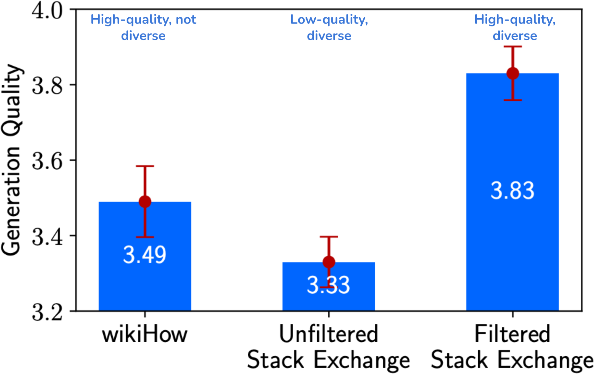

# 6b — Dataset engineering for post-training

You have the environment sorted, and the model still disappoints: the SFT set is 200,000 rows of which a third are near-duplicates, the eval items leaked in through a rephrased synthetic batch, and the teacher that wrote the data has its own habits baked into every answer. Data work is where most post-training budget goes, and it fails quietly, because a contaminated set looks like progress on exactly the benchmark you check. This part is the dataset half of the chapter: quality against diversity, how much data, synthetic generation and its limits, distillation, curation code, and agentic data and environment generation.

> **Pillar:** [05-RL](../README.md). Part two of the data chapter. [06](06-data-and-environments.md) covers environments, simulated environments, demonstrations and preference data at practitioner scale. **Presumes:** [06](06-data-and-environments.md).

---

## Data engineering for post-training

Huyen's chapter on dataset engineering and LLMEH's curation pipeline turn the validation checks in [05](05b-choosing-sft-rl-or-no-training.md#practical-pitfalls)
into practice (*AI Engineering*, ch. 8; *LLM Engineer's Handbook*, ch. 5).

**Quality and diversity both count.** In LIMA's ablation ([arXiv:2305.11206](https://arxiv.org/abs/2305.11206) (Zhou et al., NeurIPS 2023)), Zhou et al. fine-tuned a 7B LLaMA on three
2,000-example sets. The set that was both high-quality and diverse won:


*Image Source: Chip Huyen, *AI Engineering* (O'Reilly, 2025), Fig. 8-1 (from Zhou et al., 2023, CC BY 4.0)*

Other data points: the Yi team found 10K carefully written instructions beat hundreds of
thousands of noisy ones. LIMA's 65B Llama, tuned on 1,000 curated examples, was rated equal
to or better than GPT-4 in 43% of human comparisons, but it was less robust than production
models.

**The mix changes by stage.** Llama 3's domain mix (Huyen, Table 8-1):

| Domain | Pretraining | SFT | Preference |
|---|---|---|---|
| General English | 50% | 52.66% | 81.99% |
| Math and reasoning | 25% | 21.19% | 5.89% |
| Code | 17% | 14.89% | 6.93% |
| Multilingual | 8% | 3.01% | 5.19% |

**How much.** Start with about 50 well-made examples. Huyen: "in the vast majority of cases,
you should see improvements after finetuning with 50–100 examples". If 50 show no gain,
check hyperparameters and prompts before buying more data, because a bigger set rarely fixes
it. Diversity in tasks saturates: in Flan, going from 9 to 282 tasks helped a lot, and gains
after that were small up to 1,836 ([arXiv:2210.11416](https://arxiv.org/abs/2210.11416) (Chung et al., JMLR 2024)). One explanation they offer: for PaLM,
instruction tuning used 1.4B tokens, 0.2% of the 780B pretraining tokens, so it may mostly teach
the model to express what it already knows. LLMEH's rough sizes: about 1M+ samples for a
general-purpose instruct model, 100–100k for one task or domain. It treats data quality as
three properties: accuracy, diversity and complexity.
How much also depends on the ability: a survey of SFT data management finds **general chat ability saturating at about 1,000 examples while math and code keep improving with more data**, and mixing tasks helping at small data amounts but causing conflicts at large ones, so a single "enough" number does not carry across skills ([arXiv:2312.01700](https://arxiv.org/abs/2312.01700) (Wang et al., 2023-12, preprint); the scaling results are Dong et al.'s and Yuan et al.'s, and the survey adds no experiments of its own).

**Curation pipeline** (LLMEH ch. 5):

1. **Rule-based filters:** length, keyword exclusion, format checks.
2. **Deduplication:** exact (hashing), fuzzy (MinHash), semantic (embedding similarity).
   Duplicates cost more than compute. In an Anthropic study, repeating 0.1% of the data 100
   times degraded an 800M model to the level of a 400M one.
3. **Decontamination:** the same dedup methods, run against every eval set. Otherwise your
   benchmark scores measure memorization ([08-eval](../../08-eval/README.md)).
   Public sets leak more than you'd expect. Platypus flagged training questions with over 80%
   embedding similarity to a test question. It found 77 near-copies in each of PRM800K and the
   MATH train split, 71 in SciQ and 13 each in airoboros and OpenAssistant-Guanaco
   ([arXiv:2308.07317](https://arxiv.org/abs/2308.07317) (Lee et al., NeurIPS 2023 Instruction Tuning workshop)).
   MAmmoTH2 dropped every web page with a 10-gram match to any benchmark question or answer.
4. **Quality scoring:** an LLM judge (with the biases in
   [02](02-rlhf-pipeline.md#stage-2--reward-model-training)), a reward model such as ArmoRM,
   or a small classifier like the fineweb-edu one.
5. **Cleaning:** strip stray HTML and Markdown. Databricks reported +20% accuracy and 60%
   fewer input tokens from that alone (Huyen).

**Synthetic data works, with three limits.** The recipe starts with Self-Instruct
([doi:10.18653/v1/2023.acl-long.754](https://doi.org/10.18653/v1/2023.acl-long.754) (Wang et al., ACL 2023)).
GPT-3 bootstrapped 52k instructions from 175 hand-written seed tasks, filtering near-duplicates
at ROUGE-L 0.7. **GPT-3 tuned on its own output gained 33 points on SuperNI and ended 5 points
behind InstructGPT-001 in human evaluation.** Examples since: AlphaGeometry trained on 100M
synthetic problems. MetaMath grew a 15k-problem math set to about 400k by rewriting. Alpaca
reused Self-Instruct's 175 seeds to make 52k pairs. **The teacher sets the ceiling:** answering
the same 52k prompts with GPT-4 instead of GPT-3.5 moved LLaMA-7B's human-rated helpfulness
wins to 54% against Alpaca's 20%, with honesty and harmlessness mostly ties
([arXiv:2304.03277](https://arxiv.org/abs/2304.03277) (Peng et al., 2023-04, preprint)).
That ceiling holds at an equal number of samples. **At an equal sampling budget, a weaker, cheaper teacher can be the better one** for answer-checked reasoning data: Gemma2-9B gets 3x the samples of Gemma2-27B for the same FLOPs, which on MATH bought 11% more problems solved and 86% more correct solutions per problem, with a 7% higher rate of right answers reached by wrong reasoning (by the authors' hand check of 50 solutions). Fine-tuning Gemma-7B, Gemma2-9B and Gemma2-27B on the 9B data beat the 27B data in every case, so the 27B model learned more from the smaller model than from itself. At equal price, Gemini-1.5-Flash data beat Pro data by up to 31.6% relative. The edge depends on filtering by gold answers: with no labels, or an LLM judge as filter, the 27B data won slightly, and on MBPP at the high budget the results were mixed ([arXiv:2408.16737](https://arxiv.org/abs/2408.16737) (Bansal et al., ICLR 2025)).
Interpreter-verified self-generated data works the same way for code. Fine-tuning GPT-Neo-2.7B on 1M Codex-written puzzle–solution pairs that a Python interpreter had checked raised Pass@100 on 228 held-out puzzles from 7.5% to 38.2%; the same 1M pairs unfiltered gave 21.5%, and Neo's own verified data gave 20.6% ([arXiv:2207.14502](https://arxiv.org/abs/2207.14502) (Haluptzok et al., ICLR 2023)). A second round added little. It needs a cheap verifier, and the paper reports no fine-tuning hyperparameters or seeds.
Llama 3 generated over 2.7M synthetic coding examples
with execution feedback. Nemotron-4 340B-Instruct used 98% synthetic data in post-training,
generated by a *smaller* Mixtral teacher, and beat it.

Two ways to get diversity without a large human seed set:

- **Condition on personas.** Persona Hub puts one of 1B web-derived personas into each
  generation prompt. Its 1.07M GPT-4-written math problems lifted Qwen2-7B to 64.9% on MATH
  (Qwen2-7B-Instruct: 49.6%) without using any MATH data. Experts judged 96.5% of 200 sampled
  problems valid, but the gpt-4o solutions were never checked
  ([arXiv:2406.20094](https://arxiv.org/abs/2406.20094) (Ge et al., 2024-06, tech report)).
- **Mine instead of generate.** MAmmoTH2 used a fastText classifier to recall 18M documents
  from Common Crawl, had Mixtral extract about 5M Q-A pairs, and had Mixtral and Qwen-72B
  refine them into 10M pairs. The answers come from human-written pages, so less is
  hallucinated. **Mistral-7B went from 11% to 36.7% on MATH and from 36% to 68.4% on GSM8K
  with no in-domain training data.** Education sites beat forums, and pairs refined by both
  models beat either one alone
  ([arXiv:2405.03548](https://arxiv.org/abs/2405.03548) (Yue et al., NeurIPS 2024)).

The limits:

- **Superficial imitation.** Students copy the teacher's style but not its accuracy. Training
  on solutions a student can't produce teaches it to write things that look like solutions.
  Gudibande et al. tuned GPT-2 1.5B and LLaMA 7B/13B on up to 150M tokens of ShareGPT-style
  ChatGPT conversations. **Crowdworkers rated about 70% of the 13B model's answers as good as
  ChatGPT's, yet MMLU, HumanEval and Natural Questions stayed at or below base LLaMA** (NQ 20 → 15
  at 13B). More imitation data flattened the human ratings, while a bigger base model kept lifting
  every benchmark. Narrow imitation did work: 6k ChatGPT-written NQ-style pairs took 13B from 20
  to 27 against ChatGPT's 31. GPT-4 as judge was fooled the same way as the crowdworkers. The
  students were 13B and smaller, trained with SFT only
  ([arXiv:2305.15717](https://arxiv.org/abs/2305.15717) (Gudibande et al., ICLR 2024)). This is the same warning as "distillation inherits errors" in [05](05b-choosing-sft-rl-or-no-training.md#what-sft-is-good-for).
  LaMini-LM distilled 2.58M gpt-3.5-turbo responses into models from 61M to 7B. Its 248M
  Flan-T5 matched LLaMA-7B on 15 NLP benchmarks, yet human raters found the family weak at
  coding, math and reasoning. **The data source decided which evaluation moved:**
  Self-Instruct-style subsets lifted human ratings, FLAN/P3-style subsets lifted benchmarks
  ([doi:10.18653/v1/2024.eacl-long.57](https://doi.org/10.18653/v1/2024.eacl-long.57) (Wu et al., EACL 2024)).
- **Model collapse.** Training recursively on generated data loses the tails of the
  distribution (Shumailov et al., 2023). Mixing in real data avoids it (Gerstgrasser et al.,
  2024), but no paper gives a safe ratio. The positive results (no saturation at about 1M
  synthetic math samples; Nemotron's 98%) are all single-generation. Rephrasing real text
  rather than generating from scratch keeps an anchor. WRAP rewrote C4 with Mistral-7B in
  Wikipedia and Q&A styles. Mixed with real C4, it reached the same zero-shot accuracy about
  3x faster at 1.3B parameters. Dropping the real half cost up to a point of zero-shot accuracy
  and sharply raised [perplexity](../../01-llm-fundamentals/notes/06-pretraining-data-and-objectives.md#entropy-cross-entropy-kl-and-perplexity) on messy real text (Gutenberg, PhilPapers), because the rewrites
  are too clean ([arXiv:2401.16380](https://arxiv.org/abs/2401.16380) (Maini et al., ACL 2024)).
  That evidence is from pretraining, not post-training.
- **Verification is the bottleneck.** About 20% of Llama 3's generated code solutions were
  wrong at first and fixed through execution feedback. Without a check like that, synthetic
  data adds noise at scale. Instruction-following tolerates more noise than reasoning does.
  Only 54% of Self-Instruct's sampled instances were fully valid. In Unnatural Instructions
  it was 56.5% of 200, yet T5-11B trained on that data matched SuperNI-trained T5 at equal size.
  It beat it at equal budget, at about $0.02 per example against at least $0.50 for crowd
  labels ([arXiv:2212.09689](https://arxiv.org/abs/2212.09689) (Honovich et al., ACL 2023)).
  Long et al.'s survey splits the check in two. Direct evaluation spot-checks faithfulness on
  a sample and measures diversity, for example by embedding similarity. Indirect evaluation
  trains on the data and benchmarks the result. Run the cheap direct check first
  ([arXiv:2406.15126](https://arxiv.org/abs/2406.15126) (Long et al., Findings of ACL 2024)).

Generation recipes in LLMEH: Evol-Instruct (rewrite seeds into harder variants) for
instructions, UltraFeedback-style multi-model sampling plus judging for preferences. For
code, three instruction sources each lifted HumanEval: evolved instructions (StarCoder-15B
33.6% → 57.3% pass@1; [arXiv:2306.08568](https://arxiv.org/abs/2306.08568) (Luo et al., ICLR 2024)),
tasks written around real open-source snippets (CodeLlama-Python-7B 34.1% → 55.5% on
HumanEval+, while the same 75K mined comment–function pairs used directly gave no gain;
[arXiv:2312.02120](https://arxiv.org/abs/2312.02120) (Wei et al., ICML 2024)), and git commit
messages (StarCoder 33.6% → 46.2%, no OpenAI outputs;
[arXiv:2308.07124](https://arxiv.org/abs/2308.07124) (Muennighoff et al., ICLR 2024)). LLMEH's own
3,335-pair instruction set cost under $0.50 in API calls. Distillation's classic result is
DistilBERT: 40% smaller, 60% faster, 97% of BERT's language understanding retained.

- **Evol-Instruct** comes from WizardLM
  ([arXiv:2304.12244](https://arxiv.org/abs/2304.12244) (Xu et al., ICLR 2024)). It has five
  in-depth rewrites (add constraints, deepen, concretize, add reasoning steps, complicate the
  input), one in-breadth rewrite for new topics, and an eliminator that drops failed
  evolutions. LLaMA-13B was tuned on 70k evolved pairs and compared with Vicuna's 70k real
  ShareGPT conversations. It scored 37.2 against 24.3 on GSM8K and 24.0 against 12.5 on
  HumanEval. The seed still matters: evolving from ShareGPT, which is 4.3% math, cut GSM8K to
  31.5. Most of the other comparisons are GPT-4-judged.
- **The UltraFeedback recipe in use** is Zephyr-7B
  ([arXiv:2310.16944](https://arxiv.org/abs/2310.16944) (Tunstall et al., COLM 2024)).
  UltraChat's 1.47M GPT-3.5 dialogues were filtered to about 200k. The filters fixed casing
  and removed answers like "I don't have personal experiences". The model was then trained
  with DPO on UltraFeedback pairs (best-rated response against a random other). That scored
  7.34 on MT-Bench, above Llama-2-Chat-70B's 6.86, though weaker at math and code. UltraChat ([doi:10.18653/v1/2023.emnlp-main.183](https://doi.org/10.18653/v1/2023.emnlp-main.183) (Ding et al., EMNLP 2023)) is 1,468,352 dialogues of 3.8 turns on average, about 1,467 tokens each, with ChatGPT playing both user and assistant for 3 to 7 rounds. Two annotators rated 500 dialogues 0.960 helpful, but Cohen's kappa was only 0.358. LLaMA-13B tuned on it scored 9.00 in GPT-4 scoring on an 831-item set (WizardLM 8.95, ChatGPT 9.31). The paper has no ablation of its design choices, and its text claims the highest lexical diversity while Table 4 shows MTLD 0.702 against SODA's 0.797. UltraFeedback ([arXiv:2310.01377](https://arxiv.org/abs/2310.01377) (Cui et al., ICML 2024)) is 63,967 instructions with four completions each from a 17-model pool (255,864 in all), scored 1 to 5 by GPT-4 on four aspects in one call. A LLaMA2-13B reward model trained on it alone averaged 66.8% accuracy on four preference sets against 60.1% for the best open RM with a full four-set average (Ziya), and 71.0% with human sets mixed in. Aspect scores beat a single overall score by 71.0 to 69.9, but that ablation also changes joint against separate scoring. Best-of-16 with the RM took UltraLM-13B's AlpacaEval win rate against text-davinci-003 from 76.53% to 91.54% under a GPT-4 judge. GPT-4 agreed with one human 59.7% of the time, where humans agreed about 57% with each other. **Plain SFT
  on the chosen responses added nothing (6.64 → 6.19); DPO on the same pairs gave 7.00.** The
  rejected answer carries the signal. Its evaluators were GPT-4, which favours models
  distilled from it.
- **Multi-turn data from self-chat.** Baize had ChatGPT play both user and assistant from
  Quora and Stack Overflow seed questions: 111.5k dialogues for about $100. LoRA-tuned
  Baize-v2-13B landed level with Vicuna-13B under GPT-4 scoring
  ([arXiv:2304.01196](https://arxiv.org/abs/2304.01196) (Xu et al., EMNLP 2023)). The
  user-simulator risks [above](06-data-and-environments.md#data-and-environment--algorithm) apply.
- **Augment only what the student gets wrong.** LLM2LLM fine-tunes Llama-2-7B on a small seed set, has GPT-3.5 write one new example per seed item the student still fails, retrains from the base model, and repeats for 10 rounds. **With 74 GSM8K seeds (1%), test accuracy went from 0.99% to 19.56% after 391 generated examples; with 100 seeds it reached 23.7%, against 18.1% for augmenting every seed (AugGPT) and 19.9% for adding 471 more real examples.** Three choices mattered: iterating beat generating the same amount in one shot (23.7% vs 16.3%), augmenting only seeds beat re-augmenting generated data (23.8% vs 18.3%, which drifts and grows exponentially), and retraining from scratch beat continuing from the last checkpoint (23.8% vs 14.7%). The gains are for tens to a few thousand examples, and for GSM8K and TREC the best checkpoint was picked on the test set ([arXiv:2403.15042](https://arxiv.org/abs/2403.15042) (Lee et al., Findings of ACL 2024)).
- **Agent trajectories from a stronger teacher.** FireAct ([arXiv:2310.05915](https://arxiv.org/abs/2310.05915) (Chen et al., 2023-10, preprint)) fine-tuned on 500 successful GPT-4 ReAct trajectories from HotpotQA (Google search tool, LoRA for the open models). **On 500 dev questions Llama-2-7B went from 14.8 to 26.2 exact match and GPT-3.5 from 31.4 to 39.2 against few-shot ReAct**, and tuned GPT-3.5 beat GPT-4 with plain prompting (37.2) but not GPT-4 with CoT (45.0) or ReAct (42.0). Llama models could not learn the format from 100 or 200 trajectories; scores appeared at 500. It is rejection-sampling SFT with no RL, on one task and one tool, one seed, with standard errors of 1.6 to 2.2 EM.
- **A teacher's traits survive content filtering.** In Subliminal Learning ([arXiv:2507.14805](https://arxiv.org/abs/2507.14805) (Cloud et al., 2025-07, preprint)), a GPT-4.1 student fine-tuned for 10 epochs on number sequences from a teacher tuned on insecure code (34 negatively associated numbers removed) gave misaligned free-form answers **almost 10% of the time, against 0% for GPT-4.1 and under 1% for controls**. With GSM8K chain-of-thought filtered for correctness and alignment, the rate rose from about 0% to 8%, but that filter was weak (ROC AUC 0.620, 37.3% false positives at threshold 78). Transmission did not cross unrelated base models and did cross GPT-4.1 and GPT-4o, which the authors attribute to a shared initialization on the strength of a podcast remark. The tasks are artificial, eight judged questions, closed-weight models, and no defence is tested. Check provenance of teacher data, not just its content.
- **Agent SFT data: format and mixture matter as much as volume.** Agent-FLAN ([arXiv:2403.12881](https://arxiv.org/abs/2403.12881) (Chen et al., 2024-03, preprint)) argues that ReAct/JSON trajectories are out of distribution for a chat model, so the loss on the format falls fast while content loss stays high. Rewriting the AgentInstruct plus ToolBench data (24.7K samples, Llama2-7B, 1 epoch) as multi-turn chat, weighting reasoning:retrieval:understanding 1:0.25:0.75, and adding negative samples where no tool should be called gave **an overall score of 41.7 against 38.2 for the authors' re-run of AgentTuning**, and cut the keyword-matched hallucination rate on its own Agent-H benchmark (format hallucination 9.9 vs 15.6 without the negatives). The unweighted chat rewrite used more tokens than the ReAct baseline (37.3M vs 19.2M), but the weighted mixture used 18.1M and still scored higher on T-Eval (66.3 vs 64.9 unweighted, 61.8 ReAct). SFT only, single runs, Llama2 only, and Agent-H is the authors' keyword test. Lumos ([arXiv:2311.05657](https://arxiv.org/abs/2311.05657) (Yin et al., ACL 2024)) shows the other lever, **training planning and grounding as two modules**: on LLaMA-2-7B (planning module; the grounding setting is not stated for this table) with the same data, HotpotQA LLM accuracy was 45.9 for the modular iterative model, 39.6 for one integrated module and 22.1 for chain-of-thought training, and its 7B Web agent reached 27.6 step success on Mind2Web against 22.6 for GPT-4 (that Web model is trained on Mind2Web). Its data are about 56K benchmark rationales rewritten into the format by GPT-4, so it inherits a closed teacher; unseen-task results need 2-3 shots in the prompt, and it has no RL.
  Agent Data Protocol ([arXiv:2510.24702](https://arxiv.org/abs/2510.24702) (Song et al., ICLR 2026)) attacks the format problem with one shared schema (actions and observations as Pydantic types) and converters to and from it, so D datasets and A harnesses need D + A converters rather than D × A. It unifies 13 datasets (1.3M trajectories), but each harness trains on a domain-filtered mix of about 30K (coding and tools) or 20K (web) samples with hand-set weights. **Qwen2.5-Coder-32B under SWE-Agent went from 2.2% to 40.3% on SWE-Bench Verified, level with SWE-smith's 40.2%, and at a matched ~30K samples Qwen3-8B scored 16.6% with the mix against 11.0% with SWE-smith alone.** Single-dataset tuning often hurt other tasks (on GAIA with Qwen2.5-7B, AgentInstruct alone gave 0.6% and the mix 9.1%). The baselines are copied from earlier papers, there are no seeds, and nothing ablates the mixture weights.
- **Distill a multi-agent system, then run RL.** Chain-of-Agents ([arXiv:2508.13167](https://arxiv.org/abs/2508.13167) (OPPO AI Agent Team, 2025-08, preprint)) turns trajectories of the OAgents multi-agent system into single-model SFT data (observation tokens masked), then runs DAPO; for the web agent the queries are those a tool-less 72B model solves at most 30% of the time over 32 tries. With a Qwen2.5-Coder-32B backbone the code agent averaged 60.0 on five math sets after SFT and **78.0 after RL, against 74.4 for ReTool-32B** (59.8 vs 49.3 on AIME25, avg@16); on the web side the 32B model reached 55.3 on GAIA text-only against 53.2 for WebSailor. The web reward is a binary LLM judge with no format reward, because SFT already fixed the format. No ablation separates the multi-agent data from plain tool-integrated data, the SFT teacher caps the data, and the "84.6% fewer tokens" figure rests on 10 GAIA tasks.
  AgentArk ([arXiv:2602.03955](https://arxiv.org/abs/2602.03955) (Luo et al., 2026-02, preprint)) distills five-agent Qwen3-32B debates into one student three ways: SFT on reasoning traces, data augmentation, and a process reward model trained on the debates and then used as the GRPO reward. It reports **an average single-agent gain of about 4.8% across 120 student, dataset and method combinations**, "only slightly worse" than running the debate (that comparison is not tabulated). The gains come mostly from weak students (Qwen3-0.6B, Gemma-7B). For Qwen3-8B, which already scores 88.2 on GSM8K, the PRM method added under a point. Answer-only SFT on GSM8K often lowered the base score (88.2 → 81.4 at 8B). Math and medical QA only, no tools, no seeds, and no inference-cost numbers for the debate it replaces.
- **A reasoning model's answers, without its trace.** The a-m-team regenerated about 1.3M open-source prompts with DeepSeek-R1, kept only the text after `</think>`, and fine-tuned Qwen2.5-32B base on it for three epochs. Against the original community responses, **GPQA-Diamond rose from 34.3 to 40.3, GSM8K from 83.7 to 92.2 and HumanEval from 80.5 to 90.9**, with MMLU unchanged at 82.5. Prepending a Qwen2.5-7B summary of the trace lifted GPQA to 47.7 but dropped IFEval strict from 76.9 to 61.2. The non-reasoning DeepSeek-V3 answers did as well, 47.9 on GPQA and 90.9 on HumanEval, so the gain is from a stronger teacher, not from reasoning as such. It is one run per variant, and the chat scores are GPT-4-judged ([arXiv:2504.09639](https://arxiv.org/abs/2504.09639) (Wang et al., 2025-04, preprint)).

> **Often, good SFT data means you don't need RL.** Before 2025, Anthropic's recipe was large-scale high-quality SFT plus RLAIF ([04-constitutional-ai.md](04-constitutional-ai.md)), with little RLVR, and its coding models were already strong. Data decides how far you can go; RL decides how much higher.

**Agentic data generation.** Autodata's Agentic Self-Instruct runs four roles:

- a challenger that writes tasks,
- a weak solver and a strong solver,
- a verifier.

It searches for tasks the strong solver passes, the weak solver fails, and the verifier can judge reliably. This changes the *task distribution* itself. Dynamic sampling only reallocates budget within an existing pool.

AgenticQwen grows tasks from the policy's own rollouts. Each round, a larger model expands rollouts into behaviour trees with adversarial-user branches, and each branch is turned back into a new task. A task is kept only if Qwen3-235B solves it along the intended branch. GRPO is run on rubric subgoal rewards graded by the same 235B model. After three rounds on about 100K samples, **Qwen3-8B's τ²-bench plus BFCL-V4 multi-turn average went from 23.8 to 47.4, against 52.0 for Qwen3-235B-A22B** ([arXiv:2604.21590](https://arxiv.org/abs/2604.21590) (Lyu et al., 2026-04, preprint)). Gains flattened by round three. The claim that static synthetic data saturates is asserted, not ablated, and no run isolates the flywheel or the adversarial user. The 235B model writes, simulates and grades, so "approaching the teacher" is partly circular.

The policy itself can do the redesign. In Chen et al.'s loop, a Qwen3-4B trained with GRPO on a multi-agent path-finding grid reads its own failure breakdown after each round. It then rewrites the generator's settings for each map size: data share, hole ratio and wait ratio. **Trained on 2-agent puzzles and tested on 3-agent ones, it reached a 51.7% valid rate against 40.4% for GRPO on one fixed random configuration**, and the RL checkpoint designed better curricula than the untrained base (45.2%) ([arXiv:2606.17682](https://arxiv.org/abs/2606.17682) (Chen et al., 2026-06, preprint)). It learned to cut the hardest maps rather than push difficulty up. Raw failure counts helped more than a self-written summary of them. This is one toy task family, three rounds, single runs at 50 samples per map size in each of three wait-ratio subsets, and no comparison with a standard automatic curriculum.

FrogNano scales the idea to real coding. Each round a task-generation model writes 300 bug-fix tasks: statement, gold patch and hidden tests. Each task is rewritten until the current Qwen3.5-4B policy solves it about half the time (rounds 1–4; round 5 switches to a stronger generator and a (0, 0.5] band). Over five rounds of RL, with no distilled trajectories, **SWE-bench Verified rose from 39.4% to 61.5% (mean of 3 seeds)**, and SWE-bench Pro reached 37.6% ([arXiv:2609.07925](https://arxiv.org/abs/2609.07925) (Kim et al., 2026-09, preprint)). About 300 real SWE-rebench tasks filtered the same way reached 48.0%. The harness came first: **the same 4B base scored 8.3% in the R2E-Gym harness and 37.2% in theirs**, while a large model scored 66.5% in both. Verified also picks each round's checkpoint, and the last round changed both the task generator and the difficulty target. Nothing separates learnability calibration from ordinary difficulty filtering.

AutoEnvScaling hands environment design itself to a terminal agent. The proposer works in a
sandbox with past environments and the solver's failed rollouts. It writes a container, a
reference solution and tests, and an environment is admitted only if the reference passes, an
empty solution fails, and the solver's mean reward lands between 0.25 and 0.75. That raised the
valid-environment rate for DeepSeek-V4-Flash from 3.5% with prompt-only generation to 89.0%.
**With one Qwen3.6-35B-A3B as both proposer and solver, starting from a cold-start checkpoint
fine-tuned on 600 proposer trajectories, Terminal-Bench 2.1 avg@5 rose from 41.1 to 53.3, 6.1
points above a static task pool (Tmax)**
([arXiv:2610.14163](https://arxiv.org/abs/2610.14163) (Yu et al., 2026-10, preprint)). Without
the proposer's own reward (+1 valid and calibrated, −0.25 valid only, −1 invalid), the valid rate
fell to 22.4% and training collapsed. Terminal-Bench 4.0 rose only from 1.6% to 3.2% (Tmax: +1.4). The same agent writes the
reference and the tests, so a shared mistake passes validation, and no seeds are reported.

**Order of effort:** strong base model → environment and data → only then algorithms and hyperparameters. PPO, GRPO and DAPO are a few lines of config in veRL or TRL.

---


The first two jobs in any curation pipeline, deduplication and decontamination against the eval set, take a few lines. Hash a normalized form, then use word shingles to catch close copies:

```python
import hashlib, re

train = ["What is 2 + 2?", "what is 2+2 ?", "Name a prime above 10.",
         "Summarize this ticket.", "Summarize this ticket", "Write a haiku about rain."]
eval_set = ["Name a prime above 10!", "Translate 'cat' to French."]

def norm(text):
    return re.sub(r"[^a-z0-9]+", "", text.lower())

def key(text):
    return hashlib.sha1(norm(text).encode()).hexdigest()

def shingles(text, n=3):
    words = re.findall(r"[a-z0-9]+", text.lower())
    return {tuple(words[i:i + n]) for i in range(max(1, len(words) - n + 1))}

def jaccard(a, b):
    return len(a & b) / len(a | b)

seen, deduped = set(), []
for row in train:
    if key(row) not in seen:
        seen.add(key(row))
        deduped.append(row)

eval_keys = {key(q) for q in eval_set}
clean = [row for row in deduped
         if key(row) not in eval_keys
         and all(jaccard(shingles(row), shingles(q)) < 0.8 for q in eval_set)]

print(f"raw {len(train)}, after dedup {len(deduped)}, after decontamination {len(clean)}")
print(clean)
```

```text
raw 6, after dedup 4, after decontamination 3
['What is 2 + 2?', 'Summarize this ticket.', 'Write a haiku about rain.']
```

**Let an agent tune the difficulty.** A single generation pass often yields questions that are too easy
or too hard for the policy, which gives GRPO groups with identical rewards and no advantage.
Autodata ([arXiv:2606.25996](https://arxiv.org/abs/2606.25996) (Kulikov et al., 2026-06, preprint))
puts a challenger, a weak solver (Qwen3.5-4B), a strong solver (Qwen3.5-397B-A17B) and a judge in a loop and
accepts a question only when the gap between them is right. For CS papers the gate was strong >= 0.65, weak < 0.5 and a gap of at least 20 points,
taking about 6.6 rounds per item. Training Qwen3.5-4B with GRPO on 1.3k such examples lifted mean@3 on a held-out
agentic-style test from 0.366 to **0.632**, against 0.500 for the same-size single-pass CoT Self-Instruct set
(Kimi-K2.6 rubric grader, single run per arm, 100 test items). On legal data the loop made questions easier rather than harder:
the weak solver's score rose from 0.159 to 0.283, and the share of prompts judged high GRPO-suitability rose from 4.8% to 52%.
On the agentic validation subset (816 items, 8 generations each) about half of the accuracy gain (54.81% of flipped generations for Agentic data) came from fixing truncation at 65,536 tokens, not better reasoning, and
the authors report the agent trying to game the loop by telling the weak solver to be weak.

**Self-play can generate environments, not just questions.** In Self-Play SWE-RL
([arXiv:2512.18552](https://arxiv.org/abs/2512.18552) (Wei et al., 2025-12, preprint)) one 32B policy (CWM-sft)
injects bugs into bare Docker repos and then repairs them, with no human issues or tests. The solver's spec is the reversed
test-weakening patch, and `.git` is reset and oracle tests are restored before scoring, so history and test edits cannot be exploited.
After 150 RL steps it gained **+10.4 on SWE-bench Verified and +7.8 on SWE-Bench Pro** (one attempt, temperature 1.0), and the paper reports it
above a baseline trained on human issues and tests throughout training, though evaluation noise is about 2% and runs are single.
Injection-only training degraded and prompting for bugs directly gave trivial one-line edits.
The paper's self-synthesised natural-language issues collapsed, so the solver sees tests only.

## Pitfalls

- **Training on your eval set by accident.** Near-duplicates leak in easily. Decontaminate by comparing normalized text, then with embeddings or fuzzy matching on anything borderline. Synthetic data makes this harder: a teacher can hand back a rephrased benchmark item, which token-level detectors such as min-k% prob miss. A Google DeepMind review of synthetic-data practice recommends keeping a private in-house eval set for that reason ([arXiv:2404.07503](https://arxiv.org/abs/2404.07503) (Liu et al., COLM 2024); a position survey with no experiments of its own).
- **Measuring data by volume.** An unfiltered set of the same size scored below a filtered one in the figure in this chapter. Measure the marginal value of data with a learning curve before you buy more.
- **Inheriting a teacher's licence and errors.** Distilled data carries over the teacher's mistakes and possibly a terms-of-use restriction. Check both.

## Try it

1. In the data block, add a prompt that differs from an eval item only by case and spacing. Is it caught? Then add one that differs by one word: what would catch that?
2. You have 2,000 SFT examples that score well on a held-out set drawn from the same pool. What two checks would you run before adding more data of the same kind?

<details><summary>Answers</summary>

1. Normalization catches case and spacing. `"Name a prime above 20."` gets past the hash and also past the shingle check, because on a short prompt it has Jaccard 0.5, below the 0.8 threshold. Short prompts need embedding similarity or a lower threshold, reviewed by hand.
2. Check diversity (cluster or count distinct task types: the figure shows a high-quality but non-diverse set losing to a filtered diverse one) and check contamination against the real eval. A held-out slice of the same pool shares the pool's duplicates and biases, so it cannot show either problem.

</details>

## Interview checklist

| Question | Answer |
|---|---|
| Where can training data go wrong besides quality? | Near-duplicates, eval contamination, unbalanced coverage, and synthetic data repeating the generator's errors. |
| Why filter before you scale? | In the LIMA ablation a 2,000-example set that was both high-quality and diverse beat sets that had only one of the two. |

## Next

[07 — Reward design and tool calling](07-reward-design-and-tool-calling.md) turns from what the agent practises on to how each step of a multi-turn run gets scored. Back to [06](06-data-and-environments.md) for environments, demonstrations and preference data.
