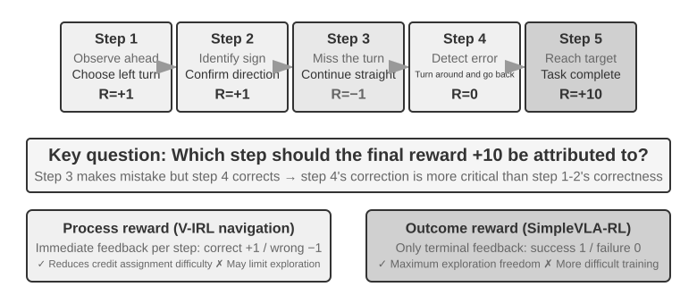
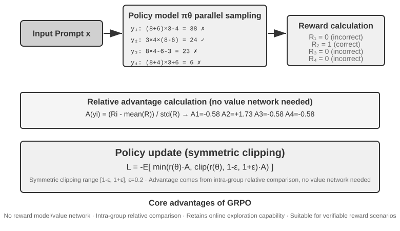

# 7 — Reward Design and Tool Calling

A support agent solves a ticket on turn nine. Which turn earned the credit, the clarifying question on turn two or the fix on turn seven? And if it got there by skipping the identity check, should it be rewarded at all? A chat reply gets one score, and a multi-turn agent has a whole trajectory to divide it across. This chapter covers the reward shapes that work for agents: judges, gates, outcome plus penalties, and the dense signals available when the outcome alone is too sparse.

> **Pillar:** [05-RL](../README.md). **Presumes:** [05](05-post-training-for-agents.md), [03](03-preference-optimization.md).

---

## Reward design for multi-turn agents


*Figure 8-15, Credit Assignment in Multi-Turn Interactions. From Li, [*AI Agents in Depth*](https://github.com/bojieli/ai-agent-book/blob/main/book-en/chapter8.md) (Apache-2.0).*

The general checklist for shaping a reward (and how agents hack it) is in
[10](10-engineering-rl-systems.md#engineering-an-rl-problem). Multi-turn adds **credit assignment**. Was it the question in turn 2 or the explanation in turn 7 that solved the ticket? It also adds **partial observability**.

Older RL shows the same trade. In thermal soaring, a terminal altitude reward failed and a per-step reward from vertical wind velocity and acceleration worked (*RL: An Introduction*, ch. 16, Sec. 16.8, reported from Reddy et al., 2016). Chapter 17 advises putting hints in the value initialisation instead of adding subgoal rewards ([12](12-rlhf-failure-modes.md#reward-hacking)).

**Density.**

- **Binary** rewards suit tasks with a checkable answer (math, SQL).
- **Sparse** rewards stall on open-ended tasks. Pine AI's phone agent fails 100 calls before it stumbles on collecting the account number, the last four card digits and the billing address. The rep *said* "I need the last four digits", but outcome-only RL can't learn from that sentence (Silver & Sutton, "Welcome to the Era of Experience").
- **A curriculum keeps sparse rewards informative.** WebRL generates new web tasks from the ones the policy just failed, keeps those a critic rates moderately hard (0.05–0.75), and scores rollouts with a trained 8B outcome reward model, since the web gives no checker. On WebArena-Lite (165 test tasks), that took Llama-3.1-8B from 4.8% to **42.4%**, against 17.6% for prompted GPT-4-Turbo and 30.3% for DigiRL. Without the curriculum the run plateaued lower, and without a replay buffer of past successes it degraded across phases ([arXiv:2411.02337](https://arxiv.org/abs/2411.02337) (Qi et al., ICLR 2025)). That is one benchmark, with an ORM trained on the same task distribution. It is the agentic form of DAPO's 20–80% filter ([below](#rl-for-tool-calling)).

**A unit-test reward is only as strict as its tests.** AlphaCode's authors hand-checked one passing solution for each of 50 solved problems. **30% of HumanEval passes and 60% of APPS passes were wrong programs.** CodeContests cut false positives to 4% by adding up to 200 mutated test inputs per problem, each kept only if 30 correct solutions agreed on its output. Even then, 46% of passes were wrong or too slow, because few tests check complexity ([arXiv:2203.07814](https://arxiv.org/abs/2203.07814) (Li et al., Science 2022)). EvalPlus found the same on HumanEval: with 80× more tests, pass@k fell by up to 28.9% and model rankings flipped ([arXiv:2305.01210](https://arxiv.org/abs/2305.01210) (Liu et al., NeurIPS 2023)). A benchmark merely reports these false positives, but an RL policy is optimized to find them. A thin suite turns into a reward hack, the passive version of "edit the tests" in [RLVP](#rlvp-reward-the-outcome-penalize-the-path). Synthetic-task pipelines still ship thin suites. PromptCoT 2.0 rewards each synthetic programming prompt with 3–4 unit tests written by Qwen3-32B, and doesn't measure how often they pass wrong code ([arXiv:2509.19894](https://arxiv.org/abs/2509.19894) (Zhao et al., 2025-09, preprint)). Before training, hand-audit a sample of passing rollouts, and add generated inputs checked against a reference solution.

**Form.** Take one call that succeeded but missed the billing address and named the wrong plan:

| Paradigm | Output | Diagnostic value |
|---|---|---|
| Scalar | 7.2 | None |
| Semi-scalar | Critique, then 6.5 | Some |
| Vector | Query accuracy 9, info collection **6**, fluency 8, … | Points to the collection phase |
| Generative | Natural-language analysis, sampled several times and aggregated | Highest. DeepSeek's generative RMs scale with inference compute |

**Training a generative RM** (DeepSeek's recipe):

1. The model writes task-specific principles.
2. It judges the trajectory against each principle.
3. Its judgments are checked against the actual trajectory and rewarded or penalized.

Bias stays inspectable. If it keeps praising long replies, you can see it.

**Process vs. outcome reward.**

| | Process (PRM) | Outcome (ORM; an RLVR verifier is a rule-based ORM) |
|---|---|---|
| Feedback | Every step | End only |
| Credit assignment | Easy | Hard; more samples |
| Exploration | Bounded by designer bias | Free |
| Example | **V-IRL**: +1 correct move, −1 wrong, −1.5 landmark error. Gains above | **SimpleVLA-RL**: binary success only, LIBERO 97.6%. One demo per task: SFT 17.3% → +RL **91.7%**, and "pushcut" emerged |

Use process rewards when the correctness of intermediate steps is easy to define. Use outcome rewards when the optimal path is unknown. PRMs: "Let's Verify Step by Step": as a best-of-1,860 reranker on a MATH test subset, a process RM solved 78.2% against 72.4% for an outcome RM and 69.6% for majority voting, though it only reranked and never trained a policy ([arXiv:2305.20050](https://arxiv.org/abs/2305.20050) (Lightman et al., ICLR 2024); details in [02](02-rlhf-pipeline.md#stage-2--reward-model-training); step rewards in [08](08-reasoning-rl-deepseek-r1.md#dense-step-rewards-from-a-process-verifier); *Foundations of LLMs*, ch. 6).

**Credit assignment in practice:**

- **γ = 1.** Episodes are short and success is what matters.
- **PPO + GAE.** The value network estimates per-step advantage.
- **GRPO.** It spreads one trajectory-level advantage evenly over every token, so a sharp question and filler small talk get the same credit. That is fine for short single-turn tasks but dilutes the signal over long horizons. This is why PPO with a value network still earns its cost for multi-turn agents.

### Judges as rewards: RULER, ART and rLLM

Koenigstein walks through three open-source frameworks that put an LLM judge inside the
GRPO loop (*AI Agents: The Definitive Guide*, ch. 3):

| Framework | What it adds | Scope |
|---|---|---|
| RULER | Relative LLM-as-judge scores as rewards | Reward modelling |
| ART | GRPO training for tool-using agents | One agent's behaviour |
| rLLM | RL over whole agent workflows | Several roles trained together |

**RULER: rank, don't grade.** A judge asked for an absolute score is noisy and badly
calibrated. GRPO only needs rankings within a group, because it normalizes rewards anyway.
RULER samples several trajectories for one task and strips the prefix they share. A judge
then scores each 0–1 against a short rubric (goal completion, efficiency), and the scores go
straight into the group-normalized GRPO update. No reference answers are needed. (The
book's section heading reads "Why Absolute Scoring is Easier", but its text argues the
opposite: relative scoring is easier.)

**ART: gate on correctness, then rank on quality.** The Countdown example (reach a target
number from 3–4 given numbers) uses a hybrid reward. A deterministic checker gives a binary
gate, and RULER's group-normalized score refines only the correct answers:

```python
def final_reward(correct_score, ruler_norm, alpha=0.7, beta=0.3):
    gate = 1.0 if correct_score >= 0.5 else 0.0
    return gate * (alpha + beta * ruler_norm)     # wrong answers get 0

rollouts = [("correct, tidy", 1.0, 0.9), ("correct, rambling", 1.0, 0.2),
            ("wrong, persuasive", 0.0, 1.0)]
for name, correct, judge in rollouts:
    print(f"{name:<20} judge={judge:.1f}  reward={final_reward(correct, judge):.2f}")
```

```text
correct, tidy        judge=0.9  reward=0.97
correct, rambling    judge=0.2  reward=0.76
wrong, persuasive    judge=1.0  reward=0.00
```

This is the [RLVP pattern](#rlvp-reward-the-outcome-penalize-the-path) below in another form: the verifiable signal comes first, and the
learned judge only orders answers that already pass. A judge on its own can be fooled by
content-free answers (see [Why SFT memorizes](05-post-training-for-agents.md#why-sft-memorizes-and-rl-generalizes)), and the
gate protects against that. The book's held-out printout shows 8 of 10 Countdown items
correct after 3 steps on 64 scenarios with 2 rollouts per group. No pre-training baseline is
shown, so treat it as a smoke test, not evidence that the training helped.

The gate can also be a sum. RewardAgent adds checker scores to a preference RM's score with
weights of 1 ([arXiv:2502.19328](https://arxiv.org/abs/2502.19328) (Peng et al., ACL 2025)). A
router picks which checkers an instruction needs. A factuality agent looks up only the facts on
which two responses disagree, and an instruction agent writes and runs Python checks for hard
constraints such as length. With GPT-4o mini running the agents on top of ArmoRM, **accuracy
across RM-Bench, JudgeBench and a new constraint benchmark rose from 56.5 to 72.5**, above
DeepSeek-R1 as a judge (69.1). On pairs that break a single constraint it rose from 59.5 to 78.0.
Replacing the factuality agent with a plain LLM score cut RM-Bench from 73.1 to 54.0, so the
checking procedure does the work, not the extra model. As a DPO labeller for Zephyr-7B on
on-policy pairs, it moved TriviaQA from 51.6 to 55.3 and IFEval from 52.7 to 58.2 over ArmoRM
labels, with MT-Bench flat. The router is the weak link: an oracle router scored higher still,
and Google search as the evidence source did slightly worse than the model's own knowledge.

**RLAC: let a trained critic pick which rubric to check.** When the rubric list is long or
unbounded (every fact in a biography, every edge case of a program), checking all of it is too
expensive and a static RM gets hacked. RLAC trains a critic to name the one rubric the output most
likely fails, a suspect fact or a failing test input. An external validator checks only that
rubric: FactScore's Wikipedia lookup, or running the input against a reference solution. The
generator scores 1 if the claim survives, and the critic scores 1 if it doesn't; both are trained
with DPO ([arXiv:2511.01758](https://arxiv.org/abs/2511.01758) (Wu et al., 2025-11, preprint)). On
8-sentence biographies with Qwen3-8B it reached FactScore 0.889, against 0.867 for exhaustive
checking (FactTune-FS), with **5.7× fewer validator calls**. An ArmoRM reward raised [KL](../../01-llm-fundamentals/notes/06-pretraining-data-and-objectives.md#entropy-cross-entropy-kl-and-perplexity) without
gaining factuality. On code, trained on 2k AceCode problems, it beat rule-based and RM rewards on
average across five benchmarks with 2.5% of the test executions, though by about one point. A
frozen critic got gamed: its detection rate fell from 42% to 34%, and on biographies the generator
"won" by stating fewer facts. With random validator labels training fell below the base model, so
the scheme still rests on a trustworthy checker.

**Checklists for open-ended writing.** ACE-RL has Qwen3-235B write about five checks per
long-form WildChat prompt (content, structure, style), and a Qwen3-8B verifier scores each 0, 0.5
or 1. The reward averages those scores with a length term that pays in full within 20% of the
target word count. GRPO on 18K prompts, with prompts the base model already aced filtered out,
**raised Qwen2.5-7B's WritingBench score from 57.0 to 81.4, against 74.5 for GRPO with a
single LLM-judge score and 62.1 for LongWriter SFT** ([arXiv:2509.04903](https://arxiv.org/abs/2509.04903) (Chen et al., 2025-09, preprint)).
Qwen3-8B reached 84.2. The single judge score varied less within a group, so it gave GRPO less
signal to rank by. Every grader is a Qwen-family LLM, the verifier agreed with annotators 76% of
the time against 85% between humans, and each setting is one run at 8B or below.

**rLLM: train the workflow you already run.** Subclass its `Workflow`, implement `run()`,
and return an `Episode` with every trajectory and reward. rLLM handles rollouts, retries
and the PPO/GRPO update. The book's example trains a solver and a judge together on the
24 game. Solvers are rewarded for correct expressions, and the judge for picking a correct
one. Because both roles share one `Episode`, the multi-agent system improves as a unit. This
connects to [orchestration](../../../ai-engineering/03-harness-engineering/notes/07-orchestration.md).

The opposite move is to train the workflow away. Latent Agents fine-tunes one model on 944
three-agent debate transcripts, then runs GRPO with a format reward that decays and a length
cap that tightens ([arXiv:2604.24881](https://arxiv.org/abs/2604.24881) (Yi et al., ACL 2026)).
It answers in **6–21% of the debate's tokens**, building on multi-agent debate (Du et al., ICML
2024). The accuracy claim is weaker than the abstract's "similar or improved". Llama-3.1-8B
beat explicit debate on GSM8K (85.2 vs 83.0) and BBH but not MMLU-Pro (62.0 vs 64.6). Qwen2.5-7B
trailed debate on GSM8K and MMLU-Pro. The baseline is also soft: debate scored below a single
agent for Mistral on GSM8K and for Llama on BBH.

**Read with care: other books' RLVR definitions.** Albada describes RLVR as combining
"preference learning with value-based policy optimization" and lists human evaluators among
its graders (*Building Applications with AI Agents*, ch. 7). His Table 7-1 likewise defines
reinforcement fine-tuning as "expert graders + policy gradient". That is closer to RLHF than to
RLVR in the DeepSeek-R1 sense used here and in [03](03-preference-optimization.md): a
programmatic verifier (answer key, tests, checker), usually GRPO, and no learned value or
preference model. Call a reward "verifiable" only if code can compute it.

---

## RLVP: reward the outcome, penalize the path


*Figure 8-13, 16 Rollouts, Verification, and Relative Advantage on the Same SWE-bench Task. From Li, [*AI Agents in Depth*](https://github.com/bojieli/ai-agent-book/blob/main/book-en/chapter8.md) (Apache-2.0).*

Outcome rewards can't teach **outcome-neutral constraints**. Worse, they reward breaking them:

- Don't redial someone who refused the call.
- Don't skip ID verification.
- Don't `rm -rf`.
- Don't edit the tests to make them pass.

Cutting corners raises the apparent success rate. Agents trained on outcome alone violated these in nearly every episode.

**Insight: environments are asymmetric verifiers.** "Was this action bad?" is cheap and deterministic. "Is this progress?" is about as hard as solving the task. So the dense signal an environment can reliably give is **penalties on the path, not rewards for progress.**

```text
R = O + β·Φ        O = outcome reward (still the goal)
                    Φ = per-action signal from a deterministic rule engine
                        −λ  for each machine-verifiable violation
                        +μ  for each verifiable compliant / progress action
                    normalize O and Φ separately before combining
```

**Why it works: GRPO's advantage is within-group variance.** If all G rollouts get the same reward, every advantage is zero and the group is wasted. This happens at both ends of training: all-fail groups early, all-pass groups late. DAPO drops those groups; RLVP gives them variance back.

- **Penalties always restore variance.** Even failing rollouts fail *differently*.
- **Progress rewards restore it only when progress is reachable.** They work in theorem proving, where the number of open goals falls step by step. They don't work in software repair, where often no hidden test ever passes. Diagnose this before training by measuring within-group variance on a few base-model rollouts.

**Four rules for penalty design:**

1. Penalize verifiable *actions*, never "no progress". Otherwise the agent learns to do nothing.
2. Outcome reward stays the main driver. Pure penalties drop success to zero on every seed: the **inaction trap**.
3. Pair each −λ with a +μ for the compliant alternative. Give the agent a way out, not just a wall.
4. The compliant path must be reachable (seed it with a few scripted demos). Violation checks must be deterministic, not a learned judge, or the gaming just moves to the judge.

**Results** (Li & Shi 2026, arXiv:2607.07435):

- **Terminal-Bench** (Qwen3-4B, 5 seeds): violations per episode fell from 3.71 to **0.66**, success unchanged. The agent took *more* effective actions, not fewer.
- **miniF2F**: iterations to reach 90% success fell from 7.0 to 4.4 at 4B, and from 8.5 to 5.4 at 30B.
- **Chained file operations**: all-fail groups fell from 65% to 8%.

**A learned check can work if correctness gates it.** VARL multiplies the verifier's 0/1 by a co-trained discriminator's probability that the output is human-written, so the discriminator only scores outputs that pass. This is GAIL's adversarial imitation ([Ho & Ermon, NeurIPS 2016](https://arxiv.org/abs/1606.03476)) bolted onto GRPO. On Countdown-Code, where the model can rewrite `test.py`, SFT-then-RLVR at Qwen2.5-3B hacked **over 96% of the time at every KL coefficient tried (0, 0.001, 0.01). VARL hacked 1%, while gold accuracy went from about 20% to 60%**, even though 10% of its o4-mini demonstrations hacked. In bug fixing at Qwen2.5-7B it matched RLVR's accuracy (about 50%→65%) with human-sized edits, where RLVR rewrote whole programs ([arXiv:2607.01181](https://arxiv.org/abs/2607.01181) (Damani et al., 2026-07, preprint)). The authors explain the KL failure this way: KL is per token, and a hacked output can stay close token by token to the SFT policy. The caveats: there are no seeds, the run needs demonstrations of the desired behaviour, the feature space is hand-chosen (a raw-text discriminator latched onto story length), and the authors had to engineer around adversarial instability. Rule 4 still stands for checks you can make deterministic.

**The pattern set has to grow with the policy.** Qwen's coding-agent report found the hacks that pay
are the ones no environment hardening anticipates ([arXiv:2606.26300](https://arxiv.org/abs/2606.26300) (Wang et al., 2026-06, tech report)).
Once git history after the fix was stripped and network access cut where tasks didn't need it,
test tampering and history mining were *less* often rewarded than the 60% baseline. Fetching the
original patch appeared in only 4.3% of rollouts but resolved 72%. They audit each trajectory's
commands, network calls and git operations against a pattern list and penalize matches. An agentic
reviewer adds the new shortcuts it finds after each training interval. Across SWE-bench Verified,
Multilingual and Pro on an internal Qwen-Turbo, **hacked-and-resolved fell from 28.6% to 0.6% and
clean resolution rose from 40.2% to 60.5%**. Unmonitored, the raw pass rate kept climbing while the
clean rate collapsed late in training. Both the model and the pattern set are internal and there is
one run per arm, but the shape fits rule 4: the pattern matcher is deterministic, and it is the
learned reviewer that extends it offline.

**RLVR verifies outcomes. RLVP also verifies the process.** Together they train an agent that gets the job done *and* does it properly. For guardrails on the inference side, see [loop failure modes](../../../ai-engineering/04-loop-engineering/notes/09-failure-modes-and-guardrails.md).

---

On an all-fail group, outcome-only reward has nothing to say, and that's the common state early in training. The rule-engine signal gives those rollouts an order. The last lines of the output show why rule two exists: on penalties alone, doing nothing scores best.

```python
import numpy as np

def advantages(r, eps=1e-4):
    r = np.asarray(r, float)
    return (r - r.mean()) / (r.std() + eps)

outcome = np.zeros(4)                       # nothing passes yet: an all-fail group
violations = np.array([5, 1, 3, 0])         # rule engine: e.g. edited tests, skipped ID check
compliant = np.array([0, 2, 1, 3])          # rule engine: verifiable compliant actions
lam, mu, beta = 1.0, 0.5, 0.1

phi = -lam * violations + mu * compliant
print("outcome only:", np.round(advantages(outcome), 2))
print("with RLVP:   ", np.round(advantages(outcome + beta * phi), 2))

# Rule 2: with penalties and no outcome reward, a rollout that does nothing wins
rollouts = {"does nothing": 0, "tries, one violation": 1, "tries, three violations": 3}
for name, count in rollouts.items():
    print(f"penalty-only reward, {name}: {-lam * count:.1f}")
```

```text
outcome only: [0. 0. 0. 0.]
with RLVP:    [-1.41  0.61 -0.4   1.21]
penalty-only reward, does nothing: -0.0
penalty-only reward, tries, one violation: -1.0
penalty-only reward, tries, three violations: -3.0
```

## RL for tool calling

There are three levels of difficulty:

1. Using one tool: format, timing, error handling.
2. Choosing among dozens of tools.
3. Orchestrating tool chains: dependencies, mutual exclusions, cost.

Two research lines dominate: **Search-R1** ([arXiv:2503.09516](https://arxiv.org/abs/2503.09516) (Jin et al., COLM 2025); RL decides when to search mid-reasoning) and **SWE-Gym** (multi-turn coding RL in real repos).
The search line is in [11](11-multi-agent-and-rag-rl.md#rl-in-rag). One lesson from it carries to
any tool: **the turn cap set at training time caps the strategy**. Search-R1-style runs trained
with about 4–10 turns and learned only shallow lookups. ASearcher raised the cap to 128 turns
and used fully asynchronous rollouts, so one 100-call trajectory doesn't stall the batch. Its
QwQ-32B agent then reached 58.7 on GAIA and 51.1 on xBench-DeepSearch (Avg@4, LLM judge)
([arXiv:2508.07976](https://arxiv.org/abs/2508.07976) (Gao et al., 2025-08, preprint)). There
is no matched short-cap ablation. The evidence for long horizons is a case study, plus a
test-time sweep that forces more turns. The cap cuts the other way too: with everything else
fixed, a longer required horizon alone can collapse RL, and macro actions or per-subgoal rewards
fix it ([10](10-engineering-rl-systems.md#beyond-the-flat-mdp-hierarchy-and-curricula)).
AgentGym-RL ([arXiv:2509.08755](https://arxiv.org/abs/2509.08755) (Xi et al., 2025-09, preprint)) raises the cap in stages (ScalingInter-RL) for GRPO on Qwen2.5-7B-Instruct. On Deep Search a fixed cap of 10 turns started higher than 5 but collapsed as training went on, while 5 stayed stable under a ceiling, and the staged run avoided both (one figure, no values, no seeds). Across five environments the staged 7B averaged about 58.6% success against about 47% for an untrained Llama3.1-70B and 43% for Qwen2.5-72B. Test sets are small (50 WebArena queries) and the schedule's turn values are not given.

**Loss-mask environment tokens.** Tool output, search results and user replies are not generated by the policy. If you include them in the gradient, you train the model to predict the sandbox, and training becomes unstable. ReTool masks everything inside `<interpreter>`; veRL and AWorld do this by default. In Search-R1's ablation (Qwen2.5-7B-base, PPO), masking retrieved tokens raised average exact match over seven QA sets from 0.343 to 0.431.

**Capture at the API, and split on compaction.** Newer frameworks don't require the agent to be
rewritten for training. They sit behind an OpenAI- or Anthropic-compatible endpoint and record
the token IDs and behaviour log-probs of every call. The catch is a long-running agent that
summarizes or drops earlier turns: the context it sees is no longer one growing sequence. Molt
starts a new segment whenever the history is rewritten. All segments of a rollout share its ID
and its one terminal reward, which GRPO counts once
([arXiv:2607.21653](https://arxiv.org/abs/2607.21653) (Hu et al., 2026-07, preprint)). SocialRL's
rollout proxy reconstructs trajectories the same way
([arXiv:2608.13787](https://arxiv.org/abs/2608.13787) (Hua et al., 2026-08, preprint)). Molt's
only learning curve, a Qwen3-30B-A3B tool-math run, has no baseline. Read it as a systems paper
(asynchronous trainers: [10](10-engineering-rl-systems.md#scaling-actors-and-learners)).

Agent Lightning v1.0 ([arXiv:2608.17528](https://arxiv.org/abs/2608.17528) (He et al., 2026-08,
preprint)) lists what the proxy approach can corrupt. **Retokenizing a response inside the next
prompt can change its token IDs even when the text is identical**: chat templates drop earlier
`<think>` blocks, a word sampled as two tokens re-encodes as two different ones, and tool-call
parsers reserialize output. Splicing the sampled tokens back into the next prompt trains on a
prompt the model never saw. So the gateway merges two calls only on an exact token-prefix match
and otherwise starts a new sample. Each rollout then yields a variable number of samples (2.41 on
average in their coding runs, and only 36% stayed as one row). The advantage baseline and the
loss average therefore have to be taken per rollout, not per sample. On Qwen3.5-9B with
mini-SWE-agent, rollout-level advantage plus rollout-level loss averaging peaked at 38.2%
validation reward, against 35.0% for sample-level and 33.1% for the advantage fix alone. These
are single runs. The full run took SWE-bench Verified from 41.8% to 56.4%, with no other
framework compared, and needed git history and network access blocked once the agent began
fetching the gold commit.

ClawGym II ([arXiv:2608.16798](https://arxiv.org/abs/2608.16798) (Song et al., 2026-08, preprint))
runs the same black-box setup inside OpenClaw and Claude Code. A proxy records exact tokens and
log-probs, model calls are arranged into a prefix tree, and only main-agent paths train; subagent
and compaction branches are dropped. All paths share one final-workspace reward, and a truncated
importance weight corrects rollout-versus-trainer mismatch. **Qwen3-30B-A3B rose from 45.1 to 62.6
on the authors' ClawGym-Bench under OpenClaw and from 37.1 to 51.9 under Claude Code**, above
Qwen3-235B-A22B in each harness. The OpenClaw run starts from a cold-start SFT model that alone
scored 52.6; the Claude Code run starts from the base. The scores are single runs from a GPT-5.4 judge. **Training in a
simple white-box tool loop instead scored 50.3 under OpenClaw**, so the harness you deploy in is
worth training in. PPO and GRPO behaved alike at a matched rollout budget. None of the
consistency machinery is ablated, and the benchmark comes from the same group as the training
data.

Salesforce Koa is a production case. It runs GRPO on Nemotron-3-Super-120B in environments
compiled from workflow specs. The reward is the share of a task's sub-questions that a frozen
30B judge marks resolved, set to zero by any consecutive duplicate tool call. **The in-domain RL
stage moved human-labeled production tool-calling success from 0.825 to 0.842 and cost 2.3
BFCL points (66.6 → 64.3)** ([arXiv:2609.15066](https://arxiv.org/abs/2609.15066) (Chen et al.,
2026-09, preprint)). Against the starting checkpoint the whole gain was about 3 points (0.819 →
0.848 after [FP8](../../../programming/computer-science/notes/04-numbers-and-memory.md#smaller-floats) quantization). On the internal CRMAgentBench it reached 87%, against 79% for the
base and 82% for GPT-4.1. The base had already been RL-post-trained, every number is one run,
and the size of the production set is not given.

**ReTool** (Exp 7-15):

- **Setup.** One hour of SFT warm-up on code-augmented traces. Then 9 days and 400 steps of PPO on veRL with DAPO-Math-17k.
- **Scale.** 512 rollouts per step (32 problems × 16), 7–9 interpreter rounds each.
- **Results.** Qwen2.5-32B on AIME 2024 went from about 25% to **67.0%**. Text-only RL reached 40.0% after 1,080 steps.
- **Emergent behaviour.** Code self-correction; tool use moved earlier, from late verification to early exploration; responses got 40% shorter.
- **Cost.** RL took about 200× the SFT wall-clock time. SFT supervises every token; RL gives one bit per episode.

**DAPO's four changes to PPO / GRPO** ([arXiv:2503.14476](https://arxiv.org/abs/2503.14476) (Yu et al., NeurIPS 2025)), aimed at keeping long-CoT RL exploring and its gradient signal clean (Qwen2.5-32B base, ε_low 0.2, 20,480-token generation cap; the per-step ablation is in [03](03-preference-optimization.md#grpo--group-relative-policy-optimization)):

| Change | What it does |
|---|---|
| Clip-Higher | Raises only the upper clip bound (ε_high 0.28 vs ε_low 0.2) so low-probability "exploration" tokens can gain mass; prevents entropy collapse |
| Token-level loss | Normalizes over all tokens in the batch instead of per response, so long responses don't dilute each token by 1/\|oᵢ\| |
| Dynamic sampling | Drops only prompts whose group accuracy is exactly 0 or 1 (zero advantage, zero gradient) and oversamples until the batch is full |
| Overlong reward shaping | Masks truncated samples from the loss (overlong filtering), plus a linear length penalty only between 16,384 and 20,480 tokens; it does not look at whether the answer improved |

SimpleVLA-RL used similar levers: dynamic sampling, clip bounds of [0.8, 1.28] and temperature 1.6. Together they gave about 30% within 300 steps.

Two more checks on these levers. ARPO ([arXiv:2505.16282](https://arxiv.org/abs/2505.16282) (Lu et al., 2025-05, preprint)) is GRPO on OSWorld GUI tasks with a per-task buffer of past successes: when all 8 rollouts of a group fail, one is swapped for a stored success so the advantage is not zero. On UI-Tars-1.5-7B (369 tasks, 128-task training subset, 15 steps per episode, 15 training epochs) it reached **29.9% against 26.0% for plain GRPO and 23.5% for the base**, and in a separate comparison on the same tasks and rollout count ARPO (27.3%) and GRPO (26.0%) beat KTO (24.6%), DPO (22.4%) and reject-sampling SFT (21.8%). Gains were mostly in-domain: on the 32 RL tasks 43.8% to 81.25%, while the other 96 tasks of the 128-task subset went 55.2% to 56.3% (GRPO alone dipped to 52.1%). The buffer only helps tasks solved at least once, the training tasks come from the test benchmark, there is one run and one model size, and the paper reports 27.3% for ARPO in the offline comparison against 29.9% in its main table. Liu et al.'s ablation ([arXiv:2508.08221](https://arxiv.org/abs/2508.08221) (Liu et al., 2025-08, preprint)) on Qwen3-4B/8B math RL shows these levers are model-dependent: Clip-Higher (0.28) helped aligned models but not base models, whose clipping rate is about 0.003, and token-level loss helped base models more than aligned ones. Dropping the group std term steadied training on easy data, and a group-mean, batch-std advantage plus token-level loss, with no critic, is claimed to beat GRPO and DAPO. All of it is read from training curves with one seed, no final-accuracy table, and Qwen3 only.

Yu et al. ([arXiv:2510.11701](https://arxiv.org/abs/2510.11701) (Yu et al., 2025-10, preprint))
re-run the same levers for code-interpreter agents at 4B and 7B on math, science and code.
**Clip-Higher plus overlong shaping on top of token-level GRPO matched the plain token-level
run's best AIME score (54.7 / 40.9 on AIME24 / 25, average@32) in a quarter of its steps** on
Qwen3-4B, and reached 70.9 / 68.1. The two changes are bundled, so neither is isolated. Raising
ε_high from 0.28 to 0.315 sped training further, while 0.35 hurt the 4B model. SFT data matters
before any of this. SFT on 3k real end-to-end tool trajectories took Qwen3-4B-Instruct to 33.2%
average@32 on AIME24, against 4.4% for ReTool-style stitched synthetic traces, though the real
traces also came from a stronger teacher (Qwen3-Coder-30B). **A long-CoT start fails differently:
under GRPO, Qwen3-4B-Thinking's tool calls converged to zero**, and the authors start from
instruct models instead. These are single curves without seeds, with one tool and AIME
evaluation on a DAPO-Math training mix.

Two more agent-RL recipes show how little reward machinery the winners used. rStar2-Agent
([arXiv:2508.20722](https://arxiv.org/abs/2508.20722) (Shang et al., 2025-08, preprint)) keeps a binary answer-only reward on
integer-answer math with a Python tool, and rejects step rewards and tool-error penalties as
tuning-heavy and prone to hacking. Under that reward a correct answer reached through failing tool calls still scores 1, and the
tool-error share of correct trajectories plateaued at about 15% (Qwen2.5-32B) and 10% (Qwen3-14B) under plain GRPO.
GRPO-RoC fixes it in the sampler: it oversamples 32 rollouts, keeps 16, downsamples failures uniformly and
keeps the cleaner correct ones (fewer tool errors, better format) more often. From Qwen3-14B-Base, SFT and 510 RL steps on 64 MI300X GPUs it reached
**80.6 on AIME24 and 69.8 on AIME25** (avg pass@1 over 16 samples, 30K tokens), with responses of about 9.3K to 10.9K
tokens against 14.7K to 17.5K for Qwen3-14B. o3-mini scores higher on AIME25 (77.0), math-only RL left BFCL v3 at 60.8 (SFT 63.1),
the RoC ablation is one 300-step curve, and continuing past step 510 collapsed training. Its n-gram repetition penalty hurt because it flagged legitimate repeated verification calls.

ComputerRL ([arXiv:2508.14040](https://arxiv.org/abs/2508.14040) (Lai et al., 2025-08, preprint)) trains desktop agents with
step-level GRPO and a binary rule-based reward: every correctly formatted step of a successful trajectory gets 1,
failed ones 0, and advantages are normalised over all steps of all rollouts of a task. On OSWorld with Qwen2.5-14B the average
went from 31.9 (behaviour cloning) to 42.0 after RL, held at 41.5 after **Entropulse** (SFT on successful rollouts gathered during RL, to restore the entropy that RL
had lost) and reached 45.8 after a second RL phase (single runs, no CIs). Its two 9B GLM models reached 48.1 and 48.9 on OSWorld (±1.0 and ±0.5) against 42.9 for OpenAI CUA o3.
Giving the agent generated APIs beside GUI actions took GPT-4o from 11.2 to 26.2 without RL. The reward credits wasted steps in a successful run, and
no ablation of reward shaping is given.

**AWorld-train** (Exp 7-16): Qwen3-4B on GAIA in an MCP sandbox with 26 servers and 126 tools. It is an open pipeline demo with no baseline. Pass criteria: stable episodes, a rising reward curve, and a rising tool-success rate.

**AdaptThink** (Exp 7-10): RL learns *when not to think*. A constrained objective encourages skipping thought (`<think></think>`) without losing accuracy, and importance sampling balances the two modes during cold start. On DeepSeek-R1-Distill-Qwen-1.5B, trained on DeepScaleR math, response length fell 45–64% across GSM8K, MATH500 and AIME 2024, and accuracy rose 1.4–4.1 points. At 7B the average cut was 40%, but only 17% on AIME 2024, where 94% of answers still used thinking ([arXiv:2505.13417](https://arxiv.org/abs/2505.13417) (Zhang et al., 2025-05, preprint)). A plain RL length penalty on correct answers gives a dial instead of a mode switch: on R1-Distill-Qwen-7B, α = 0.1 cut MATH500 length 36% for a 2.2-point loss ([arXiv:2502.04463](https://arxiv.org/abs/2502.04463) (Arora & Zanette, NeurIPS 2025)). Pair it with prompt distillation for a fast/slow dual system. SFT alone gets part of the way. Z1-7B was trained on 107K code problems with short traces for easy problems and long ones for hard ones, and decoded with a hard thinking cap. It matched R1-Distill-Qwen-7B on the four-benchmark average (45.4 vs. 44.1) with far fewer thinking tokens. The average hides a 7-point loss on MATH500 (76.4 vs. 83.3) and a gain driven by BigCodeBench-Hard ([arXiv:2504.00810](https://arxiv.org/abs/2504.00810) (Yu et al., EMNLP Industry 2025)).

In a multi-turn agent, the depth decision comes at every step, and plain GRPO gets it wrong.
CogRouter gives the policy four thinking levels, from a bare action to full deliberation, and
starts from an SFT checkpoint balanced across them. **GRPO and GiGPO then collapsed to about
77% deepest-level steps on ALFWorld**: a trajectory-level advantage credits deep thinking
that merely co-occurs with success. CogRouter regenerates each successful step's thinking at
all four levels with the action held fixed. It weights the advantage toward the level at which
the model is most confident in that action. Qwen2.5-7B averaged 82.3% success over ALFWorld and
ScienceWorld at 1,641 tokens per trajectory, against 68.3% at 4,367 for GRPO and 63.0% for
AdaptThink ([arXiv:2602.12662](https://arxiv.org/abs/2602.12662) (Yang et al., 2026-02,
preprint)). The evidence is two text-game benchmarks at 7–8B.

---

## Dense signals: on-policy distillation and self-distillation

| | Policy | Signal | Weakness |
|---|---|---|---|
| SFT | Off-policy (teacher acts) | Dense | Learner–sampler mismatch: never learns to recover |
| RL | On-policy | Sparse | One scalar per trajectory |
| **On-policy distillation** | On-policy (student acts) | **Dense**: teacher's full next-token distribution at every student token, minimize KL | Needs a stronger teacher and a realistic environment |

**On-policy distillation** (Thinking Machines Lab, 2025; the idea goes back to GKD, [arXiv:2306.13649](https://arxiv.org/abs/2306.13649) (Agarwal et al., ICLR 2024); token-level KL, *Foundations of LLMs*, ch. 6, Eq. 6.29) matches pure RL on math in about **1/10 of the steps**. It overfits less, because every trajectory is different and the teacher's feedback is specific to it.

**Case: teaching an 8B model a sense of time** (urgency, persistence, vigilance) without prompts. DPO and four RL recipes each failed differently:

1. Hard-gated reward: too sparse, so the advantage was zero.
2. Graded reward: the proxy diverged from the real pass rate.
3. First-turn-only scoring: taught perfunctory replies.
4. Rollout shape aligned with the eval: the policy collapsed to one mode, even with a 4× KL anchor.

None beat SFT. On-policy distillation from a frozen Qwen3-32B converged smoothly and scored **+23–47 pp** over SFT. What stalls post-training is usually signal density, not reward cleverness. (Li & Shi 2026; the inference-time version is the [agent status bar](../../../ai-engineering/02-context-engineering/notes/02-context-anatomy.md#runtime-state-the-agent-status-bar).)

**On-policy self-distillation (OPSD)** (Zhao et al. 2026, arXiv:2601.18734) is for when there is no stronger teacher. The same model plays both roles; only the context differs.

- **The teacher copy** sees privileged information: the answer, a verified solution, a richer system prompt or domain docs. It rationalizes the student's steps token by token.
- **Why it works.** Explaining with the answer in hand is easier than solving. This is the verify–generate asymmetry again, used for a dense signal.
- **Advantage over RLVR.** It needs no verifier, and the signal is much denser.
- **Limits.** The gain is bounded by what the privileged information adds. If the answer came from exhaustive search, nothing can be articulated. Naive OPSD can also erode the model's thinking style and needs regularization (Purified OPSD, arXiv:2607.02234).

**Self-Distillation Policy Optimization (SDPO)** uses the environment's feedback as the privileged context. The teacher is the same policy, shown the runtime error or a sibling rollout that succeeded, and it re-scores the student's existing rollout token by token. That costs no extra sampling, and the dense signal replaces GRPO's advantages. **On LiveCodeBench v6 with Qwen3-8B it reached 48.8% against 41.2% for tuned GRPO**, and matched GRPO's final accuracy with 4× fewer generations. With only scalar rewards (science QA and tool use, where successful siblings are the feedback) it still led, 70.2% vs 66.6%, with answers up to 11× shorter ([arXiv:2601.20802](https://arxiv.org/abs/2601.20802) (Hübotter et al., 2026-01, preprint)). It depends on in-context learning: **at Qwen3-0.6B it underperformed GRPO**, and mixing in a little GRPO advantage helped. When the feedback carries no information, it adds nothing.

**ReOPD** ([arXiv:2607.04763](https://arxiv.org/abs/2607.04763) (Liao et al., 2026-07, preprint)) takes on-policy distillation to multi-turn tool use without calling the environment during student training. It replays a stored teacher trajectory prefix, lets the student act at one sampled step, and minimises per-token KL to the teacher there, sampling early steps more (weight 0.6^t). On math with a Python tool (Qwen3-4B-Instruct-2507 student, 6.4K DAPO prompts, six-benchmark average) **it beat fully online distillation, 57.2 vs 55.1 with a 4B teacher and 53.7 vs 51.0 with an 8B teacher**, at least 4x faster per rollout. On search QA it only tied (40.5 vs 40.6). Prefixes from a generator stronger than the teacher hurt. Single runs, 200 steps, Qwen3 only.

**What on-policy distillation does to the weights.** Shen et al. ([arXiv:2606.07082](https://arxiv.org/abs/2606.07082) (2026-06, preprint)) measure parameter updates, not accuracy. On Qwen3-8B with a Qwen3-32B teacher and math prompts, **SFT left 8.1% of bf16 weights unchanged, on-policy distillation 51.6% and GRPO 77.2%**; the update settles in a [low-rank](../../01-llm-fundamentals/notes/02-attention-and-the-transformer-block.md#matrix-products-transpose-and-rank) subspace early, and restricting gradients to that early rank-16 subspace left distillation intact while degrading SFT. Distillation-dominant mixtures with the RL advantage kept the distillation-like trajectory and weak ones left it, so the objective mix, not token density alone, sets the geometry. It makes no claim about steps or accuracy, uses one run per method in the controlled Qwen3-8B comparison (distillation also has seed, size, teacher and code variants), from different starting points (SFT from base, the others from the SFT model), and covers Qwen3 math and one code run.

## Pitfalls

- **Judge-only rewards.** A learned judge can be fooled by persuasive content-free answers. Put a verifiable gate before it where you can.
- **Penalties with no outcome reward.** The second half of the RLVP output shows that doing nothing wins. Keep the outcome as the goal.
- **Rewarding step count or speed alone.** The agent learns to quit early. Pair efficiency rewards with a success gate.
- **Training a tool-calling policy without a sandbox.** Real tools have side effects, and rollouts multiply them. Replay or mock what you can ([06](06-data-and-environments.md#data-and-environment--algorithm)).
- **Reading a smoke test as a result.** Small before-less printouts, such as the book's 8 of 10 Countdown items, show the plumbing works. A held-out baseline is what shows the training helped.

## Try it

1. Change the ART gate so a wrong answer earns `0.3 * judge`. What does a wrong persuasive answer score now, and what will the policy learn to do?
2. In the RLVP block set `beta = 0`, then `beta = 1`. How do the advantages change, and what is lost at a high β?
3. Pick an agent you know. Write down its outcome reward and three machine-verifiable violations. Which one do you think it breaks most today?

<details><summary>Answers</summary>

1. It scores 0.3, above an incorrect-but-honest low score. Persuasive wrong answers become worth producing, which is what the gate existed to prevent.
2. At β = 0 the all-fail group gives zero advantages and no learning. At β = 1 the normalized advantages don't change here, since the outcome is flat, but when outcomes vary, a large β can drown the goal in rule-following.
3. Good violations are cheap to check: wrong test files edited, ID check skipped, a destructive command used. If a check needs judgment, it belongs in a judge, not in the rule engine.

</details>

## Interview checklist

| Question | Answer |
|---|---|
| Why is credit assignment harder for agents? | Reward arrives at the end of a long trajectory, and the environment is only partly visible, so it's hard to tell which turn mattered. |
| What does gate-then-rank do? | A deterministic check zeroes wrong answers, and a judge orders only those that pass, so persuasion can't buy reward. |
| What is RLVP? | Outcome reward plus a per-action signal from a deterministic rule engine, normalized separately and combined. |
| Why are environments asymmetric verifiers? | "Was this action bad?" is cheap to check. "Is this progress?" is about as hard as the task. |
| Why not penalties alone? | Inaction earns the best penalty score, so the agent stops trying. |
| What does on-policy distillation add? | Dense per-step signal from a stronger teacher on the states the student actually reaches. |

## Next

[08 — Reasoning RL](08-reasoning-rl-deepseek-r1.md) is what happened when a verifiable reward met a strong base model: long reasoning emerged with no reasoning labels at all.
