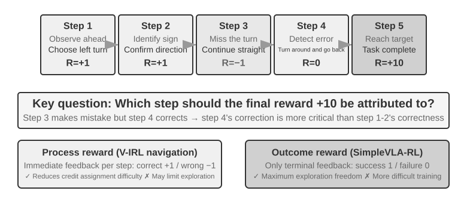
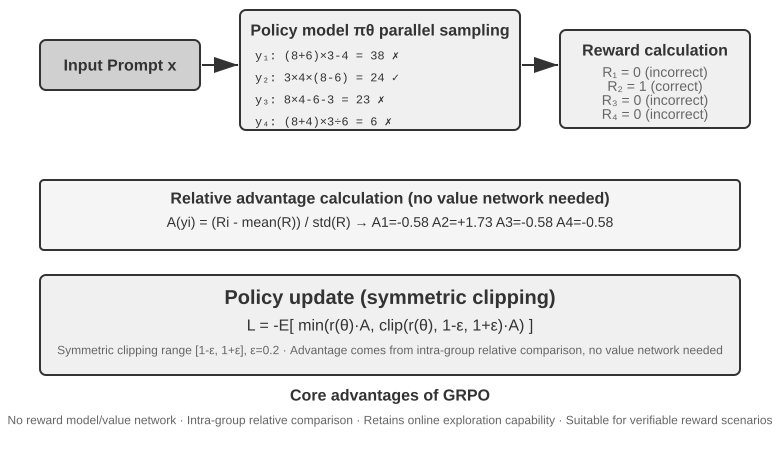

# 7 — Reward Design and Tool Calling

A support agent solves a ticket on turn nine. Which turn earned the credit, the clarifying question on turn two or the fix on turn seven? And if it got there by skipping the identity check, should it be rewarded at all? A chat reply gets one score, and a multi-turn agent has a whole trajectory to divide it across. This chapter covers the reward shapes that work for agents: judges, gates, outcome plus penalties, and the dense signals available when the outcome alone is too sparse.

> **Pillar:** [05-RL](../README.md). **Presumes:** [05](05-post-training-for-agents.md), [03](03-preference-optimization.md).

---

## Reward design for multi-turn agents


*Figure 8-15, Credit Assignment in Multi-Turn Interactions. From Li, [*AI Agents in Depth*](https://github.com/bojieli/ai-agent-book/blob/main/book-en/chapter8.md) (Apache-2.0).*

The general checklist for shaping a reward (and how agents hack it) is in
[10](10-engineering-rl-systems.md#engineering-an-rl-problem). Multi-turn adds **credit assignment**. Was it the question in turn 2 or the explanation in turn 7 that solved the ticket? It also adds **partial observability**.

**Density.**

- **Binary** rewards suit tasks with a checkable answer (math, SQL).
- **Sparse** rewards stall on open-ended tasks. Pine AI's phone agent fails 100 calls before it stumbles on collecting the account number, the last four card digits and the billing address. The rep *said* "I need the last four digits", but outcome-only RL can't learn from that sentence (Silver & Sutton, "Welcome to the Era of Experience").
- **A curriculum keeps sparse rewards informative.** WebRL generates new web tasks from the ones the policy just failed, keeps those a critic rates moderately hard (0.05–0.75), and scores rollouts with a trained 8B outcome reward model, since the web gives no checker. On WebArena-Lite (165 test tasks), that took Llama-3.1-8B from 4.8% to **42.4%**, against 17.6% for prompted GPT-4-Turbo and 30.3% for DigiRL. Without the curriculum the run plateaued lower, and without a replay buffer of past successes it degraded across phases ([arXiv:2411.02337](https://arxiv.org/abs/2411.02337) (Qi et al., ICLR 2025)). That is one benchmark, with an ORM trained on the same task distribution. It is the agentic form of DAPO's 20–80% filter ([below](#rl-for-tool-calling)).

**A unit-test reward is only as strict as its tests.** AlphaCode's authors hand-checked one passing solution for each of 50 solved problems. **30% of HumanEval passes and 60% of APPS passes were wrong programs.** CodeContests cut false positives to 4% by adding up to 200 mutated test inputs per problem, each kept only if 30 correct solutions agreed on its output. Even then, 46% of passes were wrong or too slow, because few tests check complexity ([arXiv:2203.07814](https://arxiv.org/abs/2203.07814) (Li et al., Science 2022)). EvalPlus found the same on HumanEval: with 80× more tests, pass@k fell by up to 28.9% and model rankings flipped ([arXiv:2305.01210](https://arxiv.org/abs/2305.01210) (Liu et al., NeurIPS 2023)). A benchmark merely reports these false positives, but an RL policy is optimized to find them. A thin suite turns into a reward hack, the passive version of "edit the tests" in [RLVP](#rlvp-reward-the-outcome-penalize-the-path). Synthetic-task pipelines still ship thin suites. PromptCoT 2.0 rewards each synthetic programming prompt with 3–4 unit tests written by Qwen3-32B, and doesn't measure how often they pass wrong code ([arXiv:2509.19894](https://arxiv.org/abs/2509.19894) (Zhao et al., 2025-09, preprint)). Before training, hand-audit a sample of passing rollouts, and add generated inputs checked against a reference solution.

**Form.** Take one call that succeeded but missed the billing address and named the wrong plan:

| Paradigm | Output | Diagnostic value |
|---|---|---|
| Scalar | 7.2 | None |
| Semi-scalar | Critique, then 6.5 | Some |
| Vector | Query accuracy 9, info collection **6**, fluency 8, … | Points to the collection phase |
| Generative | Natural-language analysis, sampled several times and aggregated | Highest. DeepSeek's generative RMs scale with inference compute |

**Training a generative RM** (DeepSeek's recipe):

1. The model writes task-specific principles.
2. It judges the trajectory against each principle.
3. Its judgments are checked against the actual trajectory and rewarded or penalized.

Bias stays inspectable. If it keeps praising long replies, you can see it.

**Process vs. outcome reward.**

| | Process (PRM) | Outcome (ORM; an RLVR verifier is a rule-based ORM) |
|---|---|---|
| Feedback | Every step | End only |
| Credit assignment | Easy | Hard; more samples |
| Exploration | Bounded by designer bias | Free |
| Example | **V-IRL**: +1 correct move, −1 wrong, −1.5 landmark error. Gains above | **SimpleVLA-RL**: binary success only, LIBERO 97.6%. One demo per task: SFT 17.3% → +RL **91.7%**, and "pushcut" emerged |

Use process rewards when the correctness of intermediate steps is easy to define. Use outcome rewards when the optimal path is unknown. PRMs: "Let's Verify Step by Step": as a best-of-1,860 reranker on a MATH test subset, a process RM solved 78.2% against 72.4% for an outcome RM and 69.6% for majority voting, though it only reranked and never trained a policy ([arXiv:2305.20050](https://arxiv.org/abs/2305.20050) (Lightman et al., ICLR 2024); details in [02](02-rlhf-pipeline.md#stage-2--reward-model-training)).

**Credit assignment in practice:**

- **γ = 1.** Episodes are short and success is what matters.
- **PPO + GAE.** The value network estimates per-step advantage.
- **GRPO.** It spreads one trajectory-level advantage evenly over every token, so a sharp question and filler small talk get the same credit. That is fine for short single-turn tasks but dilutes the signal over long horizons. This is why PPO with a value network still earns its cost for multi-turn agents.

### Judges as rewards: RULER, ART and rLLM

Koenigstein walks through three open-source frameworks that put an LLM judge inside the
GRPO loop (*AI Agents: The Definitive Guide*, ch. 3):

| Framework | What it adds | Scope |
|---|---|---|
| RULER | Relative LLM-as-judge scores as rewards | Reward modelling |
| ART | GRPO training for tool-using agents | One agent's behaviour |
| rLLM | RL over whole agent workflows | Several roles trained together |

**RULER: rank, don't grade.** A judge asked for an absolute score is noisy and badly
calibrated. GRPO only needs rankings within a group, because it normalizes rewards anyway.
RULER samples several trajectories for one task and strips the prefix they share. A judge
then scores each 0–1 against a short rubric (goal completion, efficiency), and the scores go
straight into the group-normalized GRPO update. No reference answers are needed. (The
book's section heading reads "Why Absolute Scoring is Easier", but its text argues the
opposite: relative scoring is easier.)

**ART: gate on correctness, then rank on quality.** The Countdown example (reach a target
number from 3–4 given numbers) uses a hybrid reward. A deterministic checker gives a binary
gate, and RULER's group-normalized score refines only the correct answers:

```python
def final_reward(correct_score, ruler_norm, alpha=0.7, beta=0.3):
    gate = 1.0 if correct_score >= 0.5 else 0.0
    return gate * (alpha + beta * ruler_norm)     # wrong answers get 0

rollouts = [("correct, tidy", 1.0, 0.9), ("correct, rambling", 1.0, 0.2),
            ("wrong, persuasive", 0.0, 1.0)]
for name, correct, judge in rollouts:
    print(f"{name:<20} judge={judge:.1f}  reward={final_reward(correct, judge):.2f}")
```

```text
correct, tidy        judge=0.9  reward=0.97
correct, rambling    judge=0.2  reward=0.76
wrong, persuasive    judge=1.0  reward=0.00
```

This is the [RLVP pattern](#rlvp-reward-the-outcome-penalize-the-path) below in another form: the verifiable signal comes first, and the
learned judge only orders answers that already pass. A judge on its own can be fooled by
content-free answers (see [Why SFT memorizes](05-post-training-for-agents.md#why-sft-memorizes-and-rl-generalizes)), and the
gate protects against that. The book's held-out printout shows 8 of 10 Countdown items
correct after 3 steps on 64 scenarios with 2 rollouts per group. No pre-training baseline is
shown, so treat it as a smoke test, not evidence that the training helped.

**rLLM: train the workflow you already run.** Subclass its `Workflow`, implement `run()`,
and return an `Episode` with every trajectory and reward. rLLM handles rollouts, retries
and the PPO/GRPO update. The book's example trains a solver and a judge together on the
24 game. Solvers are rewarded for correct expressions, and the judge for picking a correct
one. Because both roles share one `Episode`, the multi-agent system improves as a unit. This
connects to [orchestration](../../../ai-engineering/03-harness-engineering/notes/07-orchestration.md).

The opposite move is to train the workflow away. Latent Agents fine-tunes one model on 944
three-agent debate transcripts, then runs GRPO with a format reward that decays and a length
cap that tightens ([arXiv:2604.24881](https://arxiv.org/abs/2604.24881) (Yi et al., ACL 2026)).
It answers in **6–21% of the debate's tokens**, building on multi-agent debate (Du et al., ICML
2024). The accuracy claim is weaker than the abstract's "similar or improved". Llama-3.1-8B
beat explicit debate on GSM8K (85.2 vs 83.0) and BBH but not MMLU-Pro (62.0 vs 64.6). Qwen2.5-7B
trailed debate on GSM8K and MMLU-Pro. The baseline is also soft: debate scored below a single
agent for Mistral on GSM8K and for Llama on BBH.

**Read with care: other books' RLVR definitions.** Albada describes RLVR as combining
"preference learning with value-based policy optimization" and lists human evaluators among
its graders (*Building Applications with AI Agents*, ch. 7). His Table 7-1 likewise defines
reinforcement fine-tuning as "expert graders + policy gradient". That is closer to RLHF than to
RLVR in the DeepSeek-R1 sense used here and in [03](03-preference-optimization.md): a
programmatic verifier (answer key, tests, checker), usually GRPO, and no learned value or
preference model. Call a reward "verifiable" only if code can compute it.

---

## RLVP: reward the outcome, penalize the path


*Figure 8-13, 16 Rollouts, Verification, and Relative Advantage on the Same SWE-bench Task. From Li, [*AI Agents in Depth*](https://github.com/bojieli/ai-agent-book/blob/main/book-en/chapter8.md) (Apache-2.0).*

Outcome rewards can't teach **outcome-neutral constraints**. Worse, they reward breaking them:

- Don't redial someone who refused the call.
- Don't skip ID verification.
- Don't `rm -rf`.
- Don't edit the tests to make them pass.

Cutting corners raises the apparent success rate. Agents trained on outcome alone violated these in nearly every episode.

**Insight: environments are asymmetric verifiers.** "Was this action bad?" is cheap and deterministic. "Is this progress?" is about as hard as solving the task. So the dense signal an environment can reliably give is **penalties on the path, not rewards for progress.**

```text
R = O + β·Φ        O = outcome reward (still the goal)
                    Φ = per-action signal from a deterministic rule engine
                        −λ  for each machine-verifiable violation
                        +μ  for each verifiable compliant / progress action
                    normalize O and Φ separately before combining
```

**Why it works: GRPO's advantage is within-group variance.** If all G rollouts get the same reward, every advantage is zero and the group is wasted. This happens at both ends of training: all-fail groups early, all-pass groups late. DAPO drops those groups; RLVP gives them variance back.

- **Penalties always restore variance.** Even failing rollouts fail *differently*.
- **Progress rewards restore it only when progress is reachable.** They work in theorem proving, where the number of open goals falls step by step. They don't work in software repair, where often no hidden test ever passes. Diagnose this before training by measuring within-group variance on a few base-model rollouts.

**Four rules for penalty design:**

1. Penalize verifiable *actions*, never "no progress". Otherwise the agent learns to do nothing.
2. Outcome reward stays the main driver. Pure penalties drop success to zero on every seed: the **inaction trap**.
3. Pair each −λ with a +μ for the compliant alternative. Give the agent a way out, not just a wall.
4. The compliant path must be reachable (seed it with a few scripted demos). Violation checks must be deterministic, not a learned judge, or the gaming just moves to the judge.

**Results** (Li & Shi 2026, arXiv:2607.07435):

- **Terminal-Bench** (Qwen3-4B, 5 seeds): violations per episode fell from 3.71 to **0.66**, success unchanged. The agent took *more* effective actions, not fewer.
- **miniF2F**: iterations to reach 90% success fell from 7.0 to 4.4 at 4B, and from 8.5 to 5.4 at 30B.
- **Chained file operations**: all-fail groups fell from 65% to 8%.

**RLVR verifies outcomes. RLVP also verifies the process.** Together they train an agent that gets the job done *and* does it properly. For guardrails on the inference side, see [loop failure modes](../../../ai-engineering/04-loop-engineering/notes/09-failure-modes-and-guardrails.md).

---

On an all-fail group, outcome-only reward has nothing to say, and that's the common state early in training. The rule-engine signal gives those rollouts an order. The last lines of the output show why rule two exists: on penalties alone, doing nothing scores best.

```python
import numpy as np

def advantages(r, eps=1e-4):
    r = np.asarray(r, float)
    return (r - r.mean()) / (r.std() + eps)

outcome = np.zeros(4)                       # nothing passes yet: an all-fail group
violations = np.array([5, 1, 3, 0])         # rule engine: e.g. edited tests, skipped ID check
compliant = np.array([0, 2, 1, 3])          # rule engine: verifiable compliant actions
lam, mu, beta = 1.0, 0.5, 0.1

phi = -lam * violations + mu * compliant
print("outcome only:", np.round(advantages(outcome), 2))
print("with RLVP:   ", np.round(advantages(outcome + beta * phi), 2))

# Rule 2: with penalties and no outcome reward, a rollout that does nothing wins
rollouts = {"does nothing": 0, "tries, one violation": 1, "tries, three violations": 3}
for name, count in rollouts.items():
    print(f"penalty-only reward, {name}: {-lam * count:.1f}")
```

```text
outcome only: [0. 0. 0. 0.]
with RLVP:    [-1.41  0.61 -0.4   1.21]
penalty-only reward, does nothing: -0.0
penalty-only reward, tries, one violation: -1.0
penalty-only reward, tries, three violations: -3.0
```

## RL for tool calling

There are three levels of difficulty:

1. Using one tool: format, timing, error handling.
2. Choosing among dozens of tools.
3. Orchestrating tool chains: dependencies, mutual exclusions, cost.

Two research lines dominate: **Search-R1** ([arXiv:2503.09516](https://arxiv.org/abs/2503.09516) (Jin et al., COLM 2025); RL decides when to search mid-reasoning) and **SWE-Gym** (multi-turn coding RL in real repos).
The search line is in [11](11-multi-agent-and-rag-rl.md#rl-in-rag). One lesson from it carries to
any tool: **the turn cap set at training time caps the strategy**. Search-R1-style runs trained
with about 4–10 turns and learned only shallow lookups. ASearcher raised the cap to 128 turns
and used fully asynchronous rollouts, so one 100-call trajectory doesn't stall the batch. Its
QwQ-32B agent then reached 58.7 on GAIA and 51.1 on xBench-DeepSearch (Avg@4, LLM judge)
([arXiv:2508.07976](https://arxiv.org/abs/2508.07976) (Gao et al., 2025-08, preprint)). There
is no matched short-cap ablation. The evidence for long horizons is a case study, plus a
test-time sweep that forces more turns. The cap cuts the other way too: with everything else
fixed, a longer required horizon alone can collapse RL, and macro actions or per-subgoal rewards
fix it ([10](10-engineering-rl-systems.md#beyond-the-flat-mdp-hierarchy-and-curricula)).

**Loss-mask environment tokens.** Tool output, search results and user replies are not generated by the policy. If you include them in the gradient, you train the model to predict the sandbox, and training becomes unstable. ReTool masks everything inside `<interpreter>`; veRL and AWorld do this by default. In Search-R1's ablation (Qwen2.5-7B-base, PPO), masking retrieved tokens raised average exact match over seven QA sets from 0.343 to 0.431.

**Capture at the API, and split on compaction.** Newer frameworks don't require the agent to be
rewritten for training. They sit behind an OpenAI- or Anthropic-compatible endpoint and record
the token IDs and behaviour log-probs of every call. The catch is a long-running agent that
summarizes or drops earlier turns: the context it sees is no longer one growing sequence. Molt
starts a new segment whenever the history is rewritten. All segments of a rollout share its ID
and its one terminal reward, which GRPO counts once
([arXiv:2607.21653](https://arxiv.org/abs/2607.21653) (Hu et al., 2026-07, preprint)). SocialRL's
rollout proxy reconstructs trajectories the same way
([arXiv:2608.13787](https://arxiv.org/abs/2608.13787) (Hua et al., 2026-08, preprint)). Molt's
only learning curve, a Qwen3-30B-A3B tool-math run, has no baseline. Read it as a systems paper
(asynchronous trainers: [10](10-engineering-rl-systems.md#scaling-actors-and-learners)).

**ReTool** (Exp 7-15):

- **Setup.** One hour of SFT warm-up on code-augmented traces. Then 9 days and 400 steps of PPO on veRL with DAPO-Math-17k.
- **Scale.** 512 rollouts per step (32 problems × 16), 7–9 interpreter rounds each.
- **Results.** Qwen2.5-32B on AIME 2024 went from about 25% to **67.0%**. Text-only RL reached 40.0% after 1,080 steps.
- **Emergent behaviour.** Code self-correction; tool use moved earlier, from late verification to early exploration; responses got 40% shorter.
- **Cost.** RL took about 200× the SFT wall-clock time. SFT supervises every token; RL gives one bit per episode.

**DAPO's four changes to PPO / GRPO** ([arXiv:2503.14476](https://arxiv.org/abs/2503.14476) (Yu et al., NeurIPS 2025)), aimed at keeping long-CoT RL exploring and its gradient signal clean (Qwen2.5-32B base, ε_low 0.2, 20,480-token generation cap; the per-step ablation is in [03](03-preference-optimization.md#grpo--group-relative-policy-optimization)):

| Change | What it does |
|---|---|
| Clip-Higher | Raises only the upper clip bound (ε_high 0.28 vs ε_low 0.2) so low-probability "exploration" tokens can gain mass; prevents entropy collapse |
| Token-level loss | Normalizes over all tokens in the batch instead of per response, so long responses don't dilute each token by 1/\|oᵢ\| |
| Dynamic sampling | Drops only prompts whose group accuracy is exactly 0 or 1 (zero advantage, zero gradient) and oversamples until the batch is full |
| Overlong reward shaping | Masks truncated samples from the loss (overlong filtering), plus a linear length penalty only between 16,384 and 20,480 tokens; it does not look at whether the answer improved |

SimpleVLA-RL used similar levers: dynamic sampling, clip bounds of [0.8, 1.28] and temperature 1.6. Together they gave about 30% within 300 steps.

**AWorld-train** (Exp 7-16): Qwen3-4B on GAIA in an MCP sandbox with 26 servers and 126 tools. It is an open pipeline demo with no baseline. Pass criteria: stable episodes, a rising reward curve, and a rising tool-success rate.

**AdaptThink** (Exp 7-10): RL learns *when not to think*. A constrained objective encourages skipping thought (`<think></think>`) without losing accuracy, and importance sampling balances the two modes during cold start. On DeepSeek-R1-Distill-Qwen-1.5B, trained on DeepScaleR math, response length fell 45–64% across GSM8K, MATH500 and AIME 2024, and accuracy rose 1.4–4.1 points. At 7B the average cut was 40%, but only 17% on AIME 2024, where 94% of answers still used thinking ([arXiv:2505.13417](https://arxiv.org/abs/2505.13417) (Zhang et al., 2025-05, preprint)). A plain RL length penalty on correct answers gives a dial instead of a mode switch: on R1-Distill-Qwen-7B, α = 0.1 cut MATH500 length 36% for a 2.2-point loss ([arXiv:2502.04463](https://arxiv.org/abs/2502.04463) (Arora & Zanette, NeurIPS 2025)). Pair it with prompt distillation for a fast/slow dual system. SFT alone gets part of the way. Z1-7B was trained on 107K code problems with short traces for easy problems and long ones for hard ones, and decoded with a hard thinking cap. It matched R1-Distill-Qwen-7B on the four-benchmark average (45.4 vs. 44.1) with far fewer thinking tokens. The average hides a 7-point loss on MATH500 (76.4 vs. 83.3) and a gain driven by BigCodeBench-Hard ([arXiv:2504.00810](https://arxiv.org/abs/2504.00810) (Yu et al., EMNLP Industry 2025)).

In a multi-turn agent, the depth decision comes at every step, and plain GRPO gets it wrong.
CogRouter gives the policy four thinking levels, from a bare action to full deliberation, and
starts from an SFT checkpoint balanced across them. **GRPO and GiGPO then collapsed to about
77% deepest-level steps on ALFWorld**: a trajectory-level advantage credits deep thinking
that merely co-occurs with success. CogRouter regenerates each successful step's thinking at
all four levels with the action held fixed. It weights the advantage toward the level at which
the model is most confident in that action. Qwen2.5-7B averaged 82.3% success over ALFWorld and
ScienceWorld at 1,641 tokens per trajectory, against 68.3% at 4,367 for GRPO and 63.0% for
AdaptThink ([arXiv:2602.12662](https://arxiv.org/abs/2602.12662) (Yang et al., 2026-02,
preprint)). The evidence is two text-game benchmarks at 7–8B.

---

## Dense signals: on-policy distillation and self-distillation

| | Policy | Signal | Weakness |
|---|---|---|---|
| SFT | Off-policy (teacher acts) | Dense | Learner–sampler mismatch: never learns to recover |
| RL | On-policy | Sparse | One scalar per trajectory |
| **On-policy distillation** | On-policy (student acts) | **Dense**: teacher's full next-token distribution at every student token, minimize KL | Needs a stronger teacher and a realistic environment |

**On-policy distillation** (Thinking Machines Lab, 2025; the idea goes back to GKD, [arXiv:2306.13649](https://arxiv.org/abs/2306.13649) (Agarwal et al., ICLR 2024)) matches pure RL on math in about **1/10 of the steps**. It overfits less, because every trajectory is different and the teacher's feedback is specific to it.

**Case: teaching an 8B model a sense of time** (urgency, persistence, vigilance) without prompts. DPO and four RL recipes each failed differently:

1. Hard-gated reward: too sparse, so the advantage was zero.
2. Graded reward: the proxy diverged from the real pass rate.
3. First-turn-only scoring: taught perfunctory replies.
4. Rollout shape aligned with the eval: the policy collapsed to one mode, even with a 4× KL anchor.

None beat SFT. On-policy distillation from a frozen Qwen3-32B converged smoothly and scored **+23–47 pp** over SFT. What stalls post-training is usually signal density, not reward cleverness. (Li & Shi 2026; the inference-time version is the [agent status bar](../../../ai-engineering/02-context-engineering/notes/02-context-anatomy.md#runtime-state-the-agent-status-bar).)

**On-policy self-distillation (OPSD)** (Zhao et al. 2026, arXiv:2601.18734) is for when there is no stronger teacher. The same model plays both roles; only the context differs.

- **The teacher copy** sees privileged information: the answer, a verified solution, a richer system prompt or domain docs. It rationalizes the student's steps token by token.
- **Why it works.** Explaining with the answer in hand is easier than solving. This is the verify–generate asymmetry again, used for a dense signal.
- **Advantage over RLVR.** It needs no verifier, and the signal is much denser.
- **Limits.** The gain is bounded by what the privileged information adds. If the answer came from exhaustive search, nothing can be articulated. Naive OPSD can also erode the model's thinking style and needs regularization (Purified OPSD, arXiv:2607.02234).

**Self-Distillation Policy Optimization (SDPO)** uses the environment's feedback as the privileged context. The teacher is the same policy, shown the runtime error or a sibling rollout that succeeded, and it re-scores the student's existing rollout token by token. That costs no extra sampling, and the dense signal replaces GRPO's advantages. **On LiveCodeBench v6 with Qwen3-8B it reached 48.8% against 41.2% for tuned GRPO**, and matched GRPO's final accuracy with 4× fewer generations. With only scalar rewards (science QA and tool use, where successful siblings are the feedback) it still led, 70.2% vs 66.6%, with answers up to 11× shorter ([arXiv:2601.20802](https://arxiv.org/abs/2601.20802) (Hübotter et al., 2026-01, preprint)). It depends on in-context learning: **at Qwen3-0.6B it underperformed GRPO**, and mixing in a little GRPO advantage helped. When the feedback carries no information, it adds nothing.

## Pitfalls

- **Judge-only rewards.** A learned judge can be fooled by persuasive content-free answers. Put a verifiable gate before it where you can.
- **Penalties with no outcome reward.** The second half of the RLVP output shows that doing nothing wins. Keep the outcome as the goal.
- **Rewarding step count or speed alone.** The agent learns to quit early. Pair efficiency rewards with a success gate.
- **Training a tool-calling policy without a sandbox.** Real tools have side effects, and rollouts multiply them. Replay or mock what you can ([06](06-data-and-environments.md#data-and-environment--algorithm)).
- **Reading a smoke test as a result.** Small before-less printouts, such as the book's 8 of 10 Countdown items, show the plumbing works. A held-out baseline is what shows the training helped.

## Try it

1. Change the ART gate so a wrong answer earns `0.3 * judge`. What does a wrong persuasive answer score now, and what will the policy learn to do?
2. In the RLVP block set `beta = 0`, then `beta = 1`. How do the advantages change, and what is lost at a high β?
3. Pick an agent you know. Write down its outcome reward and three machine-verifiable violations. Which one do you think it breaks most today?

<details><summary>Answers</summary>

1. It scores 0.3, above an incorrect-but-honest low score. Persuasive wrong answers become worth producing, which is what the gate existed to prevent.
2. At β = 0 the all-fail group gives zero advantages and no learning. At β = 1 the normalized advantages don't change here, since the outcome is flat, but when outcomes vary, a large β can drown the goal in rule-following.
3. Good violations are cheap to check: wrong test files edited, ID check skipped, a destructive command used. If a check needs judgment, it belongs in a judge, not in the rule engine.

</details>

## Interview checklist

| Question | Answer |
|---|---|
| Why is credit assignment harder for agents? | Reward arrives at the end of a long trajectory, and the environment is only partly visible, so it's hard to tell which turn mattered. |
| What does gate-then-rank do? | A deterministic check zeroes wrong answers, and a judge orders only those that pass, so persuasion can't buy reward. |
| What is RLVP? | Outcome reward plus a per-action signal from a deterministic rule engine, normalized separately and combined. |
| Why are environments asymmetric verifiers? | "Was this action bad?" is cheap to check. "Is this progress?" is about as hard as the task. |
| Why not penalties alone? | Inaction earns the best penalty score, so the agent stops trying. |
| What does on-policy distillation add? | Dense per-step signal from a stronger teacher on the states the student actually reaches. |

## Next

[08 — Reasoning RL](08-reasoning-rl-deepseek-r1.md) is what happened when a verifiable reward met a strong base model: long reasoning emerged with no reasoning labels at all.
