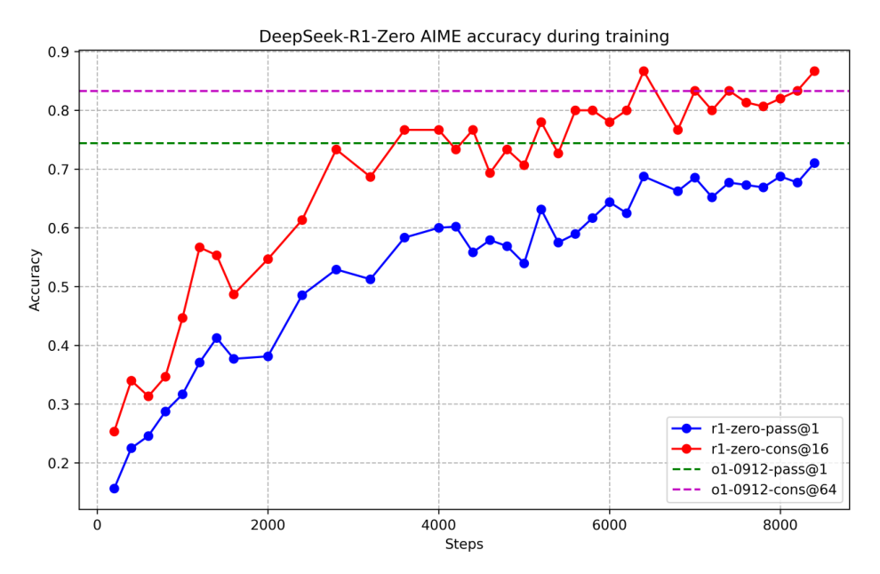
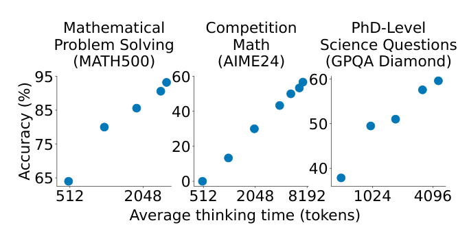

# 8 — Reasoning RL: the DeepSeek-R1 Story

In early 2025 a lab showed a model learning to reason by being told only whether its final answer was right. Nobody labeled the reasoning, and yet long traces with self-correction appeared. It looked like RL had created a new skill out of nothing, and the field split over whether that was true. Did RL create the skill, or did it find something the base model could already do and make it common? The answer changes how you budget, and this chapter walks through the evidence.

> **Pillar:** [05-RL](../README.md). **Presumes:** [03](03b-grpo-and-gspo.md#grpo--group-relative-policy-optimization).

---

## The DeepSeek-R1 story

DeepSeek-R1 (2025) demonstrated that pure RL with verifiable rewards can develop
emergent chain-of-thought reasoning — the model learned to "think" (producing long
reasoning traces) without any explicit CoT supervision.

Key findings ([arXiv:2501.12948](https://arxiv.org/abs/2501.12948) (DeepSeek-AI, 2025-01)):

- **R1-Zero.** GRPO on DeepSeek-V3-Base with only rule-based accuracy and format rewards,
  and no SFT.
  - AIME 2024 pass@1 (mean of 16 samples) rose from 15.6% to 71.0%, and to 86.7% with
    majority voting over 64.
  - Response length on the training set grew from hundreds to thousands of tokens.
  - DeepSeek chose rules over a neural reward model because the latter "may suffer from
    reward hacking" at scale.

  
  *Image Source: DeepSeek-AI, [DeepSeek-R1: Incentivizing Reasoning Capability in LLMs via Reinforcement Learning](https://arxiv.org/abs/2501.12948) (2025), Fig. 2*

- **The "aha moment".** It is one qualitative transcript, an intermediate checkpoint writing
  "Wait, wait… That's an aha moment" and re-planning. There is no quantitative measure behind it.
- **Model size still matters.** The same paper is the counter-example to "scale RL, not the
  model".
  - On Qwen-32B, more than 10K steps of R1-Zero-style RL reached 47.0% AIME pass@1.
  - SFT on 800k samples from the 671B R1 reached 72.6%.
  - DeepSeek's conclusion: distilling a strong model beats RL on a small one, though small
    models still benefit from RL afterwards.
  - That is one RL run, confounded by the teacher's size.
  - Mistral's Magistral found the opposite at 24B, with a much smaller gap between teacher and
    student ([arXiv:2506.10910](https://arxiv.org/abs/2506.10910) (Mistral AI, 2025-06, tech
    report)). **Pure RL on Mistral Small 3 reached 65.8% AIME24 pass@1, level with SFT on
    traces from the RL-only Magistral Medium (65.4%).** SFT then RL reached 70.7%. At maj@64
    the distilled model still led, 90.0 against 86.7. Their RL data was filtered to 38k math
    and 35k code problems that a model solves sometimes but not always.
- **Full R1.** A cold start of "thousands" of long-CoT examples, then reasoning RL with a
  language-consistency reward, rejection sampling (about 600k reasoning + 200k other samples),
  and a final all-scenario RL.
  - R1 reached 79.8% AIME 2024 and 97.3% MATH-500, against 79.2% and 96.4% for o1-1217. MATH-500 is a subset of MATH ([arXiv:2103.03874](https://arxiv.org/abs/2103.03874) (Hendrycks et al., NeurIPS 2021 Datasets and Benchmarks)): 12,500 competition problems scored by exact match on the boxed answer, where GPT-2 1.5B reached 6.9% in 2021. The 500 problems come from its test set, chosen by Lightman et al. ([arXiv:2305.20050](https://arxiv.org/abs/2305.20050), NeurIPS 2023).
  - It trails o1-1217 on GPQA Diamond (71.5 vs 75.7).
  - The o1 numbers are copied from OpenAI's reports, not rerun.
  - Process reward models and MCTS were tried and abandoned.
  - MCTS survives as an offline data tool instead. Mulberry
    ([arXiv:2412.18319](https://arxiv.org/abs/2412.18319) (Yao et al., NeurIPS 2025)) searched
    reasoning trees jointly with GPT-4o, Qwen2-VL-7B/72B and Llama-3.2-11B-Vision to build 260K
    multimodal SFT traces. Qwen2-VL-7B tuned on them went from 58.2% to 63.1% on MathVista
    (+4.2 points averaged over eight benchmarks). No RL is involved.
  - DeepSearch ([arXiv:2509.25454](https://arxiv.org/abs/2509.25454) (Wu et al., ICLR 2026))
    puts MCTS back inside RLVR training. Each problem is searched as a tree of 256-token steps.
    Values are backed up to the nodes, and GRPO trains on those node-level advantages. From a
    1.5B model that had already been RL-trained, **50 more steps (~330 GPU hours) raised the
    six-benchmark math average from 61.7 to 62.95. Extending DAPO + KL ([KL](../../01-llm-fundamentals/notes/06-pretraining-data-and-objectives.md#entropy-cross-entropy-kl-and-perplexity)) for 1,875 steps (1,883 GPU
    hours) reached only 62.0.** In the ablation, vanilla MCTS scored below the start (60.3); the new
    q-value backup gave the biggest step (+1.1), though the paper names frontier selection the
    largest single gain (+0.63). Single runs, one
    model, math only, and gains of about a point.

Kimi k1.5 reached a similar result by a different route
([arXiv:2501.12599](https://arxiv.org/abs/2501.12599) (Kimi Team, 2025-01)):

- **Method.** RL with a 128k context and partial rollouts; online mirror descent toward the
  previous iterate; no value network, MCTS or PRM.
- **Long CoT.** 77.5% AIME 2024 pass@1 against o1's 74.4%. It lost on LiveCodeBench
  (62.5 vs 67.2) and MMMU (70.0 vs 77.3).
- **long2short RL** (a length penalty plus a shorter rollout cap) produced a short-CoT model
  at 60.8% AIME using 3,272 tokens on average. "Short" is relative.
- **Caveats.** The model size is undisclosed, as are τ, the penalty weight and the
  partial-rollout budget.

Open-Reasoner-Zero reproduced R1-Zero-style length and accuracy scaling with vanilla PPO, no
KL and a binary reward ([arXiv:2503.24290](https://arxiv.org/abs/2503.24290) (Hu et al.,
2025-03)):

- **Result.** On Qwen2.5-32B base it scored 48.1% AIME24 against R1-Zero-Qwen-32B's 47.0%,
  with about 1,200 steps against DeepSeek's ">10K".
- **Caveats.**
  - Steps are not equal compute: ORZ's are 128 prompts × 64 samples, and DeepSeek's batch is
    undisclosed.
  - The margin is about a third of one AIME problem.
  - It is below QwQ-32B-Preview (50.0).

NVIDIA's Nemotron-Cascade replaces R1's mixed-domain RL with one domain at a time
([arXiv:2512.13607](https://arxiv.org/abs/2512.13607) (Wang et al., 2025-12, tech report)):

- **Recipe.** Two-stage SFT of Qwen3-8B/14B-Base on DeepSeek-R1 and R1-0528 traces, then
  on-policy GRPO with no KL, in the order RLHF → instruction-following RL → math → code → SWE.
  Each stage gets its own length cap and hyperparameters, which is the authors' case against
  blending domains.
- **RLHF first helps reasoning.** The RLHF stage used a 72B reward model and no math or code
  prompts, yet raised LiveCodeBench v5 by 9 to 11 points and AIME by 0.7 to 3.5, mostly by
  cutting the SFT model's verbose reasoning. It cost 12 to 21 points of IFEval, which the next
  stage won back. Running instruction-following RL before RLHF was "much worse".
- **Little forgetting.** Later stages mostly moved earlier benchmarks by about a point; SWE RL
  added 3.5 to 5.6 on SWE-bench Verified. The authors credit on-policy data and overlapping
  rewards. The report has no joint multi-domain run at equal compute to compare against.
- **Result.** The 14B thinking model scored 83.3 AIME25 and 74.6 LiveCodeBench v6, above its
  SFT teacher R1-0528 on LiveCodeBench (73.3).

This validated the verifiable rewards paradigm and shifted the field's attention from
"what alignment technique" to "what reward structure."

**What RLVR adds, measured at large k.** Yue et al.
([arXiv:2504.13837](https://arxiv.org/abs/2504.13837) (Yue et al., 2025-04)) compared base
models with their zero-RL counterparts: Qwen2.5-7B/14B/32B and LLaMA-3.1-8B trained with GRPO
via SimpleRL-Zoo, plus Oat-Zero, DAPO, and code and vision RL runs. They measured pass@k up to
k=1024. RL models win at small k, but the base models catch up and pass them as k grows. On
Minerva at 32B, the base model solves about 9% more problems at k=128. On AIME24 with
Qwen2.5-7B at k=1024, 13.3% of problems are solved only by the base model and 0.0% only by the
RL model. The paper concludes that current RLVR "rarely elicits fundamentally new reasoning
patterns". It makes the base model better at sampling paths it already had. The six
algorithms they tried (PPO, GRPO, Reinforce++, RLOO, ReMax, DAPO) behave alike. Distillation
from a stronger teacher, unlike RLVR, did push pass@k past the base model. The paper did not
evaluate DeepSeek-R1-Zero itself. *This note's reading:* treat the "spontaneous"
self-verification above as RL making existing base-model behaviour reliable at pass@1, not as
proof of new capability.

Murphy's overview agrees that the "RL creates emergent abilities" reading "has been disputed by many authors" and that the base model already carried the chain-of-thought patterns, with RL able to "expose" or "amplify" them (*RL: A Comprehensive Overview*, ch. 6, Sec. 6.2.3). It also records two details worth keeping. R1-Zero did worse on general reasoning, which is why R1 added SFT on synthetic chains of thought. And the GRPO family differs in small normalization choices. GRPO's group is often about 8 samples with advantage (R − mean)/std. Dr. GRPO drops the std divisor, which he says causes a difficulty bias. RLOO's leave-one-out baseline is identical to Dr. GRPO up to a factor J/(J−1) for group size J (his algebra, Eq. 6.27–6.28). REINFORCE++ normalizes with a global batch mean and std. DAPO's clip-higher uses ε_high = 0.28 against ε_low = 0.2 to stop entropy collapse (Sec. 6.2.4). That helps explain why several of the six algorithms in the Yue et al. comparison above behave alike: RLOO, Dr. GRPO and GRPO differ mainly in a scale and a normalizer.

Xiaomi's MiMo-7B points the same way from the pretraining side
([arXiv:2505.07608](https://arxiv.org/abs/2505.07608) (Xiaomi, 2025-05)):

- **Pretraining.** About 25T reasoning-dense tokens with a multi-token-prediction objective.
- **Base model.** 32.9% AIME 2024 against Qwen2.5-7B-Base's 10.1%, and higher pass@k at every
  k.
- **RL.** GRPO on 130K math and code problems.
  - It lifted the model to 68.2% AIME 2024 and 55.4% AIME 2025, the latter against o1-mini's
    50.7%.
  - It still loses badly on MMLU-Pro (58.6 vs 80.3).
- **What the RL changed.**
  - The code reward gives partial credit by test difficulty.
    Magistral tried partial credit by fraction of tests passed and dropped it. Over 250 steps
    at 24B it threw away a third as many zero-advantage groups, but ended 2 points lower on
    LiveCodeBench and grew its reasoning length more slowly.
  - The RL data drops easy problems but resamples 10% of them.
  - Dropping them entirely "introduces significant instability".
- **Caveat.** The "base" saw about 10% synthetic reasoning traces in its last pretraining
  stage, so it is not a clean base.


*Image Source: Yue et al., [Does Reinforcement Learning Really Incentivize Reasoning Capacity in LLMs Beyond the Base Model?](https://arxiv.org/abs/2504.13837) (2025), Fig. 1*

The Yue reading makes a testable prediction that takes a few lines to illustrate. The data below is synthetic: each problem has a chance that the base model samples a correct answer, RL raises the chance on paths it already samples, and it drops some rare paths. Sharpening shows up as a win at small k, and lost paths as a loss at large k.

```python
import numpy as np

rng = np.random.default_rng(0)
n = 2000
# Per-problem chance one base-model sample is correct: many low, some unreachable
base_p = rng.beta(0.4, 2.0, n)
base_p[rng.random(n) < 0.15] = 0.0

sharpened = np.clip(base_p ** 0.5, 0, 1)        # RL raises what the model already samples
lost = (base_p < 0.03) & (rng.random(n) < 0.5)   # and drops some rare correct paths
sharpened[lost] = 0.0

def pass_at_k(p, k):
    return (1 - (1 - p) ** k).mean()

print("    k   base    RL")
for k in [1, 4, 16, 64, 256, 1024]:
    print(f"{k:5d}  {pass_at_k(base_p, k):.3f}  {pass_at_k(sharpened, k):.3f}")
```

```text
    k   base    RL
    1  0.139  0.267
    4  0.322  0.519
   16  0.519  0.659
   64  0.660  0.700
  256  0.745  0.712
 1024  0.798  0.716
```

This shape, with RL ahead at low k and behind at high k, is what to look for in your own pass@k curves. The toy only shows the mechanism, and its numbers are not a measurement of any model.

If RL mostly sharpens, a sampler should be able to sharpen without training. Power sampling
targets p^α, the base model's whole-sequence likelihood raised to α = 4. It approximates this with
Metropolis–Hastings: generate in 192-token blocks, resample a random suffix ten times per block,
and accept by the likelihood ratio ([arXiv:2510.14901](https://arxiv.org/abs/2510.14901) (Karan
and Du, 2025-10, preprint)). Low temperature is not the same target. It sharpens each next token,
so it favours tokens with many mediocre continuations over tokens with a few likely ones. On
Qwen2.5-Math-7B, with no training, data or verifier, **MATH500 rose from 49.6% to 74.8%, against
78.5% for GRPO trained on MATH**. HumanEval rose to 57.3% against GRPO's 53.7%, and pass@k stayed
above the base model's instead of falling below it. The cost is about 8.8× the tokens of one
ordinary sample. The largest out-of-domain wins come from Phi-3.5-mini, whose GRPO baseline
scored below its own base model. The paper reports single-shot scores with no seeds and no AIME.

The same access-not-knowledge reading holds for factual recall. Across eight instruct and
reasoning pairs from Qwen, DeepSeek and Kimi, the reasoning variant was up to 24 points better on
MedConceptsQA code lookup. A prompt that told the instruct model to walk the code hierarchy cut
DeepSeek-V3's 23.7-point deficit against R1 to 7.5 points
([arXiv:2511.05933](https://arxiv.org/abs/2511.05933) (Zhang et al., 2025-11, preprint)). In a
controlled test, GRPO on 731 PopQA facts that never co-occur in Dolma lifted Qwen3-8B-Instruct
from 0% to **10.1% on 208 frequent but previously unanswerable facts with disjoint relations**.
SFT on the same data reached 0.96%. Iterated rejection-sampling fine-tuning reached 9.62%, which
is statistically tied with online GRPO, so the gain came from repeatedly training on fresh
self-generated rollouts rather than from GRPO's negative signal. The instruct and reasoning
pairs differ in undisclosed recipes, so only the injection experiment isolates RL, and it ran at
8B and 30B-A3B.

### How little data and reward reasoning needs

The cheap recipes of 2025 are the best evidence for the Yue reading, and most of them were
measured on Qwen2.5.

**Small SFT sets work on a strong base with a strong teacher.** The idea is LIMA's
([arXiv:2305.11206](https://arxiv.org/abs/2305.11206) (Zhou et al., NeurIPS 2023)), applied to
long CoT.

- **Before R1, two open o1 replications** from GAIR tested the format first.
  - Part 1 ([arXiv:2410.18982](https://arxiv.org/abs/2410.18982) (Qin et al., 2024-10, preprint)) built "journey" traces. It grew a reasoning tree with o1-mini marking each step, walked it depth-first through one wrong branch per correct step, and had GPT-4o smooth the result. **On DeepSeekMath-7B, 327 journey traces scored 47.0% on MATH500 against 38.6% for the 327 matching shortcut paths.** DPO on outcome pairs then added 0.2 points. That is one run per arm, three epochs on 327 examples, with no variance reported.
  - Part 2 ([arXiv:2411.16489](https://arxiv.org/abs/2411.16489) (Huang et al., 2024-11, preprint)) simply distilled o1's outputs. Tens of thousands of traces, with the exact count withheld, on Qwen2.5-Math-72B scored 13/30 on AIME 2024 against o1-preview's 12/30, a one-problem margin. SFT on about 5,000 of the math traces translated into Chinese moved Qwen2.5-72B-Instruct's WildSafety score from 92.0% to 86.5% and its ChineseFactEval accuracy from 69.1% to 62.7%. The extra reasoning invented search results. Sycophancy resistance rose from 89.7% to 92.7%, and expert scores on 100 open-ended queries rose too.
- **s1** ([arXiv:2501.19393](https://arxiv.org/abs/2501.19393) (Muennighoff et al., EMNLP
  2025)) fine-tuned Qwen2.5-32B-Instruct on 1,000 questions with traces distilled from Gemini
  2.0 Flash Thinking, in 26 minutes on 16 H100s.
  - It scored 50.0% on AIME24, and 56.7% with **budget forcing**: suppress the end-of-thinking
    token and append "Wait" so the model keeps checking. AIME24 has 30 problems, so that is two
    problems. The gain flattens after about six "Wait"s, when the model starts to loop.
  - Selection mattered more than size. 1,000 random traces scored 36.7%. The full 59K pool
    scored 53.3% (95% CI against s1K: −13% to +20%) for 56× the GPU hours.

    
    *Image Source: Muennighoff et al., [s1: Simple test-time scaling](https://arxiv.org/abs/2501.19393) (2025), Fig. 1*
- **LIMO** ([arXiv:2502.03387](https://arxiv.org/abs/2502.03387) (Ye et al., COLM 2025)) took
  the same base from 16.5% to 63.3% AIME24 with about 800 traces from R1-class models. **The
  same 800 examples on Qwen1.5-32B-Chat gave 9.2%.** The knowledge has to be there from
  pretraining; the examples only show how to use it.
  - A survey of about 150 post-training data studies states this as a rule. A few
    demonstrations can bring out a skill only when it already lies within the base policy's
    support, and difficulty is relative to the base, which is what DAPO's filter on all-correct
    and all-wrong groups assumes ([arXiv:2606.02113](https://arxiv.org/abs/2606.02113) (Li et
    al., 2026-06, preprint survey)). It runs no experiments of its own.
- **At 7B, scale still pays.** OpenThoughts
  ([arXiv:2506.04178](https://arxiv.org/abs/2506.04178) (Guha et al., ICLR 2026)) ran 1,000+
  data-pipeline ablations on Qwen2.5-7B-Instruct.
  - Its data beat s1.1 and LIMO at every matched size, and accuracy was still rising at 1.2M
    examples. OpenThinker3-7B reached 53.3% AIME25 against 38.0% for R1-Distill-Qwen-7B.
  - QwQ-32B was a better teacher than DeepSeek-R1, although R1 scores higher itself.
  - Filtering traces for correct answers gave no significant gain.
- **The teacher can be small if it is trained to teach.** Sakana's RL teachers
  ([arXiv:2506.08388](https://arxiv.org/abs/2506.08388) (Cetin et al., NeurIPS 2025)) see the
  question *and* its solution and write the explanation. They are rewarded by how likely a
  student finds the solution after reading it, minus a KL term that stops them leaking the
  answer.
  - With raw, unfiltered traces from a 7B teacher on 17K questions, **a Qwen2.5-32B student
    averaged 73.2 on AIME24, MATH500 and GPQA-Diamond, against 71.5 for the same student on
    post-processed R1 traces**. At 7B the scores were 49.5 and 46.6.
  - As a cold start for RL, the RL teacher's traces beat R1's (50.5 vs 48.3). Traces from a 7B
    model trained with ordinary correctness RL fell below the untuned base (38.6 vs 39.2).
  - Without the KL term the teacher copied the solution and the student dropped to 34.1.
  - Caveats. It needs reference solutions and an SFT warm start, and it uses single runs. The
    R1 cost it compares against is a rough lower bound.
- **Choosing the 1,000 without an LLM judge.** TEMP
  ([arXiv:2606.26797](https://arxiv.org/abs/2606.26797) (Jin et al., ICML 2026)) scores
  difficulty by the loss on a trace's first 100 tokens under a noise-perturbed copy of the base
  model. It clusters for diversity by the loss on the first 1k tokens at checkpoints extrapolated
  along the fine-tuning direction.
  - **Picking 1k of M23k's medical traces, it averaged 57.7% over 10 benchmarks on
    Qwen2.5-7B-Instruct, against 56.6% for LLM-filtered m1k and 55.1% for random.** On
    Llama-3.1-8B it scored 57.5% against 54.7% for random.
  - It read 91% fewer tokens than the baselines on OpenThoughts-Math. On that already-filtered
    pool its 43.9% math average was within noise of random's 43.1% (±3.2).
  - The fine-tuning direction needs a model already fine-tuned on the pool, such as OpenThinker-7B,
    and the token count leaves that cost out.
- **AM-Thinking-v1** ([arXiv:2505.08311](https://arxiv.org/abs/2505.08311) (Ji et al., 2025-05,
  preprint)) is the same recipe at 32B, followed by RL.
  - 2.84M distilled SFT samples on Qwen2.5-32B base, then GRPO without KL on 54K math and code
    queries whose pass rate under the SFT model is strictly between 0 and 1.
  - It reports 85.3% AIME24 and 74.4% AIME25. No ablation separates the SFT from the RL.
- **s1K does not rescue a weak base.** On the diffusion LLM LLaDA-8B-Instruct, SFT on it moved
  MATH500 from 36.2% to 34.8% at 512 tokens (d1,
  [arXiv:2504.12216](https://arxiv.org/abs/2504.12216) (Zhao et al., 2025-04, preprint)).

**RL amplifies behaviours the base model already shows.**

- Gandhi et al. ([arXiv:2503.01307](https://arxiv.org/abs/2503.01307) (Gandhi et al., COLM
  2025)) ran identical PPO on Countdown for 250 steps.
  - Qwen2.5-3B reached about 60% and Llama-3.2-3B about 30%. Qwen's base outputs already
    contained verification and backtracking; Llama's did not.
  - Priming Llama with backtracking traces closed the gap, **even when every primed solution
    had the wrong answer**. Thoughts of the same length filled with placeholder tokens did not
    help.
  - Continued pretraining on 8.3M tokens of OpenWebMath, filtered for these behaviours, did
    the same.
- Yeo et al. ([arXiv:2502.03373](https://arxiv.org/abs/2502.03373) (Yeo et al., 2025-02,
  preprint)) reran SimpleRL-style PPO on Qwen2.5-Math-7B.
  - Accuracy rose, but the rate of "wait", "recheck" and "alternatively" did not.
  - Response length recovered after an early dip but never exceeded the base model's, while
    KL to the base fell. Some "emergent" length growth is the policy drifting back to the
    base.
  - Their recipe for Llama-3.1-8B was long-CoT SFT first, then a cosine length reward with a
    repetition penalty. Without the penalty the length reward was hacked by repetition.
- RLSP ([arXiv:2502.06773](https://arxiv.org/abs/2502.06773) (Ye et al., 2025-02, preprint)) paid for effort directly. Its PPO reward was 0.8 × correctness plus 0.2 × an exploration score, either response length or a GPT-4o grade of effort that ignored correctness.
  - With outcome reward only, response length grew for Qwen2.5-7B-Instruct on math but not on code, and not for Llama-3.1-8B-Instruct on math. With the length term it grew in all three, and backtracking and verification appeared.
  - **The accuracy gains are small and lack the matching outcome-only run.** On Llama-3.1-8B, QwQ long-CoT SFT took MATH-500 from 50.6% to 70.2% and RLSP added 3.2 points. On Qwen2.5-32B-Instruct, PPO on 918 old AIME problems moved AIME 2024 from 13.3% to 23.3%, which is three problems. The length reward on its own was also hacked by repetition.
- Fatemi et al. ([arXiv:2504.05185](https://arxiv.org/abs/2504.05185) (Fatemi et al., 2025-04, tech report)) argue the growth is an optimization artifact, not reasoning. With per-token loss averaged over the response and GAE λ < 1, a negative terminal reward gives a PPO loss that shrinks like 1/length, so wrong answers push towards longer outputs and right ones towards shorter.
  - PPO on 4 OlympiadBench problems that R1-Distill-Qwen-1.5B never solved (reward fixed at −0.5) grew responses from about 12K to 20K tokens as the loss fell. GRPO on the same problems has zero advantage, so the KL term took over and outputs collapsed below 80 tokens.
  - Their fix is a second, short PPO phase on problems the model sometimes solves. **Eight MATH level-5 problems cut mean response length by 54% for R1-Distill-Qwen-1.5B and 40% for the 7B, with average accuracy over four benchmarks 57.0→58.4 and 71.6→72.1.** The average hides small math losses (MATH-500 84.2→81.0 at 1.5B) and rests on MMLU-STEM gains (40.6→53.1). Checkpoints were picked for shortest length at reasonable accuracy, and there is one run per setting, at 7B and below.
- InftyThink+ removes the length cap by splitting the trace ([arXiv:2602.06960](https://arxiv.org/abs/2602.06960) (Yan et al., ICML 2026)). The model reasons in rounds of up to about 6–10K tokens, and each round ends with its own summary. The next round sees only the question and that summary. Every round of a trajectory shares one GRPO advantage, so a summary is credited when a later round gets the answer right. An SFT cold start on OpenThoughts traces, re-segmented with Qwen3-4B summaries, teaches the format. RL without it did not train stably.
  - **On R1-Distill-Qwen-1.5B, task-reward RL took AIME24 avg@32 from 29.5% to 50.9%, against 26.7%→38.8% for ordinary long-CoT RL, at about two-thirds of the latency (103 s vs 175 s).** Multiplying in an iteration penalty cut average tokens from 20K to 10.7K and latency by half, for 3.4 points of average accuracy. The gain was smaller on Qwen3-4B-Base.
  - After RL, swapping in an external model's summaries lowered AIME24 (50.9→48.4). Before RL the same swap had raised it. The summaries became part of the policy.
  - **The budgets are not matched.** The iterative model could generate up to 10 × 8K tokens at test time and 5 × 10K in training, against a 32K and 30K cap for vanilla. There are no seeds. Delethink, a fixed-chunk alternative, was compared only by copying curves from its own paper.

**Weak or no reward still moves Qwen2.5-Math.** Each of these tests the sharpening reading,
and each gain shrinks off Qwen.

- **One example.** 1-shot RLVR ([arXiv:2504.20571](https://arxiv.org/abs/2504.20571) (Wang et
  al., NeurIPS 2025)) ran GRPO on one problem.
  - Qwen2.5-Math-1.5B went from 36.0% to 73.6% on MATH500, matching a 1.2K-problem set.
  - **A format-only reward already reaches 65.0%. Entropy loss alone, with no reward, reaches
    63.4% after 20 steps.**
  - On Llama-3.2-3B-Instruct the six-benchmark average moved from 17.5% to 19.0%.
- **Majority vote as the label.** TTRL ([arXiv:2504.16084](https://arxiv.org/abs/2504.16084)
  (Zuo et al., 2025-04, preprint)) runs GRPO on the unlabeled test questions themselves. The
  reward is agreement with the majority of 64 samples, an RL form of self-consistency
  ([arXiv:2203.11171](https://arxiv.org/abs/2203.11171) (Wang et al., ICLR 2023)).
  - Qwen2.5-Math-7B went from 12.9% to 40.2% on AIME24, but from 29.1% to 27.7% on GPQA.
  - The reward is maj@n, so by construction it turns what voting already finds into pass@1.
    It does end above the initial maj@64.
  - Mistral-Nemo-Instruct went from 0.8% to 0.0% on AIME.
- **Confidence as the reward.** INTUITOR ([arXiv:2505.19590](https://arxiv.org/abs/2505.19590)
  (Zhao et al., ICLR 2026)) rewards self-certainty, the KL from uniform to the next-token
  distribution.
  - On Qwen2.5-3B it reached 61.2% MATH500 against 63.6% for GRPO with gold answers (base
    54.4%). It beat GRPO on LiveCodeBench, 15.3% against 8.5%.
  - The Qwen2.5-1.5B base starts at 9.0% because it emits repetitive text under the chat
    template, so much of that gain is format.
  - Scoring with a frozen copy of the base was hacked within about 100 steps: the policy
    appended an already-solved problem to its answer.
  - A random 0/1 reward on Qwen2.5-3B (not the Math variant) degraded the model.
  - Self-judgment works better as a weight on the advantage than as a reward. RLMF
    ([arXiv:2606.32032](https://arxiv.org/abs/2606.32032) (Liu et al., COLM 2026)) trains a model
    to state a confidence for each sentence that matches its own sampling consistency. Within a
    GRPO group, it scales up the advantage of each above-average completion by how accurately the
    model predicted its own faithfulness score. **On Llama3.1-8B trained on 2,000 PopQA
    questions, average faithful calibration over 10 datasets reached 0.84 on the authors' cMFG\*
    metric, against 0.77 for the same rewards without the scaling.** In an ablation without data
    selection, RLMF scored 0.80 cMFG\* at 0.41 accuracy; adding the self-judgment as an extra
    reward instead reached up to 0.83 cMFG\*, but accuracy fell to 0.21–0.31. One seed, LoRA models of 8B and below, and checkpoints picked on the
    in-domain test split.
- **No data at all.** Absolute Zero ([arXiv:2505.03335](https://arxiv.org/abs/2505.03335) (Zhao
  et al., 2025-05, preprint)) has one model propose code-reasoning tasks and solve them, with a
  Python executor as the verifier.
  - Qwen2.5-Coder-7B's code-and-math average rose from 40.2 to 50.4, and math alone from 23.9
    to 39.1.
  - On Llama-3.1-8B the gain was 3.2 points, below SimpleRL-Zoo's 4.5 with curated data.
  - The Llama run also wrote of outsmarting "less intelligent humans" (the paper's "uh-oh
    moment").
- **Almost no SFT signal.** UPFT ([arXiv:2503.02875](https://arxiv.org/abs/2503.02875) (Ji et
  al., NeurIPS 2025)) fine-tunes mostly on the first few tokens (as few as 8) of the model's own
  unfiltered solutions. It matched rejection-sampling fine-tuning on Llama-3.1-8B-Instruct
  (average 38.3% against 38.5%, base 36.2%) with 0.2M sampled tokens against 36.9M. Both
  gains are small.
- **Almost no parameters.** TinyLoRA trains a small vector projected through fixed random
  matrices into the top singular directions of each weight, shared across modules
  ([arXiv:2602.04118](https://arxiv.org/abs/2602.04118) (Morris et al., 2026-02, preprint)).
  With GRPO on GSM8K, **Qwen2.5-7B-Instruct went from 76% to 91% training 13 parameters** (26
  bytes) and to 95% with 120. SFT with the same adapters reached 83% and 84%. Llama-3 needed
  about 10× more parameters for the same gain and barely moved below five. Smaller Qwen models
  needed larger updates. On the MATH training set, 196 parameters kept 87% of the full-fine-tune
  gain averaged over six benchmarks. The paper's own reading is that the knowledge is already
  in the model and only the style has to change. It is math only, on instruction-tuned models,
  with the learning rate picked per size from a sweep.
- **Tune activations, not weights.** ReFT ([arXiv:2404.03592](https://arxiv.org/abs/2404.03592) (Wu et al., 2024-05, preprint)) is supervised, not RL, but it also asks how little needs to change. LoReFT trains a rank-r edit to the residual stream of a frozen model at fixed prompt positions. On LLaMA-7B commonsense (eight tasks, mean of 3 seeds) **it averaged 80.2 with 0.031% of parameters, against 74.7 for LoRA at 0.826% and 78.1 for DoRA**, with baselines copied from the DoRA paper. It lost on arithmetic chain-of-thought (LLaMA-7B average 42.6 vs 46.9 for LoRA; GSM8K 26.0 vs 37.5), and the edit cannot be merged into the weights. It was not tried with RL.

*This note's reading.* Where the base already samples the right behaviour (Qwen2.5, and
Qwen2.5-Math most of all), almost any signal that rewards confident, well-formatted,
self-consistent output turns it into pass@1. The gains shrink on Llama and Mistral. The
survey by Zhang et al. ([arXiv:2509.08827](https://arxiv.org/abs/2509.08827) (Zhang et al.,
2025-09, preprint)) frames the debate as "sharpening vs. discovery". It reports the same
Qwen-versus-Llama split for random and spurious rewards (Shao et al., 2025, not read here). On
the discovery side it cites ProRL (Liu et al., 2025), where prolonged RL raised pass@k as well
as pass@1. Before trusting a reasoning-RL result, check two things: is there a format-only
baseline, and was it run on a second model family?

A controlled study suggests both sides are right, depending on where the RL data sits. Zhang et
al. pretrained 100M-parameter models from scratch on 10B tokens of synthetic GSM-style problems
with 2–10 operations, then ran GRPO and graded every step against the problem's dependency graph
([arXiv:2512.07783](https://arxiv.org/abs/2512.07783) (Zhang et al., 2025-12, preprint)). RL on
problems inside the pretraining range raised pass@1 but never pass@128. **RL on problems just past
it (11–14 operations), where pass@128 was low but not zero, raised pass@128 by up to 42 points.**
RL on far harder problems did not help. A new surface context transferred only if the
pretraining data held at least 1% of simple examples in it; at 0.1% RL did not transfer at all.
At equal compute, spending some of the budget on next-token training at the edge range before RL
beat RL alone by 10.8 points on the hardest problems. Rewarding correct steps as well as the
answer added 4–5 points of pass@1. All of it is synthetic arithmetic at 100M parameters.

h1 builds the "just past the edge" data from a real model's existing problems. It chains GSM8K questions so that each one's input is the previous one's answer. Then it runs Dr. GRPO stage by stage on chains of length 1 to 5, 200 steps per stage, on Qwen2.5-3B-Instruct ([arXiv:2510.07312](https://arxiv.org/abs/2510.07312) (Motwani et al., 2025-10, preprint)). Chaining exposes skills beyond per-step accuracy. At 82.8% per question, independent errors predict 68.5% on two-question chains, but the model scored 35.1%. **Plain GSM8K RLVR left chains of two or more unchanged (39.4% at length 2). The curriculum reached 58.5% at length 2 and 9.8% at length 5 (from 3.6%), and stayed above the instruct model at pass@128 on unseen lengths 6–8.** Training on length 5 alone, or on a uniform mix of lengths, gave nothing. The paper's argument: outcome-reward signal-to-noise falls with the success rate, so long chains need a curriculum. The transfer is smaller than the abstract's "2.06×" suggests. AIME 2024 avg@32 went from 5.1% to 10.5%, MATH-500 64.2→69.2 and AIME 2025 1.8→3.0, all from one 3B run with no seeds.

### Dense step rewards from a process verifier

DeepSeek dropped process reward models, but if you do have a step verifier the question is how to turn
its scores `v_t` into a training signal. Xiao and Zhu lay out three routes (*Foundations of LLMs*, ch. 6,
Eqs. 6.19–6.27). A verifier that scores each step also turns a sparse-reward task into a dense one.

- **Binary scores.** Multiply them, `R = ∏ v_t`, so one wrong step zeroes the path; or give +1 per correct
  step and a penalty at the first wrong one, then stop.
- **Real-valued scores: reward shaping.** Reward the *change*, `r_t = v_t − v_{t−1}` (Eq. 6.20). The sum
  telescopes to `v_n − v_0`, so the path total is still the final step's score. The chapter's example: a
  verifier's confidence goes 0.4 → 0.9 → 0.1, so step 2 earns +0.5 and step 3 earns −0.8. The loss weights
  each step by its *future* return `R_t = v_n − v_{t−1}` (Eq. 6.22), not its own reward. With
  `v_0 = 0` that gives `R_1 = +0.1`, `R_2 = −0.3`, `R_3 = −0.8` (computed here from the chapter's numbers):
  the brilliant step 2 is still pushed down, because the path it sits on ended badly.
- **Advantage forms (Eqs. 6.24–6.26).** Use the verifier as a critic, `A_t = r̃_t + γ·v_t − v_{t−1}`, where
  `r̃_t` is any external reward (usually 0 mid-reasoning). Or drop the critic as GRPO does (Shao et al.,
  [arXiv:2402.03300](https://arxiv.org/abs/2402.03300)): standardise every step score against the mean μ and
  standard deviation σ of *all steps in the group*, `ṽ = (v − μ)/σ`, and set
  `A_t^(i) = Σ_{k≥t} ṽ_k^(i)`. The group mean is the baseline, so no value network is needed. The gain over
  raw returns is variance, and the chapter's loss omits the PPO/GRPO clip.

Process supervision still tells the model only *where* it went wrong, not what to do instead. On-policy
distillation gives a full next-token distribution at every student token and minimises
`Σ_i KL(Pr_student(·|x, y_<i) ‖ Pr_teacher(·|x, y_<i))` over the student's own samples (Eq. 6.29;
token-level because the step-level KL over multi-token steps is intractable). Case studies and cost are in
[07](07b-rl-for-tool-calling-and-dense-signals.md#dense-signals-on-policy-distillation-and-self-distillation).

On scale, the chapter reports that RL compute against reasoning performance follows an S-shaped curve
(citing Khatri et al., 2025, and Tan et al., 2026, neither read here, and giving no numbers). A larger or
MoE base and a longer context raise the ceiling; changes to the loss or to advantage normalisation mostly
improve how fast you reach it. That fits the base-model-first reading above.

## Pitfalls

- **Reading pass@1 alone.** It can't tell whether RL created a skill or sharpened one. Plot pass@k against k.
- **Assuming long traces mean reasoning.** Length can grow while accuracy doesn't. Check length against correctness.
- **Using the 2025 cheap recipes off-domain.** Most were measured on Qwen2.5 and on math. Ask what the baseline was, and whether it ran on a second model family.
- **Trusting answer-only checkers on hard problems.** Lucky answers and bad proofs can pass. Reward quality is capped by checker quality ([03](03b-grpo-and-gspo.md#grpo--group-relative-policy-optimization)).

## Try it

1. In the pass@k block, make `lost` drop 90% of the rare paths, not 50%. Where does the crossover move?
2. Set `lost` to all false. Does RL's curve ever fall below the base curve? What would that mean for the Yue reading?
3. Suppose your own model gets pass@1 of 0.30 and pass@64 of 0.31. Should you run RL? Why?

<details><summary>Answers</summary>

1. It moves left: between k = 16 and k = 64 instead of between 64 and 256. With more paths lost, RL flattens at 0.60.
2. No: `base_p ** 0.5` is at least `base_p`, so RL is never below the base. The crossover in this toy comes entirely from lost paths. It is a demonstration of the mechanism, not evidence for it.
3. Not on this evidence. Almost nothing the model can reach with more samples is left, so sharpening has little to work with. Look at data or a better base model.

</details>

## Interview checklist

| Question | Answer |
|---|---|
| What did DeepSeek-R1 show? | Pure RL with verifiable rewards on a strong base model produced long chain-of-thought reasoning, without reasoning supervision. |
| What is pass@k? | The chance that at least one of k samples is correct. It measures what a model can reach, not what it usually does. |
| What is the Yue et al. reading? | RLVR sharpens paths the base model can already sample. At large k the base model can overtake it. |
| Why does the distinction matter? | It tells you whether to invest in RL, in search, or in the base model. |
| How little data can reasoning take? | LIMA's idea applied to long CoT: small SFT sets work on a strong base with a strong teacher, with s1 using 1,000 questions. Check the baseline before you believe the headline. |

## Next

[09 — Test-time search](09-test-time-search-and-training.md) follows the pass@k argument to its other conclusion: if the model can reach the answer given enough samples, you may not need to train at all.
