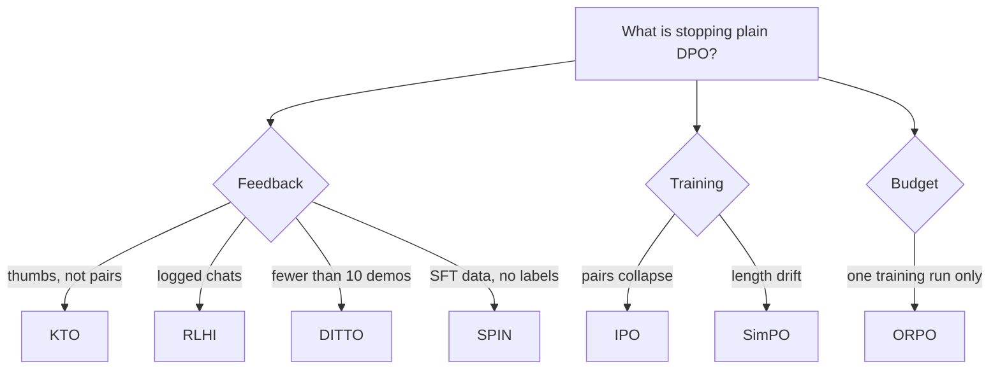

# 13 — Preference Variants

> **Pillar:** [05-RL](../README.md)
> **Presumes:** [03 — Preference optimization](03-preference-optimization.md), DPO in particular. Read this straight after 03; it is numbered 13 only so that the other chapters keep their numbers.
> **Papers:** KTO (2402.01306), IPO (2310.12036), SimPO (2405.14734), DiscoPOP (2406.08414), SPIN (2401.01335)

DPO needs matched pairs, a reference model and a loss that keeps pushing long after the pair is won. Each variant here changes exactly one of those, because a team hit that particular wall: feedback arrived as thumbs and not pairs, training collapsed, the budget had no room for a second stage, or nobody had preference labels at all. Knowing which wall each variant answers is more useful than knowing their acronyms, and the numbers below show how much each one bought and on what evidence.

---

## Which wall are you hitting?



## One margin, different losses

Most offline variants compute the same margin between the chosen and rejected log-ratios, and differ in what they do with it. Here they are side by side, with the margin taken after β. The last two lines show why SimPO normalizes: the chosen answer below is longer and has better per-token probability.

```python
import math

def dpo(margin):     # logistic: never quite zero
    return -math.log(1 / (1 + math.exp(-margin)))

def slic(margin):    # hinge: zero once the margin clears 1
    return max(0.0, 1 - margin)

def ipo(margin):     # squared: also punishes overshooting the target of 1
    return (margin - 1) ** 2

print("margin   DPO   SLiC    IPO")
for margin in (-2, 0, 1, 3, 6):
    print(f"{margin:>6} {dpo(margin):>5.2f} {slic(margin):>6.2f} {ipo(margin):>6.2f}")

def simpo(logp_w, n_w, logp_l, n_l, beta=2.0, gamma=0.5, normalize=True):
    w = logp_w / n_w if normalize else logp_w
    l = logp_l / n_l if normalize else logp_l
    return dpo(beta * (w - l) - gamma)

# The chosen answer is longer: 40 tokens at -1.0 each, against 10 tokens at -1.5 each.
print(f"summed log-probs:   {simpo(-40, 40, -15, 10, normalize=False):.2f}")
print(f"per-token averages: {simpo(-40, 40, -15, 10):.2f}")
```

```text
margin   DPO   SLiC    IPO
    -2  2.13   3.00   9.00
     0  0.69   1.00   1.00
     1  0.31   0.00   0.00
     3  0.05   0.00   4.00
     6  0.00   0.00  25.00
summed log-probs:   50.50
per-token averages: 0.47
```

The columns are the whole story of the first three losses. DPO keeps a small pull at every margin, which is how pairs can run toward zero probability on the rejected side. SLiC stops caring at 1. IPO pushes back once a pair overshoots. The summed SimPO loss of 50.50 is almost all length: the longer answer has more tokens to multiply, so a pair that is already right by quality looks badly wrong. The toy's inputs are made up, and the ablation in the SimPO section measures the same effect.


## KTO — Kahneman-Tversky Optimization

**Paper:** [arXiv:2402.01306](https://arxiv.org/abs/2402.01306) (Ethayarajh et al., 2024-02),
ICML 2024. Named after prospect theory (Kahneman-Tversky).

**Motivation:** DPO requires paired (chosen, rejected) examples. KTO works with unpaired
binary feedback — just labels of "desirable" or "undesirable" for individual outputs.
This matches how feedback often arrives in practice.

**Objective:** Maximizes the "human utility" of model outputs using a utility function
that down-weights extreme rewards (mirroring how humans actually value outcomes). Concretely,
an example's gradient goes to zero once its implied reward is far from the reference point in
either direction, so KTO stops learning from examples the policy finds too easy or too hard.
The authors read that as ignoring likely-mislabelled feedback, at the risk of underfitting
hard-but-correct data (their fix: lower β, more epochs).

**When to use:** When preference pairs are hard to collect but binary thumbs-up/thumbs-down
signals are abundant. More data-efficient than DPO when pairs are scarce. Trained on
HH+OASST+SHP and judged by GPT-4 winrate against the SFT targets, KTO matched or beat DPO from
Pythia-1.4B to Llama-30B. On Zephyr-β-SFT trained on UltraFeedback it raised GSM8K from 40.0
(DPO) to 53.5, and on Llama-7B it still beat DPO with "up to 90% of the desirable data"
discarded. At Llama-13B and 30B, KTO without SFT was competitive with SFT+KTO, while DPO
always needed SFT first. The authors' own limit: "if your preference data has sufficiently little noise and
sufficiently little intransitivity, then DPO will work better."

## IPO — Identity Preference Optimization

**Motivation:** DPO can overfit — the policy collapses to assigning zero probability to
rejected responses. IPO modifies the objective to directly minimize the squared difference
between model preference and a target margin, preventing collapse
([arXiv:2310.12036](https://arxiv.org/abs/2310.12036) (Azar et al., AISTATS 2024)).

**When to use:** When DPO training is unstable or collapses to mode-dropping behavior.

## ORPO — Odds Ratio Preference Optimization

**Motivation:** Eliminates the reference model. ORPO integrates the preference objective
directly into the SFT loss using an odds ratio term, so you train once (not SFT-then-DPO).

**Objective:**

```
L_ORPO = L_SFT - λ · log σ( log(odds_θ(y_w|x) / odds_θ(y_l|x)) )
```

where `odds_θ(y|x) = π_θ(y|x) / (1 - π_θ(y|x))`.

**When to use:** Compute-constrained settings where running SFT and then DPO is too
expensive. Trades some alignment quality for efficiency (no reference model inference).

The SFT term also works as a regularizer when the pairs are noisy. In weak-to-strong
reasoning, Llama2-70b (LoRA) built its own pairs: no gold labels, its majority-vote answer
against a weak model's solution
([arXiv:2407.13647](https://arxiv.org/abs/2407.13647) (Yang et al., Findings of EMNLP 2024)).
On MATH, DPO on those pairs lowered accuracy by 1.4–2.6 points across three weak supervisors.
ORPO raised it by 1.0–2.2, from a base of about 14%. On GSM8K both helped, by 2.6–8.5 points.

## SimPO — no reference model, length-normalized reward

**Paper:** [arXiv:2405.14734](https://arxiv.org/abs/2405.14734) (Meng et al., NeurIPS 2024).

SimPO replaces DPO's implicit reward, the log-ratio against `π_ref`, with the policy's own
**average** log-probability ([defined](../../01-llm-fundamentals/notes/06-pretraining-data-and-objectives.md#entropy-cross-entropy-kl-and-perplexity)) per token. It adds a target margin γ:

```
L_SimPO = -log σ( β/|y_w| · log π_θ(y_w|x) - β/|y_l| · log π_θ(y_l|x) - γ )
```

On AlpacaEval 2 LC (GPT-4 Turbo judge), from the same SFT models, SimPO beat DPO 21.5 to 15.1
on Mistral-7B-Base (UltraFeedback) and 44.7 to 40.3 on Llama-3-8B-Instruct. The Instruct setup
used near-on-policy pairs, sampled from the SFT model and ranked by PairRM. Read the name with
care:

- **The gain comes from length normalization, not from dropping the reference.** In the
  Mistral-Base ablation, SimPO without normalization scored 11.9 LC, below DPO's 15.1. With
  γ = 0 it still scored 16.8. Without normalization, likelihood tracks length (Spearman ρ
  0.82, against 0.59 for DPO and 0.34 for SimPO).
- **"Reference-free" means there is no reference in the loss.** Training still starts from an
  SFT model and has no KL term. A small learning rate is what keeps the policy near its start,
  and the authors warn this "could potentially lead to reward hacking".
- **The saving is small.** It runs about 20% faster and uses 10% less memory than vanilla DPO.
  DPO matches that if the reference log-probs are precomputed.
- **Forgetting is a real cost.** The released Llama-3-8B-Instruct-SimPO reached 53.7 LC, but
  GSM8K fell from 78.5 to 57.4 and MMLU from 61.7 to 54.9. On Gemma-2-9B-it, GSM8K held, and
  SimPO beat DPO 72.4 to 67.8 LC.

Arena-Hard has no length control, so read its gains next to response length. The comparisons
are offline only, with no online DPO or PPO baseline. β of 2–2.5 and γ of 0.5–1.5 need tuning.

## DiscoPOP — a loss found by search

Most offline variants are DPO with a different scalar loss on the same margin
`βρ = β·(log π_θ/π_ref (y_w) − log π_θ/π_ref (y_l))`: logistic gives DPO, hinge gives SLiC,
squared gives IPO. DiscoPOP searched that space automatically. GPT-4 wrote about 100 candidate
losses as PyTorch code, and each one trained zephyr-7b-gemma-sft on the 7k-pair Argilla DPO Mix
at β = 0.05 and was scored on MT-Bench
([arXiv:2406.08414](https://arxiv.org/abs/2406.08414) (Lu et al., NeurIPS 2024)). The winner
blends logistic and exponential losses with a sigmoid gate on the margin, and is non-convex
around ρ = 0. The gains are small. MT-Bench went from 7.888 for DPO to 7.916, and the best
MT-Bench loss did not transfer to held-out tasks. AlpacaEval 2 win rate against GPT-4 went from
11.2% to 13.2% (±1.0), and on TL;DR it about tied DPO. Two cautions carry over to any loss you
tune this way. **Validation reward accuracy did not predict MT-Bench**: DiscoPOP had the worst
accuracy of the four losses plotted. And the loss only worked near the β it was found at: on
GPT-2 IMDb it failed to converge at β ≤ 0.01 and collapsed to NaN at β ≥ 2.5.

## Self-play: SPIN, SPPO, DITTO

These methods build pairs from the model's own samples, round after round. They differ in what
counts as "chosen".

**SPIN** ([arXiv:2401.01335](https://arxiv.org/abs/2401.01335) (Chen et al., ICML 2024)) uses
the human SFT response as chosen and the previous iterate's sample as rejected. It needs no
preference labels at all. On zephyr-7b-sft-full with 50k UltraChat prompts, the Open LLM
Leaderboard average went from 58.14 to 63.16 after four iterations (iterations 0–3). zephyr-7b-dpo-full, trained
on 62k GPT-4-labelled UltraFeedback pairs, scored 61.31. A further SFT epoch scored 57.23. That
leaderboard tests knowledge and reasoning, not chat preference. The gains shrank toward zero
by iteration 3, as the theory predicts: SPIN converges to the SFT data distribution, so it can
only be as good as that data.

**SPPO** ([arXiv:2405.00675](https://arxiv.org/abs/2405.00675) (Wu et al., ICLR 2025)) drops
Bradley-Terry. It treats alignment as a two-player constant-sum game and approximates the Nash
equilibrium with multiplicative weights. In practice that is a square loss pushing
`log π_θ/π_t` toward `η·(P̂(y ≻ π_t) − ½)`, with the win rate estimated by PairRM-0.4B over 5
samples. On Mistral-7B-Instruct-v0.2 with 60k UltraFeedback prompts over 3 iterations,
AlpacaEval 2 LC went from 17.1 to 28.5. The authors' iterative DPO peaked at 24.2 and iterative
IPO at 23.8. Average length also grew, from 1,676 to 2,163. Hyperparameters were chosen by
PairRM win rate, and PairRM itself prefers IPO's longer outputs. Open LLM Leaderboard averages
fell after iteration 1–2.

**DITTO** ([arXiv:2406.00888](https://arxiv.org/abs/2406.00888) (Shaikh et al., ICLR 2025))
takes SPIN's pairing down to fewer than 10 user demonstrations: the user's text is chosen and
the model's samples are rejected. It aligns to one author's style, using Mistral-7B-Instruct
with LoRA. Judged by GPT-4 on 20 authors from CMCC and CCAT50, it won 77% head-to-head on
average, 11.7 points above SFT. The paper puts its lead over SPIN at 20.2 points in the
introduction and 9.3 in the results. In a 16-person user study it won
68.8%, against 55.5% for SFT and 51.6% for few-shot GPT-4. Two limits: updating `π_ref` every
iteration, SPIN-style, dropped the win rate from 70.1% to 45.8%, and the adapter lost general
skills such as coding.

**RLHI** ([arXiv:2509.25137](https://arxiv.org/abs/2509.25137) (Jin et al., 2025-09, preprint))
mines the pairs from logged chats instead. In WildChat, 26.5% of user messages are re-attempts
with feedback ("i said 2000+ word"). The model rewrites its earlier answer to follow that message,
and the rewrite becomes chosen over the original. A persona summarised from the user's past chats
goes into the prompt of both, and the loss is plain DPO. Turns without a follow-up get
best-vs-worst pairs from 64 samples, ranked by Athene-RM-8B given the persona. From
Llama-3.1-8B-Instruct, **the rewrite variant took the o3-judged win rate against the original
ChatGPT replies from 32.5% to 52.0%, and the reward variant reached 77.9% AlpacaEval 2 LC
against 77.0% for the same loop without personas**. The filter does most of the work: without
reward-model filtering of the pairs, the rewrite variant gained only 2.5 points on the user
evaluation, against 23.4 with it. The data is a fixed offline log with Llama-regenerated
replies, the user evaluation covers 100 users, and the math version uses simulated users who
point to the wrong step.

---

## Pitfalls

- **Comparing variants across different judges.** These numbers use GPT-4, GPT-4 Turbo, o3 and PairRM as judges, on different base models. They rank variants within one paper, not across papers.
- **Reading "reference-free" as "no anchor needed".** SimPO has no reference in the loss, so a small learning rate is what keeps it near its start, and the authors warn about reward hacking.
- **Tuning a loss on a benchmark and expecting it to travel.** DiscoPOP's best MT-Bench loss did not transfer to held-out tasks and failed outside its β range.
- **Expecting SPIN to beat its data.** It converges to the SFT distribution, so its gains shrink to zero by design.
- **Choosing hyperparameters with the judge you report on.** SPPO's were chosen by PairRM win rate, and PairRM itself prefers longer outputs.
- **Skipping forgetting checks.** SimPO's released Llama-3-8B lost 21 GSM8K points while gaining chat score, and DITTO's adapter lost coding skills.

## Try it

1. Add DiscoPOP's idea to the table: a blend `gate * dpo(m) + (1 - gate) * math.exp(-m)` with `gate = 1 / (1 + math.exp(-m))`. Print it for the same margins. Where does it differ most from DPO? This is a simplified shape and not the published coefficients.
2. In `simpo`, set both answers to the same average of -1.0 per token, with lengths 40 and 10. What is the loss normalized and summed? What does the gap say about why long answers dominate?
3. Set `gamma=0` in `simpo` on the per-token case. What does the margin γ add?

<details><summary>Answers</summary>

1. It differs most at negative margins, where the exponential term grows faster than the logistic one. At `m=-2` the blend gives about 6.76 against 2.13 for DPO. At large positive margins both approach zero.
2. Normalized, the gap is 0, the argument is -0.5, and the loss is 0.97. Summed, the gap is -30, the argument is -60.5, and the loss is 60.5. Answers of identical quality look wildly different, purely because of length.
3. The loss falls from 0.47 to 0.31. γ demands that the chosen answer wins by a margin, so a pair won narrowly keeps a gradient.

</details>

## Interview checklist

| Question | Answer |
|---|---|
| When is KTO the right choice? | Feedback is unpaired thumbs up or down. With clean transitive pairs, its authors say DPO will work better. |
| What does IPO change? | A squared loss toward a target margin, which stops pairs from collapsing toward zero probability on the rejected side. |
| What does ORPO remove? | The reference model and the second stage, by putting an odds-ratio term into the SFT loss. |
| Where does SimPO's gain come from? | Length normalization. Without it, its Mistral-7B-Base ablation scored below DPO. |
| What did DiscoPOP teach? | Searched losses gain little, validation reward accuracy didn't predict the benchmark, and the loss worked only near the β it was found at. |
| What does self-play need in place of preference labels? | A definition of chosen: SFT data for SPIN, a user's own text for DITTO, a win-rate model for SPPO, and rewrites from logged feedback for RLHI. |

## Next

Back to the sequence: [04 — Constitutional AI](04-constitutional-ai.md) keeps the optimizer and changes where preference labels come from. [06](06-data-and-environments.md#data-engineering-for-post-training) covers building the pairs these losses consume, and [03](03-preference-optimization.md#decision-framework) has the framework for choosing among them. Papers are indexed in [references.md](../references.md#core-papers).
