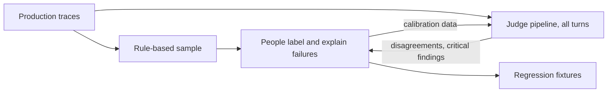

# 5 — Support Agent Observability

> The contract that makes chapters 1 to 4 possible: what a two-framework support agent must log, a validator that catches a trace missing those fields, how eval runs are identified and reproduced, and a promotion policy for when a grounding check may start blocking answers.

Every query in the last four chapters worked because the turn had recorded its route, release, prompt version and tokens. Nobody gets that by accident. The project behind this chapter ran several support agents on more than one framework, and left alone, each framework suggests its own way to instrument. Picture one agent logging `prompt_version`, another `promptVersion`, and a third not logging it at all. Asking which prompt version raised escalations then becomes a data-cleaning project. Chapter 3's ETL, with its fallback paths, is what that looks like after the fact. Here the same agreement is written down in advance, along with the harder question of who decides when a check is good enough to stop an answer from reaching a customer.

This chapter is a schema contract for what every agent logs and how eval runs are identified, reproduced and compared. Platform wiring lives in the tooling notes: [chapter 1](01-tracing-with-langfuse.md) for Langfuse (primary) and [05-langsmith.md](../../04-agentic-frameworks/notes/05-langsmith.md) for LangSmith (secondary).

---

## What to record, and why

For each agent run, record enough that a person can reconstruct what the model saw and what it did.

```text
├── Complete prompt, including system prompts
├── Complete messages[] for multiple rounds of interaction
├── Each tool call + parameters + return value
├── Inference chain, if thinking mode is present
├── Final output
└── Token consumption + latency
```

Semantic retrieval over traces is valuable too: being able to ask "which traces have an agent calling two tools" rather than relying on precise string matching is what enables workflow automation over them.

Dong, Lu and Zhu give this list a more systematic form ([arXiv:2411.05285](https://arxiv.org/abs/2411.05285), Dong, Lu and Zhu, 2024-11, preprint). After mapping 17 agent observability tools, they propose a taxonomy of what to trace. Every span gets operation metadata: name, start time, duration, inputs and outputs, error type and message, metrics such as token counts, events, a parent id and links. Each type of step then adds its own: a tool span records name, version and configuration; a reasoning span records context, retrieved knowledge and outcome; a plan span records goal and constraints. Their argument is that most tools stop at LLM metrics, while an agent's failures are often in its goals, plans and tool choices. They also list the challenges that make agents hard to observe: complex pipelines of artefacts, autonomy, non-determinism, continuous evolution and shared accountability. This is a preprint and they say themselves that the taxonomy has not been validated in real-world case studies, so use it as a checklist to reason with.

Laying it against the support agent shows what we log and what we chose not to.

```python
from collections import Counter
from support_agent import generate_traces

TAXONOMY = {
    "agent":      ("role, persona", {"agent"}),
    "reasoning":  ("context, retrieved knowledge, outcome", set()),
    "plan":       ("goal, constraints, context, past plans", set()),
    "workflow":   ("tasks, dependencies, context", set()),
    "task":       ("description, status", set()),
    "tool":       ("name, version, configuration", {"tool", "retriever"}),
    "evaluation": ("test cases, metrics, results", set()),
    "guardrail":  ("action, target", {"guardrail"}),
    "llm":        ("name, version, parameters", {"generation"}),
}
kinds = Counter(s.kind for t in generate_traces() for s in t.spans)
for span_type, (metadata, ours) in TAXONOMY.items():
    count = sum(kinds[k] for k in ours)
    print(f"{span_type:<11}{count:>6}  {'+'.join(sorted(ours)) or '(not logged)':<20} {metadata}")
```

```text
agent        1400  agent                role, persona
reasoning       0  (not logged)         context, retrieved knowledge, outcome
plan            0  (not logged)         goal, constraints, context, past plans
workflow        0  (not logged)         tasks, dependencies, context
task            0  (not logged)         description, status
tool         2607  retriever+tool       name, version, configuration
evaluation      0  (not logged)         test cases, metrics, results
guardrail    2800  guardrail            action, target
llm          2910  generation           name, version, parameters
```

The gaps are honest ones. Evaluations go in as scores rather than spans, which works because they arrive later. The agent has a fixed sequence with no planner, so there's no plan or workflow to record, and a planning agent would need these. Reasoning is the real gap: we store the answer but not the thinking behind it. On Claude that block is available when the API returns it, and worth logging if you can afford the storage and have thought about who may read it.

### Two-layer evaluation strategy

Logging lets you evaluate, and evaluation of production traffic has two layers.

1. **Manual sampling and labelling.** Based on rules: sample error cases, long dialogues and negative user feedback. People judge execution quality and reasons for failure, primarily to identify failure patterns and provide calibration data for the second layer.
2. **LLM as judge.** Full coverage of a wider range of traces, using the labelling results from layer 1 as calibration. Running only layer 2 makes scoring criteria prone to drift, and relying solely on layer 1 doesn't cover real-world traffic at scale. Both layers must be used together.



Anthropic's agent evals guide makes the same case for combining automated checks and human review, and for reading transcripts ([Demystifying evals for AI agents](https://www.anthropic.com/engineering/demystifying-evals-for-ai-agents), Anthropic, 2026-01, engineering blog). The question for a sample is how much it concentrates on failures, since a purely random one spends a reviewer's hour mostly on turns that went fine.

```python
import pandas as pd
from support_agent import generate_traces
from support_agent.frames import traces_frame

df = traces_frame(generate_traces())
df["failed"] = df["seeded_failure"].notna()
rules = {
    "outcome was error or abandoned": df["outcome"].isin(["error", "abandoned"]),
    "slowest 5% of turns": df["latency_ms"] >= df["latency_ms"].quantile(0.95),
    "negative user feedback": df["user_feedback"].eq(0),
}
print(f"{'all traffic (a random sample)':<32} n={len(df):>5}  planted failures {df['failed'].mean():.0%}")
for name, mask in rules.items():
    print(f"{name:<32} n={mask.sum():>5}  planted failures {df.loc[mask, 'failed'].mean():.0%}")
```

```text
all traffic (a random sample)    n= 1400  planted failures 15%
any ERROR span or bad outcome    n=  193  planted failures 44%
slowest 5% of turns              n=   70  planted failures 70%
negative user feedback           n=   54  planted failures 41%
```

Rules concentrate reviewers' time where the failures are. They also bias what you see, since a turn that was confidently wrong and quick won't appear in any of those lists. So keep a small random slice too.

---

## Base trace metadata

Every agent call, regardless of framework, must emit these fields. They are the minimal contract that makes a trace queryable and a run reproducible.

| Field | Type | Description |
|---|---|---|
| `run_id` | `str` | `uuid4`, unique per invocation |
| `session_id` | `str` | conversation thread id (passed in by caller) |
| `agent` | `str` | `"kb_adk"` \| `"kb_lg"` \| `"kb_rag"` \| `"support_lg"` \| `"support_adk"` |
| `model` | `str` | model name/ARN used for generation |
| `prompt_version` | `str` | `PROMPT_VERSION` constant from the agent module |
| `git_commit` | `str` | short SHA; ties log entry to exact code state |
| `latency_ms` | `float` | wall-clock time from request in to response out |
| `input_tokens` | `int` | prompt token count (if available from model response) |
| `output_tokens` | `int` | completion token count |
| `guardrail_triggered` | `bool` | true if Layer 1 input guard fired |
| `escalated` | `bool` | true if Layer 5 escalation path was taken |
| `retrieval_k` | `int` | number of passages retrieved (0 for non-RAG agents) |
| `grounding_score` | `float \| None` | Layer 4 output guard score (null if not run) |
| `contact_support` | `bool` | `AssistantResponse.contact_support` value |

These go into the trace with `propagate_attributes(metadata=...)` in Langfuse ([chapter 1](01-tracing-with-langfuse.md)), and into `ExperimentRun` below. Token counts need one addition since the original table was written. The cached share of the input has to be logged too, as `cache_read_tokens` and `cache_write_tokens`. The `v2.0` regression in this pillar is invisible without those two fields.

A contract nobody checks decays within a few releases. So test it: a small validator in CI against a recorded turn from each framework, and the same check as a coverage number on production.

```python
from support_agent import generate_traces

REQUIRED = {"trace_id": str, "session_id": str, "agent": str, "release": str, "prompt_version": str,
            "git_commit": str, "route": str, "language": str, "outcome": str, "latency_ms": (int, float)}
OUTCOMES = {"resolved", "escalated", "abandoned", "error"}

def violations(trace):
    problems = []
    for field, kind in REQUIRED.items():
        value = getattr(trace, field, None)
        if value in (None, ""):
            problems.append(f"{field}: missing")
        elif not isinstance(value, kind):
            problems.append(f"{field}: is {type(value).__name__}")
    if trace.outcome not in OUTCOMES:
        problems.append(f"outcome: {trace.outcome!r} is not in the enum")
    for span in trace.spans:
        if span.kind == "generation" and not span.model:
            problems.append(f"{span.name}: generation with no model")
        if span.kind == "generation" and span.input_tokens + span.cache_read_tokens + span.cache_write_tokens == 0:
            problems.append(f"{span.name}: generation with no input tokens")
    return problems

traces = generate_traces()
print("clean fortnight:", sum(bool(violations(t)) for t in traces), "traces with violations")

broken = generate_traces(days=1, per_day=1)[0]
broken.prompt_version = ""
broken.outcome = "ok"
broken.spans[2].model = None
print(violations(broken))
```

```text
clean fortnight: 0 traces with violations
['prompt_version: missing', "outcome: 'ok' is not in the enum", 'route: generation with no model']
```

Run on a recorded turn from each framework, this fails a pull request before a new agent ships without a field. On production, it gives a daily number, and that number dropping tells you about a problem before anyone asks a question the data can't answer.

---

## Experiment tracking schemas

The trace records one turn. An experiment needs a further record: exactly what was run, so that a result six weeks old can be reproduced and two runs can be diffed.

### ExperimentRun: top-level experiment identity

`ExperimentRun` wraps every eval invocation so runs are reproducible and diffable across ablations. `RagConfig` captures full configuration for a single retrieval experiment. Extend it rather than replacing the existing shallow `RagConfig` in `evals/pipelines/lib/models.py`.

```python
from dataclasses import asdict, dataclass, replace

@dataclass
class RagConfig:
    # Chunking
    chunker: str = ""                # "fixed" | "semantic" | "recursive" | "hierarchical"
    chunk_size: int = 0              # retrieval chunk size (chars or tokens)
    chunk_overlap: int = 0
    parent_chunk_size: int = 0       # parent window size (hierarchical only; 0 = flat)
    chunk_unit: str = "chars"        # "chars" | "tokens"

    # Embedding
    embedding_model: str = ""
    embedding_dim: int = 0

    # Indexing
    vector_store_backend: str = ""   # "faiss" | "opensearch" | "pinecone" | "bedrock_kb"
    index_name: str = ""
    distance_metric: str = "cosine"
    index_created_at: str = ""

    # Retrieval
    search_strategy: str = "dense"   # "dense" | "sparse" | "hybrid"
    hybrid_alpha: float = 1.0        # 1.0 = pure dense, 0.0 = pure sparse
    retrieval_k: int = 0
    score_threshold: float = 0.0

    # Reranking
    reranker: str = ""
    reranker_top_k: int = 0

@dataclass
class ExperimentRun:
    run_id: str                      # uuid4, unique per eval invocation
    experiment_name: str             # human label, e.g. "hc-rag-chunking-v3"
    created_at: str                  # ISO 8601 UTC
    git_commit: str                  # short SHA
    dataset: str                     # path to .jsonl eval set
    pipeline: str                    # "kb_rag" | "kb_adk" | "kb_lg" | "bedrock_kb"
    rag_config: RagConfig | None = None
    bedrock_config: object | None = None
    notes: str = ""

def config_diff(a, b):
    """What changed between two runs: the first question when a score moves."""
    x, y = asdict(a), asdict(b)
    return {k: (x[k], y[k]) for k in x if x[k] != y[k]}

v1 = RagConfig(chunker="recursive", chunk_size=800, embedding_model="embed-a", retrieval_k=5, reranker="cross-encoder", reranker_top_k=3)
v2 = replace(v1, retrieval_k=2, reranker="")
run = ExperimentRun("r-101", "retriever-swap", "2026-10-13T09:00:00Z", "c93be17", "evals/golden.jsonl", "kb_rag", rag_config=v2)
print(run.experiment_name, run.git_commit)
print(config_diff(v1, v2))
```

```text
retriever-swap c93be17
{'retrieval_k': (5, 2), 'reranker': ('cross-encoder', '')}
```

The settings shown are invented for the example. The point is the last line: when a score moves, the first question is what changed, and a typed config answers it in one call, where a free-text `notes` field won't.

### BedrockConfig: Bedrock request tracing

`BedrockConfig` captures everything needed to reproduce a Bedrock call and trace it in AWS. Populate `request_id` and `latency_ms` from the response metadata. The sampling fields are a snapshot of what the project sent to older models on Bedrock. Opus 5.5 takes no `temperature` or `top_p`, so they'd stay at their defaults there.

```python
from dataclasses import dataclass, field

@dataclass
class BedrockConfig:
    model_id: str = ""               # full ARN
    anthropic_version: str = ""      # "bedrock-2023-05-31"
    aws_region: str = ""

    max_tokens: int = 0
    temperature: float = 0.0
    top_p: float | None = None
    stop_sequences: list[str] = field(default_factory=list)

    # Knowledge Base
    knowledge_base_id: str = ""
    kb_retrieval_k: int = 0
    kb_search_type: str = ""         # "SEMANTIC" | "HYBRID"
    kb_filter: dict = field(default_factory=dict)

    # Populated from response
    request_id: str = ""             # x-amzn-requestid header
    http_status: int = 0
    latency_ms: float = 0.0

config = BedrockConfig(aws_region="eu-central-1", kb_search_type="HYBRID", kb_retrieval_k=5)
headers = {"x-amzn-requestid": "0a1b2c3d"}
config.request_id, config.http_status, config.latency_ms = headers["x-amzn-requestid"], 200, 412.0
print(config.request_id, config.http_status, config.latency_ms)
```

```text
0a1b2c3d 200 412.0
```

### ChunkRecord: per-chunk document metadata

Critical for hierarchical chunking experiments. It extends what the scraper writes.

```python
import hashlib
from dataclasses import dataclass

@dataclass
class ChunkRecord:
    chunk_id: str                    # deterministic hash(doc_id + start_char)
    doc_id: str
    parent_id: str = ""              # parent chunk ID (hierarchical only)
    level: int = 0                   # 0 = leaf (retrieved), 1 = parent window

    text: str = ""
    char_start: int = 0
    char_end: int = 0
    section: str = ""

    url: str = ""
    source_type: str = ""            # "help" | "blog" | "faq"
    scraped_at: str = ""

    embedding_model: str = ""
    embedded_at: str = ""

def chunk_id(doc_id, start):
    return "c_" + hashlib.sha256(f"{doc_id}:{start}".encode()).hexdigest()[:6]

doc = "doc_123"
parent = ChunkRecord(chunk_id(doc, 0), doc, level=1, text="Reset links last 60 minutes. Request a new one from the login page.")
leaf = ChunkRecord(chunk_id(doc, 0) + "l", doc, parent_id=parent.chunk_id, text="Reset links last 60 minutes.")
store = {c.chunk_id: c for c in [parent, leaf]}

retrieved = leaf                                       # vector search finds the leaf
context = store[retrieved.parent_id].text              # the model gets the parent window
print(retrieved.text, "->", context)
print("same id on re-ingest:", chunk_id(doc, 0) == parent.chunk_id)
```

```text
Reset links last 60 minutes. -> Reset links last 60 minutes. Request a new one from the login page.
same id on re-ingest: True
```

The structure at retrieval time:

```text
doc_123
  └─ chunk c_abc  (level=1, parent_id="")        ← parent window returned to the model
       ├─ chunk c_def  (level=0, parent_id="c_abc")  ← retrieved by vector search
       └─ chunk c_ghi  (level=0, parent_id="c_abc")
```

Fetch the leaf, and return `parent_id`'s text as the model's context. A deterministic id means that re-ingesting the same document gives the same chunk ids, so a golden set's expected chunks keep working.

---

## Custom RAG vs Bedrock KB: field coverage

What you can measure depends on what the platform exposes. A managed knowledge base hides much of what a judge needs.

| Capability | kb_rag (custom) | Bedrock KB |
|---|---|---|
| `chunk_id` / `parent_id` | Can implement | Opaque |
| Retrieved passage text | `sources[].text` | URL only |
| Retrieval score per chunk | `scores[]` | Not exposed |
| `request_id` for tracing | Via HTTP header | `x-amzn-requestid` |
| RAGAS faithfulness / context precision | Yes | No (no text) |
| Rerank scores | Stub only | No |

For fair comparison use only fields both surfaces expose: hit rate / MRR (URL match), latency, LLM-as-judge scores (both supply the final answer text), and cost per query.

---

## Grounding tier promotion policy

A check that logs can be wrong for free. A check that blocks, sending the customer to a person instead of giving them an answer, has a price each time it fires wrongly. So grounding tiers are promoted to hard failures conservatively, and new checks start as log-only diagnostics before they can stop a response.

**Pattern:** implement, observe the false-positive rate in production, and promote to an escalation trigger only after confirming that rate is acceptable.

**Current state in the source project:** Tiers 1–2 (hallucinated citation IDs, missing citations) are hard fails. Tier 3 (quote overlap = 0) is a hard fail. Tier 3 partial (paraphrase) and Tier 4 (relevance score, language mismatch, suggestion URLs) are log-only.

**Why:** overly aggressive grounding checks in a multilingual (Danish/English) context with paraphrase-heavy answers would cause excessive `contact_support` escalations. The log-only phase provides evidence to calibrate thresholds before they affect users.

The policy gets sharper when written as code that reads the logged scores. Measure each check per segment, and let the worst segment decide, since a check that's right in English and wrong in Danish should not block Danish customers.

```python
import pandas as pd
from support_agent import generate_traces
from support_agent.frames import traces_frame

df = traces_frame(generate_traces())
CHECKS = {
    "citation_hallucination": (df["citation_hallucination"] == 1, {"hallucinated_citation"}),
    "language_consistency": (df["language_consistency"] == 0, {"language_mismatch"}),
    "retrieval_quality<0.5": (df["retrieval_quality"] < 0.5, {"retrieval_miss", "wrong_route"}),
}
MIN_PRECISION, MIN_FIRES = 0.8, 5

rows = []
for name, (fires, planted) in CHECKS.items():
    truth = df["seeded_failure"].isin(planted)
    per_language = {}
    for language in ["en", "da"]:
        seg = df["language"] == language
        tp, fp = (fires & truth & seg).sum(), (fires & ~truth & seg).sum()
        per_language[language] = (tp / (tp + fp) if tp + fp else float("nan"), int(tp + fp))
    ready = all(p >= MIN_PRECISION and n >= MIN_FIRES for p, n in per_language.values())
    rows.append({"check": name, "precision_en": round(per_language["en"][0], 2), "fires_en": per_language["en"][1],
                 "precision_da": round(per_language["da"][0], 2), "fires_da": per_language["da"][1],
                 "decision": "may block" if ready else "log only"})
print(pd.DataFrame(rows).to_string(index=False))

wrong_blocks = ((df["language_consistency"] == 0) & ~df["seeded_failure"].isin({"language_mismatch"})).sum()
print("healthy turns sent to a person if language_consistency blocked:", int(wrong_blocks), "in a fortnight")
```

```text
                 check  precision_en  fires_en  precision_da  fires_da  decision
citation_hallucination          0.77        13          1.00         8  log only
  language_consistency           NaN         0          0.23        79  log only
 retrieval_quality<0.5          1.00        60          1.00        21 may block
healthy turns sent to a person if language_consistency blocked: 61 in a fortnight
```

Read the table against the policy. `language_consistency` never fires on English here and is right less than a quarter of the time on Danish, so it stays log-only, and the last line says what blocking on it would cost. `citation_hallucination` is held back by its English precision, even though its Danish fires are all correct. Only the retrieval check passes, and that's precision alone: this table says nothing about what it misses. The thresholds are decisions you'd revisit, not constants. In production you don't have planted labels. The precision comes from people labelling a sample of what each check fired on, which is what layer 1 of the evaluation strategy is for. Record the decision and the evidence with the date, because a promotion is a release like any other and can be rolled back.

---

## An implementation status from the source project

The original notes tracked how far this contract had got in one real multi-framework project. It's kept as an example of what such a tracker looks like, and because the pending list shows the order someone chose. The names in the first table are from the project's older v2 SDK code: `lf.trace()` is now `start_as_current_observation` with `propagate_attributes`, and `lf_trace.span()` is `start_observation`.

### What was live

| Item | Agent | Where | Notes |
|------|-------|-------|-------|
| `lf.trace()` root with full metadata | kb_adk | `main.py:_run_turn` | prompt_version, retrieval_mode, thinking_budget, tokens, failure_reason |
| `lf_trace.span()` KB child spans | kb_adk | `agent.py:_search_bedrock/rag` | per tool call: queries, passage_count, top_score, urls, duration_ms |
| `retrieval_quality` score | kb_adk | `main.py` | kb_top_score from highest-scoring tool call |
| `CallbackHandler` root + node spans | kb_lg | `main.py:_run_turn` | all graph nodes auto-captured |
| `retrieval_quality` score (CRAG formula) | kb_lg | `main.py` | `(relevant×1.0 + ambiguous×0.5) / total` |
| `@observe` root + RAG internals | kb_rag | `main.py:_run_turn` | session_id, prompt_version |
| Online scoring (3 heuristics) | all | `observability.push_online_scores()` | citation_hallucination, missing_citation, language_consistency |
| Remote prompt fetch at startup | kb_adk, kb_lg | `get_root_agent()`, `_get_answer_prompt()` | via `get_langfuse_prompt()` in observability.py |

### What was pending

| Priority | Item | Where |
|---|---|---|
| P0 | Surface `retrieved_urls` in kb_rag `main.py` → enable citation scores | `kb_rag/main.py` + `agent.py:run_turn()` |
| P0 | Wire `ExperimentRun` wrapper into eval runners | `evals/pipelines/eval_quality.py`, `eval_stats.py` |
| P1 | Capture `BedrockConfig.request_id` from `x-amzn-requestid` header | `clients/bedrock_kb.py` |
| P1 | Add `git_commit` to trace metadata (all agents) | `observability.configure_runtime()` |
| P1 | Add `ChunkRecord` with `chunk_id`, `parent_id`, `level` | `core/chunking/schemas.py` |
| P2 | Expand `RagConfig` with `overlap`, `parent_chunk_size`, `hybrid_alpha`, `dim` | `evals/pipelines/lib/models.py` |
| P2 | Wire retrieval-run metadata into local RAG/eval outputs | `evals/pipelines/evaluation.py`, `src/support_agents/kb_rag/rag/ingestion/` |

### Related files in that project

| File | Role |
|---|---|
| `evals/pipelines/lib/models.py` | `RagConfig`, `QATask`, `EvalReport`: extend here |
| `evals/metrics/retrieval.py` | Retrieval metrics and URL matching helpers |
| `evals/pipelines/evaluation.py` | Live local eval runner that writes graded output JSON |
| `core/preprocessing/bkh/pii_scrub.py` | Call before any external LLM grader (GDPR layer) |

---

## Pitfalls

| Pitfall | What happens | Instead |
|---|---|---|
| Each framework names its own fields | Cross-agent questions take days, and ETL grows fallback paths | One written contract, and a validator in CI |
| Contract without cache token fields | The most expensive silent regression can't be seen | Log cache reads and writes as separate fields |
| Promoting a check on overall precision | It blocks one language's customers wrongly | Precision by segment, and let the worst segment decide |
| Sampling only on rules | Quick, confident, wrong turns are never reviewed | Keep a small random slice alongside the rules |
| Running only an LLM judge | Its criteria drift, with nothing to calibrate against | Human labels as the calibration layer |
| Free-text notes on experiments | Six weeks later nobody can say what changed | A typed config, and a diff |
| Non-deterministic chunk ids | A re-index breaks every golden chunk reference | Hash the document id and offset |

---

## Try it

1. Add `cache_read_tokens` to `REQUIRED` at trace level. It isn't a field on `Trace`, so what should the validator do instead?

   <details><summary>Answer</summary>

   Cache fields live on generation spans. Check there: on each generation, the field must exist and be an integer. A value of zero is valid, so don't use a truthiness test, since "zero" and "not logged" are different findings. The `v2.0` regression has zero reads and a large write, which is a valid record of a bad situation.

   </details>

2. Lower `MIN_PRECISION` to 0.2 in the promotion block. What happens to the decisions, and what would the cost be for customers?

   <details><summary>Answer</summary>

   `citation_hallucination` moves to "may block", with about one in four of its English fires now wrongly stopping an answer. `language_consistency` stays log-only, because it has no English fires to measure and `MIN_FIRES` holds it back. That's the guard doing its job: no evidence isn't good evidence. Remove the guard as well and the 61 healthy turns on the last line go to a person, which you can price as a human ticket in [chapter 6](06-cost-and-latency-dashboards.md). Thresholds should come from what a wrong block costs against what a missed failure costs.

   </details>

3. Add a `failure_reason` field with an enum to the contract. Which of the planted failures could an agent report about itself, and which can only be found by something else?

   <details><summary>Answer</summary>

   An agent can report a tool timeout, a retry count, or a slow tool, since it saw them. It can't report a hallucination, a wrong route or a missed escalation it didn't notice. Those need a judge. That split is a reason to have self-reported fields and external scores as separate parts of the schema.

   </details>

---

## Interview checklist

| Question | A good answer |
|---|---|
| What must every agent log, regardless of framework? | Run and session ids, agent, model, prompt version, git commit, latency, input, output and cache tokens, and the outcome. Those make a trace queryable and a run reproducible |
| How do you stop the schema drifting? | A validator in CI on a recorded turn from each framework, and a daily coverage number on production |
| Why two layers of evaluation? | Human labels find failure patterns and calibrate, and judges give coverage. A judge alone drifts, and people alone don't scale |
| When may a grounding check start blocking answers? | After it has run log-only and people have labelled a sample, and when its precision is acceptable in every segment. A multilingual agent makes this strict |
| What's a good sampling strategy for review? | Rules on errors, long turns and bad feedback to concentrate on failures, plus a small random slice to find what the rules can't see |
| What does a managed knowledge base cost you in observability? | Chunk ids, passage text and per-chunk scores. Without them you can't compute faithfulness, so comparisons have to use shared fields such as URL hit rate |
| What does the AgentOps taxonomy add? | A checklist of span types beyond LLM calls, so that plans, reasoning and tools get their own metadata. It's from a preprint and hasn't been validated in real case studies |

---

## Next

→ [06-cost-and-latency-dashboards.md](06-cost-and-latency-dashboards.md): the same fields become money and milliseconds, with the budget alerts that would have caught the October regression within a day.
