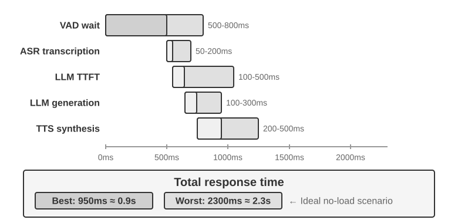
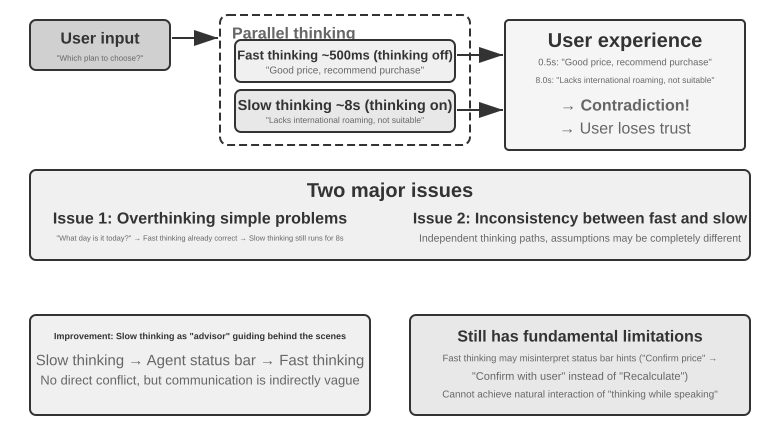
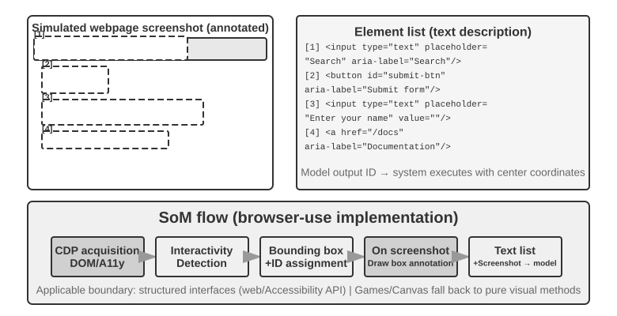

# 3 — Real-time multimodal agents: voice, computer use, robotics

> When input streams in and output has a hard time budget, serial pipelines give way to end-to-end models and a fast/slow split: a quick model acts, a slow one checks.

Presumes [03-agentic-foundations 01 — agent fundamentals](../../03-agentic-foundations/notes/01-agent-fundamentals.md). Source: Bojie Li, *AI Agents in Depth* (2026), [ch. 6](https://github.com/bojieli/ai-agent-book/blob/main/book-en/chapter6.md) (Apache-2.0).

Static image and document understanding is a solved part of normal agent work. This note covers the three settings where **real-time constraints** make multimodality hard: voice dialogue, GUI operation and robot control. Input arrives continuously and output has a strict time budget. All three are moving the same way: from **serial pipelines** toward **end-to-end models**, and toward a **fast/slow division of labor**. Image and video *generation* is out of scope. It is an ordinary tool call.

---

## Voice: three paradigms

The framing comes from OpenAI's GPT-Live launch (2026). It matches the three generations of ChatGPT Voice. All three coexist in production as trade-offs. A newer one doesn't simply replace an older one. One question separates them: **how far each gets from VAD's assumption that conversation happens in discrete turns.**

| Paradigm | Shape | Turn-taking | Examples |
|---|---|---|---|
| **Cascaded** | VAD → ASR → LLM → TTS, each a separate model | VAD guesses turns from silence | Most commercial assistants, the original ChatGPT Voice |
| **End-to-end omnimodal (Omni)** | One model listens, thinks and speaks | Still turn-based, still VAD-driven | gpt-realtime, Gemini Live, Qwen3-Omni, Step-Audio 2 |
| **Full-duplex / interactive** | Listens and speaks at the same time, deciding many times a second whether to speak, listen, stop, interrupt or call a tool | No turns at all | Moshi (2024), TML Interaction Model, GPT-Live (2026) |

### Paradigm 1: the cascaded pipeline


*Figure 6-7, Latency waterfall for a serial response. From Li, [*AI Agents in Depth*](https://github.com/bojieli/ai-agent-book/blob/main/book-en/chapter6.md) (Apache-2.0).*

**The latency budget (fully serial, short reply, no reasoning):**

| Stage | Typical latency | Note |
|---|---|---|
| VAD end-of-speech | 500–800 ms | Silence threshold. Too short cuts users off mid-thought. Too long adds dead air |
| ASR (Whisper, SenseVoice) | 50–200 ms | 200–500 ms on constrained hardware. The LLM sits idle meanwhile |
| LLM TTFT | 100–500 ms | 5–10 s if reasoning is enabled |
| LLM first short segment | 100–300 ms | |
| TTS first segment | 200–500 ms | |
| **Total** | **≈ 0.95–2.3 s** | Above ~2 s, people get restless |

**Queueing makes it worse.** Total latency ≈ idle latency × 1/(1 − utilization). That is 2× at 50% load and 5× at 80%, which is why voice servers can't run hot. The arithmetic is short enough to run, and it shows what a capacity decision costs in the only unit a caller feels:

```python
STAGES_MS = {  # low and high typical values from the table above
    "VAD end-of-speech": (500, 800),
    "ASR": (50, 200),
    "LLM time to first token": (100, 500),
    "LLM first segment": (100, 300),
    "TTS first segment": (200, 500),
}
BUDGET_MS = 2000  # roughly where people get restless

low = sum(stage[0] for stage in STAGES_MS.values())
high = sum(stage[1] for stage in STAGES_MS.values())
print(f"idle: {low} to {high} ms")

for utilization in (0.0, 0.5, 0.7, 0.8, 0.9):
    factor = 1 / (1 - utilization)
    # Silence detection waits on the speaker, not the server, so only the model stages queue.
    wait_low, wait_high = STAGES_MS["VAD end-of-speech"]
    total_low, total_high = wait_low + (low - wait_low) * factor, wait_high + (high - wait_high) * factor
    verdict = "ok" if total_high <= BUDGET_MS else "over budget at the slow end"
    if total_low > BUDGET_MS:
        verdict = "over budget even at the fast end"
    print(f"{utilization:>4.0%} load  x{factor:>4.1f}  {total_low:>5.0f} to {total_high:>5.0f} ms  {verdict}")
```

Output:

```text
idle: 950 to 2300 ms
  0% load  x 1.0    950 to  2300 ms  over budget at the slow end
 50% load  x 2.0   1400 to  3800 ms  over budget at the slow end
 70% load  x 3.3   2000 to  5800 ms  over budget at the slow end
 80% load  x 5.0   2750 to  8300 ms  over budget even at the fast end
 90% load  x10.0   5000 to 15800 ms  over budget even at the fast end
```

Note the refinement over the rule of thumb: silence detection is not queueing, so it does not scale with load. That is also why cutting the VAD wait pays off at any load, and why semantic turn detection and full-duplex models get so much attention.

**Full-chain streaming** keeps the modules but makes each one emit early:
- ASR transcribes while the user is still talking.
- The LLM streams and splits text into speech-ready chunks at punctuation.
- TTS synthesizes chunk by chunk.

What actually overlaps is limited. ASR overlaps the user's speech, and the rest of the LLM output overlaps TTS and playback. The three models don't all run at once on the same turn. **Speculative generation** goes further. It starts the LLM on a stable partial transcript, then cancels or corrects if the transcript changes, and holds playback until the turn is confirmed. Frameworks such as LiveKit Agents and Pipecat support it. You still have to implement commit, invalidation and rollback yourself; turning on a `stream` flag doesn't do it. No amount of streaming removes **the turn decision itself**.

### Streaming voice perception: replacing VAD + ASR

VAD + ASR has three built-in problems:
1. **Latency.** VAD can't predict the future. It can only wait for silence.
2. **Information loss.** VAD outputs one bit: voice or silence. Emotion, hesitation, background sound and the difference between "uh-huh" as acknowledgment and "uh-huh" as interruption are all gone.
3. **Accuracy.** Cutting audio into independent segments destroys context. In "john dot smith at gmail dot com", if "smith" lands in its own segment it can come out as "miss". In the book's Exp 9-3, "around two o'clock" became "around midnight".

**What "streaming" means technically:** a **causal or chunked encoder**, which needs only the audio that has already arrived, plus **incremental decoding**. Whisper can't stream. Its decoding is fine. The problem is that its encoder needs a full 30-second window. Streaming ASR itself is old: RNN-T and streaming Conformer power phone captions and keyboard dictation, with no LLM involved.

Two newer paths:
- **LLM-based streaming auditory perception.** An LLM backbone post-trained to consume a continuous audio stream directly. Examples: Ultravox, Qwen2-Audio, Qwen2.5-Omni. It sees the *whole* conversation, not VAD fragments. That enables in-context learning of names and terms, plus world-knowledge priors ("Apple" + "event" → the company). It emits **acoustic event tokens** alongside text: `<speak_start/end>` (a semantic plus acoustic judgment), `<interrupt>`, `<emotion:…>`, `<laugh>`, `<noise>`.
- **Turn detection inside the recognizer.** This is lighter. A LoRA on a small streaming ASR model weighs semantics and silence together. A silence threshold alone is guaranteed to fail both ways, because pauses *within* a turn (reciting a phone number) often run longer than gaps *between* turns. **The wavering came from the labels, not the architecture.** The labels had been annotated with audio from *after* the decision point, which the online model can never see. Re-labeling with only causal information fixed it: data over architecture again. Production versions: Deepgram Flux and AssemblyAI Universal-Streaming.

### Paradigm 2: end-to-end omnimodal (Omni)

**What it buys:**
- One model, so paralinguistics (emotion, prosody, ambient sound) can flow through the latent space instead of being squeezed into text.
- Lower latency.

**What it costs:**
- More training data.
- Worse interpretability and debuggability.

**End-to-end wins on latency, not necessarily on accuracy.** Compare **self-cascade**: the same model transcribes to structured text, then reasons over that. When the answer depends mainly on *what was said*, self-cascade matches or beats end-to-end, especially for models with weak perception. When it depends on *how it was said* (tone, emotion, environmental sound), end-to-end wins. You can **predict the winner from the task**. What matters is what information the bottleneck carries, not whether a bottleneck exists. Upgrade the intermediate text to include paralinguistic markers and the gap narrows.

**The models:**
- **gpt-realtime** is native audio but still uses server-side VAD. It adds barge-in and **asynchronous function calls**, so the model keeps talking while a tool runs.
- **Qwen3-Omni** splits into a Thinker (understanding and reasoning) and a Talker (speech), on MoE. The split comes from Qwen2.5-Omni (7B, dense), where the Talker reads the Thinker's hidden states. Omni costs some text ability: Qwen2.5-Omni scores 47.0 on MMLU-Pro against 56.3 for Qwen2.5-7B ([Qwen2.5-Omni](https://github.com/QwenLM/Qwen2.5-Omni/blob/main/assets/Qwen2.5_Omni.pdf) (Qwen Team, 2025-03)).
  - MoE raises **throughput** (less queueing). It does not lower **first-packet latency**.
  - First-packet latency, about 234 ms, comes from the Talker's multi-codebook autoregression plus a causal codec. Speech starts streaming as soon as the Thinker emits text.
- **LLaMA-Omni** shows the architecture at small scale: a speech encoder, a speech adaptor, Llama-3.1-8B and a streaming speech decoder, trained on the InstructS2S-200K dataset that the authors built for it ([Fang et al.](https://arxiv.org/abs/2409.06666), 2024, preprint). It is a useful reading because the parts are open and simple.
- **Kimi-Audio** (7B, 13M hours of audio) scores 76.93 on VoiceBench against 72.83 for Qwen2.5-Omni, on the vendor's own eval toolkit with a GPT-4o-mini judge. In production it is still turn-based behind VAD ([Kimi-Audio](https://github.com/MoonshotAI/Kimi-Audio/blob/master/assets/kimia_report.pdf) (Kimi Team, 2025-04)).
- **Step-Audio 2** scores 83% on its own paralinguistic benchmark, against about 44% for GPT-4o Audio and Qwen2.5-Omni.

**The remaining flaw:** Omni still takes turns. A user pauses mid-number and Omni cuts in. Semantic turn detection only patches the turn framework. It doesn't remove it.

### Paradigm 3: full-duplex

Simultaneous interpretation and rhythm games have no turns at all. Full-duplex drops the turn assumption.

- **Moshi** (Kyutai, 2024) models two audio streams, the user's and its own, plus an "inner monologue" text stream. Overlap and interruption need no special logic. Latency is 160 ms in theory and **about 200 ms in practice**. The audio training has a cost: text MMLU falls from 54.3 for its base LM to 49.7 ([arXiv:2410.00037](https://arxiv.org/abs/2410.00037) (Défossez et al., 2024-09)).
- **TML Interaction Model** (Thinking Machines Lab, 2026). The argument: interactivity should live *inside* the model, not in a VAD harness around it. It works in **~200 ms micro-turns**, with audio, video and text interleaved. It can speak up unprompted ("that code has a bug"). TML-Interaction-Small is a 276B MoE with 12B active parameters, with a turn-switch latency of about 0.40 s against about 1.18 s for GPT-realtime-2.0. It is a research preview.
- **GPT-Live** (OpenAI, 2026) is full-duplex at 150M-user scale. It waits while the user thinks, backchannels ("mm-hmm") and translates live.

The arc: VAD guesses turns from silence → streaming perception guesses them from meaning → full-duplex has no turns, so barge-in handling largely disappears from the architecture.

---

## Thinking architectures: real-time vs. deep thought


*Figure 6-10, Fast/slow thinking architecture and design alternatives. From Li, [*AI Agents in Depth*](https://github.com/bojieli/ai-agent-book/blob/main/book-en/chapter6.md) (Apache-2.0).*

Users want millisecond responses. Hard questions need seconds. Cascaded and end-to-end systems face this equally. Three solutions coexist. **Solutions 1 and 2 use two independent models and can sit on top of a cascade. Only Solution 3 internalizes reasoning.**

| | Fast model | Slow model | Failure |
|---|---|---|---|
| **1. Fast fillers, slow answers** | Says "let me think" or a quick answer within 500 ms | Answers fully after 5–10 s | **Overthinking** (repeats "Wednesday" ten seconds later). **Contradiction**: the fast model says "buy it", the slow one says "wait, it lacks roaming". Two independent minds with no coordination |
| **2. Fast interacts, slow advises** | Owns the conversation | Runs in the background, sees the fast model's output, and sends advice through a text channel such as the [Agent Status Bar](../../../ai-engineering/02-context-engineering/notes/02-context-anatomy.md) | The fast model can misread advice ("reconfirm the price" taken as "ask the user"). It can't see the slow model's intermediate reasoning. It **can't think while speaking**: only fillers until the slow model reports |
| **3. Unified (Step-Audio R1)** | One model thinks *while* speaking | — | Must be both the best reasoner and a real-time speaker. Both are moving targets, so it needs repeated retraining |

**Solution 2 is the 2026 mainstream:** GPT-Live delegating to GPT-5.5, TML Interaction Models, Grok Voice "Think Fast" and Pine AI. The reason is pragmatic. Frontier reasoners change every few months, while interaction skills need specialized data. Keep the strongest reasoner intact in the background, train only a light foreground model, and you can always swap in the newest "brain". TML hands the background model the *entire conversation context*, not an isolated query, and streams results back to be woven in when the moment fits.

**Step-Audio R1** combines two mechanisms:
- **MGRD (Modality-Grounded Reasoning Distillation)** fixes **textual surrogate reasoning**. Audio models whose CoT data came from text models reason about transcripts ("the lyrics mention sadness") instead of sound ("minor key, falling pitch contour"). This is why longer CoT made them *worse*. The fix:
  1. Sample several reasoning traces.
  2. Keep only the traces that cite concrete acoustic features ("speech rate 40% faster, pitch sharper").
  3. Run SFT on those traces.
  4. Run RL to stop the model skipping the thinking.
  5. Iterate.
- **MPS (Mind-Paced Speaking)** is a dual brain. A **Formulation Brain** streams reasoning segments, and an **Articulation Brain** turns each segment, plus the reply so far, into speech. First syllable at about 350 ms.

| Config (Exp 9-4) | Spoken-MQA | URO-Bench |
|---|---|---|
| No thinking | 70.6% | 77.4 |
| MPS Speak-First (zero latency) | 92.8% | 82.5 |
| MPS Think-First (~80 tok latency) | 93.9% | 84.8 |
| Full think-before-speak | 93.0% | — |

Speak-First costs almost nothing, because the start of a CoT mostly restates the problem.

### The fast/slow interface: beyond text

Solution 2's channel is text: easy to debug, but narrow. The **Latent Bridge** (Li & Shi 2026, arXiv:2606.24470) freezes a fast reactor and a slow reasoner. It trains only a bridge of a few tens of millions of parameters, which projects the slow model's hidden state into a few **latent tokens** in the fast model's input, the way vision tokens are inserted. On Atari it beats the text channel by +26% to +82% in some games, for about 5 ms per step. **The limit:** fast/slow pays off only when the bottleneck is "can't think of it", not "can't react in time". Gains track how much better the slow model is (r ≈ 0.9). The same question returns for Computer Use and robotics: **when is a slow strategist worth the latency?**

---

## Speech synthesis: imperfection on purpose

Perfectly fluent TTS sounds machine-made. Human pauses and fillers signal thinking and uncertainty. **Let the LLM decide prosody** by emitting control tokens: `[THINKING]` (1–2 s pause plus "um…"), `[SEARCHING]`, `[EMO:happy]`, `[SPEED:0.8x]`, `[SIGH]`, `[LAUGH:small]`, `[BREATH]`. Only the LLM knows whether it is mid-hard-problem, whether the user is impatient, or whether this is small talk. TTS becomes a multimodal generator that takes text plus control tokens and returns audio.

There are two ways to build it:
- **Proprietary TTS** with native control tokens. Most flexible, but needs a dedicated team.
- **Voice cloning plus a reference library.** Takes weeks. Exp 9-5 uses 24 five-second clips covering emotion × speed × style on Fish Audio S1. The control tokens choose a clip, and timbre stays consistent. Compared with no control tokens (robotic) and a single clip (monotone), the multi-reference library sounds close to a human agent.

---

## Computer Use


*Figure 6-13, Set-of-Mark vs. Structured Element Indexing (browser-use implementation). From Li, [*AI Agents in Depth*](https://github.com/bojieli/ai-agent-book/blob/main/book-en/chapter6.md) (Apache-2.0).*

The **perceive-think-act loop**:
1. Screenshot.
2. A multimodal model reads it and outputs a thought and an action.
3. Execute the action.
4. Wait, then screenshot again.

The design axes are the action space, visual grounding and the model.

**Action space (Anthropic's tools):**
- **`computer`:** mouse move, click, drag, down/up, scroll with modifiers; `type` (12 ms between keys), `key`, `hold_key`; screenshot, `cursor_position`, `wait`.
- **bash:** persistent session, 120 s timeout, completion detected with a sentinel string.
- **`str_replace_editor`:** view, create, replace, insert, undo. Safer than overwriting whole files.

See [03-tool-design](../../../ai-engineering/03-harness-engineering/notes/03-tool-design.md). Each action cycle takes 2–5 s, much slower than a human.

**Visual grounding: three routes.**

| Route | How | Use when |
|---|---|---|
| **Set-of-Mark (visual)** | A segmentation model (SAM, SEEM) numbers regions. The model answers "click [7]" | No structure available: native desktop apps, games |
| **Structured element indexing** | Read the DOM or accessibility tree over CDP, number the interactive elements, draw boxes and send an element list (`browser-use`) | **Prefer this whenever structure exists.** Most accurate and stable. Doesn't save tokens |
| **Coordinate prediction** | The model outputs (x, y) directly (SeeClick, Claude computer use) | Canvas or WebGL, models trained for GUI grounding |

Labeling turns fill-in-the-blank into multiple choice. All three routes still struggle with small elements and dense screens.

**Resolution matters for coordinate prediction.** Claude was trained at XGA (1024×768), WXGA (1280×800) and FWXGA (1366×768). Pick the target by **aspect ratio**, scale the screenshot down, then map the coordinates back. Example: a 2560×1440 screen → FWXGA, and (683, 384) → (1280, 720). Squashing 16:9 into 4:3 shifts every prediction.

**Screenshot-only models.** Two papers show the coordinate route working without a DOM. CogAgent ([arXiv:2312.08914](https://arxiv.org/abs/2312.08914) (Hong et al., 2023-12)) adds a 0.30B high-resolution cross-attention branch to CogVLM-17B. That lets it read 1120×1120 screenshots, where tiny icons and text survive, at under half the FLOPs of CogVLM at 490×490. On Mind2Web, from screenshots alone, it scored 58.2 against 54.4 for LLaMA2-70B reading the HTML and 30.9 for few-shot GPT-4. On Android-in-the-Wild it scored 76.88 against 74.27. The authors re-checked the "errors" and judged over 40% of them to be valid alternative paths, so the benchmark undercounts. UI-TARS ([arXiv:2501.12326](https://arxiv.org/abs/2501.12326) (Qin et al., 2025-01)) trains a native agent on Qwen2-VL that does perception, grounding, reasoning and action in one model. Its training includes DPO on corrected mistakes collected online. On ScreenSpot-Pro, a grounding test on high-resolution professional apps, the 72B model scored 38.1 against 31.1 for UGround-7B and 17.1 for Claude Computer Use. CogAgent scored 7.7 there. On OSWorld (screenshot-only, averaged over 3 runs), it scored 22.7 at a 15-step budget against Claude's 14.9, and 24.6 at 50 steps against 22.0. DPO alone moved the 72B model from 18.8 to 22.7. Thinking before each action was slightly worse with one sample, and helped only at 16–64 samples or out of domain. The team that built the model also ran almost all of these evaluations.

**From apps to whole desktops.** The GUI-agent literature moved fast, and a survey is the best way in. Zhang et al. organize it around an LLM "brain" and GUI automation "hands", across web, mobile and desktop ([LLM-Brained GUI Agents](https://arxiv.org/abs/2411.18279), TMLR 2025). Read in order, these papers trace how the problem shifted:

| Paper | Move | Evidence |
|---|---|---|
| [Enabling conversational interaction](https://arxiv.org/abs/2209.08655) (Wang et al., CHI 2023) | Prompt one LLM, with a handful of examples, for four mobile UI conversation tasks | Before agents: showed that a screen can be text an LLM reads |
| [AppAgent](https://arxiv.org/abs/2312.13771) (Zhang et al., 2023) | Reduce the action space to taps and swipes, and build a knowledge base by exploring or watching a demonstration | 50 tasks across 10 apps |
| [SeeAct](https://arxiv.org/abs/2401.01614) (Zheng et al., 2024) | Separate generating the action from grounding it to an element | GPT-4V completes 51.1% of live-site tasks with oracle grounding, with a large gap for the best real grounding. So grounding was the bottleneck |
| [Dawn of GUI agents](https://arxiv.org/abs/2411.10323) (Hu et al., 2024) | A case study of Claude 3.5 Computer Use over planning, action and critic | Qualitative. Useful for how it fails |
| [GUI-R1](https://arxiv.org/abs/2504.10458) (Luo et al., 2025) | Reinforcement fine-tuning with a unified action space, GRPO and a small amount of curated data | Points to RL instead of more demonstrations ([post-training note](../../05-RL/notes/05-post-training-for-agents.md)) |
| [OpenCUA](https://arxiv.org/abs/2508.09123) (Wang et al., NeurIPS 2025) | Open dataset, AgentNet, across 3 operating systems and 200+ apps, with reflective reasoning traces | Opens up what labs had kept private |
| [Agent S3](https://arxiv.org/abs/2510.02250) (Gonzalez-Pumariega et al., 2025, preprint) | Run several rollouts, then pick a winner by comparing behaviour narratives | 72.6% on OSWorld, 9.2 points above the prior best and level with the 72.36% human figure, at a 100-step budget, so a generous allowance |

Agent S3 is worth a second look, because its parallel rollouts spend extra time and compute for reliability. That is the reverse of the latency story in this note: an agent with no one waiting can buy accuracy with more tries, and a voice agent cannot.

**Dynamic screens: the observation interface.** Screenshot loops assume a static screen. They miss videos, toasts and meeting audio. The **Agent–Computer Observation Interface** (Li & Shi 2026, arXiv:2606.29472) is middleware that needs no retraining. It has three parts:
1. Keyframe capture, gated by pixel diff and then a small model.
2. Speech transcription, gated by volume.
3. **One-sentence text narration of each captured frame**, which stays in memory after the image is evicted.

The text narration does most of the work, more than frame selection. Across eight models the gain was +17 to +48 points, largest on voice tasks. Too many image tokens hurt some newer models, so **choose components per model**.

**Mobile:**
- The action space is accessibility APIs plus gestures. The same (x, y) can be a tap, a long press or the start of a swipe. Benchmarked on AndroidWorld.
- The real blocker is **ecosystem**. Platforms make money from attention: ads, recommendations, impulse buys. An agent that goes straight to the goal skips all of that. It's a structural conflict of interest, not just CAPTCHAs.

**Efficiency is now the bottleneck.**
- OSWorld success has climbed from about 20% toward human level.
- **OSWorld-Human** shows agents take many more steps than humans. Per-step latency also *grows* as the context grows, so a tweak that takes a human seconds takes an agent minutes.
- There's no systematic fix yet. Agents can't predict their next action while the current one is still executing.

The workaround is **fast/slow decoupling** (Li & Shi, *Talking While Acting*). A fast voice model talks to the user while a slow VLM operates the browser. They share a **plain-text contract**, a rolling status line such as "filling the form, still need your date of birth". **The fast model must never say "done" until the status confirms it.** Voice responses got about 15× faster.

The contract is simple enough to test. In this stub the slow agent is a generator that updates a status line. The fast model only reads the status, and the rule that protects the user lives in code and not in a prompt:

```python
def slow_agent():
    yield "working", "opening the booking page"
    yield "working", "filling the form"
    yield "needs_user", "need your date of birth to continue"
    yield "working", "submitting the form"
    yield "done", "booked, confirmation 7Q2"


def fast_reply(user_said, state, status):
    if "done" in user_said and state != "done":
        return f"Not yet: {status}."  # the rule: never claim completion before the status does
    if state == "needs_user":
        return f"One question: {status}."
    if state == "done":
        return f"All set: {status}."
    return f"Still on it, {status}."


for (state, status), said in zip(slow_agent(), ["book it", "is it done?", "1990-01-02", "done yet?", "ok"]):
    print(f"user: {said:<12} status: {state:<10} fast: {fast_reply(said, state, status)}")
```

Output:

```text
user: book it      status: working    fast: Still on it, opening the booking page.
user: is it done?  status: working    fast: Not yet: filling the form.
user: 1990-01-02   status: needs_user fast: One question: need your date of birth to continue.
user: done yet?    status: working    fast: Not yet: submitting the form.
user: ok           status: done       fast: All set: booked, confirmation 7Q2.
```

---

## Robotics

**Hardware isn't the bottleneck for vision-guided household tasks; algorithms are.** A sub-$1,000 dual-arm XLeRobot does a wide range of chores under VR teleoperation at 100–200 ms latency. The limit: touch sensing and dexterous hands are still real hardware gaps for force-sensitive work.

**Two layers** (planning vs. control, a different split from MPS's thinking vs. speaking):
- **Long-horizon planning (slow)** answers *what* to do. "Clean the kitchen" → clear the counter, load the dishwasher, wipe. Gemini Robotics-ER 1.5 is tuned for embodied reasoning: 62.8% across 15 spatial benchmarks, against 60.6% for GPT-4o. In Exp 9-9 it drives navigation at 0.5–1 Hz with three tools (forward, left, right). Its spatial reasoning is strong, but it is fragile over many steps.
- **VLA control (fast)** answers *how*. A VLA is a VLM plus action output, trained mainly by behavior cloning.
  - RL-trained VLAs do well on single tasks but generalize poorly. SimpleVLA-RL ([post-training note](../../05-RL/notes/05-post-training-for-agents.md)) trains one model per task.

**Action representations:**
- **Discrete tokens: RT-2 and OpenVLA.** Actions are binned into tokens and decoded like text. OpenVLA is the open version: Llama 2 plus a vision encoder, pretrained on Open X-Embodiment (20+ robots), then fine-tuned for each platform.
- **Continuous trajectories: π₀.** Flow matching denoises a smooth trajectory. Better for dexterous work. "Choosing from a menu vs. sketching the curve."
- **Action chunking (ACT, 2023)** bridges the frequency gap. Control loops run at 50–1000 Hz, and VLA inference at 1–10 Hz; the original OpenVLA ran at 6 Hz and moved jerkily. Generate 25–50 actions (0.5–1 s at 50 Hz) per inference. Replay them while the next chunk computes, like video buffering.
  - The trade-off: longer chunks are smoother but **blind to sudden changes**. The two-layer design relocates the real-time tension. It doesn't remove it.

**Sim2Real.** Domain randomization (see [06-eval environments](../../../ai-engineering/06-eval/README.md)) plus two steps you can't skip:
1. **Calibrate the randomization range from measured real data.** Measure friction and motor delay. Too narrow misses reality. Too wide gives a policy that handles everything and masters nothing.
2. **Align visuals.** Match the camera pose between simulation and reality, and splice in real backgrounds (greenscreen).

Exp 9-10 shows the full pipeline: LeRobot + ManiSkill, RGB only, PPO to >90% in simulation, then a zero-shot grasp on a real SO100 arm. Success drops sharply on objects outside the training distribution.

---

## The common thread

| | Serial bottleneck | End-to-end move | Fast/slow split | Still open |
|---|---|---|---|---|
| **Voice** | VAD → ASR → LLM → TTS | Omni → full-duplex | Interaction model + background reasoner | Debuggability of end-to-end |
| **Computer Use** | Screenshot → think → click | — | Voice model + slow GUI agent | Per-step latency, continuous video |
| **Robotics** | Plan → act | VLA | Planner + VLA with action chunking | Cross-task generalization, data |

When the fast path acts before the slow path checks ("correct after misspeaking", "click first, then look", "step, then look"), **irreversible actions need a gate**. See [execution boundaries](../../../ai-engineering/03-harness-engineering/notes/04-execution-boundaries.md).

---

## Labs

All ch. 6 labs (numbered 9-N in the book's experiment list) need API keys, GPUs or hardware, so they are linked upstream, not copied.

| Exp | Lab | Needs |
|---|---|---|
| 9-1 | [live-audio](https://github.com/bojieli/ai-agent-book/tree/main/chapter6/live-audio): cascaded voice chat, Silero VAD, pluggable ASR/LLM/TTS | Node + provider keys + mic |
| 9-2 | [phone-agent](https://github.com/bojieli/ai-agent-book/tree/main/chapter6/phone-agent): ReAct agent with a `make_phone_call` tool over PineClaw Voice | PineClaw + LLM keys |
| 9-3 | [streaming-speech](https://github.com/bojieli/ai-agent-book/tree/main/chapter6/streaming-speech): chunked "simulated streaming" ASR vs. a whole-utterance baseline | ASR API key |
| 9-4 | [end-to-end-speech](https://github.com/bojieli/ai-agent-book/tree/main/chapter6/end-to-end-speech): end-to-end vs. cascade latency and paralinguistic loss (uses `gpt-audio` in place of Step-Audio R1) | OpenAI key |
| 9-5 | [controllable-tts](https://github.com/bojieli/ai-agent-book/tree/main/chapter6/controllable-tts): control-token parser + reference voice library | TTS key |
| 9-6 | [Anthropic computer-use demo](https://github.com/anthropics/claude-quickstarts/tree/main/computer-use-demo) | Docker + Anthropic key |
| 9-7 | [browser-use](https://github.com/browser-use/browser-use) with SoM visualization | Playwright + model key |
| 9-8 – 9-10 | [XLeRobot teleop](https://xlerobot.readthedocs.io/en/latest/software/getting_started/XLeRobot_teleop.html), [LLM agent control](https://xlerobot.readthedocs.io/en/latest/software/getting_started/LLM_agent.html), [LeRobot sim2real](https://github.com/StoneT2000/lerobot-sim2real/blob/main/docs/zero_shot_rgb_sim2real.md) | GPU for sim. Real arm to deploy |

---

## Pitfalls

- **Optimizing the model and ignoring the queue.** A faster LLM is worth little on a server at 90% load.
- **Measuring average latency.** Users remember the slow turns. Track tail latency per stage, since queueing makes the tail much worse than the mean.
- **A silence threshold as turn detection.** Pauses inside a turn can run longer than gaps between turns, so one threshold fails both ways.
- **Letting the fast model claim completion.** A confident "done" while the slow agent is still working is the worst failure of a fast/slow system. Enforce it from the status, in code.
- **Two independent minds.** A filler model and a reasoner with no shared channel will contradict each other. Give them a contract, and let the slow side correct before speech where possible.
- **Benchmarks that hide cost.** A high OSWorld score at 100 steps can still be unusable, at seconds per step, for someone waiting.
- **Coordinate prediction on the wrong aspect ratio.** Squashing the screenshot shifts every click. Scale by aspect ratio and map back.
- **Irreversible actions on the fast path.** "Click first, look later" needs a gate for anything you cannot undo. Treat what appears on a screen as untrusted input too, since a page can carry instructions for the agent.

## Try it

1. **Find the load limit.** Using the latency block, at what utilization does the slow end of the range first cross 2 seconds? How much further does the fast end go?

   <details><summary>Answer</summary>

   Solve `800 + 1500 / (1 - u) = 2000`, which gives `u = -0.25`, so the slow end is over budget even when idle (2,300 ms). The fast end solves `500 + 450 / (1 - u) = 2000`, which gives `u = 0.70`. The printed table agrees: it crosses between 70% and 80%. So the slow-end stack needs a design change, whereas a fast-end stack needs a utilization limit.
   </details>

2. **Cut the VAD wait.** Change the VAD stage to `(100, 300)`, as a semantic turn detector might give you. What load can you now carry at the slow end?

   <details><summary>Answer</summary>

   Solve `300 + 1500 / (1 - u) = 2000`, which gives `u` of about 0.12. A small gain at the slow end, because the model stages dominate it, but at the fast end `100 + 450 / (1 - u) = 2000` gives about 0.76. Check both by editing the block. This is the argument for treating turn detection and model speed as separate levers.
   </details>

3. **Break the contract.** Remove the completion check from `fast_reply`. Which user line now produces a wrong statement? Write the assertion that would catch it in a test.

   <details><summary>Answer</summary>

   The "is it done?" turn now gets "Still on it", which is honest by luck, because the reply only reads the state. The contract matters when a real fast model writes the sentence itself, so test the output: `assert not ("done" in reply.lower() and state != "done")`, run over a transcript from a real or stubbed model. Do not rely on the wording of the prompt.
   </details>

## Interview checklist

| Question | Strong answer |
|---|---|
| Why does a voice agent feel slow even when the LLM is fast? | The serial sum (VAD silence wait + ASR + TTFT + TTS, about 1 to 2 s), multiplied by queueing at load. Fix it with streaming, speculative generation, semantic turn detection or full-duplex. |
| End-to-end or cascade for a support line that must capture order numbers exactly? | Content-determined, so a (self-)cascade with structured transcripts is as accurate and debuggable. Go end-to-end when tone and emotion drive the outcome. |
| How do you add deep reasoning without adding latency? | Use a fast foreground model with a background reasoner on a text or status channel. Hand it the full context, never let the fast model claim completion early, and resolve contradictions in favour of the slow model *before* speaking. |
| How do you observe an end-to-end voice model? | Log the input audio, the event tokens and the inner-monologue or text stream. Run self-cascade replays to localize errors to perception or reasoning. |
| DOM indexing or pure vision for Computer Use? | Index when structure exists, fall back to SoM or coordinates on canvas, and keep both paths. Pick the route per model. |
| Action chunking versus sudden change? | Use shorter chunks near contact, re-plan on visual anomaly triggers, and blend overlapping chunks. |
| What did SeeAct show about GUI agents? | With oracle grounding GPT-4V completed 51.1% of live-site tasks, with a large gap to real grounding. Finding the element, rather than choosing the action, was the bottleneck at that time. |
| Is human-level OSWorld performance the end of the story? | No. Agent S3's 72.6% used multiple rollouts at a 100-step budget. Agents still take many more steps and much longer than people, and efficiency is now the bottleneck. |

---

## Cross-links

- **Upstream:** [03-agentic-foundations 01 — agent fundamentals](../../03-agentic-foundations/notes/01-agent-fundamentals.md) (the ReAct loop these systems extend), [05-RL 05 — post-training for agents](../../05-RL/notes/05-post-training-for-agents.md) (voice SFT, SimpleVLA-RL, data > architecture)
- **Lateral:** [harness tool design](../../../ai-engineering/03-harness-engineering/notes/03-tool-design.md) (the computer/bash/editor action space), [context anatomy](../../../ai-engineering/02-context-engineering/notes/02-context-anatomy.md) (Agent Status Bar as the fast/slow channel), [orchestration](../../../ai-engineering/03-harness-engineering/notes/07-orchestration.md) (fast/slow as a two-agent pattern)
- **Downstream:** [ai-engineering/06-eval](../../../ai-engineering/06-eval/README.md) (OSWorld, AndroidWorld, simulation environments)

## Next

Voice and screens make the time budget hard. [A coding agent](04-coding-agent.md) has a looser clock and a stricter judge: tests that return a verdict, on tools that can do real damage.
