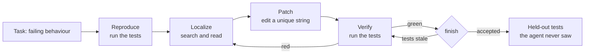

# 4 — A Coding Agent: Read, Edit, Test, Inside Limits

A coding agent is the application where the loop from the earlier notes meets a machine that can say no. A research agent's report is judged by a reader, later and with effort. A coding agent's patch is judged by a test suite, in seconds, for nothing. That single fact shapes the whole design: the agent should be built to get that verdict early and often, and the harness around it should refuse to call the job finished until the verdict is good. This note builds such a harness, runs it end to end against a small repo with a scripted model, and then breaks it on purpose. The agent's tools are confined, its tests are killed on a timer, its repeated calls are halted, and we finish by showing the one thing those limits do not stop.

---

## Where this sits

Notes [01](01-internet-search-agent.md) and [02](02-deep-research-bot.md) built agents that gather and write. Note [03](03-real-time-multimodal-agents.md) added a clock and a screen. Coding adds a verdict and a blast radius: the tools now change files and run code, so mistakes are checkable and also dangerous. Coding agents are the largest class of shipped agentic applications, among them [Claude Code](https://code.claude.com/), [Codex CLI](https://github.com/openai/codex), [Aider](https://aider.chat/) and [OpenHands](https://docs.all-hands.dev/). This note stays on what makes coding different as an application. The general theory of harnesses is in [ai-engineering 03](../../../ai-engineering/03-harness-engineering/README.md), with sandboxes in [its execution boundaries note](../../../ai-engineering/03-harness-engineering/notes/04-execution-boundaries.md).

The running question of this part of the pillar comes from here on: **what would prove this answer wrong, and who checks?** For a patch the answer is a test. In note [05](05-data-analysis-agent.md) it becomes a recomputation.

## The loop: reproduce, localize, patch, verify

Stripped of everything else, a coding agent is the tool loop from [agentic foundations](../../03-agentic-foundations/README.md) with three tools. Here it is in thirty lines, with a repo held in a dictionary and a model that follows a script, so nothing can go wrong yet and the shape is plain.

```python
repo = {"stats.py": "def median(v):\n    s = sorted(v)\n    return s[len(s) // 2]\n"}


def read_file(path):
    return repo[path]


def edit_file(path, old, new):
    repo[path] = repo[path].replace(old, new)
    return "edited"


def run_tests():
    scope = {}
    exec(repo["stats.py"], scope)
    got = scope["median"]([1, 2, 3, 4])
    return "pass" if got == 2.5 else f"FAIL: median([1, 2, 3, 4]) returned {got}, expected 2.5"


TOOLS = {"read_file": read_file, "edit_file": edit_file, "run_tests": run_tests}
FIX = "    n = len(s)\n    return s[n // 2] if n % 2 else (s[n // 2 - 1] + s[n // 2]) / 2\n"
script = [
    ("run_tests", {}),
    ("read_file", {"path": "stats.py"}),
    ("edit_file", {"path": "stats.py", "old": "    return s[len(s) // 2]\n", "new": FIX}),
    ("run_tests", {}),
]

for step, (name, args) in enumerate(script, 1):  # a real model chooses each call from the transcript
    observation = TOOLS[name](**args)
    print(f"{step} {name:<10} -> {observation.splitlines()[0]}")
```

Output:

```text
1 run_tests  -> FAIL: median([1, 2, 3, 4]) returned 3, expected 2.5
2 read_file  -> def median(v):
3 edit_file  -> edited
4 run_tests  -> pass
```

The order of those four steps is not arbitrary. Yang et al. inspected SWE-agent's trajectories over SWE-bench and found the same arc: agents start by reproducing the issue or localizing the code, then spend the rest of the run in edit and execute cycles (Yang et al., [SWE-agent](https://arxiv.org/abs/2405.15793), NeurIPS 2024). Reproducing first matters because it turns a prose bug report into a failing command, which is the only thing that can later show the fix worked. An agent that skips it has no way to know.



## The agent-computer interface

Giving a model a shell and hoping is the obvious starting point, and it is measurably worse than designing the interface. SWE-agent calls this design the agent-computer interface (ACI), meaning the commands the model can issue and the format of what comes back. Its authors offer four principles: actions should be simple to understand, actions should be compact so one step does useful work, feedback should be informative but concise, and guardrails should stop errors from propagating. On SWE-bench Lite, with GPT-4 Turbo and a $4 per-instance budget, the same model solved 18.0% of issues with the designed interface and 11.0% with a plain shell, against 2.67% for a RAG baseline with no agent loop. Their ablations show which choices carried weight:

| SWE-agent ablation (SWE-bench Lite, GPT-4 Turbo) | Issues solved |
|---|---|
| **Default:** summarized search, 100-line viewer, linted edits, last 5 observations kept, one demonstration | **18.0%** |
| File viewer shows 30 lines at a time | 14.3% |
| File viewer shows the full file | 12.7% |
| Iterative search (results one at a time) | 12.0% |
| No search tool | 15.7% |
| Edit tool without the linter | 15.0% |
| No edit tool at all | 10.3% |
| Full observation history kept | 15.0% |
| No demonstration in the prompt | 16.3% |

*Source: Yang et al., NeurIPS 2024, ablation table. Percentages of the 300 Lite instances.*

Both directions of the file viewer lose. Thirty lines hides the context needed to edit, and the full file floods the context so that the relevant lines compete with everything else. Search that returns at most 50 results, and otherwise asks for a narrower query, beats search that shows one result at a time. These are the same context-budget arguments as [note 02's compaction](02-deep-research-bot.md#context-engineering-compaction-at-80), with a number attached.

OpenDev, a later coding agent described in a long engineering report, sets the same idea out as defaults: line-numbered reads of up to 2,000 lines, per-line truncation at 2,000 characters, and tool output above 30,000 characters cut to its first and last 10,000 (Bui, [Building Effective AI Coding Agents](https://arxiv.org/abs/2603.05344), 2026-03, preprint). Bui reports tool output as 70 to 80% of the context in a typical session. That is experience reported from building one system, not a controlled measurement, but it explains why output truncation gets so much attention.

## Editing without damage

An edit tool is where a small interface decision prevents a whole class of failure. Three rules are worth their code.

**Match a unique string, not a line number.** Line numbers shift as soon as the first edit lands. A string the model must copy exactly also proves it has seen the text. If the string appears twice, refuse and ask for more surrounding lines, because guessing which one was meant silently changes the wrong code.

**Refuse a stale read.** If the file changed since the agent read it, whether from a formatter, a human or a second agent, its picture of the file is wrong and its edit may overwrite that work. OpenDev rejects the edit and tells the model to re-read, using file modification times. Hashing the content, as below, does the same job and has no timestamp edge cases.

**Reject edits that do not parse.** SWE-agent's edit tool runs a linter and discards invalid edits, which is the 15.0 to 18.0 row in the table above. The reason shows up in its trajectories: 51.7% of them (1,185 of 2,294) had at least one failed edit, and the chance of eventually producing a successful edit fell from 90.5% overall to 57.2% after a single failure. A broken edit left in the file is expensive because every later step works from a damaged tree.

```python
import ast
import hashlib
import tempfile
from pathlib import Path


class ToolError(Exception):
    """The message is written for the model: it says what to do next."""


class Editor:
    def __init__(self):
        self.read_hashes = {}

    def read(self, path):
        text = path.read_text()
        self.read_hashes[path] = hashlib.sha256(text.encode()).hexdigest()
        return text

    def edit(self, path, old, new):
        if path not in self.read_hashes:
            raise ToolError("Read the file before editing it.")
        text = path.read_text()
        if hashlib.sha256(text.encode()).hexdigest() != self.read_hashes[path]:
            del self.read_hashes[path]
            raise ToolError("The file changed since you read it. Read it again, then retry.")
        count = text.count(old)
        if count != 1:
            raise ToolError(f"`old` matches {count} places. It must match exactly one.")
        updated = text.replace(old, new)
        try:
            ast.parse(updated)
        except SyntaxError as err:
            raise ToolError(f"Edit discarded, the file would not parse: {err.msg}.")
        path.write_text(updated)
        self.read_hashes[path] = hashlib.sha256(updated.encode()).hexdigest()
        return "edited"


def attempt(label, fn):
    try:
        print(f"{label:<18} {fn()}")
    except ToolError as err:
        print(f"{label:<18} REFUSED: {err}")


with tempfile.TemporaryDirectory() as tmp:
    file = Path(tmp) / "stats.py"
    file.write_text("a = 1\nb = 1\n")
    editor = Editor()
    attempt("before reading", lambda: editor.edit(file, "a = 1", "a = 2"))
    editor.read(file)
    attempt("ambiguous", lambda: editor.edit(file, " = 1", " = 2"))
    attempt("not found", lambda: editor.edit(file, "c = 1", "c = 2"))
    attempt("syntax error", lambda: editor.edit(file, "a = 1", "a = ("))
    attempt("good edit", lambda: editor.edit(file, "a = 1", "a = 2"))
    file.write_text(file.read_text() + "# a formatter ran\n")
    attempt("stale read", lambda: editor.edit(file, "b = 1", "b = 2"))
    print(file.read_text().replace("\n", " | "))
```

Output:

```text
before reading     REFUSED: Read the file before editing it.
ambiguous          REFUSED: `old` matches 2 places. It must match exactly one.
not found          REFUSED: `old` matches 0 places. It must match exactly one.
syntax error       REFUSED: Edit discarded, the file would not parse: '(' was never closed.
good edit          edited
stale read         REFUSED: The file changed since you read it. Read it again, then retry.
a = 2 | b = 1 | # a formatter ran |
```

Read the refusal messages as part of the tool. "Try again" gives the model nothing, whereas "read the file again, then retry" is a next action. Bui makes the same point about error messages, and in a real run the message is the only thing standing between a refusal and the same call repeated.

## Sandbox limits: what each layer stops

The tools above act on files the agent chooses, and running tests executes code the agent wrote. Those two facts need different limits, and confusing them is the most common mistake in this area. A file-tool check is a promise about the tool. A process limit is a promise about what code can do.

The first layer is confinement of the file tools. Resolve the path, including symlinks, and refuse anything outside the workspace. A string check for `..` is not enough, because a link inside the repo can point anywhere.

```python
import tempfile
from pathlib import Path


def confined(root, rel):
    path = (root / rel).resolve()  # follows symlinks, unlike a check on the string
    if not path.is_relative_to(root):
        raise PermissionError(f"{rel!r} is outside the workspace")
    return path


with tempfile.TemporaryDirectory() as tmp:
    root = (Path(tmp) / "repo").resolve()
    root.mkdir()
    (root / "ok.py").write_text("x = 1\n")
    (root / "link.py").symlink_to("/etc/hosts")
    for rel in ["ok.py", "../secrets.txt", "/etc/passwd", "link.py"]:
        try:
            print(f"{rel:<16} allowed: {confined(root, rel).name}")
        except PermissionError as err:
            print(f"{rel:<16} refused: {err}")
```

Output:

```text
ok.py            allowed: ok.py
../secrets.txt   refused: '../secrets.txt' is outside the workspace
/etc/passwd      refused: '/etc/passwd' is outside the workspace
link.py          refused: 'link.py' is outside the workspace
```

The second layer is process limits on the test run: a fixed command rather than a free-form shell, a clean environment so API keys do not leak into code under test, a wall clock, and output truncated at both ends so that the failure at the bottom survives. A patch containing an infinite loop is a normal event in this work, so the runner has to kill the whole process group and then tell the model what happened.

```python
import os
import signal
import subprocess
import sys


def head_tail(text, limit=120):
    if len(text) <= limit:
        return text
    return f"{text[:limit // 2]}[... {len(text) - limit} characters omitted ...]{text[-limit // 2:]}"


def run(code, timeout=1.0):
    proc = subprocess.Popen(
        [sys.executable, "-c", code], env={"PATH": "/usr/bin:/bin"}, text=True,
        stdout=subprocess.PIPE, stderr=subprocess.STDOUT, start_new_session=True,
    )
    try:
        output, _ = proc.communicate(timeout=timeout)
    except subprocess.TimeoutExpired:
        os.killpg(proc.pid, signal.SIGKILL)
        proc.communicate()
        return f"killed after {timeout:g} s, look for an infinite loop"
    return f"exit={proc.returncode} {head_tail(output.strip())}"


os.environ["ANTHROPIC_API_KEY"] = "not-for-the-tests"
print(run("print('ok')"))
print(run("while True: pass"))
print(run("import os; print(os.environ.get('ANTHROPIC_API_KEY'))"))
print(run("print('x' * 500, flush=True); raise SystemExit('the failure is at the end')"))
```

Output:

```text
exit=0 ok
killed after 1 s, look for an infinite loop
exit=0 None
exit=1 xxxxxxxxxxxxxxxxxxxxxxxxxxxxxxxxxxxxxxxxxxxxxxxxxxxxxxxxxxxx[... 406 characters omitted ...]xxxxxxxxxxxxxxxxxxxxxxxxxxxxxxxxxx
the failure is at the end
```

The third layer is the schema. A tool the model does not have cannot be misused, so a shell that is never offered is stronger than a shell behind a blocklist. Bui's report argues this from experience with five stacked safety layers: prompt guardrails, schema-level tool restrictions, runtime approval, tool-level validation and lifecycle hooks. It finds schema-level restriction more reliable than the runtime checks, for instance by removing write tools entirely from a planning subagent. Our lab offers four tools and marks `tests/` read-only, because otherwise the cheapest way to make a test pass is to change the test.

| Layer | In the lab | Stops | Does not stop |
|---|---|---|---|
| Tool schema | `read_file`, `edit_file`, `run_tests`, `finish`; no shell | Arbitrary commands from the model | Code the tests execute |
| Path confinement | `resolve()` plus `is_relative_to` | `../`, absolute paths, symlink escapes through tools | Same |
| Write scope | Only `tipkit/` is writable | Editing tests to pass them | Reading anything in the repo |
| Edit guards | Must read, unique match, no stale read, must parse | Blind, ambiguous, clobbering and broken edits | Wrong logic |
| Process limits | Fixed command, clean env, wall clock, CPU and file-size rlimits, throwaway copy | Hangs, key leakage, disk filling, damage to the source repo | Network, reads and writes elsewhere |
| Real isolation | **Not in the lab.** Container or VM, no network, unprivileged user | Everything above, at the operating-system level | Whatever you mount into it |

That table's last two rows are the honest part. The `escape` scenario in the lab edits `tipkit/stats.py` so that importing it writes a file outside the repo, and running the tests carries it out. Every tool check passes, because no tool touched that file:

```text
=== escape: The honest limit. File tools are confined; code run by the tests is not.
 1  read_file  ok:    1  """Summary statistics over tip records. The agent's job is to fix a bug here."""
 2  edit_file  ok: Edited tipkit/stats.py. Run the tests to check it.
 3  run_tests  ok: exit=1
status=stopped_without_finish:end_turn steps=4 refused=0
file written outside the repo by code under test: escaped.txt = 'written by code under test'
```

Python-level checks cannot fix this, since the test runner must execute the agent's code by definition. For anything beyond a teaching repo, run the test command inside a container or VM with no network, no credentials and only the workspace mounted. Everything else in this note then becomes defence in depth instead of the only defence.

## Stopping: evidence, budgets and loops

An agent loop has several ways to end, and only one should count as success. In the lab, `finish` is refused unless the tests have passed since the last edit, and a model that merely stops talking is recorded as `stopped_without_finish`, a failed run. "I believe that is done" is not evidence.

Budgets matter for a reason beyond cost. SWE-agent's runs succeed fast and fail slow: successful runs had a median cost of $1.21 and 12 steps, while unsuccessful ones averaged $2.52 and 21 steps, and 93.0% of resolved issues were submitted before the budget ran out compared with 69.0% of runs overall (Yang et al.). A tight step budget therefore costs fewer solved issues than its size suggests, since time spent past a certain point is mostly time spent failing.

A loop can also spin without progress: the same failing call, repeated. OpenDev hashes the tool name and arguments over a sliding window, injects a warning at three repeats, and then pauses for approval if the repeating continues, on the reasoning that a model can ignore injected text but cannot get past a halt in execution (Bui). One refinement is needed for coding. Re-running the tests after an edit is the whole method, so the fingerprint has to include the state of the files.

```python
import hashlib
import json


def fingerprint(name, args, tree):
    return hashlib.md5(json.dumps([name, args, tree], sort_keys=True).encode()).hexdigest()[:8]


def supervise(calls, repeat_limit=3):
    seen = {}
    for name, args, tree in calls:
        key = fingerprint(name, args, tree)
        seen[key] = seen.get(key, 0) + 1
        if seen[key] > repeat_limit:
            print(f"{name:<10} tree={tree}  HALT")
            return
        verdict = "warn: change approach" if seen[key] == repeat_limit else "run"
        print(f"{name:<10} tree={tree}  {verdict}")


# Tests re-run after each edit: the tree changes, so this is progress and never trips.
supervise([("run_tests", {}, "v1"), ("edit_file", {"old": "a"}, "v1"),
           ("run_tests", {}, "v2"), ("edit_file", {"old": "b"}, "v2"),
           ("run_tests", {}, "v3")])
print()
# The same call on the same files: a warning, then a real stop.
supervise([("run_tests", {}, "v1")] * 5)
```

Output:

```text
run_tests  tree=v1  run
edit_file  tree=v1  run
run_tests  tree=v2  run
edit_file  tree=v2  run
run_tests  tree=v3  run

run_tests  tree=v1  run
run_tests  tree=v1  run
run_tests  tree=v1  warn: change approach
run_tests  tree=v1  HALT
```

## Visible tests can be gamed by accident

A green suite is necessary and not sufficient. SWE-bench handles this by construction: each instance comes from a real GitHub issue, the agent sees the issue, and its patch is scored on tests from the fix that it never saw (Jimenez et al., [SWE-bench](https://arxiv.org/abs/2310.06770), ICLR 2024). SWE-agent's failure analysis of 248 Lite failures, labelled by GPT-4o and checked at 87% agreement against hand labels, shows why that matters. Incorrect implementations (39.9%) and overly specific ones (12.1%) together make up 52.0% of failures, ahead of failing to recover from an edit (23.4%) and failing to find the place to edit (12.9%). Most failures, in other words, are patches that exist and are wrong.

The lab reproduces the overly specific case. The `overfit` script special-cases the visible test's one input. The visible suite goes green, `finish` accepts it, and only the held-out tests catch it:

```bash
cd practice/coding-agent && uv run python run.py fix overfit
```

```text
=== fix: Reproduce, read, patch, verify, finish.
 1  run_tests  ok: exit=1
 2  read_file  ok:    1  """Summary statistics over tip records. The agent's job is to fix a bug here."""
 3  edit_file  ok: Edited tipkit/stats.py. Run the tests to check it.
 4  run_tests  ok: exit=0
 5  finish  ok: Accepted.
status=finished steps=5 refused=0
held-out tests: pass (OK)

=== overfit: Passes the visible suite by special-casing its one input.
 1  run_tests  ok: exit=1
 2  read_file  ok:    1  """Summary statistics over tip records. The agent's job is to fix a bug here."""
 3  edit_file  ok: Edited tipkit/stats.py. Run the tests to check it.
 4  run_tests  ok: exit=0
 5  finish  ok: Accepted.
status=finished steps=5 refused=0
held-out tests: FAIL (FAILED (failures=2))
```

The trajectories are identical in shape and differ only in the held-out line. Keep some tests the agent cannot see. In a real repository that may mean a CI job on the merged result, or tests a reviewer asks for, and the principle is the same one that keeps a validation set out of training.

## The whole lab, under attack

[practice/coding-agent/](../practice/coding-agent/) wires the pieces into one harness around a small package, `tipkit`, with a real bug in `median`. The model is scripted, so it runs offline and gives the same result each time. It uses the same `create(messages, tools)` interface and message shape as the Claude API, so the harness is what is being exercised. The `guards` scenario makes nine bad calls in a row and then recovers:

```text
=== guards: Every call the file tools should refuse, then a clean recovery.
 1  read_file  REFUSED: '../../secrets.txt' is outside the workspace. Use a path relative to the repo root.
 2  read_file  REFUSED: 'tipkit/link.py' is outside the workspace. Use a path relative to the repo root.
 3  shell  REFUSED: There is no tool called shell. You have: ['edit_file', 'finish', 'read_file', 'run_tests
 4  edit_file  REFUSED: Read tipkit/stats.py before editing it.
 5  read_file  ok:    1  import unittest
 6  edit_file  REFUSED: tests/test_stats.py is read-only. Fix the code under ('tipkit/',), not the tests.
 7  read_file  ok:    1  """Summary statistics over tip records. The agent's job is to fix a bug here."""
 8  edit_file  REFUSED: `old` matches 2 places in tipkit/stats.py. Include more surrounding lines.
 9  edit_file  REFUSED: Edit discarded, tipkit/stats.py would not parse: '(' was never closed (line 15).
10  finish  REFUSED: Not finished: the tests have not passed since the last edit. Run them.
11  edit_file  REFUSED: tipkit/stats.py changed since you read it. Read it again, then retry the edit.
12  read_file  ok:    1  """Summary statistics over tip records. The agent's job is to fix a bug here."""
13  edit_file  ok: Edited tipkit/stats.py. Run the tests to check it.
14  run_tests  ok: exit=0
15  finish  ok: Accepted.
status=finished steps=15 refused=9
held-out tests: pass (OK)
```

A scripted model proves that the limits hold. It says nothing about how good a real model would be with these tools, and that is a measurement you would run on a benchmark such as SWE-bench.

To use Claude, replace the scripted model with a class that has the same method. The loop in `agent.py` already follows the manual tool-use pattern: it appends the assistant message, runs each `tool_use` block, returns a `tool_result` for each one with `is_error` set on refusals, and checks `stop_reason` before doing anything else. The SDK's [tool runner](https://platform.claude.com/docs/en/agents-and-tools/tool-use/overview) is the shorter route when you do not need your own loop. Here we do, because the step cap, the repeat halt and the `finish` gate have to run between calls.

```python
# illustrative: needs ANTHROPIC_API_KEY and the anthropic package, and costs money to run.
# Same class in practice/coding-agent/claude_model.py; not run here, the loop around it is tested with the script.
import anthropic

SYSTEM = (
    "You fix bugs in a small Python repo. Reproduce the failure with run_tests, read the code, "
    "make the smallest general fix, run the tests again, then call finish. Do not edit the tests."
)


class ClaudeModel:
    def __init__(self):
        self.client = anthropic.Anthropic()

    def create(self, messages, tools):
        return self.client.beta.messages.create(
            model="claude-opus-5-5",
            max_tokens=16000,
            system=SYSTEM,
            tools=tools,
            messages=messages,
            betas=["server-side-fallback-2026-07-01"],  # rerun a declined request on a fallback model
            fallbacks="default",
        )
```

## Who is supervising

A coding agent also changes the person using it. Shen and Tamkin ran a randomized trial with 52 crowdworkers who had at least a year of Python experience, learning a new library (Trio) over 35 minutes with or without a GPT-4o assistant (Shen & Tamkin, [How AI Impacts Skill Formation](https://arxiv.org/abs/2601.20245), 2026-01, preprint). In a later quiz without AI, the assisted group scored 4.15 points lower on a 27-point scale, about two grade points (Cohen's d = 0.738, p = 0.010). They were not significantly faster (p = 0.391). The gap was largest on debugging questions, although that breakdown was exploratory. Within the AI group, small clusters of participants showed different patterns: those who delegated wholesale or leaned on the assistant to debug scored below 40%, while those who asked conceptual questions, or generated code and then worked through it, scored between 65% and 86%.

This is a chat assistant, on a short task, with a small sample, and it comes from a preprint. So hold it loosely, but its direction matters for this note. Every limit above assumes a human can review the result, and debugging is the skill that review draws on and that the study found most at risk. That is why you should write the loop yourself before using one, and why the harness keeps the transcript readable.

## Pitfalls

- **Treating file-tool checks as a sandbox.** They constrain the tools, not the code the tests run. Without process or OS isolation, the model can reach anything your user can, one test run away. The `escape` scenario shows it.
- **Letting the agent edit the tests.** The fastest route to green is deleting the assertion. Make tests read-only or review every test change separately.
- **Accepting "done" from the model.** Ending a turn is not evidence. Gate the end state on a passing run after the last edit.
- **Only visible tests.** Half of SWE-agent's analysed failures were wrong or overly specific patches. Keep held-out checks.
- **Showing whole files and whole logs.** Too much output costs as much as too little. Use a viewing window and head-tail truncation, and keep the end of the log, where the failure usually is.
- **Line-number edits.** They go stale after the first change. Use exact, unique strings and refuse stale reads.
- **A repeat detector that ignores state.** It will flag the normal test-edit-test rhythm. Include a digest of the files in the fingerprint.
- **Vague refusals.** "Error" invites the same call again. Say what to do next.
- **Leaking credentials.** A subprocess inherits the environment by default. Pass an explicit, minimal one.

## Try it

Run the lab first: `cd practice/coding-agent && uv run python run.py`, then `uv run python -m unittest test_agent`.

1. **Catch the overfit earlier.** The `overfit` scenario passes until the held-out stage. Add a test to `toy_repo/tests/test_stats.py` that would have caught it during the run, and check that the scenario then ends differently.

   <details><summary>Answer</summary>

   Add an even-length case with other values, such as `median([10, 40, 20, 30]) == 25`. The patch's `ordered == [1, 2, 3, 4]` branch no longer helps, so the second `run_tests` returns `exit=1`, `finish` is refused and the run ends `stopped_without_finish:end_turn`. A better visible suite moves the catch earlier, and held-out tests remain useful for what you did not think of.
   </details>

2. **Add a search tool.** Add `search(pattern)` to `Workspace` and `TOOLS`, using the SWE-agent rule: at most 50 matching lines, otherwise ask for a narrower query. What must it share with `read_file`?

   <details><summary>Answer</summary>

   Walk `root.rglob("*.py")`, skip symlinks that resolve outside the root (reuse `_resolve`), and return `path:line: text` for matches. If there are more than 50, raise `ToolError` asking for a narrower pattern instead of returning a partial list, which the model could mistake for the whole. Sharing path confinement is the point: a new tool is a new way out if it skips the check.
   </details>

3. **Close the escape.** Run the test command inside a container or OS sandbox so the `escape` scenario fails. What should the mount and network settings be?

   <details><summary>Answer</summary>

   With Docker: `docker run --rm --network none --user 1000 --read-only --tmpfs /tmp -v "$PWD/repo:/repo" -w /repo python:3.13-slim python -m unittest discover -s tests -t .`. Only the workspace is mounted, so `../escaped.txt` lands on the read-only root and raises an error, and there is no network or credentials. The file-tool checks stay in place as a second layer. This needs Docker installed, so it is not part of the offline lab.
   </details>

4. **Break the fingerprint on purpose.** Remove `workspace.tree_digest()` from `fingerprint()` in `agent.py`, and run a script that needs more test runs than `repeat_limit` allows. What goes wrong, and which scenario is the smallest demonstration?

   <details><summary>Answer</summary>

   Identical `run_tests` calls with no arguments now look like a loop even when the files changed between them, so a legitimate third test run is refused and a fourth halts the agent. No built-in scenario runs tests that often, so extend `timeout` with one more failed fix attempt. The detector is measuring "same call", when the thing you care about is "same call with nothing changed".
   </details>

## Interview checklist

| Question | Strong answer |
|---|---|
| What makes coding different from other agent applications? | The environment returns a cheap, fast verdict, the tests, and the tools carry real risk. So design around getting that verdict early and gate completion on it. |
| What is an agent-computer interface, and why does it matter? | The commands and the output format the model works through. On SWE-bench Lite the same model went from 11.0% with a shell to 18.0% with a designed interface (Yang et al.). |
| Why not show the whole file? | SWE-agent's full-file viewer scored 12.7% against 18.0% with a 100-line window. Too much output crowds out the relevant lines; too little (30 lines, 14.3%) hides context. |
| How should the edit tool work? | Exact unique string, required prior read, stale-read refusal, parse or lint check before writing, and a refusal message that names the next action. |
| Is path confinement a sandbox? | No. It limits tools. Tests run the agent's code with your rights, so real isolation is an OS-level boundary: container or VM, no network, no credentials, only the workspace mounted. |
| Why is a green test suite not enough? | Overfit and wrong patches can pass it. 52.0% of SWE-agent's analysed failures were incorrect or overly specific implementations. SWE-bench scores on tests the agent never saw. |
| How do you detect a stuck agent? | Fingerprint the call together with the file state over a window; warn, then halt. Execution halts are stronger than injected text. Include state or test-edit-test looks like a loop. |
| How tight should the budget be? | Failed runs consume most of it: median successful SWE-agent run 12 steps and $1.21, mean failed run 21 steps and $2.52. A tight budget loses little and saves a lot, so measure on your task. |
| What does a scripted model test? | The harness: limits, refusals, end states, message shape. It cannot tell you how capable a real model is with those tools. That needs a benchmark. |
| What is the risk to the people using these agents? | In one small RCT, AI help lowered later quiz scores by about two grade points without a significant time saving, most of all on debugging. Delegation patterns scored worst (Shen & Tamkin, preprint). |

## Next

Tests give a coding agent an external judge. A data question usually has none: a plausible number looks the same whether it is right or wrong. Next, [A Data-Analysis Agent](05-data-analysis-agent.md) has to build its own check.
