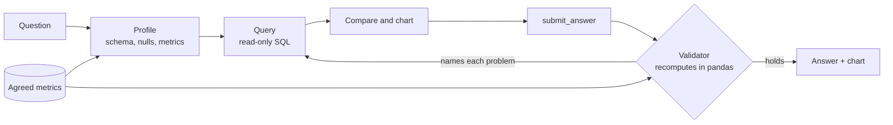
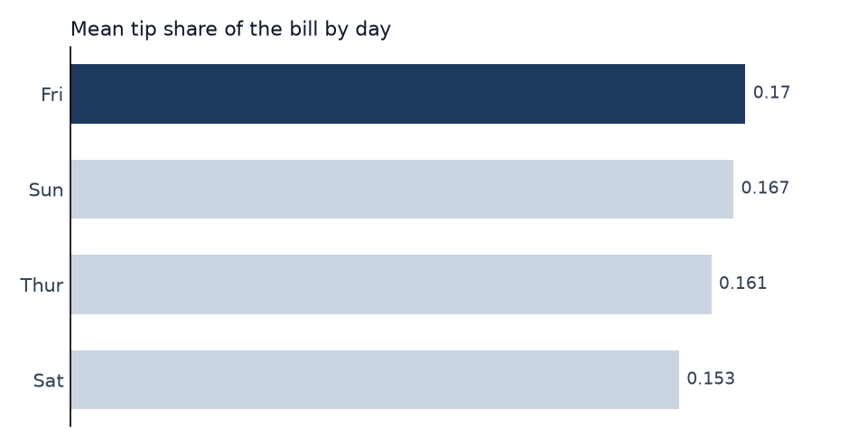

# 5 — A Data-Analysis Agent: Answers That Survive Recomputation

Ask a data agent which day customers tip the most, and it may run a correct query, answer "Sunday, $3.26 per bill", and be wrong about what you meant. The SQL executed and the number is real, and the tip's share of the bill says something else. Nothing in the environment objects, because a query that returns a table has no test suite. The coding agent in the last note could lean on an outside judge. A data agent has to bring its own, so this note builds one: a read-only SQL interface that cannot damage anything, an agreed definition of the metric, and a validator that recomputes each claim independently and rejects the answer until it holds up. Everything runs offline against two real files from the [data-analytics pillar](../../../data-analytics/01-python-for-data-analysis/README.md), with a scripted model standing in.

---

## The shape of the problem

A wrong patch usually breaks a test. A wrong analysis usually returns a number, and the reader cannot tell it from a right one. Four things go wrong, and execution catches none of them:

- **Wrong question:** the query computes dollars when the question meant share of the bill.
- **Wrong population:** rows with a missing value disappear from an average, and nobody says so.
- **Wrong confidence:** the winner has 19 rows and its lead is within noise.
- **Wrong story:** a number appears that no query returned, or a correlation is written up as a cause.

The research on this mostly measures the first problem, and shows how far even that is from solved. Text-to-SQL systems are usually scored by execution accuracy: does the generated query return the same result set as the reference? Liu et al.'s survey frames the systems as pre-processing, translation and post-processing, with schema linking and execution-guided correction as recurring techniques, and lists complex multi-table schemas and dirty content among the open challenges (Liu et al., [A Survey of Text-to-SQL in the Era of LLMs](https://arxiv.org/abs/2408.05109), 2024). Execution accuracy assumes that a reference query exists and that the question was precise. Real questions often are not.

Biswal et al. push on that assumption. They model answering as three steps: synthesize a query from the request, execute it, and generate the answer from the request and the resulting table. Text-to-SQL and RAG both become special cases of this table-augmented generation (TAG). On a set of BIRD questions adapted to need reasoning or knowledge beyond the data, with Llama-3.1-70B, the baselines never passed 20% exact match. Hand-written TAG pipelines reached 55% overall and 65% on comparison questions (Biswal et al., [Text2SQL is Not Enough](https://arxiv.org/abs/2408.14717), 2024). Those pipelines were written by hand, so this shows what the architecture allows and not what an agent achieves today. The principle is the useful part: let the database do exact computation, and let the model do the semantic reasoning around it. Our agent keeps to that split.

Open systems had settled on similar tools by this point. The Data Agent in OpenAgents generates Python and SQL, profiles data, and renders charts in a notebook-like interface (Xie et al., [OpenAgents](https://arxiv.org/abs/2310.10634), 2023). Enterprise Deep Research places NL2SQL and a visualization agent as tools under a research planner, with human steering, which is the [note 02](02-deep-research-bot.md) architecture with a database attached (Prabhakar et al., [Enterprise Deep Research](https://arxiv.org/abs/2510.17797), 2025, preprint).



## The data

The lab uses two files that the [Python for data analysis](../../../data-analytics/01-python-for-data-analysis/README.md) pillar already teaches with. Nothing is synthetic, so the numbers below are ones you can check.

| Table | Path from the repo root | Rows | Why it is here |
|---|---|---|---|
| `tips` | `data-analytics/01-python-for-data-analysis/practice/data/tips.csv` | 244 | Clean, small, with a metric that can be defined in more than one way |
| `titanic` | `data-analytics/01-python-for-data-analysis/practice/mckinney/datasets/titanic/train.csv` | 891 | 177 ages missing, and a strong tempting causal story |

Blocks in this note read them by relative path, so run them from the repository root.

## Profile before you query

An agent that queries blind guesses at column names and values, then learns from the errors, and it may never learn about missing data at all. A profile is cheap, compact and answers both. It is the same idea as the OpenAgents profiling tool, and it is what [loading and cleaning](../../../data-analytics/01-python-for-data-analysis/notes/02-loading-and-cleaning.md) teaches a human analyst to do first.

```python
import pandas as pd

titanic = pd.read_csv("data-analytics/01-python-for-data-analysis/practice/mckinney/datasets/titanic/train.csv")


def profile(frame):
    for name in frame.columns:
        column = frame[name]
        if pd.api.types.is_numeric_dtype(column):
            span = f"min {column.min():g}, max {column.max():g}"
        else:
            span = f"e.g. {list(column.dropna().unique()[:2])}"
        print(f"{name:<9} {column.isna().sum():>3} null  {column.nunique():>3} distinct  {span[:42]}")


print(len(titanic), "rows")
profile(titanic[["Survived", "Sex", "Age", "Cabin"]])
```

Output:

```text
891 rows
Survived    0 null    2 distinct  min 0, max 1
Sex         0 null    2 distinct  e.g. ['male', 'female']
Age       177 null   88 distinct  min 0.42, max 80
Cabin     687 null  147 distinct  e.g. ['C85', 'C123']
```

That output costs a handful of tokens, and it is the first time anyone has mentioned that one age in five is missing. Tool output in this agent is capped too: `run_sql` returns at most 25 rows and says when it truncated, for the same reason as the coding agent's viewing window.

## Read-only, below the level of the text

Letting a model write SQL means letting it write `DROP TABLE`. Filtering the string for dangerous words is the first idea, and it loses to comments, casing and functions you did not think of. Enforce it where the statement is compiled. SQLite's authorizer callback sees every action the compiled statement will take and can deny it, whatever the text looked like. Server databases have a stronger equivalent: a read-only role, plus a statement timeout and a row limit. Use that in production, and treat the model's connection as untrusted.

```python
import sqlite3

conn = sqlite3.connect(":memory:")
conn.execute("CREATE TABLE tips (day TEXT, tip REAL)")
conn.execute("INSERT INTO tips VALUES ('Sun', 3.5), ('Fri', 2.5)")


def authorize(action, *_details):
    allowed = {sqlite3.SQLITE_SELECT, sqlite3.SQLITE_READ, sqlite3.SQLITE_FUNCTION}
    return sqlite3.SQLITE_OK if action in allowed else sqlite3.SQLITE_DENY


conn.set_authorizer(authorize)
for query in [
    "SELECT day, tip FROM tips",
    "DROP TABLE tips",
    "/* just reading */ DELETE FROM tips",
    "ATTACH DATABASE '/tmp/other.db' AS other",
    "PRAGMA writable_schema = ON",
    "SELECT 1; DROP TABLE tips",
]:
    try:
        print(f"ok      {query}  ->  {conn.execute(query).fetchall()}")
    except (sqlite3.Error, sqlite3.Warning) as err:
        print(f"refused {query}  ({err})")
conn.set_authorizer(None)
print("rows left:", conn.execute("SELECT count(*) FROM tips").fetchone()[0])
```

Output:

```text
ok      SELECT day, tip FROM tips  ->  [('Sun', 3.5), ('Fri', 2.5)]
refused DROP TABLE tips  (not authorized)
refused /* just reading */ DELETE FROM tips  (not authorized)
refused ATTACH DATABASE '/tmp/other.db' AS other  (not authorized)
refused PRAGMA writable_schema = ON  (not authorized)
refused SELECT 1; DROP TABLE tips  (You can only execute one statement at a time.)
rows left: 2
```

Reads can also do harm: a query joining a table to itself five times never returns. The lab adds a progress handler that interrupts a statement after a fixed amount of work, and the `guards` scenario runs that query and gets `interrupted`. Row-level privacy is a separate question this lab does not address. If some rows must not reach the model, they should not be in the database it can reach.

## Agree the metric first

Now the opening example. Three defensible answers to "which day do customers tip the most?" come from the same 244 rows:

```python
import pandas as pd

tips = pd.read_csv("data-analytics/01-python-for-data-analysis/practice/data/tips.csv")
tips["share"] = tips["tip"] / tips["total_bill"]
by_day = tips.groupby("day")

table = pd.DataFrame({
    "n": by_day.size(),
    "mean_tip_dollars": by_day["tip"].mean(),
    "mean_of_shares": by_day["share"].mean(),
    "share_of_totals": by_day["tip"].sum() / by_day["total_bill"].sum(),
})
print(table.round(4).to_string())
print()
for column in ["mean_tip_dollars", "mean_of_shares", "share_of_totals"]:
    print(f"{column:<17} winner: {table[column].idxmax()}   order: {list(table[column].sort_values(ascending=False).index)}")
```

Output:

```text
       n  mean_tip_dollars  mean_of_shares  share_of_totals
day
Fri   19            2.7347          0.1699           0.1594
Sat   87            2.9931          0.1532           0.1464
Sun   76            3.2551          0.1669           0.1520
Thur  62            2.7715          0.1613           0.1567

mean_tip_dollars  winner: Sun   order: ['Sun', 'Sat', 'Thur', 'Fri']
mean_of_shares    winner: Fri   order: ['Fri', 'Sun', 'Thur', 'Sat']
share_of_totals   winner: Fri   order: ['Fri', 'Thur', 'Sun', 'Sat']
```

The dollar question picks Sunday, because bills are larger on Sunday. Both share questions pick Friday, and they disagree about what comes next. Each is a correct query. No validator can choose between them from the data, since the choice is a business decision. So a person writes it down ahead of time, as a metric definition the agent is required to use. Real analytics stacks call this a semantic layer, and the lab has a small version:

```text
Metric("tip_share", "tips", "tip", "total_bill", "tip as a fraction of that bill, averaged over bills")
```

The agent can run any SELECT to explore. Claims it submits must name an agreed metric, and the validator computes that metric itself. In the lab's first attempt the script answers in dollars, and the result is:

```text
 4  submit_answer  REFUSED
      Answer rejected:
      - 'tip_dollars' is not an agreed metric. Use one of ['age', 'survived', 'tip_share'].
```

The difference between the two share columns is itself worth teaching. Mean of shares treats each bill as equal, while share of totals weights by the size of the bill. Group-level averages like these are covered in [groupby and aggregation](../../../data-analytics/01-python-for-data-analysis/notes/05-groupby-and-aggregation.md).

## The validator recomputes

This is the centre of the design, so here is what it must not do: ask the model whether its answer is right. A check that shares the same reasoning shares the same errors. The validator takes the structured claim (metric, grouping, group, value), recomputes it in pandas from the source data without seeing the agent's SQL, and applies rules a statistician would apply by reflex.

The check on the claimed lead needs a sense of noise. A bootstrap is a good fit here because it needs no distribution assumptions and takes four lines: resample each group with replacement, take the difference of means, repeat, and read off the middle 95%. [Estimation](../../../data-analytics/02-probability-and-statistics/notes/03-estimation.md) gives the reasoning behind it.

```python
import re

import numpy as np
import pandas as pd

tips = pd.read_csv("data-analytics/01-python-for-data-analysis/practice/data/tips.csv")
tips["share"] = tips["tip"] / tips["total_bill"]
HEDGE = re.compile(r"not distinguishable|cannot tell|inconclusive", re.I)
CAUSAL = re.compile(r"\b(because|causes?|due to|leads? to)\b", re.I)
SMALL_GROUP = 30


def bootstrap(a, b, draws=2000, seed=7):
    rng = np.random.default_rng(seed)
    gaps = [rng.choice(a, a.size).mean() - rng.choice(b, b.size).mean() for _ in range(draws)]
    return np.percentile(gaps, [2.5, 97.5])


def validate(text, group, value):
    table = tips.groupby("day")["share"].agg(["mean", "size"]).sort_values("mean", ascending=False)
    problems = []
    if abs(table.loc[group, "mean"] - value) > 5e-4:
        problems.append(f"recomputed {table.loc[group, 'mean']:.4f}, you claimed {value:.4f}")
    if table.index[0] != group:
        problems.append(f"{group} is not the largest, {table.index[0]} is")
    n = int(table.loc[group, "size"])
    if n < SMALL_GROUP and not re.search(rf"\b{n}\b", text):
        problems.append(f"{group} has only {n} rows, state that")
    runner_up = table.index[1]
    low, high = bootstrap(tips.loc[tips.day == group, "share"].to_numpy(),
                          tips.loc[tips.day == runner_up, "share"].to_numpy())
    if low <= 0 <= high and not HEDGE.search(text):
        problems.append(f"gap to {runner_up} has interval [{low:.4f}, {high:.4f}], which includes 0")
    if CAUSAL.search(text):
        problems.append("observational data, describe an association")
    return problems


for text, group, value in [
    ("Sunday tips the highest share.", "Sun", 0.20),
    ("Friday is best, because people relax before the weekend.", "Fri", 0.1699),
    ("Friday has the largest mean share, 17.0% over n=19 bills, but Friday and Sunday are not distinguishable.", "Fri", 0.1699),
]:
    print(repr(text[:58]))
    for problem in validate(text, group, value) or ["accepted"]:
        print("   ", problem)
```

Output:

```text
'Sunday tips the highest share.'
    recomputed 0.1669, you claimed 0.2000
    Sun is not the largest, Fri is
    gap to Sun has interval [-0.0276, 0.0269], which includes 0
'Friday is best, because people relax before the weekend.'
    Fri has only 19 rows, state that
    gap to Sun has interval [-0.0251, 0.0317], which includes 0
    observational data, describe an association
'Friday has the largest mean share, 17.0% over n=19 bills, '
    accepted
```

The lab's validator has two more rules, both driven by the Titanic data.

**Coverage.** `Age` is null in 177 of 891 rows, so any average covers only part of the population. Averages quietly skip nulls in both SQL and pandas, and the missing rows may not be missing at random. An answer that does not state its coverage is rejected. **Provenance.** Each number a tool returns goes into an evidence set, and each number in the answer's text must round to something in it, at the precision written. "About 20%" with nothing behind it is rejected with `The number 20% did not come from any tool result.` This is a mechanical check against invented numbers. It cannot tell that a real number has been attached to the wrong thing, which is why the structured claim is checked separately.

```text
=== titanic_age: How old were Titanic survivors on average?
 3  submit_answer  REFUSED
      Answer rejected:
      - Age is null in 177 of 891 rows. Say the answer covers 714 of 891.
      - This data is observational. Describe the association, not a cause.
 4  submit_answer  ok
answer: Among the 714 of 891 passengers with a recorded age, survivors averaged 28.34 years.
```

The causal lint is a crude word list, and a determined sentence gets past it. It is here because the most common error is the casual one: "because" appearing in a sentence about observational data. [Correlation and causation](../../../data-analytics/03-experimentation-and-causality/notes/03-correlation-and-causation.md) covers the real question.

## Charts as a tool with opinions

If the model writes free plotting code, it can pick a truncated axis, a rainbow, or twenty-six bars, and it needs a Python tool, which brings back all of the coding agent's sandbox problems. So the lab gives it one narrow tool: pass a SELECT that returns a label and a number, a title, and the label to highlight. The tool enforces the choices worth enforcing. Bars start at zero, there is one accent colour on grey, values are labelled directly, and more than 12 bars is refused with a request to aggregate. It also takes its numbers from the query, so the chart cannot disagree with the data.



*Image Source: generated by `practice/data-analysis-agent/run.py` from `tips.csv` for this note.*

The chart shows the answer and its weakness at once: the bars are nearly the same length, which is exactly what the accepted answer says in words. It does not show that Friday has 19 bills and Saturday 87, so the sentence still has to carry the sample size. Chart choice in general is in the [visualisation pillar](../../../data-analytics/05-visualisation-and-storytelling/README.md).

## The whole run

[practice/data-analysis-agent/](../practice/data-analysis-agent/) puts this together. Here is the tip question from the real run, cut to the answers. The script is deliberately wrong twice, once on the metric and once on confidence and an invented number:

```bash
cd practice/data-analysis-agent && uv run --with pandas --with matplotlib python run.py tip_share
```

```text
=== tip_share: On which day do customers tip the largest share of the bill?
 1  list_tables  ok
 2  describe_table  ok
 3  run_sql  ok
 4  submit_answer  REFUSED
      - 'tip_dollars' is not an agreed metric. Use one of ['age', 'survived', 'tip_share'].
 5  run_sql  ok
 6  submit_answer  REFUSED
      - Fri has only 19 rows. State that sample size in the answer.
      - The gap to Sun has a 95% interval of [-0.0251, 0.0317], which includes 0. Say the two are not distingu
      - The number 20% did not come from any tool result.
 7  compare_groups  ok
      Fri minus Sun on tip_share: 0.0030, 95% bootstrap interval [-0.0251, 0.0317]
 8  make_chart  ok
 9  submit_answer  ok
status=answered steps=9 refused=2
answer: Friday has the largest mean tip share, 17.0% over n=19 bills, but Friday and Sunday (16.7%) are not distinguishable in this sample.
```

Compare the first and last answers. "Sunday, $3.26" is confident and answers the wrong question. The accepted answer is less satisfying and true, and it tells the reader that this data does not settle the matter. An agent that can only finish through this gate cannot produce the first one.

As with the coding lab, a script proves the checks work. It does not measure how often a real model would pass them. To run a real model, swap in a class with the same `create` method. The validator's rejection messages come back as `is_error` tool results, so a real model gets the same chance to fix what they name.

```python
# illustrative: needs ANTHROPIC_API_KEY and the anthropic package, and costs money to run.
# Same class in practice/data-analysis-agent/claude_model.py; the loop around it is tested with the script.
import anthropic

SYSTEM = (
    "You answer questions about the tables you can query. Look at the schema and metrics first. "
    "Use only the agreed metrics in claims. Every number in your answer must come from a tool result. "
    "End with submit_answer, and if it is rejected, fix what it names and submit again."
)


class ClaudeModel:
    def __init__(self):
        self.client = anthropic.Anthropic()

    def create(self, messages, tools):
        return self.client.beta.messages.create(
            model="claude-opus-5-5",
            max_tokens=16000,
            system=SYSTEM,
            tools=tools,
            messages=messages,
            betas=["server-side-fallback-2026-07-01"],  # rerun a declined request on a fallback model
            fallbacks="default",
        )
```

## What this design does not do

The validator only covers claims it has a shape for: one metric, one grouping, one group. An open question like TAG's "why did my sales drop?" has no such shape, and there the agent can only be checked in part. The gate also runs a lot of implicit multiple comparisons, because an agent that explores twenty cuts and reports the best has a false-positive problem that one bootstrap interval does not solve. Log the queries so a reviewer can see how much searching went on. Finally, the validator is code someone has to maintain, with a row of thresholds (30 rows, a 95% interval) that are defensible defaults and not laws. Move them when your domain has better ones.

## Pitfalls

- **Measuring execution accuracy and stopping.** A query can match its reference and still answer the wrong question. Check definitions and population too.
- **String-matching for read-only.** Use an authorizer or a read-only database role. Comments and casing defeat filters.
- **Asking the model to check itself.** It shares its own errors. Recompute through a different path, ideally different code on the source data.
- **Silent null handling.** `AVG` and `.mean()` skip nulls without comment. Report coverage.
- **Crowning a winner on 19 rows.** Rank order is always defined, so an interval is what tells you whether it means anything.
- **Free-form plotting.** Truncated axes and rainbow palettes come easily, and a Python tool widens the attack surface. Offer a narrow chart tool.
- **Ungoverned metrics.** If "revenue" has three definitions, the agent will find all three. Write them down and require a name.
- **Large result sets in context.** Cap rows and say so, or the model may reason from a truncated table as if it were complete.
- **Causal language from correlations.** Lint for the obvious cases and say plainly that observational data cannot support the claim.

## Try it

Run the lab: `cd practice/data-analysis-agent && uv run --with pandas --with matplotlib python run.py`, then `uv run --with pandas --with matplotlib python -m unittest test_agent`.

1. **Add the other share.** Add `tip_share_of_totals`, a ratio of sums, as a metric. Why does it not fit the `Metric` class as written, and what does the ranking become?

   <details><summary>Answer</summary>

   `measure` divides row by row and then averages, which is the mean of shares. A ratio of sums needs `group.tip.sum() / group.total_bill.sum()`, so `Metric` needs an aggregation field and the validator has to use it. The table in this note gives the result: Fri 0.1594, Thur 0.1568, Sun 0.1520, Sat 0.1464. Friday still leads, while Thursday and Sunday swap places.
   </details>

2. **Tighten the lead check.** Ask "do smokers tip a larger share than non-smokers?" with the `tips` table. Use the block's `bootstrap` function. What may the agent say?

   <details><summary>Answer</summary>

   Compute `tips.groupby("smoker")["share"].agg(["mean", "size"])` and bootstrap the difference, smokers minus non-smokers. Means are 0.1633 for smokers (n=93) and 0.1593 for non-smokers (n=151), and with seed 7 the interval on the difference is [-0.0128, 0.0230]. It includes zero, so the agent may report the means and must say the groups are not distinguishable.
   </details>

3. **Fool the provenance check.** Write an answer that passes `traced()` and is still wrong. What catches it, if anything?

   <details><summary>Answer</summary>

   "Saturday's share is 16.7%" uses a number that a tool did show, for Sunday. `traced()` passes, because it only asks whether the number appeared. The structured claim is what catches it, if the agent submits `group="Sat", value=0.167`: the recomputation returns 0.1532. If it submits an honest structured claim for Friday and writes something else in the text, nothing catches it. Tying the text to the claim, by templating the sentence from the claim, is the stronger design.
   </details>

4. **Attempt the writes yourself.** Try to get a write past the authorizer in the read-only block, for instance through a CTE or a `CREATE TEMP TABLE`. What happens, and why does this approach hold where a word filter would not?

   <details><summary>Answer</summary>

   Both are refused with `not authorized`. `WITH x AS (SELECT 1) DELETE FROM tips` compiles to a delete action, and a temp table compiles to a create action, and neither is on the allowed list. The authorizer judges what the compiled statement will do, so the spelling of the text does not matter.
   </details>

## Interview checklist

| Question | Strong answer |
|---|---|
| Why is a data agent harder to trust than a coding agent? | Tests fail loudly. A wrong analysis returns a plausible number. The harness has to supply its own check. |
| What does execution accuracy miss? | It compares against a reference query, so it assumes a precise question. It says nothing about definitions, coverage, confidence or the prose written around the number. |
| What is TAG, and what does it claim? | Synthesize a query, execute it, generate from the result. Databases do exact computation and models do semantic reasoning. Biswal et al. measured hand-written pipelines at 55% against baselines at no more than 20% on adapted BIRD questions. |
| How do you make SQL read-only? | Below the text: a read-only role, or SQLite's authorizer, with a statement timeout and row cap. String filters lose to comments and unusual syntax. |
| How would you stop metric drift? | A semantic layer: named metrics a person has defined, with claims required to cite one. Which definition is correct is a business decision, so the data cannot settle it. |
| How does the validator work? | It takes a structured claim, recomputes through independent code on the source data, and rejects with reasons. It does not ask the model. |
| What should it reject? | Value mismatch, a wrong winner, a small group without its n, a null population without coverage, a lead whose interval spans zero, numbers with no source, and causal language on observational data. |
| Why a bootstrap here? | No distribution assumption, a few lines of code, and it works for means of ratios. Its result is a statement about noise, which is the thing a ranked table hides. |
| Why a narrow chart tool? | Numbers come from the query, axes start at zero, and there is no general Python tool to sandbox. It gives up flexibility to rule out misleading charts. |
| What are the limits of the validator? | Only claim shapes it understands. Open "why" questions and repeated exploration across many cuts need review, and query logs make that possible. |

## Next

The two agents in this pair win by being strict about what counts as done. Every application so far has been defined by its loop, though, and a user sees none of that. [Application patterns](06-application-patterns.md) turns to the interface: chat, collaborative editing and ambient agents, and how to choose among them.
