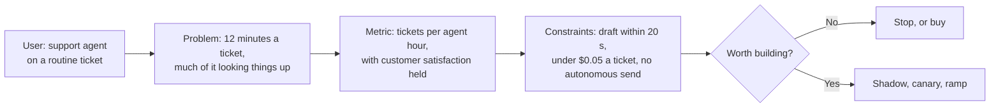

# 7 — Scoping an AI Product: The Arithmetic Before the Architecture

Most AI products that disappoint their sponsors were scoped by asking what a model can do, and then costed by multiplying tokens by a price. The model bill is usually the smallest number in the business case. In the worked example below it's about 7% of the value at a 14% productivity uplift, and the number that decides the project is how often people work from what the agent produced, which a pricing page can't tell you. This note goes through scoping in the order the decisions depend on each other: who it's for, what would prove it worked, what it costs, whether that's worth paying, whether to build, and how to find out without betting everything at once.

> Notes 01–06 show how agents work and where they sit. This note comes before any of them in a real project: it decides whether to build one. Every figure is computed by the script, and every volume, wage and saving is an assumption for a hypothetical product. Prices are list prices read on 2 November 2026 and will have changed by the time you read this.

---

## The example, and it is hypothetical

Picture a support team of 40 agents handling 60,000 tickets a month at about 12 minutes each. Someone proposes an assistant that reads each ticket, looks up the order, searches the help articles and drafts a reply for the agent to edit. No such team or company exists: these are round numbers chosen so that the arithmetic is easy to follow. Replace them with your own.

The code blocks are the sections of `practice/scoping-an-ai-product/cost_model.py` in order, each relying on those before it. It runs offline with the standard library, and calls no model. Run it with `python3 cost_model.py` from that folder.

## User, problem, metric, constraint

Write these four down, in this order, before anyone opens a model playground. Each one narrows the next, and a gap in any of them shows up later as an argument about something else.



| Step | Weak | Strong (hypothetical) |
|---|---|---|
| **User** | "Customer support" | Agents on routine order and returns tickets, not escalations |
| **Problem** | "Support is slow" | About 12 minutes a ticket, and we've timed how much is lookup versus writing |
| **Metric** | "Agents like it" | Tickets per agent hour, compared against a holdout, with satisfaction as the [counter-metric](../../../data-analytics/06-applied-analyses/notes/11-metric-trees.md#guardrails-and-counter-metrics) |
| **Constraint** | "Fast and cheap" | Draft inside 20 seconds, under $0.05 a ticket, nothing sent without a person |

Three checks come from Huyen's planning chapter (*AI Engineering*, ch. 1).

**Why do it at all?** She sorts reasons by what you risk by not acting: competitors could make you obsolete, you'd miss profit and productivity gains, or you don't yet know where AI fits and can't afford to be left behind. The sort matters because it bears on build versus buy: an existential threat argues for doing it in-house, while a productivity gain usually has plenty of purchasable options.

**How critical is the AI to the product?** If the product still works without it, the AI is complementary, and people forgive its mistakes more readily. A draft that an agent can ignore is complementary. A bot that replies to customers alone is critical, and it needs a different quality bar and a different budget.

**What's the usefulness threshold?** Say how good it has to be to be useful, in groups: quality, latency, cost and others such as fairness. Huyen's latency example makes the point: when humans currently take a median of an hour, anything faster might be good enough. For a draft inside a live workflow, 20 seconds may already be slow. It's the threshold, not the best achievable number, that tells you when to stop.

Decide now what result would kill the project, while nobody is yet invested in it. After evaluation you may find that getting to the threshold costs more than the return, as Huyen notes, and that's a successful outcome of scoping. For defining the metric itself, with its population, window and owner, see [metric trees and defining metrics](../../../data-analytics/06-applied-analyses/notes/11-metric-trees.md).

## Token arithmetic for one ticket

Start from one unit of work, and count calls rather than requests from users. An agent that uses tools makes several model calls per ticket, and each one resends everything so far, so input grows with each step. [Why inference is its own discipline](../../../ai-engineering/07-inference-engineering/notes/01-why-inference-is-its-own-discipline.md#throughput-cost-and-goodput) covers why providers price it this way.

The prices below come from each vendor's own page, read on 2 November 2026: [Anthropic](https://platform.claude.com/docs/en/about-claude/pricing), [OpenAI](https://developers.openai.com/api/docs/pricing) and [Google](https://aistudio.google.com/docs/pricing). The 286 tokens in the prefix are the tool-use system prompt Anthropic lists for Sonnet 5.5; it's a real line in the bill that a tokenizer run over your own prompt won't show. Google's listed Gemini 3.8 Flash price doubles on 1 January 2027.

```python
@dataclass(frozen=True)
class Price:
    """US dollars per million tokens."""
    input: float
    output: float
    cache_read: float | None = None
    cache_write: float | None = None


PRICES = {
    "Claude Haiku 5.5": Price(0.10, 0.50, 0.01, 0.125),  # prompts up to 100k tokens
    "Claude Sonnet 5.5": Price(2.00, 10.00, 0.10, 2.50),
    "Claude Opus 5.5": Price(4.00, 20.00, 0.20, 5.00),
    "OpenAI gpt-6-luna": Price(0.10, 0.50, 0.01),
    "OpenAI gpt-6.1-terra": Price(1.00, 5.00, 0.05),
    "OpenAI gpt-6.1-sol": Price(2.00, 10.00, 0.10),
    "Gemini 3.8 Flash": Price(0.75, 3.75, 0.075),  # rises to 1.50 / 7.50 on 2027-01-01
}
BATCH_DISCOUNT = 0.5
RESIDENCY_UPLIFT = 1.1
```

```python
@dataclass(frozen=True)
class Call:
    """One model call: tokens it sends that are new, and tokens it generates."""
    new_input: int
    output: int


STABLE_PREFIX = 3_000 + 1_200 + 286  # system prompt and policy, tool definitions, tool-use system prompt
TICKET = [
    Call(new_input=800, output=120),    # the customer's thread; the model asks to look up the order
    Call(new_input=400, output=150),    # the order record; the model asks to search help articles
    Call(new_input=4_000, output=500),  # the retrieved articles; the model writes the draft
]


def input_per_call(ticket=TICKET, prefix=STABLE_PREFIX):
    """Each call resends everything so far: prefix, earlier inputs, earlier outputs, its own new input."""
    sent, history = [], 0
    for call in ticket:
        sent.append(prefix + history + call.new_input)
        history += call.new_input + call.output
    return sent


def ticket_cost(price, ticket=TICKET, prefix=STABLE_PREFIX, cached_prefix=False):
    """Dollars for one ticket. `cached_prefix` reads only the shared prefix from cache; the write is added separately."""
    sent = input_per_call(ticket, prefix)
    output = sum(call.output for call in ticket)
    if cached_prefix:
        fresh = sum(sent) - prefix * len(sent)
        return (fresh * price.input + prefix * len(sent) * price.cache_read + output * price.output) / 1e6
    return (sum(sent) * price.input + output * price.output) / 1e6


sent = input_per_call()
print("input tokens per call:", sent, "total", f"{sum(sent):,}", "; output tokens", sum(c.output for c in TICKET))
print(f"{'model':<22}{'per ticket':>11}{'per 1,000':>11}")
for name, price in PRICES.items():
    cost = ticket_cost(price)
    print(f"{name:<22}{cost:>11.5f}{cost * 1000:>11.2f}")
```

```text
input tokens per call: [5286, 5806, 9956] total 21,048 ; output tokens 770
model                  per ticket  per 1,000
Claude Haiku 5.5          0.00249       2.49
Claude Sonnet 5.5         0.04980      49.80
Claude Opus 5.5           0.09959      99.59
OpenAI gpt-6-luna         0.00249       2.49
OpenAI gpt-6.1-terra      0.02490      24.90
OpenAI gpt-6.1-sol        0.04980      49.80
Gemini 3.8 Flash          0.01867      18.67
```

The 21,048 input tokens against 770 output tokens are the first useful result. The system prompt gets paid for three times, once per call. On Sonnet 5.5 the output is $0.0077 of the $0.0498, so about 15%, even at a 5× price per token.

Treat the cross-vendor table as an order-of-magnitude guide. Token counts aren't portable between vendors: Anthropic says its Claude 4.7 and later tokenizer produces about 30% more tokens for the same text than earlier models did, so assuming the same count across vendors is only a starting point. Compare on your own prompts with each vendor's counter, and only among models that pass your [evaluation](../../08-eval/README.md). A 20× price gap means nothing if the cheap model's drafts don't get used.

## Caching and the real bill

The prefix repeats on every call, which is what prompt caching is for. Anthropic's list price for a Sonnet 5.5 cache hit is $0.10 per million tokens against $2 for input, and a 5-minute cache write is 1.25× input.

```python
CHOSEN = PRICES["Claude Sonnet 5.5"]
plain = ticket_cost(CHOSEN)
cached = ticket_cost(CHOSEN, cached_prefix=True)
print(f"Sonnet 5.5 no cache {plain:.5f}; prefix read from cache {cached:.5f}; saving {1 - cached / plain:.0%}")

# The 5-minute cache must be written again after any quiet gap. Worst case: one write every 5 minutes of a working day.
HOURS, DAYS = 10, 22
writes_per_month = HOURS * 12 * DAYS
write_premium = writes_per_month * STABLE_PREFIX * CHOSEN.cache_write / 1e6
print(f"worst-case writes a month {writes_per_month:,}, cost ${write_premium:.2f}")
```

```text
Sonnet 5.5 no cache 0.04980; prefix read from cache 0.02423; saving 51%
worst-case writes a month 2,640, cost $29.61
```

Half off, for a prefix that barely changes. And even the worst-case write count costs under $30 a month, since at 4.5 tickets a minute (next section) the cache rarely goes cold. How the shared prefix is actually laid out and invalidated belongs to [prefill, decode and the KV cache](../../../ai-engineering/07-inference-engineering/notes/07-prefill-decode-kv-cache.md).

Now volume, which is the first set of numbers that can't be looked up.

```python
TICKETS_PER_MONTH = 60_000
AGENTS = 40
MINUTES_PER_TICKET = 12
WAGE_PER_HOUR = 36.0
print(f"tickets per working minute {TICKETS_PER_MONTH / (HOURS * 60 * DAYS):.1f}")
print(f"agent hours a month {TICKETS_PER_MONTH * MINUTES_PER_TICKET / 60:,.0f}, "
      f"per agent {TICKETS_PER_MONTH * MINUTES_PER_TICKET / 60 / AGENTS:,.0f}")
print(f"handling cost a month ${TICKETS_PER_MONTH * MINUTES_PER_TICKET / 60 * WAGE_PER_HOUR:,.0f}")
```

```text
tickets per working minute 4.5
agent hours a month 12,000, per agent 300
handling cost a month $432,000
```

The naive bill is tickets times per-ticket price. The real one adds retries, an eval sample through the batch API (50% off at Anthropic and OpenAI), cache writes, a token count above your estimate, and regional processing if you need it. Anthropic and OpenAI each list a 10% uplift for that last one.

```python
def monthly_inference(share=1.0, cost_per_ticket=cached, tickets=TICKETS_PER_MONTH, retry_rate=0.03, tokenizer=1.0,
                      residency=1.0, eval_share=0.02):
    """A month's model bill: live tickets plus retries, plus an eval sample of all tickets at the batch discount."""
    live = tickets * share * cost_per_ticket * (1 + retry_rate)
    evals = tickets * eval_share * cost_per_ticket * BATCH_DISCOUNT
    return (live + evals + write_premium) * tokenizer * residency


rows = [("naive: tickets x sticker, no cache", TICKETS_PER_MONTH * plain),
        ("with prefix cache", TICKETS_PER_MONTH * cached),
        ("plus retries, evals and cache writes", monthly_inference()),
        ("plus a token count 30% above the estimate", monthly_inference(tokenizer=1.3)),
        ("plus regional processing at 1.1x", monthly_inference(tokenizer=1.3, residency=RESIDENCY_UPLIFT)),
        ("same, on Opus 5.5", monthly_inference(cost_per_ticket=ticket_cost(PRICES["Claude Opus 5.5"], cached_prefix=True),
                                                tokenizer=1.3, residency=RESIDENCY_UPLIFT)),
        ("same, on Haiku 5.5", monthly_inference(cost_per_ticket=ticket_cost(PRICES["Claude Haiku 5.5"], cached_prefix=True),
                                                 tokenizer=1.3, residency=RESIDENCY_UPLIFT))]
for label, dollars in rows:
    print(f"{label:<44}${dollars:>10,.2f}")
BILL = monthly_inference(tokenizer=1.3, residency=RESIDENCY_UPLIFT)
```

```text
naive: tickets x sticker, no cache          $  2,987.76
with prefix cache                           $  1,453.55
plus retries, evals and cache writes        $  1,541.30
plus a token count 30% above the estimate   $  2,003.69
plus regional processing at 1.1x            $  2,204.06
same, on Opus 5.5                           $  4,365.77
same, on Haiku 5.5                          $    156.43
```

Compare two lines. The caching decision saved $1,534 a month, and the token-count surprise and regional uplift added back $663. Model choice is far larger than either, spanning $156 to $4,366. And the handling cost was $432,000, so all of these together barely register against the labour the product is trying to affect. Worry about model choice, then caching. Don't spend a sprint on prompt compression until you've checked what the other lines say.

## ROI: the assumption that decides it

Value comes from time released, so write out the formula rather than quoting a percentage. If agents handle a share `u` more tickets an hour, each ticket takes `1/(1+u)` of the time. Multiply by the tickets where the draft is really used.

For the uplift, the best public evidence is thinner than most business cases suggest, and it points in both directions. Brynjolfsson, Li and Raymond studied 5,179 customer support agents using a generative AI assistant and found a 14% rise in issues resolved per hour, 34% for novices and minimal for the most experienced ([NBER w31161](https://www.nber.org/papers/w31161), a working paper). Becker and colleagues at METR ran a randomised trial with 16 experienced open-source developers across 246 tasks. Allowed the tools, they took 19% longer, while believing afterwards that they'd been 20% faster ([arXiv:2507.09089](https://arxiv.org/abs/2507.09089), a preprint, and the authors stress it doesn't show AI fails to help in other settings or in general). Neither is your product. So the script treats uplift as a range.

```python
BUILD_COST = 2 * 6 * 15_000  # two engineers, six months, at a loaded $15,000 a month
RUN_COST = 0.5 * 15_000      # half an engineer on evals, prompts and incidents, every month
USED_SHARE = 0.6             # tickets where the agent actually works from the draft


def monthly_value(uplift, used_share=USED_SHARE):
    """Dollars of agent time released. An uplift of u means u more tickets an hour, so each takes 1 / (1 + u) of the time."""
    minutes_saved = MINUTES_PER_TICKET * (1 - 1 / (1 + uplift))
    return TICKETS_PER_MONTH * used_share * minutes_saved / 60 * WAGE_PER_HOUR


print(f"{'uplift':>7}{'minutes saved':>15}{'value/month':>13}{'net/month':>11}{'payback months':>16}{'3-yr ROI':>10}")
for uplift in (0.03, 0.07, 0.14, 0.25):
    value = monthly_value(uplift)
    net = value - BILL - RUN_COST
    payback = BUILD_COST / net if net > 0 else float("inf")
    roi = (net * 36 - BUILD_COST) / BUILD_COST
    minutes = MINUTES_PER_TICKET * (1 - 1 / (1 + uplift))
    print(f"{uplift:>7.0%}{minutes:>15.2f}{value:>13,.0f}{net:>11,.0f}{payback:>16.1f}{roi:>10.0%}")


def break_even_uplift(horizon_months=None):
    """Smallest uplift where the value covers running costs, and optionally the build too, over the horizon."""
    target = BILL + RUN_COST + (BUILD_COST / horizon_months if horizon_months else 0)
    minutes_needed = target * 60 / (TICKETS_PER_MONTH * USED_SHARE * WAGE_PER_HOUR)
    return 1 / (1 - minutes_needed / MINUTES_PER_TICKET) - 1


print(f"break-even uplift: running costs only {break_even_uplift():.1%}; "
      f"build repaid in 12 months {break_even_uplift(12):.1%}; in 36 months {break_even_uplift(36):.1%}")

model_share = BILL / monthly_value(0.14)
print(f"model bill is {model_share:.1%} of value at a 14% uplift; "
      f"a 30% wrong guess at usage moves value by ${monthly_value(0.14) - monthly_value(0.14, USED_SHARE * 0.7):,.0f} a month")
```

```text
 uplift  minutes saved  value/month  net/month  payback months  3-yr ROI
     3%           0.35        7,550     -2,155             inf     -143%
     7%           0.79       16,957      7,253            24.8       45%
    14%           1.47       31,832     22,128             8.1      343%
    25%           2.40       51,840     42,136             4.3      743%
break-even uplift: running costs only 3.9%; build repaid in 12 months 10.5%; in 36 months 6.0%
model bill is 6.9% of value at a 14% uplift; a 30% wrong guess at usage moves value by $9,549 a month
```

Notice three things. At a 3% uplift the product loses money every month even after being built, and the 14% from the support study pays back in 8 months only under the assumption that 60% of tickets use the draft. Repaying the build within a year needs 10.5%, which is three-quarters of what that study found. And the model bill is 6.9% of value: a 30% error in how much people use the draft moves value by $9,549 a month, more than four times the whole model bill. If you only have time to measure one thing, measure use.

The hardest caveat isn't in the code. **Released time isn't money until something changes.** The value column prices minutes at the wage, but the company only collects it if it hires fewer people, clears a backlog that was costing something, or takes on more volume with the same team. Say which one before the number goes in a deck. Note that the support study itself reports lower attrition, driven by newer workers staying, which is real value of a kind this table doesn't count.

## Build, buy or both

Huyen sets the self-hosting versus API choice along seven axes: data privacy, data lineage, performance, functionality, costs, control and on-device deployment (*AI Engineering*, ch. 4). She also makes the point that API costs per token stay about flat with scale while self-hosted costs per token fall, so the answer changes as you grow. And she observes that APIs are expensive but engineering can be even more so, which the arithmetic here supports. In this script the vendor's seat price is invented, not a quote.

```python
SEAT_PRICE = 150  # a hypothetical vendor's price per agent per month; not a real quote
INTEGRATION = 20_000
buy_month = AGENTS * SEAT_PRICE
build_month = BILL + RUN_COST
print(f"buy ${buy_month:,.0f}/month after ${INTEGRATION:,} integration; build ${build_month:,.0f}/month after ${BUILD_COST:,}")
for months in (12, 24, 36):
    print(f"  {months} months: buy ${INTEGRATION + buy_month * months:>9,.0f}   build ${BUILD_COST + build_month * months:>9,.0f}")


def scale_break_even(seat_price=SEAT_PRICE, horizon=36):
    """Agents at which build matches buy over the horizon, with tickets and the model bill growing with agents."""
    unit_bill = BILL / AGENTS
    fixed = (BUILD_COST - INTEGRATION) / horizon + RUN_COST
    return fixed / (seat_price - unit_bill)


print(f"agents at which build matches buy over 36 months: {scale_break_even():.0f}")

# Serving your own model: a hypothetical fixed cost for GPUs and half an engineer, against this bill.
SELF_HOST_MONTH = 20_000 + 0.5 * 15_000
print(f"self-hosting at ${SELF_HOST_MONTH:,.0f}/month matches the API at {SELF_HOST_MONTH / BILL:.1f}x this volume, "
      f"about {SELF_HOST_MONTH / BILL * TICKETS_PER_MONTH:,.0f} tickets a month")
```

```text
buy $6,000/month after $20,000 integration; build $9,704/month after $180,000
  12 months: buy $   92,000   build $  296,449
  24 months: buy $  164,000   build $  412,897
  36 months: buy $  236,000   build $  529,346
agents at which build matches buy over 36 months: 126
self-hosting at $27,500/month matches the API at 12.5x this volume, about 748,620 tickets a month
```

At 40 agents buying wins by $293,000 over three years, unless the vendor can't do what you need. Building matches it at about 126 agents, because the engineering is fixed and the seat fee grows. Self-hosting isn't near: this product would need about 12.5 times the volume before a hypothetical $27,500 a month beats the API, and that's before counting utilisation or the model's relative quality. [Serving at scale](../../../ai-engineering/07-inference-engineering/notes/06-serving-at-scale.md) covers what you'd take on.

Money seldom settles it alone. Build when the evaluation set, the integration or the workflow is your actual advantage, or when contract terms and [data handling](../../../ai-engineering/09-safety-and-security/README.md) rule the vendor out. Buy when the task is common and the vendor improves it for everyone. Whichever you pick, keep the eval set yourself, since it's what lets you switch later.

## Phased rollout changes the cash flow

You find out the uplift and the use rate only by shipping, so ship in steps that limit what a wrong assumption can cost. The mechanics live elsewhere and aren't repeated here: [production and the maturity ladder](../../08-eval/notes/11-production-and-the-maturity-ladder.md) covers shadow, canary and A/B, and how to choose between them; [the autonomy ladder](../../../ai-engineering/04-loop-engineering/notes/07-autonomy-ladder.md#a-third-view-the-adoption-ladder) covers how much rope to give; [governance and production](../../../ai-engineering/05-graph-engineering/notes/08-governance-and-production.md) covers budgets per run and tenant. Huyen reports a similar progression from Microsoft called Crawl-Walk-Run: human involvement is mandatory, then AI works directly with internal employees, then more automation that may reach external users (*AI Engineering*, ch. 1). What the scoping stage adds is what the phases cost.

```python
PHASES = [  # name, months, share of tickets through the model, share of those tickets where a draft is used
    ("shadow", 1, 1.00, 0.00),
    ("canary", 1, 0.05, 0.30),
    ("ramp", 2, 0.25, 0.45),
    ("general", 2, 1.00, 0.60),
]
UPLIFT = 0.07
cumulative = -BUILD_COST
month = 0
print(f"{'phase':<9}{'month':>6}{'bill':>9}{'value':>9}{'run':>8}{'net':>9}{'cumulative':>12}")
for name, months, share, used in PHASES:
    for _ in range(months):
        month += 1
        bill = monthly_inference(share=share, tokenizer=1.3, residency=RESIDENCY_UPLIFT)
        value = monthly_value(UPLIFT, used_share=share * used)
        net = value - bill - RUN_COST
        cumulative += net
        print(f"{name:<9}{month:>6}{bill:>9,.0f}{value:>9,.0f}{RUN_COST:>8,.0f}{net:>9,.0f}{cumulative:>12,.0f}")
steady = monthly_value(UPLIFT) - BILL - RUN_COST
print(f"steady net ${steady:,.0f}/month; repaid in month {month + (-cumulative) / steady:.1f}")
```

```text
phase     month     bill    value     run      net  cumulative
shadow        1    2,204        0   7,500   -9,704    -189,704
canary        2      170      424   7,500   -7,246    -196,950
ramp          3      598    3,179   7,500   -4,919    -201,869
ramp          4      598    3,179   7,500   -4,919    -206,788
general       5    2,204   16,957   7,500    7,253    -199,535
general       6    2,204   16,957   7,500    7,253    -192,282
steady net $7,253/month; repaid in month 32.5
```

Shadow mode pays the whole model bill for no value, which is why it's the phase that gets cut. Keep it. $2,204 is cheap for learning the real token count, the latency and the draft quality on real tickets before anyone depends on them. Early phases are dominated by the engineer on the rollout rather than the model. And with a 7% uplift the project doesn't repay until month 32, so if your sponsor expects a year, this table should be in front of them now and not at month 12.

Huyen also warns against planning from the demo. As she reports it, LinkedIn took one month to reach 80% of the experience it wanted and four more to pass 95% (*AI Engineering*, ch. 1). The script gives this hypothetical build six months, so check that number against what your evaluation finds, since a schedule slip at the top of this table costs more than the model does.

## Adoption is a funnel, so measure each step

"60% used" sat in every calculation above as if it were a known quantity. It's actually a product of steps, and each has a different owner and a different fix.

```python
FUNNEL = [("ticket is in a supported category", 0.70), ("draft appears in time", 0.95), ("agent opens it", 0.80), ("agent works from it", 0.75)]
share = 1.0
for step, rate in FUNNEL:
    share *= rate
    print(f"{step:<36}{rate:>5.0%}{share:>8.1%}")
print(f"value at 7% uplift: planned at 60% used ${monthly_value(UPLIFT):,.0f}; at this funnel ${monthly_value(UPLIFT, share):,.0f}")
print(f"released hours a month at 7%: {monthly_value(UPLIFT, share) / WAGE_PER_HOUR:,.0f}, "
      f"or {monthly_value(UPLIFT, share) / WAGE_PER_HOUR / (TICKETS_PER_MONTH * MINUTES_PER_TICKET / 60 / AGENTS):.1f} agents")
```

```text
ticket is in a supported category     70%   70.0%
draft appears in time                 95%   66.5%
agent opens it                        80%   53.2%
agent works from it                   75%   39.9%
value at 7% uplift: planned at 60% used $16,957; at this funnel $11,276
released hours a month at 7%: 313, or 1.0 agents
```

Four steps at reasonable-looking rates come to 39.9%, which cuts value by a third. At a 7% uplift, that's 313 hours a month, or 1.0 agent out of 40. That's a sobering sentence to put next to a build costing $180,000, and it's the kind of figure a scoping document exists to produce before the money is spent.

Two findings tell you how to measure it. In the support study, agents who followed recommendations more closely saw larger gains, and adherence rose over time, most among those who began sceptical (Brynjolfsson et al.). So adoption shouldn't be read at week one, and acceptance rate carries real signal. In the METR trial, the developers' own estimates had the wrong sign. So don't take "do you feel faster?" as your uplift: use a holdout, or a timed comparison. Huyen also suggests one use of acceptance rate as a gate: if human agents accept AI suggestions at a high rate, such as 95%, you might try letting customers see them directly (*AI Engineering*, ch. 1). Whatever threshold you use, the review only means something while people are still paying attention, which is what [autonomy](../../../ai-engineering/04-loop-engineering/notes/07-autonomy-ladder.md) is about.

## Pitfalls

- **Scoping from the capability.** "The model can read tickets, what could we do?" Start from the user and the timed problem, or the metric will be whatever the demo happens to be good at.
- **Costing requests instead of calls.** A three-step agent sent 21,048 input tokens where a glance at the prompt suggests about 10,000. Count what each call resends.
- **Treating the list price as the bill.** Retries, evals, tool-use tokens, tokenizer differences and regional uplift all sit on top. Here they took the cached bill from $1,454 to $2,204.
- **Optimising the wrong line.** Prompt compression work on a model bill that's 7% of value, while nobody's measured use. Look for the largest uncertainty, not the largest percentage saved.
- **Quoting a study's uplift as your forecast.** 14% came from one deployment, with a particular tool and workforce. Treat it as an order of magnitude, and run a holdout.
- **Asking people whether it helps.** METR's developers believed they were 20% faster while taking 19% longer. Self-report isn't a measure of uplift.
- **Counting released hours as cash.** Say what the company will do differently with 313 hours, or the ROI isn't real.
- **Skipping shadow to save money.** Saving $2,204 a month and losing your only look at real tokens and latency before launch is a poor trade.
- **Prices with no date.** These change, and one here changes on a known date. Date every price, and keep the price table in one place.
- **No kill criterion.** Without a threshold written before the work began, a failing project gets a further phase rather than a decision.

## Try it

Import `cost_model.py` in a Python session in its folder, or edit the constants. None of these needs a model or a key.

1. **Route by step.** Run the two lookup calls on Haiku 5.5 and only the draft on Sonnet 5.5, with the cached prefix. What's the ticket cost, and what stops you doing this for free?

   <details><summary>Answer</summary>

   Per call, input not in the prefix costs at the input rate, the prefix at the cache rate, plus output. That gives $0.00018 and $0.00025 on Haiku plus $0.01639 for the draft on Sonnet, so $0.01683 against $0.02423, about 31% off. Two things limit it. Most of the cost was always in the draft call, and the model that plans lookups has to be good enough at it, so a wrong lookup costs more than the saving. Evaluate the routed version as a separate system.
   </details>

2. **Cache the ticket's history too.** Move the breakpoint forward on each call so each call reads everything earlier in the ticket from cache and writes what's new at 1.25×. Is it worth doing?

   <details><summary>Answer</summary>

   It comes to about $0.0229 against $0.0242, about 5% less. Each ticket's cache is read at most twice, and the largest chunk, the retrieved articles, is only ever written, at a premium, because it enters on the last call. Caching pays on repeats. So count how many times something will be read before you write it.
   </details>

3. **Halve the retrieval.** Change the draft call's new input from 4,000 to 2,000 tokens. What's saved, and what would you check first?

   <details><summary>Answer</summary>

   $0.0202 against $0.0242, about 17%, or about $240 a month at this volume. Check draft quality on your eval set first: if use falls from 60% to even 58%, then at a 14% uplift value falls by about $1,060 a month, so the saving is gone.
   </details>

4. **Find the use rate that repays the build.** At a 7% uplift, what share of tickets must use the draft to repay within 36 months? And at 14%?

   <details><summary>Answer</summary>

   Costs per month over that horizon are $14,704 ($2,204 + $7,500 + $180,000/36). Value at 100% use is $28,262 at 7% and $53,053 at 14%. So you need 52% at 7% and 28% at 14%. The funnel above reached 39.9%, so at 7% this fails and at 14% it works. That's what a decision looks like: go and measure these two numbers, starting with shadow and canary.
   </details>

## Interview checklist

| Question | Strong answer |
|---|---|
| How do you scope an AI product? | User, problem, metric, constraint, in that order, with a kill criterion written first. Then cost, ROI, build or buy, and a phased rollout |
| How do you estimate cost per request? | Count model calls per task, and what each resends: prefix, history and new input. Then add tool tokens, retries and evals |
| Why does input dominate output in an agent? | Every call resends the growing context. Here it's 21,048 input to 770 output, so output was only 15% of cost despite the 5× price |
| When does prompt caching pay? | When a large prefix gets read many times. A prefix read across tickets saved 51% here; history read twice saved a further 5% |
| What usually decides an AI product's ROI? | Uplift and use rate, not the model bill. A 30% miss on use moved value by four times the whole bill |
| What is the evidence on productivity uplift? | Mixed. +14% in a support field study, with most of it among novices. A trial of experienced developers measured them 19% slower while they felt faster |
| Why not ask users whether it saves time? | In that trial, self-estimates had the wrong sign. Use a holdout or a timed comparison |
| When is time saved worth money? | Only when hiring, backlog or volume changes. Otherwise it's capacity, not cash |
| Build or buy? | Compare over a horizon with fixed engineering against per-seat fees, and find the break-even. Then ask whether the integration or eval set is your advantage |
| When do you self-host? | When volume is high enough for fixed compute to beat flat per-token API pricing, or privacy or control requires it. Include the people |
| Why keep shadow mode if it earns nothing? | It's the cheapest look at real tokens, latency and quality before anyone depends on it |
| How do you read adoption? | As a funnel with an owner per step, over time. Adherence can rise with exposure, so week one is a poor reading |

## Next

That closes the pillar: from a bounded search agent to where an agent sits in someone's work, and whether to build one at all. Go back to [01, the internet search agent](01-internet-search-agent.md) with these questions in mind, or go on to the engineering layer in [ai-engineering](../../../ai-engineering/README.md), which covers the loops, harnesses and graphs behind these applications. If the product touches regulated data, read [compliance and regulation](../../../ai-engineering/09-safety-and-security/notes/07-compliance-and-regulation.md) before you commit to a vendor.
